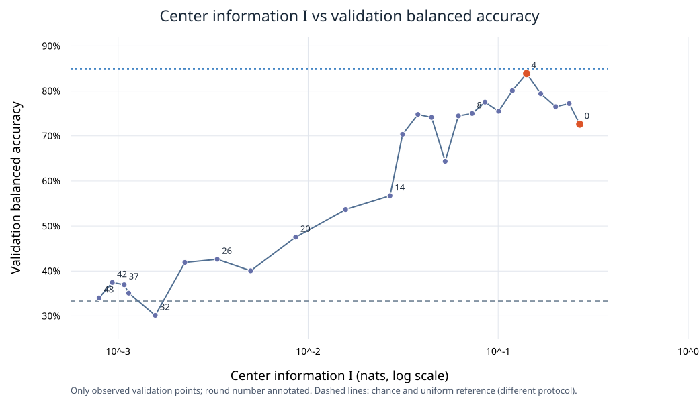
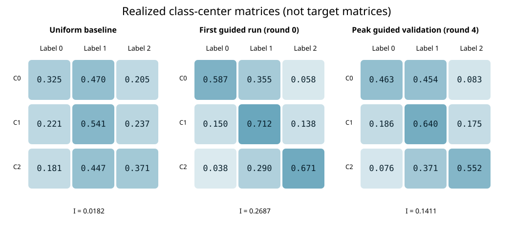

# گزارش مقایسهٔ سیاست یکنواخت و دو وضعیت سیاست هدایت‌شده به مرکز

> **دامنه:** یک مجموعه‌دادهٔ مصنوعی، یک بذر، و آزمایش مشاهده‌ای؛ نه آموزش نهایی سیاست و نه نتیجهٔ آماری تعمیم‌پذیر.

## هدف و نحوهٔ انتخاب سه وضعیت

۱. **Uniform:** سیاست یکنواخت؛ مرکز هر کلاس میانگین بازنمایی‌های آموزشی حاصل از همین سیاست است.
۲. **اولین اجرای هدایت‌شده، round=0:** هدف‌ها نزدیک بردارهای یک‌داغ‌اند؛ سیاست‌های محلی در هر گام با کمینه‌کردن JSD میان توزیع یک‌گامی و مرکز هدف ساخته می‌شوند. سپس مراکز واقعی گشت‌های آموزشی محاسبه می‌شوند. **دقت روی همین مراکز واقعی سنجیده شده؛ هیچ اصلاح هدف پس از اجرای اول در این اندازه‌گیری اعمال نشده است.**
۳. **بالاترین دقت ثبت‌شده، round=4:** بهترین مقدار دقت متوازن اعتبارسنجی بین 25 تکراری که واقعاً ارزیابی شده‌اند. این وضعیت یک انتخاب پس‌نگر با استفاده از اعتبارسنجی است، نه تخمین بدون سوگیری عملکرد مدل نهایی.

## مقایسهٔ اصلی

| معیار | یکنواخت | هدایت‌شده، اجرای اول | بالاترین دقت مسیر |
|---|---:|---:|---:|
| دقت متوازن اعتبارسنجی (%) | 84.86 | 72.61 | 83.83 |
| دقت معمولی اعتبارسنجی (%) | 81.11 | 70.00 | 83.33 |
| دقت متوازن آموزش (%) | 74.14 | 97.51 | 97.74 |
| اطلاعات مراکز I (nats) | 0.018177 | 0.268729 | 0.141105 |
| حداقل فاصلهٔ sqrt(JSD) مراکز | 0.082233 | 0.329372 | 0.216401 |
| میانگین JSD زوج‌مرکز | 0.013365 | 0.188604 | 0.101430 |
| T | 0.412473 | 0.656940 | 0.551658 |
| TNL | 0.909634 | 0.423370 | 0.603498 |
| BT | 0.412473 | 0.656940 | 0.551658 |
| BTNL | 0.909634 | 0.423370 | 0.603498 |
| میانگین JSD درون‌کلاسی آموزش | 0.003884 | 0.013257 | 0.003765 |
| میانگین JSD هدف تا مرکز واقعی | — | 0.079049 | 0.002428 |
| حاشیهٔ واقعی اعتبارسنجی (JSD) | — | 0.008320 | 0.005498 |
| سهم حاشیهٔ غیرمثبت اعتبارسنجی | — | 0.300000 | 0.166667 |

**هشدار دربارهٔ دقت آموزش:** در سیاست هدایت‌شده، برچسب واقعی مبدأ برای ساخت سیاست آموزشی استفاده شده است؛ بنابراین «دقت آموزش» آن، سنجه‌ای شرطی/اوراکلی است و مستقیماً با دقت آموزشِ یکنواخت مقایسه‌پذیر نیست.

## تحلیل تفاوت سه وضعیت

- از اجرای اول تا نقطهٔ بیشینهٔ دقت، I از 0.26873 به 0.14111 کاهش یافت (حدود 47.5٪). در همین بازه، JSD درون‌کلاسی آموزش از 0.01326 به 0.00376 کاهش یافت (حدود 71.6٪). دقت متوازن اعتبارسنجی در مجموع 11.22 واحد درصد افزایش یافت؛ بنابراین کاهش جدایی در این بخش از مسیر با **تراکم بیشتر و بهبود دقت** همراه بوده است.
- یکنواخت با I=0.01818 بسیار کمتر از هر دو وضعیت هدایت‌شده، دقت متوازن 84.86٪ ثبت کرده است. این نکته نشان می‌دهد I به‌تنهایی پیش‌بینی‌کنندهٔ کافی دقت نیست؛ ولی به سبب پروتکل‌های استنتاج متفاوت، نتیجهٔ مقایسهٔ علّی دو سیاست نیست.
- در تکرار 48، I=0.000794 و دقت متوازنِ اندازه‌گیری‌شده 34.04٪ است: نمونه‌ای از فروپاشی جدایی مراکز و افت قدرت تفکیک در تکرارهای بسیار دیرتر، بدون ادعای اثبات نقطهٔ حدی.
- مقادیر `T=BT` و `TNL=BTNL` برای این سه ماتریس رخ داده‌اند زیرا انتساب هم‌نام کلاس‌ها، بهترین انتساب جایگشتی است؛ این برابری خاص این داده‌هاست، نه یک رابطهٔ همگانی.

## ماتریس مراکز (سطر = کلاس مبدأ؛ ستون = احتمال برچسب مشاهده‌شده)

### سیاست یکنواخت

**مراکز واقعی:**

| کلاس | برچسب ۰ | برچسب ۱ | برچسب ۲ |
|---|---:|---:|---:|
| 0 | 0.324872 | 0.470143 | 0.204985 |
| 1 | 0.221477 | 0.541194 | 0.237329 |
| 2 | 0.181193 | 0.447453 | 0.371354 |

### اجرای اول، round=0

**مراکز واقعی:**

| کلاس | برچسب ۰ | برچسب ۱ | برچسب ۲ |
|---|---:|---:|---:|
| 0 | 0.587378 | 0.355085 | 0.057537 |
| 1 | 0.149664 | 0.712215 | 0.138120 |
| 2 | 0.038297 | 0.290477 | 0.671226 |

**مراکز هدفِ مورد استفاده برای ساخت سیاست (نه مراکز سنجش دقت):**

| کلاس | برچسب ۰ | برچسب ۱ | برچسب ۲ |
|---|---:|---:|---:|
| 0 | 0.946667 | 0.026667 | 0.026667 |
| 1 | 0.026667 | 0.946667 | 0.026667 |
| 2 | 0.026667 | 0.026667 | 0.946667 |

### بالاترین دقت، round=4

**مراکز واقعی:**

| کلاس | برچسب ۰ | برچسب ۱ | برچسب ۲ |
|---|---:|---:|---:|
| 0 | 0.462915 | 0.453977 | 0.083108 |
| 1 | 0.185694 | 0.639578 | 0.174727 |
| 2 | 0.076242 | 0.371276 | 0.552482 |

**مراکز هدفِ مورد استفاده برای ساخت سیاست (نه مراکز سنجش دقت):**

| کلاس | برچسب ۰ | برچسب ۱ | برچسب ۲ |
|---|---:|---:|---:|
| 0 | 0.539332 | 0.392898 | 0.067770 |
| 1 | 0.157742 | 0.691500 | 0.150758 |
| 2 | 0.055640 | 0.320618 | 0.623742 |

## مشاهدهٔ مسیر ۴۹ تکرار

از 49 تکرار ثبت‌شده، دقت اعتبارسنجی برای 25 تکرار اندازه‌گیری شده است؛ در نمودار فقط همان نقاط آمده‌اند. اعدادِ خالی در CSV به معنای فقدان ارزیابی‌اند، نه صفر.

در این اجرا، افزایش اولیهٔ دقت با کاهش فاصلهٔ هدف تا مراکز واقعی و کاهش پراکندگی درون‌کلاسی همراه بوده، در حالی که I کاهش یافته است؛ بنابراین حداکثرکردن I به‌تنهایی معادل حداکثرکردن دقت نیست. در تکرارهای بسیار دیرتر، تقریباً یکسان‌شدن مراکز با افت دقت به نزدیکی سطح تصادفی همراه شده است. این همبستگی مشاهده‌ای، رابطهٔ علّی یا یک قضیهٔ همگرایی نیست.

## محدودیت روش‌شناختیِ مهم

- یکنواخت: یک بازنماییِ مستقل از کلاس فرضی برای هر نمونه ساخته می‌شود و با همهٔ مراکز مقایسه می‌شود.
- هدایت‌شده: برای هر کلاس فرضی یک بازنماییِ جداگانه تولید می‌شود؛ فاصلهٔ آن بازنمایی تا مرکز **واقعی آموزشی همان کلاس** محاسبه می‌شود و کمترین فاصله برنده است. برچسب اعتبارسنجی در ساخت گشت به کار نرفته است.
- به همین دلیل، دو پروتکل زمان اجرا و قدرت مدل متفاوت دارند. تفاضل دقت آن‌ها آزمون کنترل‌شدهٔ اثر انتخاب سیاست به‌تنهایی نیست.
- «بیشترین دقت مسیر» با اعتبارسنجی انتخاب شده است؛ آزمون نهایی باید مستقل بماند. تکرارهای بررسی‌شده با یک بذر و ۱۰۰ گشت به ازای نمونه اجرا شده‌اند؛ نویز مونت‌کارلو و بهینه‌سازی تقریبی Q وجود دارد.
- این آزمایش **بدون متغیر مشترک آموزش‌دیده و بدون پاداش‌دهی** است. سیاست‌ها از حل محلی JSD نسبت به مراکز هدف ساخته می‌شوند.

## محاسبات و داده‌ها

- `results/history_00_48.json`: مراکز هدف، مراکز واقعی، و معیارهای ذخیره‌شدهٔ ۴۹ تکرار به همراه خط مبنا.
- `results/three_cases.json` و `results/three_cases.csv`: سه وضعیت انتخابی با هندسهٔ باز‌محاسبه‌شده از مراکز واقعی.
- `results/trajectory_metrics.csv`: مسیر معیارها؛ برای دقت‌های محاسبه‌نشده مقدار خالی.
- `analyze.py`: محاسبهٔ مستقل شاخص‌های هندسی، اعتبارسنجی سازگاری checkpointها و تولید گزارش و نمودارها.
- `reproduce.py`: اجرای مجدد مولد داده و کد اصلی آزمایش در همان مخزن.

فرمول اطلاعات مرکز با وزن یکنواخت کلاس‌ها: `I = H(mean_c V_c) - mean_c H(V_c)` با لگاریتم طبیعی؛ KL/JSD نیز برحسب nats است. `T` میانگین قطر مرکز و `BT` بیشترین میانگین انتساب جایگشتی است؛ `TNL` و `BTNL` هم نسخه‌های لگاریتمی متناظرند.
