# گزارش فنی نهایی پژوهش E-CH4-13 — مقایسهٔ کنترل‌شده Sigmoid-JS و Softplus-JS

**وضعیت مرجع (۱۵ نوامبر ۲۰۲۶):** `ACCEPT_PHASE2_SCIENTIFIC / RE_QA_PASS_FOR_MERGE`؛ PR [#79](https://github.com/mahhammad/My-Thesis/pull/79) در merge commit `a8c9027460e538fa04b8aab2f762eb4ba4c31e3d` ادغام شده است. رأی مستقل: [Issue #80](https://github.com/mahhammad/My-Thesis/issues/80#issuecomment-6892392493). گزارش‌های بازهٔ اجرای پژوهش که در ادامه آمده‌اند ممکن است هنوز عنوان `Draft` یا `PENDING_QA` داشته باشند؛ آن وضعیت تاریخی است.

## قرارداد بازتولید داده، اجرای آزمایش و ساختار پرونده‌ها — ممیزی تکمیلی ۲۰۲۶-۱۱-۱۵

**مشخصات دادهٔ پایه (فقط در صورت استفادهٔ مستقیم از مولد):** [`code/data_generator/config.json`](../../../code/data_generator/config.json) با `K=3` کلاس، `D=5` ویژگی، احتمال کلاس‌های `[0.25,0.45,0.30]`، میانگین‌های شرطی کلاس‌ها `[-2,-0.3,0,-1.2,0]`، `[0,0.7,0,0,0]`، `[2,-0.4,0,1.2,0]` و انحراف معیار `[0.95,1,1.2,0.95,1.1]` برای هر سه کلاس است. کوواریانس `diag(std)·correlation·diag(std)` با هم‌بستگی‌های غیرصفرِ بین‌ویژگی `(0,1)=0.35`، `(0,3)=0.20`، `(2,4)=0.30`؛ درصد فقدان مستقل MCAR برای پنج ویژگی `[0,5,12,5,20]` و `kernel_gamma=[0.8,1.2,0.5,1.0,0.6]` است. ویژگی‌های ۰،۱،۳ از نظر حاشیه‌ای اطلاع‌رسان و ۲،۴ نویزیِ حاشیه‌ای هستند. تنظیم پیش‌فرض `seed=20261102` و Train/Validation/Test به‌ترتیب `300/90/120` است؛ **هر آزمایش در ادامه دقیقاً مشخص می‌کند آیا همین تقسیم را می‌خواند یا داده/مرجع دیگری می‌سازد.**

**قالب عمومی خروجی مولد:** اجرای مستقل `python code/data_generator/generate.py --config code/data_generator/config.json --out /tmp/imc-data-20261102`، فایل‌های `train.npz`، `validation.npz`، `test.npz` با کلیدهای `x` (آرایهٔ `N×5` از `float64`، فقدان=`NaN`)، `mask` (`N×5` بولی) و `y` (آرایهٔ `N` از برچسب‌های ۰،۱،۲)، به‌علاوه `oracle_<split>.npz` (`posterior: N×3`، `q_population: N×5×3`)، `finite_q_<split>.npz` (`q_finite: N×5×3`) و `spec.json` تولید می‌کند. این یک **خروجی آزمایشی جدید در /tmp** است، نه فایلی که لزوماً در پوشهٔ مطالعه commit شده باشد؛ فرمان CLI همچنین Test را تولید می‌کند، ولی استفاده از Test برای گزینش مدل/تحلیل این فصل مجاز نیست. برای ساخت **فقط Train/Validation بدون تولید Test**، از `code/experiments/benchmark_v1/dataset_adapter.py::dataset_train_val(load_config(...))` مطابق کد هر مطالعه استفاده کنید. برابری بایت‌های float بین ماشین‌های دارای BLAS متفاوت تضمین نمی‌شود؛ منشأ frozen و SHAهای ثبت‌شده بر seed صرف تقدم دارند.

### منبع واقعی داده، شمار اجراها و نحوهٔ تولید نتایج

**دادهٔ واقعیِ آموزش کجاست؟** برخلاف بخش‌های قبل، ورودی هر fit از **سه فایل منجمد واقعی** در [`inputs/phase2_train_validation/`](inputs/phase2_train_validation/manifest.json) خوانده می‌شود: `ds20261102_train_val.npz`، `ds20261103_train_val.npz`، `ds20261104_train_val.npz`. هر NPZ دقیقاً چهار کلید دارد: `train_x:float64[300,5]`، `train_y:int64[300]`، `validation_x:float64[90,5]` و `validation_y:int64[90]`. نشانگر ویژگی‌های مفقود `NaN` در `*_x` است و ماسک از `np.isfinite(x)` بازساخته می‌شود؛ **هیچ Test در این بسته ساخته یا خوانده نشده است**. [`inputs/phase2_train_validation/manifest.json`](inputs/phase2_train_validation/manifest.json) برای هر seed، `file_sha256`، اثرانگشت چهار آرایه، اثرانگشت ماسک، شمار کلاس‌ها، نسخه NumPy/Python و SHA کانفیگ را نگه می‌دارد.

**ساخت مجدد داده چه قراردادی دارد؟** مولد همان Gaussian/MCAR پایه است؛ [`phase2_frozen_data.py`](phase2_frozen_data.py) سه `spec["seed"]` را به `dataset_adapter.dataset_train_val` می‌دهد و داده را به‌صورت `np.savez_compressed` ذخیره می‌کند. تولید تاریخی تحت `OPENBLAS_CORETYPE=generic`، `OPENBLAS_NUM_THREADS=1`، `NumPy=2.4.6` و `Python=3.11.18` تثبیت شد. **تنها seed برای بازتولید بایت‌به‌بایت کافی نیست**؛ تنظیم BLAS، ساختار آرایه و تأیید SHA نیز لازم‌اند. اجرای `--freeze` به opt-in صریح، SHA منبع و پوشهٔ مقصد **ناموجود** نیاز دارد و در پوشهٔ ورودی پذیرفته‌شده نباید تکرار شود. برای **اجرای شواهد کنونی، لازم نیست هیچ دادهٔ تازه‌ای تولید شود**: loader همان NPZهای قفل‌شده را پس از راستی‌آزمایی می‌خواند.

**ماتریس اجرا:** [`phase2_plan_manifest.json`](phase2_plan_manifest.json) = **۳ seed × ۲ خانواده `shared/class` × ۲ زیان `sigmoid_JS_margin_tau005/softplus_JS_tau005` = ۱۲ fit**، با ۶ جفت هم‌شرط، `n=300`، ۲۵ update، `Adam lr=.12`، شروع صفر، `τ=.005`، `β=.4,λ=.8,H=12`، امید دقیق `float64`. `phase2_runner.py` فقط تحت مجوز/GitHub Actions نسخه‌دار و بودجه قفل‌شده اجازهٔ نوشتن دارد؛ **اجرای معمولیِ --execute از روی README مجوز آموزش یا retry ایجاد نمی‌کند.**

**مراحل امن بازخوانی و تأیید، بدون fit:**
```bash
python code/experiments/ch4_loss_controlled_comparison/phase2_frozen_data.py
OPENBLAS_CORETYPE=generic OPENBLAS_NUM_THREADS=1 python code/experiments/ch4_loss_controlled_comparison/phase2_data_preflight.py
python code/experiments/ch4_loss_controlled_comparison/phase2_runner.py
python code/experiments/ch4_loss_controlled_comparison/phase2_derived_reproduce_v2.py --check
```
اولی وضعیت داده را بدون freeze نشان می‌دهد؛ دومی (در shell سازگار با Bash) با `OPENBLAS_CORETYPE=generic` و `OPENBLAS_NUM_THREADS=1` fingerprintها/قرارداد Train-Validation را بررسی می‌کند؛ در Windows باید همین متغیرها را به شیوهٔ PowerShell/CMD قبل از اجرا تنظیم کرد؛ سومی فقط dry-run برنامهٔ آموزش است و هیچ fit نمی‌زند؛ چهارمی ۱۲ فایل پوشش مشتق و ۱۱ شکل SVG و جدول‌های عددی بازتولیدپذیر را **بایت‌به‌بایت** کنترل می‌کند، بدون تغییر raw. اگر دادهٔ منجمد با manifest تطبیق نکند، توقف معتبرتر از ادامه با seed مشابه است.

| نوع | محل | ساختار دقیق |
|---|---|---|
| ورودی واقعی | `inputs/phase2_train_validation/ds<seed>_train_val.npz` | چهار آرایهٔ Train/Validation با ابعاد و dtype بالا؛ ثابت و SHA-قفل |
| منشأ ورودی | [`inputs/phase2_train_validation/manifest.json`](inputs/phase2_train_validation/manifest.json)، `phase2_plan_manifest.json` | بذر، fingerprint آرایه، قانون ۱۲ job، budget و نسخه‌ها |
| اجرای هر fit | `results/phase2_300_25/<run_key>/` | `model.json` (logits/پارامتر و reference ids)، `distributions.npz` (توزیع‌های بازنمایی)، `trace.json` (مسیر ۲۵ update)، `metrics_full.json` (Train/Validation)، `coverage.json` و `run_evidence.json` |
| ثبت کل فاز | [`results/phase2_300_25/manifest.json`](results/phase2_300_25/manifest.json)، `data_fingerprints.json`، `attempt_charges/` | ۱۲ run، ۶۰ هش مرکزی، snapshotهای مصرف بودجه و وضعیت کوشش |
| جفت‌ها و نمایش | `tables/phase2_runs_12.csv`، `tables/phase2_pairs_6.csv`، `figures/`، `derived/phase2_qa_fixes_v2/` | ۱۲ ردیف اجرا، ۶ مقایسهٔ جفتی، شکل/دادهٔ رسم مشتق |
| کنترل | `phase2_data_preflight.py`، `phase2_derived_reproduce_v2.py --check` | بررسی بدون optimizer/دسترسی به Test یا جایگزینی raw |

**محدودیت:** در README تاریخی قسمت‌های با وضعیت پیش‌ثبت `NO_FIT` متعلق به **قبل از فاز دوم انجام‌شده** هستند، نه وضعیت کنونی ۱۲ اجرای ذخیره‌شده. وضعیت فاز دوم از manifest و رأی مستقل خوانده می‌شود؛ `README_FA.md` نباید overwrite گردد.

**قاعدهٔ نگهداشت:** خروجی جدید در کنار گزارش جامع مجاز است؛ `README_FA.md` فعلی حذف/overwrite نشود. raw/checksumهای پذیرفته‌شده و گیت‌های تاریخی با ممیزی مستندات تغییر نمی‌کنند.

## چکیده و سؤال

در این پژوهش، ۱۲ آموزش واقعی با بودجه ۲۵ گام Adam و دادهٔ Train/Validation منجمد (۳ seed × دو خانواده shared/class × دو زیان) در شش جفت کنترل‌شده بررسی شدند. موتور بازنمایی *امید دقیق* گشت با H=12 است، نه Monte Carlo. اختلاف Validation BA و هندسه مراکز و تراکم نمونه‌ها فقط در دامنهٔ این داده‌ها گزارش می‌شود؛ ادعای برتری جهانی یکی از زیان‌ها مطرح نیست.

## پروتکل ثابت، روش دقیق، نتایج و محدودیت‌های علمی

## E-CH4-13 — مقایسه کنترل‌شده دو تابع زیان IMC در ۳۰۰ نمونه

**وضعیت علمی:** `PHASE2_READY_FOR_INDEPENDENT_QA` / نتایج تجربی مقدماتی، بدون ادعای پذیرش مستقل.  
**مأموریت:** [Issue #81](https://github.com/mahhammad/My-Thesis/issues/81)؛ **اجرای اصلی:** [Actions #43670524935](https://github.com/mahhammad/My-Thesis/actions/runs/43670524935) (SUCCESS، یک‌بار).  
**SHA موتور آموزش قفل‌شده:** `cdb45644c245e04a276eb2a419e4d64f71c6c18a`.  
**منبع خام نهایی:** [`results/phase2_300_25/`](results/phase2_300_25) و [GitHub artifact #14144445918](https://github.com/mahhammad/My-Thesis/actions/runs/43670524935/artifacts/14144445918).  
**عدم دسترسی به Test:** تأییدشده از قرارداد اجرا و provenance. با مجوز جدید مالک، زیربخش علمی E-CH4-13 همراه با جدول‌ها و شکل‌های برداری به `tex/chapter4.tex` افزوده شده است؛ PR #79 همچنان Draft و متن در انتظار ممیزی مستقل است.

### ۱. پرسش، فرضیه و محدودیت

در IMC آیا تابع زیان `Sigmoid-JS margin` نسبت به `Softplus-JS` دقت متوازن Validation بهتری می‌سازد و آیا تراکم کلاس‌ها (`R`)، جدایی مراکز (`I`) و حاشیه تصمیم، تغییر تعمیم را توضیح می‌دهند؟ مقایسه **جفتی** و از پیش ثبت‌شده است؛ تغییر علامت اختلاف بین مولدها مجاز است و نباید برای انتخاب برندهٔ جهانی از همان سه مولد استفاده شود. آزمایش برای آزمون حساسیت به seed و policy است، نه اثبات برتری، همگرایی جهانی یا significance تعمیم‌پذیر.

### ۲. قرارداد ثابت و تعداد اجرا

سه بذر مولد مصنوعی `20261102/03/04` × دو خانواده سیاست `shared/class` × دو تابع زیان = **۱۲ fit واقعی** و شش جفت. هر fit: `nTrain=300`, `nValidation=90`, `K=3`, `d=5`, `beta=0.4`, `lambda=0.8`, `H=12`, موتور exact float64 با گشت بدون بازگشت، Adam (`lr=0.12`)، logits اولیه صفر، **دقیقاً ۲۵ به‌روزرسانی**؛ `tau_width=0.005`. توقف زودهنگام، جست‌وجوی ابرپارامتر و انتخاب بهترین epoch بر اساس Validation ممنوع؛ checkpoint نهایی همان گام ۲۵ است.

فایل‌های frozen Train/Validation هر بذر با checksum منجمدند. تعریف score برابر `1-JSD/ln(2)` است. Sigmoid زیان سیگمویدِ حاشیه درست در مقابل نزدیک‌ترین رقیب را به‌طور متوازن کلاس‌ها کمینه می‌کند؛ Softplus نسخه `tau*logsumexp` همه فرض‌های رقیب را. هر دو همان engine و قرارداد گزارش معیارهای مشترک را استفاده کرده‌اند.

#### روش محاسبه توزیع همسایگی: پیمایش دقیق، نه برآورد مونت‌کارلو

برای هر نمونه، خروجی توزیع همسایگی/برچسب با **موتور دقیق `ExactMaskedWalk`** محاسبه شده است؛ **هیچ تعداد مسیر مونت‌کارلوی (M)** (مثلاً ۳۰۰ یا ۹۶۰۰ مسیر از هر مبدأ) در آزمایش E-CH4-13 تعریف یا نمونه‌برداری نشده است. اصطلاح «exact» به محاسبه جبری مجموع احتمالات مسیرهای مجاز در **افق ثابت (H=12)** اشاره دارد و **به معنی پیمایش نامحدود نیست**. به‌جای رسم مسیرهای تصادفی و میانگین‌گرفتن از فراوانی آن‌ها، بردار جرم احتمالِ حالت‌ها در طول گام‌ها با انتقال‌های ماسک‌شده به‌صورت `torch.float64` منتشر می‌شود و خروجی هر گام با ضرایب قطعی ترکیب می‌گردد.

پیاده‌سازی مرجع: [`ExactMaskedWalk`](../benchmark_v1/engine.py) در `code/experiments/benchmark_v1/engine.py` (توابع `coefficients`، `represent_train`، `represent_query`)؛ فراخوانی واقعی از [`phase2_runner.py`](phase2_runner.py)، ساخت `ExactMaskedWalk(..., beta=BETA, lam=LAMBDA, horizon=H, query_x=vx)`؛ مقادیر ثابت در [`phase2_protocol.py`](phase2_protocol.py).

| پارامتر بازتولید | مقدار و نقش |
|---|---|
| روش برآورد توزیع همسایگی | **Exact / deterministic probability propagation**؛ نه MC |
| تعداد مسیر نمونه‌برداری‌شده از هر مبدأ، (M_{MC}) | **قابل اعمال نیست (N/A)**؛ نباید `0` را به معنای تخمین MC با صفر نمونه گزارش کرد |
| افق / سقف طول پیمایش، (H) | `12`؛ در کد ۱۲ سهم وزن‌دار از state پس از انتقال نخست تجمیع می‌شود |
| احتمال توقف هندسی | `beta=0.4`؛ جرم باقیمانده در طول انتهایی تجمیع می‌شود |
| تخفیف/وزن موقعیت گام در پیمایش | `lambda=0.8` |
| دقت محاسبات مسیر | `torch.float64` |
| تعداد نمونه‌های مرجع گراف | `300` نمونه Train؛ **این عدد تعداد مسیرهای MC نیست** |
| تعداد به‌روزرسانی بهینه‌ساز | `25` گام Adam در هر fit؛ **این عدد طول پیمایش یا تعداد مسیرها نیست** |

طبق `coefficients`، احتمال طول‌های (1,ldots,H-1) برابر `beta*(1-beta)**(length-1)` و جرم طول پایانی (H) برابر `(1-beta)**(H-1)` است. درون هر طول، سهم گام‌ها با `lambda**j` نرمال و در نهایت ضرایب `alpha[t]` جمعاً به ۱ نرمال می‌شوند. در `represent_train`، بازگشت به **مبدأ همان نمونه** پس از انتقال اول حذف و انتقال‌های مجاز دوباره نرمال می‌شوند؛ در `represent_query` نمونهٔ جدید بیرون مجموعه مرجع است و انتشار دقیق جرم روی گراف مرجع انجام می‌شود. ویژگی‌های گمشده ماسک می‌شوند؛ `feature_kernel` خود-انتقال به همان گره را صفر می‌کند.

**جایگاه نسبت به آزمایش قبلی §۴.۵:** در مقایسه تاریخی MC در برابر exact، تعداد مسیرهای تصادفی بر دقت برآورد توزیع و سپس BA مؤثر بود. برای کنترل این منبع تصادف در E-CH4-13، **هر دو تابع زیان روی همان موتور exact با افق (H=12)** ارزیابی شده‌اند؛ بنابراین اختلاف بین آن‌ها به نویزِ نمونه‌برداری مسیر MC در همین پروتکل نسبت داده نمی‌شود. بااین‌حال وابستگی مشترک نتایج به (H)، `beta`، `lambda` و انتخاب داده همچنان پابرجاست؛ از این آزمایش نباید ادعای بی‌حساسیتی به عمق یا برتری generalize‌شده استخراج کرد. در ممیزی علمی لازم است روشن باشد که **MC path count = N/A** و نه `nTrain=300`، `Adam steps=25` یا `H=12`.

#### جایگاه پایلوت ۵۰نمونه‌ای در تفسیر نتایج

پایلوت اولیه با **۵۰ نمونه Train**، تنها **یک مولد**، خانواده سیاست `shared` و **۱۰ به‌روزرسانی Adam** طراحی شده بود و اختلاف Validation BA در آن `+5.1151` واحد درصد به سود Sigmoid-JS مشاهده شد. این اختلاف یک مشاهدهٔ اکتشافی/امکان‌سنجی فنی بود، **نه برآورد قابل اتکای برتری عمومی تابع زیان**. حجم کم Train ممکن است حساسیت سیاست آموخته‌شده به انتخاب نمونه را افزایش دهد. افزون بر این، Validation شامل ۹۰ نمونه است؛ بنابراین BA خود نیز عدم‌قطعیت نمونه‌ای دارد.

مقایسهٔ مستقیم مقدار BA پایلوت با مقادیر مطالعه حاضر برای استنتاج *اثر حجم Train* مجاز نیست، زیرا افزون بر Train=۵۰ در برابر ۳۰۰، تعداد به‌روزرسانی‌ها (۱۰ در برابر ۲۵) و دامنه مولدها/خانواده‌ها نیز تغییر کرده‌اند. برای جداکردن اثر اندازه Train از بودجه آموزش، یک آزمایش عاملیِ کنترل‌شده و از پیش ثبت‌شده جداگانه لازم است. پایلوت به‌عنوان مبنای پرسش علمی نگهداری می‌شود، نه یک مشاهده مستقل هم‌وزن با شش جفت کنونی.

### ۳. نتیجهٔ جفتی Validation BA

علامت `ΔBA = BA(Sigmoid) − BA(Softplus)`. ستون‌ها درصد و اختلاف‌ها **واحد درصد** هستند. `flip` تعداد تغییر پیش‌بینی میان دو مدل در همان Validation است.

| بذر | policy | Sigmoid BA | Softplus BA | ΔBA (pp) | flip |
|---|---|---:|---:|---:|---:|
| 20261102 | shared | 97.9592 | 96.7687 | +1.1905 | 1 |
| 20261102 | class | 97.9592 | 97.9592 | 0.0000 | 4 |
| 20261103 | shared | 87.7391 | 86.4571 | +1.2821 | 1 |
| 20261103 | class | 81.2068 | 85.8873 | −4.6805 | 8 |
| 20261104 | shared | 83.8914 | 86.0419 | −2.1505 | 4 |
| 20261104 | class | 84.1536 | 86.0419 | −1.8883 | 4 |

**میانگین اختلاف جفتی** در خانواده shared: `+0.1073 pp` با `sample SD=1.9559 pp` و علامت `+,+,−`؛ در خانواده class: `−2.1896 pp` با `sample SD=2.3548 pp` و علامت `0,−,−`. تنها **سه بذر مستقل در هر خانواده** وجود دارد؛ انحراف معیار توصیفی است و داده‌های درون یک مولد یا گام‌های optimizer نمونه‌های مستقل محسوب نمی‌شوند.


#### میانگین و واریانس Validation BA در مقایسه با مرجع بیزی

برای آنکه مقایسه تحت تأثیر آسان‌بودن بذر نخست قرار نگیرد، مرجع **Bayes MAP** روی **همان سه مجموعه Validation منجمد** و با اطلاعات مدل مولد اصلی (سه توزیع گاوسی کلاس‌مشروط، prior کلاس‌ها و ماسک ویژگی‌های مشاهده‌شده) **بدون آموزش، بدون نمونه‌سازی جدید و بدون دسترسی به Test** محاسبه شده است. عدد تاریخی `97.4490%` فقط برای بذر `20261102` بود و **نباید** به‌عنوان ملاک تمام بذرها قرار گیرد.

| خانواده | روش | میانگین Validation BA (%) | واریانس نمونه‌ای (واحد درصد)² | انحراف معیار نمونه‌ای (واحد درصد) | فاصله میانگین با Bayes (واحد درصد) |
|---|---|---:|---:|---:|---:|
| shared | Sigmoid-JS | 89.8632 | 52.8598 | 7.2705 | −0.9253 |
| shared | Softplus-JS | 89.7559 | 36.9278 | 6.0768 | −1.0327 |
| class | Sigmoid-JS | 87.7732 | 79.9869 | 8.9435 | −3.0154 |
| class | Softplus-JS | 89.9628 | 47.9628 | 6.9255 | −0.8258 |
| **مولد (مرجع)** | **Bayes MAP** | **90.7885** | **36.6405** | **6.0531** | **۰** |

**تعریف:** هر ردیف بر اساس **سه بذر مستقل تولید داده** `20261102/03/04` گزارش شده است. میانگین برابر میانگین حسابی BA سه بذر است؛ واریانس، **واریانس نمونه‌ای با مخرج `n−1=2`** است. چون BA در این جدول به درصد نوشته شده، واحد واریانس **مربعِ واحد درصد** است؛ اعداد واریانس، درصد خطا یا بازهٔ اطمینان نیستند.

**سطح سختی سه Validation بر اساس Bayes MAP:** به‌ترتیب `97.4490%`، `85.6227%` و `89.2939%` برای بذرهای `20261102`، `20261103` و `20261104`. کاهش حدود ۱۲ واحد درصدی Bayes بین بذر نخست و دوم نشان می‌دهد تفاوت سختی مجموعه‌ها واقعی و مهم است. این مرجع، **یک طبقه‌بند آگاه از مدل مولد** است و چون قاعده MAP برای دقت عادی بهینه است، **کران بالای ریاضی BA تجربی نیست**؛ بنابراین جلو افتادن گاه‌به‌گاه از Bayes MAP روی یک Validation کوچک تناقض نیست.

**نتیجهٔ توصیفی:** میانگین چهار ترکیب سیاست/هدف در حدود `87.77%` تا `89.96%` و میانگین Bayes در همان سه بذر `90.79%` است. در `shared` میانگین Sigmoid تنها `0.1073` واحد درصد از Softplus بالاتر است؛ در `class` میانگین Softplus `2.1896` واحد درصد بالاتر است. واریانس مشاهده‌شدهٔ `class/Sigmoid` بیشتر است، اما **سه بذر برای نتیجه‌گیری درباره تفاوت واریانس جمعیتی یا برتری آماری کفایت نمی‌کنند**. این جدول ملاک سختی و پراکندگی توصیفی است، نه رأی به برتری جهانی.

**منبع محاسبه:** [`validation_bayes_summary.py`](validation_bayes_summary.py)، با بازخوانی بذرهای Validation منجمد در [`inputs/phase2_train_validation/`](inputs/phase2_train_validation) و همان ۱۲ فایل `metrics_full.json`. تعریف مرجع MAP مطابق [کد تاریخی مرجع بیزی](../benchmark_v1/bayes_oracle_metrics.py) است؛ مقدار بذر نخست با گزارش ثبت‌شدهٔ تاریخی تطبیق داده شد. هیچ جدول یا نمودار اصلی جایگزین و هیچ دادهٔ خامی بازنویسی نشده است.

#### شکل 1 — مقایسهٔ مستقیم Validation BA برای سه بذر و دو خانوادهٔ سیاست

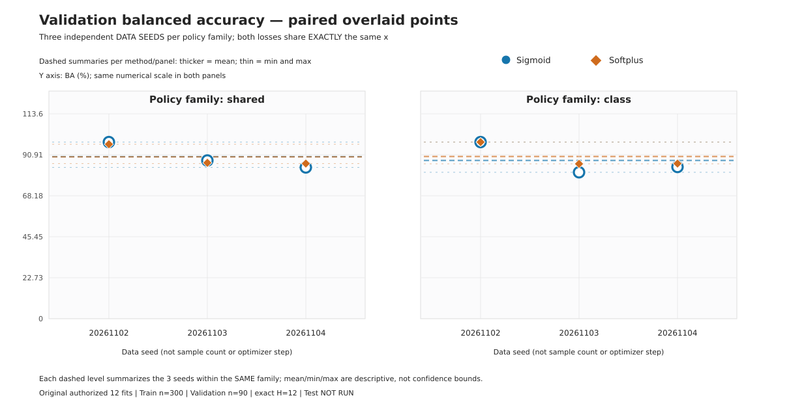

[مشاهده مستقیم SVG شکل 1](figures/phase2_repro_v3/figure01_validation_BA_methods_by_seed.svg)

**محورها:** محور افقی بذر کامل داده (`20261102`، `20261103`، `20261104`) است؛ این‌ها **اندازهٔ نمونه یا گام بهینه‌سازی نیستند**. محور عمودی BA برحسب درصد است. در هر بذر، Sigmoid (دایرهٔ توخالی آبی) و Softplus (لوزی نارنجی) **دقیقاً روی یک مختصات افقی** قرار گرفته‌اند. پنل‌های `shared` و `class` از هم جدا هستند. **سه خط‌چین برای هر روش در هر پنل** به‌ترتیب کمینه، میانگین و بیشینه در سه بذر همان خانواده‌اند (میانگین ضخیم‌تر است). این خطوط، فاصلهٔ اطمینان، روند آموزش یا خط برازش‌شده نیستند.

**مشاهده:** در `shared`، Sigmoid در بذرهای ۰۲ و ۰۳ بهتر و Softplus در بذر ۰۴ بهتر بوده است؛ در `class`، بذر ۰۲ مساوی و بذرهای ۰۳ و ۰۴ به سود Softplus بوده‌اند. تفاوت `class/20261103` برابر **۴٫۶۸ واحد درصد** به سود Softplus است. **نتیجه:** هیچ‌کدام در Validation BA برتری یکنواخت ندارند و با فقط سه بذر نباید برتری جمعیتی نتیجه گرفت.

### ۴. تراکم، جدایی مراکز و حاشیه

تمام شش جفت **Softplus دارای `R_JS` و `R_KL` کمتر در Train** و **Sigmoid دارای `I` و میانه حاشیه Validation بالاتر** بودند. اما جهت BA به مولد و خانواده وابسته است.

| بذر | policy | I Sig | I Soft | R_JS Sig | R_JS Soft | median margin Val Sig | median margin Val Soft |
|---|---|---:|---:|---:|---:|---:|---:|
| 20261102 | shared | 0.04800 | 0.01867 | 0.00778 | 0.00252 | 0.03431 | 0.01234 |
| 20261102 | class | 0.03802 | 0.01912 | 0.00858 | 0.00266 | 0.03377 | 0.01279 |
| 20261103 | shared | 0.06521 | 0.01969 | 0.00703 | 0.00224 | 0.03881 | 0.01265 |
| 20261103 | class | 0.13554 | 0.02036 | 0.01391 | 0.00232 | 0.06191 | 0.01380 |
| 20261104 | shared | 0.04676 | 0.01827 | 0.00796 | 0.00265 | 0.03606 | 0.01227 |
| 20261104 | class | 0.04764 | 0.01741 | 0.00615 | 0.00259 | 0.03581 | 0.01270 |

نمونهٔ خلاف تفسیر یک‌بعدی: در `seed=20261103, class` با اینکه Sigmoid جدایی مراکز و میانه حاشیه بالاتری دارد، **Validation BA آن ۴٫۶۸ واحد درصد کمتر از Softplus** است. برعکس در `seed=20261102, shared`، Sigmoid برتری کوچک BA دارد. بنابراین نه `R↓` و نه `I↑` یا margin↑ به‌تنهایی تضمین‌کننده بهبود BA نیستند. اثر توزیع نمونه‌ها و هندسه تصمیم باید همراه confusions، recall کلاس‌ها، مرز تصمیم و مقدار واقعی margin مطالعه شود. حتی `median margin` بالاتر الزاماً تعداد خطاهای کمتر را تضمین نمی‌کند.

مقیاس گرادیان دو loss متفاوت است؛ برابر بودن ۲۵ گام Adam و learning rate به معنای برابر بودن سرعت همگرایی، مقدار gradient یا ظرفیت مدل نیست. ادعای برتری عمومی یا استنباط p-value/CI قوی از سه seed صورت نمی‌گیرد.


#### شکل 2 — جدایی مراکز Train بر حسب بذر و خانوادهٔ سیاست

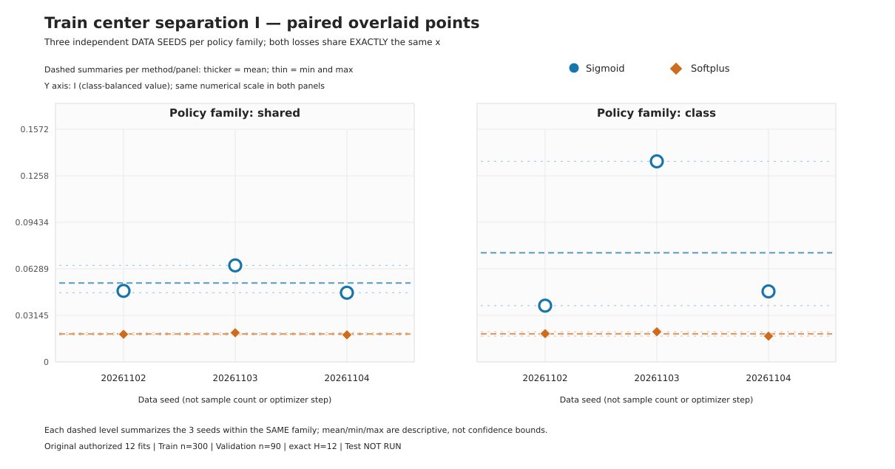

[مشاهده مستقیم SVG شکل 2](figures/phase2_repro_v3/figure02_train_I_methods_by_seed.svg)

**محورها:** محور عمودی معیار جدایی `I` محاسبه‌شده از مراکز Train است؛ محور افقی سه بذر کامل تولید داده است. در هر بذر، Sigmoid (دایرهٔ توخالی آبی) و Softplus (لوزی نارنجی) **دقیقاً روی یک مختصات افقی** قرار گرفته‌اند. پنل‌های `shared` و `class` از هم جدا هستند. **سه خط‌چین برای هر روش در هر پنل** به‌ترتیب کمینه، میانگین و بیشینه در سه بذر همان خانواده‌اند (میانگین ضخیم‌تر است). این خطوط، فاصلهٔ اطمینان، روند آموزش یا خط برازش‌شده نیستند.

**مشاهده:** Sigmoid در **تمام شش جفت** `I` بزرگ‌تری دارد؛ بیشترین تفاوت در `class/20261103` است (`0.13554` در برابر `0.02036`). بااین‌حال BA همان جفت به سود Softplus است. **نتیجه:** برتری Sigmoid در جدایی مراکز در این آزمایش یکنواخت است، ولی افزایش `I` شرط کافی برای BA بالاتر نیست.

### ۵. معیارها و ردپای بازتولید

هر یک از ۱۲ پرونده دارای `model.json`، `distributions.npz`، `trace.json`، `metrics_full.json`، `coverage.json`، `run_evidence.json` است. گزارش‌های `metrics_full.json` شامل گروه density (`R_KL/R_JS/R_sqrt_JS`)، هندسه (`I/T/BT/TNL/BTNL`)، BA/Acc، confusion و per-class recall، پیش‌بینی‌ها و خطاها، margin و quantileهای آن، معیارهای جانشین زیان، و مقادیر per-sample هستند؛ `NLL`/surrogateهای مرتبط و حدود تعریف‌پذیری نیز گزارش شده‌اند.

- `manifest.json` با **۱۲ رکورد و ۶۰ هش SHA256** از فایل‌های مرکزی هر fit ذخیره شده و تمام ۶۰ تطبیق بایتی در بررسی مستقل از ZIP PASS شد. checksumِ داده‌ها و provenance هم تطبیق داشتند.
- ۱۲ نشانگر مصرف بودجه، ۱۲ ledger checkpoint، ۱۲ success checkpoint، **۳۱۲ checkpoint گام‌به‌گام** و دقیقاً ۲۶ سطر trace (گام‌های ۰ تا ۲۵) در هر fit ثبت شده‌اند؛ هیچ فایل `failures/` وجود ندارد.
- بازمحاسبه مستقل `JSD→score` و `argmax` بر اساس `distributions.npz`، بازشماری confusion و BA از `per_sample` و تطبیق با manifest و `paired_summary.json` در هر ۱۲ fit بدون اختلاف انجام شد.
- **نکته پوشش معیار:** `coverage.json` دو مسیر `train.per_class_recall` و `validation.per_class_recall` را به علت نام کلید `not_measured` می‌نامد، ولی مقادیر واقعی per-class recall در `metrics_full.json/per_class[].accuracy` و confusion موجودند. این اختلاف نام‌گذاری/coverage در ممیزی مستقل باید بررسی شود. داده خام به همین شکل اصلی حفظ شده و پوشش به‌صورت ساختگی «PASS کامل» اعلام نشده است.
- سیستم عددی `Python 3.11.18`, `NumPy 2.4.6`, `torch CPU 2.15.0`, `OPENBLAS_CORETYPE=generic` و تک‌ریسمانی در `provenance.json` ثبت شده؛ گیت SHA و تأیید رسمی مدیر در فایل مجوز ثبت و token محرمانه به raw وارد نشده است.

#### منشأ غیرقابل تغییر

- موفقیت آموزش، reducer و آپلود: [Run #43670524935](https://github.com/mahhammad/My-Thesis/actions/runs/43670524935).
- نام artifact اصلی: `e-ch4-13-phase2-partial-or-complete-43670524935-1`؛ ID `14144445918`؛ SHA256 فایل ZIP برابر `26e7a94e36edeae2a3153b76b40cf282c30b550a3fac359558a20d11e72c3e3e`.
- بایگانی در شاخه آزمایش صرفاً از **بایت‌های خام artifact** و به کمک [`archive_phase2_existing.py`](archive_phase2_existing.py) انجام شد؛ **هیچ آموزش جدید** برای گزارش یا بازیابی اجرا نشد.
- [CSV دوازده اجرا](tables/phase2_runs_12.csv)، [CSV شش جفت](tables/phase2_pairs_6.csv) و [نمودار ΔBA](figures/phase2_paired_delta_validation_ba.svg) تنها از manifest/pair raw تولید شده‌اند. گزارشهای اضافی و ترسیم تک‌خانواده‌ای می‌توانند بعد از QA بدون تغییر raw ساخته شوند.

### ۵.۱. تحلیل تکمیلی سه نسخهٔ R و منحنی‌های آموزش (بدون هیچ fit تازه)

این بخش فقط از ۱۲ گزارش `metrics_full.json` و ۱۲ ردپای ۲۶-نقطه‌ای `trace.json` موجود در `results/phase2_300_25/`، و از داده‌های خام تأییدشدهٔ اجرای اصلی استخراج شده است. **هر سه معیار چگالی** `R_KL`، `R_JS` و `R_sqrt_JS` برای **Train و Validation** در هر ۱۲ اجرای موفق محاسبه شده‌اند؛ هیچ یک را نباید با تعداد مسیرهای MC یا تعداد گام‌های Adam اشتباه گرفت. `R_sqrt_JS` میانگینِ ریشهٔ فاصله JS در مقیاس مربوط است؛ به‌طور کلی نمی‌توان آن را برابر ریشهٔ میانگین `R_JS` گرفت. مقایسه بین سه نسخه باید با تعریف دقیق metric مشترک در موتور `standard_metrics` انجام شود.

#### ۵.۱.۱. میانگین‌های توصیفی Train و شواهد جفتی

| خانواده | loss | میانگین `R_KL` Train | میانگین `R_JS` Train | میانگین `R_sqrt_JS` Train | میانگین `I` Train | میانگین BA Validation |
|---|---|---:|---:|---:|---:|---:|
| shared | Sigmoid | 0.029675 | 0.007591 | 0.073092 | 0.053322 | 89.8632% |
| shared | Softplus | 0.009826 | 0.002470 | 0.042061 | 0.018878 | 89.7559% |
| class | Sigmoid | 0.037501 | 0.009544 | 0.079805 | 0.073735 | 87.7732% |
| class | Softplus | 0.010042 | 0.002522 | 0.042667 | 0.018962 | 89.9628% |

**شمارش علامت اختلاف جفتی (`Sigmoid−Softplus`):** برای هر سه معیار `R_KL/R_JS/R_sqrt_JS` در Train، نتیجه **۶/۶ مثبت** است؛ بنابراین Softplus در تمام شش جفت مقدار کوچک‌تری از هر سه `R` دارد. همین نتیجه **۶/۶** در Validation نیز برقرار است. برعکس، `I` در **۶/۶** جفت برای Sigmoid بزرگ‌تر است. مقادیر `R_sqrt_JS` نیز به‌صورت مستقل از گزارش‌های هر ۱۲ مدل محاسبه و در جدول بالا گزارش شده‌اند؛ مرجع بازبینی بایتی همان `metrics_full.json` در هر پوشهٔ اجراست.

در شاخه `shared`، میانگین اختلاف جفتی Validation BA برابر **`+0.1073` واحد درصد** و در شاخه `class` برابر **`−2.1896` واحد درصد** است. میانگین شش اختلاف به‌صورت توصیفی `−1.0411` واحد درصد می‌شود، ولی این عدد «برتری عمومی Softplus» نیست؛ هر دو خانواده روی همان سه seed تکرار شده‌اند و تعداد مولدهای مستقل برای استنباط تنها سه است.

#### ۵.۱.۲. شکل‌های ۳ تا ۸ — سه معیار R در Train و Validation

در شش نمودار زیر، در هر بذر، Sigmoid (دایرهٔ توخالی آبی) و Softplus (لوزی نارنجی) **دقیقاً روی یک مختصات افقی** قرار گرفته‌اند. پنل‌های `shared` و `class` از هم جدا هستند. **سه خط‌چین برای هر روش در هر پنل** به‌ترتیب کمینه، میانگین و بیشینه در سه بذر همان خانواده‌اند (میانگین ضخیم‌تر است). این خطوط، فاصلهٔ اطمینان، روند آموزش یا خط برازش‌شده نیستند. محور افقی شامل بذرهای **کامل** `20261102`، `20261103` و `20261104` است. محور عمودی مقدار یکی از سه معیار `R` بوده و **مقیاس‌های KL، JS و ریشهٔ JS با هم متفاوت‌اند**. برای Validation مراکز کلاس فقط از Train محاسبه شده‌اند و در مرحلهٔ ارزیابی ثابت می‌مانند.

**یافته مشترک هر شش نمودار:** Softplus در هر سه بذر و در **هر دو خانواده سیاست**، **هر سه مقدار `R_KL`، `R_JS` و `R_sqrt_JS` را هم روی Train و هم Validation کمتر کرده است (۶/۶ مقایسه برای هر معیار و هر split)**. این یک برتری یکنواخت **در تراکم درون‌کلاسی با تعریف R** است، نه در BA. همان داده‌ها نشان می‌دهند Sigmoid در `I` یکنواخت بهتر است و اختلاف BA با بذر و خانواده تغییر علامت می‌دهد.

##### شکل 3 — `R_KL` روی Train

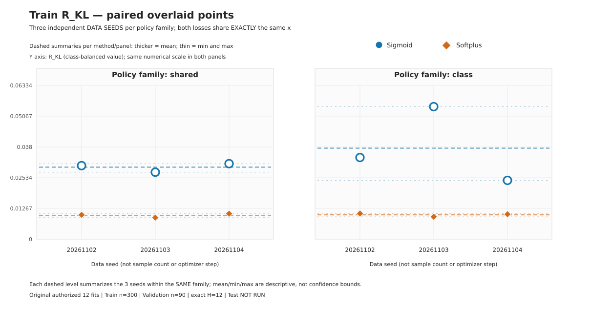

[مشاهدهٔ مستقیم SVG شکل 3](figures/phase2_repro_v3/phase2_train_R_KL_six_pairs.svg)

**تعریف:** میانگین متوازن کلاس از KL توزیع نمونه نسبت به مرکز واقعی کلاس با قاعدهٔ support-aware؛ در این داده‌های ثابت همهٔ مقادیر متناهی‌اند. **خوانش:** در تمام شش جفت، نقطهٔ Softplus مقدار کمتری از Sigmoid دارد. خط‌چین‌های هر روش، دامنه و میانگین سه بذر را فقط برای همان خانواده خلاصه می‌کنند؛ میانگین‌ها شاهد توصیفی هستند نه فاصلهٔ اطمینان. **نتیجه:** Softplus برای این سنجهٔ تراکم و این split برتری یکنواخت داشته، اما از این واقعیت نمی‌توان برتری Validation BA را نتیجه گرفت.

##### شکل 4 — `R_KL` روی Validation

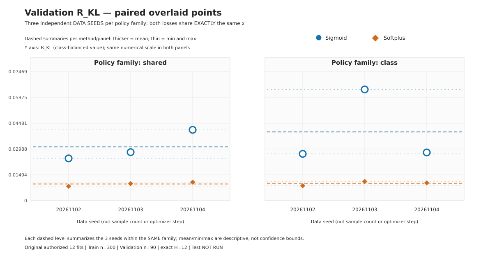

[مشاهدهٔ مستقیم SVG شکل 4](figures/phase2_repro_v3/phase2_validation_R_KL_six_pairs.svg)

**تعریف:** میانگین متوازن کلاس از KL توزیع نمونه نسبت به مرکز واقعی کلاس با قاعدهٔ support-aware؛ در این داده‌های ثابت همهٔ مقادیر متناهی‌اند. **خوانش:** در تمام شش جفت، نقطهٔ Softplus مقدار کمتری از Sigmoid دارد. خط‌چین‌های هر روش، دامنه و میانگین سه بذر را فقط برای همان خانواده خلاصه می‌کنند؛ میانگین‌ها شاهد توصیفی هستند نه فاصلهٔ اطمینان. **نتیجه:** Softplus برای این سنجهٔ تراکم و این split برتری یکنواخت داشته، اما از این واقعیت نمی‌توان برتری Validation BA را نتیجه گرفت.

##### شکل 5 — `R_JS` روی Train

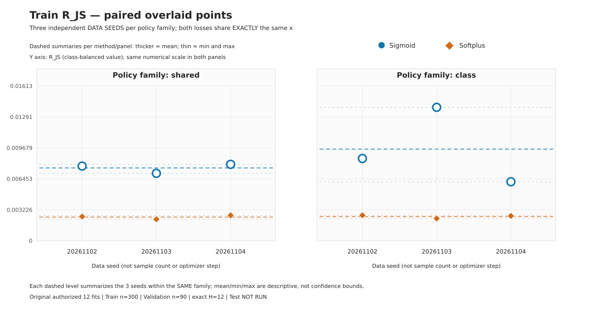

[مشاهدهٔ مستقیم SVG شکل 5](figures/phase2_repro_v3/phase2_train_R_JS_six_pairs.svg)

**تعریف:** میانگین متوازن کلاس از JSD نمونه تا مرکز واقعی کلاس؛ این معیار متقارن و کران‌دار است ولی با KL هم‌مقیاس نیست. **خوانش:** در تمام شش جفت، نقطهٔ Softplus مقدار کمتری از Sigmoid دارد. خط‌چین‌های هر روش، دامنه و میانگین سه بذر را فقط برای همان خانواده خلاصه می‌کنند؛ میانگین‌ها شاهد توصیفی هستند نه فاصلهٔ اطمینان. **نتیجه:** Softplus برای این سنجهٔ تراکم و این split برتری یکنواخت داشته، اما از این واقعیت نمی‌توان برتری Validation BA را نتیجه گرفت.

##### شکل 6 — `R_JS` روی Validation

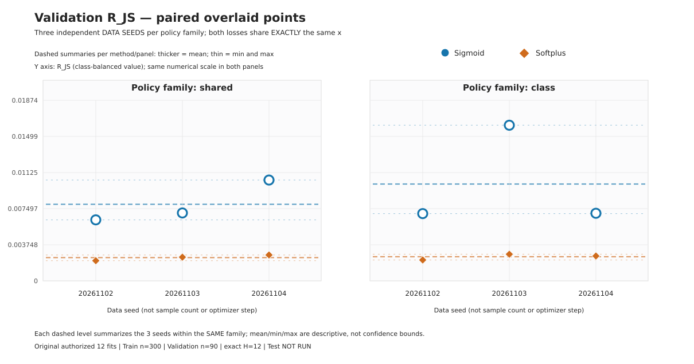

[مشاهدهٔ مستقیم SVG شکل 6](figures/phase2_repro_v3/phase2_validation_R_JS_six_pairs.svg)

**تعریف:** میانگین متوازن کلاس از JSD نمونه تا مرکز واقعی کلاس؛ این معیار متقارن و کران‌دار است ولی با KL هم‌مقیاس نیست. **خوانش:** در تمام شش جفت، نقطهٔ Softplus مقدار کمتری از Sigmoid دارد. خط‌چین‌های هر روش، دامنه و میانگین سه بذر را فقط برای همان خانواده خلاصه می‌کنند؛ میانگین‌ها شاهد توصیفی هستند نه فاصلهٔ اطمینان. **نتیجه:** Softplus برای این سنجهٔ تراکم و این split برتری یکنواخت داشته، اما از این واقعیت نمی‌توان برتری Validation BA را نتیجه گرفت.

##### شکل 7 — `R_sqrt_JS` روی Train

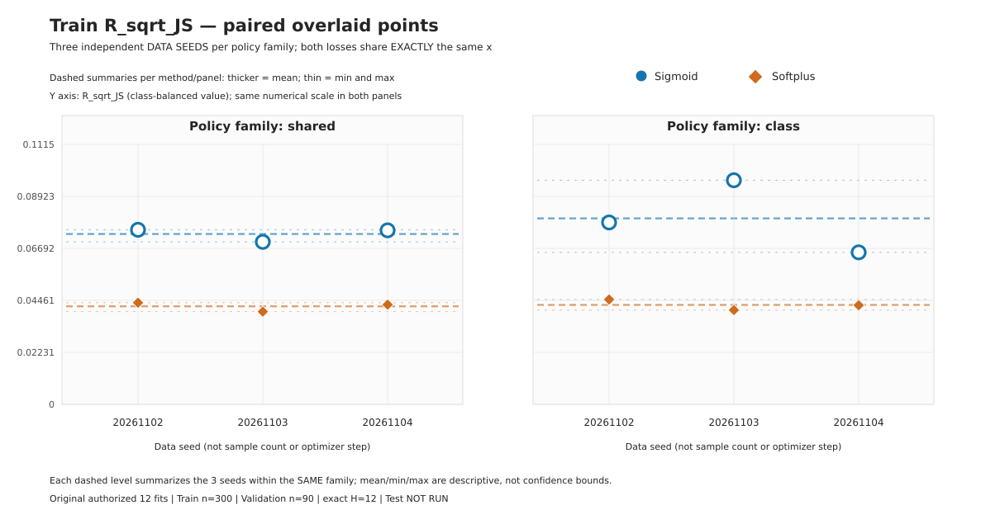

[مشاهدهٔ مستقیم SVG شکل 7](figures/phase2_repro_v3/phase2_train_R_sqrt_JS_six_pairs.svg)

**تعریف:** برای هر نمونه ابتدا ریشهٔ JSD محاسبه و سپس میانگین متوازن گرفته می‌شود؛ `R_sqrt_JS` عموماً برابر `sqrt(R_JS)` نیست. **خوانش:** در تمام شش جفت، نقطهٔ Softplus مقدار کمتری از Sigmoid دارد. خط‌چین‌های هر روش، دامنه و میانگین سه بذر را فقط برای همان خانواده خلاصه می‌کنند؛ میانگین‌ها شاهد توصیفی هستند نه فاصلهٔ اطمینان. **نتیجه:** Softplus برای این سنجهٔ تراکم و این split برتری یکنواخت داشته، اما از این واقعیت نمی‌توان برتری Validation BA را نتیجه گرفت.

##### شکل 8 — `R_sqrt_JS` روی Validation

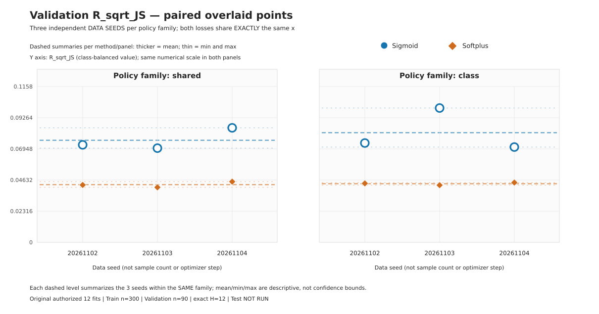

[مشاهدهٔ مستقیم SVG شکل 8](figures/phase2_repro_v3/phase2_validation_R_sqrt_JS_six_pairs.svg)

**تعریف:** برای هر نمونه ابتدا ریشهٔ JSD محاسبه و سپس میانگین متوازن گرفته می‌شود؛ `R_sqrt_JS` عموماً برابر `sqrt(R_JS)` نیست. **خوانش:** در تمام شش جفت، نقطهٔ Softplus مقدار کمتری از Sigmoid دارد. خط‌چین‌های هر روش، دامنه و میانگین سه بذر را فقط برای همان خانواده خلاصه می‌کنند؛ میانگین‌ها شاهد توصیفی هستند نه فاصلهٔ اطمینان. **نتیجه:** Softplus برای این سنجهٔ تراکم و این split برتری یکنواخت داشته، اما از این واقعیت نمی‌توان برتری Validation BA را نتیجه گرفت.

#### شکل ۹ — روند نسبی تابع زیان در ۲۵ به‌روزرسانی Adam

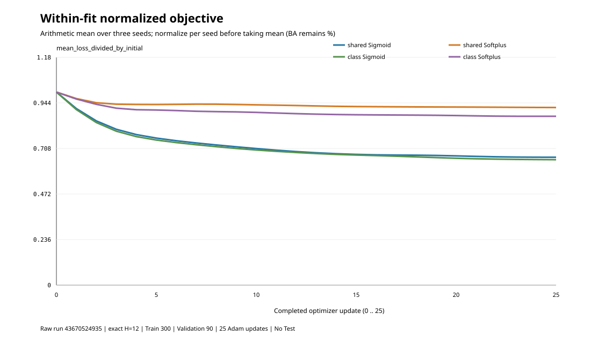

[مشاهده فایل مستقل SVG](figures/phase2_repro_v2/phase2_train_loss_relative_dynamics.svg)

**چه چیزی نشان می‌دهد؟** برای هر مدل در هر بذر ابتدا زیان گام (t) بر زیان همان مدل در گام صفر تقسیم شده؛ سپس سه نسبت برای یک ترکیب خانواده×زیان میانگین گرفته شده‌اند. بنابراین همه منحنی‌ها در گام صفر از **۱** آغاز می‌شوند و مقدار پایین‌تر نشان‌دهنده کاهش نسبی بیشتر همان زیان نسبت به شروع خودش است. مقیاس مطلق دو تابع متفاوت است؛ **نسبت‌های کمتر، اثبات بهتر بودن طبقه‌بندی یا همگرایی جهانی نیستند**. این منحنی‌ها صرفاً روند ثبت‌شده در ۲۵ به‌روزرسانی ثابت را نشان می‌دهند، نه انتخاب بهترین epoch.

#### شکل ۱۰ — روند نسبی هنجار گرادیان

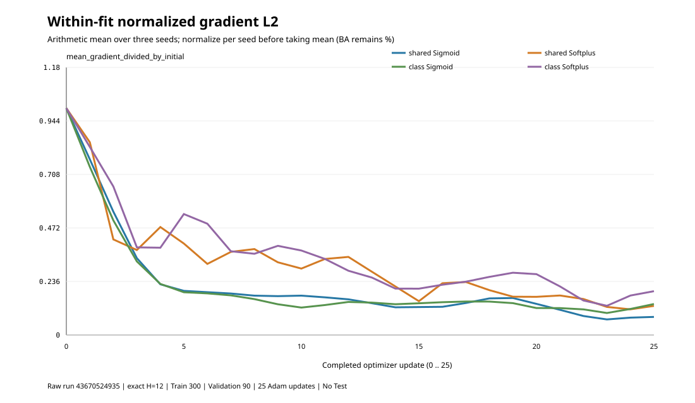

[مشاهده فایل مستقل SVG](figures/phase2_repro_v2/phase2_gradient_norm_relative_dynamics.svg)

**چه چیزی نشان می‌دهد؟** برای هر fit، `||∇L_t||₂ / ||∇L_0||₂` محاسبه و سپس سه بذر میانگین شده‌اند. مقدار ۱ در گام صفر قراردادی است. کوچک‌شدن هنجار گرادیان می‌تواند نشانه کاهش حساسیت محلی تابع هدف باشد ولی **گواه رسیدن به بهینهٔ سراسری یا بهتر شدن BA نیست**. نرمال‌سازی به دلیل تفاوت ذاتی مقیاس گرادیان Sigmoid و Softplus انجام شده و برای مخرج اولیه کمتر یا مساوی `10^-12` اجرای مولد شکل متوقف می‌شود.

#### تحلیل مشترک شکل‌های ۹ و ۱۰ — همگرایی نسبی و تبیین تفاوت روش‌ها

مقادیر زیر از [جدول ۱۰۴ نقطهٔ ردپای آموزش](derived/phase2_qa_fixes_v2/plot_trajectories.csv) استخراج شده‌اند و برای هر خانواده، **ابتدا نسبت نهایی به اولیه در هر بذر** و سپس میانگین سه نسبت را گزارش می‌کنند:

| خانوادهٔ سیاست | تابع زیان | نسبت زیان گام ۲۵ به گام صفر | نسبت هنجار گرادیان گام ۲۵ به گام صفر |
|---|---|---:|---:|
| shared | Sigmoid | 0.6625 | 0.0797 |
| shared | Softplus | 0.9201 | 0.1283 |
| class | Sigmoid | 0.6498 | 0.1366 |
| class | Softplus | 0.8746 | 0.1932 |

**نتیجهٔ پشتیبانی‌شده:** در هر دو خانواده، **هر دو تابع زیان تا گام ۲۵ کاهش زیان و کاهش محسوس هنجار گرادیان نسبی داشته‌اند**؛ نسبت گرادیان نهایی هر دو در یک مرتبهٔ بزرگی است، اما دقیقاً برابر نیست. پس اختلاف الگوی `R` و `I` را نمی‌توان به‌سادگی صرفاً با این ادعا توضیح داد که «یکی از دو روش اساساً کاهش گرادیان نداشته است». این شواهد **تفاوت هندسهٔ جواب‌های حاصل از دو هدف** را تقویت می‌کنند.

**مرز استنباط:** هنجارهای نشان‌داده‌شده **نسبت به مقدار اولیه خودشان** نرمال شده‌اند؛ بنابراین نزدیکی دو منحنی به معنای نزدیکی هنجارهای **مطلق** نیست. هیچ‌یک از دو منحنی اثبات نمی‌کند که هر دو مدل به بهینهٔ نهایی یا آستانهٔ همگرایی یکسان رسیده‌اند. هنوز ممکن است بخشی از اختلاف نتیجه ناشی از سرعت همگرایی، جهت گرادیان یا بودجهٔ محدود ۲۵ گام باشد. برای حذف این توضیح، آزمایش مستقل کنترل‌شده با بودجهٔ بیشتر لازم است. **برتری مشاهده‌شده مختص معیار است**: Softplus در `R` برای هر شش جفت و Sigmoid در `I` برای هر شش جفت بهتر بوده‌اند؛ در `Validation BA` برندهٔ یکنواخت نداریم.

#### شکل ۱۱ — سیر دقت متوازن Train در طول آموزش (محور ثابت ۷۰ تا ۱۰۰)

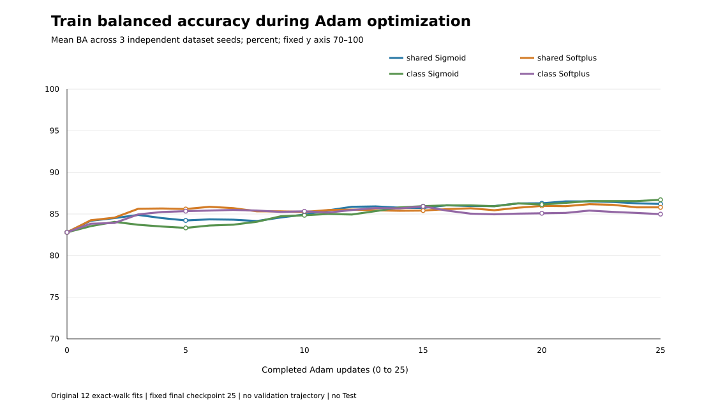

[مشاهده SVG اصلاح‌شدهٔ شکل ۱۱](figures/phase2_tex/figure11_train_BA_y70_100.svg) | [نسخه برداری PDF برای LaTeX](figures/phase2_tex/figure11_train_BA_y70_100.pdf)

**روش خواندن:** محور افقی تعداد به‌روزرسانی \`Adam\` از گام صفر تا ۲۵ و محور عمودی **دقت متوازن آموزش بر حسب درصد** است. برای آشکارشدن فاصله و تقاطع منحنی‌ها، **کران‌های محور عمودی دقیقاً ۷۰ و ۱۰۰ درصد** و فاصله برچسب‌ها پنج واحد درصد تنظیم شده‌اند. برای هر ترکیب خانواده و زیان، در هر گام ابتدا BA محاسبه‌شده در هر یک از سه بذر مستقل و سپس **میانگین حسابی** سه مقدار رسم شده است؛ خود BA به مقدار اولیه نرمال نشده است. نقاط کوچک روی منحنی‌ها مربوط به گام‌های ۰، ۵، ۱۰، ۱۵، ۲۰ و ۲۵ هستند.

**برداشت علمی:** چهار منحنی در طول آموزش بسیار نزدیک‌اند و تغییر ترتیب نسبی دارند. این شباهت در **Train BA** نمی‌تواند برابری پیش‌بینی‌های نمونه‌به‌نمونه یا یکسان‌بودن **Validation BA** را اثبات کند؛ جدول جفتی نشان داده است که اثر Validation با بذر و خانواده تغییر می‌کند. کاهش زیان و گرادیان‌های نسبیِ شکل‌های ۹ و ۱۰ نیز برابری سرعت همگرایی یا رسیدن به بهینهٔ مشترک را اثبات نمی‌کند. مرجع بیزیِ سه‌بذری در جدول Validation آورده شده است و **خط بیزیِ تک‌بذر به اشتباه روی این میانگین سه‌بذری آموزش رسم نشده است**. فقط checkpoint گام ۲۵ مبنای مقایسهٔ اصلی است.

**بازتولید شکل ۱۱، بدون آموزش و بدون Test:** [\`phase2_figure11_y70_100.py\`](phase2_figure11_y70_100.py) از فایل‌های SHA-تأییدشدهٔ \`trace.json\` محاسبه می‌کند. نسخه‌های اصلی v2 بدون تغییر باقی مانده‌اند.

**یادداشت بازتولید شکل‌ها:** شکل‌های ۱ تا ۸ از [کد تولید بازطراحی v3](phase2_figures_1_8_v3.py) و [مانیفست هش v3](derived/phase2_figures_1_8_v3_manifest.json) استفاده می‌کنند؛ **شکل‌های ۹ و ۱۰ همان SVG نسخهٔ v2 و بدون تغییر** هستند و شکل ۱۱ با [منبع مستقل اصلاح بازه ۷۰ تا ۱۰۰](phase2_figure11_y70_100.py) تولید شده است. یازده PDF برداری همگی در [پوشه شکل‌های آماده LaTeX](figures/phase2_tex) قرار دارند. کد تولید اصلی این سه شکل در [اسکریپت v2](phase2_derived_reproduce_v2.py) قرار دارد. دادهٔ شش جفت در [`plot_pairs.csv`](derived/phase2_qa_fixes_v2/plot_pairs.csv)، دادهٔ ۱۰۴ نقطه روند در [`plot_trajectories.csv`](derived/phase2_qa_fixes_v2/plot_trajectories.csv)، کد تولید در [`phase2_derived_reproduce_v2.py`](phase2_derived_reproduce_v2.py) و SHA256 شکل‌ها در [`plot_figure_manifest.json`](derived/phase2_qa_fixes_v2/plot_figure_manifest.json) قرار دارند. همهٔ شکل‌ها توصیفی‌اند، از Train/Validation به دست آمده‌اند و **هیچ دادهٔ Test** ندارند. چنانچه پیش‌نمایش SVG در GitHub نمایش داده نشود، پیوند «مشاهده فایل مستقل SVG» زیر هر شکل مسیر جایگزین است.


#### ۵.۱.۳. تفسیر و موارد پرسش از ممیز

Softplus در همه شش جفت چگالی درون‌کلاسیِ سنجیده‌شده با سه `R` را بهبود داده، درحالی‌که Sigmoid در همه شش جفت جدایی هندسی مراکز و میانهٔ حاشیهٔ Validation را بالاتر برده است. با وجود این، **دقت Validation ترکیبی و حساس به مولد/سیاست** است. مثال روشن `seed=20261103, class`: با `I` بیشتر Sigmoid (`0.135541` در برابر `0.020362`) و `R_JS` بدتر (`0.013907` در برابر `0.002322`)، BA آن `81.2068%` در برابر `85.8873%` است. این شواهد از یک trade-off احتمالی در هندسه خروجی پشتیبانی می‌کنند، نه از رابطه علّیِ تأییدشده بین objective و عملکرد.

**ممیزی لازم است** (۱) تعریف دقیق و پوشش `R_sqrt_JS` را از `standard_metrics` تطبیق دهد؛ (۲) گزارش‌های Train/Validation برای هر سه `R` را مستقل بازتولید کند؛ (۳) اختلاف `coverage.json` درباره `per_class_recall` را تعیین تکلیف کند؛ (۴) نشت Test و اعتبار پیش‌بینی در inference را کنترل کند؛ و (۵) تناسب ۳ seed برای هر ادعای آماری را بررسی نماید. در این مرحله داده‌های خام **قفل و بدون تغییر** باقی می‌مانند.

### ۵.۲. اصلاحات پس از ممیزی مستقل — بستهٔ مشتق‌شدهٔ نسخه دوم

رأی اولیه ممیز مستقل برای مأموریت `QA-E-CH4-13-PHASE2-FINAL-01` در [Issue #80](https://github.com/mahhammad/My-Thesis/issues/80#issuecomment-6889701832) برابر `ACCEPT_PHASE2_WITH_FIXES` بود. **آن رأی هنوز به پذیرش نهایی تغییر نکرده است.** این بخش تحویل اصلاحی پژوهشگر در پاسخ به موارد P1/P2/P3 را مستند می‌کند؛ ممیز باید مجدداً این خروجی‌ها را مستقل بررسی کند.

#### P1 — نسخه اصلاحی پوشش معیارها

در **هر یک از ۱۲ مدل**، فایل اصلی `coverage.json` دو فیلد `train.per_class_recall` و `validation.per_class_recall` را `not_measured` گزارش کرده بود، با اینکه مقدار Recall واقعی هر کلاس در `metrics_full.json/{train,validation}/per_class[].accuracy` و قطر ماتریس سردرگمی همان split قابل بازسازی است. **۲۴ وضعیت نادرست پوشش** شناسایی شد؛ این نقص در metadata است، نه خطای محاسبه Recall.

برای اصلاح، فایل‌های اصلی **به هیچ عنوان تغییر داده نشده‌اند**. نسخه `derived/phase2_qa_fixes_v2/coverage/<run_key>.json` یک کپی منشعب با اصلاح فقط همین دو status و دلیل علمی صریح است. [`coverage_index.json`](derived/phase2_qa_fixes_v2/coverage_index.json) شامل نام ۱۲ مدل، SHA256 پوشش اولیه، SHA256 معیار اصلی، SHA256 محصول اصلاحی و Recall هر سه کلاس روی Train/Validation است. معیار اصلی `per_class[].accuracy` در این مسئله، برابر Recall همان کلاس است؛ با تقسیم قطر confusion بر مجموع سطر کلاس مربوط تطبیق و به‌طور جداگانه آزمون شده است. در زمان گزارش‌کردن coverage، **نسخه v2** مرجع پوشش اصلاح‌شده و **raw اصلی** شاهد تاریخی بدون دست‌کاری است.

#### P2 — بازتولید نمودارها و شواهد نقطه‌ای

کد قطعی و بدون وابستگی آموزش [`phase2_derived_reproduce_v2.py`](phase2_derived_reproduce_v2.py) از فایل‌های خام موجود و با کنترل ۶۰ SHA256، ۱۲ سلول و ۲۶ checkpoint هر مدل استفاده می‌کند. تنها خروجی آن **۱۱ نمودار نسخه‌دار** در [`figures/phase2_repro_v2/`](figures/phase2_repro_v2) و دو جدول عددی همراه با پوشش اصلاح‌شده است. تصاویر قبلی در `figures/` برای بازبینی مالک **بدون تغییر حفظ شده‌اند**؛ فایل‌های v2 بازتولیدپذیر، کاندید نمودارهای علمی نهایی هستند و نباید با نمودارهای قبلی هم‌نام و بدون قید نسخه ادغام شوند.

برای بررسی داده‌های نمودارها:
- [`plot_pairs.csv`](derived/phase2_qa_fixes_v2/plot_pairs.csv): شش جفت، BA و `Delta I` و هر سه R روی هر دو مجموعه.
- [`plot_trajectories.csv`](derived/phase2_qa_fixes_v2/plot_trajectories.csv): ۴ سیاست/تابع زیان × ۲۶ گام؛ میانگین سه seed روی مقادیر **ابتدا در همان fit نرمال‌شده** و نیز Train BA بر حسب درصد.
- [`plot_figure_manifest.json`](derived/phase2_qa_fixes_v2/plot_figure_manifest.json): SHA256 تک‌تک ۱۱ SVG و hash مانیفست ورودی خام.

نرمال‌سازی زیان و گرادیان تنها وقتی مخرج اولیه هر fit **بیشتر از \(10^{-12}\)** است مجاز شناخته شده است؛ در غیر این صورت مولد نمودار با خطا توقف می‌کند، نه اینکه تقسیم بر صفر یا clipping مخفی انجام دهد. برای هر نوع نمودار از شواهد خامِ مربوط استفاده شده است؛ ستون‌های نمودار BA جفتی واحد «نقطه درصدی» دارند و منحنی Train BA در مقیاس درصد است. هیچ نموداری فاصله اطمینان، ادعای آزمون معناداری یا رابطه علّی ترسیم نمی‌کند.

**دستور بازتولید، بدون آموزش و Test، از ریشه مخزن:**

```bash
python code/experiments/ch4_loss_controlled_comparison/phase2_derived_reproduce_v2.py --check
python -m unittest discover -v -s code/experiments/ch4_loss_controlled_comparison -p 'test_phase2_derived_v2.py'
```

اجرای اول **هر ۲۷ فایل مشتق‌شده** (۱۲ پوشش اصلاحی، ۲ جدول CSV، ۲ manifest JSON، ۱۱ SVG) را بایت‌به‌بایت با محاسبه جدید از raw مقایسه می‌کند و هیچ فایل موجود را تغییر نمی‌دهد. [`test_phase2_derived_v2.py`](test_phase2_derived_v2.py) علاوه بر آزمون ثبات، سناریوی جعل یک فایل raw، شمار شکل‌ها، صحت Recall و کنترل مخرج نرمال‌سازی را بررسی می‌کند. [workflow ویژه بازتولید](https://github.com/mahhammad/My-Thesis/blob/c9c71ce923590ffd8cae6242c9992e30240e1ba1/.github/workflows/e-ch4-13-phase2-derived-fixes-v2.yml) فقط با تریگر صریح و بدون مجوز آموزش فعال شد و فایل‌ها را در شاخه آزمایش ثبت کرد. **این ثبت به معنی رأی مثبت مجدد ممیز نیست.**

#### P3 — دامنه استنباط و مرز انتشار

داده‌های ۱۲ fit با SHA آموزش `cdb45644c245e04a276eb2a419e4d64f71c6c18a` همچنان ثابت هستند؛ commitهای بعدی صرفاً گزارش و مشتقات را ثبت کرده‌اند. ادعای علمی مجاز محدود به جهت تفاوت‌های توصیفی روی **سه seed مستقل** و دو خانواده سیاست است. `R↓` یا `I↑` یا margin↑ شرط کافی برای `BA↑` نیست. اختلاف مقیاس گرادیان دو زیان، افق محدود `H=12` و نبود ارزیابی Test مانع رتبه‌بندی عمومی می‌شود. **با دستور جدید مالک، نگارش محدود E-CH4-13 در LaTeX انجام شده است؛ تا رأی مجدد ممیز، PR #79 Draft می‌ماند و اجرای مدل جدید یا ادغام نتایج مجاز نیست.**


### ۶. جمع‌بندی و گیت انتشار

مقایسهٔ دوازده‌تایی با حفظ پروتکل پایان یافته و شواهد نشان می‌دهند ارتباط `R`، `I`، حاشیه و BA حساس به مولد و خانواده سیاست است. این یافته برای فصل چهارم مهم است ولی با سه مولد مصنوعی و بدون داده Test **نتیجه نهایی درباره تعمیم** یا انتخاب تابع زیان برتر نیست. درخواست از ممیز مستقل در [Issue #80](https://github.com/mahhammad/My-Thesis/issues/80): بازبینی شواهد بایتی، اندازه‌گیری metric coverage و هماهنگی برچسب‌های `per_class_recall`، صحت losses و engine، عدم نشت Validation/Test، اعداد raw-derived و اعتبار استنباط. متن E-CH4-13 با دستور جدید مالک به `tex/chapter4.tex` افزوده شده است؛ پذیرش علمی و ادغام PR #79 همچنان منوط به ممیزی مستقل و تصمیم مدیر پژوهش است.

**وضعیت:** `PHASE2_READY_FOR_INDEPENDENT_QA`؛ نه `ACCEPT_SCIENTIFIC`. PR #79 نباید ادغام شود و Test همچنان `NOT_RUN` است.


## پایلوت علمی پیش از فاز دوم (شاهد مستقلِ کوچک‌تر)

> دو fit ده‌گامی و یک seed، فقط برای صحت مسیر اجرا و مشاهده اولیه؛ با نتایج ۱۲ fit فاز دوم یکی فرض نشود.

## E-CH4-13 — گزارش پایلوت مقایسه کنترل‌شده دو تابع زیان IMC
**RESEARCHER-06 | ۱۴ نوامبر ۲۰۲۶ | وضعیت: PILOT_READY_FOR_QA / PROVISIONAL — NOT INDEPENDENTLY ACCEPTED**

**مرجع مأموریت:** [Issue #78](https://github.com/mahhammad/My-Thesis/issues/78)؛ رأی `ACCEPT_PREFLIGHT_DESIGN_WITH_CONDITIONS` در [کامنت مدیر](https://github.com/mahhammad/My-Thesis/issues/78#issuecomment-6880231186). **مرجع خام:** [results/pilot_seed20261102_shared_two_fits/](results/pilot_seed20261102_shared_two_fits). **PR:** [#79](https://github.com/mahhammad/My-Thesis/pull/79)، Draft؛ ممنوعیت مرج برقرار است.

### ۱. پرسش و حدود ادعا
آیا تابع سیگموئیدی حاشیه JS و Softplus چندرقیبی JS تحت داده، خانواده سیاست، مقداردهی اولیه، تعداد به‌روزرسانی و τ ثابت، مسیر یادگیری و BA متفاوتی می‌سازند؟ این پایلوت برای صحت pipeline و مشاهده رفتار طراحی شده؛ **یک seed و ۱۰ گام هیچ برتری آماری یا انتخاب نهایی تابع زیان را اثبات نمی‌کند**. هر اختلاف می‌تواند به مقداردهی اولیه، مقیاس گرادیان، داده، checkpoint یا محدودیت بهینه‌سازی وابسته باشد.

### ۲. روش محاسباتی و قرارداد
- مولد مصنوعی استاندارد سه‌کلاسه/پنج‌ویژگی، فقط Train/Validation؛ seed داده `20261102`، زیرمجموعه طبقه‌متناسب `n=50` با reference seed `20261107` و reference_ids قفل‌شده در manifest؛ Validation=۹۰. هیچ Test تولید/ارزیابی نشده است.
- سیاست `shared` به شکل `(d+1,d)`، شروع صفر جفت‌شده. Adam، نرخ یادگیری `0.12`، دقیقاً **۱۰ update** برای هر objective، `float64`، گشت امید دقیق با `β=.4`، `λ=.8`، `H=12`، ماسک موجود، منع بازگشت به نمونه مبدأ.
- امتیاز نامزد از شباهت نرمال‌شده JS به مرکز Train و برچسب نامزد مستقل از حقیقت Validation استفاده می‌کند. تعریف معیارهای عمومی به فصل سوم `tex/chapter3.tex` و `COMMON_METRICS_CONTRACT.json` ارجاع دارد. مراکز Validation بازبرازش نشده‌اند.
- تابع اول `ℓτ(m)=σ(−m/τ)` با `τ=.005` و کاهش متوازن روی کلاس‌ها؛ تابع دوم `τ·logsumexp_c((s_c−s_y)/τ)` با همان `τ=.005` و کاهش متوازن. پیاده‌سازی آموزشی از `replay_v1.objective_loss` و `train_missing_objectives.train_loss` canonical reuse می‌کند. **مقیاس عددی و گرادیان دو objective برابر نیست**؛ برابر بودن optimizer و steps مساوی بودن اثر آموزشی نیست.
- snapshotها طبق `imc-snapshot-v2` (دو فایل `model.json` و `distributions.npz`)، همراه `metrics_full.json`، `trace.json` و SHA256 هر فایل ذخیره شدند. گزارشگر `report_snapshot.py` raw را مستقلاً با Train/Validation و fingerprintها بازخوانی می‌کند.

### ۳. نتیجه مشاهده‌شده (پایلوت؛ بدون ادعای برتری)
اعداد جدول از `results/pilot_seed20261102_shared_two_fits/manifest.json` و `metrics_full.json` بازخوانی شده‌اند. BA به درصد، هندسه و تراکم بدون بعد:

| هدف آموزش | Train BA (%) | Validation BA (%) | I ↑ | R_JS ↓ | R_KL ↓ | R_sqrt_JS ↓ |
|---|---:|---:|---:|---:|---:|---:|
| Sigmoid-JS τ=.005 | 78.7607 | **87.7551** | .063964 | .008345 | .032668 | .070982 |
| Softplus-JS τ=.005 | **83.9915** | 82.6400 | .021570 | **.002669** | **.010484** | **.040228** |

اختلاف مشاهده‌شده Validation BA برابر **۵٫۱۱۵ واحد درصد به سود سیگموئید** است؛ در عوض Softplus در Train BA حدود **۵٫۲۳ واحد درصد بالاتر** دارد و سه تراکم R پایین‌ترند. در این نمونه کاهش پراکندگی `R_JS` و افزایش دقت آموزش، همراه افزایش دقت Validation نبوده‌اند. سیگموئید `I` بالاتر و پراکندگی درون‌کلاسی بیشتر دارد. این شواهد محدود، مستقل از بافت پایلوت نتیجه قطعی درباره رابطه `R/I/BA` نیستند.

**حاشیه تصمیم Validation:** میانه حاشیه برای سیگموئید `0.029507` و برای Softplus `0.006437` است. هیچ تساوی گزارش نشده. ماتریس سردرگمی با سطر حقیقت و ستون پیش‌بینی:

- Sigmoid: `[[13,0,0],[5,38,6],[0,4,24]]`؛ Recall کلاس‌های ۰/۱/۲ به‌ترتیب `1.0000, .7755, .8571`.
- Softplus: `[[12,1,0],[6,36,7],[0,5,23]]`؛ Recall `.9231, .7347, .8214`.

مقادیر NLL، Softplus، sigmoid، تمام پنج جدایی `T/BT/TNL/BTNL/I`، ماتریس فاصله مراکز، تمام Rها و توزیع حاشیه در `metrics_full.json` هر objective موجود است. فایل `coverage.json` برای ۴۳ شناسه split/metric در هر objective مقدار `measured` دارد؛ Test به‌صورت `not_applicable` و سنجش پیک حافظه `not_measured` دلیل‌دار ثبت شده‌اند.

### ۴. زیان، گرادیان و محدودیت مقیاس
| هدف | زیان ابتدا | زیان پایان | norm2 گرادیان ابتدا | norm2 گرادیان پایان |
|---|---:|---:|---:|---:|
| Sigmoid-JS | .3482500 | .2201254 | .1063069 | .0181370 |
| Softplus-JS | .00322562 | .00277090 | .000658662 | .000113791 |

هر دو مقدار loss مخصوص خودشان کاهش یافته‌اند، ولی این lossها کمیت هم‌مقیاس نیستند. norm گرادیان آغاز سیگموئید تقریباً ۱۶۱ برابر Softplus است؛ **مقایسه عدد خام loss دو خانواده بی‌معناست**. تمام ۱۱ نقطه از آغاز `step=0` تا `step=10` در `trace.json` هر هدف ثبت شده؛ checkpoint انتخاب‌شده از پیش endpoint نهایی بوده، نه بیشینه Validation.

### ۵. بازتولید، PASS/FAIL/NOT_RUN و خطاهای واقعی
- گیت ۲۲ آزمون پیش از اجرا در [CI #43614497613](https://github.com/mahhammad/My-Thesis/actions/runs/43614497613) **PASS**: ۸ اختصاصی + ۴ قرارداد معیار + ۷ snapshot + ۳ roundtrip. `run_experiment.py` پیش‌فرض DRY_RUN است و بدون محیط `E_CH4_13_PREFLIGHT_PASS=true` و `--execute` آموزش نمی‌دهد.
- اجرای اصلیِ دو fit در همان CI انجام شد، اما **job به علت خطای کدنویسی پس از fit در ساخت coverage.json FAIL شد** (تبدیل dictionary چندک‌های حاشیه به float). این شکست پنهان نشده است: [artifact raw اولیه](https://github.com/mahhammad/My-Thesis/actions/runs/43614497613/artifacts/14121258818) شامل ۸ فایل immutable حفظ شد؛ SHA256 ZIP در log: `d243b375f4b0034d31069760dbc0606dfbd93ea91ca28965a732d2c6708ee0d1`.
- **صفر آموزش اضافی:** فرایند `finalize_existing.py` فقط همان فایل‌ها را از artifact اولیه بازخوانی کرده و مدل/داده، fingerprint، trace، hash و گزارشگر را کنترل نموده و سپس manifest/coverage/CSV/SVG را محاسبه کرده است. [CI بازیابی موفق #43615046534](https://github.com/mahhammad/My-Thesis/actions/runs/43615046534) **PASS**؛ git commit بازیابی `58d1430519c31602269fc8eaaf7f8ea15ed5da98`. عددهای جدید از **آموزش جدید** نیستند.
- تلاش نخست بازیابی [#43614895487](https://github.com/mahhammad/My-Thesis/actions/runs/43614895487) با تشخیص کلی fingerprint mismatch متوقف شد؛ پس از افزودن گزارش تفکیکی هریک از چهار fingerprint، اجرای بعدی همه کنترل‌ها را PASS کرد. علت اختلاف fingerprint در ممیزی تکمیلی به **تفاوت مسیر BLAS در مولد NumPy** ردیابی شد. در CI شماره 43615893696 با NumPy 2.4.6، `OPENBLAS_CORETYPE=Haswell` و `Zen` برای Train/Validation fingerprint متفاوت داشتند، اما `SkylakeX` و `generic` دقیقاً با hashهای فایل اصلی مطابقت داشتند؛ config/label counts تغییر نکرده بود. این رفتار را نباید نشت یا تخریب داده دانست، اما نشان می‌دهد `seed` تنها برای بازتولید *بایت‌به‌بایت* کافی نیست. ازاین‌رو CI اختصاصی روی `OPENBLAS_CORETYPE=generic`، `OPENBLAS_NUM_THREADS=1`، NumPy 2.4.6 و Torch CPU 2.15.0 قفل شده است. بررسی cross-platform فراتر از محیط Linux/x86_64 هنوز انجام نشده است. فایل خام اولیه دست‌نخورده مانده است.
- تست‌های heavy/full300/multiseed/Test و QA علمی مستقل و XeLaTeX/PDF: **NOT_RUN**. هیچ به‌روزرسانی `tex/` یا فایل تاریخچه‌ای انجام نشده. ادعای پذیرش غیرمرکزمحور QA76 داده نشده است.

### ۶. مسیر فایل‌ها و گیت جانشینی
- `results/pilot_seed20261102_shared_two_fits/manifest.json` و `coverage.json`، `metrics_summary.csv`، `validation_ba.svg`
- `results/pilot_seed20261102_shared_two_fits/<objective>/model.json`، `distributions.npz`، `trace.json` و `metrics_full.json`، همگی با hashes در manifest
- کد اجرا: `run_experiment.py`، کد بدون آموزش بازیابی `finalize_existing.py`، آزمون سبک `test_e_ch4_13_preflight.py`، گیت GitHub Actions `.github/workflows/e-ch4-13-*.yml`.
- گزارش علمی تنها نتیجه مقدماتی این پایلوت را بیان می‌کند؛ مانع انجام/ثبت خطاهای فرایندی نیست. پس از گیت مدیر، تفسیر در بخش ۴.۱۳ و شکل/جدول پایان‌نامه فقط با قبول QA مستقل جایز است.

**گیت مورد درخواست:** `PILOT_READY_FOR_QA`، نه ACCEPTED و نه مجوز اجرای اصلی. مدیر باید raw و manifest، تکرار بی‌آموزش fingerprint و پوشش معیارها، مقیاس گرادیان، ارتباط با فصل سوم و کد را مستقلاً ممیزی کند. **۱۸/۲۴ fit و Test/مرج ممنوع‌اند.**


### ۷. ریشه‌یابی تکمیلی fingerprint (بدون آموزش)
[تشخیص کنترل‌شده #43615893696](https://github.com/mahhammad/My-Thesis/actions/runs/43615893696) نشان داد که OpenBLAS در مسیر تولید داده NumPy می‌تواند خروجی floating-point بایت‌به‌بایت متفاوت تولید کند. هردو fingerprint ویژگی Train و Validation با `OPENBLAS_CORETYPE=generic` و `SkylakeX` عیناً برابر هش‌های ذخیره‌شده‌اند، ولی با `Haswell` و `Zen` نابرابر. SHA کانفیگ و برچسب‌های تقسیم ثابت ماندند. برای کنترل مستقل، آزمون‌های raw باید پیش از import NumPy با dispatch قفل‌شده اجرا شوند؛ تغییر تلرانس به‌جای رفع اختلاف ممنوع است. نگهداری immutable دادهٔ واقعی Train/Validation (بدون Test) علاوه بر seed برای پژوهش‌های آینده توصیه می‌شود. در این مأموریت هیچ raw و نتیجه تاریخی تغییر نکرده است.


## قرارداد پیش‌ثبت، مجوز و کنترل اعتبار شواهد

### سند منشأ: `phase2_preregistration.md`

## E-CH4-13 / Phase 2 — پیش‌ثبت مقایسه کنترل‌شده n=300

**وضعیت:** `PHASE2_DESIGN_ONLY / NO_FIT` — ۱۴ نوامبر ۲۰۲۶، RESEARCHER-06، Issue [#81](https://github.com/mahhammad/My-Thesis/issues/81). **دستور جدید مدیر:** ممیزی **علمی نهایی** تا پس از تکمیل شواهد چندمولدی به تعویق افتاده است. Issue [#80](https://github.com/mahhammad/My-Thesis/issues/80) هنگام بررسی باز و فاقد رأی بود؛ برای هر fit جدید، **ممیزی فنی مقدماتیِ جداگانه و مجوز رسمی اجرای آموزش در GitHub** به‌علاوه PASS واقعی CI لازم است. نبود هرکدام → NO_FIT.

### پرسش علمی و فرضیه پیشینی
آیا تغییر تابع زیان از `sigmoid_JS_margin_tau005` به `softplus_JS_tau005` در جفت‌هایی با موتور و داده یکسان، جهت `Δ Validation BA` و رابطه `R_KL/R_JS/R_sqrt_JS`, `I` و حاشیه را در مولدهای مستقل و دو policy خانواده حفظ می‌کند؟ فرض صفر توصیفی: نشانه و بزرگی دلتا میان مولد/خانواده ناپایدار است؛ هیچ inferential p-value/CI قوی یا «برتری عمومی» با سه مولد ادعا نمی‌شود.

### پروتکل قفل‌شده
- مولد: `code/data_generator/config.json` از main؛ در مرحله طراحی فقط از `dataset_adapter.dataset_train_val` سه Train=۳۰۰ و Validation=۹۰ برای `data_seeds=[20261102,20261103,20261104]` ساخته شد. خروجی به‌صورت **immutable** در `inputs/phase2_train_validation/` همراه فایل‌به‌فایل SHA256 و fingerprint ویژگی/برچسب/ماسک منجمد شد (data-only CI #43622826092، commit `561a391d1c165075aee1d95a192c0bffcb4e2506`). همه fitهای آینده باید داده را **فقط از همان NPZهای ثابت** بخوانند، بدون تولید/خواندن Test. بازتولید بایت‌به‌بایت از seed در CPU دیگر، شرط لازم reuse تاریخی است، نه شرط لازم استفاده از این آرایه‌های SHA-verified.
- `families=[shared,class]`؛ `objectives=[sigmoid_JS_margin_tau005,softplus_JS_tau005]`. برای class، مراکز Train بر اساس بازنمایی همان فرض کاندید؛ همه فرض‌ها برای Validation بدون اطلاع `y_val` محاسبه می‌شوند. `node/node_class` خارج دامنه.
- جفت هر `seed×family` با `reference_ids=0..299` ثابت (کل Train؛ هیچ زیرنمونه تصادفی)؛ `K=3,d=5`، ماسک و gamma از config همان بذر؛ `beta=.4,lambda=.8,H=12`، exact `float64`، logits صفر، Adam `lr=.12`، **۲۵ update برای هر fit**، `τ=.005` width، checkpoint endpoint=25. بدون Validation early stop، reselect یا optimize-on-Test.
- `sigmoid`: `mean_c mean_{i:y_i=c} σ(-(s_y-max_{r≠y}s_r)/τ)`؛ `softplus`: `mean_c mean_{i:y_i=c} τ log Σ_{r=0}^{K-1} exp((s_r-s_y)/τ)`. score `s_c=1−JSD(Q_{i,c},V_c)/ln 2`. کاهش متوازن کلاس دقیقاً یکسان؛ ولی سطح و norm/direction گرادیان دو هدف به‌طور ذاتی ناهم‌مقیاس است.
- grid کامل `3×2×2=12` خانه، سقف **۱۲ fit جدید** در مجموع؛ اجرا/تکرار شکست هم باید در دفتر بودجه شمارش شود، retry خودکار ممنوع. قبل از execute باید برپایه checksum موجودی تاریخی تصمیم قطعی reuse ثبت شود، نه بازچرخانی پنهان fit جدید. هر objective خارج دو مورد/seed خارج سه مورد/horizon یا budget متفاوت → خطا.
- هر گام ۰ تا ۲۵: value objective، gradient norm L2/Linf، norm به‌روزرسانی، cosine گرادیان بین دو loss در checkpointهای مشترک (در صورت ممکن از یک policy ثابت بدون optimizer اضافی)، train margin، elapsed؛ metadata dtype/library/BLAS/split/reference.
- دو snapshot خام `model.json` + `distributions.npz` برای هر fit، `trace.json`، `metrics_full.json` و `coverage.json`؛ یک `provenance.json` و manifest با SHA256 و no Test. `R_KL` support-aware/∞ دلیل‌دار، `R_JS`، `R_sqrt_JS=mean sqrt`، `I/T/BT/TNL/BTNL`، BA/Acc، per-class recall/confusion، ties، margin quantiles، همه NLL/surrogateهای موجود. جدول و شکل فقط از raw ساخته شود.
- دلتا جفتی `BA_sigmoid−BA_softplus` و اختلاف recall، flip count بین پیش‌بینی‌های Validation دو مدل همان seed/family، margin quantiles؛ برای هر family روی **سه مولد** mean و sample SD (ddof=1)، بدون تلقی تعداد Validation یا گام‌های optimizer به‌عنوان تکرار مستقل.
- Test مطلقاً ممنوع؛ مرحله پایان‌نامه و merge فقط پس از QA و رأی مدیر.

### ترتیب گیت و شرط توقف
1. `PHASE2_DESIGN_READY`: قرارداد، موجودی reuse، runner محافظت‌شده و fixture/tests بدون آموزش، ثبت SHA و checkpoint Issue #81.
2. بر اساس دستور جدید مدیر، رأی **علمی نهایی** بعد از مطالعه اصلی خواهد بود. پیش از هر fit جدید باید ممیزی **فنی مقدماتی مستقل** و **مجوز رسمی اجرای آموزش** با پیوند GitHub قابل‌تأیید ثبت شده باشند؛ نبود این دو → `NO_FIT`. نه گزارش پژوهشگر و نه فایل JSON به‌تنهایی مجوز محسوب نمی‌شوند.
3. تمام preflightهای engine/origin/mask/gradient/tau/class multi-hypothesis/Train-only center/label leakage/KL/coverage/snapshot/fingerprint و budget/opt-in واقعی روی **همان SHA** PASS با log. `NOT_RUN` اجازه نیست.
4. فقط opt-in صریح همراه evidence و گیت فعال‌شده توسط مدیر، batch دقیقاً تا سقف ۱۲ fit. هر mismatch یا NaN/خرابی raw/سنجه → `STOP` و جلوگیری از retry. هر تلاش به‌محض ورود به optimizer در دفتر بودجه مصرف می‌شود.
5. `PHASE2_READY_FOR_INDEPENDENT_QA` با raw، checksum، گزارش علمی، provenance و جدول/شکل واقعی. تا پیش از QA هیچ نتیجه عام یا تغییر `tex/`.

### خطرات از پیش ثبت شده
- BLAS-dependent byte fingerprints در پایلوت: `OPENBLAS_CORETYPE=generic`, `OPENBLAS_NUM_THREADS=1`، NumPy=2.4.6، Torch CPU=2.15.0؛ **هر سه seed** باید با fingerprint و محیط قفل‌شده در raw ثبت شوند. اختلاف بایتی بی‌مجوز قابل اغماض نیست.
- برچسب Validation فقط در گزارشگر و محاسبه BA بعد از freeze سیاست/مرکز مجاز است؛ حضور در fit/ساخت prediction هرگز.
- خروجی تاریخی `n300×25` فقط در صورت تطبیق کامل داده، bytes/config، reference IDs، family، objective/τ، init/optimizer/steps/engine code و checkpoint قابل reuse است؛ در غیر این صورت `NOT_COMPARABLE`، نه حذف یا انتساب به phase2.
- استفاده از ۳ seed از یک generator، جای چند dataset واقعی یا آزمون تعمیم جامع را نمی‌گیرد. هر نتیجه باید تفسیر محدود داشته باشد.


### سند منشأ: `preregistration.md`

## E-CH4-13 — پیشنهاد پیش‌ثبت (تا تصویب مدیر اجرا نشود)
**Owner RESEARCHER-06 | Based on main@ac5892ad166ce300a2044e3303d4adaa1a21d7d7 | status PROPOSAL**

- پرسش: اختلاف paired Validation BA میان objectiveها تحت Train/Validation و start/optimizer/steps یکسان؛ آیا I↑ و R↓ به بهبود BA مربوط می‌شوند؟
- واحد مستقل: داده مصنوعی از seedهای 20261102/03/04؛ *نمونه‌های همان generator* و checkpointهایش واحد مستقل تازه نیستند.
- اولویت خانواده‌ها: shared و class با همه فرض‌های نامزد برون‌گراف. node/node_class بدون شروع معتبر خارج از دامنه.
- داده/موتور: K=3، d=5، n=300؛ Validation موجود هر seed؛ β=.4, λ=.8, H=12, float64 و exact، gamma و reference IDs frozen از config/manifest.
- فقط پس از تصویب: سه objective اول sigmoid JSD τ=.005 / Softplus JS τ=.005 / KL normalized historical NLL؛ چهارمی NLL_KL_simple فقط با رأی مدیر. baseline uniform و raw تاریخی reuse فقط پس از fingerprint + checksum.
- آموزش: Adam lr=.12، ۲۵ گام، paired zero-init؛ هیچ انتخاب checkpoint/τ با Test. اگر random init در دور بعد اضافه شود، seed_init مستقل، یکسان در pair و گزارش صریح.
- گسترش KL margin / sqrtJS margin / maxI / combined I-R-margin، τ=.002/.020، چندشروعی/گرادیان تک‌نمونه **در این طرح خودکار مجاز نیست**.
- ملاک اصلی: paired Δ Validation BA در سطح seed generator. ثانوی: recall/class, confusion, ties, true margin quantiles, R_KL exact, R_JS, R_sqrt_JS, I/T/BT/TNL/BTNL, NLL/Softplus/sigmoid, time and gradient norm.
- aggregate: میانگین و SD توصیفی اختلاف‌های paired برای هر خانواده؛ سه seed برای CI قوی کافی نیست. عدم اختلاف و شکست نیز نگهداری شوند.
- کنترل خطر: validation label perturbation استقلال logits/pred؛ no Test; stop on nonfinite train gradient/loss, bad simplex, unsupported KL ambiguity, checksum/config mismatch, mask/origin mismatch, undefined query start.
- مرحله اول پیشنهادی *بعد از گیت*: فقط ۲ fit (shared × sigmoid/softplus، seed=20261102، n=50، ۱۰ گام، Adam .12، init صفر). پیش از هر fit تمام fixtureهای lightweight باید PASS واقعی داشته باشند. بودجه پیشنهادی **مجوز فعلی اجرا نیست**.
- نتایج و گزارش: immutable model.json/distributions.npz + sha256, full metrics, coverage reason codes, trace/manifest, independent tests, tables and figures from same data source.
- state: ALL TESTS NOT_RUN; NO TRAINING; NO TEST; READY_FOR_PREFLIGHT_REVIEW requested.


### سند منشأ: `PHASE2_DESIGN_CHECKPOINT_FA.md`

## E-CH4-13 / RESEARCHER-06 — PHASE2_DESIGN_READY

**مأموریت:** [Issue #81](https://github.com/mahhammad/My-Thesis/issues/81) | **PR باز:** [#79 Draft](https://github.com/mahhammad/My-Thesis/pull/79) | **شاخه:** `experiment/ch4-loss-controlled-comparison-01` | **وضعیت:** `PHASE2_DESIGN_READY / NO_FIT / PRELIMINARY_TECHNICAL_QA_REQUIRED`.

### تصمیم مدیریتی جاری
ممیزی علمی نهایی E-CH4-13 تا جمع‌آوری شواهد چندمولدی به تعویق افتاده است. این تصمیم به معنای مجوز آموزش نیست. **ممیزی فنی مقدماتی مستقل، PASS واقعی کد مرحله دوم و اجازه کتبی اجرای آموزش جدید در GitHub باید جداگانه تعیین و ثبت شوند.** هنگام آماده‌سازی این گزارش Issue #80 باز و فاقد رأی ممیزی بود. فایل `phase2_execution_gate.json` با `training_authorized=false` قفل مانده؛ اجرای `--execute` فاقد مجوز است. حتی پس از مجوز، حداکثر ۱۲ fit؛ Test/merge/LaTeX ممنوع.

### بسته تحویل مرحله A
- `phase2_preregistration.md`: سؤال علمی، متغیرهای ثابت، کاهش balanced و خطر تفاوت scale، تجزیه تحلیل توصیفی سه seed
- `phase2_plan_manifest.json` و `phase2_protocol.py`: **۳ بذر × ۲ خانواده shared/class × ۲ تابع Sigmoid-JS/Softplus-JS = ۱۲ job**، full300، ۲۵ update، `τ=.005,β=.4,λ=.8,H=12,Adam lr=.12,float64`، init صفر، endpoint ثابت
- `phase2_inventory_reuse.csv`: دوازده خانه مطالعه و نامزدهای تاریخی؛ **هیچ نمونه تاریخی هنوز واجد شرایط reuse تأییدشده معرفی نشده است** چون هش raw، reference IDs، engine و شرایط عددی باید بررسی شوند
- `inputs/phase2_train_validation/manifest.json` و `ds<seed>_train_val.npz` برای seedهای `20261102/03/04`؛ فقط Train=300 + Validation=90، Test هرگز تولید نشده؛ **ساخت و راستی‌آزمایی داده بدون آموزش** در [GitHub Actions #43622826092](https://github.com/mahhammad/My-Thesis/actions/runs/43622826092)، کامیت بایتی `561a391d1c165075aee1d95a192c0bffcb4e2506`
- `phase2_frozen_data.py` و `phase2_data_preflight.py`: کنترل SHA فایل‌ها، هر آرایه و ماسک، کلاس‌ها، config و موارد عدم تطابق BLAS؛ همه fitها تنها از frozen NPZ خواهند خواند
- `phase2_runner.py`: dry-run، گیت fail-closed، استارت ۱۲ خانه ثابت، norm گرادیان/جهت و update، جلوگیری از تکرار، hash و snapshot raw، متریک canonical، ممنوعیت Test
- `phase2_report.py`: محاسبه کامل متریک مشترک از داده منجمد و snapshot با مراکز Train و `benchmark_v1/report_snapshot.standard_metrics`
- `phase2_aggregate.py`: تحلیل توصیفیِ جفتی BA/recall/flip/margin و mean/SD واقعی سه seed؛ تا قبل از همه ۱۲ raw با خطا متوقف می‌شود
- `test_phase2_*.py`، `.github/workflows/e-ch4-13-phase2-design.yml`: تست‌ها بدون fit، شامل derivative finite-difference، class hypotheses، leakage، ماسک، snapshot، KL، بودجه/گیت، raw integrity و data contract
- فایل‌های هشت‌گانه خام پایلوت و گزارش/خطاهای گذشته **بدون تغییر**؛ تثبیت SHA آنها در `test_phase2_pilot_unchanged.py`.

### شواهد واقعی CI و ضعف‌ها
- [CI اولیه مرحله دوم #43621841462](https://github.com/mahhammad/My-Thesis/actions/runs/43621841462) FAIL به‌علت عدم تطبیق fingerprint بازتولید تاریخی پایلوت در بعضی runnerها؛ خطا **به معنای تخریب snapshotها نیست**، و به شکل درستی متوقف شد
- [CI ۳۵ تست مرحله دوم #43621973697](https://github.com/mahhammad/My-Thesis/actions/runs/43621973697) PASS در runner سازگار با raw تاریخی
- [CI داده‌ای #43622826092](https://github.com/mahhammad/My-Thesis/actions/runs/43622826092) PASS پس از یک شکست اولیه import torch در freeze tool که با NumPy-only fingerprint رفع شد؛ بدون Test و بدون training
- [CI تست‌های جداشده مرحله دوم #43623071697](https://github.com/mahhammad/My-Thesis/actions/runs/43623071697) PASS، ۳۹ تست: ۱۷ phase2 + ۸ engine/pilot-fixture + ۴ canonical common metrics + ۷ snapshot pipeline + ۳ roundtrip. تست‌های phase2 طبق قرارداد raw frozen، SHA هر هشت فایل پایلوت، قرارداد گیت و no-leakage را راستی‌آزمایی کردند.
- بازتولید دوباره generator روی سخت‌افزار متفاوت ممکن است byte-exact نباشد؛ فایل‌های frozen ورودی واقعی مرحله دوم را قفل می‌کنند. **بازتولید بایت‌به‌بایت پایلوت تاریخی روی همه runnerها ادعا نمی‌شود**. ممیز فنی باید سازگاری داده‌های frozen با پروتکل و reuse تاریخی را مستقل بررسی کند.
- همه fitهای phase2، معیارهای عددی phase2، نمودارهای واقعی، QA علمی نهایی، Test و XeLaTeX = `NOT_RUN`.

### محل تداوم برای جانشین
شاخه جدید نسازد و خام پایلوت و `inputs/phase2_train_validation` را تغییر ندهد. ابتدا Issue #81 و مجوز رسمی فنی، سپس `phase2_execution_gate.json`، `phase2_protocol.py`، `phase2_plan_manifest.json` و گزارش CI روی همان commit را بررسی کند. تا مجوز کتبی مشخص **هیچ fit** اجرا نشود. در صورت هر FAIL یا عدم تطابق SHA، STOP و checkpoint در Issue.

**درخواست گیت بعدی:** ممیزی فنی مقدماتی مستقل از پژوهشگر ۰۶ و سپس تصمیم جداگانه مدیر درباره اجازه حداکثر ۱۲ fit. این تحویل، **مجوز خودکار آموزش** یا پذیرش علمی نتیجه نیست.


### سند منشأ: `PHASE2_DATA_FREEZE_CHECKPOINT_FA.md`

## E-CH4-13 — Checkpoint قفل داده مرحله دوم

**مرحله:** `PHASE2_DESIGN_DATA_FREEZE`؛ پیش از هر fit و بدون Test.
**فرمان جدید مدیر:** ممیزی علمی نهایی پس از مطالعه چندمولدی؛ اجرای مدل صرفاً بعد از ممیزی فنی مقدماتی و مجوز رسمی جداگانه در GitHub. رأی Issue #80 تاکنون ثبت نشده؛ مجوز آموزش همچنان **NO_FIT** است.

**اقدام داده‌ای مجاز و غیرآموزشی:** workflow `.github/workflows/e-ch4-13-phase2-freeze-inputs.yml` سه مجموعه `Train=300,Validation=90` را از seedهای `20261102/03/04` تحت config main و محیط NumPy 2.4.6/OpenBLAS generic یک‌بار می‌سازد؛ هیچ Test و هیچ optimizer وجود ندارد. فایل‌های `inputs/phase2_train_validation/ds<seed>_train_val.npz` و manifest شامل SHA256 bytes/arrays/masks و config تولید و بعد با خوانش مستقل اعتبارسنجی خواهند شد. تغییر یا overwrite ممنوع است.

**هدف علمی:** جلوگیری از تغییر بی‌صدای نمونه‌های Training/Validation در اثر مسیر محاسباتی BLAS بین runnerهای GitHub و حفظ جفتی بودن داده‌های هر seed×family×objective. این داده‌های تازه باید برای تفسیر مقایسه با اجرای تاریخی با fingerprint ارزیابی شوند؛ هم‌نامی seed به‌تنهایی reuse را توجیه نمی‌کند.

**گیت:** صرفاً بعد از اجرای موفق workflow و بررسی مستقل checksum `DATA_FROZEN_NO_FIT` ثبت خواهد شد. این عمل هیچ مجوزی برای ۱۲ آموزش صادر نمی‌کند؛ `phase2_execution_gate.json` باید تا مجوز رسمی مدیر BLOCKED باقی بماند.

**Checkpoint commit trigger:** فقط درخواست قفل ورودی، نه درخواست آموزش.

### Freeze attempt 1: NOT_RUN
اولین CI freeze به دلیل import غیرضروری torch در ابزار fingerprint قبل از ساخت فایل شکست خورد. این وابستگی حذف شد و fingerprint NumPy-only با canonical fingerprint در fixture سنجیده می‌شود. هیچ مجموعه داده‌ای در شاخه commit نشده و هیچ آموزش انجام نشده بود. تلاش دوم فقط برای ساخت داده ثابت Train/Validation است.


### سند منشأ: `PHASE2_P0_HARDENING_CHECKPOINT_FA.md`

## تحویل اصلاحات P0 مرحله دوم — E-CH4-13 / RESEARCHER-06

**مرجع مدیریتی:** [Issue #81 / TECHNICAL_PREFLIGHT_ACCEPT_WITH_FIXES](https://github.com/mahhammad/My-Thesis/issues/81#issuecomment-6883629540)  
**شاخه:** `experiment/ch4-loss-controlled-comparison-01`؛ PR #79 همچنان Draft؛ `main` و `tex/` بدون تغییر.  
**وضعیت اجرای واقعی:** `NO_FIT / TECHNICAL_FIXES_IMPLEMENTED / AWAITING_MANAGER_REVIEW_AND_EXPLICIT_EXECUTION_AUTHORIZATION`.  
**ممیزی علمی نهایی:** پس از نتایج چندمولدی. **هیچ برنامه‌ای به‌صورت خودکار آموزشی اجرا نمی‌کند.**

### P0-1 — گیت مجوز رسمی و یک‌بارمصرف
- [`phase2_github_gate.py`](phase2_github_gate.py): با GitHub token واقعی، head شاخه و SHA دقیق، کامنت تأیید اصلاحات فنی `TECHNICAL_PREFLIGHT_FIXES_ACCEPTED` و کامنت **جداگانه متأخر** `PHASE2_EXECUTION_AUTHORIZED` از صاحب مخزن در Issue #81 را می‌خواند. هر دو باید `candidate_sha=<exact40hex>` و `max_fits=12` *یکتا* داشته باشند. نتیجه CI طراحی باید `conclusion=success` روی همان SHA در workflow `e-ch4-13-phase2-design.yml` باشد. pagination ناشناخته، SHA/branch نامعتبر، کامنت جعلی/متناقض و CI ناموفق STOP.
- [`e-ch4-13-phase2-authorized.yml`](https://github.com/mahhammad/My-Thesis/blob/c9c71ce923590ffd8cae6242c9992e30240e1ba1/.github/workflows/e-ch4-13-phase2-authorized.yml): فقط `workflow_dispatch` از شاخه مصوب و با اعتراف صریح کاربر؛ هیچ `push` trigger ندارد. قبل از fit مجوز را **آنلاین** بررسی و بر اساس SHA، به‌شکل اتمیک یک Git tag/ref `refs/tags/e-ch4-13-phase2-budget-spent-<SHA>` ایجاد می‌کند. اگر قبلاً وجود داشته باشد GitHub 422 و STOP. این نشانگر با شکست CI پاک نمی‌شود. concurrency تک‌گروهی، `cancel-in-progress: false`، اجرای غیرمجاز متوقف.
- `phase2_runner.py`: علاوه بر بررسی gate موقت (فقط در runtime و بدون commit)، خواندن مجدد رأی آنلاین/CI و وجود SHA marker از GitHub؛ تطبیق `GITHUB_RUN_ID`، branch/workflow، runtime pinned، رمز تصادفی یک‌بارمصرف، خروجی تازه. JSON gate پیش‌فرضِ committed همچنان BLOCKED است. توکن داخل raw/provenance/artifact نوشته نمی‌شود.
- **قید مهم:** فایل workflow مستقیماً در گیت واقعی اجرا نشده است، چون مجوز رسمی هنوز وجود ندارد. آزمون‌های تستِ GitHub با mock/fixture هستند، نه شاهد اجرای مجاز ۱۲ fit؛ تأیید عملکرد واقعی آنلاین پس از صدور مجوز باقی می‌ماند.

### P0-2 — شکست میانی و بودجه
- برای هر یک از **حداکثر ۱۲** خانه `attempt_charges/<run>.json` و `budget_checkpoints/attempt_NN.json` **پیش از ورود به optimizer** با حالت immutable ایجاد می‌شود.
- `optimizer_checkpoints/<run>/step_XX.json` همه گام‌های تکمیل‌شده شامل logits و trace را ثبت می‌کند؛ `optimizer_updates_applied_to_stored_logits` مستقل از `evaluated_at_updates` است. این checkpointها **فقط شواهد** هستند و مجوز resume/retry نیستند.
- پس از fit، `trace.json` قبل از snapshot/report ذخیره می‌شود. snapshot/metric/coverage/evidence هر خانه جداست؛ شکست optimizer یا report به `failures/` ثبت و استثناء دوباره صادر می‌شود؛ manifest نهایی فقط پس از کامل‌شدن ۱۲ خانه. وجود حتی خروجی ناقص مانع rerun می‌شود.
- در workflow حفاظت‌شده، `actions/upload-artifact@v4` با `if: always()` و retention=90 روز **تمام نتایج ناقص و کامل** را حتی هنگام CI FAIL ذخیره می‌کند. نشانگر مصرف GitHub مستقل از طول عمر artifact باقی می‌ماند. این نگهداری ۹۰روزه دائمی نیست و باید هنگام تحویل نتایج در مخزن بایگانی نهایی انجام شود.

### P0-3 — تست کامل مصنوعی، بدون optimizer واقعی
[`test_phase2_hardening.py`](test_phase2_hardening.py) موارد زیر را در fixture پوشش می‌دهد: تأیید آنلاین صحیح، رد فقدان رأی/صاحب غیرمجاز/چند SHA/ترتیب غلط، عدم موفقیت CI، شاخه و HEAD غلط، تکرار نشانگر یک‌بارمصرف، عدم ایجاد gate هنگام خطای اعتبارسنجی، تزریق شکست fit و باقی‌ماندن budget و failure files، رد fingerprint تغییرکرده قبل از هر optimizer، و **اجرای mock تمام ۱۲ خانه از gate تا raw/coverage/CSV/manifest**. آزمون مثبت تجمیع ۱۲ خانه در `phase2_aggregate.py` جداگانه با fixture عددی و ۶ paired comparison اجرا شده است. تست‌ها فقط mock هستند؛ هیچ optimizer جدیدی اجرا نشده و Test خوانده نشده است.

### تاریخچه CI، خطاها و وضعیت
- قبل از P0: [CI #43623484023](https://github.com/mahhammad/My-Thesis/actions/runs/43623484023): ۴۰ PASS روی `970eba66`.
- طی اصلاحات، [CI #43637454103](https://github.com/mahhammad/My-Thesis/actions/runs/43637454103) FAIL روی fixture گیت جدید (SHA مبهم، کنترل duplicate)؛ مورد اصلاح شد.
- [CI #43637661792](https://github.com/mahhammad/My-Thesis/actions/runs/43637661792) FAIL روی mock snapshot که برخلاف `save_snapshot` اصلی، پوشه‌ای حاوی trace را ممنوع می‌کرد؛ fixture با رفتار canonical منطبق شد.
- [CI #43637787275](https://github.com/mahhammad/My-Thesis/actions/runs/43637787275) روی `aa0dcecc21a832d2edb8a6fc0cb48ac6965e347e`: **۵۰ آزمون PASS**؛ ۲۸ تست phase2 + ۸ engine + ۴ common metrics + ۷ snapshot + ۳ roundtrip. کد پس از این SHA فقط برای افزودن ستون نهایی CSV موجودی reuse و تهیه همین گزارش تغییر یافته است؛ روی SHA تازه نیز CI باید مستقل PASS شود.
- CI قدیمی پایلوت [#43637342310](https://github.com/mahhammad/My-Thesis/actions/runs/43637342310) در تشخیص fingerprint تولید مجدد با BLAS جدید FAIL شد؛ نه انکار و نه جایگزین موفقیت CI فاز۲ است. داده‌های اصلی n=300 از frozen NPZ تاییدشده خوانده می‌شوند؛ داده خام پایلوت ۲ اجرا و تاریخچه خطاها دست‌نخورده مانده‌اند.

### وضعیت reuse و تصمیم ایمن
[`phase2_inventory_reuse.csv`](phase2_inventory_reuse.csv) تمام ۱۲ خانه را پوشش می‌دهد؛ هر مورد تاریخی `NOT_COMPARABLE_FOR_REUSE` **در معنای نبود شواهد کافی برای اثبات برابری بایتیِ داده/پروتکل/کد** است، نه ادعای اثبات تفاوت عددی. هیچ خروجی تاریخی بی‌تطبیق به phase2 الصاق نمی‌شود. بودجه جدید حداکثر ۱۲ fit است، اما بدون رأی/اجازه **صفر**.

### درخواست رأی مدیر
گیت اصلاحات فنی `P0_FIXES_SUBMITTED_FOR_MANAGER_REVIEW`؛ پس از CI نهاییِ SHA جاری، مدیر می‌تواند این سه اصلاح را مستقل بازبینی کند. برای فعال‌سازی، دو رأی رسمی متوالی صاحب مخزن در **Issue #81** با markerها و `candidate_sha` قفل‌شده لازم‌اند. تا ثبت آن‌ها `NO_NEW_FIT` قطعی است. اجرای واقعی این workflow و پذیرفته‌شدن علمی نتایج هنوز `NOT_RUN / NOT_VERIFIED` است؛ PR #79 Draft/بدون merge.

### گیت استقرار GitHub Actions — محدودیت جداگانه و باز
طبق مستندات رسمی GitHub، `workflow_dispatch` تنها وقتی در دسترس قرار می‌گیرد که فایل workflow روی **default branch** موجود باشد. در بررسی این تحویل، `.github/workflows/e-ch4-13-phase2-authorized.yml` روی `main` موجود **نیست** و تنها روی شاخه آزمایش اضافه شده است. بنابراین **با وجود PASS تست‌های mock/CI، workflow اجرای دستی هنوز عملیاتی/قابل dispatch تأییدشده نیست** و این بخش `DEPLOYMENT_BLOCKED / NOT_RUN` باقی می‌ماند.

**تصمیم لازم مدیر:** پیش از هر fit، با یک مجوز مستند جداگانه فقط bootstrapِ فایل workflow حفاظت‌شده روی default branch را انجام دهد (بدون ادغام PR #79 یا کد/داده/LaTeX آزمایش)، یا راهکار اجرایی معادل و مستقل را تعیین و ممیزی کند. تا آن زمان هیچ اجرای واقعی نباید شروع شود. بعد از bootstrap، SHA شاخه آزمایش باید دوباره CI PASS بگیرد و workflow با همان SHA/کامنت‌های واقعی امتحان شود؛ آزمون مجوز بدون fit می‌تواند با رأی مدیر انجام شود، ولی خلق tag مصرف بودجه تنها هنگام اجرای اصلی مجاز است.

**منبع:** https://docs.github.com/en/actions/reference/workflows-and-actions/events-that-trigger-workflows#workflow_dispatch


### سند منشأ: `RECOVERY_CHECKPOINT_FA.md`

## E-CH4-13 — RECOVERY_CHECKPOINT_01

**وضعیت:** PILOT_REPORTING_FAILURE / RAW_PRESERVED / NO_RETRAINING.

- گیت قبل از پایلوت: [GitHub Actions run 43614497613](https://github.com/mahhammad/My-Thesis/actions/runs/43614497613)، job guard-and-test **SUCCESS**: ۲۲ آزمون PASS.
- job اجرا: **FAIL** پس از دو fit مصوب، در ساخت `coverage.json`، به‌دلیل `TypeError: float() argument must be a string or a real number, not 'dict'` در تبدیل `margin_quantiles` که نوع آن dictionary است. این خطا در معیار اجرای آموزش و گرادیان گزارش نشده؛ جای دقیق خطا مرحله *post-fit reporting* بوده است.
- artifact سالم‌شده پیش از خطای گزارش: [raw artifact 14121258818](https://github.com/mahhammad/My-Thesis/actions/runs/43614497613/artifacts/14121258818)، ۸ فایل خروجی: `model.json`، `distributions.npz`، `metrics_full.json`، `trace.json` برای هر یک از دو هدف. Artifact SHA256 ZIP در لاگ: `d243b375f4b0034d31069760dbc0606dfbd93ea91ca28965a732d2c6708ee0d1`.
- طبق سقف دو fit مدیریتی، **هیچ training دیگری مجاز نیست**. فقط بازیابی raw از همان artifact، اعتبارسنجی هش/داده/فایل‌های مدل و بازساخت بدون optimizerِ `manifest.json`، `coverage.json`، `metrics_summary.csv` و SVG توسط `finalize_existing.py` انجام می‌شود.
- این checkpoint گواه موفقیت نهایی نیست؛ provenance نهایی مربوط به کامیت اجرای اولیه `66a007928e129ad6dd5acffeaa93fc2485ee9775` می‌ماند. کل commitهای بعدی صرفاً recovery و reporting هستند. هر عدم تطابق یا شکست بازخوانی باید `PILOT_BLOCKED` شود و raw حفظ شود.
- گیت بعدی: `PILOT_READY_FOR_QA` فقط در صورت موفقیت بازیابی و ممیزی مستقلی که مدیر تعیین کند. PR #79 همچنان Draft و unmerged است.

### Recovery attempt 1 (zero training)
[CI #43614895487](https://github.com/mahhammad/My-Thesis/actions/runs/43614895487): دانلود هر ۸ فایل raw موفق شد؛ کنترل fingerprint با پیام کلی FAIL شد و بدون گزارش عددی توقف کرد. کد بازیابی فقط برای چاپ کلید و هش نامنطبق سخت‌گیرانه‌تر شد؛ هیچ تغییری در raw یا optimizer وجود ندارد. اجرای بازیابی بعدی هم فقط read/recompute است.

### Root cause verified — BLAS dispatch, not extra training
[CI #43615893696](https://github.com/mahhammad/My-Thesis/actions/runs/43615893696) با `OPENBLAS_CORETYPE=Haswell/Zen` X hashes را متفاوت و با `SkylakeX/generic` دقیقاً برابر داده خام اولیه پیدا کرد؛ config hash و labels بدون اختلاف. مولد از NumPy multivariate_normal و مسیر محاسباتی BLAS استفاده می‌کند؛ seed به تنهایی تضمین بایت‌به‌بایت بین dispatchهای متفاوت نیست. CI جدید با `OPENBLAS_CORETYPE=generic`, `OPENBLAS_NUM_THREADS=1`, NumPy 2.4.6 قفل شد؛ عدم انطباق همچنان FAIL است، هیچ fingerprint جعلی/ریست نمی‌شود. پایلوت دوباره آموزش داده نشده و trigger آن در .github/workflows/e-ch4-13-pilot.yml با if:false قفل شد.

### Pinned reproducibility gate (final methodological repair)
On [CI #43616289674](https://github.com/mahhammad/My-Thesis/actions/runs/43616289674), `OPENBLAS_CORETYPE=generic`, `OPENBLAS_NUM_THREADS=1` and exact NumPy/Torch versions reproduced both frozen Train/Validation hashes and passed the complete lightweight and saved-evidence test suites. The earlier experimental `OPENBLAS_CORETYPE=SkylakeX` caused an illegal instruction on another runner in [#43616173241](https://github.com/mahhammad/My-Thesis/actions/runs/43616173241), so unsafe multi-dispatch probing was removed from default CI. No change was made to original 8 raw files or to policy weights; the pilot remained exactly two fits. Results remain PROVISIONAL pending independent scientific audit.


### سند منشأ: `PILOT_EXECUTION_AUTHORIZATION_FA.md`

## E-CH4-13 — مجوز اجرای پایلوت و ثبت گیت

**مدیر:** RESEARCH-MANAGER-04، Issue #78، [رأی رسمی](https://github.com/mahhammad/My-Thesis/issues/78#issuecomment-6880231186): ACCEPT_PREFLIGHT_DESIGN_WITH_CONDITIONS / CONDITIONAL_TWO_FIT_PILOT.

**Preflight evidence:** [CI #43614287838](https://github.com/mahhammad/My-Thesis/actions/runs/43614287838) PASS روی `fa65f37c82328c3b4178283ff1a17628a7a7b13b` و [CI #43614360524](https://github.com/mahhammad/My-Thesis/actions/runs/43614360524) PASS روی `f166d6a519b5440ec5ba1f065c1b459d733ebef1` با تست‌های مستقل، تست‌های canonical و dry-run بدون optimizer. در CIهای اولیه FAILهای واقعی fixture tie و نحوه فراخوانی تست ثبت شده و با اصلاح فقط در پوشه E-CH4-13 و workflow مربوط بسته شدند.

**حد ثابت اجرا:** فقط `data_seed=20261102`، `reference_seed=20261107`، `n=50`، ۳ کلاس، ۵ ویژگی، policy=shared، Adam `lr=.12`، logits صفر، `beta=.4,lambda=.8,H=12`، `float64` و دو objective `sigmoid_JS_margin_tau005` و `softplus_JS_tau005`، دقیقاً ۱۰ update برای هر کدام. هیچ انتخاب model/checkpoint از Validation و هیچ دسترسی Test مجاز نیست.

**Gate rerun:** workflow `.github/workflows/e-ch4-13-pilot.yml` با شناسه کامیت اجرا تنها پس از PASS تمام تست‌های سبک در همان workflow اجازه fit می‌دهد و حداکثر دو fit دارد. خروجی باید در `results/pilot_seed20261102_shared_two_fits/` شامل model.json، distributions.npz، metrics_full.json، trace.json، manifest.json، coverage.json و خلاصه CSV/SVG به صورت immutable ثبت شود. GitHub Actions اجازه مرج ندارد؛ PR #79 Draft باقی می‌ماند.

**گیت بعدی:** PILOT_READY_FOR_QA تنها با موفقیت واقعی CI، وجود raw و checksum، گزارش محدودیت و ممیزی مستقل. `18/24` fit، grid، full300، Test و مرج همچنان ممنوع.

**Checkpoint:** این سند مجوز آغاز خودکار همان پایلوت پس از عبور مجدد از CI است، نه ادعای اتمام یا پذیرش نتیجه.


### سند منشأ: `PHASE2_ARCHIVE_REQUEST_FA.md`

## E-CH4-13 / 2026-11-15 — authorized archival checkpoint

**Purpose:** Run the no-training archive workflow once on the already-successful [official phase2 Actions run #43670524935](https://github.com/mahhammad/My-Thesis/actions/runs/43670524935). This is **NOT** an optimizer trigger or an extension of the 12-fit cap.

- Training source SHA: `cdb45644c245e04a276eb2a419e4d64f71c6c18a`.
- Archive artifact ID: `14144445918`.
- Original archive ZIP SHA256: `26e7a94e36edeae2a3153b76b40cf282c30b550a3fac359558a20d11e72c3e3e`.
- Validation: 12 full raw models, 312 optimizer state checkpoints, 12 immutable charge markers, full metric/source SHA, exact 25-update traces, no Test.
- No Test, no new training, no edit to historical pilot, no LaTeX, no PR #79 merge. Outcome remains provisional until independent scientific QA.

The GitHub Actions archival workflow is restricted to this single explicit marker in the commit message and fails closed if `results/phase2_300_25` already exists. It copies original bytes rather than fitting models.


### سند منشأ: `RESEARCHER-06_READINESS_REPORT.md`

## RESEARCHER-06_READINESS_REPORT — E-CH4-13
**۱۴ نوامبر ۲۰۲۶ | پژوهشگر:** RESEARCHER-06 | **مدیر:** RESEARCH-MANAGER-04
**وضعیت:** READY_FOR_PREFLIGHT_REVIEW / DESIGN_ONLY / NO_HEAVY_RUN
**مبنا:** main@ac5892ad166ce300a2044e3303d4adaa1a21d7d7 (پس از PR #77) | Issue #78
**دامنه:** مقایسه کنترل‌شده تابع زیان IMC؛ آموزش جدید، Test و تغییر LaTeX انجام نشده است.

### ۱. مدل و استنتاج
در IMC حالت هر گشت زوج (نمونه،ویژگی) است؛ گام کامل از انتخاب ویژگی بعدی (self-loop ویژگی در صورت مجاز بودن) و جهش عمودی به نمونه دیگر تشکیل می‌شود. ماسک ویژگی ناموجود، یال غیرمجاز و ممنوعیت بازگشت به *مبدأ همان قطعه گشت* در کل طول گشت اعمال می‌شوند؛ بازدید مجدد دیگر نمونه‌ها ممکن است. طول گشت هندسی با β است، λ وزن گام‌های مشاهده‌شده را کنترل می‌کند، H سقف محاسبه دقیق است؛ تقریب ماتریسی با MC یکسان نیست. قرارداد پایه β=.4، λ=.8، H=12، dtype=float64 است.

چهار خانواده عددی Z: shared=(d+1,d)، class=(K,d+1,d)، node=(n,d+1,d)، node_class=(K,n,d+1,d). سطر اضافی مربوط به *شروع* است؛ class به فرضیه کلاس مبدأ وابسته است نه برچسب گره میانی. پیش‌بینی برای نامزد c از بازنمایی مخصوص فرض c و مرکز c استفاده می‌کند. مراکز V_c صرفاً میانگین بازنمایی‌های **Train کلاس c** هستند و در Validation ثابت می‌مانند. برای هر نمونه Validation همه K فرضیه بدون y_val اجرا می‌شوند؛ برچسب Validation فقط پس از تولید logits/predictions برای سنجش به کار می‌رود. تنها shared/class بدون قانون شروع افزوده، بیرون‌گراف معتبرند. node/node_class آزاد به query_start قابل‌اثبات و مجزا نیاز دارند؛ Validation بدون آن **undefined**, نه صفر. مدل ترکیبی class_tied_node نیز خانواده مستقلی است و در مطالعه اصلی وارد نمی‌شود.

با امتیاز تصمیم s_ic=1-JSD(Y_i^(c),V_c)/ln(2)، پیش‌بینی argmax با رفع تساوی به کمترین اندیس و حاشیه واقعی m_i=s_i,y−max_(r≠y)s_i,r تعریف می‌شود. BA میانگین recall کلاس‌هاست، نه Accuracy معمولی. R_KL=D_KL(Y_i||V_y) جهت‌دار و support-aware، R_JS میانگین JSD و R_sqrt_JS **میانگین جذرهای تک‌نمونه** است. T/BT/TNL/BTNL/I از مراکز Train با وزن کلاس برابر محاسبه می‌شوند. هیچ‌یک به تنهایی تضمین BA نیست.

تابع سیگموئیدی **پهنایی** ℓτ(m)=σ(−m/τ) و مشتق −ℓτ(1−ℓτ)/τ است؛ از فرم تاریخی σ(−τm) متمایز. در m=0 گرادیان نسبت به m برابر −1/(4τ) است و در tie، ℓτ=.5 ولی خطای محافظه‌کارانه ۱ است. مشتق max رقیب در tie غیر یکتا است. Softplus چندرقیبی با τ log∑exp((s_ic−s_i,y)/τ)، NLL روی JS، NLL ساده بر −KL، NLL نرمال تاریخی بر -(d−mean(d))/std(d)، و max_I / combined_I_R_margin تعریف‌های متفاوت و gradient scale متفاوت دارند؛ به‌صورت نادرست هم‌نام نشوند.

### ۲. شواهد موجود و شکاف واقعی
مرجع خام موجودی **master_runs_76.csv** با ۷۶ ردیف، data_seed, objective, family, tau, steps, file و sha256 است (blob: bcc2d7f4a4f39301973eb53c465ff05a6b4d0f21). جدول حاضر **شمار اجرا**ست، نه شمار seedهای مستقل:

| بلوک | خانواده | objective | seed مولد | بودجه | وضعیت استنباط |
|---|---|---|---|---|---|
| core / ۱۶ | ۴ خانواده × (max_I + margin_JSD با τ=.002/.005/.020) | 20261102 | n=300، ۵۰ گام Adam .12 | موجود؛ shared/class دارای Validation، node* فقط Train؛ تک‌مولد |
| extra / ۱۲ | ۴ خانواده × (margin_sqrtJSD، margin_KL، combined_I_R_margin) | 20261102 | n=300، ۲۵ گام Adam .12 | موجود؛ بین سه objective همین بلوک paired محتمل است، باید init/indices raw تصدیق شود؛ با core ۵۰گامی **هم‌بودجه نیست** |
| size / ۴۸ | ۴ خانواده × nهای ۵۰ تا ۳۰۰، ۲۵ گام margin_JSD τ=.005 (۲۴ پایه + ۲۴ الحاقی shared/class) | 20261102/03/04 فقط برای shared/class؛ سایر خانواده‌ها محدودتر | ۲۵ گام؛ زیرمجموعه‌های درون مولد تو در تو | ۳۶ اجرای shared/class سه‌بذری در شش n؛ **تنها یک objective**، نه مقایسه چندبذری lossها |
| gapfill / ۸ | shared/class × NLL_JS_similarity، NLL_KL_simple، NLL_KL_normalized، softplus_JS_tau005 | 20261102 | n=300، ۲۵ گام Adam .12، init صفر | آموزش مستقیم در GitHub؛ شاهد تک‌مولد و با توابع/مقیاس متفاوت |
| retrospective / ۷۶ | posthoc NLL/Softplus/sigmoid روی logits ذخیره‌شده | مطابق checkpoint | optimizer=۰ | بازامتیازدهی **نیست** آموزش با همان loss |
| E-CH4-07 | ۱۸ ارزیابی تشخیصی (۳ checkpoint × ۶ τ)، ۳ آموزش ۵۰گامی shared و ۳۶ size run | موجود | مختلف | ۱۸ تشخیص seed مستقل نیست و τ=.020 با .005 نتایج متفاوت دارد |

شاهد موجود: در داده seed=20261102 برای shared با ۲۵ گام، Validation BA سیگموئید قبلی τ=.005 برابر 97.96%، NLL_JS حدود 89.46%، NLL_KL_simple حدود 89.46%، NLL_KL_normalized حدود 97.28% و Softplus حدود 96.77% گزارش شده؛ در class، NLL_normalized حدود 98.64% ثبت شده است. این **نتیجه تک‌بذر تاریخی** و به معنی برتری پایدار نیست. در core ۵۰گامی، بیشینه I با BA پایین‌تر از حاشیه هم‌زمان شده و در checkpointهای مقید کاهش R لزوماً افزایش BA نداده است.

**شکاف واقعی:** هیچ جدول کامل loss×(shared/class)×سه مولد با seed/init/budget یکسان و raw تأییدشده برای تمام objectiveهای مورد نظر موجود نیست؛ اثر scale/τ و چندشروعی، اختلاف بین seeds و gradient conflict کامل اثبات نشده‌اند. تکرار ۷۶ run، ۸ اجرای NLL یا سه τ پیشین به‌تنهایی ارزش افزوده ندارد. برای pairing واقعی باید raw هر جفت را با manifest و reference IDs راستی‌آزمایی کرد؛ تا آن هنگام وضعیت cross-block=NOT_VERIFIED است.

منابع: benchmark_v1/RESULTS_FA.md، GAPFILL_2026-11-08_FA.md، results/master_runs_76.csv، results/new_objectives_25_summary.csv، sigmoid_margin_observational_evaluation/REPORT_FA.md، IDEA-006. PRهای قبلی QA76 تنها **center-only** ۸۳۶ مقدار را پوشش داده‌اند؛ QA تمامی BA/NLL/حاشیه‌های تاریخی blanket-accepted نیست.

### ۳. API و اصول reuse
- code/experiments/benchmark_v1/policy_interface.py: create_policy(family,parameters,*,n,k,d,n_query=0) و evaluate_policy(dataset,policy_family,policy_parameters,*,gamma,beta=.4,lam=.8,horizon=12). دومی آموزش/گزارش انجام نمی‌دهد.
- code/experiments/benchmark_v1/snapshot_pipeline.py: collect_representations(), save_snapshot(), load_snapshot(), array_fingerprint(), config_fingerprint(). schema=imc-snapshot-v2؛ دو فایل immutable model.json و distributions.npz؛ raw باید SHA256 داشته باشد.
- code/experiments/benchmark_v1/report_snapshot.py: standard_metrics(by_hypothesis,centers,labels,tau,*,split,per_sample=True)، report_snapshot()، save_report(). این **reporter اصلی قرارداد کلاس‌فرضی** است، نه metrics.report() با ورودی ساده N×K.
- code/policy_evaluator/metrics.py: jsd، sqrt_jsd، kl_divergence (support-aware)، center_metrics، class_centers، classify، report، normalized_nll، soft_margin_loss؛ center_metrics را reporter مشترک import می‌کند. برخی توابع مخصوص بازنمایی مشترک N×K اند و نباید جای امتیاز فرضیه‌ای N×K×K به کار روند.
- code/experiments/benchmark_v1/replay_v1.py: objective_outputs، objective_loss، fit، forward؛ آموزش sigmoid/max_I/margin_KL/margin_sqrtJSD/combined و اصطلاحات historical را فقط پس از test تطبیق API reuse می‌کنیم.
- code/experiments/benchmark_v1/train_missing_objectives.py: train_loss و load_graph/one_run برای چهار NLL/Softplus؛ ثابت بودن τ=.005 و init صفر در کد باید هنگام طراحی توسعه ثبت شود.
- code/experiments/benchmark_v1/engine.py: ExactMaskedWalk، گشت و موتور exact؛ کد مستقل جایگزین نوشته نمی‌شود.
- code/experiments/COMMON_METRICS_CONTRACT.json (v2)، COMMON_METRICS_FA.md، EXPERIMENT_REPORT_STANDARD_FA.md و REPORT_PRESENTATION_FA.md: نام فیلد، پوشش و تولید جدول از یک raw.

**ناسازگاری‌های بالقوه که باید تست شوند:** metrics.py:report با score یک بازنمایی در برابر تمام مراکز کار می‌کند؛ standard_metrics برای هر نامزد بازنمایی خودش را می‌گیرد. metrics.py:classify نیز تساوی را به کمترین اندیس می‌شکند ولی «exact tie» در reporter با atol=1e−12 گزارش می‌شود؛ تعریف tie_count عددی و argmax باید مستقل کنترل شود. تابع KL سنتی آموزش با clamp_min(1e−300) همان support-aware KL گزارش نیست. NLL_KL_normalized_historical همان smoothing نظری فصل ۳ نیست. در TRAIN میانگین مراکز، KL متناهی است اما در Validation ممکن است ∞ شود؛ مقدار null باید با coverage توضیح داده شود. رفتار derivative برای sqrt(JSD) نزدیک صفر و NLL normalization با std≈0 نیاز به fixture دارد.

### ۴. پیش‌ثبت مطالعه پیشنهادی (نه مجوز اجرا)
**واحد مقایسه** (generator seed, family, initialization seed, same reference IDs, same data split, objective). در طراحی اصلی فقط shared/class و n=300، K=3، d=5، ۹۰ Validation، β=.4 λ=.8 H=12، exact float64. داده‌های مستقل پیشنهادی 20261102/03/04 از مولد موجود؛ seed init جدا (برای paired zero-init مقدار شروع یکسان است و نیازی به ادعای «استقلال init seed» نیست)، RNG optimizer و هر nondeterminism جدا ثبت می‌شود. اگر random start پذیرفته شود، seed init از seed مولد جدا و در همه objectiveها جفت خواهد شد. ref IDs و train/val fingerprints، کلاس‌توازن، gamma، mask، architecture و کل ترتیب داده در هر pair یکسان باشند. عدم استفاده از Test اجباری.

**طرح اولیه candidateها**: ۱) sigmoid JSD τ=.005 مرجع، ۲) Softplus-JS τ=.005، ۳) NLL_KL_normalized_historical، ۴) NLL_KL_simple (چهارم در صورت تأیید هزینه/پیش‌پرواز). margin_KL / margin_sqrtJSD / max_I / combined و τهای .002/.020 **فقط توسعه بعدی مصوب**؛ فهرست قدیمی اجازه full-grid نیست. دو لایه نتیجه: مقایسه fixed optimizer steps/lr و تحلیل حساسیت scale/gradient norm؛ equal steps به معنای equal effective progress نیست. «equal compute» با بودجه ثابت steps/gradient evaluations و زمان/حافظه اندازه‌گیری‌شده، نه الزام برابری runtime. هیچ انتخاب پسینی بهترین τ بر اساس Test.

**تحلیل اصلی:** Validation BA paired و ΔBA برای هر مولد/خانواده، recallها و flip count، تغییر حاشیه صدک‌ها و hard error؛ secondary: Train R_KL دقیق و R_JS/R_sqrt_JS، I/T/BT/TNL/BTNL، gradient norm، initial/final training objective هرکدام در مقیاس خودش، زمان و حافظه. SD سه مولد فقط توصیفی و CI قطعی ادعا نشود. در تمام checkpointها loss/gradient و BA با همان تعریف محاسبه شود؛ گرادیان کلاس/نمونه برای تحلیل optional، نه برای آغاز پایلوت. ملاک توقف از قبل قفل شود؛ هیچ early stopping انتخابی از Validation در مقایسه اصلی.

**طرح multi-seed مشروط:** پس از پذیرش پایلوت، ۳ مولد × ۲ خانواده × ۳ objective اولیه × ۲۵ گام = ۱۸ fit؛ با اضافه‌شدن NLL_KL_simple ۲۴ fit. بازاستفاده از checkpointهای قدیمی فقط با شرط raw identity، optimizer config، code semantics و SHA معتبر؛ در غیر این صورت برچسب non-comparable. جدول های validation باید fold/seed-paired باشند، هر سه داده واحد مستقل، نه ۹۰ نمونه یا ۲۵ checkpoint مستقل.

### ۵. تست‌ها و STOP
| گیت | تست سبک و مرجع | وضعیت این checkpoint |
|---|---|---|
| موتور / mask / blocked / origin / exact / one-multistep | fixture graph ۲–۶ نمونه و مرجع ماتریسی مستقل، MC فقط tolerance آماری | NOT_RUN |
| گرادیان و زیان، tau<=0، near-tie، 0/∞/NaN، finite differences | replay_v1/train_missing_objectives و مرجع مشتق تک‌متغیره + autograd | NOT_RUN |
| KL دقیق vs legacy، JSD و mean(sqrtJSD) | metrics.py + hand fixtures و support | NOT_RUN |
| هندسه R/I/T/BT/TNL/BTNL و وزن کلاس | metrics.py:center_metrics و hand fixtures | NOT_RUN |
| BA/confusion/recall/tie/margin و scorer فرضیه‌ای | report_snapshot.standard_metrics + استقلال predictions از y_val | NOT_RUN |
| split/reference/seed و fingerprint/checksum/roundtrip | snapshot_pipeline.py + known raw sample | NOT_RUN |
| reporter vs raw/coverage/table/fig consistency | COMMON_METRICS_CONTRACT.json + بازساخت کامل | NOT_RUN |
| CI/QA independent/XeLaTeX/PDF | مرحله‌های بعدی | NOT_RUN |

**STOP hard:** نشت y_Validation یا هر Test؛ NaN/Inf تعریف‌نشده در training loss/gradient؛ شکست simplex/mask/origin؛ اختلاف checksum، raw/fingerprint/config؛ node/free query بدون شروع؛ عدم انطباق BA/margin/center با API؛ تعریف unsupported KL به‌عنوان finite؛ تناقض τ یا mismatch count. هر FAIL بلافاصله جلوی optimization را می‌گیرد و خطا/fixture باید حفظ شود. FAIL به NOT_RUN تبدیل نمی‌شود. برای نبود یک مقدار معتبر، coverage.json با not_applicable/not_measured/undefined_or_infinite/not_verified و علت ثبت شود؛ صفر واقعی measured است.

### ۶. بودجه پیشنهادی پایلوت — نیازمند مجوز مدیر
**فقط دو fit:** یک مولد 20261102، n=50 (زیرمجموعه طبقه‌متناسب ثابت و ثبت‌شده)، خانواده shared، دو objective sigmoid JSD τ=.005 در مقابل Softplus JS τ=.005، logits صفر جفت‌شده، Adam lr=.12، ۱۰ step برای هر fit، β=.4 λ=.8 H=12، float64؛ یک checkpoint ابتدا و آخر و checkpoint میانی در صورت کم‌هزینه بودن؛ ثبت gradient norm و trace، raw کامل و coverage. این دو هدف دارای واحد امتیاز یکسان و پارامتر τ یکسان‌اند ولی scale loss/gradient یکسان نیست؛ آن‌ها را «هم‌مقیاس» ننامیم. برای کنترل تطبیق، قبل از fit یک snapshot uniform بدون آموزش و expected exact را با reporter مشترک روی همان داده بسنجیم. فقط اگر همه تست‌های سبک PASS و مدیر گیت بدهد. پس از پایلوت، QA مستقل و تصمیم درباره grid سه‌بذری.

### ۷. ریسک‌ها و تصمیم‌های لازم
1. **مقیاس objective:** Adam یک lr مساوی به معنای اثر گرادیانی یکسان نیست. ثبت norms/gradient direction، عدم ادعای برتری ذاتى؛ normalization احتمالی تنها به‌عنوان مطالعه جدا با preregistration.
2. **مقیاس حاشیه:** JS similarity، sqrtJS و KL واحد یکسان ندارند؛ τ یکسان الزاماً sensitivity یکسان نمی‌سازد؛ بدون calibration پیش‌ثبت‌شده «مقایسه τ برابر» تفسیر علّی محدود دارد.
3. **non-smooth:** max rival در تساوی‌ها؛ finite diff باید نقاط دارای رقیب یکتا را انتخاب کند؛ tie fixture جدا.
4. **نشتی/شروع:** برچسب validation هرگز ورودی ساخت policy نیست؛ class candidate hypothesis فقط فرضیه است.
5. **رابطه R/I/BA:** بهبود هندسه بدون بهبود حاشیه ممکن؛ اثر هم‌زمان و مقایسه با نرخ خطا ثبت شود.
6. **نمونه آماری:** سه مولد تخمین اثر robust نیست؛ ترتیب رتبه‌ها ممکن است وارونه شود.
7. **provenance:** archived ZIP, raw JSON و manifest باید قبل از هر reuse بررسی شوند؛ تفاوت نسخه گزارشگر و training code علامت‌گذاری شود.
8. **کیفیت گیت:** هیچ PASS برای کد/CI بدون اجرا، هیچ پذیرش blanket برای ۵۵ سنجه و هیچ ادعای نتیجه جدید از طراحی.

### ۸. تحویل / جانشینی
**READ:** انجام شد: شش سند دانش جاری، فصل ۳ و پیوست و فصل ۴ (بخش‌های مربوط و ساختار کل)، قرارداد معیارها، APIهای اصلی، Benchmark/Gapfill/Sigmoid و IDEA-006. **WRITE:** فقط اسناد طراحی این پوشه، روی شاخه موقت. **RUN:** هیچ آموزش، Test یا تست اجرایی در این مرحله اجرا نشده؛ وضعیت همه تست‌ها NOT_RUN. **NEXT:** مدیر این گزارش و انتخاب objective/budget را ارزیابی کند؛ سپس پژوهشگر تست‌های سبک و پایلوت را تحت مجوز جداگانه پیاده کند. هیچ کد اصلی، raw قبلی، LaTeX یا شاخه main تغییر داده نشده است.

**درخواست رأی مدیر:** READY_FOR_PREFLIGHT_REVIEW؛ نه READY_FOR_PILOT و نه ACCEPTED.


## فهرست فنی کارکرد فایل‌ها

بخش اول، فایل‌های اجرایی و طبقه‌بندی کل شواهد را معرفی می‌کند؛ بخش بازشدنی انتهایی، نام **تمام فایل‌های غیر Markdown** را به‌صورت دقیق با شرح نقش نگه می‌دارد. پوشه‌های چندصدتایی raw با تعداد و قرارداد مشترک در جدول گروهی نمایش داده شده‌اند؛ حذف یا دستکاری داده انجام نشده است.

### ماژول‌ها و آزمون‌های نرم‌افزاری

| فایل کد | نقش |

|---|---|

| [`archive_phase2_existing.py`](archive_phase2_existing.py) | بازیابی/آرشیو شواهد قبلاً محاسبه‌شده |

| [`diagnose_fingerprints.py`](diagnose_fingerprints.py) | کنترل منشأ/هش و بارگذاری Train/Validation |

| [`finalize_existing.py`](finalize_existing.py) | بازیابی/آرشیو شواهد قبلاً محاسبه‌شده |

| [`phase2_aggregate.py`](phase2_aggregate.py) | استخراج گزارش و تجمیع شاخص‌های جفتی |

| [`phase2_data_preflight.py`](phase2_data_preflight.py) | کنترل منشأ/هش و بارگذاری Train/Validation |

| [`phase2_derived_reproduce_v2.py`](phase2_derived_reproduce_v2.py) | تولید/تأیید نمودارهای مشتق‌شده بدون FIT |

| [`phase2_figure11_y70_100.py`](phase2_figure11_y70_100.py) | تولید/تأیید نمودارهای مشتق‌شده بدون FIT |

| [`phase2_figures_1_8_v3.py`](phase2_figures_1_8_v3.py) | تولید/تأیید نمودارهای مشتق‌شده بدون FIT |

| [`phase2_frozen_data.py`](phase2_frozen_data.py) | کنترل منشأ/هش و بارگذاری Train/Validation |

| [`phase2_github_gate.py`](phase2_github_gate.py) | قرارداد قفل‌شده، مجوز اجرا و کنترل سقف بودجه |

| [`phase2_persian_figures.py`](phase2_persian_figures.py) | تولید/تأیید نمودارهای مشتق‌شده بدون FIT |

| [`phase2_protocol.py`](phase2_protocol.py) | قرارداد قفل‌شده، مجوز اجرا و کنترل سقف بودجه |

| [`phase2_report.py`](phase2_report.py) | استخراج گزارش و تجمیع شاخص‌های جفتی |

| [`phase2_runner.py`](phase2_runner.py) | موتور اجرای آموزش جفتی با کنترل بودجه و ثبت checkpoint |

| [`run_experiment.py`](run_experiment.py) | موتور اجرای آموزش جفتی با کنترل بودجه و ثبت checkpoint |

| [`test_e13_publication_ready.py`](test_e13_publication_ready.py) | آزمون خودکار بدون آموزش برای قرارداد، دادهٔ منجمد یا گزارش |

| [`test_e_ch4_13_preflight.py`](test_e_ch4_13_preflight.py) | آزمون خودکار بدون آموزش برای قرارداد، دادهٔ منجمد یا گزارش |

| [`test_phase2_aggregation.py`](test_phase2_aggregation.py) | آزمون خودکار بدون آموزش برای قرارداد، دادهٔ منجمد یا گزارش |

| [`test_phase2_derived_v2.py`](test_phase2_derived_v2.py) | آزمون خودکار بدون آموزش برای قرارداد، دادهٔ منجمد یا گزارش |

| [`test_phase2_design.py`](test_phase2_design.py) | آزمون خودکار بدون آموزش برای قرارداد، دادهٔ منجمد یا گزارش |

| [`test_phase2_frozen_data.py`](test_phase2_frozen_data.py) | آزمون خودکار بدون آموزش برای قرارداد، دادهٔ منجمد یا گزارش |

| [`test_phase2_hardening.py`](test_phase2_hardening.py) | آزمون خودکار بدون آموزش برای قرارداد، دادهٔ منجمد یا گزارش |

| [`test_phase2_pilot_unchanged.py`](test_phase2_pilot_unchanged.py) | آزمون خودکار بدون آموزش برای قرارداد، دادهٔ منجمد یا گزارش |

| [`test_pilot_saved_evidence.py`](test_pilot_saved_evidence.py) | آزمون خودکار بدون آموزش برای قرارداد، دادهٔ منجمد یا گزارش |

| [`validation_bayes_summary.py`](validation_bayes_summary.py) | استخراج گزارش و تجمیع شاخص‌های جفتی |

### دسته‌های شواهد، داده‌های منجمد و مصنوعات ارائه

| مسیر/پسوند | تعداد فایل | مفهوم |

|---|---:|---|

| `derived/` · `*.json` | 2 | نتیجه، trace، checkpoint، هش و مانفیست |

| `derived/phase2_qa_fixes_v2/` · `*.csv` | 2 | جدول خلاصه و زوج‌های مقایسه |

| `derived/phase2_qa_fixes_v2/` · `*.json` | 14 | نتیجه، trace، checkpoint، هش و مانفیست |

| `figures/` · `*.svg` | 13 | نسخهٔ برداری شکل‌ها |

| `figures/` · `*.tex` | 3 | ورودی LaTeX |

| `figures/phase2_repro_v2/` · `*.svg` | 11 | نسخهٔ برداری شکل‌ها |

| `figures/phase2_repro_v3/` · `*.svg` | 8 | نسخهٔ برداری شکل‌ها |

| `figures/phase2_tex/` · `*.pdf` | 11 | نسخهٔ برداری شکل‌ها |

| `figures/phase2_tex/` · `*.svg` | 1 | نسخهٔ برداری شکل‌ها |

| `figures/phase2_tex_fa/` · `*.pdf` | 11 | نسخهٔ برداری شکل‌ها |

| `figures/phase2_tex_fa/` · `*.svg` | 11 | نسخهٔ برداری شکل‌ها |

| `inputs/phase2_train_validation/` · `*.json` | 1 | نتیجه، trace، checkpoint، هش و مانفیست |

| `inputs/phase2_train_validation/` · `*.npz` | 3 | آرایه‌های منجمد و بازنمایی |

| `results/phase2_300_25/` · `*.csv` | 1 | جدول خلاصه و زوج‌های مقایسه |

| `results/phase2_300_25/` · `*.json` | 415 | نتیجه، trace، checkpoint، هش و مانفیست |

| `results/phase2_300_25/` · `*.npz` | 12 | آرایه‌های منجمد و بازنمایی |

| `results/pilot_seed20261102_shared_two_fits/` · `*.csv` | 1 | جدول خلاصه و زوج‌های مقایسه |

| `results/pilot_seed20261102_shared_two_fits/` · `*.json` | 8 | نتیجه، trace، checkpoint، هش و مانفیست |

| `results/pilot_seed20261102_shared_two_fits/` · `*.npz` | 2 | آرایه‌های منجمد و بازنمایی |

| `results/pilot_seed20261102_shared_two_fits/` · `*.svg` | 1 | نسخهٔ برداری شکل‌ها |

| `root/` · `*.csv` | 2 | جدول خلاصه و زوج‌های مقایسه |

| `root/` · `*.json` | 3 | نتیجه، trace، checkpoint، هش و مانفیست |

| `tables/` · `*.csv` | 2 | جدول خلاصه و زوج‌های مقایسه |

| `tables/` · `*.tex` | 3 | ورودی LaTeX |

### نمایهٔ دقیق همهٔ پرونده‌های غیر Markdown

<details>

<summary>نمایش پرونده‌های کامل و نقش هرکدام (566 فایل)</summary>


| نام فایل | نوع و نقش |

|---|---|

| `PHASE2_RAW_ARCHIVE_CHECKPOINT.json` | خروجی ساخت‌یافتهٔ هر fit یا metadata محاسباتی |

| `archive_phase2_existing.py` | بازیابی/آرشیو شواهد قبلاً محاسبه‌شده |

| `derived/phase2_figures_1_8_v3_manifest.json` | مانیفست، هش، وضعیت checkpoint و هویت داده |

| `derived/phase2_persian_figures_manifest.json` | مانیفست، هش، وضعیت checkpoint و هویت داده |

| `derived/phase2_qa_fixes_v2/coverage/ds20261102_class_sigmoid_JS_margin_tau005_n300_s25.json` | خروجی ساخت‌یافتهٔ هر fit یا metadata محاسباتی |

| `derived/phase2_qa_fixes_v2/coverage/ds20261102_class_softplus_JS_tau005_n300_s25.json` | خروجی ساخت‌یافتهٔ هر fit یا metadata محاسباتی |

| `derived/phase2_qa_fixes_v2/coverage/ds20261102_shared_sigmoid_JS_margin_tau005_n300_s25.json` | مانیفست، هش، وضعیت checkpoint و هویت داده |

| `derived/phase2_qa_fixes_v2/coverage/ds20261102_shared_softplus_JS_tau005_n300_s25.json` | مانیفست، هش، وضعیت checkpoint و هویت داده |

| `derived/phase2_qa_fixes_v2/coverage/ds20261103_class_sigmoid_JS_margin_tau005_n300_s25.json` | خروجی ساخت‌یافتهٔ هر fit یا metadata محاسباتی |

| `derived/phase2_qa_fixes_v2/coverage/ds20261103_class_softplus_JS_tau005_n300_s25.json` | خروجی ساخت‌یافتهٔ هر fit یا metadata محاسباتی |

| `derived/phase2_qa_fixes_v2/coverage/ds20261103_shared_sigmoid_JS_margin_tau005_n300_s25.json` | مانیفست، هش، وضعیت checkpoint و هویت داده |

| `derived/phase2_qa_fixes_v2/coverage/ds20261103_shared_softplus_JS_tau005_n300_s25.json` | مانیفست، هش، وضعیت checkpoint و هویت داده |

| `derived/phase2_qa_fixes_v2/coverage/ds20261104_class_sigmoid_JS_margin_tau005_n300_s25.json` | خروجی ساخت‌یافتهٔ هر fit یا metadata محاسباتی |

| `derived/phase2_qa_fixes_v2/coverage/ds20261104_class_softplus_JS_tau005_n300_s25.json` | خروجی ساخت‌یافتهٔ هر fit یا metadata محاسباتی |

| `derived/phase2_qa_fixes_v2/coverage/ds20261104_shared_sigmoid_JS_margin_tau005_n300_s25.json` | مانیفست، هش، وضعیت checkpoint و هویت داده |

| `derived/phase2_qa_fixes_v2/coverage/ds20261104_shared_softplus_JS_tau005_n300_s25.json` | مانیفست، هش، وضعیت checkpoint و هویت داده |

| `derived/phase2_qa_fixes_v2/coverage_index.json` | معیارهای ذخیره‌شده، trace آموزشی یا تجمیع محاسبه |

| `derived/phase2_qa_fixes_v2/plot_figure_manifest.json` | مانیفست، هش، وضعیت checkpoint و هویت داده |

| `derived/phase2_qa_fixes_v2/plot_pairs.csv` | جدول عددی برای تحلیل جفتی، گزارش یا ارائه |

| `derived/phase2_qa_fixes_v2/plot_trajectories.csv` | جدول عددی برای تحلیل جفتی، گزارش یا ارائه |

| `diagnose_fingerprints.py` | کنترل منشأ/هش و بارگذاری Train/Validation |

| `figures/phase2_comparison_figures.tex` | جدول/منبع شکل قابل درج در پایان‌نامه |

| `figures/phase2_delta_I_vs_delta_validation_BA.svg` | نمودار برداری؛ نسخهٔ اصلی یا فارسی برای مستند علمی |

| `figures/phase2_density_figures.tex` | جدول/منبع شکل قابل درج در پایان‌نامه |

| `figures/phase2_dynamics_figures.tex` | جدول/منبع شکل قابل درج در پایان‌نامه |

| `figures/phase2_gradient_norm_relative_dynamics.svg` | نمودار برداری؛ نسخهٔ اصلی یا فارسی برای مستند علمی |

| `figures/phase2_paired_delta_validation_ba.svg` | نمودار برداری؛ نسخهٔ اصلی یا فارسی برای مستند علمی |

| `figures/phase2_repro_v2/phase2_delta_I_vs_delta_validation_BA.svg` | نمودار برداری؛ نسخهٔ اصلی یا فارسی برای مستند علمی |

| `figures/phase2_repro_v2/phase2_gradient_norm_relative_dynamics.svg` | نمودار برداری؛ نسخهٔ اصلی یا فارسی برای مستند علمی |

| `figures/phase2_repro_v2/phase2_train_BA_optimizer_dynamics.svg` | نمودار برداری؛ نسخهٔ اصلی یا فارسی برای مستند علمی |

| `figures/phase2_repro_v2/phase2_train_R_JS_six_pairs.svg` | نمودار برداری؛ نسخهٔ اصلی یا فارسی برای مستند علمی |

| `figures/phase2_repro_v2/phase2_train_R_KL_six_pairs.svg` | نمودار برداری؛ نسخهٔ اصلی یا فارسی برای مستند علمی |

| `figures/phase2_repro_v2/phase2_train_R_sqrt_JS_six_pairs.svg` | نمودار برداری؛ نسخهٔ اصلی یا فارسی برای مستند علمی |

| `figures/phase2_repro_v2/phase2_train_loss_relative_dynamics.svg` | نمودار برداری؛ نسخهٔ اصلی یا فارسی برای مستند علمی |

| `figures/phase2_repro_v2/phase2_validation_BA_paired_delta_6.svg` | نمودار برداری؛ نسخهٔ اصلی یا فارسی برای مستند علمی |

| `figures/phase2_repro_v2/phase2_validation_R_JS_six_pairs.svg` | نمودار برداری؛ نسخهٔ اصلی یا فارسی برای مستند علمی |

| `figures/phase2_repro_v2/phase2_validation_R_KL_six_pairs.svg` | نمودار برداری؛ نسخهٔ اصلی یا فارسی برای مستند علمی |

| `figures/phase2_repro_v2/phase2_validation_R_sqrt_JS_six_pairs.svg` | نمودار برداری؛ نسخهٔ اصلی یا فارسی برای مستند علمی |

| `figures/phase2_repro_v3/figure01_validation_BA_methods_by_seed.svg` | نمودار برداری؛ نسخهٔ اصلی یا فارسی برای مستند علمی |

| `figures/phase2_repro_v3/figure02_train_I_methods_by_seed.svg` | نمودار برداری؛ نسخهٔ اصلی یا فارسی برای مستند علمی |

| `figures/phase2_repro_v3/phase2_train_R_JS_six_pairs.svg` | نمودار برداری؛ نسخهٔ اصلی یا فارسی برای مستند علمی |

| `figures/phase2_repro_v3/phase2_train_R_KL_six_pairs.svg` | نمودار برداری؛ نسخهٔ اصلی یا فارسی برای مستند علمی |

| `figures/phase2_repro_v3/phase2_train_R_sqrt_JS_six_pairs.svg` | نمودار برداری؛ نسخهٔ اصلی یا فارسی برای مستند علمی |

| `figures/phase2_repro_v3/phase2_validation_R_JS_six_pairs.svg` | نمودار برداری؛ نسخهٔ اصلی یا فارسی برای مستند علمی |

| `figures/phase2_repro_v3/phase2_validation_R_KL_six_pairs.svg` | نمودار برداری؛ نسخهٔ اصلی یا فارسی برای مستند علمی |

| `figures/phase2_repro_v3/phase2_validation_R_sqrt_JS_six_pairs.svg` | نمودار برداری؛ نسخهٔ اصلی یا فارسی برای مستند علمی |

| `figures/phase2_tex/figure01_validation_BA_methods_by_seed.pdf` | نسخهٔ برداری PDF برای درج در XeLaTeX |

| `figures/phase2_tex/figure02_train_I_methods_by_seed.pdf` | نسخهٔ برداری PDF برای درج در XeLaTeX |

| `figures/phase2_tex/figure11_train_BA_y70_100.pdf` | نسخهٔ برداری PDF برای درج در XeLaTeX |

| `figures/phase2_tex/figure11_train_BA_y70_100.svg` | نمودار برداری؛ نسخهٔ اصلی یا فارسی برای مستند علمی |

| `figures/phase2_tex/phase2_gradient_norm_relative_dynamics.pdf` | نسخهٔ برداری PDF برای درج در XeLaTeX |

| `figures/phase2_tex/phase2_train_R_JS_six_pairs.pdf` | نسخهٔ برداری PDF برای درج در XeLaTeX |

| `figures/phase2_tex/phase2_train_R_KL_six_pairs.pdf` | نسخهٔ برداری PDF برای درج در XeLaTeX |

| `figures/phase2_tex/phase2_train_R_sqrt_JS_six_pairs.pdf` | نسخهٔ برداری PDF برای درج در XeLaTeX |

| `figures/phase2_tex/phase2_train_loss_relative_dynamics.pdf` | نسخهٔ برداری PDF برای درج در XeLaTeX |

| `figures/phase2_tex/phase2_validation_R_JS_six_pairs.pdf` | نسخهٔ برداری PDF برای درج در XeLaTeX |

| `figures/phase2_tex/phase2_validation_R_KL_six_pairs.pdf` | نسخهٔ برداری PDF برای درج در XeLaTeX |

| `figures/phase2_tex/phase2_validation_R_sqrt_JS_six_pairs.pdf` | نسخهٔ برداری PDF برای درج در XeLaTeX |

| `figures/phase2_tex_fa/e13_01_fa.pdf` | نسخهٔ برداری PDF برای درج در XeLaTeX |

| `figures/phase2_tex_fa/e13_01_fa.svg` | نمودار برداری؛ نسخهٔ اصلی یا فارسی برای مستند علمی |

| `figures/phase2_tex_fa/e13_02_fa.pdf` | نسخهٔ برداری PDF برای درج در XeLaTeX |

| `figures/phase2_tex_fa/e13_02_fa.svg` | نمودار برداری؛ نسخهٔ اصلی یا فارسی برای مستند علمی |

| `figures/phase2_tex_fa/e13_03_fa.pdf` | نسخهٔ برداری PDF برای درج در XeLaTeX |

| `figures/phase2_tex_fa/e13_03_fa.svg` | نمودار برداری؛ نسخهٔ اصلی یا فارسی برای مستند علمی |

| `figures/phase2_tex_fa/e13_04_fa.pdf` | نسخهٔ برداری PDF برای درج در XeLaTeX |

| `figures/phase2_tex_fa/e13_04_fa.svg` | نمودار برداری؛ نسخهٔ اصلی یا فارسی برای مستند علمی |

| `figures/phase2_tex_fa/e13_05_fa.pdf` | نسخهٔ برداری PDF برای درج در XeLaTeX |

| `figures/phase2_tex_fa/e13_05_fa.svg` | نمودار برداری؛ نسخهٔ اصلی یا فارسی برای مستند علمی |

| `figures/phase2_tex_fa/e13_06_fa.pdf` | نسخهٔ برداری PDF برای درج در XeLaTeX |

| `figures/phase2_tex_fa/e13_06_fa.svg` | نمودار برداری؛ نسخهٔ اصلی یا فارسی برای مستند علمی |

| `figures/phase2_tex_fa/e13_07_fa.pdf` | نسخهٔ برداری PDF برای درج در XeLaTeX |

| `figures/phase2_tex_fa/e13_07_fa.svg` | نمودار برداری؛ نسخهٔ اصلی یا فارسی برای مستند علمی |

| `figures/phase2_tex_fa/e13_08_fa.pdf` | نسخهٔ برداری PDF برای درج در XeLaTeX |

| `figures/phase2_tex_fa/e13_08_fa.svg` | نمودار برداری؛ نسخهٔ اصلی یا فارسی برای مستند علمی |

| `figures/phase2_tex_fa/e13_09_fa.pdf` | نسخهٔ برداری PDF برای درج در XeLaTeX |

| `figures/phase2_tex_fa/e13_09_fa.svg` | نمودار برداری؛ نسخهٔ اصلی یا فارسی برای مستند علمی |

| `figures/phase2_tex_fa/e13_10_fa.pdf` | نسخهٔ برداری PDF برای درج در XeLaTeX |

| `figures/phase2_tex_fa/e13_10_fa.svg` | نمودار برداری؛ نسخهٔ اصلی یا فارسی برای مستند علمی |

| `figures/phase2_tex_fa/e13_11_fa.pdf` | نسخهٔ برداری PDF برای درج در XeLaTeX |

| `figures/phase2_tex_fa/e13_11_fa.svg` | نمودار برداری؛ نسخهٔ اصلی یا فارسی برای مستند علمی |

| `figures/phase2_train_BA_optimizer_dynamics.svg` | نمودار برداری؛ نسخهٔ اصلی یا فارسی برای مستند علمی |

| `figures/phase2_train_R_JS_six_pairs.svg` | نمودار برداری؛ نسخهٔ اصلی یا فارسی برای مستند علمی |

| `figures/phase2_train_R_KL_six_pairs.svg` | نمودار برداری؛ نسخهٔ اصلی یا فارسی برای مستند علمی |

| `figures/phase2_train_R_sqrt_JS_six_pairs.svg` | نمودار برداری؛ نسخهٔ اصلی یا فارسی برای مستند علمی |

| `figures/phase2_train_loss_relative_dynamics.svg` | نمودار برداری؛ نسخهٔ اصلی یا فارسی برای مستند علمی |

| `figures/phase2_validation_BA_paired_delta_6.svg` | نمودار برداری؛ نسخهٔ اصلی یا فارسی برای مستند علمی |

| `figures/phase2_validation_R_JS_six_pairs.svg` | نمودار برداری؛ نسخهٔ اصلی یا فارسی برای مستند علمی |

| `figures/phase2_validation_R_KL_six_pairs.svg` | نمودار برداری؛ نسخهٔ اصلی یا فارسی برای مستند علمی |

| `figures/phase2_validation_R_sqrt_JS_six_pairs.svg` | نمودار برداری؛ نسخهٔ اصلی یا فارسی برای مستند علمی |

| `figures/validation_ba.svg` | نمودار برداری؛ نسخهٔ اصلی یا فارسی برای مستند علمی |

| `finalize_existing.py` | بازیابی/آرشیو شواهد قبلاً محاسبه‌شده |

| `inputs/phase2_train_validation/ds20261102_train_val.npz` | آرایهٔ عددی منجمد Train/Validation، سیاست یا بازنمایی گشت |

| `inputs/phase2_train_validation/ds20261103_train_val.npz` | آرایهٔ عددی منجمد Train/Validation، سیاست یا بازنمایی گشت |

| `inputs/phase2_train_validation/ds20261104_train_val.npz` | آرایهٔ عددی منجمد Train/Validation، سیاست یا بازنمایی گشت |

| `inputs/phase2_train_validation/manifest.json` | مانیفست، هش، وضعیت checkpoint و هویت داده |

| `inventory_existing.csv` | جدول عددی برای تحلیل جفتی، گزارش یا ارائه |

| `phase2_aggregate.py` | استخراج گزارش و تجمیع شاخص‌های جفتی |

| `phase2_data_preflight.py` | کنترل منشأ/هش و بارگذاری Train/Validation |

| `phase2_derived_reproduce_v2.py` | تولید/تأیید نمودارهای مشتق‌شده بدون FIT |

| `phase2_execution_gate.json` | خروجی ساخت‌یافتهٔ هر fit یا metadata محاسباتی |

| `phase2_figure11_y70_100.py` | تولید/تأیید نمودارهای مشتق‌شده بدون FIT |

| `phase2_figures_1_8_v3.py` | تولید/تأیید نمودارهای مشتق‌شده بدون FIT |

| `phase2_frozen_data.py` | کنترل منشأ/هش و بارگذاری Train/Validation |

| `phase2_github_gate.py` | قرارداد قفل‌شده، مجوز اجرا و کنترل سقف بودجه |

| `phase2_inventory_reuse.csv` | جدول عددی برای تحلیل جفتی، گزارش یا ارائه |

| `phase2_persian_figures.py` | تولید/تأیید نمودارهای مشتق‌شده بدون FIT |

| `phase2_plan_manifest.json` | مانیفست، هش، وضعیت checkpoint و هویت داده |

| `phase2_protocol.py` | قرارداد قفل‌شده، مجوز اجرا و کنترل سقف بودجه |

| `phase2_report.py` | استخراج گزارش و تجمیع شاخص‌های جفتی |

| `phase2_runner.py` | موتور اجرای آموزش جفتی با کنترل بودجه و ثبت checkpoint |

| `results/phase2_300_25/attempt_charges/ds20261102_class_sigmoid_JS_margin_tau005_n300_s25.json` | خروجی ساخت‌یافتهٔ هر fit یا metadata محاسباتی |

| `results/phase2_300_25/attempt_charges/ds20261102_class_softplus_JS_tau005_n300_s25.json` | خروجی ساخت‌یافتهٔ هر fit یا metadata محاسباتی |

| `results/phase2_300_25/attempt_charges/ds20261102_shared_sigmoid_JS_margin_tau005_n300_s25.json` | مانیفست، هش، وضعیت checkpoint و هویت داده |

| `results/phase2_300_25/attempt_charges/ds20261102_shared_softplus_JS_tau005_n300_s25.json` | مانیفست، هش، وضعیت checkpoint و هویت داده |

| `results/phase2_300_25/attempt_charges/ds20261103_class_sigmoid_JS_margin_tau005_n300_s25.json` | خروجی ساخت‌یافتهٔ هر fit یا metadata محاسباتی |

| `results/phase2_300_25/attempt_charges/ds20261103_class_softplus_JS_tau005_n300_s25.json` | خروجی ساخت‌یافتهٔ هر fit یا metadata محاسباتی |

| `results/phase2_300_25/attempt_charges/ds20261103_shared_sigmoid_JS_margin_tau005_n300_s25.json` | مانیفست، هش، وضعیت checkpoint و هویت داده |

| `results/phase2_300_25/attempt_charges/ds20261103_shared_softplus_JS_tau005_n300_s25.json` | مانیفست، هش، وضعیت checkpoint و هویت داده |

| `results/phase2_300_25/attempt_charges/ds20261104_class_sigmoid_JS_margin_tau005_n300_s25.json` | خروجی ساخت‌یافتهٔ هر fit یا metadata محاسباتی |

| `results/phase2_300_25/attempt_charges/ds20261104_class_softplus_JS_tau005_n300_s25.json` | خروجی ساخت‌یافتهٔ هر fit یا metadata محاسباتی |

| `results/phase2_300_25/attempt_charges/ds20261104_shared_sigmoid_JS_margin_tau005_n300_s25.json` | مانیفست، هش، وضعیت checkpoint و هویت داده |

| `results/phase2_300_25/attempt_charges/ds20261104_shared_softplus_JS_tau005_n300_s25.json` | مانیفست، هش، وضعیت checkpoint و هویت داده |

| `results/phase2_300_25/authorization_record.json` | خروجی ساخت‌یافتهٔ هر fit یا metadata محاسباتی |

| `results/phase2_300_25/budget_checkpoints/attempt_01.json` | خروجی ساخت‌یافتهٔ هر fit یا metadata محاسباتی |

| `results/phase2_300_25/budget_checkpoints/attempt_02.json` | خروجی ساخت‌یافتهٔ هر fit یا metadata محاسباتی |

| `results/phase2_300_25/budget_checkpoints/attempt_03.json` | خروجی ساخت‌یافتهٔ هر fit یا metadata محاسباتی |

| `results/phase2_300_25/budget_checkpoints/attempt_04.json` | خروجی ساخت‌یافتهٔ هر fit یا metadata محاسباتی |

| `results/phase2_300_25/budget_checkpoints/attempt_05.json` | خروجی ساخت‌یافتهٔ هر fit یا metadata محاسباتی |

| `results/phase2_300_25/budget_checkpoints/attempt_06.json` | خروجی ساخت‌یافتهٔ هر fit یا metadata محاسباتی |

| `results/phase2_300_25/budget_checkpoints/attempt_07.json` | خروجی ساخت‌یافتهٔ هر fit یا metadata محاسباتی |

| `results/phase2_300_25/budget_checkpoints/attempt_08.json` | خروجی ساخت‌یافتهٔ هر fit یا metadata محاسباتی |

| `results/phase2_300_25/budget_checkpoints/attempt_09.json` | خروجی ساخت‌یافتهٔ هر fit یا metadata محاسباتی |

| `results/phase2_300_25/budget_checkpoints/attempt_10.json` | خروجی ساخت‌یافتهٔ هر fit یا metadata محاسباتی |

| `results/phase2_300_25/budget_checkpoints/attempt_11.json` | خروجی ساخت‌یافتهٔ هر fit یا metadata محاسباتی |

| `results/phase2_300_25/budget_checkpoints/attempt_12.json` | خروجی ساخت‌یافتهٔ هر fit یا metadata محاسباتی |

| `results/phase2_300_25/data_fingerprints.json` | خروجی ساخت‌یافتهٔ هر fit یا metadata محاسباتی |

| `results/phase2_300_25/ds20261102_class_sigmoid_JS_margin_tau005_n300_s25/coverage.json` | معیارهای ذخیره‌شده، trace آموزشی یا تجمیع محاسبه |

| `results/phase2_300_25/ds20261102_class_sigmoid_JS_margin_tau005_n300_s25/distributions.npz` | آرایهٔ عددی منجمد Train/Validation، سیاست یا بازنمایی گشت |

| `results/phase2_300_25/ds20261102_class_sigmoid_JS_margin_tau005_n300_s25/metrics_full.json` | معیارهای ذخیره‌شده، trace آموزشی یا تجمیع محاسبه |

| `results/phase2_300_25/ds20261102_class_sigmoid_JS_margin_tau005_n300_s25/model.json` | خروجی ساخت‌یافتهٔ هر fit یا metadata محاسباتی |

| `results/phase2_300_25/ds20261102_class_sigmoid_JS_margin_tau005_n300_s25/run_evidence.json` | خروجی ساخت‌یافتهٔ هر fit یا metadata محاسباتی |

| `results/phase2_300_25/ds20261102_class_sigmoid_JS_margin_tau005_n300_s25/trace.json` | معیارهای ذخیره‌شده، trace آموزشی یا تجمیع محاسبه |

| `results/phase2_300_25/ds20261102_class_softplus_JS_tau005_n300_s25/coverage.json` | معیارهای ذخیره‌شده، trace آموزشی یا تجمیع محاسبه |

| `results/phase2_300_25/ds20261102_class_softplus_JS_tau005_n300_s25/distributions.npz` | آرایهٔ عددی منجمد Train/Validation، سیاست یا بازنمایی گشت |

| `results/phase2_300_25/ds20261102_class_softplus_JS_tau005_n300_s25/metrics_full.json` | معیارهای ذخیره‌شده، trace آموزشی یا تجمیع محاسبه |

| `results/phase2_300_25/ds20261102_class_softplus_JS_tau005_n300_s25/model.json` | خروجی ساخت‌یافتهٔ هر fit یا metadata محاسباتی |

| `results/phase2_300_25/ds20261102_class_softplus_JS_tau005_n300_s25/run_evidence.json` | خروجی ساخت‌یافتهٔ هر fit یا metadata محاسباتی |

| `results/phase2_300_25/ds20261102_class_softplus_JS_tau005_n300_s25/trace.json` | معیارهای ذخیره‌شده، trace آموزشی یا تجمیع محاسبه |

| `results/phase2_300_25/ds20261102_shared_sigmoid_JS_margin_tau005_n300_s25/coverage.json` | معیارهای ذخیره‌شده، trace آموزشی یا تجمیع محاسبه |

| `results/phase2_300_25/ds20261102_shared_sigmoid_JS_margin_tau005_n300_s25/distributions.npz` | آرایهٔ عددی منجمد Train/Validation، سیاست یا بازنمایی گشت |

| `results/phase2_300_25/ds20261102_shared_sigmoid_JS_margin_tau005_n300_s25/metrics_full.json` | معیارهای ذخیره‌شده، trace آموزشی یا تجمیع محاسبه |

| `results/phase2_300_25/ds20261102_shared_sigmoid_JS_margin_tau005_n300_s25/model.json` | خروجی ساخت‌یافتهٔ هر fit یا metadata محاسباتی |

| `results/phase2_300_25/ds20261102_shared_sigmoid_JS_margin_tau005_n300_s25/run_evidence.json` | خروجی ساخت‌یافتهٔ هر fit یا metadata محاسباتی |

| `results/phase2_300_25/ds20261102_shared_sigmoid_JS_margin_tau005_n300_s25/trace.json` | معیارهای ذخیره‌شده، trace آموزشی یا تجمیع محاسبه |

| `results/phase2_300_25/ds20261102_shared_softplus_JS_tau005_n300_s25/coverage.json` | معیارهای ذخیره‌شده، trace آموزشی یا تجمیع محاسبه |

| `results/phase2_300_25/ds20261102_shared_softplus_JS_tau005_n300_s25/distributions.npz` | آرایهٔ عددی منجمد Train/Validation، سیاست یا بازنمایی گشت |

| `results/phase2_300_25/ds20261102_shared_softplus_JS_tau005_n300_s25/metrics_full.json` | معیارهای ذخیره‌شده، trace آموزشی یا تجمیع محاسبه |

| `results/phase2_300_25/ds20261102_shared_softplus_JS_tau005_n300_s25/model.json` | خروجی ساخت‌یافتهٔ هر fit یا metadata محاسباتی |

| `results/phase2_300_25/ds20261102_shared_softplus_JS_tau005_n300_s25/run_evidence.json` | خروجی ساخت‌یافتهٔ هر fit یا metadata محاسباتی |

| `results/phase2_300_25/ds20261102_shared_softplus_JS_tau005_n300_s25/trace.json` | معیارهای ذخیره‌شده، trace آموزشی یا تجمیع محاسبه |

| `results/phase2_300_25/ds20261103_class_sigmoid_JS_margin_tau005_n300_s25/coverage.json` | معیارهای ذخیره‌شده، trace آموزشی یا تجمیع محاسبه |

| `results/phase2_300_25/ds20261103_class_sigmoid_JS_margin_tau005_n300_s25/distributions.npz` | آرایهٔ عددی منجمد Train/Validation، سیاست یا بازنمایی گشت |

| `results/phase2_300_25/ds20261103_class_sigmoid_JS_margin_tau005_n300_s25/metrics_full.json` | معیارهای ذخیره‌شده، trace آموزشی یا تجمیع محاسبه |

| `results/phase2_300_25/ds20261103_class_sigmoid_JS_margin_tau005_n300_s25/model.json` | خروجی ساخت‌یافتهٔ هر fit یا metadata محاسباتی |

| `results/phase2_300_25/ds20261103_class_sigmoid_JS_margin_tau005_n300_s25/run_evidence.json` | خروجی ساخت‌یافتهٔ هر fit یا metadata محاسباتی |

| `results/phase2_300_25/ds20261103_class_sigmoid_JS_margin_tau005_n300_s25/trace.json` | معیارهای ذخیره‌شده، trace آموزشی یا تجمیع محاسبه |

| `results/phase2_300_25/ds20261103_class_softplus_JS_tau005_n300_s25/coverage.json` | معیارهای ذخیره‌شده، trace آموزشی یا تجمیع محاسبه |

| `results/phase2_300_25/ds20261103_class_softplus_JS_tau005_n300_s25/distributions.npz` | آرایهٔ عددی منجمد Train/Validation، سیاست یا بازنمایی گشت |

| `results/phase2_300_25/ds20261103_class_softplus_JS_tau005_n300_s25/metrics_full.json` | معیارهای ذخیره‌شده، trace آموزشی یا تجمیع محاسبه |

| `results/phase2_300_25/ds20261103_class_softplus_JS_tau005_n300_s25/model.json` | خروجی ساخت‌یافتهٔ هر fit یا metadata محاسباتی |

| `results/phase2_300_25/ds20261103_class_softplus_JS_tau005_n300_s25/run_evidence.json` | خروجی ساخت‌یافتهٔ هر fit یا metadata محاسباتی |

| `results/phase2_300_25/ds20261103_class_softplus_JS_tau005_n300_s25/trace.json` | معیارهای ذخیره‌شده، trace آموزشی یا تجمیع محاسبه |

| `results/phase2_300_25/ds20261103_shared_sigmoid_JS_margin_tau005_n300_s25/coverage.json` | معیارهای ذخیره‌شده، trace آموزشی یا تجمیع محاسبه |

| `results/phase2_300_25/ds20261103_shared_sigmoid_JS_margin_tau005_n300_s25/distributions.npz` | آرایهٔ عددی منجمد Train/Validation، سیاست یا بازنمایی گشت |

| `results/phase2_300_25/ds20261103_shared_sigmoid_JS_margin_tau005_n300_s25/metrics_full.json` | معیارهای ذخیره‌شده، trace آموزشی یا تجمیع محاسبه |

| `results/phase2_300_25/ds20261103_shared_sigmoid_JS_margin_tau005_n300_s25/model.json` | خروجی ساخت‌یافتهٔ هر fit یا metadata محاسباتی |

| `results/phase2_300_25/ds20261103_shared_sigmoid_JS_margin_tau005_n300_s25/run_evidence.json` | خروجی ساخت‌یافتهٔ هر fit یا metadata محاسباتی |

| `results/phase2_300_25/ds20261103_shared_sigmoid_JS_margin_tau005_n300_s25/trace.json` | معیارهای ذخیره‌شده، trace آموزشی یا تجمیع محاسبه |

| `results/phase2_300_25/ds20261103_shared_softplus_JS_tau005_n300_s25/coverage.json` | معیارهای ذخیره‌شده، trace آموزشی یا تجمیع محاسبه |

| `results/phase2_300_25/ds20261103_shared_softplus_JS_tau005_n300_s25/distributions.npz` | آرایهٔ عددی منجمد Train/Validation، سیاست یا بازنمایی گشت |

| `results/phase2_300_25/ds20261103_shared_softplus_JS_tau005_n300_s25/metrics_full.json` | معیارهای ذخیره‌شده، trace آموزشی یا تجمیع محاسبه |

| `results/phase2_300_25/ds20261103_shared_softplus_JS_tau005_n300_s25/model.json` | خروجی ساخت‌یافتهٔ هر fit یا metadata محاسباتی |

| `results/phase2_300_25/ds20261103_shared_softplus_JS_tau005_n300_s25/run_evidence.json` | خروجی ساخت‌یافتهٔ هر fit یا metadata محاسباتی |

| `results/phase2_300_25/ds20261103_shared_softplus_JS_tau005_n300_s25/trace.json` | معیارهای ذخیره‌شده، trace آموزشی یا تجمیع محاسبه |

| `results/phase2_300_25/ds20261104_class_sigmoid_JS_margin_tau005_n300_s25/coverage.json` | معیارهای ذخیره‌شده، trace آموزشی یا تجمیع محاسبه |

| `results/phase2_300_25/ds20261104_class_sigmoid_JS_margin_tau005_n300_s25/distributions.npz` | آرایهٔ عددی منجمد Train/Validation، سیاست یا بازنمایی گشت |

| `results/phase2_300_25/ds20261104_class_sigmoid_JS_margin_tau005_n300_s25/metrics_full.json` | معیارهای ذخیره‌شده، trace آموزشی یا تجمیع محاسبه |

| `results/phase2_300_25/ds20261104_class_sigmoid_JS_margin_tau005_n300_s25/model.json` | خروجی ساخت‌یافتهٔ هر fit یا metadata محاسباتی |

| `results/phase2_300_25/ds20261104_class_sigmoid_JS_margin_tau005_n300_s25/run_evidence.json` | خروجی ساخت‌یافتهٔ هر fit یا metadata محاسباتی |

| `results/phase2_300_25/ds20261104_class_sigmoid_JS_margin_tau005_n300_s25/trace.json` | معیارهای ذخیره‌شده، trace آموزشی یا تجمیع محاسبه |

| `results/phase2_300_25/ds20261104_class_softplus_JS_tau005_n300_s25/coverage.json` | معیارهای ذخیره‌شده، trace آموزشی یا تجمیع محاسبه |

| `results/phase2_300_25/ds20261104_class_softplus_JS_tau005_n300_s25/distributions.npz` | آرایهٔ عددی منجمد Train/Validation، سیاست یا بازنمایی گشت |

| `results/phase2_300_25/ds20261104_class_softplus_JS_tau005_n300_s25/metrics_full.json` | معیارهای ذخیره‌شده، trace آموزشی یا تجمیع محاسبه |

| `results/phase2_300_25/ds20261104_class_softplus_JS_tau005_n300_s25/model.json` | خروجی ساخت‌یافتهٔ هر fit یا metadata محاسباتی |

| `results/phase2_300_25/ds20261104_class_softplus_JS_tau005_n300_s25/run_evidence.json` | خروجی ساخت‌یافتهٔ هر fit یا metadata محاسباتی |

| `results/phase2_300_25/ds20261104_class_softplus_JS_tau005_n300_s25/trace.json` | معیارهای ذخیره‌شده، trace آموزشی یا تجمیع محاسبه |

| `results/phase2_300_25/ds20261104_shared_sigmoid_JS_margin_tau005_n300_s25/coverage.json` | معیارهای ذخیره‌شده، trace آموزشی یا تجمیع محاسبه |

| `results/phase2_300_25/ds20261104_shared_sigmoid_JS_margin_tau005_n300_s25/distributions.npz` | آرایهٔ عددی منجمد Train/Validation، سیاست یا بازنمایی گشت |

| `results/phase2_300_25/ds20261104_shared_sigmoid_JS_margin_tau005_n300_s25/metrics_full.json` | معیارهای ذخیره‌شده، trace آموزشی یا تجمیع محاسبه |

| `results/phase2_300_25/ds20261104_shared_sigmoid_JS_margin_tau005_n300_s25/model.json` | خروجی ساخت‌یافتهٔ هر fit یا metadata محاسباتی |

| `results/phase2_300_25/ds20261104_shared_sigmoid_JS_margin_tau005_n300_s25/run_evidence.json` | خروجی ساخت‌یافتهٔ هر fit یا metadata محاسباتی |

| `results/phase2_300_25/ds20261104_shared_sigmoid_JS_margin_tau005_n300_s25/trace.json` | معیارهای ذخیره‌شده، trace آموزشی یا تجمیع محاسبه |

| `results/phase2_300_25/ds20261104_shared_softplus_JS_tau005_n300_s25/coverage.json` | معیارهای ذخیره‌شده، trace آموزشی یا تجمیع محاسبه |

| `results/phase2_300_25/ds20261104_shared_softplus_JS_tau005_n300_s25/distributions.npz` | آرایهٔ عددی منجمد Train/Validation، سیاست یا بازنمایی گشت |

| `results/phase2_300_25/ds20261104_shared_softplus_JS_tau005_n300_s25/metrics_full.json` | معیارهای ذخیره‌شده، trace آموزشی یا تجمیع محاسبه |

| `results/phase2_300_25/ds20261104_shared_softplus_JS_tau005_n300_s25/model.json` | خروجی ساخت‌یافتهٔ هر fit یا metadata محاسباتی |

| `results/phase2_300_25/ds20261104_shared_softplus_JS_tau005_n300_s25/run_evidence.json` | خروجی ساخت‌یافتهٔ هر fit یا metadata محاسباتی |

| `results/phase2_300_25/ds20261104_shared_softplus_JS_tau005_n300_s25/trace.json` | معیارهای ذخیره‌شده، trace آموزشی یا تجمیع محاسبه |

| `results/phase2_300_25/fit_budget_ledger.json` | خروجی ساخت‌یافتهٔ هر fit یا metadata محاسباتی |

| `results/phase2_300_25/manifest.json` | مانیفست، هش، وضعیت checkpoint و هویت داده |

| `results/phase2_300_25/metrics_summary.csv` | جدول عددی برای تحلیل جفتی، گزارش یا ارائه |

| `results/phase2_300_25/optimizer_checkpoints/ds20261102_class_sigmoid_JS_margin_tau005_n300_s25/step_00.json` | خروجی ساخت‌یافتهٔ هر fit یا metadata محاسباتی |

| `results/phase2_300_25/optimizer_checkpoints/ds20261102_class_sigmoid_JS_margin_tau005_n300_s25/step_01.json` | خروجی ساخت‌یافتهٔ هر fit یا metadata محاسباتی |

| `results/phase2_300_25/optimizer_checkpoints/ds20261102_class_sigmoid_JS_margin_tau005_n300_s25/step_02.json` | خروجی ساخت‌یافتهٔ هر fit یا metadata محاسباتی |

| `results/phase2_300_25/optimizer_checkpoints/ds20261102_class_sigmoid_JS_margin_tau005_n300_s25/step_03.json` | خروجی ساخت‌یافتهٔ هر fit یا metadata محاسباتی |

| `results/phase2_300_25/optimizer_checkpoints/ds20261102_class_sigmoid_JS_margin_tau005_n300_s25/step_04.json` | خروجی ساخت‌یافتهٔ هر fit یا metadata محاسباتی |

| `results/phase2_300_25/optimizer_checkpoints/ds20261102_class_sigmoid_JS_margin_tau005_n300_s25/step_05.json` | خروجی ساخت‌یافتهٔ هر fit یا metadata محاسباتی |

| `results/phase2_300_25/optimizer_checkpoints/ds20261102_class_sigmoid_JS_margin_tau005_n300_s25/step_06.json` | خروجی ساخت‌یافتهٔ هر fit یا metadata محاسباتی |

| `results/phase2_300_25/optimizer_checkpoints/ds20261102_class_sigmoid_JS_margin_tau005_n300_s25/step_07.json` | خروجی ساخت‌یافتهٔ هر fit یا metadata محاسباتی |

| `results/phase2_300_25/optimizer_checkpoints/ds20261102_class_sigmoid_JS_margin_tau005_n300_s25/step_08.json` | خروجی ساخت‌یافتهٔ هر fit یا metadata محاسباتی |

| `results/phase2_300_25/optimizer_checkpoints/ds20261102_class_sigmoid_JS_margin_tau005_n300_s25/step_09.json` | خروجی ساخت‌یافتهٔ هر fit یا metadata محاسباتی |

| `results/phase2_300_25/optimizer_checkpoints/ds20261102_class_sigmoid_JS_margin_tau005_n300_s25/step_10.json` | خروجی ساخت‌یافتهٔ هر fit یا metadata محاسباتی |

| `results/phase2_300_25/optimizer_checkpoints/ds20261102_class_sigmoid_JS_margin_tau005_n300_s25/step_11.json` | خروجی ساخت‌یافتهٔ هر fit یا metadata محاسباتی |

| `results/phase2_300_25/optimizer_checkpoints/ds20261102_class_sigmoid_JS_margin_tau005_n300_s25/step_12.json` | خروجی ساخت‌یافتهٔ هر fit یا metadata محاسباتی |

| `results/phase2_300_25/optimizer_checkpoints/ds20261102_class_sigmoid_JS_margin_tau005_n300_s25/step_13.json` | خروجی ساخت‌یافتهٔ هر fit یا metadata محاسباتی |

| `results/phase2_300_25/optimizer_checkpoints/ds20261102_class_sigmoid_JS_margin_tau005_n300_s25/step_14.json` | خروجی ساخت‌یافتهٔ هر fit یا metadata محاسباتی |

| `results/phase2_300_25/optimizer_checkpoints/ds20261102_class_sigmoid_JS_margin_tau005_n300_s25/step_15.json` | خروجی ساخت‌یافتهٔ هر fit یا metadata محاسباتی |

| `results/phase2_300_25/optimizer_checkpoints/ds20261102_class_sigmoid_JS_margin_tau005_n300_s25/step_16.json` | خروجی ساخت‌یافتهٔ هر fit یا metadata محاسباتی |

| `results/phase2_300_25/optimizer_checkpoints/ds20261102_class_sigmoid_JS_margin_tau005_n300_s25/step_17.json` | خروجی ساخت‌یافتهٔ هر fit یا metadata محاسباتی |

| `results/phase2_300_25/optimizer_checkpoints/ds20261102_class_sigmoid_JS_margin_tau005_n300_s25/step_18.json` | خروجی ساخت‌یافتهٔ هر fit یا metadata محاسباتی |

| `results/phase2_300_25/optimizer_checkpoints/ds20261102_class_sigmoid_JS_margin_tau005_n300_s25/step_19.json` | خروجی ساخت‌یافتهٔ هر fit یا metadata محاسباتی |

| `results/phase2_300_25/optimizer_checkpoints/ds20261102_class_sigmoid_JS_margin_tau005_n300_s25/step_20.json` | خروجی ساخت‌یافتهٔ هر fit یا metadata محاسباتی |

| `results/phase2_300_25/optimizer_checkpoints/ds20261102_class_sigmoid_JS_margin_tau005_n300_s25/step_21.json` | خروجی ساخت‌یافتهٔ هر fit یا metadata محاسباتی |

| `results/phase2_300_25/optimizer_checkpoints/ds20261102_class_sigmoid_JS_margin_tau005_n300_s25/step_22.json` | خروجی ساخت‌یافتهٔ هر fit یا metadata محاسباتی |

| `results/phase2_300_25/optimizer_checkpoints/ds20261102_class_sigmoid_JS_margin_tau005_n300_s25/step_23.json` | خروجی ساخت‌یافتهٔ هر fit یا metadata محاسباتی |

| `results/phase2_300_25/optimizer_checkpoints/ds20261102_class_sigmoid_JS_margin_tau005_n300_s25/step_24.json` | خروجی ساخت‌یافتهٔ هر fit یا metadata محاسباتی |

| `results/phase2_300_25/optimizer_checkpoints/ds20261102_class_sigmoid_JS_margin_tau005_n300_s25/step_25.json` | خروجی ساخت‌یافتهٔ هر fit یا metadata محاسباتی |

| `results/phase2_300_25/optimizer_checkpoints/ds20261102_class_softplus_JS_tau005_n300_s25/step_00.json` | خروجی ساخت‌یافتهٔ هر fit یا metadata محاسباتی |

| `results/phase2_300_25/optimizer_checkpoints/ds20261102_class_softplus_JS_tau005_n300_s25/step_01.json` | خروجی ساخت‌یافتهٔ هر fit یا metadata محاسباتی |

| `results/phase2_300_25/optimizer_checkpoints/ds20261102_class_softplus_JS_tau005_n300_s25/step_02.json` | خروجی ساخت‌یافتهٔ هر fit یا metadata محاسباتی |

| `results/phase2_300_25/optimizer_checkpoints/ds20261102_class_softplus_JS_tau005_n300_s25/step_03.json` | خروجی ساخت‌یافتهٔ هر fit یا metadata محاسباتی |

| `results/phase2_300_25/optimizer_checkpoints/ds20261102_class_softplus_JS_tau005_n300_s25/step_04.json` | خروجی ساخت‌یافتهٔ هر fit یا metadata محاسباتی |

| `results/phase2_300_25/optimizer_checkpoints/ds20261102_class_softplus_JS_tau005_n300_s25/step_05.json` | خروجی ساخت‌یافتهٔ هر fit یا metadata محاسباتی |

| `results/phase2_300_25/optimizer_checkpoints/ds20261102_class_softplus_JS_tau005_n300_s25/step_06.json` | خروجی ساخت‌یافتهٔ هر fit یا metadata محاسباتی |

| `results/phase2_300_25/optimizer_checkpoints/ds20261102_class_softplus_JS_tau005_n300_s25/step_07.json` | خروجی ساخت‌یافتهٔ هر fit یا metadata محاسباتی |

| `results/phase2_300_25/optimizer_checkpoints/ds20261102_class_softplus_JS_tau005_n300_s25/step_08.json` | خروجی ساخت‌یافتهٔ هر fit یا metadata محاسباتی |

| `results/phase2_300_25/optimizer_checkpoints/ds20261102_class_softplus_JS_tau005_n300_s25/step_09.json` | خروجی ساخت‌یافتهٔ هر fit یا metadata محاسباتی |

| `results/phase2_300_25/optimizer_checkpoints/ds20261102_class_softplus_JS_tau005_n300_s25/step_10.json` | خروجی ساخت‌یافتهٔ هر fit یا metadata محاسباتی |

| `results/phase2_300_25/optimizer_checkpoints/ds20261102_class_softplus_JS_tau005_n300_s25/step_11.json` | خروجی ساخت‌یافتهٔ هر fit یا metadata محاسباتی |

| `results/phase2_300_25/optimizer_checkpoints/ds20261102_class_softplus_JS_tau005_n300_s25/step_12.json` | خروجی ساخت‌یافتهٔ هر fit یا metadata محاسباتی |

| `results/phase2_300_25/optimizer_checkpoints/ds20261102_class_softplus_JS_tau005_n300_s25/step_13.json` | خروجی ساخت‌یافتهٔ هر fit یا metadata محاسباتی |

| `results/phase2_300_25/optimizer_checkpoints/ds20261102_class_softplus_JS_tau005_n300_s25/step_14.json` | خروجی ساخت‌یافتهٔ هر fit یا metadata محاسباتی |

| `results/phase2_300_25/optimizer_checkpoints/ds20261102_class_softplus_JS_tau005_n300_s25/step_15.json` | خروجی ساخت‌یافتهٔ هر fit یا metadata محاسباتی |

| `results/phase2_300_25/optimizer_checkpoints/ds20261102_class_softplus_JS_tau005_n300_s25/step_16.json` | خروجی ساخت‌یافتهٔ هر fit یا metadata محاسباتی |

| `results/phase2_300_25/optimizer_checkpoints/ds20261102_class_softplus_JS_tau005_n300_s25/step_17.json` | خروجی ساخت‌یافتهٔ هر fit یا metadata محاسباتی |

| `results/phase2_300_25/optimizer_checkpoints/ds20261102_class_softplus_JS_tau005_n300_s25/step_18.json` | خروجی ساخت‌یافتهٔ هر fit یا metadata محاسباتی |

| `results/phase2_300_25/optimizer_checkpoints/ds20261102_class_softplus_JS_tau005_n300_s25/step_19.json` | خروجی ساخت‌یافتهٔ هر fit یا metadata محاسباتی |

| `results/phase2_300_25/optimizer_checkpoints/ds20261102_class_softplus_JS_tau005_n300_s25/step_20.json` | خروجی ساخت‌یافتهٔ هر fit یا metadata محاسباتی |

| `results/phase2_300_25/optimizer_checkpoints/ds20261102_class_softplus_JS_tau005_n300_s25/step_21.json` | خروجی ساخت‌یافتهٔ هر fit یا metadata محاسباتی |

| `results/phase2_300_25/optimizer_checkpoints/ds20261102_class_softplus_JS_tau005_n300_s25/step_22.json` | خروجی ساخت‌یافتهٔ هر fit یا metadata محاسباتی |

| `results/phase2_300_25/optimizer_checkpoints/ds20261102_class_softplus_JS_tau005_n300_s25/step_23.json` | خروجی ساخت‌یافتهٔ هر fit یا metadata محاسباتی |

| `results/phase2_300_25/optimizer_checkpoints/ds20261102_class_softplus_JS_tau005_n300_s25/step_24.json` | خروجی ساخت‌یافتهٔ هر fit یا metadata محاسباتی |

| `results/phase2_300_25/optimizer_checkpoints/ds20261102_class_softplus_JS_tau005_n300_s25/step_25.json` | خروجی ساخت‌یافتهٔ هر fit یا metadata محاسباتی |

| `results/phase2_300_25/optimizer_checkpoints/ds20261102_shared_sigmoid_JS_margin_tau005_n300_s25/step_00.json` | خروجی ساخت‌یافتهٔ هر fit یا metadata محاسباتی |

| `results/phase2_300_25/optimizer_checkpoints/ds20261102_shared_sigmoid_JS_margin_tau005_n300_s25/step_01.json` | خروجی ساخت‌یافتهٔ هر fit یا metadata محاسباتی |

| `results/phase2_300_25/optimizer_checkpoints/ds20261102_shared_sigmoid_JS_margin_tau005_n300_s25/step_02.json` | خروجی ساخت‌یافتهٔ هر fit یا metadata محاسباتی |

| `results/phase2_300_25/optimizer_checkpoints/ds20261102_shared_sigmoid_JS_margin_tau005_n300_s25/step_03.json` | خروجی ساخت‌یافتهٔ هر fit یا metadata محاسباتی |

| `results/phase2_300_25/optimizer_checkpoints/ds20261102_shared_sigmoid_JS_margin_tau005_n300_s25/step_04.json` | خروجی ساخت‌یافتهٔ هر fit یا metadata محاسباتی |

| `results/phase2_300_25/optimizer_checkpoints/ds20261102_shared_sigmoid_JS_margin_tau005_n300_s25/step_05.json` | خروجی ساخت‌یافتهٔ هر fit یا metadata محاسباتی |

| `results/phase2_300_25/optimizer_checkpoints/ds20261102_shared_sigmoid_JS_margin_tau005_n300_s25/step_06.json` | خروجی ساخت‌یافتهٔ هر fit یا metadata محاسباتی |

| `results/phase2_300_25/optimizer_checkpoints/ds20261102_shared_sigmoid_JS_margin_tau005_n300_s25/step_07.json` | خروجی ساخت‌یافتهٔ هر fit یا metadata محاسباتی |

| `results/phase2_300_25/optimizer_checkpoints/ds20261102_shared_sigmoid_JS_margin_tau005_n300_s25/step_08.json` | خروجی ساخت‌یافتهٔ هر fit یا metadata محاسباتی |

| `results/phase2_300_25/optimizer_checkpoints/ds20261102_shared_sigmoid_JS_margin_tau005_n300_s25/step_09.json` | خروجی ساخت‌یافتهٔ هر fit یا metadata محاسباتی |

| `results/phase2_300_25/optimizer_checkpoints/ds20261102_shared_sigmoid_JS_margin_tau005_n300_s25/step_10.json` | خروجی ساخت‌یافتهٔ هر fit یا metadata محاسباتی |

| `results/phase2_300_25/optimizer_checkpoints/ds20261102_shared_sigmoid_JS_margin_tau005_n300_s25/step_11.json` | خروجی ساخت‌یافتهٔ هر fit یا metadata محاسباتی |

| `results/phase2_300_25/optimizer_checkpoints/ds20261102_shared_sigmoid_JS_margin_tau005_n300_s25/step_12.json` | خروجی ساخت‌یافتهٔ هر fit یا metadata محاسباتی |

| `results/phase2_300_25/optimizer_checkpoints/ds20261102_shared_sigmoid_JS_margin_tau005_n300_s25/step_13.json` | خروجی ساخت‌یافتهٔ هر fit یا metadata محاسباتی |

| `results/phase2_300_25/optimizer_checkpoints/ds20261102_shared_sigmoid_JS_margin_tau005_n300_s25/step_14.json` | خروجی ساخت‌یافتهٔ هر fit یا metadata محاسباتی |

| `results/phase2_300_25/optimizer_checkpoints/ds20261102_shared_sigmoid_JS_margin_tau005_n300_s25/step_15.json` | خروجی ساخت‌یافتهٔ هر fit یا metadata محاسباتی |

| `results/phase2_300_25/optimizer_checkpoints/ds20261102_shared_sigmoid_JS_margin_tau005_n300_s25/step_16.json` | خروجی ساخت‌یافتهٔ هر fit یا metadata محاسباتی |

| `results/phase2_300_25/optimizer_checkpoints/ds20261102_shared_sigmoid_JS_margin_tau005_n300_s25/step_17.json` | خروجی ساخت‌یافتهٔ هر fit یا metadata محاسباتی |

| `results/phase2_300_25/optimizer_checkpoints/ds20261102_shared_sigmoid_JS_margin_tau005_n300_s25/step_18.json` | خروجی ساخت‌یافتهٔ هر fit یا metadata محاسباتی |

| `results/phase2_300_25/optimizer_checkpoints/ds20261102_shared_sigmoid_JS_margin_tau005_n300_s25/step_19.json` | خروجی ساخت‌یافتهٔ هر fit یا metadata محاسباتی |

| `results/phase2_300_25/optimizer_checkpoints/ds20261102_shared_sigmoid_JS_margin_tau005_n300_s25/step_20.json` | خروجی ساخت‌یافتهٔ هر fit یا metadata محاسباتی |

| `results/phase2_300_25/optimizer_checkpoints/ds20261102_shared_sigmoid_JS_margin_tau005_n300_s25/step_21.json` | خروجی ساخت‌یافتهٔ هر fit یا metadata محاسباتی |

| `results/phase2_300_25/optimizer_checkpoints/ds20261102_shared_sigmoid_JS_margin_tau005_n300_s25/step_22.json` | خروجی ساخت‌یافتهٔ هر fit یا metadata محاسباتی |

| `results/phase2_300_25/optimizer_checkpoints/ds20261102_shared_sigmoid_JS_margin_tau005_n300_s25/step_23.json` | خروجی ساخت‌یافتهٔ هر fit یا metadata محاسباتی |

| `results/phase2_300_25/optimizer_checkpoints/ds20261102_shared_sigmoid_JS_margin_tau005_n300_s25/step_24.json` | خروجی ساخت‌یافتهٔ هر fit یا metadata محاسباتی |

| `results/phase2_300_25/optimizer_checkpoints/ds20261102_shared_sigmoid_JS_margin_tau005_n300_s25/step_25.json` | خروجی ساخت‌یافتهٔ هر fit یا metadata محاسباتی |

| `results/phase2_300_25/optimizer_checkpoints/ds20261102_shared_softplus_JS_tau005_n300_s25/step_00.json` | خروجی ساخت‌یافتهٔ هر fit یا metadata محاسباتی |

| `results/phase2_300_25/optimizer_checkpoints/ds20261102_shared_softplus_JS_tau005_n300_s25/step_01.json` | خروجی ساخت‌یافتهٔ هر fit یا metadata محاسباتی |

| `results/phase2_300_25/optimizer_checkpoints/ds20261102_shared_softplus_JS_tau005_n300_s25/step_02.json` | خروجی ساخت‌یافتهٔ هر fit یا metadata محاسباتی |

| `results/phase2_300_25/optimizer_checkpoints/ds20261102_shared_softplus_JS_tau005_n300_s25/step_03.json` | خروجی ساخت‌یافتهٔ هر fit یا metadata محاسباتی |

| `results/phase2_300_25/optimizer_checkpoints/ds20261102_shared_softplus_JS_tau005_n300_s25/step_04.json` | خروجی ساخت‌یافتهٔ هر fit یا metadata محاسباتی |

| `results/phase2_300_25/optimizer_checkpoints/ds20261102_shared_softplus_JS_tau005_n300_s25/step_05.json` | خروجی ساخت‌یافتهٔ هر fit یا metadata محاسباتی |

| `results/phase2_300_25/optimizer_checkpoints/ds20261102_shared_softplus_JS_tau005_n300_s25/step_06.json` | خروجی ساخت‌یافتهٔ هر fit یا metadata محاسباتی |

| `results/phase2_300_25/optimizer_checkpoints/ds20261102_shared_softplus_JS_tau005_n300_s25/step_07.json` | خروجی ساخت‌یافتهٔ هر fit یا metadata محاسباتی |

| `results/phase2_300_25/optimizer_checkpoints/ds20261102_shared_softplus_JS_tau005_n300_s25/step_08.json` | خروجی ساخت‌یافتهٔ هر fit یا metadata محاسباتی |

| `results/phase2_300_25/optimizer_checkpoints/ds20261102_shared_softplus_JS_tau005_n300_s25/step_09.json` | خروجی ساخت‌یافتهٔ هر fit یا metadata محاسباتی |

| `results/phase2_300_25/optimizer_checkpoints/ds20261102_shared_softplus_JS_tau005_n300_s25/step_10.json` | خروجی ساخت‌یافتهٔ هر fit یا metadata محاسباتی |

| `results/phase2_300_25/optimizer_checkpoints/ds20261102_shared_softplus_JS_tau005_n300_s25/step_11.json` | خروجی ساخت‌یافتهٔ هر fit یا metadata محاسباتی |

| `results/phase2_300_25/optimizer_checkpoints/ds20261102_shared_softplus_JS_tau005_n300_s25/step_12.json` | خروجی ساخت‌یافتهٔ هر fit یا metadata محاسباتی |

| `results/phase2_300_25/optimizer_checkpoints/ds20261102_shared_softplus_JS_tau005_n300_s25/step_13.json` | خروجی ساخت‌یافتهٔ هر fit یا metadata محاسباتی |

| `results/phase2_300_25/optimizer_checkpoints/ds20261102_shared_softplus_JS_tau005_n300_s25/step_14.json` | خروجی ساخت‌یافتهٔ هر fit یا metadata محاسباتی |

| `results/phase2_300_25/optimizer_checkpoints/ds20261102_shared_softplus_JS_tau005_n300_s25/step_15.json` | خروجی ساخت‌یافتهٔ هر fit یا metadata محاسباتی |

| `results/phase2_300_25/optimizer_checkpoints/ds20261102_shared_softplus_JS_tau005_n300_s25/step_16.json` | خروجی ساخت‌یافتهٔ هر fit یا metadata محاسباتی |

| `results/phase2_300_25/optimizer_checkpoints/ds20261102_shared_softplus_JS_tau005_n300_s25/step_17.json` | خروجی ساخت‌یافتهٔ هر fit یا metadata محاسباتی |

| `results/phase2_300_25/optimizer_checkpoints/ds20261102_shared_softplus_JS_tau005_n300_s25/step_18.json` | خروجی ساخت‌یافتهٔ هر fit یا metadata محاسباتی |

| `results/phase2_300_25/optimizer_checkpoints/ds20261102_shared_softplus_JS_tau005_n300_s25/step_19.json` | خروجی ساخت‌یافتهٔ هر fit یا metadata محاسباتی |

| `results/phase2_300_25/optimizer_checkpoints/ds20261102_shared_softplus_JS_tau005_n300_s25/step_20.json` | خروجی ساخت‌یافتهٔ هر fit یا metadata محاسباتی |

| `results/phase2_300_25/optimizer_checkpoints/ds20261102_shared_softplus_JS_tau005_n300_s25/step_21.json` | خروجی ساخت‌یافتهٔ هر fit یا metadata محاسباتی |

| `results/phase2_300_25/optimizer_checkpoints/ds20261102_shared_softplus_JS_tau005_n300_s25/step_22.json` | خروجی ساخت‌یافتهٔ هر fit یا metadata محاسباتی |

| `results/phase2_300_25/optimizer_checkpoints/ds20261102_shared_softplus_JS_tau005_n300_s25/step_23.json` | خروجی ساخت‌یافتهٔ هر fit یا metadata محاسباتی |

| `results/phase2_300_25/optimizer_checkpoints/ds20261102_shared_softplus_JS_tau005_n300_s25/step_24.json` | خروجی ساخت‌یافتهٔ هر fit یا metadata محاسباتی |

| `results/phase2_300_25/optimizer_checkpoints/ds20261102_shared_softplus_JS_tau005_n300_s25/step_25.json` | خروجی ساخت‌یافتهٔ هر fit یا metadata محاسباتی |

| `results/phase2_300_25/optimizer_checkpoints/ds20261103_class_sigmoid_JS_margin_tau005_n300_s25/step_00.json` | خروجی ساخت‌یافتهٔ هر fit یا metadata محاسباتی |

| `results/phase2_300_25/optimizer_checkpoints/ds20261103_class_sigmoid_JS_margin_tau005_n300_s25/step_01.json` | خروجی ساخت‌یافتهٔ هر fit یا metadata محاسباتی |

| `results/phase2_300_25/optimizer_checkpoints/ds20261103_class_sigmoid_JS_margin_tau005_n300_s25/step_02.json` | خروجی ساخت‌یافتهٔ هر fit یا metadata محاسباتی |

| `results/phase2_300_25/optimizer_checkpoints/ds20261103_class_sigmoid_JS_margin_tau005_n300_s25/step_03.json` | خروجی ساخت‌یافتهٔ هر fit یا metadata محاسباتی |

| `results/phase2_300_25/optimizer_checkpoints/ds20261103_class_sigmoid_JS_margin_tau005_n300_s25/step_04.json` | خروجی ساخت‌یافتهٔ هر fit یا metadata محاسباتی |

| `results/phase2_300_25/optimizer_checkpoints/ds20261103_class_sigmoid_JS_margin_tau005_n300_s25/step_05.json` | خروجی ساخت‌یافتهٔ هر fit یا metadata محاسباتی |

| `results/phase2_300_25/optimizer_checkpoints/ds20261103_class_sigmoid_JS_margin_tau005_n300_s25/step_06.json` | خروجی ساخت‌یافتهٔ هر fit یا metadata محاسباتی |

| `results/phase2_300_25/optimizer_checkpoints/ds20261103_class_sigmoid_JS_margin_tau005_n300_s25/step_07.json` | خروجی ساخت‌یافتهٔ هر fit یا metadata محاسباتی |

| `results/phase2_300_25/optimizer_checkpoints/ds20261103_class_sigmoid_JS_margin_tau005_n300_s25/step_08.json` | خروجی ساخت‌یافتهٔ هر fit یا metadata محاسباتی |

| `results/phase2_300_25/optimizer_checkpoints/ds20261103_class_sigmoid_JS_margin_tau005_n300_s25/step_09.json` | خروجی ساخت‌یافتهٔ هر fit یا metadata محاسباتی |

| `results/phase2_300_25/optimizer_checkpoints/ds20261103_class_sigmoid_JS_margin_tau005_n300_s25/step_10.json` | خروجی ساخت‌یافتهٔ هر fit یا metadata محاسباتی |

| `results/phase2_300_25/optimizer_checkpoints/ds20261103_class_sigmoid_JS_margin_tau005_n300_s25/step_11.json` | خروجی ساخت‌یافتهٔ هر fit یا metadata محاسباتی |

| `results/phase2_300_25/optimizer_checkpoints/ds20261103_class_sigmoid_JS_margin_tau005_n300_s25/step_12.json` | خروجی ساخت‌یافتهٔ هر fit یا metadata محاسباتی |

| `results/phase2_300_25/optimizer_checkpoints/ds20261103_class_sigmoid_JS_margin_tau005_n300_s25/step_13.json` | خروجی ساخت‌یافتهٔ هر fit یا metadata محاسباتی |

| `results/phase2_300_25/optimizer_checkpoints/ds20261103_class_sigmoid_JS_margin_tau005_n300_s25/step_14.json` | خروجی ساخت‌یافتهٔ هر fit یا metadata محاسباتی |

| `results/phase2_300_25/optimizer_checkpoints/ds20261103_class_sigmoid_JS_margin_tau005_n300_s25/step_15.json` | خروجی ساخت‌یافتهٔ هر fit یا metadata محاسباتی |

| `results/phase2_300_25/optimizer_checkpoints/ds20261103_class_sigmoid_JS_margin_tau005_n300_s25/step_16.json` | خروجی ساخت‌یافتهٔ هر fit یا metadata محاسباتی |

| `results/phase2_300_25/optimizer_checkpoints/ds20261103_class_sigmoid_JS_margin_tau005_n300_s25/step_17.json` | خروجی ساخت‌یافتهٔ هر fit یا metadata محاسباتی |

| `results/phase2_300_25/optimizer_checkpoints/ds20261103_class_sigmoid_JS_margin_tau005_n300_s25/step_18.json` | خروجی ساخت‌یافتهٔ هر fit یا metadata محاسباتی |

| `results/phase2_300_25/optimizer_checkpoints/ds20261103_class_sigmoid_JS_margin_tau005_n300_s25/step_19.json` | خروجی ساخت‌یافتهٔ هر fit یا metadata محاسباتی |

| `results/phase2_300_25/optimizer_checkpoints/ds20261103_class_sigmoid_JS_margin_tau005_n300_s25/step_20.json` | خروجی ساخت‌یافتهٔ هر fit یا metadata محاسباتی |

| `results/phase2_300_25/optimizer_checkpoints/ds20261103_class_sigmoid_JS_margin_tau005_n300_s25/step_21.json` | خروجی ساخت‌یافتهٔ هر fit یا metadata محاسباتی |

| `results/phase2_300_25/optimizer_checkpoints/ds20261103_class_sigmoid_JS_margin_tau005_n300_s25/step_22.json` | خروجی ساخت‌یافتهٔ هر fit یا metadata محاسباتی |

| `results/phase2_300_25/optimizer_checkpoints/ds20261103_class_sigmoid_JS_margin_tau005_n300_s25/step_23.json` | خروجی ساخت‌یافتهٔ هر fit یا metadata محاسباتی |

| `results/phase2_300_25/optimizer_checkpoints/ds20261103_class_sigmoid_JS_margin_tau005_n300_s25/step_24.json` | خروجی ساخت‌یافتهٔ هر fit یا metadata محاسباتی |

| `results/phase2_300_25/optimizer_checkpoints/ds20261103_class_sigmoid_JS_margin_tau005_n300_s25/step_25.json` | خروجی ساخت‌یافتهٔ هر fit یا metadata محاسباتی |

| `results/phase2_300_25/optimizer_checkpoints/ds20261103_class_softplus_JS_tau005_n300_s25/step_00.json` | خروجی ساخت‌یافتهٔ هر fit یا metadata محاسباتی |

| `results/phase2_300_25/optimizer_checkpoints/ds20261103_class_softplus_JS_tau005_n300_s25/step_01.json` | خروجی ساخت‌یافتهٔ هر fit یا metadata محاسباتی |

| `results/phase2_300_25/optimizer_checkpoints/ds20261103_class_softplus_JS_tau005_n300_s25/step_02.json` | خروجی ساخت‌یافتهٔ هر fit یا metadata محاسباتی |

| `results/phase2_300_25/optimizer_checkpoints/ds20261103_class_softplus_JS_tau005_n300_s25/step_03.json` | خروجی ساخت‌یافتهٔ هر fit یا metadata محاسباتی |

| `results/phase2_300_25/optimizer_checkpoints/ds20261103_class_softplus_JS_tau005_n300_s25/step_04.json` | خروجی ساخت‌یافتهٔ هر fit یا metadata محاسباتی |

| `results/phase2_300_25/optimizer_checkpoints/ds20261103_class_softplus_JS_tau005_n300_s25/step_05.json` | خروجی ساخت‌یافتهٔ هر fit یا metadata محاسباتی |

| `results/phase2_300_25/optimizer_checkpoints/ds20261103_class_softplus_JS_tau005_n300_s25/step_06.json` | خروجی ساخت‌یافتهٔ هر fit یا metadata محاسباتی |

| `results/phase2_300_25/optimizer_checkpoints/ds20261103_class_softplus_JS_tau005_n300_s25/step_07.json` | خروجی ساخت‌یافتهٔ هر fit یا metadata محاسباتی |

| `results/phase2_300_25/optimizer_checkpoints/ds20261103_class_softplus_JS_tau005_n300_s25/step_08.json` | خروجی ساخت‌یافتهٔ هر fit یا metadata محاسباتی |

| `results/phase2_300_25/optimizer_checkpoints/ds20261103_class_softplus_JS_tau005_n300_s25/step_09.json` | خروجی ساخت‌یافتهٔ هر fit یا metadata محاسباتی |

| `results/phase2_300_25/optimizer_checkpoints/ds20261103_class_softplus_JS_tau005_n300_s25/step_10.json` | خروجی ساخت‌یافتهٔ هر fit یا metadata محاسباتی |

| `results/phase2_300_25/optimizer_checkpoints/ds20261103_class_softplus_JS_tau005_n300_s25/step_11.json` | خروجی ساخت‌یافتهٔ هر fit یا metadata محاسباتی |

| `results/phase2_300_25/optimizer_checkpoints/ds20261103_class_softplus_JS_tau005_n300_s25/step_12.json` | خروجی ساخت‌یافتهٔ هر fit یا metadata محاسباتی |

| `results/phase2_300_25/optimizer_checkpoints/ds20261103_class_softplus_JS_tau005_n300_s25/step_13.json` | خروجی ساخت‌یافتهٔ هر fit یا metadata محاسباتی |

| `results/phase2_300_25/optimizer_checkpoints/ds20261103_class_softplus_JS_tau005_n300_s25/step_14.json` | خروجی ساخت‌یافتهٔ هر fit یا metadata محاسباتی |

| `results/phase2_300_25/optimizer_checkpoints/ds20261103_class_softplus_JS_tau005_n300_s25/step_15.json` | خروجی ساخت‌یافتهٔ هر fit یا metadata محاسباتی |

| `results/phase2_300_25/optimizer_checkpoints/ds20261103_class_softplus_JS_tau005_n300_s25/step_16.json` | خروجی ساخت‌یافتهٔ هر fit یا metadata محاسباتی |

| `results/phase2_300_25/optimizer_checkpoints/ds20261103_class_softplus_JS_tau005_n300_s25/step_17.json` | خروجی ساخت‌یافتهٔ هر fit یا metadata محاسباتی |

| `results/phase2_300_25/optimizer_checkpoints/ds20261103_class_softplus_JS_tau005_n300_s25/step_18.json` | خروجی ساخت‌یافتهٔ هر fit یا metadata محاسباتی |

| `results/phase2_300_25/optimizer_checkpoints/ds20261103_class_softplus_JS_tau005_n300_s25/step_19.json` | خروجی ساخت‌یافتهٔ هر fit یا metadata محاسباتی |

| `results/phase2_300_25/optimizer_checkpoints/ds20261103_class_softplus_JS_tau005_n300_s25/step_20.json` | خروجی ساخت‌یافتهٔ هر fit یا metadata محاسباتی |

| `results/phase2_300_25/optimizer_checkpoints/ds20261103_class_softplus_JS_tau005_n300_s25/step_21.json` | خروجی ساخت‌یافتهٔ هر fit یا metadata محاسباتی |

| `results/phase2_300_25/optimizer_checkpoints/ds20261103_class_softplus_JS_tau005_n300_s25/step_22.json` | خروجی ساخت‌یافتهٔ هر fit یا metadata محاسباتی |

| `results/phase2_300_25/optimizer_checkpoints/ds20261103_class_softplus_JS_tau005_n300_s25/step_23.json` | خروجی ساخت‌یافتهٔ هر fit یا metadata محاسباتی |

| `results/phase2_300_25/optimizer_checkpoints/ds20261103_class_softplus_JS_tau005_n300_s25/step_24.json` | خروجی ساخت‌یافتهٔ هر fit یا metadata محاسباتی |

| `results/phase2_300_25/optimizer_checkpoints/ds20261103_class_softplus_JS_tau005_n300_s25/step_25.json` | خروجی ساخت‌یافتهٔ هر fit یا metadata محاسباتی |

| `results/phase2_300_25/optimizer_checkpoints/ds20261103_shared_sigmoid_JS_margin_tau005_n300_s25/step_00.json` | خروجی ساخت‌یافتهٔ هر fit یا metadata محاسباتی |

| `results/phase2_300_25/optimizer_checkpoints/ds20261103_shared_sigmoid_JS_margin_tau005_n300_s25/step_01.json` | خروجی ساخت‌یافتهٔ هر fit یا metadata محاسباتی |

| `results/phase2_300_25/optimizer_checkpoints/ds20261103_shared_sigmoid_JS_margin_tau005_n300_s25/step_02.json` | خروجی ساخت‌یافتهٔ هر fit یا metadata محاسباتی |

| `results/phase2_300_25/optimizer_checkpoints/ds20261103_shared_sigmoid_JS_margin_tau005_n300_s25/step_03.json` | خروجی ساخت‌یافتهٔ هر fit یا metadata محاسباتی |

| `results/phase2_300_25/optimizer_checkpoints/ds20261103_shared_sigmoid_JS_margin_tau005_n300_s25/step_04.json` | خروجی ساخت‌یافتهٔ هر fit یا metadata محاسباتی |

| `results/phase2_300_25/optimizer_checkpoints/ds20261103_shared_sigmoid_JS_margin_tau005_n300_s25/step_05.json` | خروجی ساخت‌یافتهٔ هر fit یا metadata محاسباتی |

| `results/phase2_300_25/optimizer_checkpoints/ds20261103_shared_sigmoid_JS_margin_tau005_n300_s25/step_06.json` | خروجی ساخت‌یافتهٔ هر fit یا metadata محاسباتی |

| `results/phase2_300_25/optimizer_checkpoints/ds20261103_shared_sigmoid_JS_margin_tau005_n300_s25/step_07.json` | خروجی ساخت‌یافتهٔ هر fit یا metadata محاسباتی |

| `results/phase2_300_25/optimizer_checkpoints/ds20261103_shared_sigmoid_JS_margin_tau005_n300_s25/step_08.json` | خروجی ساخت‌یافتهٔ هر fit یا metadata محاسباتی |

| `results/phase2_300_25/optimizer_checkpoints/ds20261103_shared_sigmoid_JS_margin_tau005_n300_s25/step_09.json` | خروجی ساخت‌یافتهٔ هر fit یا metadata محاسباتی |

| `results/phase2_300_25/optimizer_checkpoints/ds20261103_shared_sigmoid_JS_margin_tau005_n300_s25/step_10.json` | خروجی ساخت‌یافتهٔ هر fit یا metadata محاسباتی |

| `results/phase2_300_25/optimizer_checkpoints/ds20261103_shared_sigmoid_JS_margin_tau005_n300_s25/step_11.json` | خروجی ساخت‌یافتهٔ هر fit یا metadata محاسباتی |

| `results/phase2_300_25/optimizer_checkpoints/ds20261103_shared_sigmoid_JS_margin_tau005_n300_s25/step_12.json` | خروجی ساخت‌یافتهٔ هر fit یا metadata محاسباتی |

| `results/phase2_300_25/optimizer_checkpoints/ds20261103_shared_sigmoid_JS_margin_tau005_n300_s25/step_13.json` | خروجی ساخت‌یافتهٔ هر fit یا metadata محاسباتی |

| `results/phase2_300_25/optimizer_checkpoints/ds20261103_shared_sigmoid_JS_margin_tau005_n300_s25/step_14.json` | خروجی ساخت‌یافتهٔ هر fit یا metadata محاسباتی |

| `results/phase2_300_25/optimizer_checkpoints/ds20261103_shared_sigmoid_JS_margin_tau005_n300_s25/step_15.json` | خروجی ساخت‌یافتهٔ هر fit یا metadata محاسباتی |

| `results/phase2_300_25/optimizer_checkpoints/ds20261103_shared_sigmoid_JS_margin_tau005_n300_s25/step_16.json` | خروجی ساخت‌یافتهٔ هر fit یا metadata محاسباتی |

| `results/phase2_300_25/optimizer_checkpoints/ds20261103_shared_sigmoid_JS_margin_tau005_n300_s25/step_17.json` | خروجی ساخت‌یافتهٔ هر fit یا metadata محاسباتی |

| `results/phase2_300_25/optimizer_checkpoints/ds20261103_shared_sigmoid_JS_margin_tau005_n300_s25/step_18.json` | خروجی ساخت‌یافتهٔ هر fit یا metadata محاسباتی |

| `results/phase2_300_25/optimizer_checkpoints/ds20261103_shared_sigmoid_JS_margin_tau005_n300_s25/step_19.json` | خروجی ساخت‌یافتهٔ هر fit یا metadata محاسباتی |

| `results/phase2_300_25/optimizer_checkpoints/ds20261103_shared_sigmoid_JS_margin_tau005_n300_s25/step_20.json` | خروجی ساخت‌یافتهٔ هر fit یا metadata محاسباتی |

| `results/phase2_300_25/optimizer_checkpoints/ds20261103_shared_sigmoid_JS_margin_tau005_n300_s25/step_21.json` | خروجی ساخت‌یافتهٔ هر fit یا metadata محاسباتی |

| `results/phase2_300_25/optimizer_checkpoints/ds20261103_shared_sigmoid_JS_margin_tau005_n300_s25/step_22.json` | خروجی ساخت‌یافتهٔ هر fit یا metadata محاسباتی |

| `results/phase2_300_25/optimizer_checkpoints/ds20261103_shared_sigmoid_JS_margin_tau005_n300_s25/step_23.json` | خروجی ساخت‌یافتهٔ هر fit یا metadata محاسباتی |

| `results/phase2_300_25/optimizer_checkpoints/ds20261103_shared_sigmoid_JS_margin_tau005_n300_s25/step_24.json` | خروجی ساخت‌یافتهٔ هر fit یا metadata محاسباتی |

| `results/phase2_300_25/optimizer_checkpoints/ds20261103_shared_sigmoid_JS_margin_tau005_n300_s25/step_25.json` | خروجی ساخت‌یافتهٔ هر fit یا metadata محاسباتی |

| `results/phase2_300_25/optimizer_checkpoints/ds20261103_shared_softplus_JS_tau005_n300_s25/step_00.json` | خروجی ساخت‌یافتهٔ هر fit یا metadata محاسباتی |

| `results/phase2_300_25/optimizer_checkpoints/ds20261103_shared_softplus_JS_tau005_n300_s25/step_01.json` | خروجی ساخت‌یافتهٔ هر fit یا metadata محاسباتی |

| `results/phase2_300_25/optimizer_checkpoints/ds20261103_shared_softplus_JS_tau005_n300_s25/step_02.json` | خروجی ساخت‌یافتهٔ هر fit یا metadata محاسباتی |

| `results/phase2_300_25/optimizer_checkpoints/ds20261103_shared_softplus_JS_tau005_n300_s25/step_03.json` | خروجی ساخت‌یافتهٔ هر fit یا metadata محاسباتی |

| `results/phase2_300_25/optimizer_checkpoints/ds20261103_shared_softplus_JS_tau005_n300_s25/step_04.json` | خروجی ساخت‌یافتهٔ هر fit یا metadata محاسباتی |

| `results/phase2_300_25/optimizer_checkpoints/ds20261103_shared_softplus_JS_tau005_n300_s25/step_05.json` | خروجی ساخت‌یافتهٔ هر fit یا metadata محاسباتی |

| `results/phase2_300_25/optimizer_checkpoints/ds20261103_shared_softplus_JS_tau005_n300_s25/step_06.json` | خروجی ساخت‌یافتهٔ هر fit یا metadata محاسباتی |

| `results/phase2_300_25/optimizer_checkpoints/ds20261103_shared_softplus_JS_tau005_n300_s25/step_07.json` | خروجی ساخت‌یافتهٔ هر fit یا metadata محاسباتی |

| `results/phase2_300_25/optimizer_checkpoints/ds20261103_shared_softplus_JS_tau005_n300_s25/step_08.json` | خروجی ساخت‌یافتهٔ هر fit یا metadata محاسباتی |

| `results/phase2_300_25/optimizer_checkpoints/ds20261103_shared_softplus_JS_tau005_n300_s25/step_09.json` | خروجی ساخت‌یافتهٔ هر fit یا metadata محاسباتی |

| `results/phase2_300_25/optimizer_checkpoints/ds20261103_shared_softplus_JS_tau005_n300_s25/step_10.json` | خروجی ساخت‌یافتهٔ هر fit یا metadata محاسباتی |

| `results/phase2_300_25/optimizer_checkpoints/ds20261103_shared_softplus_JS_tau005_n300_s25/step_11.json` | خروجی ساخت‌یافتهٔ هر fit یا metadata محاسباتی |

| `results/phase2_300_25/optimizer_checkpoints/ds20261103_shared_softplus_JS_tau005_n300_s25/step_12.json` | خروجی ساخت‌یافتهٔ هر fit یا metadata محاسباتی |

| `results/phase2_300_25/optimizer_checkpoints/ds20261103_shared_softplus_JS_tau005_n300_s25/step_13.json` | خروجی ساخت‌یافتهٔ هر fit یا metadata محاسباتی |

| `results/phase2_300_25/optimizer_checkpoints/ds20261103_shared_softplus_JS_tau005_n300_s25/step_14.json` | خروجی ساخت‌یافتهٔ هر fit یا metadata محاسباتی |

| `results/phase2_300_25/optimizer_checkpoints/ds20261103_shared_softplus_JS_tau005_n300_s25/step_15.json` | خروجی ساخت‌یافتهٔ هر fit یا metadata محاسباتی |

| `results/phase2_300_25/optimizer_checkpoints/ds20261103_shared_softplus_JS_tau005_n300_s25/step_16.json` | خروجی ساخت‌یافتهٔ هر fit یا metadata محاسباتی |

| `results/phase2_300_25/optimizer_checkpoints/ds20261103_shared_softplus_JS_tau005_n300_s25/step_17.json` | خروجی ساخت‌یافتهٔ هر fit یا metadata محاسباتی |

| `results/phase2_300_25/optimizer_checkpoints/ds20261103_shared_softplus_JS_tau005_n300_s25/step_18.json` | خروجی ساخت‌یافتهٔ هر fit یا metadata محاسباتی |

| `results/phase2_300_25/optimizer_checkpoints/ds20261103_shared_softplus_JS_tau005_n300_s25/step_19.json` | خروجی ساخت‌یافتهٔ هر fit یا metadata محاسباتی |

| `results/phase2_300_25/optimizer_checkpoints/ds20261103_shared_softplus_JS_tau005_n300_s25/step_20.json` | خروجی ساخت‌یافتهٔ هر fit یا metadata محاسباتی |

| `results/phase2_300_25/optimizer_checkpoints/ds20261103_shared_softplus_JS_tau005_n300_s25/step_21.json` | خروجی ساخت‌یافتهٔ هر fit یا metadata محاسباتی |

| `results/phase2_300_25/optimizer_checkpoints/ds20261103_shared_softplus_JS_tau005_n300_s25/step_22.json` | خروجی ساخت‌یافتهٔ هر fit یا metadata محاسباتی |

| `results/phase2_300_25/optimizer_checkpoints/ds20261103_shared_softplus_JS_tau005_n300_s25/step_23.json` | خروجی ساخت‌یافتهٔ هر fit یا metadata محاسباتی |

| `results/phase2_300_25/optimizer_checkpoints/ds20261103_shared_softplus_JS_tau005_n300_s25/step_24.json` | خروجی ساخت‌یافتهٔ هر fit یا metadata محاسباتی |

| `results/phase2_300_25/optimizer_checkpoints/ds20261103_shared_softplus_JS_tau005_n300_s25/step_25.json` | خروجی ساخت‌یافتهٔ هر fit یا metadata محاسباتی |

| `results/phase2_300_25/optimizer_checkpoints/ds20261104_class_sigmoid_JS_margin_tau005_n300_s25/step_00.json` | خروجی ساخت‌یافتهٔ هر fit یا metadata محاسباتی |

| `results/phase2_300_25/optimizer_checkpoints/ds20261104_class_sigmoid_JS_margin_tau005_n300_s25/step_01.json` | خروجی ساخت‌یافتهٔ هر fit یا metadata محاسباتی |

| `results/phase2_300_25/optimizer_checkpoints/ds20261104_class_sigmoid_JS_margin_tau005_n300_s25/step_02.json` | خروجی ساخت‌یافتهٔ هر fit یا metadata محاسباتی |

| `results/phase2_300_25/optimizer_checkpoints/ds20261104_class_sigmoid_JS_margin_tau005_n300_s25/step_03.json` | خروجی ساخت‌یافتهٔ هر fit یا metadata محاسباتی |

| `results/phase2_300_25/optimizer_checkpoints/ds20261104_class_sigmoid_JS_margin_tau005_n300_s25/step_04.json` | خروجی ساخت‌یافتهٔ هر fit یا metadata محاسباتی |

| `results/phase2_300_25/optimizer_checkpoints/ds20261104_class_sigmoid_JS_margin_tau005_n300_s25/step_05.json` | خروجی ساخت‌یافتهٔ هر fit یا metadata محاسباتی |

| `results/phase2_300_25/optimizer_checkpoints/ds20261104_class_sigmoid_JS_margin_tau005_n300_s25/step_06.json` | خروجی ساخت‌یافتهٔ هر fit یا metadata محاسباتی |

| `results/phase2_300_25/optimizer_checkpoints/ds20261104_class_sigmoid_JS_margin_tau005_n300_s25/step_07.json` | خروجی ساخت‌یافتهٔ هر fit یا metadata محاسباتی |

| `results/phase2_300_25/optimizer_checkpoints/ds20261104_class_sigmoid_JS_margin_tau005_n300_s25/step_08.json` | خروجی ساخت‌یافتهٔ هر fit یا metadata محاسباتی |

| `results/phase2_300_25/optimizer_checkpoints/ds20261104_class_sigmoid_JS_margin_tau005_n300_s25/step_09.json` | خروجی ساخت‌یافتهٔ هر fit یا metadata محاسباتی |

| `results/phase2_300_25/optimizer_checkpoints/ds20261104_class_sigmoid_JS_margin_tau005_n300_s25/step_10.json` | خروجی ساخت‌یافتهٔ هر fit یا metadata محاسباتی |

| `results/phase2_300_25/optimizer_checkpoints/ds20261104_class_sigmoid_JS_margin_tau005_n300_s25/step_11.json` | خروجی ساخت‌یافتهٔ هر fit یا metadata محاسباتی |

| `results/phase2_300_25/optimizer_checkpoints/ds20261104_class_sigmoid_JS_margin_tau005_n300_s25/step_12.json` | خروجی ساخت‌یافتهٔ هر fit یا metadata محاسباتی |

| `results/phase2_300_25/optimizer_checkpoints/ds20261104_class_sigmoid_JS_margin_tau005_n300_s25/step_13.json` | خروجی ساخت‌یافتهٔ هر fit یا metadata محاسباتی |

| `results/phase2_300_25/optimizer_checkpoints/ds20261104_class_sigmoid_JS_margin_tau005_n300_s25/step_14.json` | خروجی ساخت‌یافتهٔ هر fit یا metadata محاسباتی |

| `results/phase2_300_25/optimizer_checkpoints/ds20261104_class_sigmoid_JS_margin_tau005_n300_s25/step_15.json` | خروجی ساخت‌یافتهٔ هر fit یا metadata محاسباتی |

| `results/phase2_300_25/optimizer_checkpoints/ds20261104_class_sigmoid_JS_margin_tau005_n300_s25/step_16.json` | خروجی ساخت‌یافتهٔ هر fit یا metadata محاسباتی |

| `results/phase2_300_25/optimizer_checkpoints/ds20261104_class_sigmoid_JS_margin_tau005_n300_s25/step_17.json` | خروجی ساخت‌یافتهٔ هر fit یا metadata محاسباتی |

| `results/phase2_300_25/optimizer_checkpoints/ds20261104_class_sigmoid_JS_margin_tau005_n300_s25/step_18.json` | خروجی ساخت‌یافتهٔ هر fit یا metadata محاسباتی |

| `results/phase2_300_25/optimizer_checkpoints/ds20261104_class_sigmoid_JS_margin_tau005_n300_s25/step_19.json` | خروجی ساخت‌یافتهٔ هر fit یا metadata محاسباتی |

| `results/phase2_300_25/optimizer_checkpoints/ds20261104_class_sigmoid_JS_margin_tau005_n300_s25/step_20.json` | خروجی ساخت‌یافتهٔ هر fit یا metadata محاسباتی |

| `results/phase2_300_25/optimizer_checkpoints/ds20261104_class_sigmoid_JS_margin_tau005_n300_s25/step_21.json` | خروجی ساخت‌یافتهٔ هر fit یا metadata محاسباتی |

| `results/phase2_300_25/optimizer_checkpoints/ds20261104_class_sigmoid_JS_margin_tau005_n300_s25/step_22.json` | خروجی ساخت‌یافتهٔ هر fit یا metadata محاسباتی |

| `results/phase2_300_25/optimizer_checkpoints/ds20261104_class_sigmoid_JS_margin_tau005_n300_s25/step_23.json` | خروجی ساخت‌یافتهٔ هر fit یا metadata محاسباتی |

| `results/phase2_300_25/optimizer_checkpoints/ds20261104_class_sigmoid_JS_margin_tau005_n300_s25/step_24.json` | خروجی ساخت‌یافتهٔ هر fit یا metadata محاسباتی |

| `results/phase2_300_25/optimizer_checkpoints/ds20261104_class_sigmoid_JS_margin_tau005_n300_s25/step_25.json` | خروجی ساخت‌یافتهٔ هر fit یا metadata محاسباتی |

| `results/phase2_300_25/optimizer_checkpoints/ds20261104_class_softplus_JS_tau005_n300_s25/step_00.json` | خروجی ساخت‌یافتهٔ هر fit یا metadata محاسباتی |

| `results/phase2_300_25/optimizer_checkpoints/ds20261104_class_softplus_JS_tau005_n300_s25/step_01.json` | خروجی ساخت‌یافتهٔ هر fit یا metadata محاسباتی |

| `results/phase2_300_25/optimizer_checkpoints/ds20261104_class_softplus_JS_tau005_n300_s25/step_02.json` | خروجی ساخت‌یافتهٔ هر fit یا metadata محاسباتی |

| `results/phase2_300_25/optimizer_checkpoints/ds20261104_class_softplus_JS_tau005_n300_s25/step_03.json` | خروجی ساخت‌یافتهٔ هر fit یا metadata محاسباتی |

| `results/phase2_300_25/optimizer_checkpoints/ds20261104_class_softplus_JS_tau005_n300_s25/step_04.json` | خروجی ساخت‌یافتهٔ هر fit یا metadata محاسباتی |

| `results/phase2_300_25/optimizer_checkpoints/ds20261104_class_softplus_JS_tau005_n300_s25/step_05.json` | خروجی ساخت‌یافتهٔ هر fit یا metadata محاسباتی |

| `results/phase2_300_25/optimizer_checkpoints/ds20261104_class_softplus_JS_tau005_n300_s25/step_06.json` | خروجی ساخت‌یافتهٔ هر fit یا metadata محاسباتی |

| `results/phase2_300_25/optimizer_checkpoints/ds20261104_class_softplus_JS_tau005_n300_s25/step_07.json` | خروجی ساخت‌یافتهٔ هر fit یا metadata محاسباتی |

| `results/phase2_300_25/optimizer_checkpoints/ds20261104_class_softplus_JS_tau005_n300_s25/step_08.json` | خروجی ساخت‌یافتهٔ هر fit یا metadata محاسباتی |

| `results/phase2_300_25/optimizer_checkpoints/ds20261104_class_softplus_JS_tau005_n300_s25/step_09.json` | خروجی ساخت‌یافتهٔ هر fit یا metadata محاسباتی |

| `results/phase2_300_25/optimizer_checkpoints/ds20261104_class_softplus_JS_tau005_n300_s25/step_10.json` | خروجی ساخت‌یافتهٔ هر fit یا metadata محاسباتی |

| `results/phase2_300_25/optimizer_checkpoints/ds20261104_class_softplus_JS_tau005_n300_s25/step_11.json` | خروجی ساخت‌یافتهٔ هر fit یا metadata محاسباتی |

| `results/phase2_300_25/optimizer_checkpoints/ds20261104_class_softplus_JS_tau005_n300_s25/step_12.json` | خروجی ساخت‌یافتهٔ هر fit یا metadata محاسباتی |

| `results/phase2_300_25/optimizer_checkpoints/ds20261104_class_softplus_JS_tau005_n300_s25/step_13.json` | خروجی ساخت‌یافتهٔ هر fit یا metadata محاسباتی |

| `results/phase2_300_25/optimizer_checkpoints/ds20261104_class_softplus_JS_tau005_n300_s25/step_14.json` | خروجی ساخت‌یافتهٔ هر fit یا metadata محاسباتی |

| `results/phase2_300_25/optimizer_checkpoints/ds20261104_class_softplus_JS_tau005_n300_s25/step_15.json` | خروجی ساخت‌یافتهٔ هر fit یا metadata محاسباتی |

| `results/phase2_300_25/optimizer_checkpoints/ds20261104_class_softplus_JS_tau005_n300_s25/step_16.json` | خروجی ساخت‌یافتهٔ هر fit یا metadata محاسباتی |

| `results/phase2_300_25/optimizer_checkpoints/ds20261104_class_softplus_JS_tau005_n300_s25/step_17.json` | خروجی ساخت‌یافتهٔ هر fit یا metadata محاسباتی |

| `results/phase2_300_25/optimizer_checkpoints/ds20261104_class_softplus_JS_tau005_n300_s25/step_18.json` | خروجی ساخت‌یافتهٔ هر fit یا metadata محاسباتی |

| `results/phase2_300_25/optimizer_checkpoints/ds20261104_class_softplus_JS_tau005_n300_s25/step_19.json` | خروجی ساخت‌یافتهٔ هر fit یا metadata محاسباتی |

| `results/phase2_300_25/optimizer_checkpoints/ds20261104_class_softplus_JS_tau005_n300_s25/step_20.json` | خروجی ساخت‌یافتهٔ هر fit یا metadata محاسباتی |

| `results/phase2_300_25/optimizer_checkpoints/ds20261104_class_softplus_JS_tau005_n300_s25/step_21.json` | خروجی ساخت‌یافتهٔ هر fit یا metadata محاسباتی |

| `results/phase2_300_25/optimizer_checkpoints/ds20261104_class_softplus_JS_tau005_n300_s25/step_22.json` | خروجی ساخت‌یافتهٔ هر fit یا metadata محاسباتی |

| `results/phase2_300_25/optimizer_checkpoints/ds20261104_class_softplus_JS_tau005_n300_s25/step_23.json` | خروجی ساخت‌یافتهٔ هر fit یا metadata محاسباتی |

| `results/phase2_300_25/optimizer_checkpoints/ds20261104_class_softplus_JS_tau005_n300_s25/step_24.json` | خروجی ساخت‌یافتهٔ هر fit یا metadata محاسباتی |

| `results/phase2_300_25/optimizer_checkpoints/ds20261104_class_softplus_JS_tau005_n300_s25/step_25.json` | خروجی ساخت‌یافتهٔ هر fit یا metadata محاسباتی |

| `results/phase2_300_25/optimizer_checkpoints/ds20261104_shared_sigmoid_JS_margin_tau005_n300_s25/step_00.json` | خروجی ساخت‌یافتهٔ هر fit یا metadata محاسباتی |

| `results/phase2_300_25/optimizer_checkpoints/ds20261104_shared_sigmoid_JS_margin_tau005_n300_s25/step_01.json` | خروجی ساخت‌یافتهٔ هر fit یا metadata محاسباتی |

| `results/phase2_300_25/optimizer_checkpoints/ds20261104_shared_sigmoid_JS_margin_tau005_n300_s25/step_02.json` | خروجی ساخت‌یافتهٔ هر fit یا metadata محاسباتی |

| `results/phase2_300_25/optimizer_checkpoints/ds20261104_shared_sigmoid_JS_margin_tau005_n300_s25/step_03.json` | خروجی ساخت‌یافتهٔ هر fit یا metadata محاسباتی |

| `results/phase2_300_25/optimizer_checkpoints/ds20261104_shared_sigmoid_JS_margin_tau005_n300_s25/step_04.json` | خروجی ساخت‌یافتهٔ هر fit یا metadata محاسباتی |

| `results/phase2_300_25/optimizer_checkpoints/ds20261104_shared_sigmoid_JS_margin_tau005_n300_s25/step_05.json` | خروجی ساخت‌یافتهٔ هر fit یا metadata محاسباتی |

| `results/phase2_300_25/optimizer_checkpoints/ds20261104_shared_sigmoid_JS_margin_tau005_n300_s25/step_06.json` | خروجی ساخت‌یافتهٔ هر fit یا metadata محاسباتی |

| `results/phase2_300_25/optimizer_checkpoints/ds20261104_shared_sigmoid_JS_margin_tau005_n300_s25/step_07.json` | خروجی ساخت‌یافتهٔ هر fit یا metadata محاسباتی |

| `results/phase2_300_25/optimizer_checkpoints/ds20261104_shared_sigmoid_JS_margin_tau005_n300_s25/step_08.json` | خروجی ساخت‌یافتهٔ هر fit یا metadata محاسباتی |

| `results/phase2_300_25/optimizer_checkpoints/ds20261104_shared_sigmoid_JS_margin_tau005_n300_s25/step_09.json` | خروجی ساخت‌یافتهٔ هر fit یا metadata محاسباتی |

| `results/phase2_300_25/optimizer_checkpoints/ds20261104_shared_sigmoid_JS_margin_tau005_n300_s25/step_10.json` | خروجی ساخت‌یافتهٔ هر fit یا metadata محاسباتی |

| `results/phase2_300_25/optimizer_checkpoints/ds20261104_shared_sigmoid_JS_margin_tau005_n300_s25/step_11.json` | خروجی ساخت‌یافتهٔ هر fit یا metadata محاسباتی |

| `results/phase2_300_25/optimizer_checkpoints/ds20261104_shared_sigmoid_JS_margin_tau005_n300_s25/step_12.json` | خروجی ساخت‌یافتهٔ هر fit یا metadata محاسباتی |

| `results/phase2_300_25/optimizer_checkpoints/ds20261104_shared_sigmoid_JS_margin_tau005_n300_s25/step_13.json` | خروجی ساخت‌یافتهٔ هر fit یا metadata محاسباتی |

| `results/phase2_300_25/optimizer_checkpoints/ds20261104_shared_sigmoid_JS_margin_tau005_n300_s25/step_14.json` | خروجی ساخت‌یافتهٔ هر fit یا metadata محاسباتی |

| `results/phase2_300_25/optimizer_checkpoints/ds20261104_shared_sigmoid_JS_margin_tau005_n300_s25/step_15.json` | خروجی ساخت‌یافتهٔ هر fit یا metadata محاسباتی |

| `results/phase2_300_25/optimizer_checkpoints/ds20261104_shared_sigmoid_JS_margin_tau005_n300_s25/step_16.json` | خروجی ساخت‌یافتهٔ هر fit یا metadata محاسباتی |

| `results/phase2_300_25/optimizer_checkpoints/ds20261104_shared_sigmoid_JS_margin_tau005_n300_s25/step_17.json` | خروجی ساخت‌یافتهٔ هر fit یا metadata محاسباتی |

| `results/phase2_300_25/optimizer_checkpoints/ds20261104_shared_sigmoid_JS_margin_tau005_n300_s25/step_18.json` | خروجی ساخت‌یافتهٔ هر fit یا metadata محاسباتی |

| `results/phase2_300_25/optimizer_checkpoints/ds20261104_shared_sigmoid_JS_margin_tau005_n300_s25/step_19.json` | خروجی ساخت‌یافتهٔ هر fit یا metadata محاسباتی |

| `results/phase2_300_25/optimizer_checkpoints/ds20261104_shared_sigmoid_JS_margin_tau005_n300_s25/step_20.json` | خروجی ساخت‌یافتهٔ هر fit یا metadata محاسباتی |

| `results/phase2_300_25/optimizer_checkpoints/ds20261104_shared_sigmoid_JS_margin_tau005_n300_s25/step_21.json` | خروجی ساخت‌یافتهٔ هر fit یا metadata محاسباتی |

| `results/phase2_300_25/optimizer_checkpoints/ds20261104_shared_sigmoid_JS_margin_tau005_n300_s25/step_22.json` | خروجی ساخت‌یافتهٔ هر fit یا metadata محاسباتی |

| `results/phase2_300_25/optimizer_checkpoints/ds20261104_shared_sigmoid_JS_margin_tau005_n300_s25/step_23.json` | خروجی ساخت‌یافتهٔ هر fit یا metadata محاسباتی |

| `results/phase2_300_25/optimizer_checkpoints/ds20261104_shared_sigmoid_JS_margin_tau005_n300_s25/step_24.json` | خروجی ساخت‌یافتهٔ هر fit یا metadata محاسباتی |

| `results/phase2_300_25/optimizer_checkpoints/ds20261104_shared_sigmoid_JS_margin_tau005_n300_s25/step_25.json` | خروجی ساخت‌یافتهٔ هر fit یا metadata محاسباتی |

| `results/phase2_300_25/optimizer_checkpoints/ds20261104_shared_softplus_JS_tau005_n300_s25/step_00.json` | خروجی ساخت‌یافتهٔ هر fit یا metadata محاسباتی |

| `results/phase2_300_25/optimizer_checkpoints/ds20261104_shared_softplus_JS_tau005_n300_s25/step_01.json` | خروجی ساخت‌یافتهٔ هر fit یا metadata محاسباتی |

| `results/phase2_300_25/optimizer_checkpoints/ds20261104_shared_softplus_JS_tau005_n300_s25/step_02.json` | خروجی ساخت‌یافتهٔ هر fit یا metadata محاسباتی |

| `results/phase2_300_25/optimizer_checkpoints/ds20261104_shared_softplus_JS_tau005_n300_s25/step_03.json` | خروجی ساخت‌یافتهٔ هر fit یا metadata محاسباتی |

| `results/phase2_300_25/optimizer_checkpoints/ds20261104_shared_softplus_JS_tau005_n300_s25/step_04.json` | خروجی ساخت‌یافتهٔ هر fit یا metadata محاسباتی |

| `results/phase2_300_25/optimizer_checkpoints/ds20261104_shared_softplus_JS_tau005_n300_s25/step_05.json` | خروجی ساخت‌یافتهٔ هر fit یا metadata محاسباتی |

| `results/phase2_300_25/optimizer_checkpoints/ds20261104_shared_softplus_JS_tau005_n300_s25/step_06.json` | خروجی ساخت‌یافتهٔ هر fit یا metadata محاسباتی |

| `results/phase2_300_25/optimizer_checkpoints/ds20261104_shared_softplus_JS_tau005_n300_s25/step_07.json` | خروجی ساخت‌یافتهٔ هر fit یا metadata محاسباتی |

| `results/phase2_300_25/optimizer_checkpoints/ds20261104_shared_softplus_JS_tau005_n300_s25/step_08.json` | خروجی ساخت‌یافتهٔ هر fit یا metadata محاسباتی |

| `results/phase2_300_25/optimizer_checkpoints/ds20261104_shared_softplus_JS_tau005_n300_s25/step_09.json` | خروجی ساخت‌یافتهٔ هر fit یا metadata محاسباتی |

| `results/phase2_300_25/optimizer_checkpoints/ds20261104_shared_softplus_JS_tau005_n300_s25/step_10.json` | خروجی ساخت‌یافتهٔ هر fit یا metadata محاسباتی |

| `results/phase2_300_25/optimizer_checkpoints/ds20261104_shared_softplus_JS_tau005_n300_s25/step_11.json` | خروجی ساخت‌یافتهٔ هر fit یا metadata محاسباتی |

| `results/phase2_300_25/optimizer_checkpoints/ds20261104_shared_softplus_JS_tau005_n300_s25/step_12.json` | خروجی ساخت‌یافتهٔ هر fit یا metadata محاسباتی |

| `results/phase2_300_25/optimizer_checkpoints/ds20261104_shared_softplus_JS_tau005_n300_s25/step_13.json` | خروجی ساخت‌یافتهٔ هر fit یا metadata محاسباتی |

| `results/phase2_300_25/optimizer_checkpoints/ds20261104_shared_softplus_JS_tau005_n300_s25/step_14.json` | خروجی ساخت‌یافتهٔ هر fit یا metadata محاسباتی |

| `results/phase2_300_25/optimizer_checkpoints/ds20261104_shared_softplus_JS_tau005_n300_s25/step_15.json` | خروجی ساخت‌یافتهٔ هر fit یا metadata محاسباتی |

| `results/phase2_300_25/optimizer_checkpoints/ds20261104_shared_softplus_JS_tau005_n300_s25/step_16.json` | خروجی ساخت‌یافتهٔ هر fit یا metadata محاسباتی |

| `results/phase2_300_25/optimizer_checkpoints/ds20261104_shared_softplus_JS_tau005_n300_s25/step_17.json` | خروجی ساخت‌یافتهٔ هر fit یا metadata محاسباتی |

| `results/phase2_300_25/optimizer_checkpoints/ds20261104_shared_softplus_JS_tau005_n300_s25/step_18.json` | خروجی ساخت‌یافتهٔ هر fit یا metadata محاسباتی |

| `results/phase2_300_25/optimizer_checkpoints/ds20261104_shared_softplus_JS_tau005_n300_s25/step_19.json` | خروجی ساخت‌یافتهٔ هر fit یا metadata محاسباتی |

| `results/phase2_300_25/optimizer_checkpoints/ds20261104_shared_softplus_JS_tau005_n300_s25/step_20.json` | خروجی ساخت‌یافتهٔ هر fit یا metadata محاسباتی |

| `results/phase2_300_25/optimizer_checkpoints/ds20261104_shared_softplus_JS_tau005_n300_s25/step_21.json` | خروجی ساخت‌یافتهٔ هر fit یا metadata محاسباتی |

| `results/phase2_300_25/optimizer_checkpoints/ds20261104_shared_softplus_JS_tau005_n300_s25/step_22.json` | خروجی ساخت‌یافتهٔ هر fit یا metadata محاسباتی |

| `results/phase2_300_25/optimizer_checkpoints/ds20261104_shared_softplus_JS_tau005_n300_s25/step_23.json` | خروجی ساخت‌یافتهٔ هر fit یا metadata محاسباتی |

| `results/phase2_300_25/optimizer_checkpoints/ds20261104_shared_softplus_JS_tau005_n300_s25/step_24.json` | خروجی ساخت‌یافتهٔ هر fit یا metadata محاسباتی |

| `results/phase2_300_25/optimizer_checkpoints/ds20261104_shared_softplus_JS_tau005_n300_s25/step_25.json` | خروجی ساخت‌یافتهٔ هر fit یا metadata محاسباتی |

| `results/phase2_300_25/paired_summary.json` | معیارهای ذخیره‌شده، trace آموزشی یا تجمیع محاسبه |

| `results/phase2_300_25/protocol.json` | خروجی ساخت‌یافتهٔ هر fit یا metadata محاسباتی |

| `results/phase2_300_25/provenance.json` | مانیفست، هش، وضعیت checkpoint و هویت داده |

| `results/phase2_300_25/success_checkpoints/fit_01.json` | خروجی ساخت‌یافتهٔ هر fit یا metadata محاسباتی |

| `results/phase2_300_25/success_checkpoints/fit_02.json` | خروجی ساخت‌یافتهٔ هر fit یا metadata محاسباتی |

| `results/phase2_300_25/success_checkpoints/fit_03.json` | خروجی ساخت‌یافتهٔ هر fit یا metadata محاسباتی |

| `results/phase2_300_25/success_checkpoints/fit_04.json` | خروجی ساخت‌یافتهٔ هر fit یا metadata محاسباتی |

| `results/phase2_300_25/success_checkpoints/fit_05.json` | خروجی ساخت‌یافتهٔ هر fit یا metadata محاسباتی |

| `results/phase2_300_25/success_checkpoints/fit_06.json` | خروجی ساخت‌یافتهٔ هر fit یا metadata محاسباتی |

| `results/phase2_300_25/success_checkpoints/fit_07.json` | خروجی ساخت‌یافتهٔ هر fit یا metadata محاسباتی |

| `results/phase2_300_25/success_checkpoints/fit_08.json` | خروجی ساخت‌یافتهٔ هر fit یا metadata محاسباتی |

| `results/phase2_300_25/success_checkpoints/fit_09.json` | خروجی ساخت‌یافتهٔ هر fit یا metadata محاسباتی |

| `results/phase2_300_25/success_checkpoints/fit_10.json` | خروجی ساخت‌یافتهٔ هر fit یا metadata محاسباتی |

| `results/phase2_300_25/success_checkpoints/fit_11.json` | خروجی ساخت‌یافتهٔ هر fit یا metadata محاسباتی |

| `results/phase2_300_25/success_checkpoints/fit_12.json` | خروجی ساخت‌یافتهٔ هر fit یا metadata محاسباتی |

| `results/pilot_seed20261102_shared_two_fits/coverage.json` | معیارهای ذخیره‌شده، trace آموزشی یا تجمیع محاسبه |

| `results/pilot_seed20261102_shared_two_fits/manifest.json` | مانیفست، هش، وضعیت checkpoint و هویت داده |

| `results/pilot_seed20261102_shared_two_fits/metrics_summary.csv` | جدول عددی برای تحلیل جفتی، گزارش یا ارائه |

| `results/pilot_seed20261102_shared_two_fits/sigmoid_JS_margin_tau005/distributions.npz` | آرایهٔ عددی منجمد Train/Validation، سیاست یا بازنمایی گشت |

| `results/pilot_seed20261102_shared_two_fits/sigmoid_JS_margin_tau005/metrics_full.json` | معیارهای ذخیره‌شده، trace آموزشی یا تجمیع محاسبه |

| `results/pilot_seed20261102_shared_two_fits/sigmoid_JS_margin_tau005/model.json` | خروجی ساخت‌یافتهٔ هر fit یا metadata محاسباتی |

| `results/pilot_seed20261102_shared_two_fits/sigmoid_JS_margin_tau005/trace.json` | معیارهای ذخیره‌شده، trace آموزشی یا تجمیع محاسبه |

| `results/pilot_seed20261102_shared_two_fits/softplus_JS_tau005/distributions.npz` | آرایهٔ عددی منجمد Train/Validation، سیاست یا بازنمایی گشت |

| `results/pilot_seed20261102_shared_two_fits/softplus_JS_tau005/metrics_full.json` | معیارهای ذخیره‌شده، trace آموزشی یا تجمیع محاسبه |

| `results/pilot_seed20261102_shared_two_fits/softplus_JS_tau005/model.json` | خروجی ساخت‌یافتهٔ هر fit یا metadata محاسباتی |

| `results/pilot_seed20261102_shared_two_fits/softplus_JS_tau005/trace.json` | معیارهای ذخیره‌شده، trace آموزشی یا تجمیع محاسبه |

| `results/pilot_seed20261102_shared_two_fits/validation_ba.svg` | نمودار برداری؛ نسخهٔ اصلی یا فارسی برای مستند علمی |

| `run_experiment.py` | موتور اجرای آموزش جفتی با کنترل بودجه و ثبت checkpoint |

| `tables/phase2_pairs_6.csv` | جدول عددی برای تحلیل جفتی، گزارش یا ارائه |

| `tables/phase2_runs_12.csv` | جدول عددی برای تحلیل جفتی، گزارش یا ارائه |

| `tables/phase2_validation_pairs.tex` | جدول/منبع شکل قابل درج در پایان‌نامه |

| `tables/phase2_validation_summary.tex` | جدول/منبع شکل قابل درج در پایان‌نامه |

| `tables/pilot_summary.tex` | جدول/منبع شکل قابل درج در پایان‌نامه |

| `test_e13_publication_ready.py` | آزمون خودکار بدون آموزش برای قرارداد، دادهٔ منجمد یا گزارش |

| `test_e_ch4_13_preflight.py` | آزمون خودکار بدون آموزش برای قرارداد، دادهٔ منجمد یا گزارش |

| `test_phase2_aggregation.py` | آزمون خودکار بدون آموزش برای قرارداد، دادهٔ منجمد یا گزارش |

| `test_phase2_derived_v2.py` | آزمون خودکار بدون آموزش برای قرارداد، دادهٔ منجمد یا گزارش |

| `test_phase2_design.py` | آزمون خودکار بدون آموزش برای قرارداد، دادهٔ منجمد یا گزارش |

| `test_phase2_frozen_data.py` | آزمون خودکار بدون آموزش برای قرارداد، دادهٔ منجمد یا گزارش |

| `test_phase2_hardening.py` | آزمون خودکار بدون آموزش برای قرارداد، دادهٔ منجمد یا گزارش |

| `test_phase2_pilot_unchanged.py` | آزمون خودکار بدون آموزش برای قرارداد، دادهٔ منجمد یا گزارش |

| `test_pilot_saved_evidence.py` | آزمون خودکار بدون آموزش برای قرارداد، دادهٔ منجمد یا گزارش |

| `validation_bayes_summary.py` | استخراج گزارش و تجمیع شاخص‌های جفتی |


</details>

## راهنمای اجرایی قدیمی و تاریخچهٔ مسیر پژوهش

## E-CH4-13 — مقایسه کنترل‌شده تابع زیان IMC

**مالک:** RESEARCHER-06 · **مدیر:** RESEARCH-MANAGER-04 · [Issue #78](https://github.com/mahhammad/My-Thesis/issues/78) · [Draft PR #79](https://github.com/mahhammad/My-Thesis/pull/79)

### وضعیت جاری (۱۵ نوامبر ۲۰۲۶): PHASE2_READY_FOR_INDEPENDENT_QA — اجرای ۱۲ fit کامل، پذیرش علمی در انتظار

**اجرای موفق:** [Actions #43670524935](https://github.com/mahhammad/My-Thesis/actions/runs/43670524935)؛ **SHA آموزش قفل‌شده:** `cdb45644c245e04a276eb2a419e4d64f71c6c18a`؛ **بایگانی ۱۲ fit:** [`results/phase2_300_25/`](results/phase2_300_25) با checksum، ۱۲ snapshot، traceهای ۰..۲۵، ۳۱۲ checkpoint optimizer، داده‌های Train/Validation و بدون Test. بازیابی و بایگانی فقط از [artifact اصلی #14144445918](https://github.com/mahhammad/My-Thesis/actions/runs/43670524935/artifacts/14144445918) و **بدون آموزش مجدد** انجام شد.

- [`REPORT_PHASE2_FA.md`](README_FA.md): گزارش علمی کامل، طراحی قفل‌شده، مقایسه ۶ جفت، **هر سه R: `R_KL`، `R_JS`، `R_sqrt_JS` روی Train و Validation**، `I`، margin، BA، تحلیل روند آموزش و محدودیت‌های استنباط؛ توضیح `ExactMaskedWalk` در افق `H=12` و **MC paths = N/A**.
- [`tables/phase2_runs_12.csv`](tables/phase2_runs_12.csv) و [`tables/phase2_pairs_6.csv`](tables/phase2_pairs_6.csv): دو جدول مشتق‌شده از داده واقعی.
- [`figures/`](figures): **۱۱ نمودار تحلیلی جدید**: سه نسخه `R` جداگانه برای Train و Validation (۶ نمودار)، اختلاف BA، رابطه `ΔI` با `ΔBA`، روند نسبی loss و gradient و روند Train BA؛ افزون بر دو تصویر تاریخی/اولیه.
- [`phase2_preregistration.md`](README_FA.md) و [`phase2_protocol.py`](phase2_protocol.py): طراحی و قرارداد فریز‌شده؛ [`PHASE2_RAW_ARCHIVE_CHECKPOINT.json`](PHASE2_RAW_ARCHIVE_CHECKPOINT.json): ثبت مبدأ بایگانی اصلی.
- **اصلاحات رأی ممیز [#80](https://github.com/mahhammad/My-Thesis/issues/80#issuecomment-6889701832):** پوشش اصلاحی نسخه‌دار در [derived/phase2_qa_fixes_v2/coverage/](derived/phase2_qa_fixes_v2/coverage)، کد تولید [phase2_derived_reproduce_v2.py](phase2_derived_reproduce_v2.py)، **۱۱ نمودار قابل بازتولید نسخه دوم** در [figures/phase2_repro_v2/](figures/phase2_repro_v2)، دو جدول CSV و [مانیفست SHA نمودارها](derived/phase2_qa_fixes_v2/plot_figure_manifest.json) ثبت شده‌اند. همه شکل‌های قبلی و raw اصلی حفظ شده‌اند. نتیجه همچنان **منتظر ممیزی مستقل مجدد** است.
- **QA مستقل علمی هنوز باقی است:** [Issue #80](https://github.com/mahhammad/My-Thesis/issues/80). وضعیت `coverage.json` برای `per_class_recall` باید با مقادیر واقعی `metrics_full.json/per_class` تطبیق داده شود. **Test=NOT_RUN؛ PR #79 Draft؛ LaTeX و خام تاریخی بدون تغییر.**
- **اجرا/تکرار ممنوع:** بودجه ۱۲ fit مصرف شده است؛ فایل `phase2_execution_gate.json` متعلق به طرح قفل‌شده تاریخی و تغییرناپذیر است و برای شروع آموزش دیگری نباید استفاده شود.

### وضعیت تاریخی پایلوت: PILOT_READY_FOR_QA / UNVERIFIED SCIENTIFIC CLAIMS
طرح پیش‌پرواز [پذیرفته‌شده با شروط](https://github.com/mahhammad/My-Thesis/issues/78#issuecomment-6880231186) و **دقیقاً دو آموزش مجاز، هرکدام ۱۰ update** روی seed=20261102 و shared انجام شد. گزارشگر مرحله نهایی در اجرای اولیه خطای پوشش متریک داشت؛ فایل‌های هر دو run به‌صورت artifact محفوظ ماندند و بدون اجرای optimizer مجدد [بازیابی و راستی‌آزمایی شدند](https://github.com/mahhammad/My-Thesis/actions/runs/43615046534).

**در زمان نگارش این بخش تاریخی، مطالعه کامل چندبذری، full300، Test و merge هنوز مجاز نبود.** نتیجه مقدماتی فقط مربوط به یک مولد و بودجه کم است؛ QA مستقل علمی انجام نشده است.

### مسیر مطالعه و تحویل
- [RESEARCHER-06_READINESS_REPORT.md](README_FA.md): گزارش پیش‌پرواز اولیه (checkpoint تاریخی قبل از پایلوت)
- [preregistration.md](README_FA.md): طرح و فرضیه کنترل‌شده
- [REPORT_FA.md](README_FA.md): گزارش کامل پایلوت، نتایج، شواهد منفی و حدود استنباط
- [inventory_existing.csv](inventory_existing.csv): موجودی مقایسه‌های سابق
- [PILOT_EXECUTION_AUTHORIZATION_FA.md](README_FA.md): گیت و بودجه مصوب
- [RECOVERY_CHECKPOINT_FA.md](README_FA.md): گزارش شکست واقعی پس از fit و بازیابی بی‌آموزش
- [results/pilot_seed20261102_shared_two_fits/](results/pilot_seed20261102_shared_two_fits): raw، fingerprint، hash، trace، coverage، کامل‌ترین metric report، CSV و SVG
- [tables/pilot_summary.tex](tables/pilot_summary.tex) و [figures/validation_ba.svg](figures/validation_ba.svg): منابع مشتق‌شده از همان raw

### اجرای مجدد بدون آموزش برای QA
```bash
python -m unittest discover -v -s code/experiments/ch4_loss_controlled_comparison -p 'test_*.py'
python -m unittest discover -v -s code/experiments/benchmark_v1 -p 'test_common_metrics_contract.py'
python -m unittest discover -v -s code/experiments/benchmark_v1 -p 'test_snapshot_pipeline.py'
python -m unittest discover -v -s code/experiments/benchmark_v1 -p 'test_snapshot_roundtrip.py'
```
`finalize_existing.py` تنها raw موجود را بازخوانی و خروجی دیجیتال را از آن بازسازی می‌کند؛ در آن optimizer وجود ندارد. `run_experiment.py` به‌طور پیش‌فرض dry-run و در حالت --execute fail-closed است؛ با پایان بودجه دو fit این مرحله مجوز تکرار آن وجود ندارد.

**درخواست گیت:** `PILOT_READY_FOR_QA`؛ هیچ پذیرش نتیجه علمی یا مجوز مرحله اصلی پیش از رأی ممیزی مستقل.

### بازتولید عددی با محیط ثابت
در ممیزی بعدی مشخص شد که توابع تولید داده NumPy می‌توانند با dispatch مختلف OpenBLAS خروجی بایت‌به‌بایت متفاوت تولید کنند، حتی وقتی seed/config/برچسب‌ها یکسان‌اند. [تشخیص CI](https://github.com/mahhammad/My-Thesis/actions/runs/43615893696) نشان داد generic و SkylakeX با raw منطبق بودند؛ SkylakeX روی بعضی CPU runnerها غیرمجاز است، بنابراین اجرای رسمی به `OPENBLAS_CORETYPE=generic`, `OPENBLAS_NUM_THREADS=1`, `numpy==2.4.6`, و `torch==2.15.0+cpu` محدود شده است. روی سیستم دیگری که هش‌ها تطبیق نکنند، QA باید FAIL اعلام شود؛ raw به‌صورت خودکار جایگزین نمی‌شود.

**گیت اجرا مصرف شده است:** هیچ آموزش جدیدی در این مرحله مجاز نیست؛ فایل workflow پایلوت `if: false` دارد. گیت بعدی فقط ممیزی مستقل raw و تحلیل نتایج است.


### مرحله دوم: طرح قفل‌شده پیش از اجرا (آرشیو تاریخی؛ وضعیت اجرایی در ابتدای README به‌روزرسانی شده است)

**مأموریت جاری:** [Issue #81](https://github.com/mahhammad/My-Thesis/issues/81). مدیر مقرر کرده ممیزی **علمی نهایی** پس از گردآوری شواهد چندمولدی صورت گیرد. صدور **مجوز اجرای آموزش‌ها** منوط به **ممیزی فنی مقدماتی مستقل و مجوز کتبی جداگانه در GitHub** است. هر دو مجوز بعداً در Issue #81 صادر شد؛ این بند شرح وضعیت پیش از مجوز و اجراست. فایل `phase2_execution_gate.json` صورت تاریخی طرح را نشان می‌دهد. اجرای Test و مرج PR #79 نیز ممنوع‌اند.

- [phase2_preregistration.md](README_FA.md) — سؤال علمی، جدول `3 seeds × 2 families × 2 losses = 12 fits`، ۲۵ گام، β/λ/H، گرادیان و محدودیت تعمیم
- [phase2_inventory_reuse.csv](phase2_inventory_reuse.csv) — ۱۲ خانه هدف و وضعیت نامطمئن reuse تاریخی؛ هم‌نامی seed یا تشابه تعداد گام‌ها برای reuse کافی نیست
- [phase2_protocol.py](phase2_protocol.py) و [phase2_execution_gate.json](phase2_execution_gate.json) — قرارداد ثابت ۱۲ fit، گیت فنی/مدیریتی و ledger ضد تکرار
- [phase2_runner.py](phase2_runner.py) — dry-run پیش‌فرض؛ ۱۲ fit فقط با احراز رسمی مجوز، PASS همان SHA، opt-in و سقف سخت، بدون Test
- [phase2_frozen_data.py](phase2_frozen_data.py) — ساخت ورودی بدون آموزش و بازخوانی SHA-verified
- [inputs/phase2_train_validation/manifest.json](inputs/phase2_train_validation/manifest.json) — **سه Train/Validation منجمد**؛ هر seed دارای فایل NPZ و SHA256 مستقل، `n_train=300` و `n_validation=90`؛ [CI داده‌ای موفق #43622826092](https://github.com/mahhammad/My-Thesis/actions/runs/43622826092)
- [phase2_report.py](phase2_report.py) — محاسبه تمام COMMON metrics با `standard_metrics` از snapshot و **همان داده‌های منجمد**، بدون بازسازی وابسته به CPU یا افشای Validation labels هنگام inference
- [phase2_aggregate.py](phase2_aggregate.py) — پس از تکمیل ۱۲ raw، دلتای جفتی BA، flip count، اختلاف Recall، mean/SD سه seed؛ خروجی `PROVISIONAL` تا QA نهایی
- `test_phase2_*.py` و `.github/workflows/e-ch4-13-phase2-design.yml` — آزمون‌های بدون fit و CI مقید به NumPy/Torch و محیط BLAS؛ تأیید raw پایلوت **با هش فایل‌های اصلی**، بدون ادعای بازتولید بیت‌به‌بیت مولد تاریخی روی هر CPU

**محل مورد انتظار raw آموزش‌های آینده:** `results/phase2_300_25/` — **اکنون موجود است؛** دوازده آموزش مرحله دوم در اجرای رسمی #43670524935 تکمیل و داده‌ها به همان مسیر بایگانی شده‌اند. اجرای برنامهٔ dry-run:
```bash
python code/experiments/ch4_loss_controlled_comparison/phase2_runner.py
```
این دستور فقط فهرست ۱۲ کار را چاپ می‌کند، نه اینکه آموزش را آغاز کند. اجرای `--execute` با گیت فعلی PermissionError می‌دهد و نباید مجدداً اجرا شود؛ سقف ۱۲ آموزش مصوب مصرف شده است. تغییر در `tex/` یا خام پایلوت اعمال نشده است.


## سیاست آرشیو نسخه‌های قبلی

متن گزارش، پیش‌ثبت و checkpointها با شناسه و وضعیت زمان ثبت‌شان در بخش‌های بالا حفظ شده است. اصل فایل‌ها در [کامیت تاریخی پیش از تجمیع](https://github.com/mahhammad/My-Thesis/tree/9a6f1e178ee25c4e280ec93af80800586e61ea9c/code/experiments/ch4_loss_controlled_comparison/) و در سوابق Git/Issue قابل بازیابی است؛ کدهای آموزشی، داده‌های خام، snapshotها و نتایج رسمی تغییر نکرده‌اند.


## پیوست سابقهٔ کنترل‌های یک‌بارهٔ انتشار (غیرفعال)

این هفت فایل صرفاً *محرک اجرای Workflowهای موقت روی شاخهٔ آزمایشی قدیمی* بودند. Workflowهای مربوطه قبلاً از `main` بازنشسته شده‌اند؛ این بخش صرفاً منشأ تصمیم‌های مربوط به آماده‌سازی شکل‌ها و کنترل پسینی را ثبت می‌کند و **هیچ مجوز یا امکان شروع آموزش جدید ایجاد نمی‌کند**.

| فایل محرک بازنشسته | هدف تاریخی |

|---|---|

| `PERSIAN_FIGURES_TRIGGER.md` | تولید اولیه نسخه‌های فارسی SVG/PDF بدون آموزش |

| `PERSIAN_LAYOUT_REPAIR_TRIGGER.md` | رفع هم‌پوشانی legend در نمودارهای فارسی |

| `PERSIAN_TEX_COMPILE_TRIGGER.md` | درخواست ساخت تمام PDF فارسی با XeLaTeX و استخراج صفحات شکل‌ها |

| `PHASE2_FIGURES_V3_TRIGGER.md` | بازآرایی هشت نمودار هم‌محور روش‌ها و خطوط خلاصه |

| `PHASE2_LATEX_FIGURES_TRIGGER.md` | ساخت PDF برداری و اصلاح محور BA شکل ۱۱ |

| `PHASE2_LATEX_QA_TRIGGER.md` | کنترل نهایی نام فایل‌ها و نمودارهای قابل انتشار |

| `PHASE2_QA_FIXES_V2_TRIGGER.md` | بازسازی پوشش صحیح و شکل‌های مشتق‌شده نسخه دوم بدون FIT |

نسخه‌های Git blob این محرک‌ها و وضعیت زمانی آن‌ها در [کامیت منبع قبل از بازنشستگی](https://github.com/mahhammad/My-Thesis/tree/28386293ebda139d1c835a46af955af326bbf9b2/code/experiments/ch4_loss_controlled_comparison/) قابل بازیابی هستند.

### متن دقیق سوابق محرک‌های انتشار

#### `PERSIAN_FIGURES_TRIGGER.md`

<details>

<summary>نمایش متن تاریخی محرک منسوخ</summary>


## E-CH4-13 — explicit authorization for derived Persian publication figures
Owner/manager request: https://github.com/mahhammad/My-Thesis/issues/80#issuecomment-6891611063

Only approved one-time task: generate new 11 SVG + 11 vector PDF Persian
publication counterparts in figures/phase2_tex_fa/, with source/target
SHA256 manifest. No new fitting, no Test, no overwritten English originals,
no changes to original raw/experiment snapshots, no merge.

Use the deterministic Python source phase2_persian_figures.py and retain all
eleven English graph bytes. The completed assets will be reviewed in chapter
PDF before publication.
Retry explanation: first artifact fully generated and passed all figure checks, but publication push was rejected by a concurrent chapter text commit. The workflow now rebases safely; no training and no modification of frozen sources.


</details>

#### `PERSIAN_LAYOUT_REPAIR_TRIGGER.md`

<details>

<summary>نمایش متن تاریخی محرک منسوخ</summary>


Final publication visual QA note: the Persian dashed-lines explanatory sentence originally sat at x=1140, y=98 in the same row as the two legend labels. Relocate only this Persian label to its original unobstructed x=60, retaining the vector geometry and all English originals. Reproduce all 11 Persian editions and refresh the manifest. Never train, access Test, change any metric or merge.
Approved final: method legend shifted LEFT for 8 paired plots; dashed summary text stays RIGHT with nonoverlapping space. Figure 11 footer replaced with «دقت متوازن بر اساس نمونه‌های آموزش». Derived-only generator has been corrected for in-place regeneration; rerun layout QA. English SVG/PDF source and all data remain immutable.

Owner clarification: retain substantive footer metadata for Figures 9–11 (12 fits, exact walk H=12, 25 Adam updates, archived run ID and split sizes where applicable); replace only needless 'no Validation or Test trajectory' wording with explicit 'based on Train data'. Regenerate and checksum Persian derivatives only. Date: 2026-11-15.


</details>

#### `PERSIAN_TEX_COMPILE_TRIGGER.md`

<details>

<summary>نمایش متن تاریخی محرک منسوخ</summary>


E-CH4-13 owner-approved publication PDF quality gate.
Source issue: https://github.com/mahhammad/My-Thesis/issues/80#issuecomment-6891611063

All 11 original English graph editions remain unchanged. All 11 Persian vector PDFs are source-verified and referenced by chapter 4 LaTeX wrappers. This explicitly triggers a full XeLaTeX compilation and visible page-review artifact (NO FIT / NO TEST / NO MERGE).

Final independent gate QA-E-CH4-13-FINAL-MERGE-GATE-01: compile post-owner-review Chapter 4 and the precise current Persian 11-figure edition, without any optimizer, Test access, or changing science. Audit run requested to replace older SHA-only success evidence.

Corrected final evidence rerun: explicitly map LaTeX printed page numbers to physical PDF pages, render all 11 actual Persian figures from the same commit, archive complete thesis PDF. Scientific report/figures unchanged; no fit, no Test.

Final extracted figure-page audit: read Persian printed page number from the footer of the unique E-CH4-13 directory-reference page; map printed 177–183 to physical PDF pages 229–235. Do not alter LaTeX, charts, raw data or Test.


</details>

#### `PHASE2_FIGURES_V3_TRIGGER.md`

<details>

<summary>نمایش متن تاریخی محرک منسوخ</summary>


## E-CH4-13 owner-selected figure layout (Figures 1–8 only)

Owner-requested display: exact overlapping x for Sigmoid and Softplus **within each seed** (no horizontal dodge), two distinct shapes/colors, separate panels for policy families shared and class. In each panel **each method gets three horizontal dashed descriptive lines**: minimum, arithmetic mean and maximum **over its three dataset seeds**. Mean heavier dashed, extrema lighter fine-dashed. Each panel shares the same y scale, seeds are named in full. These lines must NOT be interpreted as confidence intervals, fitted trends, or a population inference.

New graphs: original 1–8 report figure slots, with 1 = absolute Validation BA of two losses, 2 = absolute Train I of two losses, 3–8 = three R variants by Train and Validation. **Figures 9–11 unchanged**. Existing v2 images and raw evidence are immutable.

Output in figures/phase2_repro_v3/ (8 SVG) plus derived/phase2_figures_1_8_v3_manifest.json. Source: phase2_figures_1_8_v3.py using the stored 12-fit raw and 60 independent checksum checks, without Test/optimizer. This trigger authorizes only the visualization-derived workflow, not fitting or LaTeX edits.

Do not merge PR #79; await independent re-QA and owner's chart review.


</details>

#### `PHASE2_LATEX_FIGURES_TRIGGER.md`

<details>

<summary>نمایش متن تاریخی محرک منسوخ</summary>


## E-CH4-13: owner-authorized presentation-only TeX vector assets

This trigger authorizes exactly 11 vector PDF versions of existing figure SVG assets, plus one new Figure 11 SVG with y axis fixed to 70--100 percent. No new fit, no optimizer, no new data, no Test access. Figure 1--8 take the existing paired-overlaid v3 assets. Figures 9--10 take existing v2 assets. Figure 11 is rebuilt deterministically from original SHA-verified optimizer trace, and prior SVGs remain unchanged. TeX inclusion points at `figures/phase2_tex/*.pdf`; manuscript prose and tables are separately committed. PR #79 remains Draft pending independent QA.


</details>

#### `PHASE2_LATEX_QA_TRIGGER.md`

<details>

<summary>نمایش متن تاریخی محرک منسوخ</summary>


## Publication-only E-CH4-13 QA authorization

Explicitly trigger deterministic evaluation of the existing 12-fit source manifests, 8 overlaid figures, 70–100 Train BA figure 11, 11 vector PDF LaTeX assets and 2 tables, and the matched three-seed Bayes MAP Validation baseline. This is a no-fit, no-Test, no-new-data, read-only QA run for owner review and subsequent independent scientific audit. PR #79 remains Draft.

### Regression verification 2

Re-check full published LaTeX number strings against original per-fit archived metrics and same three-seed frozen Bayes MAP baseline. No fitting, no Test access.

### Regression verification 3

Zero-difference paired BA renders `0.0000` (unsigned), preserving the human-facing table convention. Re-run complete read-only publication preflight.

### Final independent merge-gate re-QA

Run the archived raw reproducibility, twelve corrected coverage aliases, original v2/v3 SVGs, Figure 11 axis and Persian LaTeX wrapper checks on this exact publication branch. Confirm no fit or Test. Required by QA-E-CH4-13-FINAL-MERGE-GATE-01.


</details>

#### `PHASE2_QA_FIXES_V2_TRIGGER.md`

<details>

<summary>نمایش متن تاریخی محرک منسوخ</summary>


## E-CH4-13 — independent QA follow-up: versioned derived fixes, zero training

Request: Issue #80, independent verdict ACCEPT_PHASE2_WITH_FIXES, comment #6889701832.

Purpose: generate **only** new derivation products under `derived/phase2_qa_fixes_v2/` and `figures/phase2_repro_v2/` using existing immutable 12-fit raw and strict source SHA checks. No change to prior figures the owner is reviewing. No optimizer, Test, raw overwrite, LaTeX or PR merge.

- Frozen audit delivery: `d836d72beec4cc9dd47467c7e39755e4c0c8cbad`
- Original training SHA: `cdb45644c245e04a276eb2a419e4d64f71c6c18a`
- Original successful Actions run: `43670524935`, artifact `14144445918`
- Post-hoc source: `phase2_derived_reproduce_v2.py`
- Gate: exactly 12 corrected coverage metadata files, 11 reproducible SVGs, 2 plotting data CSVs, 2 provenance JSONs (27 files total)
- Generated files must pass `--check` for byte-level reconstruction.

This file is an opt-in **nontraining** workflow marker; after completion, the derived correction code is the canonical source of chart values, not the originally hand-crafted SVGs. The independent auditor must recheck this new v2 material rather than treating the researcher declaration as acceptance.


</details>


---

### پیوست ممیزی تگ — اجرای تاریخی و نقشهٔ ذخیره‌سازی (§۴.۱۳)

**سؤال و طرح:** مقایسهٔ کنترل‌شدهٔ دو زیان Sigmoid-JS و Softplus-JS در فاز دوم با ۱۲ آموزش واقعی، ۳ seed مولد و ۶ جفت هم‌تنظیم. گزارش‌های پایلوت، تصمیم‌های انتشار و محرک‌های تاریخی در سند بلند بالا حفظ شده‌اند، اما شواهد رسمیِ فاز دوم را باید از آنها جدا خواند؛ انتخاب تابع هدف با Test انجام نشده است.

**ثبت دادهٔ منجمد و آموزش:** `inputs/phase2_train_validation/` شامل NPZهای Train/Validation و manifest است؛ `phase2_plan_manifest.json`، `phase2_execution_gate.json` و `phase2_protocol.py` قرارداد اجرای نسخه‌دار را نشان می‌دهند. برنامه‌های اصلی `phase2_runner.py` و `run_experiment.py` برای آموزش تاریخی هستند، نه بخشی از ممیزی بدون‌آموزش. در `results/phase2_300_25/` مانیفست کلی، خروجی هر جفت، checkpoint، trace و `attempt_charges/` سوابق بودجه را نگهداری می‌کنند؛ `tables/phase2_runs_12.csv` و `tables/phase2_pairs_6.csv` خلاصهٔ قابل‌داوری هستند.

**خروجی‌های ارائه و بازسازیِ فقط از شواهد:** `figures/` منابع SVG و TeX فصل، `derived/` داده‌ها/شواهد محاسبهٔ نمودار و پوشش اصلاح‌شده را دارد. [`phase2_derived_reproduce_v2.py`](phase2_derived_reproduce_v2.py) با گزینهٔ `--check` خروجی‌های ذخیره‌شده را **بایت‌به‌بایت فقط بررسی** می‌کند؛ بدون `--check` فقط فایل‌های مشتق **جدید** می‌سازد و اگر مسیر خروجی موجود باشد با خطا متوقف می‌شود، نه اینکه آن را بازنویسی کند.

**کنترل پیشنهادی بدون آموزش:** `python code/experiments/ch4_loss_controlled_comparison/phase2_derived_reproduce_v2.py --check`. نتایج خام و manifest از تگ `backup/pre-cleanup-2026-11-15` بدون تغییر Git blob باقی مانده‌اند. صدور گزارش مشتق مستقل مجاز است، ولی حذف/overwrite کردن `README_FA.md` جامع و داده‌های پذیرفته‌شده ممنوع است.
