# E-CH4-13 — مقایسه کنترل‌شده دو تابع زیان IMC در ۳۰۰ نمونه

**وضعیت علمی:** `PHASE2_READY_FOR_INDEPENDENT_QA` / نتایج تجربی مقدماتی، بدون ادعای پذیرش مستقل.  
**مأموریت:** [Issue #81](https://github.com/mahhammad/My-Thesis/issues/81)؛ **اجرای اصلی:** [Actions #43670524935](https://github.com/mahhammad/My-Thesis/actions/runs/43670524935) (SUCCESS، یک‌بار).  
**SHA موتور آموزش قفل‌شده:** `cdb45644c245e04a276eb2a419e4d64f71c6c18a`.  
**منبع خام نهایی:** [`results/phase2_300_25/`](results/phase2_300_25/) و [GitHub artifact #14144445918](https://github.com/mahhammad/My-Thesis/actions/runs/43670524935/artifacts/14144445918).  
**عدم دسترسی به Test:** تأییدشده از قرارداد اجرا و provenance. با مجوز جدید مالک، زیربخش علمی E-CH4-13 همراه با جدول‌ها و شکل‌های برداری به `tex/chapter4.tex` افزوده شده است؛ PR #79 همچنان Draft و متن در انتظار ممیزی مستقل است.

## ۱. پرسش، فرضیه و محدودیت

در IMC آیا تابع زیان `Sigmoid-JS margin` نسبت به `Softplus-JS` دقت متوازن Validation بهتری می‌سازد و آیا تراکم کلاس‌ها (`R`)، جدایی مراکز (`I`) و حاشیه تصمیم، تغییر تعمیم را توضیح می‌دهند؟ مقایسه **جفتی** و از پیش ثبت‌شده است؛ تغییر علامت اختلاف بین مولدها مجاز است و نباید برای انتخاب برندهٔ جهانی از همان سه مولد استفاده شود. آزمایش برای آزمون حساسیت به seed و policy است، نه اثبات برتری، همگرایی جهانی یا significance تعمیم‌پذیر.

## ۲. قرارداد ثابت و تعداد اجرا

سه بذر مولد مصنوعی `20261102/03/04` × دو خانواده سیاست `shared/class` × دو تابع زیان = **۱۲ fit واقعی** و شش جفت. هر fit: `nTrain=300`, `nValidation=90`, `K=3`, `d=5`, `beta=0.4`, `lambda=0.8`, `H=12`, موتور exact float64 با گشت بدون بازگشت، Adam (`lr=0.12`)، logits اولیه صفر، **دقیقاً ۲۵ به‌روزرسانی**؛ `tau_width=0.005`. توقف زودهنگام، جست‌وجوی ابرپارامتر و انتخاب بهترین epoch بر اساس Validation ممنوع؛ checkpoint نهایی همان گام ۲۵ است.

فایل‌های frozen Train/Validation هر بذر با checksum منجمدند. تعریف score برابر `1-JSD/ln(2)` است. Sigmoid زیان سیگمویدِ حاشیه درست در مقابل نزدیک‌ترین رقیب را به‌طور متوازن کلاس‌ها کمینه می‌کند؛ Softplus نسخه `tau*logsumexp` همه فرض‌های رقیب را. هر دو همان engine و قرارداد گزارش معیارهای مشترک را استفاده کرده‌اند.

### روش محاسبه توزیع همسایگی: پیمایش دقیق، نه برآورد مونت‌کارلو

برای هر نمونه، خروجی توزیع همسایگی/برچسب با **موتور دقیق `ExactMaskedWalk`** محاسبه شده است؛ **هیچ تعداد مسیر مونت‌کارلوی (M)** (مثلاً ۳۰۰ یا ۹۶۰۰ مسیر از هر مبدأ) در آزمایش E-CH4-13 تعریف یا نمونه‌برداری نشده است. اصطلاح «exact» به محاسبه جبری مجموع احتمالات مسیرهای مجاز در **افق ثابت (H=12)** اشاره دارد و **به معنی پیمایش نامحدود نیست**. به‌جای رسم مسیرهای تصادفی و میانگین‌گرفتن از فراوانی آن‌ها، بردار جرم احتمالِ حالت‌ها در طول گام‌ها با انتقال‌های ماسک‌شده به‌صورت `torch.float64` منتشر می‌شود و خروجی هر گام با ضرایب قطعی ترکیب می‌گردد.

پیاده‌سازی مرجع: [`ExactMaskedWalk`](../benchmark_v1/engine.py) در `code/experiments/benchmark_v1/engine.py` (توابع `coefficients`، `represent_train`، `represent_query`)؛ فراخوانی واقعی از [`phase2_runner.py`](phase2_runner.py)، ساخت `ExactMaskedWalk(..., beta=BETA, lam=LAMBDA, horizon=H, query_x=vx)`؛ مقادیر ثابت در [`phase2_protocol.py`](phase2_protocol.py).

| پارامتر بازتولید | مقدار و نقش |
|---|---|
| روش برآورد توزیع همسایگی | **Exact / deterministic probability propagation**؛ نه MC |
| تعداد مسیر نمونه‌برداری‌شده از هر مبدأ، (M_{MC}) | **قابل اعمال نیست (N/A)**؛ نباید `0` را به معنای تخمین MC با صفر نمونه گزارش کرد |
| افق / سقف طول پیمایش، (H) | `12`؛ در کد ۱۲ سهم وزن‌دار از state پس از انتقال نخست تجمیع می‌شود |
| احتمال توقف هندسی | `beta=0.4`؛ جرم باقیمانده در طول انتهایی تجمیع می‌شود |
| تخفیف/وزن موقعیت گام در پیمایش | `lambda=0.8` |
| دقت محاسبات مسیر | `torch.float64` |
| تعداد نمونه‌های مرجع گراف | `300` نمونه Train؛ **این عدد تعداد مسیرهای MC نیست** |
| تعداد به‌روزرسانی بهینه‌ساز | `25` گام Adam در هر fit؛ **این عدد طول پیمایش یا تعداد مسیرها نیست** |

طبق `coefficients`، احتمال طول‌های (1,ldots,H-1) برابر `beta*(1-beta)**(length-1)` و جرم طول پایانی (H) برابر `(1-beta)**(H-1)` است. درون هر طول، سهم گام‌ها با `lambda**j` نرمال و در نهایت ضرایب `alpha[t]` جمعاً به ۱ نرمال می‌شوند. در `represent_train`، بازگشت به **مبدأ همان نمونه** پس از انتقال اول حذف و انتقال‌های مجاز دوباره نرمال می‌شوند؛ در `represent_query` نمونهٔ جدید بیرون مجموعه مرجع است و انتشار دقیق جرم روی گراف مرجع انجام می‌شود. ویژگی‌های گمشده ماسک می‌شوند؛ `feature_kernel` خود-انتقال به همان گره را صفر می‌کند.

**جایگاه نسبت به آزمایش قبلی §۴.۵:** در مقایسه تاریخی MC در برابر exact، تعداد مسیرهای تصادفی بر دقت برآورد توزیع و سپس BA مؤثر بود. برای کنترل این منبع تصادف در E-CH4-13، **هر دو تابع زیان روی همان موتور exact با افق (H=12)** ارزیابی شده‌اند؛ بنابراین اختلاف بین آن‌ها به نویزِ نمونه‌برداری مسیر MC در همین پروتکل نسبت داده نمی‌شود. بااین‌حال وابستگی مشترک نتایج به (H)، `beta`، `lambda` و انتخاب داده همچنان پابرجاست؛ از این آزمایش نباید ادعای بی‌حساسیتی به عمق یا برتری generalize‌شده استخراج کرد. در ممیزی علمی لازم است روشن باشد که **MC path count = N/A** و نه `nTrain=300`، `Adam steps=25` یا `H=12`.

### جایگاه پایلوت ۵۰نمونه‌ای در تفسیر نتایج

پایلوت اولیه با **۵۰ نمونه Train**، تنها **یک مولد**، خانواده سیاست `shared` و **۱۰ به‌روزرسانی Adam** طراحی شده بود و اختلاف Validation BA در آن `+5.1151` واحد درصد به سود Sigmoid-JS مشاهده شد. این اختلاف یک مشاهدهٔ اکتشافی/امکان‌سنجی فنی بود، **نه برآورد قابل اتکای برتری عمومی تابع زیان**. حجم کم Train ممکن است حساسیت سیاست آموخته‌شده به انتخاب نمونه را افزایش دهد. افزون بر این، Validation شامل ۹۰ نمونه است؛ بنابراین BA خود نیز عدم‌قطعیت نمونه‌ای دارد.

مقایسهٔ مستقیم مقدار BA پایلوت با مقادیر مطالعه حاضر برای استنتاج *اثر حجم Train* مجاز نیست، زیرا افزون بر Train=۵۰ در برابر ۳۰۰، تعداد به‌روزرسانی‌ها (۱۰ در برابر ۲۵) و دامنه مولدها/خانواده‌ها نیز تغییر کرده‌اند. برای جداکردن اثر اندازه Train از بودجه آموزش، یک آزمایش عاملیِ کنترل‌شده و از پیش ثبت‌شده جداگانه لازم است. پایلوت به‌عنوان مبنای پرسش علمی نگهداری می‌شود، نه یک مشاهده مستقل هم‌وزن با شش جفت کنونی.

## ۳. نتیجهٔ جفتی Validation BA

علامت `ΔBA = BA(Sigmoid) − BA(Softplus)`. ستون‌ها درصد و اختلاف‌ها **واحد درصد** هستند. `flip` تعداد تغییر پیش‌بینی میان دو مدل در همان Validation است.

| بذر | policy | Sigmoid BA | Softplus BA | ΔBA (pp) | flip |
|---|---|---:|---:|---:|---:|
| 20261102 | shared | 97.9592 | 96.7687 | +1.1905 | 1 |
| 20261102 | class | 97.9592 | 97.9592 | 0.0000 | 4 |
| 20261103 | shared | 87.7391 | 86.4571 | +1.2821 | 1 |
| 20261103 | class | 81.2068 | 85.8873 | −4.6805 | 8 |
| 20261104 | shared | 83.8914 | 86.0419 | −2.1505 | 4 |
| 20261104 | class | 84.1536 | 86.0419 | −1.8883 | 4 |

**میانگین اختلاف جفتی** در خانواده shared: `+0.1073 pp` با `sample SD=1.9559 pp` و علامت `+,+,−`؛ در خانواده class: `−2.1896 pp` با `sample SD=2.3548 pp` و علامت `0,−,−`. تنها **سه بذر مستقل در هر خانواده** وجود دارد؛ انحراف معیار توصیفی است و داده‌های درون یک مولد یا گام‌های optimizer نمونه‌های مستقل محسوب نمی‌شوند.


### میانگین و واریانس Validation BA در مقایسه با مرجع بیزی

برای آنکه مقایسه تحت تأثیر آسان‌بودن بذر نخست قرار نگیرد، مرجع **Bayes MAP** روی **همان سه مجموعه Validation منجمد** و با اطلاعات مدل مولد اصلی (سه توزیع گاوسی کلاس‌مشروط، prior کلاس‌ها و ماسک ویژگی‌های مشاهده‌شده) **بدون آموزش، بدون نمونه‌سازی جدید و بدون دسترسی به Test** محاسبه شده است. عدد تاریخی `97.4490%` فقط برای بذر `20261102` بود و **نباید** به‌عنوان ملاک تمام بذرها قرار گیرد.

| خانواده | روش | میانگین Validation BA (%) | واریانس نمونه‌ای (واحد درصد)² | انحراف معیار نمونه‌ای (واحد درصد) | فاصله میانگین با Bayes (واحد درصد) |
|---|---|---:|---:|---:|---:|
| shared | Sigmoid-JS | 89.8632 | 52.8598 | 7.2705 | −0.9253 |
| shared | Softplus-JS | 89.7559 | 36.9278 | 6.0768 | −1.0327 |
| class | Sigmoid-JS | 87.7732 | 79.9869 | 8.9435 | −3.0154 |
| class | Softplus-JS | 89.9628 | 47.9628 | 6.9255 | −0.8258 |
| **مولد (مرجع)** | **Bayes MAP** | **90.7885** | **36.6405** | **6.0531** | **۰** |

**تعریف:** هر ردیف بر اساس **سه بذر مستقل تولید داده** `20261102/03/04` گزارش شده است. میانگین برابر میانگین حسابی BA سه بذر است؛ واریانس، **واریانس نمونه‌ای با مخرج `n−1=2`** است. چون BA در این جدول به درصد نوشته شده، واحد واریانس **مربعِ واحد درصد** است؛ اعداد واریانس، درصد خطا یا بازهٔ اطمینان نیستند.

**سطح سختی سه Validation بر اساس Bayes MAP:** به‌ترتیب `97.4490%`، `85.6227%` و `89.2939%` برای بذرهای `20261102`، `20261103` و `20261104`. کاهش حدود ۱۲ واحد درصدی Bayes بین بذر نخست و دوم نشان می‌دهد تفاوت سختی مجموعه‌ها واقعی و مهم است. این مرجع، **یک طبقه‌بند آگاه از مدل مولد** است و چون قاعده MAP برای دقت عادی بهینه است، **کران بالای ریاضی BA تجربی نیست**؛ بنابراین جلو افتادن گاه‌به‌گاه از Bayes MAP روی یک Validation کوچک تناقض نیست.

**نتیجهٔ توصیفی:** میانگین چهار ترکیب سیاست/هدف در حدود `87.77%` تا `89.96%` و میانگین Bayes در همان سه بذر `90.79%` است. در `shared` میانگین Sigmoid تنها `0.1073` واحد درصد از Softplus بالاتر است؛ در `class` میانگین Softplus `2.1896` واحد درصد بالاتر است. واریانس مشاهده‌شدهٔ `class/Sigmoid` بیشتر است، اما **سه بذر برای نتیجه‌گیری درباره تفاوت واریانس جمعیتی یا برتری آماری کفایت نمی‌کنند**. این جدول ملاک سختی و پراکندگی توصیفی است، نه رأی به برتری جهانی.

**منبع محاسبه:** [`validation_bayes_summary.py`](validation_bayes_summary.py)، با بازخوانی بذرهای Validation منجمد در [`inputs/phase2_train_validation/`](inputs/phase2_train_validation/) و همان ۱۲ فایل `metrics_full.json`. تعریف مرجع MAP مطابق [کد تاریخی مرجع بیزی](../benchmark_v1/bayes_oracle_metrics.py) است؛ مقدار بذر نخست با گزارش ثبت‌شدهٔ تاریخی تطبیق داده شد. هیچ جدول یا نمودار اصلی جایگزین و هیچ دادهٔ خامی بازنویسی نشده است.

### شکل 1 — مقایسهٔ مستقیم Validation BA برای سه بذر و دو خانوادهٔ سیاست

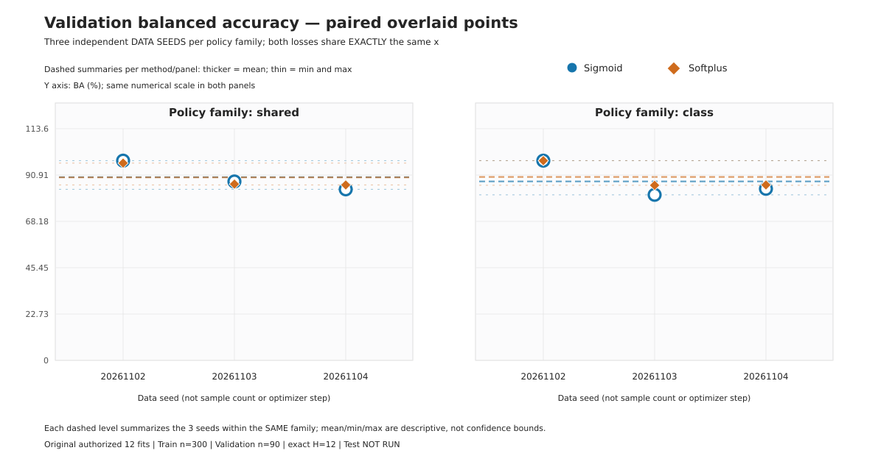

[مشاهده مستقیم SVG شکل 1](figures/phase2_repro_v3/figure01_validation_BA_methods_by_seed.svg)

**محورها:** محور افقی بذر کامل داده (`20261102`، `20261103`، `20261104`) است؛ این‌ها **اندازهٔ نمونه یا گام بهینه‌سازی نیستند**. محور عمودی BA برحسب درصد است. در هر بذر، Sigmoid (دایرهٔ توخالی آبی) و Softplus (لوزی نارنجی) **دقیقاً روی یک مختصات افقی** قرار گرفته‌اند. پنل‌های `shared` و `class` از هم جدا هستند. **سه خط‌چین برای هر روش در هر پنل** به‌ترتیب کمینه، میانگین و بیشینه در سه بذر همان خانواده‌اند (میانگین ضخیم‌تر است). این خطوط، فاصلهٔ اطمینان، روند آموزش یا خط برازش‌شده نیستند.

**مشاهده:** در `shared`، Sigmoid در بذرهای ۰۲ و ۰۳ بهتر و Softplus در بذر ۰۴ بهتر بوده است؛ در `class`، بذر ۰۲ مساوی و بذرهای ۰۳ و ۰۴ به سود Softplus بوده‌اند. تفاوت `class/20261103` برابر **۴٫۶۸ واحد درصد** به سود Softplus است. **نتیجه:** هیچ‌کدام در Validation BA برتری یکنواخت ندارند و با فقط سه بذر نباید برتری جمعیتی نتیجه گرفت.

## ۴. تراکم، جدایی مراکز و حاشیه

تمام شش جفت **Softplus دارای `R_JS` و `R_KL` کمتر در Train** و **Sigmoid دارای `I` و میانه حاشیه Validation بالاتر** بودند. اما جهت BA به مولد و خانواده وابسته است.

| بذر | policy | I Sig | I Soft | R_JS Sig | R_JS Soft | median margin Val Sig | median margin Val Soft |
|---|---|---:|---:|---:|---:|---:|---:|
| 20261102 | shared | 0.04800 | 0.01867 | 0.00778 | 0.00252 | 0.03431 | 0.01234 |
| 20261102 | class | 0.03802 | 0.01912 | 0.00858 | 0.00266 | 0.03377 | 0.01279 |
| 20261103 | shared | 0.06521 | 0.01969 | 0.00703 | 0.00224 | 0.03881 | 0.01265 |
| 20261103 | class | 0.13554 | 0.02036 | 0.01391 | 0.00232 | 0.06191 | 0.01380 |
| 20261104 | shared | 0.04676 | 0.01827 | 0.00796 | 0.00265 | 0.03606 | 0.01227 |
| 20261104 | class | 0.04764 | 0.01741 | 0.00615 | 0.00259 | 0.03581 | 0.01270 |

نمونهٔ خلاف تفسیر یک‌بعدی: در `seed=20261103, class` با اینکه Sigmoid جدایی مراکز و میانه حاشیه بالاتری دارد، **Validation BA آن ۴٫۶۸ واحد درصد کمتر از Softplus** است. برعکس در `seed=20261102, shared`، Sigmoid برتری کوچک BA دارد. بنابراین نه `R↓` و نه `I↑` یا margin↑ به‌تنهایی تضمین‌کننده بهبود BA نیستند. اثر توزیع نمونه‌ها و هندسه تصمیم باید همراه confusions، recall کلاس‌ها، مرز تصمیم و مقدار واقعی margin مطالعه شود. حتی `median margin` بالاتر الزاماً تعداد خطاهای کمتر را تضمین نمی‌کند.

مقیاس گرادیان دو loss متفاوت است؛ برابر بودن ۲۵ گام Adam و learning rate به معنای برابر بودن سرعت همگرایی، مقدار gradient یا ظرفیت مدل نیست. ادعای برتری عمومی یا استنباط p-value/CI قوی از سه seed صورت نمی‌گیرد.


### شکل 2 — جدایی مراکز Train بر حسب بذر و خانوادهٔ سیاست

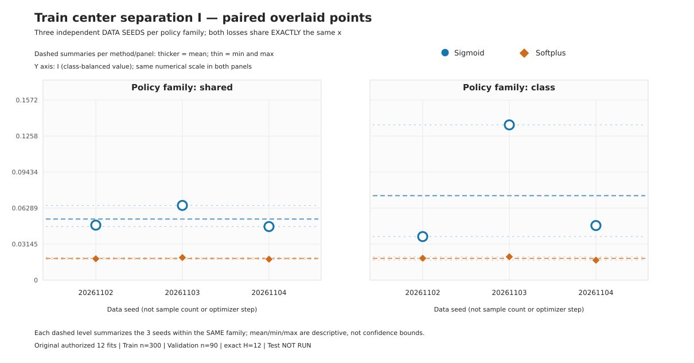

[مشاهده مستقیم SVG شکل 2](figures/phase2_repro_v3/figure02_train_I_methods_by_seed.svg)

**محورها:** محور عمودی معیار جدایی `I` محاسبه‌شده از مراکز Train است؛ محور افقی سه بذر کامل تولید داده است. در هر بذر، Sigmoid (دایرهٔ توخالی آبی) و Softplus (لوزی نارنجی) **دقیقاً روی یک مختصات افقی** قرار گرفته‌اند. پنل‌های `shared` و `class` از هم جدا هستند. **سه خط‌چین برای هر روش در هر پنل** به‌ترتیب کمینه، میانگین و بیشینه در سه بذر همان خانواده‌اند (میانگین ضخیم‌تر است). این خطوط، فاصلهٔ اطمینان، روند آموزش یا خط برازش‌شده نیستند.

**مشاهده:** Sigmoid در **تمام شش جفت** `I` بزرگ‌تری دارد؛ بیشترین تفاوت در `class/20261103` است (`0.13554` در برابر `0.02036`). بااین‌حال BA همان جفت به سود Softplus است. **نتیجه:** برتری Sigmoid در جدایی مراکز در این آزمایش یکنواخت است، ولی افزایش `I` شرط کافی برای BA بالاتر نیست.

## ۵. معیارها و ردپای بازتولید

هر یک از ۱۲ پرونده دارای `model.json`، `distributions.npz`، `trace.json`، `metrics_full.json`، `coverage.json`، `run_evidence.json` است. گزارش‌های `metrics_full.json` شامل گروه density (`R_KL/R_JS/R_sqrt_JS`)، هندسه (`I/T/BT/TNL/BTNL`)، BA/Acc، confusion و per-class recall، پیش‌بینی‌ها و خطاها، margin و quantileهای آن، معیارهای جانشین زیان، و مقادیر per-sample هستند؛ `NLL`/surrogateهای مرتبط و حدود تعریف‌پذیری نیز گزارش شده‌اند.

- `manifest.json` با **۱۲ رکورد و ۶۰ هش SHA256** از فایل‌های مرکزی هر fit ذخیره شده و تمام ۶۰ تطبیق بایتی در بررسی مستقل از ZIP PASS شد. checksumِ داده‌ها و provenance هم تطبیق داشتند.
- ۱۲ نشانگر مصرف بودجه، ۱۲ ledger checkpoint، ۱۲ success checkpoint، **۳۱۲ checkpoint گام‌به‌گام** و دقیقاً ۲۶ سطر trace (گام‌های ۰ تا ۲۵) در هر fit ثبت شده‌اند؛ هیچ فایل `failures/` وجود ندارد.
- بازمحاسبه مستقل `JSD→score` و `argmax` بر اساس `distributions.npz`، بازشماری confusion و BA از `per_sample` و تطبیق با manifest و `paired_summary.json` در هر ۱۲ fit بدون اختلاف انجام شد.
- **نکته پوشش معیار:** `coverage.json` دو مسیر `train.per_class_recall` و `validation.per_class_recall` را به علت نام کلید `not_measured` می‌نامد، ولی مقادیر واقعی per-class recall در `metrics_full.json/per_class[].accuracy` و confusion موجودند. این اختلاف نام‌گذاری/coverage در ممیزی مستقل باید بررسی شود. داده خام به همین شکل اصلی حفظ شده و پوشش به‌صورت ساختگی «PASS کامل» اعلام نشده است.
- سیستم عددی `Python 3.11.18`, `NumPy 2.4.6`, `torch CPU 2.15.0`, `OPENBLAS_CORETYPE=generic` و تک‌ریسمانی در `provenance.json` ثبت شده؛ گیت SHA و تأیید رسمی مدیر در فایل مجوز ثبت و token محرمانه به raw وارد نشده است.

### منشأ غیرقابل تغییر

- موفقیت آموزش، reducer و آپلود: [Run #43670524935](https://github.com/mahhammad/My-Thesis/actions/runs/43670524935).
- نام artifact اصلی: `e-ch4-13-phase2-partial-or-complete-43670524935-1`؛ ID `14144445918`؛ SHA256 فایل ZIP برابر `26e7a94e36edeae2a3153b76b40cf282c30b550a3fac359558a20d11e72c3e3e`.
- بایگانی در شاخه آزمایش صرفاً از **بایت‌های خام artifact** و به کمک [`archive_phase2_existing.py`](archive_phase2_existing.py) انجام شد؛ **هیچ آموزش جدید** برای گزارش یا بازیابی اجرا نشد.
- [CSV دوازده اجرا](tables/phase2_runs_12.csv)، [CSV شش جفت](tables/phase2_pairs_6.csv) و [نمودار ΔBA](figures/phase2_paired_delta_validation_ba.svg) تنها از manifest/pair raw تولید شده‌اند. گزارشهای اضافی و ترسیم تک‌خانواده‌ای می‌توانند بعد از QA بدون تغییر raw ساخته شوند.

## ۵.۱. تحلیل تکمیلی سه نسخهٔ R و منحنی‌های آموزش (بدون هیچ fit تازه)

این بخش فقط از ۱۲ گزارش `metrics_full.json` و ۱۲ ردپای ۲۶-نقطه‌ای `trace.json` موجود در `results/phase2_300_25/`، و از داده‌های خام تأییدشدهٔ اجرای اصلی استخراج شده است. **هر سه معیار چگالی** `R_KL`، `R_JS` و `R_sqrt_JS` برای **Train و Validation** در هر ۱۲ اجرای موفق محاسبه شده‌اند؛ هیچ یک را نباید با تعداد مسیرهای MC یا تعداد گام‌های Adam اشتباه گرفت. `R_sqrt_JS` میانگینِ ریشهٔ فاصله JS در مقیاس مربوط است؛ به‌طور کلی نمی‌توان آن را برابر ریشهٔ میانگین `R_JS` گرفت. مقایسه بین سه نسخه باید با تعریف دقیق metric مشترک در موتور `standard_metrics` انجام شود.

### ۵.۱.۱. میانگین‌های توصیفی Train و شواهد جفتی

| خانواده | loss | میانگین `R_KL` Train | میانگین `R_JS` Train | میانگین `R_sqrt_JS` Train | میانگین `I` Train | میانگین BA Validation |
|---|---|---:|---:|---:|---:|---:|
| shared | Sigmoid | 0.029675 | 0.007591 | 0.073092 | 0.053322 | 89.8632% |
| shared | Softplus | 0.009826 | 0.002470 | 0.042061 | 0.018878 | 89.7559% |
| class | Sigmoid | 0.037501 | 0.009544 | 0.079805 | 0.073735 | 87.7732% |
| class | Softplus | 0.010042 | 0.002522 | 0.042667 | 0.018962 | 89.9628% |

**شمارش علامت اختلاف جفتی (`Sigmoid−Softplus`):** برای هر سه معیار `R_KL/R_JS/R_sqrt_JS` در Train، نتیجه **۶/۶ مثبت** است؛ بنابراین Softplus در تمام شش جفت مقدار کوچک‌تری از هر سه `R` دارد. همین نتیجه **۶/۶** در Validation نیز برقرار است. برعکس، `I` در **۶/۶** جفت برای Sigmoid بزرگ‌تر است. مقادیر `R_sqrt_JS` نیز به‌صورت مستقل از گزارش‌های هر ۱۲ مدل محاسبه و در جدول بالا گزارش شده‌اند؛ مرجع بازبینی بایتی همان `metrics_full.json` در هر پوشهٔ اجراست.

در شاخه `shared`، میانگین اختلاف جفتی Validation BA برابر **`+0.1073` واحد درصد** و در شاخه `class` برابر **`−2.1896` واحد درصد** است. میانگین شش اختلاف به‌صورت توصیفی `−1.0411` واحد درصد می‌شود، ولی این عدد «برتری عمومی Softplus» نیست؛ هر دو خانواده روی همان سه seed تکرار شده‌اند و تعداد مولدهای مستقل برای استنباط تنها سه است.

### ۵.۱.۲. شکل‌های ۳ تا ۸ — سه معیار R در Train و Validation

در شش نمودار زیر، در هر بذر، Sigmoid (دایرهٔ توخالی آبی) و Softplus (لوزی نارنجی) **دقیقاً روی یک مختصات افقی** قرار گرفته‌اند. پنل‌های `shared` و `class` از هم جدا هستند. **سه خط‌چین برای هر روش در هر پنل** به‌ترتیب کمینه، میانگین و بیشینه در سه بذر همان خانواده‌اند (میانگین ضخیم‌تر است). این خطوط، فاصلهٔ اطمینان، روند آموزش یا خط برازش‌شده نیستند. محور افقی شامل بذرهای **کامل** `20261102`، `20261103` و `20261104` است. محور عمودی مقدار یکی از سه معیار `R` بوده و **مقیاس‌های KL، JS و ریشهٔ JS با هم متفاوت‌اند**. برای Validation مراکز کلاس فقط از Train محاسبه شده‌اند و در مرحلهٔ ارزیابی ثابت می‌مانند.

**یافته مشترک هر شش نمودار:** Softplus در هر سه بذر و در **هر دو خانواده سیاست**، **هر سه مقدار `R_KL`، `R_JS` و `R_sqrt_JS` را هم روی Train و هم Validation کمتر کرده است (۶/۶ مقایسه برای هر معیار و هر split)**. این یک برتری یکنواخت **در تراکم درون‌کلاسی با تعریف R** است، نه در BA. همان داده‌ها نشان می‌دهند Sigmoid در `I` یکنواخت بهتر است و اختلاف BA با بذر و خانواده تغییر علامت می‌دهد.

#### شکل 3 — `R_KL` روی Train

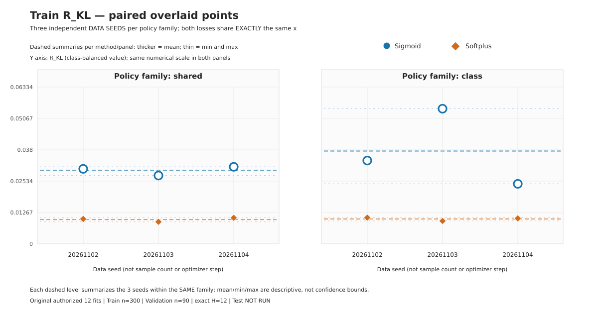

[مشاهدهٔ مستقیم SVG شکل 3](figures/phase2_repro_v3/phase2_train_R_KL_six_pairs.svg)

**تعریف:** میانگین متوازن کلاس از KL توزیع نمونه نسبت به مرکز واقعی کلاس با قاعدهٔ support-aware؛ در این داده‌های ثابت همهٔ مقادیر متناهی‌اند. **خوانش:** در تمام شش جفت، نقطهٔ Softplus مقدار کمتری از Sigmoid دارد. خط‌چین‌های هر روش، دامنه و میانگین سه بذر را فقط برای همان خانواده خلاصه می‌کنند؛ میانگین‌ها شاهد توصیفی هستند نه فاصلهٔ اطمینان. **نتیجه:** Softplus برای این سنجهٔ تراکم و این split برتری یکنواخت داشته، اما از این واقعیت نمی‌توان برتری Validation BA را نتیجه گرفت.

#### شکل 4 — `R_KL` روی Validation

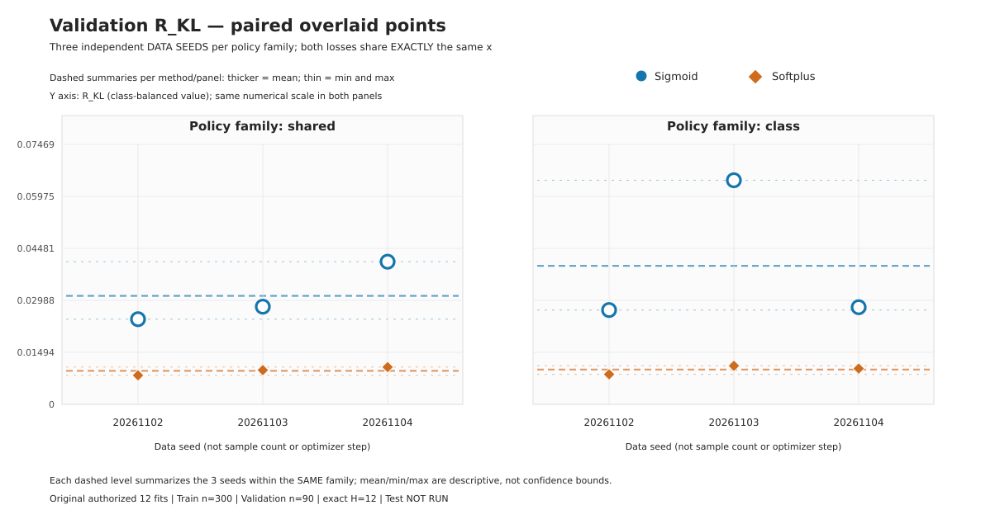

[مشاهدهٔ مستقیم SVG شکل 4](figures/phase2_repro_v3/phase2_validation_R_KL_six_pairs.svg)

**تعریف:** میانگین متوازن کلاس از KL توزیع نمونه نسبت به مرکز واقعی کلاس با قاعدهٔ support-aware؛ در این داده‌های ثابت همهٔ مقادیر متناهی‌اند. **خوانش:** در تمام شش جفت، نقطهٔ Softplus مقدار کمتری از Sigmoid دارد. خط‌چین‌های هر روش، دامنه و میانگین سه بذر را فقط برای همان خانواده خلاصه می‌کنند؛ میانگین‌ها شاهد توصیفی هستند نه فاصلهٔ اطمینان. **نتیجه:** Softplus برای این سنجهٔ تراکم و این split برتری یکنواخت داشته، اما از این واقعیت نمی‌توان برتری Validation BA را نتیجه گرفت.

#### شکل 5 — `R_JS` روی Train

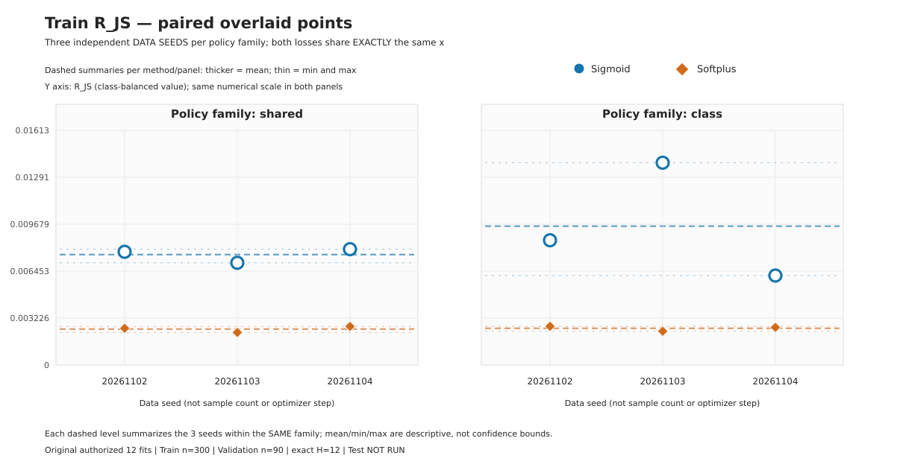

[مشاهدهٔ مستقیم SVG شکل 5](figures/phase2_repro_v3/phase2_train_R_JS_six_pairs.svg)

**تعریف:** میانگین متوازن کلاس از JSD نمونه تا مرکز واقعی کلاس؛ این معیار متقارن و کران‌دار است ولی با KL هم‌مقیاس نیست. **خوانش:** در تمام شش جفت، نقطهٔ Softplus مقدار کمتری از Sigmoid دارد. خط‌چین‌های هر روش، دامنه و میانگین سه بذر را فقط برای همان خانواده خلاصه می‌کنند؛ میانگین‌ها شاهد توصیفی هستند نه فاصلهٔ اطمینان. **نتیجه:** Softplus برای این سنجهٔ تراکم و این split برتری یکنواخت داشته، اما از این واقعیت نمی‌توان برتری Validation BA را نتیجه گرفت.

#### شکل 6 — `R_JS` روی Validation

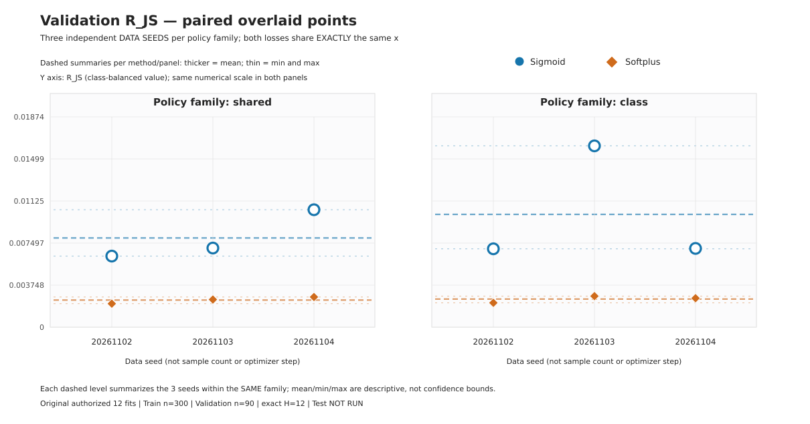

[مشاهدهٔ مستقیم SVG شکل 6](figures/phase2_repro_v3/phase2_validation_R_JS_six_pairs.svg)

**تعریف:** میانگین متوازن کلاس از JSD نمونه تا مرکز واقعی کلاس؛ این معیار متقارن و کران‌دار است ولی با KL هم‌مقیاس نیست. **خوانش:** در تمام شش جفت، نقطهٔ Softplus مقدار کمتری از Sigmoid دارد. خط‌چین‌های هر روش، دامنه و میانگین سه بذر را فقط برای همان خانواده خلاصه می‌کنند؛ میانگین‌ها شاهد توصیفی هستند نه فاصلهٔ اطمینان. **نتیجه:** Softplus برای این سنجهٔ تراکم و این split برتری یکنواخت داشته، اما از این واقعیت نمی‌توان برتری Validation BA را نتیجه گرفت.

#### شکل 7 — `R_sqrt_JS` روی Train

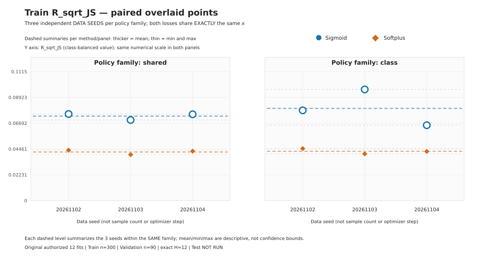

[مشاهدهٔ مستقیم SVG شکل 7](figures/phase2_repro_v3/phase2_train_R_sqrt_JS_six_pairs.svg)

**تعریف:** برای هر نمونه ابتدا ریشهٔ JSD محاسبه و سپس میانگین متوازن گرفته می‌شود؛ `R_sqrt_JS` عموماً برابر `sqrt(R_JS)` نیست. **خوانش:** در تمام شش جفت، نقطهٔ Softplus مقدار کمتری از Sigmoid دارد. خط‌چین‌های هر روش، دامنه و میانگین سه بذر را فقط برای همان خانواده خلاصه می‌کنند؛ میانگین‌ها شاهد توصیفی هستند نه فاصلهٔ اطمینان. **نتیجه:** Softplus برای این سنجهٔ تراکم و این split برتری یکنواخت داشته، اما از این واقعیت نمی‌توان برتری Validation BA را نتیجه گرفت.

#### شکل 8 — `R_sqrt_JS` روی Validation

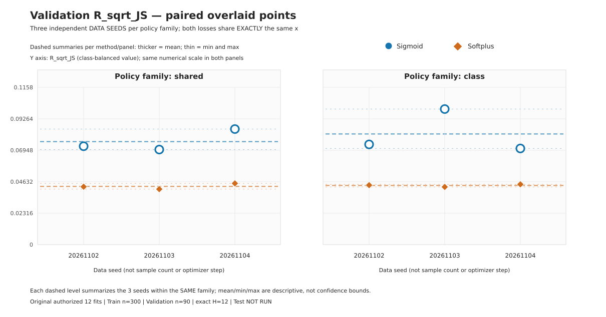

[مشاهدهٔ مستقیم SVG شکل 8](figures/phase2_repro_v3/phase2_validation_R_sqrt_JS_six_pairs.svg)

**تعریف:** برای هر نمونه ابتدا ریشهٔ JSD محاسبه و سپس میانگین متوازن گرفته می‌شود؛ `R_sqrt_JS` عموماً برابر `sqrt(R_JS)` نیست. **خوانش:** در تمام شش جفت، نقطهٔ Softplus مقدار کمتری از Sigmoid دارد. خط‌چین‌های هر روش، دامنه و میانگین سه بذر را فقط برای همان خانواده خلاصه می‌کنند؛ میانگین‌ها شاهد توصیفی هستند نه فاصلهٔ اطمینان. **نتیجه:** Softplus برای این سنجهٔ تراکم و این split برتری یکنواخت داشته، اما از این واقعیت نمی‌توان برتری Validation BA را نتیجه گرفت.

### شکل ۹ — روند نسبی تابع زیان در ۲۵ به‌روزرسانی Adam

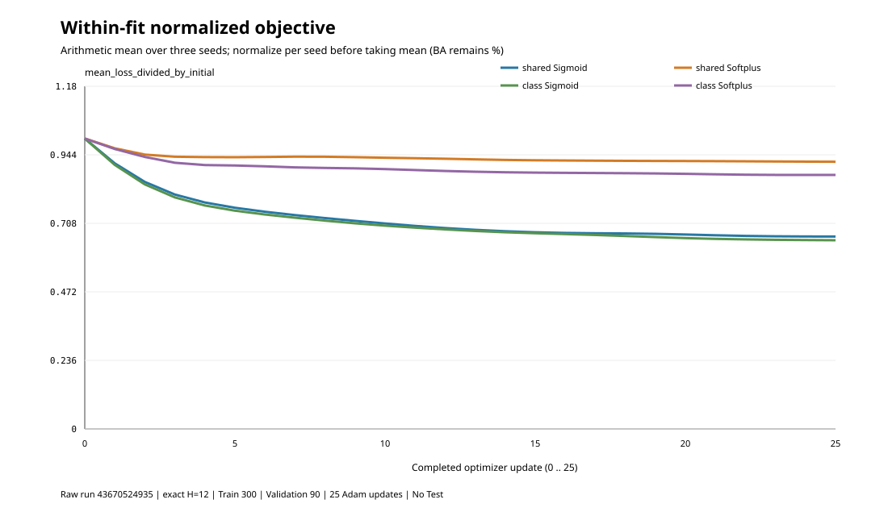

[مشاهده فایل مستقل SVG](figures/phase2_repro_v2/phase2_train_loss_relative_dynamics.svg)

**چه چیزی نشان می‌دهد؟** برای هر مدل در هر بذر ابتدا زیان گام (t) بر زیان همان مدل در گام صفر تقسیم شده؛ سپس سه نسبت برای یک ترکیب خانواده×زیان میانگین گرفته شده‌اند. بنابراین همه منحنی‌ها در گام صفر از **۱** آغاز می‌شوند و مقدار پایین‌تر نشان‌دهنده کاهش نسبی بیشتر همان زیان نسبت به شروع خودش است. مقیاس مطلق دو تابع متفاوت است؛ **نسبت‌های کمتر، اثبات بهتر بودن طبقه‌بندی یا همگرایی جهانی نیستند**. این منحنی‌ها صرفاً روند ثبت‌شده در ۲۵ به‌روزرسانی ثابت را نشان می‌دهند، نه انتخاب بهترین epoch.

### شکل ۱۰ — روند نسبی هنجار گرادیان

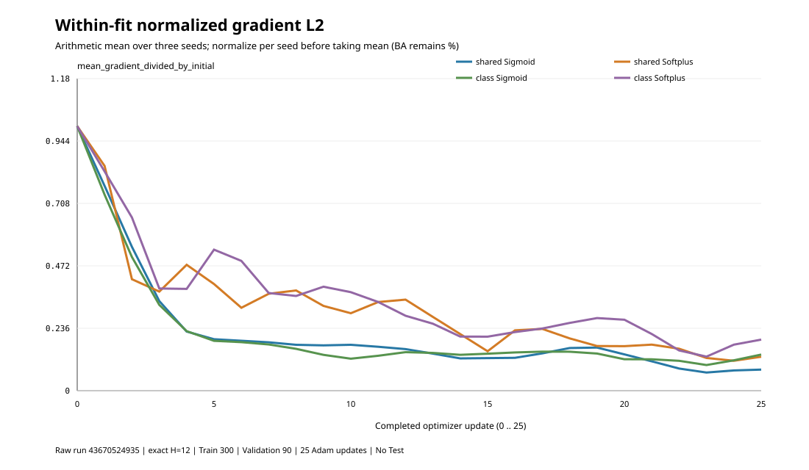

[مشاهده فایل مستقل SVG](figures/phase2_repro_v2/phase2_gradient_norm_relative_dynamics.svg)

**چه چیزی نشان می‌دهد؟** برای هر fit، `||∇L_t||₂ / ||∇L_0||₂` محاسبه و سپس سه بذر میانگین شده‌اند. مقدار ۱ در گام صفر قراردادی است. کوچک‌شدن هنجار گرادیان می‌تواند نشانه کاهش حساسیت محلی تابع هدف باشد ولی **گواه رسیدن به بهینهٔ سراسری یا بهتر شدن BA نیست**. نرمال‌سازی به دلیل تفاوت ذاتی مقیاس گرادیان Sigmoid و Softplus انجام شده و برای مخرج اولیه کمتر یا مساوی `10^-12` اجرای مولد شکل متوقف می‌شود.

### تحلیل مشترک شکل‌های ۹ و ۱۰ — همگرایی نسبی و تبیین تفاوت روش‌ها

مقادیر زیر از [جدول ۱۰۴ نقطهٔ ردپای آموزش](derived/phase2_qa_fixes_v2/plot_trajectories.csv) استخراج شده‌اند و برای هر خانواده، **ابتدا نسبت نهایی به اولیه در هر بذر** و سپس میانگین سه نسبت را گزارش می‌کنند:

| خانوادهٔ سیاست | تابع زیان | نسبت زیان گام ۲۵ به گام صفر | نسبت هنجار گرادیان گام ۲۵ به گام صفر |
|---|---|---:|---:|
| shared | Sigmoid | 0.6625 | 0.0797 |
| shared | Softplus | 0.9201 | 0.1283 |
| class | Sigmoid | 0.6498 | 0.1366 |
| class | Softplus | 0.8746 | 0.1932 |

**نتیجهٔ پشتیبانی‌شده:** در هر دو خانواده، **هر دو تابع زیان تا گام ۲۵ کاهش زیان و کاهش محسوس هنجار گرادیان نسبی داشته‌اند**؛ نسبت گرادیان نهایی هر دو در یک مرتبهٔ بزرگی است، اما دقیقاً برابر نیست. پس اختلاف الگوی `R` و `I` را نمی‌توان به‌سادگی صرفاً با این ادعا توضیح داد که «یکی از دو روش اساساً کاهش گرادیان نداشته است». این شواهد **تفاوت هندسهٔ جواب‌های حاصل از دو هدف** را تقویت می‌کنند.

**مرز استنباط:** هنجارهای نشان‌داده‌شده **نسبت به مقدار اولیه خودشان** نرمال شده‌اند؛ بنابراین نزدیکی دو منحنی به معنای نزدیکی هنجارهای **مطلق** نیست. هیچ‌یک از دو منحنی اثبات نمی‌کند که هر دو مدل به بهینهٔ نهایی یا آستانهٔ همگرایی یکسان رسیده‌اند. هنوز ممکن است بخشی از اختلاف نتیجه ناشی از سرعت همگرایی، جهت گرادیان یا بودجهٔ محدود ۲۵ گام باشد. برای حذف این توضیح، آزمایش مستقل کنترل‌شده با بودجهٔ بیشتر لازم است. **برتری مشاهده‌شده مختص معیار است**: Softplus در `R` برای هر شش جفت و Sigmoid در `I` برای هر شش جفت بهتر بوده‌اند؛ در `Validation BA` برندهٔ یکنواخت نداریم.

### شکل ۱۱ — سیر دقت متوازن Train در طول آموزش (محور ثابت ۷۰ تا ۱۰۰)

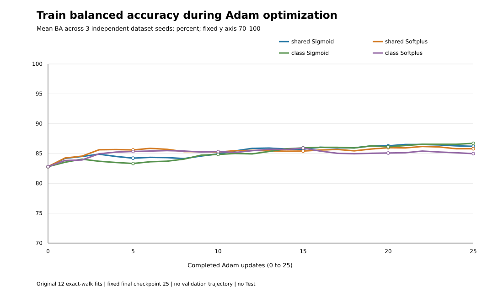

[مشاهده SVG اصلاح‌شدهٔ شکل ۱۱](figures/phase2_tex/figure11_train_BA_y70_100.svg) | [نسخه برداری PDF برای LaTeX](figures/phase2_tex/figure11_train_BA_y70_100.pdf)

**روش خواندن:** محور افقی تعداد به‌روزرسانی \`Adam\` از گام صفر تا ۲۵ و محور عمودی **دقت متوازن آموزش بر حسب درصد** است. برای آشکارشدن فاصله و تقاطع منحنی‌ها، **کران‌های محور عمودی دقیقاً ۷۰ و ۱۰۰ درصد** و فاصله برچسب‌ها پنج واحد درصد تنظیم شده‌اند. برای هر ترکیب خانواده و زیان، در هر گام ابتدا BA محاسبه‌شده در هر یک از سه بذر مستقل و سپس **میانگین حسابی** سه مقدار رسم شده است؛ خود BA به مقدار اولیه نرمال نشده است. نقاط کوچک روی منحنی‌ها مربوط به گام‌های ۰، ۵، ۱۰، ۱۵، ۲۰ و ۲۵ هستند.

**برداشت علمی:** چهار منحنی در طول آموزش بسیار نزدیک‌اند و تغییر ترتیب نسبی دارند. این شباهت در **Train BA** نمی‌تواند برابری پیش‌بینی‌های نمونه‌به‌نمونه یا یکسان‌بودن **Validation BA** را اثبات کند؛ جدول جفتی نشان داده است که اثر Validation با بذر و خانواده تغییر می‌کند. کاهش زیان و گرادیان‌های نسبیِ شکل‌های ۹ و ۱۰ نیز برابری سرعت همگرایی یا رسیدن به بهینهٔ مشترک را اثبات نمی‌کند. مرجع بیزیِ سه‌بذری در جدول Validation آورده شده است و **خط بیزیِ تک‌بذر به اشتباه روی این میانگین سه‌بذری آموزش رسم نشده است**. فقط checkpoint گام ۲۵ مبنای مقایسهٔ اصلی است.

**بازتولید شکل ۱۱، بدون آموزش و بدون Test:** [\`phase2_figure11_y70_100.py\`](phase2_figure11_y70_100.py) از فایل‌های SHA-تأییدشدهٔ \`trace.json\` محاسبه می‌کند. نسخه‌های اصلی v2 بدون تغییر باقی مانده‌اند.

**یادداشت بازتولید شکل‌ها:** شکل‌های ۱ تا ۸ از [کد تولید بازطراحی v3](phase2_figures_1_8_v3.py) و [مانیفست هش v3](derived/phase2_figures_1_8_v3_manifest.json) استفاده می‌کنند؛ **شکل‌های ۹ و ۱۰ همان SVG نسخهٔ v2 و بدون تغییر** هستند و شکل ۱۱ با [منبع مستقل اصلاح بازه ۷۰ تا ۱۰۰](phase2_figure11_y70_100.py) تولید شده است. یازده PDF برداری همگی در [پوشه شکل‌های آماده LaTeX](figures/phase2_tex/) قرار دارند. کد تولید اصلی این سه شکل در [اسکریپت v2](phase2_derived_reproduce_v2.py) قرار دارد. دادهٔ شش جفت در [`plot_pairs.csv`](derived/phase2_qa_fixes_v2/plot_pairs.csv)، دادهٔ ۱۰۴ نقطه روند در [`plot_trajectories.csv`](derived/phase2_qa_fixes_v2/plot_trajectories.csv)، کد تولید در [`phase2_derived_reproduce_v2.py`](phase2_derived_reproduce_v2.py) و SHA256 شکل‌ها در [`plot_figure_manifest.json`](derived/phase2_qa_fixes_v2/plot_figure_manifest.json) قرار دارند. همهٔ شکل‌ها توصیفی‌اند، از Train/Validation به دست آمده‌اند و **هیچ دادهٔ Test** ندارند. چنانچه پیش‌نمایش SVG در GitHub نمایش داده نشود، پیوند «مشاهده فایل مستقل SVG» زیر هر شکل مسیر جایگزین است.


### ۵.۱.۳. تفسیر و موارد پرسش از ممیز

Softplus در همه شش جفت چگالی درون‌کلاسیِ سنجیده‌شده با سه `R` را بهبود داده، درحالی‌که Sigmoid در همه شش جفت جدایی هندسی مراکز و میانهٔ حاشیهٔ Validation را بالاتر برده است. با وجود این، **دقت Validation ترکیبی و حساس به مولد/سیاست** است. مثال روشن `seed=20261103, class`: با `I` بیشتر Sigmoid (`0.135541` در برابر `0.020362`) و `R_JS` بدتر (`0.013907` در برابر `0.002322`)، BA آن `81.2068%` در برابر `85.8873%` است. این شواهد از یک trade-off احتمالی در هندسه خروجی پشتیبانی می‌کنند، نه از رابطه علّیِ تأییدشده بین objective و عملکرد.

**ممیزی لازم است** (۱) تعریف دقیق و پوشش `R_sqrt_JS` را از `standard_metrics` تطبیق دهد؛ (۲) گزارش‌های Train/Validation برای هر سه `R` را مستقل بازتولید کند؛ (۳) اختلاف `coverage.json` درباره `per_class_recall` را تعیین تکلیف کند؛ (۴) نشت Test و اعتبار پیش‌بینی در inference را کنترل کند؛ و (۵) تناسب ۳ seed برای هر ادعای آماری را بررسی نماید. در این مرحله داده‌های خام **قفل و بدون تغییر** باقی می‌مانند.

## ۵.۲. اصلاحات پس از ممیزی مستقل — بستهٔ مشتق‌شدهٔ نسخه دوم

رأی اولیه ممیز مستقل برای مأموریت `QA-E-CH4-13-PHASE2-FINAL-01` در [Issue #80](https://github.com/mahhammad/My-Thesis/issues/80#issuecomment-6889701832) برابر `ACCEPT_PHASE2_WITH_FIXES` بود. **آن رأی هنوز به پذیرش نهایی تغییر نکرده است.** این بخش تحویل اصلاحی پژوهشگر در پاسخ به موارد P1/P2/P3 را مستند می‌کند؛ ممیز باید مجدداً این خروجی‌ها را مستقل بررسی کند.

### P1 — نسخه اصلاحی پوشش معیارها

در **هر یک از ۱۲ مدل**، فایل اصلی `coverage.json` دو فیلد `train.per_class_recall` و `validation.per_class_recall` را `not_measured` گزارش کرده بود، با اینکه مقدار Recall واقعی هر کلاس در `metrics_full.json/{train,validation}/per_class[].accuracy` و قطر ماتریس سردرگمی همان split قابل بازسازی است. **۲۴ وضعیت نادرست پوشش** شناسایی شد؛ این نقص در metadata است، نه خطای محاسبه Recall.

برای اصلاح، فایل‌های اصلی **به هیچ عنوان تغییر داده نشده‌اند**. نسخه `derived/phase2_qa_fixes_v2/coverage/<run_key>.json` یک کپی منشعب با اصلاح فقط همین دو status و دلیل علمی صریح است. [`coverage_index.json`](derived/phase2_qa_fixes_v2/coverage_index.json) شامل نام ۱۲ مدل، SHA256 پوشش اولیه، SHA256 معیار اصلی، SHA256 محصول اصلاحی و Recall هر سه کلاس روی Train/Validation است. معیار اصلی `per_class[].accuracy` در این مسئله، برابر Recall همان کلاس است؛ با تقسیم قطر confusion بر مجموع سطر کلاس مربوط تطبیق و به‌طور جداگانه آزمون شده است. در زمان گزارش‌کردن coverage، **نسخه v2** مرجع پوشش اصلاح‌شده و **raw اصلی** شاهد تاریخی بدون دست‌کاری است.

### P2 — بازتولید نمودارها و شواهد نقطه‌ای

کد قطعی و بدون وابستگی آموزش [`phase2_derived_reproduce_v2.py`](phase2_derived_reproduce_v2.py) از فایل‌های خام موجود و با کنترل ۶۰ SHA256، ۱۲ سلول و ۲۶ checkpoint هر مدل استفاده می‌کند. تنها خروجی آن **۱۱ نمودار نسخه‌دار** در [`figures/phase2_repro_v2/`](figures/phase2_repro_v2/) و دو جدول عددی همراه با پوشش اصلاح‌شده است. تصاویر قبلی در `figures/` برای بازبینی مالک **بدون تغییر حفظ شده‌اند**؛ فایل‌های v2 بازتولیدپذیر، کاندید نمودارهای علمی نهایی هستند و نباید با نمودارهای قبلی هم‌نام و بدون قید نسخه ادغام شوند.

برای بررسی داده‌های نمودارها:
- [`plot_pairs.csv`](derived/phase2_qa_fixes_v2/plot_pairs.csv): شش جفت، BA و `Delta I` و هر سه R روی هر دو مجموعه.
- [`plot_trajectories.csv`](derived/phase2_qa_fixes_v2/plot_trajectories.csv): ۴ سیاست/تابع زیان × ۲۶ گام؛ میانگین سه seed روی مقادیر **ابتدا در همان fit نرمال‌شده** و نیز Train BA بر حسب درصد.
- [`plot_figure_manifest.json`](derived/phase2_qa_fixes_v2/plot_figure_manifest.json): SHA256 تک‌تک ۱۱ SVG و hash مانیفست ورودی خام.

نرمال‌سازی زیان و گرادیان تنها وقتی مخرج اولیه هر fit **بیشتر از \(10^{-12}\)** است مجاز شناخته شده است؛ در غیر این صورت مولد نمودار با خطا توقف می‌کند، نه اینکه تقسیم بر صفر یا clipping مخفی انجام دهد. برای هر نوع نمودار از شواهد خامِ مربوط استفاده شده است؛ ستون‌های نمودار BA جفتی واحد «نقطه درصدی» دارند و منحنی Train BA در مقیاس درصد است. هیچ نموداری فاصله اطمینان، ادعای آزمون معناداری یا رابطه علّی ترسیم نمی‌کند.

**دستور بازتولید، بدون آموزش و Test، از ریشه مخزن:**

```bash
python code/experiments/ch4_loss_controlled_comparison/phase2_derived_reproduce_v2.py --check
python -m unittest discover -v -s code/experiments/ch4_loss_controlled_comparison -p 'test_phase2_derived_v2.py'
```

اجرای اول **هر ۲۷ فایل مشتق‌شده** (۱۲ پوشش اصلاحی، ۲ جدول CSV، ۲ manifest JSON، ۱۱ SVG) را بایت‌به‌بایت با محاسبه جدید از raw مقایسه می‌کند و هیچ فایل موجود را تغییر نمی‌دهد. [`test_phase2_derived_v2.py`](test_phase2_derived_v2.py) علاوه بر آزمون ثبات، سناریوی جعل یک فایل raw، شمار شکل‌ها، صحت Recall و کنترل مخرج نرمال‌سازی را بررسی می‌کند. [workflow ویژه بازتولید](../../../.github/workflows/e-ch4-13-phase2-derived-fixes-v2.yml) فقط با تریگر صریح و بدون مجوز آموزش فعال شد و فایل‌ها را در شاخه آزمایش ثبت کرد. **این ثبت به معنی رأی مثبت مجدد ممیز نیست.**

### P3 — دامنه استنباط و مرز انتشار

داده‌های ۱۲ fit با SHA آموزش `cdb45644c245e04a276eb2a419e4d64f71c6c18a` همچنان ثابت هستند؛ commitهای بعدی صرفاً گزارش و مشتقات را ثبت کرده‌اند. ادعای علمی مجاز محدود به جهت تفاوت‌های توصیفی روی **سه seed مستقل** و دو خانواده سیاست است. `R↓` یا `I↑` یا margin↑ شرط کافی برای `BA↑` نیست. اختلاف مقیاس گرادیان دو زیان، افق محدود `H=12` و نبود ارزیابی Test مانع رتبه‌بندی عمومی می‌شود. **با دستور جدید مالک، نگارش محدود E-CH4-13 در LaTeX انجام شده است؛ تا رأی مجدد ممیز، PR #79 Draft می‌ماند و اجرای مدل جدید یا ادغام نتایج مجاز نیست.**


## ۶. جمع‌بندی و گیت انتشار

مقایسهٔ دوازده‌تایی با حفظ پروتکل پایان یافته و شواهد نشان می‌دهند ارتباط `R`، `I`، حاشیه و BA حساس به مولد و خانواده سیاست است. این یافته برای فصل چهارم مهم است ولی با سه مولد مصنوعی و بدون داده Test **نتیجه نهایی درباره تعمیم** یا انتخاب تابع زیان برتر نیست. درخواست از ممیز مستقل در [Issue #80](https://github.com/mahhammad/My-Thesis/issues/80): بازبینی شواهد بایتی، اندازه‌گیری metric coverage و هماهنگی برچسب‌های `per_class_recall`، صحت losses و engine، عدم نشت Validation/Test، اعداد raw-derived و اعتبار استنباط. متن E-CH4-13 با دستور جدید مالک به `tex/chapter4.tex` افزوده شده است؛ پذیرش علمی و ادغام PR #79 همچنان منوط به ممیزی مستقل و تصمیم مدیر پژوهش است.

**وضعیت:** `PHASE2_READY_FOR_INDEPENDENT_QA`؛ نه `ACCEPT_SCIENTIFIC`. PR #79 نباید ادغام شود و Test همچنان `NOT_RUN` است.
