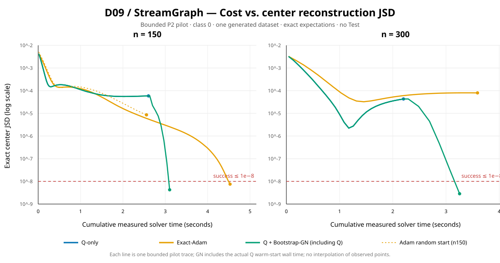

# [PILOT-REPORT] CH4-EXP-INV-01 — convergence budget

**مرحله:** P2؛ پایلوت محدود همگرایی با \`StreamGraph\`، نه اجرای استاندارد D09.  
**تاریخ:** ۱۱ نوامبر ۲۰۲۶  
**مأموریت مجاز:** [Issue #49، کامنت 6788989239](https://github.com/mahhammad/My-Thesis/issues/49#issuecomment-6788989239).  
**قفل ورودی:** \`experiment/ch4-inv01-preflight@7f32e07119b768155bc0163e9383c7eb007cc983\`. مرجع \`chapter4@de02fdda91e23db177de4429b3e1a9693c046d83\` دست‌نخورده است.  
**SHA کد اجرا:** \`e9e478e90b5753aa444eeae8f782255f8e0df87a\`؛ **SHA commit دادهٔ خام CI:** \`74a15664ea72081db99205a7425236a98b96e72f\`.  
**CI موفق:** [42975114971](https://github.com/mahhammad/My-Thesis/actions/runs/42975114971).

## ۱. منابع اولیه، محدودیت و بازتولیدپذیری

- **کد اجرایی:** [\`p2_convergence.py\`](p2_convergence.py)؛ **فایل قفل قبل از حل:** [\`p2_manifest.json\`](results/p2_manifest.json)؛ **خروجی trace کامل:** [\`p2_trace.json\`](results/p2_trace.json)؛ **منحنی داده‌جدولی:** [\`p2_curve.csv\`](results/p2_curve.csv)؛ **خلاصه و نقاط هزینه یکسان:** [\`p2_summary.json\`](results/p2_summary.json).
- **موتور ثابت و بدون تغییر:** \`code/experiments/archive/diag_max_full300/stream_graph.py\`؛ عملگرها/حلقه‌های D09 در \`code/experiments/archive/multistep_policy_target_match/bootstrap_inverse.py\`. ابزار trace در پرونده P2 جداست؛ پیش از پایلوت، خروجی اولین ۳ گام \`Q-only\`، \`Exact-Adam\` و \`GN\` (برحسب پارامتر نهایی و تاریخچه) در گراف ۳۶نمونه‌ای با تابع تاریخی **عیناً برابر** شد: اختلاف گزارش‌شده صفر. سازگاری مشتقات/fallback/restart روی گراف کوچک در [ممیزی پیش‌پرواز StreamGraph](STREAMGRAPH_REPORT_FA.md) جداگانه بررسی شده است.
- **مولد و بذرها:** داده \`20261102\`، زیرمجموعه مرجع \`20261117\`، سیاست سازنده \`20261118\`، آغاز مستقل حلگر \`20261221\`. با \`n150\` دقیقاً ۵۰ نمونه از هر کلاس؛ با \`n300\` تمام Train و فراوانی \`[72,147,81]\`، **همان مولد اولیه**. این دو اجرای یک مولد، تکرار مستقل آماری نیستند. همان کلاس **۰** و هدف کلاس مشروط از سیاست شاهد مجاز برای هر اندازه. \`float64\`, \`β=.4, λ=.8, H=12\`؛ محاسبه مرکز با **امید دقیق**، بدون MC.
- **پنهان‌بودن شاهد:** سیاست مولد پس از ساخت هدف فقط با هش SHA256 در manifest ثبت شد؛ هیچ logit شاهد به توابع حلگر وارد نشده است. **هدف روی simpleх** و \`JSD(target,target)=0\` در ساخت تأیید شد. وجود جواب تضمین می‌شود، نه یکتایی.
- **آستانه رسمی:** \`JSD(V_c(Z),V_c*)<=1e-8\`. خطای **دقیق چندگامی** در هر checkpoint برای هر سه روش مشترک است؛ Q-only تابع surrogate محلی خودش را بهینه می‌کند.
- **قبل از حل:** \`manifest_stage=LOCKED_BEFORE_SOLVE\`، SHA کد، config، StreamGraph، حلگر تاریخی، داده و \`target_sha256\`، بذرها و قواعد توقف ذخیره شدند. Test برای انتخاب/آموزش/سنجش استفاده نشد؛ مولد صرفاً فایل‌های تاریخی synthetic خود را در دایرکتوری موقت ساخت، اما P2 فقط \`data["train"]\` را خواند. بخش LaTeX، کد تاریخی، \`chapter4\` و \`main\` تغییری نکرد.

### قواعد توقف **قفل‌شده پیش از آزمایش**

\`Q-only cap100\`، \`Exact-Adam cap100\`، \`GN cap30\` و \`GN-neutral-restart cap30\` فقط در صورت شکست GN اول. شروع اصلی صفر؛ آغاز تصادفی مستقل **فقط برای Exact-Adam cap50** در صورت باقی‌ماندن بودجه. زمان کل عددی \`max840s\` با کنترل داخلی و \`timeout 870s\` بیرونی؛ سقف RSS رسمی \`1536 MiB\` و آستانه پیشگیرانه \`1430 MiB\`، با مانیتور مستقل. توقف زودهنگام با JSD رسمی؛ تست رکود از گام ۲۵ با پنجره ۱۸گامی و پیشرفت نسبی \`<1e-4\` در بهترین JSD مشاهده‌شده. \`n300\` فقط پس از اتمام حالت اول و موفقیت **حداقل یک حلگر در رسیدن به آستانه** و باقی‌بودن ظرفیت؛ سقف آن \`Q25 / Adam25 / GN10 / restart10\` است. همه پارامترها در manifest قبل از solve قفل شده‌اند؛ **کپ ۳۰۰ و ۱۰۰۰ اجرا نشد**. CI یک job عددی موفق داشت؛ تلاش CI ناموفق اولیه پیش از import داده به علت مسیر پروژه \`ModuleNotFoundError: generate\` متوقف شد و هیچ پایلوت عددی انجام نداد؛ بعد از اصلاح مسیر، همین CI سبز اجرا شد.

## ۲. نتیجه مستقیم: هدف دست‌یافتنی و بازیابی در بودجه محدود

| اندازه مرجع / کلاس ۰ | روش | گام انجام‌شده | بهترین JSD دقیق | JSD آخر | نتیجه در آستانه 1e−8 | توقف |
|---|---|---:|---:|---:|---|---|
| ۱۵۰ | Q-only | ۸۵ | \`5.54752026e−5\` | \`5.88089948e−5\` | **خیر** | رکود \`plateau\` |
| ۱۵۰ | Exact-Adam از صفر | ۹۲ | \`7.54936846e−9\` | \`7.54936846e−9\` | **بله** | آستانه |
| ۱۵۰ | Q+Bootstrap-GN | ۸۵ گام Q + **۷** اصلاح | \`4.25184798e−9\` | همان | **بله** | آستانه |
| ۱۵۰ | Exact-Adam شروع مستقل | ۵۰ | \`8.59561053e−6\` | همان | **خیر تا cap50** | سقف |
| ۳۰۰ | Q-only | ۲۵ | \`2.23457082e−6\` | \`4.30946157e−5\` | **خیر** | سقف |
| ۳۰۰ | Exact-Adam از صفر | ۲۵ | \`3.25388519e−5\` | \`7.99759562e−5\` | **خیر تا cap25** | سقف |
| ۳۰۰ | Q+Bootstrap-GN | ۲۵ گام Q + **۵** اصلاح | \`2.84785995e−9\` | همان | **بله** | آستانه |

در هر دو اندازه GN در تلاش نخست از Q به آستانه رسید؛ **شروع مجدد طبیعی لازم نشد**. هیچ ادعایی درباره هزینه واقعی restart به‌صورت احتمالی از این مطالعه کوچک نداریم؛ مسیر آن در پیش‌پرواز قبلی کنترل شده است. شروع تصادفی دوم برای Exact-Adam با \`cap50\` به معنی «آزمودن حساسیت محدود» است؛ از مقایسه آن با آغاز صفر تا ۹۲ گام، برتری نقطه شروع یا نقص روش نتیجه نمی‌شود.

### زمان و هزینه واقعی؛ **ثبت هر گام و نه هزینه گام برابر**

| مسئله | عملیات | زمان wall حلگر | تعداد عملیات (با trace) |
|---|---|---:|---|
| n150 | Q-only تا رکود | \`2.6214 s\` | \`85 q_grad\`، \`86 exact_forward\` برای پایش |
| n150 | Exact-Adam تا آستانه | \`4.5522 s\` | \`92 exact_grad\`، \`93 exact_forward\` |
| n150 | GN پس از Q | \`0.5044 s\` فقط اصلاح؛ **\`3.1258 s\` با Q** | \`7 Jacobian\`، \`8 exact_forward\` GN، \`7 line_search\`؛ همراه Q |
| n150 | Exact-Adam آغاز مستقل، cap50 | \`2.5811 s\` | \`50 exact_grad\`، \`51 exact_forward\` |
| n300 | Q-only، cap25 | \`2.2528 s\` | \`25 q_grad\`، \`26 exact_forward\` پایش |
| n300 | Exact-Adam، cap25 | \`3.6465 s\` | \`25 exact_grad\`، \`26 exact_forward\` |
| n300 | GN پس از Q | \`1.0573 s\` فقط اصلاح؛ **\`3.3101 s\` با Q** | \`5 Jacobian\`، \`6 exact_forward\` GN، \`5 line_search\`؛ همراه Q |

**نکته مهم هزینه:** زمان‌ها در جدول بالا شامل اجرای **ابزار ثبت دقیق JSD پس از *هر* گام**، serialization ثبت trace و سایر کنترل‌های P2 نیز هستند. در D09 تاریخی، Q-only بعد از هر گام \`exact_forward\` نداشت؛ این instrumentation، مخصوصاً **هزینه Q-only و بنابراین Q+GN** را افزایش می‌دهد. بنابراین اعداد **زمان واقعی اجرای instrumented pilot** هستند، نه حداقل runtime بدون پایش یا هزینه پایلوت جدید معادل با پیاده‌سازی تاریخی. شمار exact-forward بالا هزینه پایش را از تعداد گرادیان Q جدا می‌کند. در trace GN، زمان تجمعی از **پایان Q warm-start** شروع می‌شود؛ عدد کامل زمانی با محاسبه \`Q wall + GN wall\` ارائه شده است. مقایسه هزینه‌ها آزمون مستقل روی یک سخت‌افزار، نه تضمین ranking عمومی، است.

**زمان کل عملیات عددی:** \`18.2296 s\`، **RSS اوج فرایند:** \`488.43 MiB\` روی GitHub Actions Linux، Python 3.11.18، Torch 2.15.0+cpu، NumPy 2.4.6 و \`torch.set_num_threads(1)\`. این شامل تولید گراف، رگرسیون کوچک، ذخیره‌سازی و دو مرجع است؛ **زمان setup/نصب وابستگی‌ها در CI جزو این ۱۸٫۲۳ ثانیه نیست.** مصرف RSS کل فرآیند است؛ حافظه مستقل خود موتور نیست. هیچ محدودیت مأموریت نقض نشد.

## ۳. منحنی JSD در برابر زمان واقعی

**قرارداد خواندن:** برای مقایسه روش ترکیبی، کل مسیر Q اولیه در منحنی GN آمده و سپس اصلاح‌های GN از زمان تجمعی Q ادامه یافته‌اند؛ مقایسه با Q-only و Adam از زمان صفر ممکن است. خط قرمز آستانه رسمی است. زمان هر checkpoint شامل نظارت P2 است، و تمام نقاط واقعاً اندازه‌گیری شده‌اند (بدون برون‌یابی).

| بودجه زمان تجمعی* | n150: بهترین Q-only | n150: بهترین Exact-Adam | n150: بهترین Q+GN |
|---:|---:|---:|---:|
| ۲ ثانیه | \`5.55e−5\` | \`1.81e−5\` | \`5.55e−5\` (هنوز Q) |
| ۳ ثانیه | \`5.55e−5\` | \`3.10e−6\` | \`6.35e−7\` |
| ۴ ثانیه | \`5.55e−5\` | \`3.18e−7\` | **\`4.25e−9\`** |
| ۵ ثانیه | \`5.55e−5\` | **\`7.55e−9\`** | **\`4.25e−9\`** |

| بودجه زمان تجمعی* | n300: بهترین Q-only | n300: بهترین Exact-Adam | n300: بهترین Q+GN |
|---:|---:|---:|---:|
| ۲ ثانیه | \`2.23e−6\` | \`3.25e−5\` | \`2.23e−6\` (هنوز Q) |
| ۳ ثانیه | \`2.23e−6\` | \`3.25e−5\` | \`4.59e−7\` |
| ۴ ثانیه | \`2.23e−6\` | \`3.25e−5\` | **\`2.85e−9\`** |

*\`budget\` در این جدول به معنی **بهترین خطای checkpoint ذخیره‌شده در/قبل از آن زمان** است؛ هیچ interpolation انجام نشده است. روش متوقف‌شده خطای بهترین checkpoint قبلی را حفظ می‌کند، **نه اینکه آن زمان را واقعاً محاسبه کرده باشد**. به‌ویژه، در n300، Exact-Adam در ۲۵ گام متوقف شد؛ در بازه ۲ تا ۴ ثانیه نرسیدن به آستانه به معنی ناکامی با هزینه بزرگ‌تر نیست. همچنین برای n300، Q-only در یک گام میانی JSD بهتر از پاسخ آخر داشت؛ **best و final در گزارش جدا هستند**. متن فصل چهارم نباید این مطالعه تک‌کلاسی را به شواهد برتری عمومی تبدیل کند.

## ۴. ارزیابی علمی و قفل بودجه پیشنهادی

| ادعای مشخص | کنترل صحت | کفایت | رأی |
|---|---|---|---|
| مراکز هدف کلاس ۰ واقعاً از سیاست مجاز حاصل شده‌اند | PASS (SHA هدف + witness و JSD self=0) | SUFFICIENT برای این دو مسئله | A |
| در n150، Adam و GN با بودجه محدود به آستانه رسمی رسیدند | PASS (trace دقیق/CI) | SUFFICIENT برای این مسئله و seed، نه نرخ عمومی | A |
| در n300، GN در ۲۵+۵ به آستانه رسید | PASS | SUFFICIENT برای این مسئله و seed | A |
| کدام حلگر روی همه کلاس‌ها/مولدها با هزینه برابر بهتر است؟ | NOT-CHECKED | INSUFFICIENT | D (نیازمند ۱۰۸ ماتریس برنامه‌ریزی‌شده/یا طرح کمتر با توان مناسب) |
| اثر شروع مستقل بر نرخ موفقیت | PARTIAL | LIMITED | B برای اشاره محدود؛ D برای مقایسه چندبذری |

**پیشنهاد برای اجرای استاندارد (پیشنهاد تصمیم، نه اجرا):**

- از \`StreamGraph\` بدون بازنویسی استفاده شود. \`n={150,300}\`، سه بذر **مستقل مولد** (طبق نقشه راه)، کلاس‌های \`0,1,2\`، دو آغاز ثبت‌شده؛ شمار \`108\` «تعداد اجراهای حلگر» است، نه ۱۰۸ دیتاست مستقل.
- بر اساس مشاهده رسیدن Adam در **گام ۹۲** برای فقط یک مسئله n150، **cap100 برای یک اجرای واحد نزدیک به حد لازم بوده**؛ پیشنهاد **cap150 برای Exact-Adam در آزمایش اصلی** صرفاً حاشیه اطمینان *پیشنهادی و هنوز آزموده‌نشده* است. برای n300 وجود شاهدی درباره کافی‌بودن ۱۵۰ گام نداریم. \`Q-only cap100\` با توقف رکود; \`GN cap30\` با اجازه **restart صفر cap30** صرفاً پس از شکست تلاش اصلی. سقف توقف \`1e−8\` ثابت، checkpointهای \`0,1,2,5,10,25,50,100,150\` (آخری فقط اگر اجرا شد)، ذخیره best/final، لاگ هزینه Jacobian و fallback، خطای تمام کلاس‌ها، وضعیت mask، عدم استفاده از Test.
- **انصاف:** Q-only surrogate خود را حفظ می‌کند. پایش \`exact_JSD\` در گام‌ها برای همه روش‌ها و شامل هزینه زمانی باشد، ولی برای مقایسه هزینه حلگر، «هزینه پایش» در ستون مجزا یا با cadence یکسان و کم ثبت شود؛ شمارنده‌ها باید \`q_grad, exact_grad, exact_forward, jacobian, line_search, retries, wall_s, peak_RSS\` و منحنی هزینه--JSD را حفظ کنند. «گام یکسان» هم‌هزینه نیست.
- **دو آغاز در هر سه روش نیازمند توسعه سبک و تست regression API آغاز مستقل است؛** توابع تاریخی Q/Adam ذاتاً صفرشروع هستند. پیش از ۱۰۸، شروع مستقل در ابزار instrumented با تطابق مسیر zero-init کنترل و قفل شود. برای GN نیز وضعیت \`restart\` را از «آغاز مستقل طراحی‌شده» تفکیک کنید.
- **گیت مرحله‌ای برای ۱۰۸ موردِ اولویت بعدی:** نخست برنامه اجرایی و سقف *زمان/حافظه* روی هر runner تصویب شود؛ سپس کوچک‌ترین **بلوک n150 با یک مولد و ۳ کلاس** (نه ۱۰۸ با یک‌باره)، QA نتایج و بررسی منابع؛ بعد n300 و مولدهای دیگر، با حفظ آرشیو و فایل‌های ناقص. از مجموع زیرمجموعه‌های یک مولد، خطای آماری مستقل نتیجه نگیریم. زمان ۱۸٫۲۳ ثانیه پایلوت **برآورد کل ۱۰۸ اجرا نیست**؛ توزیع هزینه برحسب کلاس و تکرار ناشناخته است.
- در P2 حق اجرای استاندارد ۱۰۸ حالت، تغییر \`tex/chapter4.tex\` یا تغییر آرشیو داده نشده و **هیچ‌کدام انجام نشده‌اند**. D15 فقط شاهد مکمل وجود جواب با محدودیت محاسباتی می‌ماند؛ مسئله دست‌یافتنی‌بودن اهداف بیزی موضوع §۴.۱۱ است.

**رأی اجرایی:** **\`RUN\` مرحله‌بندی‌شده با قفل موارد بالا و تأیید ناظر، نه \`RUN\` خودکار کل ۱۰۸ مورد.** دلیل: مسئله معکوس در دو اندازه با روش دقیق حداقل برای GN به آستانه رسیده، ابزار و منابع سالم‌اند، اما بودجه Adam در n300 و پایداری میان کلاس/مولد هنوز آزموده نشده‌اند. تصمیم موردنیاز برای مرحله بعد، تثبیت capها/شروع‌های مستقل/بودجه هر job و اجازه اجرای بلوک اول است.

**حفاظت:** \`chapter4\`, \`main\`, \`tex/chapter4.tex\` و پوشه‌های تاریخی D09/D15 دست‌نخورده‌اند. نسخه ۷۲تایی وارد LaTeX نشد. CI موفق و manifest/trace/CSV/تصویر/خلاصه در شاخه جدا ثبت شده‌اند.
