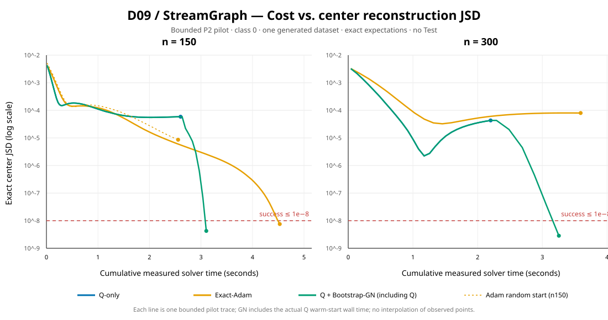

# گزارش فنی پژوهشی §۴.۱۰ — بازیابی سیاست از مراکز دست‌یافتنی (INV01)

**وضعیت فعلی:** PRهای [#61](https://github.com/mahhammad/My-Thesis/pull/61) و [#62](https://github.com/mahhammad/My-Thesis/pull/62) ادغام‌شده‌اند. **۱۰۸/۱۰۸ اجرای استاندارد ثبت‌شده**؛ B01-v2 (۱۸ اجرا) مستقل پذیرفته شده، ۹۰ اجرای B02–B06 با برچسب خام `PROVISIONAL_PENDING_FINAL_QA` محفوظ مانده‌اند. رأی ممیزی نسخهٔ منجمد `BASELINE_ACCEPT_WITH_FIXES` و رگرسیون پساتحویل توسط جانشین، به معنی ممیزی مستقل دوم نیستند. [رکورد نهایی Issue #60](https://github.com/mahhammad/My-Thesis/issues/60#issuecomment-6856231363).

## قرارداد بازتولید داده، اجرای آزمایش و ساختار پرونده‌ها — ممیزی تکمیلی ۲۰۲۶-۱۱-۱۵

**مشخصات دادهٔ پایه (فقط در صورت استفادهٔ مستقیم از مولد):** [`code/data_generator/config.json`](../../../code/data_generator/config.json) با `K=3` کلاس، `D=5` ویژگی، احتمال کلاس‌های `[0.25,0.45,0.30]`، میانگین‌های شرطی کلاس‌ها `[-2,-0.3,0,-1.2,0]`، `[0,0.7,0,0,0]`، `[2,-0.4,0,1.2,0]` و انحراف معیار `[0.95,1,1.2,0.95,1.1]` برای هر سه کلاس است. کوواریانس `diag(std)·correlation·diag(std)` با هم‌بستگی‌های غیرصفرِ بین‌ویژگی `(0,1)=0.35`، `(0,3)=0.20`، `(2,4)=0.30`؛ درصد فقدان مستقل MCAR برای پنج ویژگی `[0,5,12,5,20]` و `kernel_gamma=[0.8,1.2,0.5,1.0,0.6]` است. ویژگی‌های ۰،۱،۳ از نظر حاشیه‌ای اطلاع‌رسان و ۲،۴ نویزیِ حاشیه‌ای هستند. تنظیم پیش‌فرض `seed=20261102` و Train/Validation/Test به‌ترتیب `300/90/120` است؛ **هر آزمایش در ادامه دقیقاً مشخص می‌کند آیا همین تقسیم را می‌خواند یا داده/مرجع دیگری می‌سازد.**

**قالب عمومی خروجی مولد:** اجرای مستقل `python code/data_generator/generate.py --config code/data_generator/config.json --out /tmp/imc-data-20261102`، فایل‌های `train.npz`، `validation.npz`، `test.npz` با کلیدهای `x` (آرایهٔ `N×5` از `float64`، فقدان=`NaN`)، `mask` (`N×5` بولی) و `y` (آرایهٔ `N` از برچسب‌های ۰،۱،۲)، به‌علاوه `oracle_<split>.npz` (`posterior: N×3`، `q_population: N×5×3`)، `finite_q_<split>.npz` (`q_finite: N×5×3`) و `spec.json` تولید می‌کند. این یک **خروجی آزمایشی جدید در /tmp** است، نه فایلی که لزوماً در پوشهٔ مطالعه commit شده باشد؛ فرمان CLI همچنین Test را تولید می‌کند، ولی استفاده از Test برای گزینش مدل/تحلیل این فصل مجاز نیست. برای ساخت **فقط Train/Validation بدون تولید Test**، از `code/experiments/benchmark_v1/dataset_adapter.py::dataset_train_val(load_config(...))` مطابق کد هر مطالعه استفاده کنید. برابری بایت‌های float بین ماشین‌های دارای BLAS متفاوت تضمین نمی‌شود؛ منشأ frozen و SHAهای ثبت‌شده بر seed صرف تقدم دارند.

### منبع واقعی داده، شمار اجراها و نحوهٔ تولید نتایج

**ساخت داده و هدف‌های واقعی:** با مولد پایه Gaussian/MCAR، **۳ seed داده `20261102,20261103,20261104`** هرکدام Train=۳۰۰ می‌سازند؛ برای هر seed دو اندازه مرجع `n=150` و `n=300` در نظر گرفته شده است. در `n=150` از Train همان seed، **۵۰ نمونه از هر کلاس** با `reference_seed=20261201` انتخاب و شناسه‌های ردیف اصلی حفظ می‌شوند؛ در `n=300` کل ۳۰۰ سطر با ترتیب واقعی به کار می‌رود و انتخاب تصادفی دیگری انجام نمی‌شود. برای هر بلوک، یک سیاست شاهد مخفی با `teacher_seed` ثبت‌شده در [`standard_plan/plan_108.json`](standard_plan/plan_108.json) مرکز هدف چندگامیِ دست‌یافتنی می‌سازد. شاهد **ورودی حلگر** نیست؛ هدف ذخیره‌شده، ورودی آن است. `β=.4,λ=.8,H=12,float64`.

**جدول اجراها:** ۳ seed × ۲ اندازه = **۶ بلوک B01..B06**؛ هر بلوک ۳ کلاس × ۲ شروع `zero` و `independent_random` × ۳ روش `Q-only`، `Exact-Adam` و `Q+Bootstrap-GN` دارد: **۱۸ اجرای حلگر در هر بلوک، مجموعاً ۱۰۸ اجرا**. این شمار هیچ تکرار مستقل دیگری از داده نمی‌سازد. `standard_plan/plan_108.csv` نگاشت `run_id,block_id,class,initialization,solver` است؛ `standard_plan/plan_108.json` تنظیمات/بودجه/seed و حدود رأی را در خود دارد.

**قالب ورودی‌های منجمد، نه فقط seed:** در `snapshot_v2/results/INV01-Bxx-.../` برای بلوک‌های مربوطه چهار فایل وجود دارد: `train_canonical.bin` (قالب باینری اختصاصی با X، ماسک، y و ids؛ قالب آن در `manifest.json` تعریف شده)، `targets_float64_le.bin` (۹ مقدار `float64` little-endian در ماتریس `3×3` مراکز هدف)، `manifest.json` (اندازه/seed/شناسه/هش‌های هر آرایه و فایل) و `verification.json` (نتیجه کنترل). بلوک B02 افزون بر این سابقهٔ `b02_preflight/` با trust-root قفل‌شده دارد؛ برای اجرای جدید صرف وجود فایل snapshot به معنی اخذ مجوز B02 نیست.

**از اجرای تاریخی تا نتیجه:** `runner_v3/run_one.py` و `standard_plan/b01_v2_run.py` کدهای تاریخیِ حلگر با گیت، قفل منبع و محدودیت هزینه‌اند؛ نباید آنها را با حذف کنترل یا روی پرونده‌های پذیرفته‌شده مجدداً اجرا کرد. فایل‌های هر حلگر در `results/raw/` یا `standard_plan/results/` شامل manifest اولیه، `trace.json` (مسیر تکرار)، `curve.csv` (منحنی JSD)، `summary.json` (بهترین و نهایی) و شواهد آغاز/پایان `results/audit_attachments/` هستند. [`analysis_v3/aggregate.py`](analysis_v3/aggregate.py) فقط از این rawها، `results/metrics_full.json`، `results/coverage.json`، `results/analysis_manifest.json`، `tables/` و `figures/` را تولید می‌کند و گزارش مشتق را در `results/analysis_generated_report.txt` می‌نویسد.

**راهنمای بررسی بدون حل مجدد:**
```bash
python code/experiments/inverse_attainable_standard/qa_final/verify.py
```
این کنترل `qa_final/internal_check.json` را اگر موجود باشد با خروجی بازساخته تطبیق می‌دهد، و **در صورت نبودن آن فایل را ایجاد می‌کند**؛ برای تضمین عدم‌نوشتن در worktree مستقل اجرا شود. `analysis_v3/aggregate.py --complete` قادر به تولید/بازنویسی گزارش مشتق و خروجی‌هاست و در این ممیزی اجرا نشده است. دادهٔ Train بذرهای مختلف ممکن است به BLAS وابسته باشد؛ اصالت اصلی با آرایه‌های frozen و SHA فایل‌ها تعیین می‌شود.

| نقش داده | مسیر | شناسه و ساختار |
|---|---|---|
| طرح و تولید | `standard_plan/plan_108.csv`، [`standard_plan/plan_108.json`](standard_plan/plan_108.json)، `snapshot_v2/build_standard_snapshots.py` | ۶ بلوک/۱۰۸ شناسه، سازندهٔ snapshot بدون solver |
| ورودی حلگر | `snapshot_v2/results/*/{train_canonical.bin,targets_float64_le.bin,manifest.json,verification.json}` | X/mask/y/ids و مراکز `3×3` با SHA |
| خام تاریخی | `standard_plan/results/B01_v2/` و `results/raw/`، `results/audit_attachments/` | trace/curve/summary و گواه attempt |
| نتایج قابل گزارش | [`results/metrics_full.json`](results/metrics_full.json)، [`results/coverage.json`](results/coverage.json)، `results/analysis_manifest.json`، `tables/`، `figures/` | موفقیت، هزینه، JSD، حدود عدم‌اعتماد به روش‌ها |

**اصل علمی:** ۱۰۸ اجرای ثبت‌شده به معنی پذیرش مستقل یکسان تمام بلوک‌ها نیست. بازسازی گزارش ذخیره‌شده، حل مجدد و تأیید امنیتی B02 سه عمل متفاوت‌اند.

**قاعده نگهداشت:** ایجاد گزارش/فایل مشتق جدید مجاز است، اما `README_FA.md` سند جامع رسمی می‌ماند و نباید بازنویسی شود. دادهٔ اصلی و نتایج منجمدشده فقط در checkout مستقل بازتولید شوند.

## چکیدهٔ علمی و حدود حکم

مسئله، وارون‌سازی مراکز **از پیش دست‌یافتنی** و تولیدشده توسط یک سیاست شاهدِ پنهان است؛ حلگرِ با بودجهٔ معین تلاش می‌کند برای همان گراف و داده، مرکز هدف را بازسازی کند. این مطالعه اثبات دست‌یافتنی‌بودن مراکز بیزی دلخواه، شناسایی یکتای سیاست، برتری همگانی یک روش یا بهبود BA نیست. شش بلوک، سه بذر مستقل مولد و ۱۰۸ اجرای حلگر را باید با ۱۸ مرکز هدف و دو اندازهٔ مرجع وابسته از هم تفکیک کرد.

## گزارش نهایی علمی: طراحی، روش‌ها، بازپخش و نتایج

## گزارش نهایی علمی و تحویل شواهد بخش ۴.۱۰ — INV01

**شناسه مأموریت:** `R05-SEC410-ENDTOEND-01`  
**موضوع:** بازیابی سیاست کلاس‌شرطی از مراکز برچسبیِ دست‌یافتنی در مدل گشت تصادفی  
**وضعیت پس از تحویل:** ۱۰۸ اجرای استاندارد و تحلیل داخلی کامل؛ ممیزی مستقلِ نسخهٔ منجمد `BASELINE_ACCEPT_WITH_FIXES` ثبت شده و آزمون رگرسیون پساتحویل `SELF_VALIDATED_PURE_ARCHIVE_REGRESSION=PASS` است؛ بازپخش مستقل گرافی همچنان `NOT_CHECKED` است؛ کامپایل دوبارۀ XeLaTeX بر نسخۀ مشخص PR موفق و بازبینی دیداری صفحه‌های بخش ۴.۱۰ انجام شده، با محدودیت‌های سربرگ قالب و کتاب‌نامه.  
**مخزن:** `mahhammad/My-Thesis`، شاخه نهایی نویسنده: `researcher/05-chapter4` (تجمیع نهایی پس از تثبیت محتوای حاضر)  
**مالک دامنه:** دستور جامع [Issue #60، comment #6852050071](https://github.com/mahhammad/My-Thesis/issues/60#issuecomment-6852050071).

### ۱. سؤال پژوهشی، فرضیه و مرز استنتاج

هدف، آزمودن توان بازیابی \emph{مرکز دقیق چندگامی} از یک مرکز هدفی است که عمداً با سیاست مجاز و پنهان تولید شده است. برای هر هدف، وجود حداقل یک سیاست سازنده معلوم است؛ بنابراین آزمایش درباره یافتن پاسخ با بودجه/کد مقرر است و اثبات دست‌یافتنی‌بودن مرکز بیزی دلخواه، یکتایی پارامترهای سیاست، بهبود Accuracy/BA یا مقیاس‌پذیری نامحدود نیست.

هر سه روش روی سیاست کلاس‌شرطی `Z_c` با `(d+1)×d` امتیاز و ماسک ویژگی‌های موجود قرار دارند. مرکز هدف و مرکز برآوردی با **JSD دقیق چندگامی** مقایسه می‌شوند؛ موفقیت `JSD_exact <= 1e-8` برای `best selected checkpoint` است. `final checkpoint` جداگانه گزارش شده و با بهترین checkpoint جایگزین‌سازی تاریخی نشده است. ثابت‌ها: `β=0.4, λ=0.8, H=12, float64`.

### ۲. طراحی از پیش قفل‌شده و شمارش درست

سه **بذر مستقل مولد Train**: `20261102`، `20261103` و `20261104`. از Train ۳۰۰تایی هر بذر، یک زیرمجموعه متوازن ۱۵۰تایی (۵۰ نمونه هر کلاس) انتخاب می‌شود و برای اندازه ۳۰۰، همه نمونه‌های همان Train با شناسه اصلی استفاده می‌شوند؛ این دو اندازه روی یک مولد \emph{زوج‌شده و وابسته} هستند. بذرهای انتخاب مرجع n150: `20261201/02/03`؛ بذرهای سیاست شاهد: `20261211/12/13`. در full Train، `runs[].reference_seed=null` است (هیچ انتخاب مرجع مجزایی رخ نداده) و مقدار `blocks[].reference_seed` فقط برچسب منشأ تاریخی است. دست‌کاری این null برای هماهنگ‌کردن با گیت، تحریف داده بود؛ به‌جای آن G17 نسخه‌دار اصلاح شد.

**۶ بلوک × ۳ کلاس × ۲ آغاز × ۳ حلگر = ۱۰۸ solve instance**؛ درواقع **۱۸ مرکز هدف** و تنها **۳ تکرار مولد مستقل** وجود دارد. روش‌ها: `Q-only` با سقف ۱۰۰ گام، `Exact-Adam` با سقف ۱۵۰ و `Q+Bootstrap-GN` با Q-warm سقف ۱۰۰ + تا ۳۰ اصلاح گاوس--نیوتن در هر تلاش، با restart مشروط تا ۳۰ اصلاح دیگر؛ نرخ یادگیری Adam=0.12. رکود (plateau) تشخیصی است و موجب توقف نمی‌شود. تمام خروجی‌های ناموفق تا سقف به‌عنوان داده معتبر حفظ شده‌اند.

**منبع قفل‌شده:** `standard_plan/plan_108.json@4b7aea00035ae1da70c360d589ce1752fc2d38d8`، `B01_v2/validated_run_01/` با رأی مستقل [`ACCEPT_B01_V2`](https://github.com/mahhammad/My-Thesis/issues/49#issuecomment-6791688515). هر یک از ۹۰ اجرای جدید پرونده مستقل `input_pins`، `summary`، `trace`، `curve`، `audit_ref` و کپی `START/TERMINAL` دارد.

### ۳. وضعیت واقعی تکمیل اجرا و موفقیت علمی

| بلوک | مرجع | بذر Train | Q-only | Exact-Adam | Q+Bootstrap-GN | مجموع solve ثبت‌شده |
|---|---:|---:|---:|---:|---:|---:|
| B01-v2 | 150 | 20261102 | ۰/۶ | ۵/۶ | ۶/۶ | ۱۸/۱۸، `ACCEPT_B01_V2` |
| B02 | 300 | 20261102 | ۰/۶ | ۶/۶ | ۶/۶ | ۱۸/۱۸، موقت |
| B03 | 150 | 20261103 | ۰/۶ | ۶/۶ | ۶/۶ | ۱۸/۱۸، موقت |
| B04 | 300 | 20261103 | ۰/۶ | ۶/۶ | ۶/۶ | ۱۸/۱۸، موقت |
| B05 | 150 | 20261104 | ۰/۶ | ۶/۶ | ۶/۶ | ۱۸/۱۸، موقت |
| B06 | 300 | 20261104 | ۲/۶ | ۴/۶ | ۶/۶ | ۱۸/۱۸، موقت |
| **مجموع** | 150 و 300 | **۳ مولد** | **۲/۳۶** | **۳۳/۳۶** | **۳۶/۳۶** | **۱۰۸/۱۰۸** |

**تمام ۱۰۸ اجرای برنامه‌ریزی‌شده پرونده کامل دارند**؛ `NOT_RUN=0`، `NOT_VERIFIED=0` در پوشش داخلی، و `COMPLETED=108`. `COMPLETED` به معنی پایان اجرای حلگر و ثبت خروجی است، نه رسیدن به آستانه موفقیت: بیشتر اجراهای `Q-only` در سقف ۱۰۰ گام با `JSD>1e-8` مانده‌اند. دو موفقیت Q-only هر دو در `B06/n300` به دست آمده‌اند. سه مورد ناموفق Exact-Adam یک مورد در B01 و دو مورد در B06 بوده‌اند؛ نه فقدان داده یا گواه ناممکنی هدف.

با گروه‌بندی اندازه‌های مرجع:
- `n=150`: Q-only `0/18`، Exact-Adam `17/18`، Q+GN `18/18`.
- `n=300`: Q-only `2/18`، Exact-Adam `16/18`، Q+GN `18/18`.
- میانه بهترین JSD روش Q+GN در `n=150` حدود `1.67e-9` و در `n=300` حدود `4.88e-9` ثبت شده است.

`Q+GN=36/36` در این سه بذر و بودجه‌ها \emph{یافته توصیفی} است، نه آزمون هم‌بودجه و نه ادعای تعمیم آماری با ۳۶ تکرار مستقل. اشتراک warm Q و تفاوت تعداد گرادیان/ژاکوبین به معنی عدم اعتبار نسبت سرعت ساده است. پایلوت قدیمی با زیرمجموعه‌های ۷۲تایی از یک Train و سقف گام متفاوت، جدا در آرشیو موجود است و در ۱۰۸ اجرا شمرده یا با آن‌ها ادغام آماری نشده است.

### ۴. بازپخش دقیق، تراکم $R$، جدایی $I$ و معیارهای دیگر

برای **هر ۱۰۸ سیاست منتخب**، مرکز دقیق چندگامی مجدداً روی \emph{همان Train/reference} و بدون گام بهینه‌سازی محاسبه و با JSD منتخب raw تا `abs(diff)<=1e-12` تطبیق داده شد. تمام شش بلوک `PASS_INTERNAL_EXACT_REPLAY` دارند؛ هر بلوک ۱۸ سیاست و ۶ ترکیب روش/آغاز × ۳ کلاس. کد: `analysis_v3/reconstruct_metrics.py`؛ خروجی‌ها: `results/reconstructed/{B01,B02,B03,B04,B05,B06}/metrics.json`.

برای هر سیاست منتخب، `R_KL`، `R_JSD` و `R_sqrt_JSD` **از توزیع برچسب همسایگی هر نمونه مرجع** نسبت به مرکز همان کلاس محاسبه شده‌اند؛ `R` از خطای مرکز بازسازی‌شده با هدف حدس زده نشده است. بر ماتریس سه مرکز بازپخش‌شده به‌ازای هر روش/آغاز، هندسه `I,T,BT,TNL,BTNL`، KL جهت‌دار زوج مراکز، JSD و √JSD نیز محاسبه شده است. همه مقادیر تراکم/جدایی در جدول خلاصه با وزن یکنواخت طبقه `ω_c=1/3` ارائه می‌شوند، نه با وزن تجربی سه کلاس.

| اندازه | روش | میانگین بلوکی `R_KL` | میانگین بلوکی `I` |
|---|---|---:|---:|
| 150 | Q-only | 0.00733 | 0.01682 |
| 150 | Exact-Adam | 0.01150 | 0.03177 |
| 150 | Q+GN | 0.01314 | 0.03177 |
| 300 | Q-only | 0.00673 | 0.01438 |
| 300 | Exact-Adam | 0.01501 | 0.02737 |
| 300 | Q+GN | 0.01425 | 0.02735 |

در این داده، Q-only به‌طور متوسط `R_KL` کمتری دارد ولی `I` کمتری نیز ایجاد می‌کند؛ تراکم ظاهری به‌تنهایی بازیابی مرکز هدف یا جدایی خوب را تضمین نمی‌کند. نزدیکی دو مرکز به یک هدف نیز یکسانی همه توزیع‌های نمونه را تضمین نمی‌کند. این مشاهده علت استفاده از گزارش چندمعیاره است، نه گواه بهبود یا افت BA.

پوشش معیار:
- `inverse`: best/final/selected exact JSD، شکست تا سقف، موفقیت، stop reason، init، class، روش، trace/restart/line-search، CPU/wall/RSS (در صورت ثبت)، اندازه و seed: **MEASURED** برای هر اجرای ثبت‌شده.
- `centers_geometry`: I, T, BT, TNL, BTNL و KL/JSD/√JSD زوج مراکز هدف و بازپخش: **MEASURED**، مگر گزارش حالت تعریف‌ناپذیر با دلایل مشخص.
- `density`: R_KL, R_JSD, R_sqrt_JSD روی نمونه‌های مرجع Train: **MEASURED** از بازپخش دقیق.
- `surrogate_losses`: مسیر Q loss در trace روش‌ها؛ `sigmoid_margin` به مسئله معکوس مربوط نیست و اندازه‌گیری نشده.
- `classification`: BA، confusion، margin و Validation/Test برای این پروتکل inversion **NOT_APPLICABLE_TO_CORE_INVERSE**؛ نباید رقم ساختگی یا برچسب `MEASURED` دریافت کنند.

### ۵. منابع، زمان، خطاهای حفظ‌شده و صحت فنی

**در مرحله آماده‌سازی:** G17 تاریخی به‌خاطر انتظار نادرست `reference_seed=20261201` از ردیف full Train نمی‌توانست B02 را قبول کند؛ در `b02_gate_v3/` به‌شکل نسخه‌دار اصلاح و **۵۴/۵۴ تست pure** در [Actions 43421721537](https://github.com/mahhammad/My-Thesis/actions/runs/43421721537) پاس شد؛ کد V2 قفل‌شده و G18/G20 non-admitting هرگز تغییر نکردند. در `snapshot_v2/` چهار بسته B03–B06 به‌شکل Train-only با SHA256، manifest و مراکز هدف ساخته شدند؛ B02 snapshot تاریخی محفوظ ماند. گیت‌های بدون گام حلگر `F0/Q1/A1/J1/M1` برای B02/B04/B06 با حافظه حدود ۴۲۰ تا ۴۳۲ MiB پاس شدند. در اجراهای عددی n300، بزرگ‌ترین peak process RSS حدود **۵۴۵.۱ MiB** بود، کمتر از سقف سخت **۱۵۳۶ MiB**؛ این نتیجه، گواه تضمین مقیاس‌پذیری فراتر از داده فعلی نیست.

**یک تلاش نامعتبر و غیرقابل‌شمارش عمداً حفظ شد:** اولین فراخوان B02 به‌علت ساخت نادرست شناسه `INV01-B02-n300-data20261104...` به‌جای `...data20261102...` با `INVALID_PRECHECK / RUN_ID_NOT_PLANNED / graph_constructed=0` متوقف شد؛ attempt `0f545f2ca40c4171853fa09043f24219`. این مورد \emph{solve موفق یا ناموفق علمی} نیست و در ۱۰۸ زمینه شمرده نمی‌شود. اصلاح `runner_v3/run_one.py@15d24c5d6cd11c1010214a52117ab37469b8322a`، آزمون نگاشت **۹۰/۹۰ شناسه** و ریشه اعتماد نسخه‌دار جدید [#6853301767](https://github.com/mahhammad/My-Thesis/issues/60#issuecomment-6853301767) تحویل شدند. لاگ قدیمی START/TERMINAL قابل بازیابی است و حذف نشده.

**هزینه و خطر دوباره‌شماری:** زمان اختصاصی ثبت‌شده `GN` صرفاً مرحله اصلاح را می‌سنجد و هزینه گرم‌کردن `Q` و پایش دقیق جداست. برای مثال مجموع زمان اختصاصی در دو بلوک جدید n150 (B03+B05): Q حدود `40.64s`، Adam `50.11s`، اصلاح GN `5.08s`؛ در سه بلوک n300: Q حدود `263.34s`، Adam `387.25s`، اصلاح GN `48.45s`. **این اعداد شاخص زمان فراگیر سه حلگرِ مستقل و هم‌بودجه نیستند**. B01-v2 تاریخی نیز wall کل `100.78s` و peak RSS فرایند `438.22MiB` داشته که با ثبت مجزای مراحل method هم‌معنا نیست. هیچ speedup تجربی بدون یک قرارداد هزینه مشترک از این اعداد استخراج نشود.

**کنترل اعتماد:** root عملیاتی در GitHub Issue با نویسنده `OWNER` و قفل source/manifest هویت‌یابی می‌شود؛ آن **کلید رمزنگاری مستقل بیرونی یا مجوز انتشار نامحدود** نیست. audit recordهای START/TERMINAL خارج از worktree ایجاد و نسخه‌های checksumشده به repository پیوست شده‌اند. محدودیت‌های GitHub owner-root، کنترل‌های TOCTOU و at-use import و طراحی watchdog باید در ممیزی علمی/مهندسی نهایی مستقل بررسی شوند؛ PASS داخلی جای آن رأی را نمی‌گیرد.

### ۶. بسته قابل‌بازیابی و دستورالعمل ممیزی پایانی

| خروجی مورد نیاز | محل |
|---|---|
| مجموعه ۱۰۸ ردیف، منشأ هر نتیجه و وضعیت | `results/coverage.json`، Git blob `60d6210b4029497115ecb01b9b76969b8d532721` |
| معیارها و شش بازپخش کامل | `results/metrics_full.json`، Git blob `30c581d26845e24463331eff85f8f0bbaa2c40fa`؛ `results/reconstructed/B01..B06/metrics.json` |
| raw جدید و هش/حسابرسی هر attempt | `results/raw/INV01-B02..B06/`، `results/audit_attachments/` |
| raw پذیرفته‌شده B01-v2 | `standard_plan/results/B01_v2/validated_run_01/`، Git blob `paired_18.csv@ff4d927b9c7d71904b7254cc09b9fee919c47058` |
| داده مرجع و مراکز هدف قفل‌شده | `b02_preflight/` و `snapshot_v2/results/INV01-B03..B06/` |
| تولید معیار/نمودار/LaTeX | `analysis_v3/aggregate.py`، `analysis_v3/reconstruct_metrics.py`، `analysis_v3/latex_export.py`؛ PDF/PNG در `figures/`؛ CSV و TeX در `tables/` |
| متن قابل‌ارجاع پایان‌نامه | `tex/chapter4.tex`، `\\label{sec:ch4-inverse-attainable}`؛ جدول‌های `sec410_*.tex` و دو شکل PDF در همین پوشه آزمایش |
| آزمون یکپارچگی داخلی | `qa_final/verify.py` و `qa_final/internal_check.json`؛ [Actions #43432156537](https://github.com/mahhammad/My-Thesis/actions/runs/43432156537) **PASS** |

**گیت داخلی واقعی:** `INTERNAL_DATA_AND_TEX_STRUCTURE_PASS`: `108/108` مطابقت طرح و raw/trace/audit، `108/108` بازپخش منتخب، شش بلوک هندسه، سه بذر مولد، تمام نمودارهای PDF و wrapperهای LaTeX، نگهداری تلاش نامعتبر، بدون برچسب تأیید مستقل برای ۹۰ داده جدید. JSON داخلی `qa_final/internal_check.json@203185e612ff267569d2bdb8617774a7061b09dc`، شامل `independent_QA=PENDING` و `latex_compilation_visual_PDF_QA=NOT_RUN` است.

**ممیز مستقل نهایی باید دست‌کم:** ۱) ممیزی هویت داده/کد/منابع و گیت runner و عدم استفاده Test؛ ۲) یکسانی ۱۰۸ run_id با plan و ۹۰ audit خام؛ ۳) بازشماری مستقل موفقیت‌ها و کنترل انتخاب بهترین JSD؛ ۴) نمونه‌برداری بازپخش چندگامی و کنترل R/I؛ ۵) بررسی عدم ادعای برتری عمومی و مخرج مستقل=۳ seed؛ ۶) QA PDF/XeLaTeX متن و مسیر شکل/جدول؛ ۷) حکم انتشار/ادغام `chapter4`. هیچ‌یک از این مراحل اکنون به‌عنوان `independently accepted` ادعا نمی‌شوند.

### ۷. رأی تحویل علمی

`SEC410_FINAL_QA_CANDIDATE` **از منظر تکمیل پژوهش و کفایت بسته برای ممیزی واحد نهایی**؛ نه `FINAL_SCIENTIFIC_ACCEPT` و نه `MERGED_TO_CHAPTER4`. ادعای علمی مجاز تنها عملکرد مشاهده‌شده این سه روش برای سه مولد و دو مرجع تحت پروتکل ثابت است. خروجی negative، cap، عدم‌قطعیت و محدودیت محاسباتی هم‌وزن داده‌های موفق در متن نهایی حفظ شده‌اند.


---

### ۸. پیوست ممیزی اولیه و اصلاحات پساتحویل — ثبت غیرتاریخیِ مستقل از raw

این پیوست **پس از** تثبیت تمام پرونده‌های عددی توسط مسئول جدید نوشته شده است. یافتهٔ مستقل فقط متعلق به نسخهٔ نویسندهٔ قبلی `researcher/05-chapter4@d9610fa3559b044fd88ac2719a4e8d9de01adbd5` است؛ شواهد جدید از نوع `AUTHOR_REMEDIATION_WITH_SELF_VALIDATION` هستند و به‌عنوان ممیزی مستقل دوم گزارش نمی‌شوند.

- **ممیزی اولیهٔ منجمد:** [Issue #49 / BASELINE_AUDIT](https://github.com/mahhammad/My-Thesis/issues/49#issuecomment-6855350028)، رأی `BASELINE_ACCEPT_WITH_FIXES`. در آن ۹۰ فایل summary جدید مستقیماً بازخوانی شد؛ ۹۰ کنترل موفقیت/بهترین JSD، شکل سیاست، وضعیت و محدودیت RSS پاس شد. با ۱۸ اجرای تاریخی پذیرفته‌شده، شمارش همان Q-only `2/36`، Exact-Adam `33/36` و Q+Bootstrap-GN `36/36` است. معیارهای هندسهٔ ۳۶ ترکیب کلاس‌ها/روش‌ها/آغازها، از **مراکز منتشرشده** دوباره محاسبه شدند (حداکثر اختلاف عددی حدود `4.45e-16`)؛ این بازپخش مستقل حرکت گشت یا محاسبهٔ مجدد `R` بر تمام نمونه‌های Train نیست.
- **آزمون رگرسیون نسخه‌دار:** `qa_final/verify_trace_contract.py` با خروجی موفق [Actions #43440602775](https://github.com/mahhammad/My-Thesis/actions/runs/43440602775)، Python `3.11.18`، معمولی و `-O`. برای **۹۰/۹۰** trace جدید، کمینهٔ `exact_center_JSD` تاریخچه و مقدار آخر با summary متناظر تطبیق داده شد؛ برای **۹۰/۹۰** جفت audit START/TERMINAL هش SHA-256 واقعیِ بایت‌های آرشیوی دوباره محاسبه و با مرجع پرونده مقایسه شد. این آزمون هیچ گراف، حلگر، تولید داده یا Test اجرا نمی‌کند.
- **F-SEC410-01، محدودیت هزینه:** در **۶۰/۹۰** پرونده (۳۰ Q-only و ۳۰ Exact-Adam)، میدان `exclusive_solver_wall_s` بزرگ‌تر از `inclusive_solver_wall_s` است. علت قراردادی از `runner_v3/run_one.py` مشخص شد: مقدار اول از `p2.START` تا پس از کنترل منتخب/تنظیم رکورد اندازه‌گیری می‌شود، اما دومی زمان ثبت‌شدهٔ مرحلهٔ روش است؛ برای Q+GN گرم‌کردن Q و مراحل GN جمع می‌شوند. بنابراین این دو ستون مقیاس یکسان و سلسله‌مراتبی ندارند و استفاده از آن‌ها برای ادعای speedup مجاز نیست. **هیچ مقدار قدیمی اصلاح یا جعل نشده است.**
- **F-SEC410-02، وضعیت trace:** هر **۹۰/۹۰** `trace.json` دارای `status="in_progress"` در سرآیند تاریخی است، در حالی که stageهای داخلی `complete`، summaryهای `COMPLETED` و auditهای TERMINAL `COMPLETED` هستند. این وضعیت از مرحلهٔ ذخیره‌سازی به ارث رسیده و نباید به‌تنهایی معیار تکمیل باشد. منبع تشخیص، تطبیق همزمان summary، trace مراحل، شناسه attempt و audit است؛ raw به عمد بدون بازنویسی حفظ شده.
- **F-SEC410-03، گواه امنیت و محاسبات:** ریشهٔ اعتماد از حساب GitHub مالک و کنترل pin تأمین شده است، **نه** از امضای مستقل بیرونی. GitHub Actions قبلی بازپخش دقیق همهٔ مراکز و اندازه‌گیری نمونه‌ای معیار R را موفق گزارش داده‌اند، اما اجرای مستقل پشتهٔ graph/at-use و کنترل خصمانهٔ TOCTOU روی همین دستگاه تکرار نشده است. نتیجه محدود به همان دامنهٔ آزمایش پذیرفتنی است.
- **F-SEC410-04، گیت انتشار PDF:** صحت ساختاری LaTeX، جدول‌ها، ارجاعات و ثابت‌ماندن سایر بخش‌های فصل چهارم کنترل شده؛ **آزمون واقعی دو گذرۀ XeLaTeX اکنون PASS است**: پس از رفع یک زیرخط escapeنشده در نام `metrics_full.json`، اجرای [Actions #43443071791](https://github.com/mahhammad/My-Thesis/actions/runs/43443071791) برای کامیت انتشار `e803d4fb650ff448d32b1c909198b6079ce28441` موفق و PDF کل پایان‌نامه در ۳۱۳ صفحه تولید شد. صفحه‌های PDF مربوط به §۴.۱۰ (همراه دو صفحه مجاور) به‌صورت تصویری بررسی شدند؛ جدول‌ها و نمودارها خوانا هستند. **بااین‌حال سربرگ طولانی قالب پیشینی در صفحه‌های پیش از §۴.۱۰ نیز هم‌پوشانی دارد و هشدارهای کتاب‌نامه باقی‌اند، زیرا Workflow فقط دو گذر XeLaTeX و نه BibTeX/xindy را اجرا کرد.** این‌ موارد برای چاپ نهایی پایان‌نامه نیازمند ویراستاری عمومی جداگانه‌اند؛ هیچ ادعای `FULL_THESIS_PRINT_READY` مطرح نیست.

**نتیجهٔ علمی محدود:** موفقیت مشاهده‌شده در دادهٔ سه مولد و بودجهٔ قفل‌شده (۷۱/۱۰۸)، همراه با ثبت ناموفق‌های واقعی، شواهدی از قابلیت بازیابی مراکز *از پیش دست‌یافتنی* در این مسائل است؛ نه برتری عمومی GN، نه یکتایی سیاست، نه تحلیل عملکرد طبقه‌بندی و نه استنتاج از Test.

**توجه به زمان ثبت:** متن تاریخی تحویل پژوهشگر ۵ در بخش‌های پیشین عمداً با وضعیت زمان تحویل محفوظ است؛ این پیوست وضعیت آزمون بعدی را بیان می‌کند، نه بازنویسی نتایج خام. جزئیات گام اصلاح و Artifact در `qa_final/POSTHANDOFF_REMEDIATION.md` ثبت شده‌اند.


## تحلیل داده‌محور و جداول ۱۰۸ حلگر

## گزارش داده‌محور بازسازی معکوس مراکز دست‌یافتنی — بخش ۴.۱۰

**وضعیت:** همهٔ ۱۰۸ ردیف شواهد ثبت شده؛ ممیزی اولیهٔ مستقل نسخهٔ منجمد انجام شده است (`BASELINE_ACCEPT_WITH_FIXES`) و اصلاحات پساتحویل با آزمون داخلی کنترل شده‌اند. بازپخش مستقل گراف تأیید نشده است؛ کامپایل دو گذرۀ XeLaTeX و وارسی تصویری نمونه‌ایِ §۴.۱۰ انجام شده‌اند (با محدودیت سربرگ قدیمی قالب و تکمیل‌نشدن چرخهٔ کتاب‌نامه).

مبدأ معیارها فقط `plan_108.json`، ۱۸ نتیجهٔ پذیرفته‌شدهٔ `B01-v2` و فایل‌های raw هر اجرای جدید است.
هدف‌های هر بلوک از سیاست شاهدِ نهان و Train ساخته شده‌اند؛ موفقیت به معنای بازسازی مرکز با JSD دقیق کمتر یا مساوی `1e-8` است.
برابری مرکز به معنای شناسایی یکتای سیاست نیست. مجموعه شامل تنها سه بذر مستقل داده است.

### پوشش واقعی

تکمیل‌شده: **108/108**؛ شکست ثبت‌شده: **0**؛ اجرا نشده: **0**؛ نامعتبر/نیازمند بازبینی: **0**.

| بلوک | n | روش | موفق/۶ | تکمیل/۶ | میانگین/میانه JSD برگزیده |
|---|---:|---|---:|---:|---:|
| B01 | 150 | Q-only | 0/6 | 6/6 | 9.67e-05 |
| B01 | 150 | Exact-Adam | 5/6 | 6/6 | 7.59e-09 |
| B01 | 150 | Q+Bootstrap-GN | 6/6 | 6/6 | 9.98e-10 |
| B02 | 300 | Q-only | 0/6 | 6/6 | 0.000202 |
| B02 | 300 | Exact-Adam | 6/6 | 6/6 | 5e-09 |
| B02 | 300 | Q+Bootstrap-GN | 6/6 | 6/6 | 4.06e-09 |
| B03 | 150 | Q-only | 0/6 | 6/6 | 0.00146 |
| B03 | 150 | Exact-Adam | 6/6 | 6/6 | 7.22e-09 |
| B03 | 150 | Q+Bootstrap-GN | 6/6 | 6/6 | 1.36e-09 |
| B04 | 300 | Q-only | 0/6 | 6/6 | 0.00141 |
| B04 | 300 | Exact-Adam | 6/6 | 6/6 | 5.38e-09 |
| B04 | 300 | Q+Bootstrap-GN | 6/6 | 6/6 | 5.94e-09 |
| B05 | 150 | Q-only | 0/6 | 6/6 | 2.2e-05 |
| B05 | 150 | Exact-Adam | 6/6 | 6/6 | 7.79e-09 |
| B05 | 150 | Q+Bootstrap-GN | 6/6 | 6/6 | 3.54e-09 |
| B06 | 300 | Q-only | 2/6 | 6/6 | 1.85e-05 |
| B06 | 300 | Exact-Adam | 4/6 | 6/6 | 8.79e-09 |
| B06 | 300 | Q+Bootstrap-GN | 6/6 | 6/6 | 4e-09 |

### حدود اعتبار

آمار توصیفی را باید در سطح بذر مولد تحلیل کرد؛ ۱۰۸ نتیجه تکرار مستقل نیستند.
آمار زمان روش Q+GN شامل آغاز گرمِ Q است؛ برای جلوگیری از دوباره‌شماری، مجموع زمان‌های روش‌ها با زمان واقعی کل کار برابر فرض نمی‌شود.
معیارهای `I,T,BT,TNL,BTNL` هم برای مراکز هدف و هم برای مراکز بازپخش‌شده با وزن برابر طبقات محاسبه شده‌اند.
معیار `R` با بازپخش توزیع همسایگی **هر نمونهٔ Train** پیرامون مرکز مربوط به خودش به دست آمده است؛ از JSD مراکز استنتاج نشده است.
BA، confusion و margin بدون پروتکل مجاز طبقه‌بندی محاسبه نشده‌اند.

دادهٔ اصلی: `results/coverage.json` و `results/metrics_full.json`؛ جدول‌ها در `tables/` هستند.
وضعیت ثبت‌شده در دادهٔ خام جدید همچنان `PROVISIONAL_PENDING_FINAL_QA` است. این برچسب تاریخی نباید با بازنویسی پرونده‌ها تغییر کند. رأی ممیزی اولیه مربوط به کنترل منشأ، ۹۰ summary، شمارش عددها و بازحساب هندسه از مراکز منتشرشده است؛ کنترل‌های جدیدِ پساتحویل را خود مسئول تکمیل انجام داده است.

### کنترل پساتحویل و دامنهٔ اعتبار

ممیزی مستقل روی نسخهٔ منجمد `d9610fa3559b044fd88ac2719a4e8d9de01adbd5` با نتیجهٔ `BASELINE_ACCEPT_WITH_FIXES` در [Issue #49](https://github.com/mahhammad/My-Thesis/issues/49#issuecomment-6855350028) ثبت شد. در این بررسی، ۹۰ پروندهٔ خام جدید جداگانه خوانده شدند؛ موفقیت‌ها از `best_exact_center_JSD\leq10^{-8}` بازشماری و ۳۶ ماتریس مراکز برای هندسهٔ `I,T,BT,TNL,BTNL` و ۱۰۸ زوج مرکز با محاسبهٔ مستقل کنترل شدند. این تأیید، اجرای مجدد مدل گرافی روی دادهٔ Train نیست.

پس از آن، آزمون رگرسیون **بدون گراف/حلگر/Test** بر روی ۹۰ `trace.json` و جفت SHA-256های START/TERMINAL اجرا شد: `90/90 PASS` در Python 3.11 و `python -O`، [Actions #43440602775](https://github.com/mahhammad/My-Thesis/actions/runs/43440602775). در هر ۹۰ trace سطح بالایی، وضعیت `in_progress` از مرحلهٔ ذخیره‌سازی باقی مانده، ولی run داخلی و پروندهٔ summary/terminal خاتمهٔ اجرا را ثبت کرده‌اند. این ناسازگاریِ متاداده‌ای **به‌صورت نسخه‌دار مستند شده** و دادهٔ خام قبلی دست‌نخورده است.

برچسب‌های زمان نیز بین روش‌ها هم‌معنا نیستند: در ۶۰ اجرای Q/Adam، مقدار `exclusive_solver_wall_s` بیشتر از `inclusive_solver_wall_s` است، چون اولی زمان را از `p2.START` تا نگارش نتیجه می‌سنجد و دومی زمان‌سنجی درونی روش را نشان می‌دهد؛ روش ترکیبی نیز هزینهٔ warm Q را در میدان `inclusive` به‌شکل متفاوت می‌آورد. بنابراین از این دو ستون، حکم برتری سرعت یا شتاب‌دهی عمومی استخراج نشود.

بازپخش کامل گرافی و استنتاج `R` در سطح تک‌نمونه در Workflowهای پژوهشگر قبلی موفق گزارش شده‌اند، ولی به‌طور مستقل در این محیط عددی تکرار نشده‌اند؛ بازشماری هندسه از مراکز منتشرشده و تطبیق جدول‌ها مستقل انجام شده است. اعتبار runtimeِ کنترل‌های at-use/TOCTOU یک تأیید امنیتی شخص ثالث محسوب نمی‌شود. اجرای XeLaTeX و وارسی دیداری PDF نیز `NOT_CHECKED` مانده است.

**مرز داوری:** نتایج حاضر صرفاً توصیفی در سه بذر مولد و بودجه‌های نابرابرند؛ دادهٔ Test، BA، برتری عمومی حلگر و یکتایی سیاست از این پروتکل حاصل نشده‌اند.

### گیت PDF پساتحویل

کامپایل اول روی PR محدود در [Actions #43442133463](https://github.com/mahhammad/My-Thesis/actions/runs/43442133463) به دلیل زیرخط escapeنشدهٔ `metrics_full.json` متوقف شد. پس از اصلاح تنها همان یک نام فایل در §۴.۱۰، دو گذر XeLaTeX روی کامیت [`e803d4fb...`](https://github.com/mahhammad/My-Thesis/commit/e803d4fb650ff448d32b1c909198b6079ce28441) در [Actions #43443071791](https://github.com/mahhammad/My-Thesis/actions/runs/43443071791) موفق شد؛ `main.pdf` برابر **۳۱۳ صفحهٔ A4** تولید شد و صفحه‌های فیزیکی ۲۰۷ تا ۲۱۶ از جمله جدول‌های B01–B06، موفقیت‌ها، R/I و نمودارهای JSD بررسی بصری شدند. بدنه و جدول‌ها خوانا هستند؛ ایراد سربرگ طولانی فصل چهارم در صفحات پیش از §۴.۱۰ نیز وجود دارد و از قالب قدیمی است. این Workflow تنها دو گذر XeLaTeX را اجرا کرده و چرخه BibTeX/xindy پایان‌نامه را پوشش نمی‌دهد؛ بنابراین گواه آماده‌چاپِ کل پایان‌نامه نیست. `qa_final/POSTHANDOFF_REMEDIATION.md` جزئیات و SHAها را نگه می‌دارد.


## پروتکل و معیارهای اجرای ثبت‌شده

### شواهد تخصصی: `standard_plan/PROTOCOL_FA.md`

## CH4-EXP-INV-01 — اولویت بعدی: طرح استاندارد ۱۰۸ اجرای حلگر (P3 / فقط طراحی)

**وضعیت:** `PROPOSED / NOT RUN`؛ اجرای هیچ‌یک از ۱۰۸ حالت با ایجاد این سند آغاز نشده است. این برنامه از P2 موفق با [گزارش و شواهد](README_FA.md) مشتق شده و باید قبل از اجرا در Issue #49 قفل شود.  
**شاخه مستقل:** `experiment/ch4-inv01-standard-plan`، مبنا `experiment/ch4-inv01-preflight@05316dd81d97170f61c46cef40048c5f1d2e46f2`.  
**مرجع مدل:** `chapter4@de02fdda91e23db177de4429b3e1a9693c046d83`.

### ۱. واحد نمونه‌گیری و شمارش صحیح

- `n∈{150,300}`؛ ۱۵۰ متوازن با ۵۰ نمونه از هر کلاس (اگر داده برای یک seed کافی نباشد، قبل از ساخت هدف **STOP** و گزارش شود)؛ ۳۰۰ تمام Train مولد و ترکیب واقعی هر dataset.
- سه **مولد مستقل** با `data_seed∈{20261102,20261103,20261104}`. هر مولد شامل دو اندازه است؛ این دو اندازه و سه کلاس از یک مولد، تکرار مستقل آماری نیستند. `reference_seed∈{20261201,20261202,20261203}` (فقط n150)؛ `teacher_seed∈{20261211,20261212,20261213}` مستقل از data seed؛ `init_seed∈{20261221,20261222,20261223}` برای random init و offset ثابت کلاسی.
- سه کلاس، دو نقطه شروع (`zero` و `independent_random`)، سه روش (`Q-only`, `Exact-Adam`, `Q+Bootstrap-GN`): **۲ × ۳ × ۳ × ۲ × ۳ = ۱۰۸ اجرای حلگر**. تعداد مسائل «مرکز هدف برای یک کلاس/گراف» تنها **۱۸** و تعداد زمینه‌های مسئله×آغاز **۳۶** است.
- **هر مسئله مرکز هدف از سیاست مجاز همان کلاس ساخته شود** و هش شاهد/target قبل از شروع حل قفل شود. شاهد به solver وارد نشود؛ هر سه حلگر روی همان هدف/مرجع/ماسک/عمق/نقطه شروع همسان آزمایش شوند. در هر مولد، می‌توان امتیاز سیاست نهان یکسان را روی n150/n300 با گراف‌های مجزا به کار برد؛ مرکز هدف هر اندازه جدا محاسبه شود.
- D15 **شاهد مکمل** می‌ماند و با D09 ترکیب آماری نمی‌شود. این مطالعه فقط JSD بازسازی مراکز و هزینه محاسبات را می‌سنجد؛ BA، تعمیم، Test و اهداف بیزی §۴.۱۱ خارج از دامنه‌اند.

### ۲. موتور، بودجه و کیفیت ثبت

موتور `StreamGraph` موجود با محاسبه امید دقیق `float64, β=.4, λ=.8, H=12`. صحت مسیر Q، Exact-Adam، GN عادی، fallback و neutral restart قبلاً با `ExactGraph` تاریخی کنترل شده است. دو آغاز نیازمند تطبیق **هر سه** مسیر حلگر با شروع تصادفی است؛ توابع تاریخی شروع صفر دارند و بازنگری ابزار جدید (نه موتور اصلی) و **تست سبک** لازم است.

پیشنهاد اولیه cap (نه حکم کفایت): `Q-only ≤100`، `Exact-Adam ≤150`، `GN ≤30` و `restart ≤30` **فقط بعد از شکست GN اولیه**. توقف فوری در `JSD≤1e−8`، رکود با پنجره ۱۸ و حداقل گام ۲۵ و پیشرفت نسبی کمتر از `1e−4`، همراه با سقف زمان و RSS که **برای هر بلوک پیش از RUN** در manifest قفل می‌شود. رسیدن Adam در ۹۲ گامِ یک مسئله n150 دلیل کافی بودن cap150 برای سایر کلاس‌ها نیست؛ n300 Adam تنها در ۲۵ گام آزموده شده است. اگر pilot بلوک نخست cap150 را ناکافی نشان دهد، **بدون افزایش خودکار cap یا تغییر نتیجه** فقط گزارش REVISE صادر شود.

برای هزینه منصفانه، علاوه بر `q_grad, exact_grad, exact_forward, center_jacobian, line_search, fallback, retries`، زمان‌های `Q warm-start`، خود حلگر، **forwardهای اضافه برای لاگ‌گیری** و RSS را جدا ثبت کنید؛ ابزار P2 در هر گام JSD دقیق می‌گرفت و هزینه نظارت را افزایش می‌داد. از «گام برابر = هزینه برابر» استفاده نشود. `best JSD` و `final JSD` و موفق/ناموفق و علت توقف جدا بمانند.

### ۳. بلوک‌بندی مرحله‌ای و توقف

[ماشین‌خوان: `plan_108.json`](standard_plan/plan_108.json) · [جدول ورودی ۱۰۸ ردیفی: `plan_108.csv`](standard_plan/plan_108.csv).

| بلوک | n | مولد مستقل | اجرا | گیت |
|---|---:|---:|---:|---|
| B01 | 150 | 20261102 | 18 | **اولویت اول؛** validate full paths, random init, JSD/cost/stop |
| B02 | 300 | 20261102 | 18 | فقط بعد از QA B01 و سنجش حافظه/زمان |
| B03 | 150 | 20261103 | 18 | مولد مستقل دوم، در صورت تصویب |
| B04 | 300 | 20261103 | 18 | paired n300 با B03 |
| B05 | 150 | 20261104 | 18 | مولد مستقل سوم |
| B06 | 300 | 20261104 | 18 | پس از QA تمام بلوک‌های قبل |

پیش از هر بلوک، `manifest` ثابت با SHA موتور/کد/seed/target، کیفیت وجود شاهد و سقف time/RSS؛ هنگام اجرای مرحله‌ای checkpointِ هر ۱ یا چند گام، ثبت جزئیات همه تلاش‌های موفق/ناموفق و گزارش QA. برای هر بلوک، از نظر runtime/hardware محدودیت **مستقل و سخت** تعریف شود؛ سقف ۱۵ دقیقه P2 **خودکار مجوز** اجرای کل ماتریس P3 نیست. حداقل هر بلوک با یک CI و فایل‌های JSON/CSV نسخه‌دار مستقل تحویل شود و برای پوشش مقایسه هم‌بودجه یک چارچوب مشترک از wall-time و تعداد ارزیابی‌ها ارائه شود.

#### تصمیم مورد نیاز برای RUN مرحله اول

۱. تصویب cap پیشنهادی و تعریف سقف wall/RSS برای B01؛ ۲. تثبیت API مستقل init و نگاشت seed؛ ۳. معیار توقف و trace پس از مشاهده پایلوت **پسینی عوض نشود**؛ ۴. فقط پس از PASS B01، اجازه ادامه بلوک B02 صادر شود. وضعیت کنونی: **هیچ‌کدام از ۱۰۸ اجرا انجام نشده‌اند** و این فایل فقط قرارداد پیشنهادی و اولویت بعدی پژوهش است.


### شواهد تخصصی: `standard_plan/B01_v2/PAIRED_REPORT_FA.md`

## [RESEARCHER-01] گزارش بازاجرای B01-v2 — حذف توقف رکود و ممیزی مقایسه زوجی

**مأموریت:** CH4-EXP-INV-01، مأموریت مدیریتی [Issue #49 / comment 6790063152](https://github.com/mahhammad/My-Thesis/issues/49#issuecomment-6790063152).  
**وضعیت:** `B01_v2: COMPLETED / CI PASS / INDEPENDENT AUDIT PENDING`.  
**مرجع ثابت:** `chapter4@de02fdda91e23db177de4429b3e1a9693c046d83`.  
**کد اجرا:** `3aeb504505bfff8841417683dbaa509fed5d13c5`؛ **شاهد داده خام:** `f13f28d70a5ff90c8c894a5a2ced375637cdb316`؛ [CI PASS #42986545002](https://github.com/mahhammad/My-Thesis/actions/runs/42986545002).  
**دسترسی به شواهد:** [manifest v2](standard_plan/results/B01_v2/validated_run_01/manifest.json)، [trace خام](standard_plan/results/B01_v2/validated_run_01/trace.json)، [منحنی هزینه JSD](standard_plan/results/B01_v2/validated_run_01/curve.csv)، [۱۸ پاسخ و سیاست منتخب](standard_plan/results/B01_v2/validated_run_01/summary.json)، [جدول paired CSV](standard_plan/results/B01_v2/validated_run_01/paired_18.csv)، [گزارش ماشین‌خوان paired](standard_plan/results/B01_v2/validated_run_01/paired_summary.json)، [نسخه تاریخی B01](standard_plan/results/B01/summary.json).

### ۱. گیت قرارداد و بازتولید داده

فقط **۱۸ اجرای مجدد B01** روی همان یک مولد و همان ۳ مرکز کلاس، هر کلاس با دو آغاز و سه حلگر، انجام شد. `n=150`، ۵۰ نمونه در هر کلاس؛ بذرهای `data=20261102`، `reference=20261201`، `teacher=20261211` و `init=20261221+100c`، `float64, β=.4, λ=.8, H=12` و `JSD<=1e−8` بدون تغییر. **هر سه هش مرکز هدف، هش شاهد، هش انتخاب مرجع، هش داده Train و هش config دقیقاً برابر B01 قبلی** بودند؛ مقایسه target با سیاست نهان در هر کلاس `JSD(target,target)=0` بود. سیاست نهان وارد مقداردهی اولیه حلگر نشد. Test، Monte Carlo، متن LaTeX و موتور تاریخی استفاده/تغییر داده نشدند.

**آزمون قبل از اجرا:** با شبیه‌سازی رکود در همه گام‌ها، Q-only و Exact-Adam تا cap و GN نیز بدون توقف ناشی از plateau ادامه پیدا کردند؛ تست آستانه موفقیت از گام صفر نیز PASS شد. تست‌های رگرسیون تاریخی D09 هم چهار مورد PASS دادند. شرط `plateau` در v2 فقط در trace به‌عنوان تشخیص ذخیره می‌شود؛ مجوز توقف فقط تلرانس، cap، شکست عددی/عدم امکان اصلاح واقعی GN یا سقف منابع است. معیار **انتخاب سیاست منتخب**، کمترین JSD دقیق مشاهده‌شده در checkpointهای همان مسئله است؛ `best` و `final` هر دو جدا ثبت و سیاست انتخابی دوباره ارزیابی شده است. **هیچ وضعیت `stop_reason=plateau` در v2 وجود ندارد**.

**ثبت ایراد زیرساخت:** تلاش نخست v2 هنگام گیت هش Train، **قبل از اجرای هر حلگر** متوقف شد و trace توقف آن در `results/B01_v2/summary.json` و `trace.json` حفظ شده است. یک آزمایش تشخیصی مستقل بعدی تطابق کامل هش‌های داده/هدف را نشان داد ([diagnostic ذخیره‌شده](standard_plan/results/B01_v2/pairing_diagnostic.json))؛ اجرای نهایی، دوباره تطابق سخت داده/هدف را کنترل کرد و موفق شد ([diagnostic نهایی](standard_plan/results/B01_v2/pairing_diagnostic_run01.json)). این رویداد هشدار می‌دهد بازتولید بین runnerها را فقط از روی seed قطعی ندانیم؛ برای اجرای آینده snapshot داده در کنار fingerprint قفل شود. شکست پیشین هیچ مقایسه حلگرِ جدیدی ایجاد نکرده است.

### ۲. خلاصه مقایسه B01 و B01-v2

| حلگر | موفقیت در JSD≤1e−8 | میانگین بهترین JSD | تعداد q_grad | تعداد exact_grad | تعداد Jacobian | مجموع زمان حلگر برچسب‌خورده (s) |
|---|---|---|---:|---:|---:|---:|
| Q-only | 0/6→**0/6** | 8.327e-4→8.327e-4 | 150→600 | 0→0 | 0→0 | 6.53→44.60 |
| Exact-Adam | 3/6→**5/6** | 1.367e-8→7.572e-9 | 0→0 | 514→540 | 0→0 | 31.60→44.11 |
| Q+Bootstrap-GN | 6/6→**6/6** | 5.681e-9→1.845e-9 | 150→600 | 0→0 | 62→76 | 11.14→52.61 |

**اثر اصلی اصلاح:** `Exact-Adam` از **۳/۶** به **۵/۶** موفقیت رسید. دو مسئله‌ای که B01 قبلی در رکود پیش از cap متوقف کرده بود، حالا به آستانه رسیدند: کلاس ۰/آغاز تصادفی با `JSD=7.3525e−9` در گام ۸۶ و کلاس ۱/آغاز صفر با `JSD=4.0686e−9` در گام ۴۶. مورد کلاس ۲/آغاز تصادفی در cap=150 همچنان به `best=1.3089e−8` رسید و به آستانه نرسید؛ این به معنای ناممکن بودن هدف نیست.

`Q-only`: هر شش اجرا تا cap=100 ادامه یافت (قبلاً در ۲۵ با plateau متوقف می‌شدند)، اما **بهترین JSD تمام شش مسیر دقیقاً ثابت ماند** و بنابراین ۰/۶ موفقیت حفظ شد؛ `final` نسبت به `best` متفاوت است و پاسخ منتخب بر اساس **best** ذخیره شده است، نه آخرین گام. این رفتار تابع surrogate داخلی Q را از JSD دقیق ارزیابی جدا می‌کند.

`Q+Bootstrap-GN`: ۶/۶ موفقیت، با `Q=100` قبل از GN و ۸، ۸، ۱۴، ۱۴، ۱۶، ۱۶ اصلاح GN؛ در B01 قدیمی `Q=25` و ۷، ۷، ۱۲، ۱۲، ۱۲، ۱۲ اصلاح بود. میانگین بهترین JSD از `5.6814e−9` به `1.8452e−9` کاهش یافت. هیچ تلاش مجدد خنثی یا مسیر fallback طبیعی موردنیاز نشد. **برتری عمومی/آماری حلگرها از این یک مولد استنتاج نمی‌شود.**

### ۳. جدول زوجی تمام ۱۸ اجرا

عبارت `✓` موفقیت در آستانه رسمی و `—` عدم‌موفقیت تا سقف ثبت‌شده است. «عملیات» جمع صرفاً **برچسبی** q_grad+exact_grad+Jacobian است، **نه واحد هزینه هم‌ارز**؛ برای تحلیل منصفانه به زمان و ستون‌های تفکیکی CSV رجوع شود.

| کلاس | آغاز | روش | بهترین JSD در B01 | بهترین JSD در v2 | موفقیت قدیم→جدید | توقف قدیم→جدید | عملیات برچسبی قدیم→جدید | زمان کل حلگر (s) قدیم→جدید |
|---:|---|---|---:|---:|---|---|---:|---:|
| 0 | صفر | Q-only | 1.017e-4 | 1.017e-4 | —→— | plateau→cap | 25→100 | 1.86→3.70 |
| 0 | صفر | Exact-Adam | 3.508e-9 | 3.508e-9 | ✓→✓ | tolerance→tolerance | 78→78 | 3.60→4.49 |
| 0 | صفر | Q+Bootstrap-GN | 6.506e-9 | 9.780e-10 | ✓→✓ | tolerance→tolerance | 32→108 | 2.33→4.38 |
| 0 | تصادفی | Q-only | 9.170e-5 | 9.170e-5 | —→— | plateau→cap | 25→100 | 0.82→4.57 |
| 0 | تصادفی | Exact-Adam | 1.213e-8 | 7.353e-9 | —→✓ | plateau→tolerance | 77→86 | 3.77→5.73 |
| 0 | تصادفی | Q+Bootstrap-GN | 3.375e-9 | 1.019e-9 | ✓→✓ | tolerance→tolerance | 32→108 | 1.31→5.27 |
| 1 | صفر | Q-only | 2.908e-5 | 2.908e-5 | —→— | plateau→cap | 25→100 | 0.87→8.06 |
| 1 | صفر | Exact-Adam | 3.585e-8 | 4.069e-9 | —→✓ | plateau→tolerance | 29→46 | 1.51→5.50 |
| 1 | صفر | Q+Bootstrap-GN | 4.704e-9 | 3.713e-9 | ✓→✓ | tolerance→tolerance | 37→114 | 1.71→9.71 |
| 1 | تصادفی | Q-only | 5.113e-5 | 5.113e-5 | —→— | plateau→cap | 25→100 | 0.92→9.80 |
| 1 | تصادفی | Exact-Adam | 7.821e-9 | 7.821e-9 | ✓→✓ | tolerance→tolerance | 47→47 | 2.50→3.39 |
| 1 | تصادفی | Q+Bootstrap-GN | 4.278e-9 | 3.589e-9 | ✓→✓ | tolerance→tolerance | 37→114 | 1.79→11.15 |
| 2 | صفر | Q-only | 2.340e-3 | 2.340e-3 | —→— | plateau→cap | 25→100 | 0.97→7.89 |
| 2 | صفر | Exact-Adam | 9.595e-9 | 9.595e-9 | ✓→✓ | tolerance→tolerance | 133→133 | 8.14→11.10 |
| 2 | صفر | Q+Bootstrap-GN | 5.503e-9 | 8.471e-10 | ✓→✓ | tolerance→tolerance | 37→116 | 1.90→9.54 |
| 2 | تصادفی | Q-only | 2.383e-3 | 2.383e-3 | —→— | plateau→cap | 25→100 | 1.10→10.59 |
| 2 | تصادفی | Exact-Adam | 1.309e-8 | 1.309e-8 | —→— | cap→cap | 150→150 | 12.09→13.90 |
| 2 | تصادفی | Q+Bootstrap-GN | 9.722e-9 | 9.252e-10 | ✓→✓ | tolerance→tolerance | 37→116 | 2.09→12.56 |

### ۴. هزینه واقعی، حافظه و سهم پایش

| معیار | B01 | B01-v2 |
|---|---:|---:|
| زمان عددی کل job (نه نصب dependencies) | 44.024 s | 100.784 s |
| اوج RSS **کل فرایند** | 441.14 MiB | 438.22 MiB |
| تعداد حلگرها | ۱۸ | ۱۸ |
| Q warm-start در هر زمینه | تا ۲۵ با plateau | تا ۱۰۰ (cap) |
| توقف Adam | plateau یا threshold یا cap | فقط threshold یا cap |
| نتیجه روش ترکیبی | Q+GN مجموعاً، شامل warm Q | Q+GN مجموعاً، شامل warm Q |

**تفاوت مهم هزینه:** مجموع زمان `Q+GN` **دوباره** warm-up Q همان زمینه را شامل می‌شود؛ بنابراین جمع زمان سه روش مساوی زمان wall کل job نیست. در v2، ثبت `exact JSD` بعد از هر گام Q/Adam، از نظر شمار `exact_forward` و `monitor_exact_forward_wall_s` در JSON و CSV جدا قابل مشاهده است؛ مجموع مانیتور برای Q-only در شش اجرا 9.41 s (شمار 606 پیشروی) بود؛ در Exact-Adam 8.43 s (شمار 546 پیشروی). زمان تخمینی «حلگر منهای این سهم پایش» **هنوز شامل هزینه serialization/سایر گیت‌ها** است و benchmark بدون instrumentation محسوب نمی‌شود. اختلاف CPU runner/فشار CI، تعداد تکرار و روش stop همگی روی اختلاف زمانی B01 و v2 اثر دارند.

حد محافظه‌کارانه مأموریت `wall<=900s` و `peak RSS<=1536MiB` رعایت شد؛ soft guard `840s/1430MiB` هم فعال بود. **۹۰ اجرای دیگر** آغاز نشده‌اند.

### ۵. ارزیابی علمی و درخواست ممیزی

**PASS/SUFFICIENT برای مسائل موجود:** سه هدف واقعا witness دارند، stop plateau حذف شده، آستانه ثابت باقی مانده، trace/snapshotهای انتخاب best اعتبارسنجی شدند، و ۱۸ context با داده/seed/hash یکسانِ تاریخچه اجرا شد.  
**PASS/LIMITED برای مقایسه هزینه در این محیط:** زمان CPU واقعی + اجزای هزینه/monitor ثبت شده، ولی نسبت runtime تعمیم‌پذیر نیست.  
**NOT-CHECKED/INSUFFICIENT برای برتری عمومی:** یک مولد داده مستقل، سه مسئله هدف، دو آغاز؛ استقلال ۶ تکرار وجود ندارد. رسیدن مرکز به هدف، هیچ ادعایی درباره یکتایی policy یا بهبود BA نمی‌دهد.

**رأی پژوهشگر شماره ۱: `READY_FOR_INDEPENDENT_AUDIT`** برای B01-v2؛ **`B02–B06 BLOCKED`** تا رأی ممیز و تصویب مدیریت. به ممیز مستقل پیشنهاد می‌شود byte-fingerprint اهداف/بذرها، no-leak witness، عدم توقف با plateau، سیاست منتخب/آخرین، wall و شمارنده‌های هزینه/monitor و توقف هر ۱۸ حالت بررسی شوند. اگر تأیید شد، تعیین بودجه B02 (n300) و snapshot خام dataset برای بازتولید بین runnerها در گیت بعدی صورت گیرد؛ آغاز خودکار ۹۰ اجرای باقی‌مانده مجاز نیست.

**دامنه تحویل:** فقط پرونده‌های v2 و ledger نسخه‌دار در شاخه `experiment/ch4-inv01-standard-plan`؛ `chapter4`، `main`، لاتک، آرشیو D09/D15 و داده‌های B01 اصلی بدون تغییر باقی مانده‌اند. سایر معیارهای طبقه‌بندی مانند BA و معیارهای تراکم وابسته به `query` **در این آزمون معکوس محاسبه نشده‌اند** و نباید صفر یا نتیجه ارتقای تصمیم تلقی شوند.


### شواهد تخصصی: `standard_plan/B01_QA_REPORT_FA.md`

## CH4-EXP-INV-01 — B01 first 18-case block scientific QA

**Decision: COMPUTATION PASS / SCIENTIFIC PROTOCOL REVISE before B02.**

**Repository source:** chapter4@de02fdda91e23db177de4429b3e1a9693c046d83
**Code commit:** c882208a4438ef4b343c0ac062cf3dd1142ca6dc
**Raw data commit:** f8739623b405905d8f5c83497903179ffee827c0
**CI SUCCESS:** https://github.com/mahhammad/My-Thesis/actions/runs/42977067592

### Inputs, coverage and reproducibility

Only B01 was executed: n=150, exactly 50 samples per class, one synthetic data generator (seed 20261102), reference-selection seed 20261201, witness-policy seed 20261211, and independent random-start seed 20261221+100*c for class c. Model: existing StreamGraph, float64 exact walk expectations, beta=0.4, lambda=0.8, H=12. Threshold: per-class center JSD <= 1e-8. No Monte Carlo or Test usage; hidden teacher policy never supplied to an inverse solver. All three class targets are known reachable (saved SHA256 hashes and self-JSD=0).

Three class targets x two start policies (neutral or independent random) x three solvers (Q-only, Exact-Adam, Q+Bootstrap-GN): **18 solver cases** but only **three distinct class-target problems** on **one data generator**. Thus these are not 18 independent statistical replications. GN does not use true class labels of unseen queries; this is an experimental class-conditional inverse problem, not a classification benchmark.

Stored source files: results/B01/manifest.json (written before solving), trace.json (all steps, including failures), curve.csv (JSD versus cost), summary.json, compact_results.csv, and ../execution_ledger.json (all 108 planning statuses). The frozen proposed plan_108.json remains unchanged; the separate ledger is authoritative for actual completed work.

### Success at the official threshold, and actual measured cost

| Solver | Threshold successes of 6 starts x classes | Mean best JSD | Maximum best JSD | Total labeled solver seconds |
|---|---:|---:|---:|---:|
| Q-only | 0/6 | 8.32658e-4 | 2.38271e-3 | 6.53 |
| Exact-Adam | 3/6 | 1.36664e-8 | 3.58522e-8 | 31.60 |
| Q+Bootstrap-GN | 6/6 | 5.68141e-9 | 9.72185e-9 | 11.14 including Q warm-up |

**Total actual numerical job wall clock: 44.024 seconds; peak overall RSS 441.14 MiB**, well below the guarded 840-second and 1430-MiB soft limits. Solver totals above must NOT be added to obtain job time: the Q component is included again in the labeled Q+GN runtime. Monitoring overhead also includes one exact-center forward after each Q-only step; this is an instrumentation cost not incurred by original historical Q-only.

| Class | Initial logits | Best Q JSD | Best Adam JSD (steps/reason) | Best Q+GN JSD (GN corrections) |
|---:|---|---:|---|---|
| 0 | neutral | 1.0169e-4 | 3.5078e-9 (78 / tolerance) | 6.5059e-9 (7) |
| 0 | random | 9.1701e-5 | 1.2133e-8 (77 / plateau) | 3.3751e-9 (7) |
| 1 | neutral | 2.9083e-5 | 3.5852e-8 (29 / plateau) | 4.7042e-9 (12) |
| 1 | random | 5.1131e-5 | 7.8207e-9 (47 / tolerance) | 4.2785e-9 (12) |
| 2 | neutral | 2.3396e-3 | 9.5951e-9 (133 / tolerance) | 5.5030e-9 (12) |
| 2 | random | 2.3827e-3 | 1.3089e-8 (150 / cap) | 9.7219e-9 (12) |

All GN cases passed the threshold on their first normal trajectory, so no natural restart or fallback was required in B01. Their correctness had been independently exercised in the previous preflight with finite differences, including forced fallback and neutral restart on a small graph. Random initialization of the Q-only and Adam update equations was checked on two steps and agreed to numerical precision (max saved logits discrepancy = 0).

### Important scientific confounder: stopping rule, NOT the exact engine

The B01 run applied an automatic plateau rule from P2: after at least 25 steps and a patience window of 18, stop if the best exact center JSD barely improves. This is **not a neutral rule for all three solvers**.

**Q-only:** all six Q runs stopped at step **25**, even though they optimize a distinct local-Q surrogate. The exact multi-step JSD is the evaluation criterion but not Q's internal objective; stopping Q on lack of JSD progress can suppress additional surrogate optimization and changes the quality of the policy handed to GN. In several cases best and final exact JSD differed substantially. Thus the observed 0/6 must NOT be interpreted as an ultimate Q-only failure or as a uniform cap100 experiment.

**Exact-Adam:** two failures stopped from plateau *before* exhausting cap150: class-1 neutral at step 29 (best 3.585e-8) and class-0 random at step 77 (best 1.213e-8). One failure reached the actual cap150: class-2 random (best 1.309e-8). All three best errors were close to the official 1e-8 threshold. The records show that **cap/stop choice matters**; they cannot establish that the optimizer lacks a solution or that another start would fail.

**Recommended scientific revision:** before running B02, remove plateau as an automatic termination condition (record it as a diagnosis only), and halt only on the exact 1e-8 success threshold, the *pre-registered* iteration cap, an actual numerical failure, or a hard resource bound. Alternatively, if the supervisory team wants a genuine plateau stop, define it for Q using its own surrogate and for Adam using its exact loss/gradient, then freeze and test those rules before further experiments. No posthoc retuning of threshold is permitted. Preserve B01 raw outputs unchanged, and rerun a separate versioned B01 only after approving revised stop rules. Do not speculate numerical outcomes from a hypothetical longer run.

**Evaluation decision:** computational trace integrity PASS and memory/cost PASS; evidential sufficiency LIMITED for the general algorithm comparison; vote REVISE before executing the 90 still-unrun cases. A successful witness center is not a uniqueness guarantee, and exact reconstruction is not evidence of better classification BA/generalization.

### Next priority

The user's next research priority is the full 108-case experiment, but it is executed in stage gates: B01 is saved (18/108), B02-B06 remain **NOT STARTED (90/108)** pending the revised stopping-rule contract and independent QA. Data from the 72-sample historical D09 remains in its archive and must not be inserted into Chapter 4. No LaTeX, chapter4, main, old experiment sources, or Test files were modified by this block.


### شواهد تخصصی: `PREFLIGHT_REPORT_FA.md`

## [PREFLIGHT] CH4-EXP-INV-01 — فاز اول: صحت، هزینه واقعی و گیت تصمیم

**نقش:** پژوهشگر مجری پیش‌پرواز؛ اجرای اصلی / تغییر LaTeX / ادغام **ممنوع تا تصویب**.  
**مبنای قفل‌شده:** `chapter4@de02fdda91e23db177de4429b3e1a9693c046d83`.  
**شاخه کاری مستقل:** `experiment/ch4-inv01-preflight`.  
**کد قابل بازپخش:** `code/experiments/inverse_attainable_standard/preflight.py`.  
**شاهد عددی:** `results/preflight_measurements.json`؛ **CI موفق:** [#42968511247](https://github.com/mahhammad/My-Thesis/actions/runs/42968511247) روی `794bd42096793699d3985434b2521eab04dafade`؛ نتایج توسط commit `3ecff1bcda765a9fa136adfffc847de0224e36a8` محفوظ‌اند.

### ۱. منابع و حفاظت

منابع بدون تغییر: `code/experiments/archive/multistep_policy_target_match/{run.py,bootstrap_inverse.py,test_bootstrap_inverse.py}`، `code/data_generator/{generate.py,config.json}`، `code/experiments/benchmark_v1/{engine.py,inverse_centers_v1.py}` و آرشیوهای D09/D15.

فقط برای رفع وابستگی کد قدیمی به جایگاه مسیر، فایل‌های Python تاریخی در **محیط موقت GitHub Actions** به محل original `code/experiments/multistep_policy_target_match/` کپی شدند؛ فایل‌های آرشیوی تغییر نکرده و این کپی وارد commit نشده است. چهار تست سبک `test_bootstrap_inverse.py` در اجرای نهایی موفق شدند: ساخت هدف دست‌یافتنی، صحت ژاکوبین در تفاضل محدود، پذیرش GN فقط با کاهش JSD واقعی، ثبت هزینه و صحت نمونه کوچک. **تست‌های عددی روی آرشیو جدید اجرا شدند، نه آزمایش‌های قدیمی ۷۲تایی.**

در یک اجرای اولیه ناموفق CI، تست مستقل قدیمی `test_run.py` نیز اجرا شده بود که **۲ بار نمونه‌گیری ۱۲۰۰۰ گشتی روی گراف کوچک تستی** انجام می‌داد؛ این تنها یک تست کد بود و هیچ خروجی علمی D09 را با MC برآورد نکرد. برای رعایت خواسته روش‌شناختی «مبنای امید دقیق»، آن تست در اجرای موفق نهایی کنار گذاشته شد. بنابراین پیش‌پرواز ۱۵۰تایی و **تمام سنجه‌های منتشرشده فاز اول با امید دقیق** به‌دست آمده‌اند، بدون Monte Carlo.

### ۲. مسئله فاز اول و کنترل عدم نشت

- داده مولد Train: `data_seed=20261102`، ۳۰۰ نمونه با فراوانی‌های `[72,147,81]`؛ برای مرجع `n=150` دقیقاً ۵۰ نمونه از هر کلاس با `reference_selection_seed=20261117` انتخاب شد. هیچ نمونه Validation/Test برای ساخت مرکز هدف یا گرادیان حلگر به کار نرفت. مولد تاریخی پرونده‌های synthetic Test را به صورت عادی در TemporaryDirectory می‌نویسد، اما فاز اول این داده‌ها را **نخوانده یا برای تصمیم استفاده نکرده است**.
- سیاست نهان `teacher_seed=20261118`، شروع تصادفی حلگر `initialization_seed=20261119`، مستقل از داده و انتخاب مرجع. هدف هر سه کلاس با `run.ExactGraph.center_train` در float64، `β=.4`، `λ=.8`، `H=12` و سیاست تصادفی مجاز ساخته شد؛ مجموع احتمال و `JSD(target,target)` با شاهد کنترل شدند. سیاست نهان **در مقداردهی اولیه حلگر یا گرادیان استفاده نشد** (فقط SHA256 در منشأ ثبت شد).
- بهینه‌سازی محدود **فقط کلاس ۰**: Q=۳ گام، Exact-Adam صفر با سقف ۲/۵/۱۰، Exact-Adam شروع تصادفی مستقل با سقف ۵، یک ژاکوبین، GN با **حداکثر ۲ اصلاح**. هیچ‌کدام جدول آزمایش اصلی یا تخمین نرخ موفقیت نیستند.
- `JSD<=1e-8` آستانه مشترک آینده؛ در فاز اول صرفاً بررسی خطا و هزینه انجام شد.

### ۳. اندازه‌گیری واقعی CPU و حافظه؛ بدون برون‌یابی قطعی

پلتفرم GitHub Actions Linux x86_64، Python 3.11.18، Torch 2.15.0+cpu، NumPy 2.4.6، `torch.set_num_threads(1)`. عددهای `perf_counter` زمان دیواری عملیات‌اند. حافظه، `VmRSS` و `ru_maxrss` **کل فرایند** را شامل Python، Torch، گراف و autograd می‌شوند، نه مصرف انحصاری یک اپراتور.

| عملیات / بودجه روی n=150، یک کلاس | زمان اندازه‌گیری‌شده | بیشینه RSS فرایند تا آن نقطه |
|---|---:|---:|
| ساخت Train و گراف دقیق | 0.2265 ثانیه | 706.77 MiB |
| یک پیشروی دقیق کلاس | 0.3237 ثانیه | 706.77 MiB |
| Q-only با ۳ گرادیان | 1.1019 ثانیه | 706.77 MiB |
| Exact-Adam، ۲ گرادیان | 1.7661 ثانیه | 1030.64 MiB |
| Exact-Adam، ۵ گرادیان | 3.8761 ثانیه | 1032.95 MiB |
| Exact-Adam، ۱۰ گرادیان | 7.4566 ثانیه | 1034.49 MiB |
| Exact-Adam، شروع تصادفی، ۵ گرادیان | 3.9104 ثانیه | 1040.39 MiB |
| یک ژاکوبین دقیق دوخروجی | 0.4391 ثانیه | 1040.39 MiB |
| GN با ۲ اصلاح از Q سه‌گامی | 1.8979 ثانیه | **1042.97 MiB** |

**کل preflight:** `23.5361 s`؛ **RSS اوج:** `1042.97 MiB`؛ **RSS انتهایی:** `545.04 MiB`. افزایش RSS جدولی `ru_maxrss` تجمعی است؛ نباید اختلاف سطرها را مصرف اپراتور تفسیر کرد. این محیط ۲ CPU منطقی دارد ولی PyTorch تک‌رشته‌ای کار کرده است. مقادیر GPU/زمان اجرای ۳۰۰تایی اندازه‌گیری نشده‌اند.

**خطر واقعی n=300:** پیاده‌سازی تاریخی `ExactGraph` آرایه مبدأ × ویژگی × مبدأ میانی × مقصد به شکل `n × d × n × n` نگه می‌دارد. تنها یک ماتریس float64 این ساختار برای n150,d5 **۱۲۸٫۷۵ MiB** و برای n300 **۱۰۲۹٫۹۷ MiB** است؛ فرآیند کپی‌های NumPy/PyTorch و گرادیان‌های اضافه دارد. این اعداد **هزینه تئوریک یک آرایه** هستند، نه ادعای اندازه‌گیری حافظه n300 یا نسبت مستقیم زمان کل. اجرای کامل n300 قبل از اصلاح حافظه توصیه نمی‌شود.

### ۴. حساسیت محدود به بودجه/آغاز و شرط توقف

| تنظیم آزمایشی یک کلاس | JSD اولیه دقیق | JSD نهایی دقیق | گام / زمان |
|---|---:|---:|---|
| Exact-Adam از صفر، cap=۲ | 0.0042769667 | 0.0017908387 | ۲ / 1.7661 s |
| Exact-Adam از صفر، cap=۵ | 0.0042769667 | 0.0004173078 | ۵ / 3.8761 s |
| Exact-Adam از صفر، cap=۱۰ | 0.0042769667 | 0.0001408889 | ۱۰ / 7.4566 s |
| Exact-Adam از شروع تصادفی، cap=۵ | 0.0045218982 | 0.0004567989 | ۵ / 3.9104 s |
| Q، ۳ گرادیان (ارزیابی با مرکز دقیق) | — | 0.0011181132 | ۳ / 1.1019 s |
| Q سپس GN، ۲ اصلاح | 0.0011181132 | 0.0000341563 | ۲ اصلاح / 1.8979 s، **به‌علاوه Q** |

در این پایلوت **هیچ مورد به `1e-8` نرسید**؛ آستانه هنوز بررسی کفایت بودجه نشده است. الگوی افت خطا در گام‌های ۸–۱۰ نیز غیرخطی است؛ از آن نمی‌توان تعداد گام لازم برای همگرایی را نتیجه گرفت. مقایسه GN با Adam **هم‌بودجه نیست** و از این اعداد هیچ رتبه‌بندی نهایی استخراج نمی‌شود.

نرخ تقریبی `7.4566/10≈0.746` ثانیه/گام Exact-Adam یک کلاس با n150 فقط **برآورد خطی مقدماتی** است؛ نرخ برای n300، کلاس‌های دیگر، اجراهای متعدد، warm-start و بار حافظه یکسان فرض نشود. در صورت عدم توقف زودهنگام، سقف‌های ۱۰۰/۳۰۰/۱۰۰۰ به‌صورت حسابی حدود ۷۵/۲۲۴/۷۴۶ ثانیه برای یک کلاس روی **همین n150/محیط** می‌شوند؛ **این هزینه اندازه‌گیری‌شده آن سقف‌ها نیست**. تفاوت هزینه Q، exact-grad، forward، Jacobian و line-search باید بر اساس زمان و شمار ارزیابی تفکیک شود.

### ۵. ماتریس پیشنهادی مسائل و بذرها برای RUN بعدی (اجرا نشده)

**ساختار حداقلی پیشنهادی پس از اصلاح موتور:**
- `nref ∈ {150,300}`: ۱۵۰ متوازن ۵۰/کلاس، ۳۰۰ کل Train با نسبت واقعی هر مولد. داده با `data_seed ∈ {20261102,20261103,20261104}` — **سه مولد مستقل**، نه سه زیرمجموعه. کنترل min class count≥50 برای هر بذر پیشاپیش؛ در صورت نقض، اجرا با شفافیت متوقف و تصميم ثبت شود، نه حذف بی‌سر و صدای بذر.
- انتخاب مرجع `reference_seed∈{20261201,20261202,20261203}`، شاهد نهان `teacher_seed∈{20261211,20261212,20261213}`، شروع تصادفی حلگر `init_seed∈{20261221,20261222,20261223}`؛ سه‌گانه‌ها **از پیش جفت‌شده** با بذرهای داده هستند تا تعداد حالت‌ها بی‌رویه ضرب نشود. هر ۳ کلاس در هر مسئله، دو آغاز حلگر (صفر و تصادفی مستقل) و هر سه روش با **همان** هدف/مرجع/ماسک/عمق. طرح کامل پیشنهادی در صورت تصویب: `2 sizes × 3 data+teacher configurations × 3 classes × 2 starts × 3 methods = 108` حلگر؛ تعداد **مسائل کلاس‌هدف یکتا = 18** و تعداد ارزیابی مشروط به آغاز ۳۶ است؛ این‌ها ۱۰۸ مولد مستقل نیستند. اگر هزینه زیاد باشد قبل از قفل، فازبندی/تعداد شروع کاهش یابد، نه پس از مشاهده نتیجه.
- `float64; β=.4, λ=.8, H=12; JSD<=1e-8`. شاهد سیاست در JSON فقط برای تأیید وجود/هش، در solve API حذف شود. سیاست مشترکِ `(d+1)×d` برای **هر کلاس**. هیچ آمار BA/Test برای تصمیم موفقیت حلگر استفاده نشود. D15 فقط شاهد مکمل «وجود در چهار خانواده با همگرایی محدود» باقی بماند.
- **پروتکل هم‌هزینه:** علاوه بر پیکربندی پیشین Q و Exact و Q+GN، منحنی هزینه--خطا در برابر `exact_forward, Q_grad, exact_grad, Jacobian, line_search, wall time, peak RSS` ذخیره شود؛ ۱ گام Jacobian یا GN معادل ۱ گام Adam فرض نشود. سیاست خنثی/شروع تصادفی، همه تکرارها و تلاش‌های ناموفق در گزارش باقی بمانند. ادعای هم‌هزینه فقط در بازه زمان/کار واقعی مشترک مجاز است.
- **بودجه هنوز نهایی/مصوب نیست:** قبل از ماتریس کامل، پس از بهینه‌سازی حافظه و کنترل هم‌ارزی، یک پایلوت محدود n150 با capهای پیشنهادی `25,50,100` و در صورت لزوم افزایش تدریجی `300,1000` برای Exact-Adam و `Q + GN`، ثبت خطای بهترین/نهایی، توقف بر `JSD<=1e-8`، پیشرفت نسبت به بودجه و حداقل دو نقطه شروع. cap نهایی برای هر روش و سقف زمان/حافظه باید **قبل از RUN اصلی** با معیار همگرایی و هزینه ثبت شود؛ هیچ ادعای «۵۰/۹۰ گام کافی است» وجود ندارد. اجرای مرحله کامل n300 و رشد بودجه به تصویب جدا نیاز دارد.
- **MC صفر**: مادام که امید دقیق ممکن است از MC برای برآورد مرکز استفاده نشود. اگر در آینده ضرورت مستند MC پیش آمد، مسئلهٔ مستقل همگرایی با >۳۰۰ مسیر، چند seed مسیر، خطای TV/JSD و پایداری نتیجه طراحی و ابتدا تصویب شود؛ حتی ۹۶۰۰ نمونه مسیر بدون شاهد خطا کافی فرض نشود.

### ۶. رأی اجرایی

**REVISE → RUN مشروط، نه اجرای خودکار.**  
**صحت محاسبات فاز اول:** `PASS` برای شاهد هدف، JSD، مسیرهای دقیق کوچک، مشتق/پذیرش GN و اندازه‌گیری تک‌رشته‌ای `n150`.  
**کفایت برای برآورد هزینه اجرایی n150:** `LIMITED` (یک مولد، یک کلاس، محیط خاص، RSS کل فرایند).  
**کفایت برای تصویب ماتریس کامل n300 و بودجه همگرایی/حافظه:** `INSUFFICIENT` تا اجرای اصلاحات موضعی.

**اصلاح ضروری قبل از فاز دوم:**
1. استفاده از موتور دقیق **عامل‌بندی‌شده/جریانی** `benchmark_v1/engine.py` یا بازنویسی کم‌حافظه همان رفتار، و کنترل تطبیق بازنمایی، مرکز، JSD و ژاکوبین با D09 قدیمی در گراف کوچک و n150؛ **نه تغییر مدل، نه MC**.
2. سنجش سبک `n=300` فقط برای ایجاد گراف و یک forward/gradient کنترل‌شده با محدودیت سخت حافظه/زمان **پس از** تأیید تطبیق؛ اگر حافظه از حد runner خارج شود، RUN کامل ممنوع.
3. پایلوت هزینه/همگرایی با بودجه‌های پیشنهادی و آغازهای متعدد برای قفل بودجه، سقف زمان و تعداد نمونه مستقل؛ سپس تصمیم RUN/STOP جدید از پژوهشگر.

**تصمیم موردنیاز پژوهشگر:** اجازه اصلاح زیرساخت فاز اول و اجرای پایلوت کم‌حافظه برای `n300` و تحلیل محدود cap/initialization، یا تصویب پروتکل دیگری. **این گزارش مجوز فاز دوم نیست**. هیچ تغییر `tex/chapter4.tex`، `chapter4`، `main`، آرشیو قدیمی یا Test در این مأموریت انجام نشده است.


### شواهد تخصصی: `P2_REPORT_FA.md`

## [PILOT-REPORT] CH4-EXP-INV-01 — convergence budget

**مرحله:** P2؛ پایلوت محدود همگرایی با \`StreamGraph\`، نه اجرای استاندارد D09.  
**تاریخ:** ۱۱ نوامبر ۲۰۲۶  
**مأموریت مجاز:** [Issue #49، کامنت 6788989239](https://github.com/mahhammad/My-Thesis/issues/49#issuecomment-6788989239).  
**قفل ورودی:** \`experiment/ch4-inv01-preflight@7f32e07119b768155bc0163e9383c7eb007cc983\`. مرجع \`chapter4@de02fdda91e23db177de4429b3e1a9693c046d83\` دست‌نخورده است.  
**SHA کد اجرا:** \`e9e478e90b5753aa444eeae8f782255f8e0df87a\`؛ **SHA commit دادهٔ خام CI:** \`74a15664ea72081db99205a7425236a98b96e72f\`.  
**CI موفق:** [42975114971](https://github.com/mahhammad/My-Thesis/actions/runs/42975114971).

### ۱. منابع اولیه، محدودیت و بازتولیدپذیری

- **کد اجرایی:** [\`p2_convergence.py\`](p2_convergence.py)؛ **فایل قفل قبل از حل:** [\`p2_manifest.json\`](results/p2_manifest.json)؛ **خروجی trace کامل:** [\`p2_trace.json\`](results/p2_trace.json)؛ **منحنی داده‌جدولی:** [\`p2_curve.csv\`](results/p2_curve.csv)؛ **خلاصه و نقاط هزینه یکسان:** [\`p2_summary.json\`](results/p2_summary.json).
- **موتور ثابت و بدون تغییر:** \`code/experiments/archive/diag_max_full300/stream_graph.py\`؛ عملگرها/حلقه‌های D09 در \`code/experiments/archive/multistep_policy_target_match/bootstrap_inverse.py\`. ابزار trace در پرونده P2 جداست؛ پیش از پایلوت، خروجی اولین ۳ گام \`Q-only\`، \`Exact-Adam\` و \`GN\` (برحسب پارامتر نهایی و تاریخچه) در گراف ۳۶نمونه‌ای با تابع تاریخی **عیناً برابر** شد: اختلاف گزارش‌شده صفر. سازگاری مشتقات/fallback/restart روی گراف کوچک در [ممیزی پیش‌پرواز StreamGraph](README_FA.md) جداگانه بررسی شده است.
- **مولد و بذرها:** داده \`20261102\`، زیرمجموعه مرجع \`20261117\`، سیاست سازنده \`20261118\`، آغاز مستقل حلگر \`20261221\`. با \`n150\` دقیقاً ۵۰ نمونه از هر کلاس؛ با \`n300\` تمام Train و فراوانی \`[72,147,81]\`، **همان مولد اولیه**. این دو اجرای یک مولد، تکرار مستقل آماری نیستند. همان کلاس **۰** و هدف کلاس مشروط از سیاست شاهد مجاز برای هر اندازه. \`float64\`, \`β=.4, λ=.8, H=12\`؛ محاسبه مرکز با **امید دقیق**، بدون MC.
- **پنهان‌بودن شاهد:** سیاست مولد پس از ساخت هدف فقط با هش SHA256 در manifest ثبت شد؛ هیچ logit شاهد به توابع حلگر وارد نشده است. **هدف روی simpleх** و \`JSD(target,target)=0\` در ساخت تأیید شد. وجود جواب تضمین می‌شود، نه یکتایی.
- **آستانه رسمی:** \`JSD(V_c(Z),V_c*)<=1e-8\`. خطای **دقیق چندگامی** در هر checkpoint برای هر سه روش مشترک است؛ Q-only تابع surrogate محلی خودش را بهینه می‌کند.
- **قبل از حل:** \`manifest_stage=LOCKED_BEFORE_SOLVE\`، SHA کد، config، StreamGraph، حلگر تاریخی، داده و \`target_sha256\`، بذرها و قواعد توقف ذخیره شدند. Test برای انتخاب/آموزش/سنجش استفاده نشد؛ مولد صرفاً فایل‌های تاریخی synthetic خود را در دایرکتوری موقت ساخت، اما P2 فقط \`data["train"]\` را خواند. بخش LaTeX، کد تاریخی، \`chapter4\` و \`main\` تغییری نکرد.

#### قواعد توقف **قفل‌شده پیش از آزمایش**

\`Q-only cap100\`، \`Exact-Adam cap100\`، \`GN cap30\` و \`GN-neutral-restart cap30\` فقط در صورت شکست GN اول. شروع اصلی صفر؛ آغاز تصادفی مستقل **فقط برای Exact-Adam cap50** در صورت باقی‌ماندن بودجه. زمان کل عددی \`max840s\` با کنترل داخلی و \`timeout 870s\` بیرونی؛ سقف RSS رسمی \`1536 MiB\` و آستانه پیشگیرانه \`1430 MiB\`، با مانیتور مستقل. توقف زودهنگام با JSD رسمی؛ تست رکود از گام ۲۵ با پنجره ۱۸گامی و پیشرفت نسبی \`<1e-4\` در بهترین JSD مشاهده‌شده. \`n300\` فقط پس از اتمام حالت اول و موفقیت **حداقل یک حلگر در رسیدن به آستانه** و باقی‌بودن ظرفیت؛ سقف آن \`Q25 / Adam25 / GN10 / restart10\` است. همه پارامترها در manifest قبل از solve قفل شده‌اند؛ **کپ ۳۰۰ و ۱۰۰۰ اجرا نشد**. CI یک job عددی موفق داشت؛ تلاش CI ناموفق اولیه پیش از import داده به علت مسیر پروژه \`ModuleNotFoundError: generate\` متوقف شد و هیچ پایلوت عددی انجام نداد؛ بعد از اصلاح مسیر، همین CI سبز اجرا شد.

### ۲. نتیجه مستقیم: هدف دست‌یافتنی و بازیابی در بودجه محدود

| اندازه مرجع / کلاس ۰ | روش | گام انجام‌شده | بهترین JSD دقیق | JSD آخر | نتیجه در آستانه 1e−8 | توقف |
|---|---|---:|---:|---:|---|---|
| ۱۵۰ | Q-only | ۸۵ | \`5.54752026e−5\` | \`5.88089948e−5\` | **خیر** | رکود \`plateau\` |
| ۱۵۰ | Exact-Adam از صفر | ۹۲ | \`7.54936846e−9\` | \`7.54936846e−9\` | **بله** | آستانه |
| ۱۵۰ | Q+Bootstrap-GN | ۸۵ گام Q + **۷** اصلاح | \`4.25184798e−9\` | همان | **بله** | آستانه |
| ۱۵۰ | Exact-Adam شروع مستقل | ۵۰ | \`8.59561053e−6\` | همان | **خیر تا cap50** | سقف |
| ۳۰۰ | Q-only | ۲۵ | \`2.23457082e−6\` | \`4.30946157e−5\` | **خیر** | سقف |
| ۳۰۰ | Exact-Adam از صفر | ۲۵ | \`3.25388519e−5\` | \`7.99759562e−5\` | **خیر تا cap25** | سقف |
| ۳۰۰ | Q+Bootstrap-GN | ۲۵ گام Q + **۵** اصلاح | \`2.84785995e−9\` | همان | **بله** | آستانه |

در هر دو اندازه GN در تلاش نخست از Q به آستانه رسید؛ **شروع مجدد طبیعی لازم نشد**. هیچ ادعایی درباره هزینه واقعی restart به‌صورت احتمالی از این مطالعه کوچک نداریم؛ مسیر آن در پیش‌پرواز قبلی کنترل شده است. شروع تصادفی دوم برای Exact-Adam با \`cap50\` به معنی «آزمودن حساسیت محدود» است؛ از مقایسه آن با آغاز صفر تا ۹۲ گام، برتری نقطه شروع یا نقص روش نتیجه نمی‌شود.

#### زمان و هزینه واقعی؛ **ثبت هر گام و نه هزینه گام برابر**

| مسئله | عملیات | زمان wall حلگر | تعداد عملیات (با trace) |
|---|---|---:|---|
| n150 | Q-only تا رکود | \`2.6214 s\` | \`85 q_grad\`، \`86 exact_forward\` برای پایش |
| n150 | Exact-Adam تا آستانه | \`4.5522 s\` | \`92 exact_grad\`، \`93 exact_forward\` |
| n150 | GN پس از Q | \`0.5044 s\` فقط اصلاح؛ **\`3.1258 s\` با Q** | \`7 Jacobian\`، \`8 exact_forward\` GN، \`7 line_search\`؛ همراه Q |
| n150 | Exact-Adam آغاز مستقل، cap50 | \`2.5811 s\` | \`50 exact_grad\`، \`51 exact_forward\` |
| n300 | Q-only، cap25 | \`2.2528 s\` | \`25 q_grad\`، \`26 exact_forward\` پایش |
| n300 | Exact-Adam، cap25 | \`3.6465 s\` | \`25 exact_grad\`، \`26 exact_forward\` |
| n300 | GN پس از Q | \`1.0573 s\` فقط اصلاح؛ **\`3.3101 s\` با Q** | \`5 Jacobian\`، \`6 exact_forward\` GN، \`5 line_search\`؛ همراه Q |

**نکته مهم هزینه:** زمان‌ها در جدول بالا شامل اجرای **ابزار ثبت دقیق JSD پس از *هر* گام**، serialization ثبت trace و سایر کنترل‌های P2 نیز هستند. در D09 تاریخی، Q-only بعد از هر گام \`exact_forward\` نداشت؛ این instrumentation، مخصوصاً **هزینه Q-only و بنابراین Q+GN** را افزایش می‌دهد. بنابراین اعداد **زمان واقعی اجرای instrumented pilot** هستند، نه حداقل runtime بدون پایش یا هزینه پایلوت جدید معادل با پیاده‌سازی تاریخی. شمار exact-forward بالا هزینه پایش را از تعداد گرادیان Q جدا می‌کند. در trace GN، زمان تجمعی از **پایان Q warm-start** شروع می‌شود؛ عدد کامل زمانی با محاسبه \`Q wall + GN wall\` ارائه شده است. مقایسه هزینه‌ها آزمون مستقل روی یک سخت‌افزار، نه تضمین ranking عمومی، است.

**زمان کل عملیات عددی:** \`18.2296 s\`، **RSS اوج فرایند:** \`488.43 MiB\` روی GitHub Actions Linux، Python 3.11.18، Torch 2.15.0+cpu، NumPy 2.4.6 و \`torch.set_num_threads(1)\`. این شامل تولید گراف، رگرسیون کوچک، ذخیره‌سازی و دو مرجع است؛ **زمان setup/نصب وابستگی‌ها در CI جزو این ۱۸٫۲۳ ثانیه نیست.** مصرف RSS کل فرآیند است؛ حافظه مستقل خود موتور نیست. هیچ محدودیت مأموریت نقض نشد.

### ۳. منحنی JSD در برابر زمان واقعی



**قرارداد خواندن:** برای مقایسه روش ترکیبی، کل مسیر Q اولیه در منحنی GN آمده و سپس اصلاح‌های GN از زمان تجمعی Q ادامه یافته‌اند؛ مقایسه با Q-only و Adam از زمان صفر ممکن است. خط قرمز آستانه رسمی است. زمان هر checkpoint شامل نظارت P2 است، و تمام نقاط واقعاً اندازه‌گیری شده‌اند (بدون برون‌یابی).

| بودجه زمان تجمعی* | n150: بهترین Q-only | n150: بهترین Exact-Adam | n150: بهترین Q+GN |
|---:|---:|---:|---:|
| ۲ ثانیه | \`5.55e−5\` | \`1.81e−5\` | \`5.55e−5\` (هنوز Q) |
| ۳ ثانیه | \`5.55e−5\` | \`3.10e−6\` | \`6.35e−7\` |
| ۴ ثانیه | \`5.55e−5\` | \`3.18e−7\` | **\`4.25e−9\`** |
| ۵ ثانیه | \`5.55e−5\` | **\`7.55e−9\`** | **\`4.25e−9\`** |

| بودجه زمان تجمعی* | n300: بهترین Q-only | n300: بهترین Exact-Adam | n300: بهترین Q+GN |
|---:|---:|---:|---:|
| ۲ ثانیه | \`2.23e−6\` | \`3.25e−5\` | \`2.23e−6\` (هنوز Q) |
| ۳ ثانیه | \`2.23e−6\` | \`3.25e−5\` | \`4.59e−7\` |
| ۴ ثانیه | \`2.23e−6\` | \`3.25e−5\` | **\`2.85e−9\`** |

*\`budget\` در این جدول به معنی **بهترین خطای checkpoint ذخیره‌شده در/قبل از آن زمان** است؛ هیچ interpolation انجام نشده است. روش متوقف‌شده خطای بهترین checkpoint قبلی را حفظ می‌کند، **نه اینکه آن زمان را واقعاً محاسبه کرده باشد**. به‌ویژه، در n300، Exact-Adam در ۲۵ گام متوقف شد؛ در بازه ۲ تا ۴ ثانیه نرسیدن به آستانه به معنی ناکامی با هزینه بزرگ‌تر نیست. همچنین برای n300، Q-only در یک گام میانی JSD بهتر از پاسخ آخر داشت؛ **best و final در گزارش جدا هستند**. متن فصل چهارم نباید این مطالعه تک‌کلاسی را به شواهد برتری عمومی تبدیل کند.

### ۴. ارزیابی علمی و قفل بودجه پیشنهادی

| ادعای مشخص | کنترل صحت | کفایت | رأی |
|---|---|---|---|
| مراکز هدف کلاس ۰ واقعاً از سیاست مجاز حاصل شده‌اند | PASS (SHA هدف + witness و JSD self=0) | SUFFICIENT برای این دو مسئله | A |
| در n150، Adam و GN با بودجه محدود به آستانه رسمی رسیدند | PASS (trace دقیق/CI) | SUFFICIENT برای این مسئله و seed، نه نرخ عمومی | A |
| در n300، GN در ۲۵+۵ به آستانه رسید | PASS | SUFFICIENT برای این مسئله و seed | A |
| کدام حلگر روی همه کلاس‌ها/مولدها با هزینه برابر بهتر است؟ | NOT-CHECKED | INSUFFICIENT | D (نیازمند ۱۰۸ ماتریس برنامه‌ریزی‌شده/یا طرح کمتر با توان مناسب) |
| اثر شروع مستقل بر نرخ موفقیت | PARTIAL | LIMITED | B برای اشاره محدود؛ D برای مقایسه چندبذری |

**پیشنهاد برای اجرای استاندارد (پیشنهاد تصمیم، نه اجرا):**

- از \`StreamGraph\` بدون بازنویسی استفاده شود. \`n={150,300}\`، سه بذر **مستقل مولد** (طبق نقشه راه)، کلاس‌های \`0,1,2\`، دو آغاز ثبت‌شده؛ شمار \`108\` «تعداد اجراهای حلگر» است، نه ۱۰۸ دیتاست مستقل.
- بر اساس مشاهده رسیدن Adam در **گام ۹۲** برای فقط یک مسئله n150، **cap100 برای یک اجرای واحد نزدیک به حد لازم بوده**؛ پیشنهاد **cap150 برای Exact-Adam در آزمایش اصلی** صرفاً حاشیه اطمینان *پیشنهادی و هنوز آزموده‌نشده* است. برای n300 وجود شاهدی درباره کافی‌بودن ۱۵۰ گام نداریم. \`Q-only cap100\` با توقف رکود; \`GN cap30\` با اجازه **restart صفر cap30** صرفاً پس از شکست تلاش اصلی. سقف توقف \`1e−8\` ثابت، checkpointهای \`0,1,2,5,10,25,50,100,150\` (آخری فقط اگر اجرا شد)، ذخیره best/final، لاگ هزینه Jacobian و fallback، خطای تمام کلاس‌ها، وضعیت mask، عدم استفاده از Test.
- **انصاف:** Q-only surrogate خود را حفظ می‌کند. پایش \`exact_JSD\` در گام‌ها برای همه روش‌ها و شامل هزینه زمانی باشد، ولی برای مقایسه هزینه حلگر، «هزینه پایش» در ستون مجزا یا با cadence یکسان و کم ثبت شود؛ شمارنده‌ها باید \`q_grad, exact_grad, exact_forward, jacobian, line_search, retries, wall_s, peak_RSS\` و منحنی هزینه--JSD را حفظ کنند. «گام یکسان» هم‌هزینه نیست.
- **دو آغاز در هر سه روش نیازمند توسعه سبک و تست regression API آغاز مستقل است؛** توابع تاریخی Q/Adam ذاتاً صفرشروع هستند. پیش از ۱۰۸، شروع مستقل در ابزار instrumented با تطابق مسیر zero-init کنترل و قفل شود. برای GN نیز وضعیت \`restart\` را از «آغاز مستقل طراحی‌شده» تفکیک کنید.
- **گیت مرحله‌ای برای ۱۰۸ موردِ اولویت بعدی:** نخست برنامه اجرایی و سقف *زمان/حافظه* روی هر runner تصویب شود؛ سپس کوچک‌ترین **بلوک n150 با یک مولد و ۳ کلاس** (نه ۱۰۸ با یک‌باره)، QA نتایج و بررسی منابع؛ بعد n300 و مولدهای دیگر، با حفظ آرشیو و فایل‌های ناقص. از مجموع زیرمجموعه‌های یک مولد، خطای آماری مستقل نتیجه نگیریم. زمان ۱۸٫۲۳ ثانیه پایلوت **برآورد کل ۱۰۸ اجرا نیست**؛ توزیع هزینه برحسب کلاس و تکرار ناشناخته است.
- در P2 حق اجرای استاندارد ۱۰۸ حالت، تغییر \`tex/chapter4.tex\` یا تغییر آرشیو داده نشده و **هیچ‌کدام انجام نشده‌اند**. D15 فقط شاهد مکمل وجود جواب با محدودیت محاسباتی می‌ماند؛ مسئله دست‌یافتنی‌بودن اهداف بیزی موضوع §۴.۱۱ است.

**رأی اجرایی:** **\`RUN\` مرحله‌بندی‌شده با قفل موارد بالا و تأیید ناظر، نه \`RUN\` خودکار کل ۱۰۸ مورد.** دلیل: مسئله معکوس در دو اندازه با روش دقیق حداقل برای GN به آستانه رسیده، ابزار و منابع سالم‌اند، اما بودجه Adam در n300 و پایداری میان کلاس/مولد هنوز آزموده نشده‌اند. تصمیم موردنیاز برای مرحله بعد، تثبیت capها/شروع‌های مستقل/بودجه هر job و اجازه اجرای بلوک اول است.

**حفاظت:** \`chapter4\`, \`main\`, \`tex/chapter4.tex\` و پوشه‌های تاریخی D09/D15 دست‌نخورده‌اند. نسخه ۷۲تایی وارد LaTeX نشد. CI موفق و manifest/trace/CSV/تصویر/خلاصه در شاخه جدا ثبت شده‌اند.


### شواهد تخصصی: `STREAMGRAPH_REPORT_FA.md`

## تکمیل پیش‌پرواز CH4-EXP-INV-01 — سازگاری StreamGraph با D09 و هزینه واقعی

**وضعیت:** `PASS` برای سازگاری محدود سه حلگر/مسیر کامل GN و هزینه محدود با `n=150/300`؛ **فاز دوم اجرا نشده است.**  
**مرجع قفل‌شده:** `chapter4@de02fdda91e23db177de4429b3e1a9693c046d83`  
**شاخه:** `experiment/ch4-inv01-preflight`، کد ممیزی‌شده در `171836cd08c605c62684948b386f1d3fbc0f9b6f`، خروجی کامل `results/streamgraph_compat_cost_v2.json` در commit `1b68772b101f499b94c4bdb5b926e8f7e37bbddf`.  
**CI سبز:** [42972074483](https://github.com/mahhammad/My-Thesis/actions/runs/42972074483).  
**تاریخ:** ۱۱ نوامبر ۲۰۲۶.

### ۱. منابع و قرارداد

- [موتور کم‌حافظه موجود](https://github.com/mahhammad/My-Thesis/blob/a8c9027460e538fa04b8aab2f762eb4ba4c31e3d/code/experiments/archive/diag_max_full300/stream_graph.py): `StreamGraph` با پایه انتقال `O(d n²)` و منع بازگشت به مبدأ هنگام ضرب. **هیچ تغییری در سورس موتور تاریخی ایجاد نشد.**
- [حلگرهای اصلی D09](https://github.com/mahhammad/My-Thesis/blob/a8c9027460e538fa04b8aab2f762eb4ba4c31e3d/code/experiments/archive/multistep_policy_target_match/bootstrap_inverse.py): عین توابع `warm_q`، `exact_adam` و `damped_gauss_newton`؛ موتور قبلی `ExactGraph` در [`run.py`](https://github.com/mahhammad/My-Thesis/blob/a8c9027460e538fa04b8aab2f762eb4ba4c31e3d/code/experiments/archive/multistep_policy_target_match/run.py) به‌عنوان کنترل.
- [کد آزمون تکمیلی](stream_compat.py)، [فایل خام، زمان و شمارنده‌های ثبت‌شده](results/streamgraph_compat_cost_v2.json). کد تاریخی فقط در CI و **در حافظه workspace موقت** به مسیر اصلی واردسازی منتقل شد؛ فایل‌های `archive`، `chapter4`، `main` و LaTeX دست نخورده‌اند.
- داده Train مولد اصلی `data_seed=20261102` (۳۰۰ نمونه با ترکیب واقعی `[72,147,81]`)، مرجع ۱۵۰تایی متوازن `[50,50,50]` با `reference_seed=20261117`، سیاست شاهد با `teacher_seed=20261118` و نقطه شروع آزمون سازگاری با `20261119`. سیاست شاهد **به solve API داده نشده** است. `float64`, `β=.4`, `λ=.8`, `H=12`؛ **انتظار دقیق بدون مونت‌کارلو**. هیچ داده Test برای آموزش، کنترل یا تصمیم وارد نشده است.

### ۲. هم‌ارزی با حلگر تاریخی و پوشش مشتقات GN

آزمون دقیق با ۳۶ نمونه از همان داده و کلاس صفر به‌صورت هم‌مسئله روی موتور قدیمی و `StreamGraph` انجام شد؛ مقداردهی اولیه و هدف در هر مقایسه یکسان بودند. این آزمون **اجرای اصلی D09 نیست**. بیشترین اختلاف میان تمام خروجی‌های زیر `5.44×10^-15` بود:

- بازنمایی نمونه و میانگین مرکز؛ `local_q_loss`؛ گرادیان هدف Q؛ گرادیان JSD دقیق؛ هر دو سطر ژاکوبین مرکز نسبت به پارامترهای ۳۰تایی.
- اجرای **خود توابع اصلی**: Q-only با ۴ گام، Exact-Adam با ۴ گام و GN عادی با ۲ اصلاح؛ logits نهایی، trace خطای JSD، و شمارنده‌های هزینه تطبیق داده شدند.
- GN با **شروع مجدد خنثی** و ۲ اصلاح، شامل هر دو مسیر و انتخاب پاسخ کم‌خطاتر (مسیر واقعی `benchmark`).
- GN با `max_backtrack=0` تنها در **تست** برای واداشتن مسیر fallback؛ الگوریتم اصلی بدون تغییر همان یک محاسبه ژاکوبین، یک گرادیان exact-JSD و جست‌وجوی خط را انجام داد. در این آزمون fallback پذیرفته شد؛ خطای JSD از `0.00013343869` به `0.00009698036` رسید. در GN عادی پس از دو اصلاح JSD از `0.00013343869` به `0.00000366398` کاهش یافت.
- صحت مشتق‌ها با **تفاضل محدود مرکزی `h=10^-5`** در شروع Q، انتهای GN عادی، انتهای fallback و انتهای تلاش خنثی، روی سه مختصات `(0,0),(1,2),(5,0)` بررسی شد؛ بیشینه خطای ژاکوبین `1.03×10^-11` و بیشینه خطای گرادیان JSD `1.38×10^-11` بود. این کنترل **نمونه‌ای** و روی شاخه‌های واقعی solver است، نه اثبات همه مختصات/همه اهداف. شرایط پذیرش خط در تابع تاریخی حفظ شدند؛ `JSD` پذیرش‌ها افزایش نیافت.

| مسیر GN در تست کوچک | شمار ژاکوبین | exact-grad | exact-forward | آزمون جست‌وجوی خط |
|---|---:|---:|---:|---:|
| دو اصلاح از Q | ۲ | ۰ | ۳ | ۲ |
| دو اصلاح از صفر، restart | ۲ | ۰ | ۳ | ۲ |
| مسیر fallback اجباری (یک اصلاح) | ۱ | ۱ | ۴ | ۳ |

**نکته:** fallback اجباری تنها برای پوشش کد بود؛ نباید زمان آن به‌عنوان هزینه رخداد طبیعی fallback در جامعه تلقی شود. همچنین یک «restart از صفر» مستقل در اجرای اصلی تابع `benchmark` فقط پس از شکست تلاش اول انجام می‌شود؛ تست کوچک هر دو شاخه را عمداً اجرا کرد تا برابری آن‌ها کنترل شود.

### ۳. اندازه‌گیری واقعی هزینه، فقط یک کلاس و بودجه بسیار محدود

محیط CI: Ubuntu runner دو CPU منطقی، **PyTorch تک‌رشته‌ای**، Python 3.11.18، Torch 2.15.0+cpu، NumPy 2.4.6؛ همه اعداد `perf_counter` و `ru_maxrss` واقعی ثبت شده‌اند. `RSS` مربوط به **کل فرایند آزمایش** (شامل Python/graph/grad و تست کنترل قبلی) است، نه حافظه مستقل گراف.

| عملیات | مرجع ۱۵۰ نمونه، زمان (s) | مرجع ۳۰۰ نمونه، زمان (s) |
|---|---:|---:|
| ساخت StreamGraph | 0.001355 | 0.004571 |
| یک forward دقیق مرکز | 0.010496 | 0.032692 |
| Q-only، دو گرادیان | 0.026033 | 0.067709 |
| Exact-Adam، دو گرادیان | 0.081593 | 0.237664 |
| GN، دو اصلاح عادی از Q | 0.104445 | 0.321470 |
| GN، یک اصلاح شروع مجدد از صفر | 0.059740 | 0.170962 |
| GN، یک اصلاح مسیر fallback اجباری | 0.085070 | 0.247613 |
| کنترل FD ژاکوبین و گرادیان دقیق | 0.065159 | 0.218083 |

زمان **Q + GN عادی + restart** که در این تست عمداً برای مقایسه کل شاخه ثبت شده است: `0.188780 s` برای ۱۵۰ و `0.558205 s` برای ۳۰۰؛ **تنها ۲+۲+۱ گام/اصلاح** و یک کلاس. این اعداد زمان تا همگرایی یا هزینه ۴۵+۳۰+۳۰ گام تاریخی نیستند. `Exact-Adam` در هر اندازه فقط ۲ گام، نه سقف تاریخی، انجام داد. شمارنده‌ها برای n150 و n300 یکسان بودند: Q_grad=2، Adam exact-grad=2/exact-forward=3، GN دو اصلاح jacobian=2/exact-forward=3/line-search=2؛ restart یک اصلاح jacobian=1/exact-forward=2/line-search=1؛ fallback یک jacobian/یک exact-grad/دو exact-forward و یک line-search.

**اوج RSS کل فرایند:** `475.27 MiB`، **زمان کل عملیات و کنترل‌ها:** `4.81 s`. در زمان اندازه‌گیری n300 اوج RSS نیز `475.27 MiB` ثبت شد. این حافظه با `ru_maxrss` **تجمعی** سنجیده شده، بنابراین نمی‌توان «۳۰۰ نمونه فقط X مگابایت نیاز دارد» نتیجه گرفت. هیچ OOM در این سقف کوتاه رخ نداد؛ مقیاس بزرگ‌تر هنوز اندازه‌گیری نشده است.

#### کنترل عددی مشتقات در n150/n300

در ورودی GN پس از Q دوگامی، روی مختصات شروع `(5,0)` با تفاضل محدود مرکزی:
- n150: بیشینه اختلاف ژاکوبین `2.29×10^-12`، گرادیان دقیق JSD `4.54×10^-12`؛
- n300: بیشینه اختلاف ژاکوبین `1.94×10^-12`، گرادیان دقیق JSD `1.23×10^-11`.

سایر مختصات در مقیاس ۳۰۰ به‌صورت exhaustive آزموده نشدند. در هیچ مرحله از این preflight، آستانه `JSD<=1e-8` حاصل نشد؛ این اجرا **نه آزمایش کفایت بودجه و نه رتبه‌بندی حلگرها** است.

### ۴. رأی گیت پیش‌پرواز و تصمیم لازم

| ادعای محدود | صحت/حساب | کفایت | رأی |
|---|---|---|---|
| StreamGraph بازنمایی، Q، Adam و هر سه مسیر عادی، neutral-restart و fallback GN را مانند ExactGraph روی مسئله کوچک محاسبه می‌کند | **PASS** | **SUFFICIENT** برای این regression کوچک | **A** |
| مشتقات استفاده‌شده در GN، شامل Jacobian و exact-merit fallback روی مختصات آزموده‌شده، با FD سازگارند | **PASS** | **SUFFICIENT** برای کنترل محلی/نمونه‌ای | **A** محدود |
| هزینه واقعی عملگرهای حلگر روی کلاس صفر با n150 و n300 معلوم است | **PASS** | **LIMITED**؛ یک محیط، یک کلاس، چند گام | **B** |
| این سه روش در اجرای کامل به آستانه برسند یا کدام در هزینه برابر بهتر است | **NOT-CHECKED** | **INSUFFICIENT** | **D** برای چنین ادعایی |

**نتیجه اصلاح مأموریت:** خطر ساختار `n×d×n×n` کد قدیمی با **استفاده مجدد از StreamGraph موجود** در preflight محدود رفع شد. نیازی به بازنویسی موتور یا تخمین هزینه از ۷۲ نمونه نیست. **پیشنهاد: RUN فقط پس از قفل بودجه اصلی و تصویب مستقل**؛ اجرای کامل هنوز مجاز نشده است. برای ادعای انصاف، منحنی هزینه--JSD با `wall time`، exact-grad، Q-grad، Jacobian، exact-forward و line-search ثبت شود؛ تعداد گام برابر معادل بودجه برابر نیست. برای همگرایی و حساسیت آغاز، ماتریس جداگانه طراحی و تصویب شود؛ Test و BA در تصمیم solve جایی ندارند.

**هیچ داده تاریخی ۷۲تایی به LaTeX بازنگشته؛** نه LaTeX و نه `chapter4` و `main` و نه آرشیو قدیمی تغییر کرده‌اند. **فاز دوم اجرا نشده است.**


### شواهد تخصصی: `section410_editorial_evidence/CLAIM_EVIDENCE.md`

## ۴.۱۰ — دفتر شواهد نگارش (append-only)

**مأموریت:** CH4-R05-SEC410-EDITORIAL-PR-01  
**مبنای متن:** `chapter4@de02fdda91e23db177de4429b3e1a9693c046d83`  
**مطالعه اولیه:** `code/experiments/archive/multistep_policy_target_match/results` در commit بالا  
**B01-v2:** `experiment/ch4-inv01-standard-plan@968675cde8783adf69db13efd7de0fb3aab703c5`. نسخه اجرای موفق: `3aeb504505bfff8841417683dbaa509fed5d13c5`؛ commit ثبت raw: `f13f28d70a5ff90c8c894a5a2ced375637cdb316`؛ [CI تاریخی](https://github.com/mahhammad/My-Thesis/actions/runs/42986545002)، [پذیرش مستقل](https://github.com/mahhammad/My-Thesis/issues/49#issuecomment-6791688515).

**هش‌ها در جدول «Git blob SHA» هستند، نه ادعای SHA-256 مستقل محتوای فایل؛ هر مورد به مسیر زیر ref مربوط است.** تمام ارقام از raw/گزارش‌های پذیرفته‌شده استخراج و برای نگارش گردآوری شده‌اند؛ هیچ اجرای عددی جدید انجام نشده است.

### Claim → raw Git blob SHA → protocol → metric → safe wording

| Claim | Raw path و Git blob SHA | Protocol | Metric | Safe wording / محدودیت |
|---|---|---|---|---|
| C410-01 | `archive/multistep_policy_target_match/results/bootstrap_seed_20261107.json`: `f32756d06d28869e9ac3d333f29c03b29d964f1e`؛ `bootstrap_seed_20261108.json`: `b2f8faa4f74ca0b78187453a4de763d5f656bddb`؛ `bootstrap_seed_20261109.json`: `642255e06916159388caf65aa15acdf0272976ec` | نخست: سه subset از یک Train 300، ۷۲ مرجع در هر subset، ۲۴ نمونه/کلاس | ۹ مرکز هدف، ۲۷ اجرای روش | نه مسئله، **نه نه مولد مستقل** |
| C410-02 | `archive/multistep_policy_target_match/results/bootstrap_aggregate.json`: `ab806d64f817b324e1d50ae498ef8a4a12aba4c0` | نخست: Q45 / Adam90 / GN(45 Q + تا ۳۰ اصلاح در هر تلاش + restart مشروط) | JSD≤1e−8، موفقیت Q=0/9، Adam=5/9، GN=9/9 | فقط تحت همین بودجه و مرجع |
| C410-03 | همان `bootstrap_aggregate.json`: `ab806d64f817b324e1d50ae498ef8a4a12aba4c0` | نخست: CPU تک‌رشته‌ای؛ **final** JSD | mean final Q=0.00128656189037؛ Adam=0.00000211610172638؛ GN=4.94487263482e−9؛ مجموع wall Q=2.872859553s، Adam=26.584171676s، GN=10.769426562s | میانگین **نهایی**؛ نباید با میانگین best پروتکل دوم یکسان تلقی شود |
| C410-04 | همان `bootstrap_aggregate.json` و `bootstrap_seed_20261109.json`: `642255e06916159388caf65aa15acdf0272976ec` | نخست: GN method-inclusive | ۴۰۵ Q-grad، ۱۲۲ Jacobian، ۲۲۲ line-search، ۲۵۰ exact-forward، restart برای یک کلاس بذر 20261109 | شمارنده‌های بعضاً هم‌پوشان و غیرهم‌هزینه؛ هزینه تلاش ناموفق محفوظ |
| C410-05 | `archive/multistep_policy_target_match/BOOTSTRAP_REPORT_FA.md`: `3e434008c54d6a0e3df5f679f900c8928d3609ad` | نخست | RSS peak: **NOT_MEASURED** | عدم اندازه‌گیری را به‌جای عدد صفر گزارش نکنیم |
| C410-06 | `standard_plan/results/B01_v2/validated_run_01/manifest.json`: `d8440f7177721fec07b520362deb2552bde59a0e`؛ `paired_summary.json`: `171eccdc57c9e8ad3cc842261cf681898978ac1a` | دوم: یک مولد، ۱۵۰ Train متوازن ۵۰/کلاس، ۳ target × ۲ initialization × ۳ method | ۱۸ اجرا، ۳ مرکز هدف؛ data seed20261102/reference20261201/teacher20261211 | ۱۸ اجرای حلگر **نه** ۱۸ مسئله مستقل؛ witness از solver جدا |
| C410-07 | `standard_plan/results/B01_v2/validated_run_01/paired_summary.json`: `171eccdc57c9e8ad3cc842261cf681898978ac1a` و `summary.json`: `4928aee8c35d6ad3714718c1b8746da6480eba18` | دوم: Q100، Adam150، GN warm Q100 + تا ۳۰ GN و restart مشروط | success Q=0/6، Adam=5/6، GN=6/6؛ tol JSD≤1e−8 | شکست با cap گواه ناممکن بودن هدف نیست |
| C410-08 | `paired_summary.json`: `171eccdc57c9e8ad3cc842261cf681898978ac1a`؛ `trace.json`: `606c7069b67cdbee6e970a03961eface4c0d8b07` | دوم: انتخاب بهترین checkpoint، نگهداری جداگانه final | mean **best** JSD: Q=8.32657939192e−4؛ Adam=7.57229841793e−9؛ GN=1.84518848349e−9؛ شکست Adam در max best=1.3088990336e−8 | **best** با final study اول نباید با عنوان یک معیار یکسان تجمیع شود |
| C410-09 | `paired_summary.json`: `171eccdc57c9e8ad3cc842261cf681898978ac1a`؛ `summary.json`: `4928aee8c35d6ad3714718c1b8746da6480eba18` | دوم: plateau فقط diagnostic، توقف tolerance/cap/failure واقعی | صفر توقف plateau؛ ۶۰۰ Q-grad، ۵۴۰ exact-grad Adam، ۷۶ Jacobian GN، ۶ موفقیت GN بدون restart | «رفتار همین run»، نه نتیجه روش‌شناختی همگانی |
| C410-10 | `paired_summary.json`: `171eccdc57c9e8ad3cc842261cf681898978ac1a`؛ `summary.json`: `4928aee8c35d6ad3714718c1b8746da6480eba18`؛ `curve.csv`: `7b8b80b80ad88b2c0193cf90c12085721c37018b` | دوم: method-inclusive؛ GN حاوی Q warm مشترک با برچسب Q-only | wall روش‌های برچسب‌خورده Q=44.604572358s، Adam=44.112668984s، GN=52.612253389s؛ wall job=100.783917336s | جمع هزینه برچسب‌خورده **به‌دلیل overlap** زمان wall واقعی نیست |
| C410-11 | همان `paired_summary.json` و `summary.json` | دوم: پایش JSD دقیق در هر گام | Q-only monitor=606 forward/9.40635644s؛ Adam=546 forward/8.432350424s | هزینه monitor؛ «runtime بدون پایش» را از تفاضل ساده ادعا نکنیم |
| C410-12 | `summary.json`: `4928aee8c35d6ad3714718c1b8746da6480eba18` | دوم: عدد سطح کل فرایند | peak RSS=438.21875MiB؛ hard caps 900s/1536MiB، soft 840s/1430MiB | اوج کل فرایند، نه RSS هر method یا پیش‌بینی برای n300 |
| C410-13 | `manifest.json`: `d8440f7177721fec07b520362deb2552bde59a0e`؛ `standard_plan/b01_v2_run.py`: `1d0662f89c5cc152cc76647574424087aff65b58`؛ [QA](https://github.com/mahhammad/My-Thesis/issues/49#issuecomment-6791688515) | دوم: target حاصل از witness، در اختیار solve قرار نگرفته | وجود سیاست شاهد برای center | «حداقل یک سیاست مولد مرکز وجود دارد»، نه uniqueness/BA/secret رمزنگاری |
| C410-14 | aggregate pilot `ab806d64f817b324e1d50ae498ef8a4a12aba4c0` + paired دوم `171eccdc57c9e8ad3cc842261cf681898978ac1a` | پروتکل‌های جدا | اندازه ۷۲/۱۵۰؛ ۹ هدف در برابر ۳ هدف×۲ آغاز؛ mean final در برابر mean best، stop و budget متفاوت | برتری کلی، آزمون آماری pooled، تعمیم runtime به n300 یا بهبود classification ادعا نشود |

**دامنه مسیرها:** اختصار `archive/...` از `code/experiments/archive/...` و `standard_plan/...` از `code/experiments/inverse_attainable_standard/standard_plan/...` است. همه Git blob SHAهای بالا مربوط به رفرنس‌های قفل‌شده معرفی‌شده در ابتدای سند هستند.

### کنترل‌های نگارشی و آمادگی QA

- Labelهای موجود حفظ شدند: `sec:ch4-inverse-attainable`، `subsec:ch4-inverse-protocol`، `eq:ch4-inverse-success`، `subsec:ch4-inverse-algorithms`، `tab:ch4-inverse-bootstrap-cost`. Labelهای جدید فقط در بخش ۴.۱۰: `subsec:ch4-inverse-pilot-results`، `subsec:ch4-inverse-b01v2-results`، `tab:ch4-inverse-b01v2`، `subsec:ch4-inverse-interpretation`.
- ارجاع فصل سوم: `sec:ch3-inverse-center-policy` در Chapter 3 موجود است؛ تعریف معادله مسئله معکوس دوباره نقل نشده است.
- کنترل متنی: مرزهای section قبل و بعد از بخش ۴.۱۰ بدون تغییر و همه labelهای موجود حفظ؛ جدول‌ها هویت مستقل دارند.
- **XeLaTeX compile: NOT_CHECKED**؛ **PDF visual inspection: NOT_CHECKED**؛ **CI: NOT_CHECKED**. reviewer قبل از merge کنترل کند.
- Reviewer باید احتمال conflict با PR مستقل نگارش بخش ۴.۱۲ بر همان فایل `tex/chapter4.tex` را کنترل کند. هیچ ادغام یا ویرایش بخش‌های ۴.۱۱/۴.۱۲، verifier B02، raw قدیمی یا مسیر main/chapter4 انجام نشود.

**وضعیت: READY_FOR_EDITORIAL_AND_LATEX_QA**. این دفتر فقط شواهد نگارشی است، بدون graph، optimizer، solve، resource probe یا استفاده جدید از Test/Validation.


### شواهد تخصصی: `qa_final/POSTHANDOFF_REMEDIATION.md`

## SEC410 post-handoff remediation ledger — V-R05-SEC410-FINALIZE-01

**Scientific owner decision:** One independent frozen-baseline audit plus responsible author self-remediation, no second independent reviewer. Historical D961 raw and Git history remain unchanged.

- **Frozen baseline:** `researcher/05-chapter4@d9610fa3559b044fd88ac2719a4e8d9de01adbd5`, root tree `ee1da8ee62e2af3e7465fb71d446b1b1e179102d`
- **Independent original snapshot audit:** [Issue #49 comment #6855350028](https://github.com/mahhammad/My-Thesis/issues/49#issuecomment-6855350028), verdict `BASELINE_ACCEPT_WITH_FIXES`
- **All subsequent edits:** `AUTHOR_REMEDIATION_WITH_SELF_VALIDATION`. No independent redo is asserted.
- **Self-validation CI:** [Actions #43440602775](https://github.com/mahhammad/My-Thesis/actions/runs/43440602775), `SUCCESS`, Python 3.11.18 normal and `-O`. Original `qa_final/verify.py` also `PASS`. The new test independently **within its own source implementation** reads all 90 raw summaries, recomputes minima/finals from all 90 traces, hashes all 90 START/TERMINAL pairs and checks linked pins, scope and resources. It does **not** execute the graph/solver/Test.

### Change ledger

| PATCH_ID | Frozen old SHA | Changed object / new SHA | Failed condition before fix | Remediation + verification | Effect on scientific claims |
|---|---|---|---|---|---|
| P-SEC410-TRACE-01 | no stand-alone trace regression existed | `qa_final/verify_trace_contract.py` added @ commit `96717cea542c22981d222fc184a077f184c96c83` | 90 raw trace top headers had `in_progress` despite completed nested runs/summaries | versioned 90/90 trace-minimum/final + 90/90 archived audit SHA-256 paired test, Python 3.11 / `-O`, CI `43440602775` PASS | no JSD changes; interpret trace header as stale serialization state; terminal proof comes from summary+nested stage+audit |
| P-SEC410-CI-02 | no dedicated stable-branch read-only trace CI | `.github/workflows/r05-sec410-posthandoff-qa.yml` added @ `569fc6427778c4a2b24ab50df9bfb30aafbbc802` | former workflow targets legacy infra branch and pins old test blob | stable-branch CI executes frozen 108-gate + new trace regression twice, read-only, success `43440602775` | supports mechanical archival/trace integrity, not independent live replay |
| P-SEC410-COST-03 | runner README `a33355194abe32c2f36b10057df97ceec7eb8d2e` | README `d9be8625c163ff395f6ae0eb5e1c707008779655`, commit `0c702b0b7aeeebf31fbf8a8645b1716a0144a7eb` | 60/90 historical records label `exclusive_solver_wall_s > inclusive_solver_wall_s`; README still said runner was untested despite successful workflow | exact source timing-scope clarification, recorded 60 split (30 Q,30 Adam), preserved raw values | **no speedup/general resource ranking**; completion/selected JSD unchanged |
| P-SEC410-REPORT-04 | `REPORT_FA.md@1e04a3ad34bc7c8e83c370c2d5525e1398ea3a5b` | `REPORT_FA.md@78c5d547ac5a6632788168702b3164a012976636`, commit `aaa44e3b385a9149f47b785ac3878d4c62792fed` | author report stated independent QA pending without status differentiation; timing/trace ambiguity | explicitly separate frozen baseline audit from post-handoff self-validation, describe 90 stale trace fields and 60 mixed-scope wall fields | restricted descriptive claims, 3 generator seeds |
| P-SEC410-FINAL-05 | `FINAL_SCIENTIFIC_REPORT_FA.md@064868f3e06215fcefb4b69a929c51083ee5f95f` | `FINAL_SCIENTIFIC_REPORT_FA.md@7161e0d3b48ad8c571e31aec90c53d625f961ac6`, commit `fde28e19f03c37fabe49255b7d05182b4fbb3c85` | final report lacked resolved independent-baseline/posthandoff distinctions | append precise evidence/limitations and trace/cost interpretation without revising prior raw | 71/108 successes remain unchanged; no BA/Test/inference beyond 3 seeds |

### Cross-object conservation

From frozen `d9610fa` to post-handoff stable `fde28e19`, only five paths changed: newly added post-handoff CI, newly added pure trace regression, and three documentation files (`runner_v3/README.md`, `REPORT_FA.md`, `FINAL_SCIENTIFIC_REPORT_FA.md`). **No raw, trace, audit, snapshot, solver, plan, table, figure, `tex/chapter4.tex` or other chapter content was modified.**

### Publication boundary

The historical author workflows completed 108/108 raw and six exact graph replays and the separate 90/90 self-validated trace/audit test passed. Recomputed center geometry and table aggregation were independent on frozen D961 data. **Fresh independent graph forward replay, adversarial G15/G20 at-use checks, externally signed trust root, actual full XeLaTeX compile and final PDF visual QA remain NOT_CHECKED.**

A minimal integration PR must not merge the extra 17 legacy workflow files or alter §§4.11/4.12. `SEC410_MERGED_TO_CHAPTER4` can only be reported after actual merged target SHA is rechecked. Before a claim of full PDF readiness, an owner EasyTex compile log plus PDF or equivalent reproducible executable full build is required. The fully versioned raw and failure attempts should remain immutable and traceable.

### P-SEC410-LATEX-06 — scoped actual PDF build and regression

- Original pinned minimal integration `1bba1d532034a913940b9eab6ad06f80fb8f7356`; attempt [GitHub Actions #43442133463](https://github.com/mahhammad/My-Thesis/actions/runs/43442133463) **FAIL** at exactly `tex/chapter4.tex:1509: Missing $ inserted`. The proof is the archived `sec410-xelatex-pass1.stdout` from Actions artifact `14046956120`: an unescaped underscore in `\\lr{metrics_full.json}`.
- Versioned author patch on R05 stable: `e6b108144f31ade2dbab6a3d037fafffcdc2d784`, old `tex/chapter4.tex` blob `a5883e21e807f78a96b88de5cfc64ad158086e8d` to new `1a5ae36003090dd631c379b488f11284a77f6c1b`, **only one literal lexical change** to `\\lr{metrics\\_full.json}`. Minimal PR branch integration fix commit `e803d4fb650ff448d32b1c909198b6079ce28441`.
- Scoped exact PR head `e803d4fb650ff448d32b1c909198b6079ce28441` was then compiled with XeLaTeX **twice** in [Actions #43443071791](https://github.com/mahhammad/My-Thesis/actions/runs/43443071791), `SUCCESS`. Main PDF produced 313 A4 pages, `main.pdf` and both complete stdout/logs retained in artifact `14046211806`. No fatal TeX/missing-$ errors.
- The whole-thesis **two-pass** job does **not** run BibTeX/xindy: unrelated existing bibliography citation warnings remain in pages other than §4.10, and the inherited Tehran-thesis template still has a long overlapping running header on both pages before and within §4.10. The PDF must not be described as fully publication-polished across all 313 pages.
- **Section visual sample** on PDF physical pages 207–216 (the 10 relevant surrounding pages) confirmed body paragraphs, the six-block protocol/success/density tables and JSD and R-vs-I figures render and are readable; standard red hyperlink boxes are not failures. The long running header problem is visible on the preceding page before §4.10, too; it is not a new numerical or section-4.10 source error. `SEC410_BODY_VISUAL_SAMPLE_PASS_WITH_INHERITED_HEADER_LIMITATION`.
- Regression code `qa_final/verify_trace_contract.py` now also rejects unescaped underscores in `\\lr{}`/`\\texttt{}` of §4.10; this new no-graph pure test must pass on Python 3.11 + `-O`, in addition to original 90-trace/audit gate. The original implementation of that new regression had its Python raw-string backslash count incorrect and its first CI [#43443923056](https://github.com/mahhammad/My-Thesis/actions/runs/43443923056) **failed closed**; corrected source commit `88250a5d762483f8f8e018e2673a333fcb68f60c` will be validated separately. No graph or science data were changed.

**Interpretation:** `TEX_COMPILE_TWO_PASS_PASS` is actual executable evidence, whereas `FULL_THESIS_FINAL_PRINT_READY` is **not** established absent bibliography/xindy and template-header cleanup. These are outside the §4.10-scoped scientific merge; disclose them to the owner before final print delivery.


### شواهد تخصصی: `runner_v3/README.md`

## R05 §4.10 — runner_v3 / historical attested execution and evidence contract

**Status as of 2026-11-13:** completed historical execution of B02–B06 (90/90 new runs); the raw results, source pins, owner-root provenance, audit logs, and selected-policy replays were committed to `researcher/05-chapter4@d9610fa3559b044fd88ac2719a4e8d9de01adbd5`. Numeric results remain **limited by three independent generator seeds** and are not a license to launch additional solver runs.

**Preserve provenance:** historical pure V2 remains frozen in `b02_gate_candidate/`; corrective G17 V3 remains non-admitting in `b02_gate_v3/`. The separate `runner_v3/` was used for the owner-authorized historical solves. This README describes completed evidence, **not** a general reusable safe-to-run certificate.

- `data_contract.py` authenticates an out-of-checkout owner GitHub Issue root, pinned plan/Train snapshot/targets and sources; all n300 run-row `reference_seed=null` denotes no subsampling of full Train. Nominal block seed remains provenance only.
- `run_one.py` selects one frozen (block,class,initialization,method), emits exclusive START and TERMINAL audit files outside worktree, and executes captured source bytes in memory under resource/time guards.
- The owner-root record is authenticated by GitHub author/association; it is **not** an independent third-party cryptographic signature. Source-loader/at-use/TOCTOU assurances from the author workflow are **not independent adversarial execution QA**.
- B01-v2's 18 accepted runs are separate historical observations; B02–B06's 90 outcomes are published with `PROVISIONAL_PENDING_FINAL_QA` immutable raw status, plus later review evidence. Never rewrite original raw, trace, witness or audit files to change historical status.
- One invalid B02 preflight attempt `0f545f2ca40c4171853fa09043f24219` failed closed before graph construction and is explicitly excluded from the 108-run denominator.

### Recorded timing fields: important historical semantics

The original `run_one.py` writes `exclusive_solver_wall_s = time.perf_counter() - p2.START` when producing a final record. This **includes more than an exclusive optimizer phase**: exact monitoring and runner record overhead can be inside that timer. `inclusive_solver_wall_s` instead comes from method-specific instrumented elapsed time for Q/Adam, and for Q+GN it explicitly adds a Q warm start plus GN and optional restart elapsed times. The two fields are **not guaranteed nested or directly comparable**. Indeed the frozen 90-run archive has `exclusive_solver_wall_s > inclusive_solver_wall_s` in 60/90 cases (30 Q, 30 Adam); this is explained by the different timing scopes, not evidence of negative runtime.

For historical raw, retain the original field names **unchanged** but label comparisons as `recorded_timing_mixed_scope_not_speedup`. Do not derive independent full-job wall from sums of per-method fields and do not claim GN speedup relative to Adam. The upstream `inclusive` field also overlaps warm Q cost across methods. Peak RSS is per recorded process; n300 maximum was 545.05859375 MiB vs historical limit 1536 MiB.

### Original trace state: important historical semantics

All 90 new `trace.json` files still have top-level `status="in_progress"` even though their nested run stage is `"complete"`, archived `summary.json` has `"COMPLETED"`, and the matching START/TERMINAL audit record ends with `"COMPLETED"`. The top-level trace flag is a **stale serialization phase**, not the final outcome. Do not overwrite it: verify run completion by matching summary, nested trace stages, archived pinned inputs, and the SHA-256-linked terminal audit.

The read-only post-handoff regression `qa_final/verify_trace_contract.py` checks **90/90** full trace best/final JSD and **90/90 START/TERMINAL SHA-256 pairs**. It ran successfully on Python 3.11 normal and `-O` modes in [GitHub Actions #43440602775](https://github.com/mahhammad/My-Thesis/actions/runs/43440602775). This is **AUTHOR_REMEDIATION_WITH_SELF_VALIDATION**, not fresh independent graph replay or third-party security attestation.

**No new solving is authorized by this README.** All future graph/optimizer runs require an explicit bounded owner scope, read-at-use source pin audit, immutable snapshots, no Test selection, new attempt IDs, strict resource caps and a separate versioned execution/QA record.

### Post-cleanup pinned contract — important exception (2026-11-15)

The original `data_contract.py` Git blob **`4984961c6a8fd8057a7c1ff3d292d30ad6c9afcb`** is **intentionally byte-for-byte frozen**, because owner-authenticated Issue #60 root records pin it under `source_blobs_sha1.contract`. Its original `code/experiments/archive/` source paths must **not** be silently edited merely to make the slim checkout runnable: that would invalidate frozen source attestations.

The historical owner-root and old path contract belong to the pinned full checkout, accessible by `backup/pre-cleanup-2026-11-15` (or the exact historical source SHA). `code/experiments/archive/` is absent from the current active checkout. Use a separate historical Git worktree to inspect/reproduce old source verification; the current active checkout must fail closed for those legacy inputs. No additional optimizer execution is authorized without a separately issued and independently reviewed owner trust root. See `research_journal/archive_recovery/README_FA.md`.


## یادداشت تاریخیِ آغاز پیش‌پرواز

> این سند شروع اولیه پیش‌پرواز را ثبت می‌کند و **نباید با وضعیت کنونیِ ۱۰۸ اجرا و انتشار §۴.۱۰ جایگزین شود**.

## CH4-EXP-INV-01 — مرحله پیش از اجرا (فقط فاز ۱)

- مرجع قفل‌شده: `chapter4@de02fdda91e23db177de4429b3e1a9693c046d83`.
- این شاخه صرفاً ابزار **اندازه‌گیری سبک** است؛ هیچ نتیجه D09/D15 تاریخی دستکاری نشده، هیچ Test خوانده نشده و هیچ محاسبه MC/آموزش اصلی انجام نمی‌شود.
- `preflight.py` از `run.py::ExactGraph`، `bootstrap_inverse.py::{warm_q,damped_gauss_newton}` و مولد اصلی استفاده می‌کند.
- داده Train یک مولد `20261102`، انتخاب مرجع `20261117`، سیاست سازنده `20261118` و آغاز تصادفی حلگر `20261119` **بذرهای جداگانه** دارند. مرجع ۱۵۰=۵۰ نمونه از هر کلاس است.
- اهداف با امید دقیق `β=.4, λ=.8, H=12` ساخته و از نظر مجموع احتمال و JSD با شاهد کنترل می‌شوند؛ سیاست سازنده در آغاز/ورودی حلگر استفاده نمی‌شود.
- تنها کلاس صفر برای آزمون محدود بودجه استفاده می‌شود: Q=۳ گام، Adam از صفر با سقف‌های ۲، ۵ و ۱۰، Adam از آغاز تصادفی با سقف ۵، یک ژاکوبین دقیق و GN حداکثر دو اصلاح. **این‌ها اجرای استاندارد مقایسه نیستند**.
- زمان CPU دیواری `perf_counter` و RSS کل فرایند به MiB ثبت می‌شود. اندازه‌گیری برای ۳۰۰ نمونه فعلاً انجام نمی‌شود و از عدد ۱۵۰ به عدد ۳۰۰ نسبت دقیق اعلام نمی‌کنیم.
- `python code/experiments/inverse_attainable_standard/preflight.py --verify`: کنترل خواندنی فایل نتایج. `--measure` فقط در غیاب خروجی و صرفاً فاز ۱ کار می‌کند.
- خروجی `results/preflight_measurements.json` پس از CI ثبت می‌شود. تصمیم RUN/REVISE/STOP بر اساس اندازه‌گیری و صحت‌سنجی در Issue مادر #49 گزارش می‌شود؛ تا تصویب ناظر فاز ۲ ممنوع است.

**نکته مهم:** `n=300` و `walks=300` دو چیز متفاوت‌اند. این آزمایش امید دقیق دارد و نمونه‌گیری مسیر نمی‌کند. از سه زیرمجموعه ۷۲تایی تاریخی فقط برای شناخت روش استفاده شده و اعداد آن‌ها وارد LaTeX نمی‌شوند.


## نقشهٔ فایل‌های فنی و علمی (داده‌ها بدون تغییر)

در این گزارش هر ابزار اجرایی جداگانه معرفی شده و فایل‌های پرتعداد نتایج بر اساس مسیر/پسوند و شناسهٔ اجرا مرتب‌اند. در پیوست بازشدنی، نام تک‌تک 761 فایل غیر Markdown با نقش آن آمده است.

### کد اجرایی و آزمون‌های مرتبط

| مسیر | نقش فنی |

|---|---|

| [`analysis_v3/aggregate.py`](analysis_v3/aggregate.py) | کنترل منشأ، بودجه، قرارداد داده و ممیزی بدون حل |

| [`analysis_v3/latex_export.py`](analysis_v3/latex_export.py) | تجمیع ۱۰۸ run و تولید جدول/شکل یا معیار |

| [`analysis_v3/reconstruct_metrics.py`](analysis_v3/reconstruct_metrics.py) | تجمیع ۱۰۸ run و تولید جدول/شکل یا معیار |

| [`b02_gate_candidate/__init__.py`](b02_gate_candidate/__init__.py) | ماژول اجرایی/محاسباتی حل معکوس |

| [`b02_gate_candidate/audit_candidate.py`](b02_gate_candidate/audit_candidate.py) | کنترل منشأ، بودجه، قرارداد داده و ممیزی بدون حل |

| [`b02_gate_candidate/pure_gate.py`](b02_gate_candidate/pure_gate.py) | کنترل منشأ، بودجه، قرارداد داده و ممیزی بدون حل |

| [`b02_gate_candidate/test_pure_gate.py`](b02_gate_candidate/test_pure_gate.py) | آزمون گیت، صحت تکرارپذیری یا سازگاری |

| [`b02_gate_v3/audit_candidate.py`](b02_gate_v3/audit_candidate.py) | کنترل منشأ، بودجه، قرارداد داده و ممیزی بدون حل |

| [`b02_gate_v3/pure_gate.py`](b02_gate_v3/pure_gate.py) | کنترل منشأ، بودجه، قرارداد داده و ممیزی بدون حل |

| [`b02_gate_v3/test_pure_gate.py`](b02_gate_v3/test_pure_gate.py) | آزمون گیت، صحت تکرارپذیری یا سازگاری |

| [`b02_preflight/audit_snapshot.py`](b02_preflight/audit_snapshot.py) | کنترل منشأ، بودجه، قرارداد داده و ممیزی بدون حل |

| [`b02_preflight/build_snapshot.py`](b02_preflight/build_snapshot.py) | ساخت snapshot منجمد و کنترل هش |

| [`p2_convergence.py`](p2_convergence.py) | ماژول اجرایی/محاسباتی حل معکوس |

| [`preflight.py`](preflight.py) | اجرای مرحله‌ای حل مسئله معکوس با بودجه و seed ثبت‌شده |

| [`probe_v3/probe_n300.py`](probe_v3/probe_n300.py) | اجرای مرحله‌ای حل مسئله معکوس با بودجه و seed ثبت‌شده |

| [`qa_final/verify.py`](qa_final/verify.py) | کنترل منشأ، بودجه، قرارداد داده و ممیزی بدون حل |

| [`qa_final/verify_trace_contract.py`](qa_final/verify_trace_contract.py) | کنترل منشأ، بودجه، قرارداد داده و ممیزی بدون حل |

| [`runner_v3/data_contract.py`](runner_v3/data_contract.py) | کنترل منشأ، بودجه، قرارداد داده و ممیزی بدون حل |

| [`runner_v3/probe_n300.py`](runner_v3/probe_n300.py) | اجرای مرحله‌ای حل مسئله معکوس با بودجه و seed ثبت‌شده |

| [`runner_v3/run_one.py`](runner_v3/run_one.py) | اجرای مرحله‌ای حل مسئله معکوس با بودجه و seed ثبت‌شده |

| [`runner_v3/test_run_ids.py`](runner_v3/test_run_ids.py) | آزمون گیت، صحت تکرارپذیری یا سازگاری |

| [`snapshot_v2/build_standard_snapshots.py`](snapshot_v2/build_standard_snapshots.py) | ساخت snapshot منجمد و کنترل هش |

| [`standard_plan/b01_run.py`](standard_plan/b01_run.py) | اجرای مرحله‌ای حل مسئله معکوس با بودجه و seed ثبت‌شده |

| [`standard_plan/b01_v2_run.py`](standard_plan/b01_v2_run.py) | اجرای مرحله‌ای حل مسئله معکوس با بودجه و seed ثبت‌شده |

| [`standard_plan/p2_v2_instrumentation.py`](standard_plan/p2_v2_instrumentation.py) | ماژول اجرایی/محاسباتی حل معکوس |

| [`standard_plan/verify_plan.py`](standard_plan/verify_plan.py) | کنترل منشأ، بودجه، قرارداد داده و ممیزی بدون حل |

| [`stream_compat.py`](stream_compat.py) | ماژول اجرایی/محاسباتی حل معکوس |

### گروه‌های فایل داده و شکل

| الگوی فایل | تعداد | هدف |

|---|---:|---|

| `b02_gate_candidate / *.json` | 1 | checkpoint، raw result یا گواه SHA و manifest |

| `b02_preflight / *.bin` | 2 | snapshot باینری |

| `b02_preflight / *.json` | 3 | checkpoint، raw result یا گواه SHA و manifest |

| `b02_preflight/__pycache__ / *.pyc` | 1 | فایل محاسبه یا شاهد وابسته |

| `figures / *.pdf` | 5 | نمودار ارائه |

| `figures / *.png` | 5 | نمودار ارائه |

| `figures / *.svg` | 1 | فایل محاسبه یا شاهد وابسته |

| `figures / *.tex` | 2 | فایل محاسبه یا شاهد وابسته |

| `qa_final / *.json` | 1 | checkpoint، raw result یا گواه SHA و manifest |

| `results / *.csv` | 1 | تجمیع و شاخص‌های محاسباتی و نمودار |

| `results / *.json` | 9 | checkpoint، raw result یا گواه SHA و manifest |

| `results/audit_attachments / *.json` | 194 | checkpoint، raw result یا گواه SHA و manifest |

| `results/probes / *.json` | 6 | checkpoint، raw result یا گواه SHA و manifest |

| `results/raw / *.csv` | 90 | تجمیع و شاخص‌های محاسباتی و نمودار |

| `results/raw / *.json` | 360 | checkpoint، raw result یا گواه SHA و manifest |

| `results/reconstructed / *.json` | 6 | checkpoint، raw result یا گواه SHA و manifest |

| `results/resource_probes / *.json` | 3 | checkpoint، raw result یا گواه SHA و manifest |

| `snapshot_v2/results / *.bin` | 8 | snapshot باینری |

| `snapshot_v2/results / *.json` | 8 | checkpoint، raw result یا گواه SHA و manifest |

| `standard_plan / *.csv` | 1 | تجمیع و شاخص‌های محاسباتی و نمودار |

| `standard_plan / *.json` | 2 | checkpoint، raw result یا گواه SHA و manifest |

| `standard_plan/results / *.csv` | 4 | تجمیع و شاخص‌های محاسباتی و نمودار |

| `standard_plan/results / *.json` | 11 | checkpoint، raw result یا گواه SHA و manifest |

| `tables / *.csv` | 7 | تجمیع و شاخص‌های محاسباتی و نمودار |

| `tables / *.tex` | 3 | فایل محاسبه یا شاهد وابسته |

### فهرست دقیق تمام پرونده‌های غیر Markdown

<details>

<summary>نمایش کامل 761 فایل و نقش مربوط به هرکدام</summary>


| نام فایل | نقش در آزمایش |

|---|---|

| `analysis_v3/aggregate.py` | کنترل منشأ، بودجه، قرارداد داده و ممیزی بدون حل |

| `analysis_v3/latex_export.py` | تجمیع ۱۰۸ run و تولید جدول/شکل یا معیار |

| `analysis_v3/reconstruct_metrics.py` | تجمیع ۱۰۸ run و تولید جدول/شکل یا معیار |

| `b02_gate_candidate/__init__.py` | ماژول اجرایی/محاسباتی حل معکوس |

| `b02_gate_candidate/audit_candidate.py` | کنترل منشأ، بودجه، قرارداد داده و ممیزی بدون حل |

| `b02_gate_candidate/pure_gate.py` | کنترل منشأ، بودجه، قرارداد داده و ممیزی بدون حل |

| `b02_gate_candidate/test_pure_gate.py` | آزمون گیت، صحت تکرارپذیری یا سازگاری |

| `b02_gate_candidate/trusted_anchor_candidate.json` | خروجی JSON ساخت‌یافتهٔ یکی از اجراها یا کنترل‌ها |

| `b02_gate_v3/audit_candidate.py` | کنترل منشأ، بودجه، قرارداد داده و ممیزی بدون حل |

| `b02_gate_v3/pure_gate.py` | کنترل منشأ، بودجه، قرارداد داده و ممیزی بدون حل |

| `b02_gate_v3/test_pure_gate.py` | آزمون گیت، صحت تکرارپذیری یا سازگاری |

| `b02_preflight/__pycache__/build_snapshot.cpython-311.pyc` | بایت‌کد موقت Python؛ نه منبع علمی یا مدرک پذیرش |

| `b02_preflight/audit_snapshot.py` | کنترل منشأ، بودجه، قرارداد داده و ممیزی بدون حل |

| `b02_preflight/build_snapshot.py` | ساخت snapshot منجمد و کنترل هش |

| `b02_preflight/manifest.json` | شواهد اصالت، SHA، گیت، ورودی یا متادیتای provenance |

| `b02_preflight/tamper_deep_verification.json` | خروجی JSON ساخت‌یافتهٔ یکی از اجراها یا کنترل‌ها |

| `b02_preflight/targets_float64_le.bin` | snapshot باینری/پارامترهای منجمد مربوط به بازپخش |

| `b02_preflight/train_canonical.bin` | snapshot باینری/پارامترهای منجمد مربوط به بازپخش |

| `b02_preflight/verification.json` | خروجی JSON ساخت‌یافتهٔ یکی از اجراها یا کنترل‌ها |

| `figures/best_jsd_by_n.pdf` | نمودار و تصویر خروجی برای بازبینی/انتشار |

| `figures/best_jsd_by_n.png` | نمودار و تصویر خروجی برای بازبینی/انتشار |

| `figures/density_vs_separation.pdf` | نمودار و تصویر خروجی برای بازبینی/انتشار |

| `figures/density_vs_separation.png` | نمودار و تصویر خروجی برای بازبینی/انتشار |

| `figures/p2_cost_jsd.svg` | نمودار و تصویر خروجی برای بازبینی/انتشار |

| `figures/reconstructed_I.pdf` | نمودار و تصویر خروجی برای بازبینی/انتشار |

| `figures/reconstructed_I.png` | نمودار و تصویر خروجی برای بازبینی/انتشار |

| `figures/sec410_density_vs_I.tex` | جدول یا شکل TeX مشتق‌شده از شواهد |

| `figures/sec410_error.tex` | جدول یا شکل TeX مشتق‌شده از شواهد |

| `figures/success_n150.pdf` | نمودار و تصویر خروجی برای بازبینی/انتشار |

| `figures/success_n150.png` | نمودار و تصویر خروجی برای بازبینی/انتشار |

| `figures/success_n300.pdf` | نمودار و تصویر خروجی برای بازبینی/انتشار |

| `figures/success_n300.png` | نمودار و تصویر خروجی برای بازبینی/انتشار |

| `p2_convergence.py` | ماژول اجرایی/محاسباتی حل معکوس |

| `preflight.py` | اجرای مرحله‌ای حل مسئله معکوس با بودجه و seed ثبت‌شده |

| `probe_v3/probe_n300.py` | اجرای مرحله‌ای حل مسئله معکوس با بودجه و seed ثبت‌شده |

| `qa_final/internal_check.json` | خروجی JSON ساخت‌یافتهٔ یکی از اجراها یا کنترل‌ها |

| `qa_final/verify.py` | کنترل منشأ، بودجه، قرارداد داده و ممیزی بدون حل |

| `qa_final/verify_trace_contract.py` | کنترل منشأ، بودجه، قرارداد داده و ممیزی بدون حل |

| `results/analysis_manifest.json` | شواهد اصالت، SHA، گیت، ورودی یا متادیتای provenance |

| `results/audit_attachments/0ac23c8986f84da2a1cfad513603c08d.start.json` | خروجی JSON ساخت‌یافتهٔ یکی از اجراها یا کنترل‌ها |

| `results/audit_attachments/0ac23c8986f84da2a1cfad513603c08d.terminal.json` | خروجی JSON ساخت‌یافتهٔ یکی از اجراها یا کنترل‌ها |

| `results/audit_attachments/0cd912f1ced246009450fb3fe090cad0.start.json` | خروجی JSON ساخت‌یافتهٔ یکی از اجراها یا کنترل‌ها |

| `results/audit_attachments/0cd912f1ced246009450fb3fe090cad0.terminal.json` | خروجی JSON ساخت‌یافتهٔ یکی از اجراها یا کنترل‌ها |

| `results/audit_attachments/0f545f2ca40c4171853fa09043f24219.start.json` | خروجی JSON ساخت‌یافتهٔ یکی از اجراها یا کنترل‌ها |

| `results/audit_attachments/0f545f2ca40c4171853fa09043f24219.terminal.json` | خروجی JSON ساخت‌یافتهٔ یکی از اجراها یا کنترل‌ها |

| `results/audit_attachments/1052ecf2a36a47d5b9df06fddf9ae517.start.json` | خروجی JSON ساخت‌یافتهٔ یکی از اجراها یا کنترل‌ها |

| `results/audit_attachments/1052ecf2a36a47d5b9df06fddf9ae517.terminal.json` | خروجی JSON ساخت‌یافتهٔ یکی از اجراها یا کنترل‌ها |

| `results/audit_attachments/1260861555c74259a9231eacb364323b.start.json` | خروجی JSON ساخت‌یافتهٔ یکی از اجراها یا کنترل‌ها |

| `results/audit_attachments/1260861555c74259a9231eacb364323b.terminal.json` | خروجی JSON ساخت‌یافتهٔ یکی از اجراها یا کنترل‌ها |

| `results/audit_attachments/165d0b8948cf4669ab4c736d74062ae0.start.json` | خروجی JSON ساخت‌یافتهٔ یکی از اجراها یا کنترل‌ها |

| `results/audit_attachments/165d0b8948cf4669ab4c736d74062ae0.terminal.json` | خروجی JSON ساخت‌یافتهٔ یکی از اجراها یا کنترل‌ها |

| `results/audit_attachments/18791747032a40c99ae2aaec41e656c0.start.json` | خروجی JSON ساخت‌یافتهٔ یکی از اجراها یا کنترل‌ها |

| `results/audit_attachments/18791747032a40c99ae2aaec41e656c0.terminal.json` | خروجی JSON ساخت‌یافتهٔ یکی از اجراها یا کنترل‌ها |

| `results/audit_attachments/1a15214983ba4da082343ea7fcbcee1b.start.json` | خروجی JSON ساخت‌یافتهٔ یکی از اجراها یا کنترل‌ها |

| `results/audit_attachments/1a15214983ba4da082343ea7fcbcee1b.terminal.json` | خروجی JSON ساخت‌یافتهٔ یکی از اجراها یا کنترل‌ها |

| `results/audit_attachments/1c5d970546db4b77a80e45235c4c5028.start.json` | خروجی JSON ساخت‌یافتهٔ یکی از اجراها یا کنترل‌ها |

| `results/audit_attachments/1c5d970546db4b77a80e45235c4c5028.terminal.json` | خروجی JSON ساخت‌یافتهٔ یکی از اجراها یا کنترل‌ها |

| `results/audit_attachments/2106c5c1299046ce8de92197cb74f0dc.start.json` | خروجی JSON ساخت‌یافتهٔ یکی از اجراها یا کنترل‌ها |

| `results/audit_attachments/2106c5c1299046ce8de92197cb74f0dc.terminal.json` | خروجی JSON ساخت‌یافتهٔ یکی از اجراها یا کنترل‌ها |

| `results/audit_attachments/221c122982ee4a6390d5492b9269e936.start.json` | خروجی JSON ساخت‌یافتهٔ یکی از اجراها یا کنترل‌ها |

| `results/audit_attachments/221c122982ee4a6390d5492b9269e936.terminal.json` | خروجی JSON ساخت‌یافتهٔ یکی از اجراها یا کنترل‌ها |

| `results/audit_attachments/22a25a40cef34615a5cdc494c7a020e0.start.json` | خروجی JSON ساخت‌یافتهٔ یکی از اجراها یا کنترل‌ها |

| `results/audit_attachments/22a25a40cef34615a5cdc494c7a020e0.terminal.json` | خروجی JSON ساخت‌یافتهٔ یکی از اجراها یا کنترل‌ها |

| `results/audit_attachments/27da31d4fbd94c1281dc75bb5f5a2d07.start.json` | خروجی JSON ساخت‌یافتهٔ یکی از اجراها یا کنترل‌ها |

| `results/audit_attachments/27da31d4fbd94c1281dc75bb5f5a2d07.terminal.json` | خروجی JSON ساخت‌یافتهٔ یکی از اجراها یا کنترل‌ها |

| `results/audit_attachments/2c2f2e96144946beb0431ec23b375b37.start.json` | خروجی JSON ساخت‌یافتهٔ یکی از اجراها یا کنترل‌ها |

| `results/audit_attachments/2c2f2e96144946beb0431ec23b375b37.terminal.json` | خروجی JSON ساخت‌یافتهٔ یکی از اجراها یا کنترل‌ها |

| `results/audit_attachments/2cda2b01bf074ae69804a18d3b3edc0b.start.json` | خروجی JSON ساخت‌یافتهٔ یکی از اجراها یا کنترل‌ها |

| `results/audit_attachments/2cda2b01bf074ae69804a18d3b3edc0b.terminal.json` | خروجی JSON ساخت‌یافتهٔ یکی از اجراها یا کنترل‌ها |

| `results/audit_attachments/317669ffe7234e1590ae6e53edfae741.start.json` | خروجی JSON ساخت‌یافتهٔ یکی از اجراها یا کنترل‌ها |

| `results/audit_attachments/317669ffe7234e1590ae6e53edfae741.terminal.json` | خروجی JSON ساخت‌یافتهٔ یکی از اجراها یا کنترل‌ها |

| `results/audit_attachments/3492986cc2e64bf99437bd1e2873d472.start.json` | خروجی JSON ساخت‌یافتهٔ یکی از اجراها یا کنترل‌ها |

| `results/audit_attachments/3492986cc2e64bf99437bd1e2873d472.terminal.json` | خروجی JSON ساخت‌یافتهٔ یکی از اجراها یا کنترل‌ها |

| `results/audit_attachments/354ffb08dbe043278b6e6a777ebf7dec.start.json` | خروجی JSON ساخت‌یافتهٔ یکی از اجراها یا کنترل‌ها |

| `results/audit_attachments/354ffb08dbe043278b6e6a777ebf7dec.terminal.json` | خروجی JSON ساخت‌یافتهٔ یکی از اجراها یا کنترل‌ها |

| `results/audit_attachments/396c79f3b63e41848ce4cdf495e3b011.start.json` | خروجی JSON ساخت‌یافتهٔ یکی از اجراها یا کنترل‌ها |

| `results/audit_attachments/396c79f3b63e41848ce4cdf495e3b011.terminal.json` | خروجی JSON ساخت‌یافتهٔ یکی از اجراها یا کنترل‌ها |

| `results/audit_attachments/39bcf827c29a4dac8317606445b7ef86.start.json` | خروجی JSON ساخت‌یافتهٔ یکی از اجراها یا کنترل‌ها |

| `results/audit_attachments/39bcf827c29a4dac8317606445b7ef86.terminal.json` | خروجی JSON ساخت‌یافتهٔ یکی از اجراها یا کنترل‌ها |

| `results/audit_attachments/3d243b6d56bb44ceb9c322530ea09120.start.json` | خروجی JSON ساخت‌یافتهٔ یکی از اجراها یا کنترل‌ها |

| `results/audit_attachments/3d243b6d56bb44ceb9c322530ea09120.terminal.json` | خروجی JSON ساخت‌یافتهٔ یکی از اجراها یا کنترل‌ها |

| `results/audit_attachments/3d47e331502b425abe160aaf8a4a3a17.start.json` | خروجی JSON ساخت‌یافتهٔ یکی از اجراها یا کنترل‌ها |

| `results/audit_attachments/3d47e331502b425abe160aaf8a4a3a17.terminal.json` | خروجی JSON ساخت‌یافتهٔ یکی از اجراها یا کنترل‌ها |

| `results/audit_attachments/3d753c03d9fa4924a55d1ebfb12cab7f.start.json` | خروجی JSON ساخت‌یافتهٔ یکی از اجراها یا کنترل‌ها |

| `results/audit_attachments/3d753c03d9fa4924a55d1ebfb12cab7f.terminal.json` | خروجی JSON ساخت‌یافتهٔ یکی از اجراها یا کنترل‌ها |

| `results/audit_attachments/3f1d3dc4ccb8426196e0b2001779b4fc.start.json` | خروجی JSON ساخت‌یافتهٔ یکی از اجراها یا کنترل‌ها |

| `results/audit_attachments/3f1d3dc4ccb8426196e0b2001779b4fc.terminal.json` | خروجی JSON ساخت‌یافتهٔ یکی از اجراها یا کنترل‌ها |

| `results/audit_attachments/4184f519ffd2436e8337ef23a9d6ba61.start.json` | خروجی JSON ساخت‌یافتهٔ یکی از اجراها یا کنترل‌ها |

| `results/audit_attachments/4184f519ffd2436e8337ef23a9d6ba61.terminal.json` | خروجی JSON ساخت‌یافتهٔ یکی از اجراها یا کنترل‌ها |

| `results/audit_attachments/41f37ef9472b461f86ae40879fb69e39.start.json` | خروجی JSON ساخت‌یافتهٔ یکی از اجراها یا کنترل‌ها |

| `results/audit_attachments/41f37ef9472b461f86ae40879fb69e39.terminal.json` | خروجی JSON ساخت‌یافتهٔ یکی از اجراها یا کنترل‌ها |

| `results/audit_attachments/420a616093e844098258993c74ad09a4.start.json` | خروجی JSON ساخت‌یافتهٔ یکی از اجراها یا کنترل‌ها |

| `results/audit_attachments/420a616093e844098258993c74ad09a4.terminal.json` | خروجی JSON ساخت‌یافتهٔ یکی از اجراها یا کنترل‌ها |

| `results/audit_attachments/48b9e1557ad940d081662a36f90df2c7.start.json` | خروجی JSON ساخت‌یافتهٔ یکی از اجراها یا کنترل‌ها |

| `results/audit_attachments/48b9e1557ad940d081662a36f90df2c7.terminal.json` | خروجی JSON ساخت‌یافتهٔ یکی از اجراها یا کنترل‌ها |

| `results/audit_attachments/4986a83538bf4b2bb33f300af302a806.start.json` | خروجی JSON ساخت‌یافتهٔ یکی از اجراها یا کنترل‌ها |

| `results/audit_attachments/4986a83538bf4b2bb33f300af302a806.terminal.json` | خروجی JSON ساخت‌یافتهٔ یکی از اجراها یا کنترل‌ها |

| `results/audit_attachments/51a3ceeabac54d1480943afca95ae7f0.start.json` | خروجی JSON ساخت‌یافتهٔ یکی از اجراها یا کنترل‌ها |

| `results/audit_attachments/51a3ceeabac54d1480943afca95ae7f0.terminal.json` | خروجی JSON ساخت‌یافتهٔ یکی از اجراها یا کنترل‌ها |

| `results/audit_attachments/520dec23d2eb4d07bb0c90ea7afa7e02.start.json` | خروجی JSON ساخت‌یافتهٔ یکی از اجراها یا کنترل‌ها |

| `results/audit_attachments/520dec23d2eb4d07bb0c90ea7afa7e02.terminal.json` | خروجی JSON ساخت‌یافتهٔ یکی از اجراها یا کنترل‌ها |

| `results/audit_attachments/536b24f441c04adfa62a8140480f6403.start.json` | خروجی JSON ساخت‌یافتهٔ یکی از اجراها یا کنترل‌ها |

| `results/audit_attachments/536b24f441c04adfa62a8140480f6403.terminal.json` | خروجی JSON ساخت‌یافتهٔ یکی از اجراها یا کنترل‌ها |

| `results/audit_attachments/57073bfe67114b2c84124cf8c5545b32.start.json` | خروجی JSON ساخت‌یافتهٔ یکی از اجراها یا کنترل‌ها |

| `results/audit_attachments/57073bfe67114b2c84124cf8c5545b32.terminal.json` | خروجی JSON ساخت‌یافتهٔ یکی از اجراها یا کنترل‌ها |

| `results/audit_attachments/58cf21e7dadd43a784ac0b720b42566b.start.json` | خروجی JSON ساخت‌یافتهٔ یکی از اجراها یا کنترل‌ها |

| `results/audit_attachments/58cf21e7dadd43a784ac0b720b42566b.terminal.json` | خروجی JSON ساخت‌یافتهٔ یکی از اجراها یا کنترل‌ها |

| `results/audit_attachments/596728ca65af4d57954813623d1e8b36.start.json` | خروجی JSON ساخت‌یافتهٔ یکی از اجراها یا کنترل‌ها |

| `results/audit_attachments/596728ca65af4d57954813623d1e8b36.terminal.json` | خروجی JSON ساخت‌یافتهٔ یکی از اجراها یا کنترل‌ها |

| `results/audit_attachments/5c021b7dbac648e09d6cb405dfd91f63.start.json` | خروجی JSON ساخت‌یافتهٔ یکی از اجراها یا کنترل‌ها |

| `results/audit_attachments/5c021b7dbac648e09d6cb405dfd91f63.terminal.json` | خروجی JSON ساخت‌یافتهٔ یکی از اجراها یا کنترل‌ها |

| `results/audit_attachments/5d576c2f398843ef93fddffc028f76bb.start.json` | خروجی JSON ساخت‌یافتهٔ یکی از اجراها یا کنترل‌ها |

| `results/audit_attachments/5d576c2f398843ef93fddffc028f76bb.terminal.json` | خروجی JSON ساخت‌یافتهٔ یکی از اجراها یا کنترل‌ها |

| `results/audit_attachments/64be70af95554d2b889266ea92f265bd.start.json` | خروجی JSON ساخت‌یافتهٔ یکی از اجراها یا کنترل‌ها |

| `results/audit_attachments/64be70af95554d2b889266ea92f265bd.terminal.json` | خروجی JSON ساخت‌یافتهٔ یکی از اجراها یا کنترل‌ها |

| `results/audit_attachments/6a88efe89f3d45aeb8bf0019816aef48.start.json` | خروجی JSON ساخت‌یافتهٔ یکی از اجراها یا کنترل‌ها |

| `results/audit_attachments/6a88efe89f3d45aeb8bf0019816aef48.terminal.json` | خروجی JSON ساخت‌یافتهٔ یکی از اجراها یا کنترل‌ها |

| `results/audit_attachments/6c58eb2dce2f4900afeabb46796783fb.start.json` | خروجی JSON ساخت‌یافتهٔ یکی از اجراها یا کنترل‌ها |

| `results/audit_attachments/6c58eb2dce2f4900afeabb46796783fb.terminal.json` | خروجی JSON ساخت‌یافتهٔ یکی از اجراها یا کنترل‌ها |

| `results/audit_attachments/6d96da155a4f4d0e92880cb140856a0d.start.json` | خروجی JSON ساخت‌یافتهٔ یکی از اجراها یا کنترل‌ها |

| `results/audit_attachments/6d96da155a4f4d0e92880cb140856a0d.terminal.json` | خروجی JSON ساخت‌یافتهٔ یکی از اجراها یا کنترل‌ها |

| `results/audit_attachments/6ea55a2a0fc1414aa763299204f67027.start.json` | خروجی JSON ساخت‌یافتهٔ یکی از اجراها یا کنترل‌ها |

| `results/audit_attachments/6ea55a2a0fc1414aa763299204f67027.terminal.json` | خروجی JSON ساخت‌یافتهٔ یکی از اجراها یا کنترل‌ها |

| `results/audit_attachments/7027ef10f230440fa90c99154740c3c7.start.json` | خروجی JSON ساخت‌یافتهٔ یکی از اجراها یا کنترل‌ها |

| `results/audit_attachments/7027ef10f230440fa90c99154740c3c7.terminal.json` | خروجی JSON ساخت‌یافتهٔ یکی از اجراها یا کنترل‌ها |

| `results/audit_attachments/7040ae7aca7e4ae2b665d026f77f9a8e.start.json` | خروجی JSON ساخت‌یافتهٔ یکی از اجراها یا کنترل‌ها |

| `results/audit_attachments/7040ae7aca7e4ae2b665d026f77f9a8e.terminal.json` | خروجی JSON ساخت‌یافتهٔ یکی از اجراها یا کنترل‌ها |

| `results/audit_attachments/7480a0bf5bef4b409f784903bfb37118.start.json` | خروجی JSON ساخت‌یافتهٔ یکی از اجراها یا کنترل‌ها |

| `results/audit_attachments/7480a0bf5bef4b409f784903bfb37118.terminal.json` | خروجی JSON ساخت‌یافتهٔ یکی از اجراها یا کنترل‌ها |

| `results/audit_attachments/7a87d44324cb4c01b48461644fdddfb4.start.json` | خروجی JSON ساخت‌یافتهٔ یکی از اجراها یا کنترل‌ها |

| `results/audit_attachments/7a87d44324cb4c01b48461644fdddfb4.terminal.json` | خروجی JSON ساخت‌یافتهٔ یکی از اجراها یا کنترل‌ها |

| `results/audit_attachments/7ba2bc13457d4632852eac7995e3003f.start.json` | خروجی JSON ساخت‌یافتهٔ یکی از اجراها یا کنترل‌ها |

| `results/audit_attachments/7ba2bc13457d4632852eac7995e3003f.terminal.json` | خروجی JSON ساخت‌یافتهٔ یکی از اجراها یا کنترل‌ها |

| `results/audit_attachments/7c20f476a5444e36bcff11b5faab2667.start.json` | خروجی JSON ساخت‌یافتهٔ یکی از اجراها یا کنترل‌ها |

| `results/audit_attachments/7c20f476a5444e36bcff11b5faab2667.terminal.json` | خروجی JSON ساخت‌یافتهٔ یکی از اجراها یا کنترل‌ها |

| `results/audit_attachments/7cb00783434f4df89c66af0f207d95ea.start.json` | خروجی JSON ساخت‌یافتهٔ یکی از اجراها یا کنترل‌ها |

| `results/audit_attachments/7cb00783434f4df89c66af0f207d95ea.terminal.json` | خروجی JSON ساخت‌یافتهٔ یکی از اجراها یا کنترل‌ها |

| `results/audit_attachments/7ec4ccb851ed4065969f5e97c5bf8b1b.start.json` | خروجی JSON ساخت‌یافتهٔ یکی از اجراها یا کنترل‌ها |

| `results/audit_attachments/7ec4ccb851ed4065969f5e97c5bf8b1b.terminal.json` | خروجی JSON ساخت‌یافتهٔ یکی از اجراها یا کنترل‌ها |

| `results/audit_attachments/80fc7f6e736440e990548a58e64f44e1.start.json` | خروجی JSON ساخت‌یافتهٔ یکی از اجراها یا کنترل‌ها |

| `results/audit_attachments/80fc7f6e736440e990548a58e64f44e1.terminal.json` | خروجی JSON ساخت‌یافتهٔ یکی از اجراها یا کنترل‌ها |

| `results/audit_attachments/83e8648eb32a44b19b82866f5915a5ae.start.json` | خروجی JSON ساخت‌یافتهٔ یکی از اجراها یا کنترل‌ها |

| `results/audit_attachments/83e8648eb32a44b19b82866f5915a5ae.terminal.json` | خروجی JSON ساخت‌یافتهٔ یکی از اجراها یا کنترل‌ها |

| `results/audit_attachments/8602ec49677c405a942fc3bab2186156.start.json` | خروجی JSON ساخت‌یافتهٔ یکی از اجراها یا کنترل‌ها |

| `results/audit_attachments/8602ec49677c405a942fc3bab2186156.terminal.json` | خروجی JSON ساخت‌یافتهٔ یکی از اجراها یا کنترل‌ها |

| `results/audit_attachments/872dc3acced84c82951950230616ba76.start.json` | خروجی JSON ساخت‌یافتهٔ یکی از اجراها یا کنترل‌ها |

| `results/audit_attachments/872dc3acced84c82951950230616ba76.terminal.json` | خروجی JSON ساخت‌یافتهٔ یکی از اجراها یا کنترل‌ها |

| `results/audit_attachments/8909ba6ec4674fd8a73519d7dbe35a09.start.json` | خروجی JSON ساخت‌یافتهٔ یکی از اجراها یا کنترل‌ها |

| `results/audit_attachments/8909ba6ec4674fd8a73519d7dbe35a09.terminal.json` | خروجی JSON ساخت‌یافتهٔ یکی از اجراها یا کنترل‌ها |

| `results/audit_attachments/890d2c9337d840c7bbbdbc4deb82bb6b.start.json` | خروجی JSON ساخت‌یافتهٔ یکی از اجراها یا کنترل‌ها |

| `results/audit_attachments/890d2c9337d840c7bbbdbc4deb82bb6b.terminal.json` | خروجی JSON ساخت‌یافتهٔ یکی از اجراها یا کنترل‌ها |

| `results/audit_attachments/8c623b1cc778427c9a977074d49c0541.start.json` | خروجی JSON ساخت‌یافتهٔ یکی از اجراها یا کنترل‌ها |

| `results/audit_attachments/8c623b1cc778427c9a977074d49c0541.terminal.json` | خروجی JSON ساخت‌یافتهٔ یکی از اجراها یا کنترل‌ها |

| `results/audit_attachments/90489768d31942aa90a8a42e6f89033f.start.json` | خروجی JSON ساخت‌یافتهٔ یکی از اجراها یا کنترل‌ها |

| `results/audit_attachments/90489768d31942aa90a8a42e6f89033f.terminal.json` | خروجی JSON ساخت‌یافتهٔ یکی از اجراها یا کنترل‌ها |

| `results/audit_attachments/9c7ce24ed09646e68d5eed6a3336cb1b.start.json` | خروجی JSON ساخت‌یافتهٔ یکی از اجراها یا کنترل‌ها |

| `results/audit_attachments/9c7ce24ed09646e68d5eed6a3336cb1b.terminal.json` | خروجی JSON ساخت‌یافتهٔ یکی از اجراها یا کنترل‌ها |

| `results/audit_attachments/9df197f51d2e4e24b6ddde6539e6b137.start.json` | خروجی JSON ساخت‌یافتهٔ یکی از اجراها یا کنترل‌ها |

| `results/audit_attachments/9df197f51d2e4e24b6ddde6539e6b137.terminal.json` | خروجی JSON ساخت‌یافتهٔ یکی از اجراها یا کنترل‌ها |

| `results/audit_attachments/9f67fdb4344d43e1bebe590de0413fe6.start.json` | خروجی JSON ساخت‌یافتهٔ یکی از اجراها یا کنترل‌ها |

| `results/audit_attachments/9f67fdb4344d43e1bebe590de0413fe6.terminal.json` | خروجی JSON ساخت‌یافتهٔ یکی از اجراها یا کنترل‌ها |

| `results/audit_attachments/a04e47e85eea4451a4d70b15fc181e83.start.json` | خروجی JSON ساخت‌یافتهٔ یکی از اجراها یا کنترل‌ها |

| `results/audit_attachments/a04e47e85eea4451a4d70b15fc181e83.terminal.json` | خروجی JSON ساخت‌یافتهٔ یکی از اجراها یا کنترل‌ها |

| `results/audit_attachments/a253ab5f26a44c508d6759f9996998e9.start.json` | خروجی JSON ساخت‌یافتهٔ یکی از اجراها یا کنترل‌ها |

| `results/audit_attachments/a253ab5f26a44c508d6759f9996998e9.terminal.json` | خروجی JSON ساخت‌یافتهٔ یکی از اجراها یا کنترل‌ها |

| `results/audit_attachments/a2c35a9e34ea406e89b0cc857c042e8d.start.json` | خروجی JSON ساخت‌یافتهٔ یکی از اجراها یا کنترل‌ها |

| `results/audit_attachments/a2c35a9e34ea406e89b0cc857c042e8d.terminal.json` | خروجی JSON ساخت‌یافتهٔ یکی از اجراها یا کنترل‌ها |

| `results/audit_attachments/a46b9ff8fd994d148914fcb83d83c61d.start.json` | خروجی JSON ساخت‌یافتهٔ یکی از اجراها یا کنترل‌ها |

| `results/audit_attachments/a46b9ff8fd994d148914fcb83d83c61d.terminal.json` | خروجی JSON ساخت‌یافتهٔ یکی از اجراها یا کنترل‌ها |

| `results/audit_attachments/a4aa69da7450487dab59469835118398.start.json` | خروجی JSON ساخت‌یافتهٔ یکی از اجراها یا کنترل‌ها |

| `results/audit_attachments/a4aa69da7450487dab59469835118398.terminal.json` | خروجی JSON ساخت‌یافتهٔ یکی از اجراها یا کنترل‌ها |

| `results/audit_attachments/a5475cb18a0146048d177ec7f0fac1ff.start.json` | خروجی JSON ساخت‌یافتهٔ یکی از اجراها یا کنترل‌ها |

| `results/audit_attachments/a5475cb18a0146048d177ec7f0fac1ff.terminal.json` | خروجی JSON ساخت‌یافتهٔ یکی از اجراها یا کنترل‌ها |

| `results/audit_attachments/a75b637832044828a328c03c38ec0b0b.start.json` | خروجی JSON ساخت‌یافتهٔ یکی از اجراها یا کنترل‌ها |

| `results/audit_attachments/a75b637832044828a328c03c38ec0b0b.terminal.json` | خروجی JSON ساخت‌یافتهٔ یکی از اجراها یا کنترل‌ها |

| `results/audit_attachments/a8c09382d52a49f8a48be9781c2ae933.start.json` | خروجی JSON ساخت‌یافتهٔ یکی از اجراها یا کنترل‌ها |

| `results/audit_attachments/a8c09382d52a49f8a48be9781c2ae933.terminal.json` | خروجی JSON ساخت‌یافتهٔ یکی از اجراها یا کنترل‌ها |

| `results/audit_attachments/ab981226d1824e59ace4ec1b085fb3a1.start.json` | خروجی JSON ساخت‌یافتهٔ یکی از اجراها یا کنترل‌ها |

| `results/audit_attachments/ab981226d1824e59ace4ec1b085fb3a1.terminal.json` | خروجی JSON ساخت‌یافتهٔ یکی از اجراها یا کنترل‌ها |

| `results/audit_attachments/abb7947a9ff04b369126a33862c23366.start.json` | خروجی JSON ساخت‌یافتهٔ یکی از اجراها یا کنترل‌ها |

| `results/audit_attachments/abb7947a9ff04b369126a33862c23366.terminal.json` | خروجی JSON ساخت‌یافتهٔ یکی از اجراها یا کنترل‌ها |

| `results/audit_attachments/acfc61255ae5473f9e4a897139f831a3.start.json` | خروجی JSON ساخت‌یافتهٔ یکی از اجراها یا کنترل‌ها |

| `results/audit_attachments/acfc61255ae5473f9e4a897139f831a3.terminal.json` | خروجی JSON ساخت‌یافتهٔ یکی از اجراها یا کنترل‌ها |

| `results/audit_attachments/b2e251c419f04a54a2fe50764203642b.start.json` | خروجی JSON ساخت‌یافتهٔ یکی از اجراها یا کنترل‌ها |

| `results/audit_attachments/b2e251c419f04a54a2fe50764203642b.terminal.json` | خروجی JSON ساخت‌یافتهٔ یکی از اجراها یا کنترل‌ها |

| `results/audit_attachments/b3d78eb2ed264a059e2000dcf5454f04.start.json` | خروجی JSON ساخت‌یافتهٔ یکی از اجراها یا کنترل‌ها |

| `results/audit_attachments/b3d78eb2ed264a059e2000dcf5454f04.terminal.json` | خروجی JSON ساخت‌یافتهٔ یکی از اجراها یا کنترل‌ها |

| `results/audit_attachments/b411bed069f14c62a30681dec4293c6d.start.json` | خروجی JSON ساخت‌یافتهٔ یکی از اجراها یا کنترل‌ها |

| `results/audit_attachments/b411bed069f14c62a30681dec4293c6d.terminal.json` | خروجی JSON ساخت‌یافتهٔ یکی از اجراها یا کنترل‌ها |

| `results/audit_attachments/b7002a5f6a2249118ac4d5a809d6c094.start.json` | خروجی JSON ساخت‌یافتهٔ یکی از اجراها یا کنترل‌ها |

| `results/audit_attachments/b7002a5f6a2249118ac4d5a809d6c094.terminal.json` | خروجی JSON ساخت‌یافتهٔ یکی از اجراها یا کنترل‌ها |

| `results/audit_attachments/be961a2ddc3f4e0f9973612b968a0432.start.json` | خروجی JSON ساخت‌یافتهٔ یکی از اجراها یا کنترل‌ها |

| `results/audit_attachments/be961a2ddc3f4e0f9973612b968a0432.terminal.json` | خروجی JSON ساخت‌یافتهٔ یکی از اجراها یا کنترل‌ها |

| `results/audit_attachments/c06b861efbe845a38687e6f7f5b3b737.start.json` | خروجی JSON ساخت‌یافتهٔ یکی از اجراها یا کنترل‌ها |

| `results/audit_attachments/c06b861efbe845a38687e6f7f5b3b737.terminal.json` | خروجی JSON ساخت‌یافتهٔ یکی از اجراها یا کنترل‌ها |

| `results/audit_attachments/c1169c1b77c5468b8a57eb3b9b1f4153.start.json` | خروجی JSON ساخت‌یافتهٔ یکی از اجراها یا کنترل‌ها |

| `results/audit_attachments/c1169c1b77c5468b8a57eb3b9b1f4153.terminal.json` | خروجی JSON ساخت‌یافتهٔ یکی از اجراها یا کنترل‌ها |

| `results/audit_attachments/c3351dd98ede49eca3d2499cde71ce17.start.json` | خروجی JSON ساخت‌یافتهٔ یکی از اجراها یا کنترل‌ها |

| `results/audit_attachments/c3351dd98ede49eca3d2499cde71ce17.terminal.json` | خروجی JSON ساخت‌یافتهٔ یکی از اجراها یا کنترل‌ها |

| `results/audit_attachments/c3a9d0c4e55e480aa414ad6b2b9c98b1.start.json` | خروجی JSON ساخت‌یافتهٔ یکی از اجراها یا کنترل‌ها |

| `results/audit_attachments/c3a9d0c4e55e480aa414ad6b2b9c98b1.terminal.json` | خروجی JSON ساخت‌یافتهٔ یکی از اجراها یا کنترل‌ها |

| `results/audit_attachments/ca8a20437f5142cea55d602b96fa6b78.start.json` | خروجی JSON ساخت‌یافتهٔ یکی از اجراها یا کنترل‌ها |

| `results/audit_attachments/ca8a20437f5142cea55d602b96fa6b78.terminal.json` | خروجی JSON ساخت‌یافتهٔ یکی از اجراها یا کنترل‌ها |

| `results/audit_attachments/cbba7ddcb3f149c1b058f8cfd1e9658f.start.json` | خروجی JSON ساخت‌یافتهٔ یکی از اجراها یا کنترل‌ها |

| `results/audit_attachments/cbba7ddcb3f149c1b058f8cfd1e9658f.terminal.json` | خروجی JSON ساخت‌یافتهٔ یکی از اجراها یا کنترل‌ها |

| `results/audit_attachments/cc5ca617285c4a0a980b2b8d436af2b6.start.json` | خروجی JSON ساخت‌یافتهٔ یکی از اجراها یا کنترل‌ها |

| `results/audit_attachments/cc5ca617285c4a0a980b2b8d436af2b6.terminal.json` | خروجی JSON ساخت‌یافتهٔ یکی از اجراها یا کنترل‌ها |

| `results/audit_attachments/d83566374d4c4dd9824cab865f06fd9f.start.json` | خروجی JSON ساخت‌یافتهٔ یکی از اجراها یا کنترل‌ها |

| `results/audit_attachments/d83566374d4c4dd9824cab865f06fd9f.terminal.json` | خروجی JSON ساخت‌یافتهٔ یکی از اجراها یا کنترل‌ها |

| `results/audit_attachments/de51594737db4aafbddfa84fa62b3fe8.start.json` | خروجی JSON ساخت‌یافتهٔ یکی از اجراها یا کنترل‌ها |

| `results/audit_attachments/de51594737db4aafbddfa84fa62b3fe8.terminal.json` | خروجی JSON ساخت‌یافتهٔ یکی از اجراها یا کنترل‌ها |

| `results/audit_attachments/e29be07db2aa4f09bd2f71d059835cb9.start.json` | خروجی JSON ساخت‌یافتهٔ یکی از اجراها یا کنترل‌ها |

| `results/audit_attachments/e29be07db2aa4f09bd2f71d059835cb9.terminal.json` | خروجی JSON ساخت‌یافتهٔ یکی از اجراها یا کنترل‌ها |

| `results/audit_attachments/e967332d50ff4a85921353141f087b89.start.json` | خروجی JSON ساخت‌یافتهٔ یکی از اجراها یا کنترل‌ها |

| `results/audit_attachments/e967332d50ff4a85921353141f087b89.terminal.json` | خروجی JSON ساخت‌یافتهٔ یکی از اجراها یا کنترل‌ها |

| `results/audit_attachments/eca15eb4cd5a4ba39a1cf231bf5c6695.start.json` | خروجی JSON ساخت‌یافتهٔ یکی از اجراها یا کنترل‌ها |

| `results/audit_attachments/eca15eb4cd5a4ba39a1cf231bf5c6695.terminal.json` | خروجی JSON ساخت‌یافتهٔ یکی از اجراها یا کنترل‌ها |

| `results/audit_attachments/f2295ebbd5f04e62a305e2082ae444c2.start.json` | خروجی JSON ساخت‌یافتهٔ یکی از اجراها یا کنترل‌ها |

| `results/audit_attachments/f2295ebbd5f04e62a305e2082ae444c2.terminal.json` | خروجی JSON ساخت‌یافتهٔ یکی از اجراها یا کنترل‌ها |

| `results/audit_attachments/f2f26da52dc341dabdfacc26809e0d0a.start.json` | خروجی JSON ساخت‌یافتهٔ یکی از اجراها یا کنترل‌ها |

| `results/audit_attachments/f2f26da52dc341dabdfacc26809e0d0a.terminal.json` | خروجی JSON ساخت‌یافتهٔ یکی از اجراها یا کنترل‌ها |

| `results/audit_attachments/f3fe4f74760f40ecb442a50aa6132db9.start.json` | خروجی JSON ساخت‌یافتهٔ یکی از اجراها یا کنترل‌ها |

| `results/audit_attachments/f3fe4f74760f40ecb442a50aa6132db9.terminal.json` | خروجی JSON ساخت‌یافتهٔ یکی از اجراها یا کنترل‌ها |

| `results/audit_attachments/f660ffece84f45139059da06c9ce9f60.start.json` | خروجی JSON ساخت‌یافتهٔ یکی از اجراها یا کنترل‌ها |

| `results/audit_attachments/f660ffece84f45139059da06c9ce9f60.terminal.json` | خروجی JSON ساخت‌یافتهٔ یکی از اجراها یا کنترل‌ها |

| `results/audit_attachments/f86aa10d3b474294aa304e0cd1994384.start.json` | خروجی JSON ساخت‌یافتهٔ یکی از اجراها یا کنترل‌ها |

| `results/audit_attachments/f86aa10d3b474294aa304e0cd1994384.terminal.json` | خروجی JSON ساخت‌یافتهٔ یکی از اجراها یا کنترل‌ها |

| `results/audit_attachments/fa19ab405a254909a05e28c90a763bdc.start.json` | خروجی JSON ساخت‌یافتهٔ یکی از اجراها یا کنترل‌ها |

| `results/audit_attachments/fa19ab405a254909a05e28c90a763bdc.terminal.json` | خروجی JSON ساخت‌یافتهٔ یکی از اجراها یا کنترل‌ها |

| `results/audit_attachments/fe7238e42e0640cca2bb1ca2677efcc3.start.json` | خروجی JSON ساخت‌یافتهٔ یکی از اجراها یا کنترل‌ها |

| `results/audit_attachments/fe7238e42e0640cca2bb1ca2677efcc3.terminal.json` | خروجی JSON ساخت‌یافتهٔ یکی از اجراها یا کنترل‌ها |

| `results/audit_attachments/feb445fec65d448e915adfe851172f97.start.json` | خروجی JSON ساخت‌یافتهٔ یکی از اجراها یا کنترل‌ها |

| `results/audit_attachments/feb445fec65d448e915adfe851172f97.terminal.json` | خروجی JSON ساخت‌یافتهٔ یکی از اجراها یا کنترل‌ها |

| `results/coverage.json` | دادهٔ ذخیره‌شدهٔ حلگر، ردپا، خطای JSD و سنجه‌ها |

| `results/metrics_full.json` | دادهٔ ذخیره‌شدهٔ حلگر، ردپا، خطای JSD و سنجه‌ها |

| `results/p2_curve.csv` | جدول اجراها، روند خطا، هزینه یا سنجهٔ قابل ترسیم |

| `results/p2_manifest.json` | شواهد اصالت، SHA، گیت، ورودی یا متادیتای provenance |

| `results/p2_summary.json` | دادهٔ ذخیره‌شدهٔ حلگر، ردپا، خطای JSD و سنجه‌ها |

| `results/p2_trace.json` | دادهٔ ذخیره‌شدهٔ حلگر، ردپا، خطای JSD و سنجه‌ها |

| `results/preflight_measurements.json` | خروجی JSON ساخت‌یافتهٔ یکی از اجراها یا کنترل‌ها |

| `results/probes/B02/2106c5c1299046ce8de92197cb74f0dc/audit_ref.json` | شواهد اصالت، SHA، گیت، ورودی یا متادیتای provenance |

| `results/probes/B02/2106c5c1299046ce8de92197cb74f0dc/probe.json` | خروجی JSON ساخت‌یافتهٔ یکی از اجراها یا کنترل‌ها |

| `results/probes/B04/596728ca65af4d57954813623d1e8b36/audit_ref.json` | شواهد اصالت، SHA، گیت، ورودی یا متادیتای provenance |

| `results/probes/B04/596728ca65af4d57954813623d1e8b36/probe.json` | خروجی JSON ساخت‌یافتهٔ یکی از اجراها یا کنترل‌ها |

| `results/probes/B06/c06b861efbe845a38687e6f7f5b3b737/audit_ref.json` | شواهد اصالت، SHA، گیت، ورودی یا متادیتای provenance |

| `results/probes/B06/c06b861efbe845a38687e6f7f5b3b737/probe.json` | خروجی JSON ساخت‌یافتهٔ یکی از اجراها یا کنترل‌ها |

| `results/raw/INV01-B02-n300-data20261102/INV01-B02-n300-data20261102-C0-R-A/3492986cc2e64bf99437bd1e2873d472/audit_ref.json` | شواهد اصالت، SHA، گیت، ورودی یا متادیتای provenance |

| `results/raw/INV01-B02-n300-data20261102/INV01-B02-n300-data20261102-C0-R-A/3492986cc2e64bf99437bd1e2873d472/curve.csv` | جدول اجراها، روند خطا، هزینه یا سنجهٔ قابل ترسیم |

| `results/raw/INV01-B02-n300-data20261102/INV01-B02-n300-data20261102-C0-R-A/3492986cc2e64bf99437bd1e2873d472/input_pins.json` | خروجی JSON ساخت‌یافتهٔ یکی از اجراها یا کنترل‌ها |

| `results/raw/INV01-B02-n300-data20261102/INV01-B02-n300-data20261102-C0-R-A/3492986cc2e64bf99437bd1e2873d472/summary.json` | دادهٔ ذخیره‌شدهٔ حلگر، ردپا، خطای JSD و سنجه‌ها |

| `results/raw/INV01-B02-n300-data20261102/INV01-B02-n300-data20261102-C0-R-A/3492986cc2e64bf99437bd1e2873d472/trace.json` | دادهٔ ذخیره‌شدهٔ حلگر، ردپا، خطای JSD و سنجه‌ها |

| `results/raw/INV01-B02-n300-data20261102/INV01-B02-n300-data20261102-C0-R-G/39bcf827c29a4dac8317606445b7ef86/audit_ref.json` | شواهد اصالت، SHA، گیت، ورودی یا متادیتای provenance |

| `results/raw/INV01-B02-n300-data20261102/INV01-B02-n300-data20261102-C0-R-G/39bcf827c29a4dac8317606445b7ef86/curve.csv` | جدول اجراها، روند خطا، هزینه یا سنجهٔ قابل ترسیم |

| `results/raw/INV01-B02-n300-data20261102/INV01-B02-n300-data20261102-C0-R-G/39bcf827c29a4dac8317606445b7ef86/input_pins.json` | خروجی JSON ساخت‌یافتهٔ یکی از اجراها یا کنترل‌ها |

| `results/raw/INV01-B02-n300-data20261102/INV01-B02-n300-data20261102-C0-R-G/39bcf827c29a4dac8317606445b7ef86/summary.json` | دادهٔ ذخیره‌شدهٔ حلگر، ردپا، خطای JSD و سنجه‌ها |

| `results/raw/INV01-B02-n300-data20261102/INV01-B02-n300-data20261102-C0-R-G/39bcf827c29a4dac8317606445b7ef86/trace.json` | دادهٔ ذخیره‌شدهٔ حلگر، ردپا، خطای JSD و سنجه‌ها |

| `results/raw/INV01-B02-n300-data20261102/INV01-B02-n300-data20261102-C0-R-Q/f660ffece84f45139059da06c9ce9f60/audit_ref.json` | شواهد اصالت، SHA، گیت، ورودی یا متادیتای provenance |

| `results/raw/INV01-B02-n300-data20261102/INV01-B02-n300-data20261102-C0-R-Q/f660ffece84f45139059da06c9ce9f60/curve.csv` | جدول اجراها، روند خطا، هزینه یا سنجهٔ قابل ترسیم |

| `results/raw/INV01-B02-n300-data20261102/INV01-B02-n300-data20261102-C0-R-Q/f660ffece84f45139059da06c9ce9f60/input_pins.json` | خروجی JSON ساخت‌یافتهٔ یکی از اجراها یا کنترل‌ها |

| `results/raw/INV01-B02-n300-data20261102/INV01-B02-n300-data20261102-C0-R-Q/f660ffece84f45139059da06c9ce9f60/summary.json` | دادهٔ ذخیره‌شدهٔ حلگر، ردپا، خطای JSD و سنجه‌ها |

| `results/raw/INV01-B02-n300-data20261102/INV01-B02-n300-data20261102-C0-R-Q/f660ffece84f45139059da06c9ce9f60/trace.json` | دادهٔ ذخیره‌شدهٔ حلگر، ردپا، خطای JSD و سنجه‌ها |

| `results/raw/INV01-B02-n300-data20261102/INV01-B02-n300-data20261102-C0-Z-A/f2f26da52dc341dabdfacc26809e0d0a/audit_ref.json` | شواهد اصالت، SHA، گیت، ورودی یا متادیتای provenance |

| `results/raw/INV01-B02-n300-data20261102/INV01-B02-n300-data20261102-C0-Z-A/f2f26da52dc341dabdfacc26809e0d0a/curve.csv` | جدول اجراها، روند خطا، هزینه یا سنجهٔ قابل ترسیم |

| `results/raw/INV01-B02-n300-data20261102/INV01-B02-n300-data20261102-C0-Z-A/f2f26da52dc341dabdfacc26809e0d0a/input_pins.json` | خروجی JSON ساخت‌یافتهٔ یکی از اجراها یا کنترل‌ها |

| `results/raw/INV01-B02-n300-data20261102/INV01-B02-n300-data20261102-C0-Z-A/f2f26da52dc341dabdfacc26809e0d0a/summary.json` | دادهٔ ذخیره‌شدهٔ حلگر، ردپا، خطای JSD و سنجه‌ها |

| `results/raw/INV01-B02-n300-data20261102/INV01-B02-n300-data20261102-C0-Z-A/f2f26da52dc341dabdfacc26809e0d0a/trace.json` | دادهٔ ذخیره‌شدهٔ حلگر، ردپا، خطای JSD و سنجه‌ها |

| `results/raw/INV01-B02-n300-data20261102/INV01-B02-n300-data20261102-C0-Z-G/de51594737db4aafbddfa84fa62b3fe8/audit_ref.json` | شواهد اصالت، SHA، گیت، ورودی یا متادیتای provenance |

| `results/raw/INV01-B02-n300-data20261102/INV01-B02-n300-data20261102-C0-Z-G/de51594737db4aafbddfa84fa62b3fe8/curve.csv` | جدول اجراها، روند خطا، هزینه یا سنجهٔ قابل ترسیم |

| `results/raw/INV01-B02-n300-data20261102/INV01-B02-n300-data20261102-C0-Z-G/de51594737db4aafbddfa84fa62b3fe8/input_pins.json` | خروجی JSON ساخت‌یافتهٔ یکی از اجراها یا کنترل‌ها |

| `results/raw/INV01-B02-n300-data20261102/INV01-B02-n300-data20261102-C0-Z-G/de51594737db4aafbddfa84fa62b3fe8/summary.json` | دادهٔ ذخیره‌شدهٔ حلگر، ردپا، خطای JSD و سنجه‌ها |

| `results/raw/INV01-B02-n300-data20261102/INV01-B02-n300-data20261102-C0-Z-G/de51594737db4aafbddfa84fa62b3fe8/trace.json` | دادهٔ ذخیره‌شدهٔ حلگر، ردپا، خطای JSD و سنجه‌ها |

| `results/raw/INV01-B02-n300-data20261102/INV01-B02-n300-data20261102-C0-Z-Q/7ec4ccb851ed4065969f5e97c5bf8b1b/audit_ref.json` | شواهد اصالت، SHA، گیت، ورودی یا متادیتای provenance |

| `results/raw/INV01-B02-n300-data20261102/INV01-B02-n300-data20261102-C0-Z-Q/7ec4ccb851ed4065969f5e97c5bf8b1b/curve.csv` | جدول اجراها، روند خطا، هزینه یا سنجهٔ قابل ترسیم |

| `results/raw/INV01-B02-n300-data20261102/INV01-B02-n300-data20261102-C0-Z-Q/7ec4ccb851ed4065969f5e97c5bf8b1b/input_pins.json` | خروجی JSON ساخت‌یافتهٔ یکی از اجراها یا کنترل‌ها |

| `results/raw/INV01-B02-n300-data20261102/INV01-B02-n300-data20261102-C0-Z-Q/7ec4ccb851ed4065969f5e97c5bf8b1b/summary.json` | دادهٔ ذخیره‌شدهٔ حلگر، ردپا، خطای JSD و سنجه‌ها |

| `results/raw/INV01-B02-n300-data20261102/INV01-B02-n300-data20261102-C0-Z-Q/7ec4ccb851ed4065969f5e97c5bf8b1b/trace.json` | دادهٔ ذخیره‌شدهٔ حلگر، ردپا، خطای JSD و سنجه‌ها |

| `results/raw/INV01-B02-n300-data20261102/INV01-B02-n300-data20261102-C1-R-A/420a616093e844098258993c74ad09a4/audit_ref.json` | شواهد اصالت، SHA، گیت، ورودی یا متادیتای provenance |

| `results/raw/INV01-B02-n300-data20261102/INV01-B02-n300-data20261102-C1-R-A/420a616093e844098258993c74ad09a4/curve.csv` | جدول اجراها، روند خطا، هزینه یا سنجهٔ قابل ترسیم |

| `results/raw/INV01-B02-n300-data20261102/INV01-B02-n300-data20261102-C1-R-A/420a616093e844098258993c74ad09a4/input_pins.json` | خروجی JSON ساخت‌یافتهٔ یکی از اجراها یا کنترل‌ها |

| `results/raw/INV01-B02-n300-data20261102/INV01-B02-n300-data20261102-C1-R-A/420a616093e844098258993c74ad09a4/summary.json` | دادهٔ ذخیره‌شدهٔ حلگر، ردپا، خطای JSD و سنجه‌ها |

| `results/raw/INV01-B02-n300-data20261102/INV01-B02-n300-data20261102-C1-R-A/420a616093e844098258993c74ad09a4/trace.json` | دادهٔ ذخیره‌شدهٔ حلگر، ردپا، خطای JSD و سنجه‌ها |

| `results/raw/INV01-B02-n300-data20261102/INV01-B02-n300-data20261102-C1-R-G/6c58eb2dce2f4900afeabb46796783fb/audit_ref.json` | شواهد اصالت، SHA، گیت، ورودی یا متادیتای provenance |

| `results/raw/INV01-B02-n300-data20261102/INV01-B02-n300-data20261102-C1-R-G/6c58eb2dce2f4900afeabb46796783fb/curve.csv` | جدول اجراها، روند خطا، هزینه یا سنجهٔ قابل ترسیم |

| `results/raw/INV01-B02-n300-data20261102/INV01-B02-n300-data20261102-C1-R-G/6c58eb2dce2f4900afeabb46796783fb/input_pins.json` | خروجی JSON ساخت‌یافتهٔ یکی از اجراها یا کنترل‌ها |

| `results/raw/INV01-B02-n300-data20261102/INV01-B02-n300-data20261102-C1-R-G/6c58eb2dce2f4900afeabb46796783fb/summary.json` | دادهٔ ذخیره‌شدهٔ حلگر، ردپا، خطای JSD و سنجه‌ها |

| `results/raw/INV01-B02-n300-data20261102/INV01-B02-n300-data20261102-C1-R-G/6c58eb2dce2f4900afeabb46796783fb/trace.json` | دادهٔ ذخیره‌شدهٔ حلگر، ردپا، خطای JSD و سنجه‌ها |

| `results/raw/INV01-B02-n300-data20261102/INV01-B02-n300-data20261102-C1-R-Q/83e8648eb32a44b19b82866f5915a5ae/audit_ref.json` | شواهد اصالت، SHA، گیت، ورودی یا متادیتای provenance |

| `results/raw/INV01-B02-n300-data20261102/INV01-B02-n300-data20261102-C1-R-Q/83e8648eb32a44b19b82866f5915a5ae/curve.csv` | جدول اجراها، روند خطا، هزینه یا سنجهٔ قابل ترسیم |

| `results/raw/INV01-B02-n300-data20261102/INV01-B02-n300-data20261102-C1-R-Q/83e8648eb32a44b19b82866f5915a5ae/input_pins.json` | خروجی JSON ساخت‌یافتهٔ یکی از اجراها یا کنترل‌ها |

| `results/raw/INV01-B02-n300-data20261102/INV01-B02-n300-data20261102-C1-R-Q/83e8648eb32a44b19b82866f5915a5ae/summary.json` | دادهٔ ذخیره‌شدهٔ حلگر، ردپا، خطای JSD و سنجه‌ها |

| `results/raw/INV01-B02-n300-data20261102/INV01-B02-n300-data20261102-C1-R-Q/83e8648eb32a44b19b82866f5915a5ae/trace.json` | دادهٔ ذخیره‌شدهٔ حلگر، ردپا، خطای JSD و سنجه‌ها |

| `results/raw/INV01-B02-n300-data20261102/INV01-B02-n300-data20261102-C1-Z-A/b7002a5f6a2249118ac4d5a809d6c094/audit_ref.json` | شواهد اصالت، SHA، گیت، ورودی یا متادیتای provenance |

| `results/raw/INV01-B02-n300-data20261102/INV01-B02-n300-data20261102-C1-Z-A/b7002a5f6a2249118ac4d5a809d6c094/curve.csv` | جدول اجراها، روند خطا، هزینه یا سنجهٔ قابل ترسیم |

| `results/raw/INV01-B02-n300-data20261102/INV01-B02-n300-data20261102-C1-Z-A/b7002a5f6a2249118ac4d5a809d6c094/input_pins.json` | خروجی JSON ساخت‌یافتهٔ یکی از اجراها یا کنترل‌ها |

| `results/raw/INV01-B02-n300-data20261102/INV01-B02-n300-data20261102-C1-Z-A/b7002a5f6a2249118ac4d5a809d6c094/summary.json` | دادهٔ ذخیره‌شدهٔ حلگر، ردپا، خطای JSD و سنجه‌ها |

| `results/raw/INV01-B02-n300-data20261102/INV01-B02-n300-data20261102-C1-Z-A/b7002a5f6a2249118ac4d5a809d6c094/trace.json` | دادهٔ ذخیره‌شدهٔ حلگر، ردپا، خطای JSD و سنجه‌ها |

| `results/raw/INV01-B02-n300-data20261102/INV01-B02-n300-data20261102-C1-Z-G/be961a2ddc3f4e0f9973612b968a0432/audit_ref.json` | شواهد اصالت، SHA، گیت، ورودی یا متادیتای provenance |

| `results/raw/INV01-B02-n300-data20261102/INV01-B02-n300-data20261102-C1-Z-G/be961a2ddc3f4e0f9973612b968a0432/curve.csv` | جدول اجراها، روند خطا، هزینه یا سنجهٔ قابل ترسیم |

| `results/raw/INV01-B02-n300-data20261102/INV01-B02-n300-data20261102-C1-Z-G/be961a2ddc3f4e0f9973612b968a0432/input_pins.json` | خروجی JSON ساخت‌یافتهٔ یکی از اجراها یا کنترل‌ها |

| `results/raw/INV01-B02-n300-data20261102/INV01-B02-n300-data20261102-C1-Z-G/be961a2ddc3f4e0f9973612b968a0432/summary.json` | دادهٔ ذخیره‌شدهٔ حلگر، ردپا، خطای JSD و سنجه‌ها |

| `results/raw/INV01-B02-n300-data20261102/INV01-B02-n300-data20261102-C1-Z-G/be961a2ddc3f4e0f9973612b968a0432/trace.json` | دادهٔ ذخیره‌شدهٔ حلگر، ردپا، خطای JSD و سنجه‌ها |

| `results/raw/INV01-B02-n300-data20261102/INV01-B02-n300-data20261102-C1-Z-Q/3d243b6d56bb44ceb9c322530ea09120/audit_ref.json` | شواهد اصالت، SHA، گیت، ورودی یا متادیتای provenance |

| `results/raw/INV01-B02-n300-data20261102/INV01-B02-n300-data20261102-C1-Z-Q/3d243b6d56bb44ceb9c322530ea09120/curve.csv` | جدول اجراها، روند خطا، هزینه یا سنجهٔ قابل ترسیم |

| `results/raw/INV01-B02-n300-data20261102/INV01-B02-n300-data20261102-C1-Z-Q/3d243b6d56bb44ceb9c322530ea09120/input_pins.json` | خروجی JSON ساخت‌یافتهٔ یکی از اجراها یا کنترل‌ها |

| `results/raw/INV01-B02-n300-data20261102/INV01-B02-n300-data20261102-C1-Z-Q/3d243b6d56bb44ceb9c322530ea09120/summary.json` | دادهٔ ذخیره‌شدهٔ حلگر، ردپا، خطای JSD و سنجه‌ها |

| `results/raw/INV01-B02-n300-data20261102/INV01-B02-n300-data20261102-C1-Z-Q/3d243b6d56bb44ceb9c322530ea09120/trace.json` | دادهٔ ذخیره‌شدهٔ حلگر، ردپا، خطای JSD و سنجه‌ها |

| `results/raw/INV01-B02-n300-data20261102/INV01-B02-n300-data20261102-C2-R-A/a5475cb18a0146048d177ec7f0fac1ff/audit_ref.json` | شواهد اصالت، SHA، گیت، ورودی یا متادیتای provenance |

| `results/raw/INV01-B02-n300-data20261102/INV01-B02-n300-data20261102-C2-R-A/a5475cb18a0146048d177ec7f0fac1ff/curve.csv` | جدول اجراها، روند خطا، هزینه یا سنجهٔ قابل ترسیم |

| `results/raw/INV01-B02-n300-data20261102/INV01-B02-n300-data20261102-C2-R-A/a5475cb18a0146048d177ec7f0fac1ff/input_pins.json` | خروجی JSON ساخت‌یافتهٔ یکی از اجراها یا کنترل‌ها |

| `results/raw/INV01-B02-n300-data20261102/INV01-B02-n300-data20261102-C2-R-A/a5475cb18a0146048d177ec7f0fac1ff/summary.json` | دادهٔ ذخیره‌شدهٔ حلگر، ردپا، خطای JSD و سنجه‌ها |

| `results/raw/INV01-B02-n300-data20261102/INV01-B02-n300-data20261102-C2-R-A/a5475cb18a0146048d177ec7f0fac1ff/trace.json` | دادهٔ ذخیره‌شدهٔ حلگر، ردپا، خطای JSD و سنجه‌ها |

| `results/raw/INV01-B02-n300-data20261102/INV01-B02-n300-data20261102-C2-R-G/7040ae7aca7e4ae2b665d026f77f9a8e/audit_ref.json` | شواهد اصالت، SHA، گیت، ورودی یا متادیتای provenance |

| `results/raw/INV01-B02-n300-data20261102/INV01-B02-n300-data20261102-C2-R-G/7040ae7aca7e4ae2b665d026f77f9a8e/curve.csv` | جدول اجراها، روند خطا، هزینه یا سنجهٔ قابل ترسیم |

| `results/raw/INV01-B02-n300-data20261102/INV01-B02-n300-data20261102-C2-R-G/7040ae7aca7e4ae2b665d026f77f9a8e/input_pins.json` | خروجی JSON ساخت‌یافتهٔ یکی از اجراها یا کنترل‌ها |

| `results/raw/INV01-B02-n300-data20261102/INV01-B02-n300-data20261102-C2-R-G/7040ae7aca7e4ae2b665d026f77f9a8e/summary.json` | دادهٔ ذخیره‌شدهٔ حلگر، ردپا، خطای JSD و سنجه‌ها |

| `results/raw/INV01-B02-n300-data20261102/INV01-B02-n300-data20261102-C2-R-G/7040ae7aca7e4ae2b665d026f77f9a8e/trace.json` | دادهٔ ذخیره‌شدهٔ حلگر، ردپا، خطای JSD و سنجه‌ها |

| `results/raw/INV01-B02-n300-data20261102/INV01-B02-n300-data20261102-C2-R-Q/f2295ebbd5f04e62a305e2082ae444c2/audit_ref.json` | شواهد اصالت، SHA، گیت، ورودی یا متادیتای provenance |

| `results/raw/INV01-B02-n300-data20261102/INV01-B02-n300-data20261102-C2-R-Q/f2295ebbd5f04e62a305e2082ae444c2/curve.csv` | جدول اجراها، روند خطا، هزینه یا سنجهٔ قابل ترسیم |

| `results/raw/INV01-B02-n300-data20261102/INV01-B02-n300-data20261102-C2-R-Q/f2295ebbd5f04e62a305e2082ae444c2/input_pins.json` | خروجی JSON ساخت‌یافتهٔ یکی از اجراها یا کنترل‌ها |

| `results/raw/INV01-B02-n300-data20261102/INV01-B02-n300-data20261102-C2-R-Q/f2295ebbd5f04e62a305e2082ae444c2/summary.json` | دادهٔ ذخیره‌شدهٔ حلگر، ردپا، خطای JSD و سنجه‌ها |

| `results/raw/INV01-B02-n300-data20261102/INV01-B02-n300-data20261102-C2-R-Q/f2295ebbd5f04e62a305e2082ae444c2/trace.json` | دادهٔ ذخیره‌شدهٔ حلگر، ردپا، خطای JSD و سنجه‌ها |

| `results/raw/INV01-B02-n300-data20261102/INV01-B02-n300-data20261102-C2-Z-A/7027ef10f230440fa90c99154740c3c7/audit_ref.json` | شواهد اصالت، SHA، گیت، ورودی یا متادیتای provenance |

| `results/raw/INV01-B02-n300-data20261102/INV01-B02-n300-data20261102-C2-Z-A/7027ef10f230440fa90c99154740c3c7/curve.csv` | جدول اجراها، روند خطا، هزینه یا سنجهٔ قابل ترسیم |

| `results/raw/INV01-B02-n300-data20261102/INV01-B02-n300-data20261102-C2-Z-A/7027ef10f230440fa90c99154740c3c7/input_pins.json` | خروجی JSON ساخت‌یافتهٔ یکی از اجراها یا کنترل‌ها |

| `results/raw/INV01-B02-n300-data20261102/INV01-B02-n300-data20261102-C2-Z-A/7027ef10f230440fa90c99154740c3c7/summary.json` | دادهٔ ذخیره‌شدهٔ حلگر، ردپا، خطای JSD و سنجه‌ها |

| `results/raw/INV01-B02-n300-data20261102/INV01-B02-n300-data20261102-C2-Z-A/7027ef10f230440fa90c99154740c3c7/trace.json` | دادهٔ ذخیره‌شدهٔ حلگر، ردپا، خطای JSD و سنجه‌ها |

| `results/raw/INV01-B02-n300-data20261102/INV01-B02-n300-data20261102-C2-Z-G/221c122982ee4a6390d5492b9269e936/audit_ref.json` | شواهد اصالت، SHA، گیت، ورودی یا متادیتای provenance |

| `results/raw/INV01-B02-n300-data20261102/INV01-B02-n300-data20261102-C2-Z-G/221c122982ee4a6390d5492b9269e936/curve.csv` | جدول اجراها، روند خطا، هزینه یا سنجهٔ قابل ترسیم |

| `results/raw/INV01-B02-n300-data20261102/INV01-B02-n300-data20261102-C2-Z-G/221c122982ee4a6390d5492b9269e936/input_pins.json` | خروجی JSON ساخت‌یافتهٔ یکی از اجراها یا کنترل‌ها |

| `results/raw/INV01-B02-n300-data20261102/INV01-B02-n300-data20261102-C2-Z-G/221c122982ee4a6390d5492b9269e936/summary.json` | دادهٔ ذخیره‌شدهٔ حلگر، ردپا، خطای JSD و سنجه‌ها |

| `results/raw/INV01-B02-n300-data20261102/INV01-B02-n300-data20261102-C2-Z-G/221c122982ee4a6390d5492b9269e936/trace.json` | دادهٔ ذخیره‌شدهٔ حلگر، ردپا، خطای JSD و سنجه‌ها |

| `results/raw/INV01-B02-n300-data20261102/INV01-B02-n300-data20261102-C2-Z-Q/536b24f441c04adfa62a8140480f6403/audit_ref.json` | شواهد اصالت، SHA، گیت، ورودی یا متادیتای provenance |

| `results/raw/INV01-B02-n300-data20261102/INV01-B02-n300-data20261102-C2-Z-Q/536b24f441c04adfa62a8140480f6403/curve.csv` | جدول اجراها، روند خطا، هزینه یا سنجهٔ قابل ترسیم |

| `results/raw/INV01-B02-n300-data20261102/INV01-B02-n300-data20261102-C2-Z-Q/536b24f441c04adfa62a8140480f6403/input_pins.json` | خروجی JSON ساخت‌یافتهٔ یکی از اجراها یا کنترل‌ها |

| `results/raw/INV01-B02-n300-data20261102/INV01-B02-n300-data20261102-C2-Z-Q/536b24f441c04adfa62a8140480f6403/summary.json` | دادهٔ ذخیره‌شدهٔ حلگر، ردپا، خطای JSD و سنجه‌ها |

| `results/raw/INV01-B02-n300-data20261102/INV01-B02-n300-data20261102-C2-Z-Q/536b24f441c04adfa62a8140480f6403/trace.json` | دادهٔ ذخیره‌شدهٔ حلگر، ردپا، خطای JSD و سنجه‌ها |

| `results/raw/INV01-B03-n150-data20261103/INV01-B03-n150-data20261103-C0-R-A/8909ba6ec4674fd8a73519d7dbe35a09/audit_ref.json` | شواهد اصالت، SHA، گیت، ورودی یا متادیتای provenance |

| `results/raw/INV01-B03-n150-data20261103/INV01-B03-n150-data20261103-C0-R-A/8909ba6ec4674fd8a73519d7dbe35a09/curve.csv` | جدول اجراها، روند خطا، هزینه یا سنجهٔ قابل ترسیم |

| `results/raw/INV01-B03-n150-data20261103/INV01-B03-n150-data20261103-C0-R-A/8909ba6ec4674fd8a73519d7dbe35a09/input_pins.json` | خروجی JSON ساخت‌یافتهٔ یکی از اجراها یا کنترل‌ها |

| `results/raw/INV01-B03-n150-data20261103/INV01-B03-n150-data20261103-C0-R-A/8909ba6ec4674fd8a73519d7dbe35a09/summary.json` | دادهٔ ذخیره‌شدهٔ حلگر، ردپا، خطای JSD و سنجه‌ها |

| `results/raw/INV01-B03-n150-data20261103/INV01-B03-n150-data20261103-C0-R-A/8909ba6ec4674fd8a73519d7dbe35a09/trace.json` | دادهٔ ذخیره‌شدهٔ حلگر، ردپا، خطای JSD و سنجه‌ها |

| `results/raw/INV01-B03-n150-data20261103/INV01-B03-n150-data20261103-C0-R-G/2c2f2e96144946beb0431ec23b375b37/audit_ref.json` | شواهد اصالت، SHA، گیت، ورودی یا متادیتای provenance |

| `results/raw/INV01-B03-n150-data20261103/INV01-B03-n150-data20261103-C0-R-G/2c2f2e96144946beb0431ec23b375b37/curve.csv` | جدول اجراها، روند خطا، هزینه یا سنجهٔ قابل ترسیم |

| `results/raw/INV01-B03-n150-data20261103/INV01-B03-n150-data20261103-C0-R-G/2c2f2e96144946beb0431ec23b375b37/input_pins.json` | خروجی JSON ساخت‌یافتهٔ یکی از اجراها یا کنترل‌ها |

| `results/raw/INV01-B03-n150-data20261103/INV01-B03-n150-data20261103-C0-R-G/2c2f2e96144946beb0431ec23b375b37/summary.json` | دادهٔ ذخیره‌شدهٔ حلگر، ردپا، خطای JSD و سنجه‌ها |

| `results/raw/INV01-B03-n150-data20261103/INV01-B03-n150-data20261103-C0-R-G/2c2f2e96144946beb0431ec23b375b37/trace.json` | دادهٔ ذخیره‌شدهٔ حلگر، ردپا، خطای JSD و سنجه‌ها |

| `results/raw/INV01-B03-n150-data20261103/INV01-B03-n150-data20261103-C0-R-Q/abb7947a9ff04b369126a33862c23366/audit_ref.json` | شواهد اصالت، SHA، گیت، ورودی یا متادیتای provenance |

| `results/raw/INV01-B03-n150-data20261103/INV01-B03-n150-data20261103-C0-R-Q/abb7947a9ff04b369126a33862c23366/curve.csv` | جدول اجراها، روند خطا، هزینه یا سنجهٔ قابل ترسیم |

| `results/raw/INV01-B03-n150-data20261103/INV01-B03-n150-data20261103-C0-R-Q/abb7947a9ff04b369126a33862c23366/input_pins.json` | خروجی JSON ساخت‌یافتهٔ یکی از اجراها یا کنترل‌ها |

| `results/raw/INV01-B03-n150-data20261103/INV01-B03-n150-data20261103-C0-R-Q/abb7947a9ff04b369126a33862c23366/summary.json` | دادهٔ ذخیره‌شدهٔ حلگر، ردپا، خطای JSD و سنجه‌ها |

| `results/raw/INV01-B03-n150-data20261103/INV01-B03-n150-data20261103-C0-R-Q/abb7947a9ff04b369126a33862c23366/trace.json` | دادهٔ ذخیره‌شدهٔ حلگر، ردپا، خطای JSD و سنجه‌ها |

| `results/raw/INV01-B03-n150-data20261103/INV01-B03-n150-data20261103-C0-Z-A/e967332d50ff4a85921353141f087b89/audit_ref.json` | شواهد اصالت، SHA، گیت، ورودی یا متادیتای provenance |

| `results/raw/INV01-B03-n150-data20261103/INV01-B03-n150-data20261103-C0-Z-A/e967332d50ff4a85921353141f087b89/curve.csv` | جدول اجراها، روند خطا، هزینه یا سنجهٔ قابل ترسیم |

| `results/raw/INV01-B03-n150-data20261103/INV01-B03-n150-data20261103-C0-Z-A/e967332d50ff4a85921353141f087b89/input_pins.json` | خروجی JSON ساخت‌یافتهٔ یکی از اجراها یا کنترل‌ها |

| `results/raw/INV01-B03-n150-data20261103/INV01-B03-n150-data20261103-C0-Z-A/e967332d50ff4a85921353141f087b89/summary.json` | دادهٔ ذخیره‌شدهٔ حلگر، ردپا، خطای JSD و سنجه‌ها |

| `results/raw/INV01-B03-n150-data20261103/INV01-B03-n150-data20261103-C0-Z-A/e967332d50ff4a85921353141f087b89/trace.json` | دادهٔ ذخیره‌شدهٔ حلگر، ردپا، خطای JSD و سنجه‌ها |

| `results/raw/INV01-B03-n150-data20261103/INV01-B03-n150-data20261103-C0-Z-G/f86aa10d3b474294aa304e0cd1994384/audit_ref.json` | شواهد اصالت، SHA، گیت، ورودی یا متادیتای provenance |

| `results/raw/INV01-B03-n150-data20261103/INV01-B03-n150-data20261103-C0-Z-G/f86aa10d3b474294aa304e0cd1994384/curve.csv` | جدول اجراها، روند خطا، هزینه یا سنجهٔ قابل ترسیم |

| `results/raw/INV01-B03-n150-data20261103/INV01-B03-n150-data20261103-C0-Z-G/f86aa10d3b474294aa304e0cd1994384/input_pins.json` | خروجی JSON ساخت‌یافتهٔ یکی از اجراها یا کنترل‌ها |

| `results/raw/INV01-B03-n150-data20261103/INV01-B03-n150-data20261103-C0-Z-G/f86aa10d3b474294aa304e0cd1994384/summary.json` | دادهٔ ذخیره‌شدهٔ حلگر، ردپا، خطای JSD و سنجه‌ها |

| `results/raw/INV01-B03-n150-data20261103/INV01-B03-n150-data20261103-C0-Z-G/f86aa10d3b474294aa304e0cd1994384/trace.json` | دادهٔ ذخیره‌شدهٔ حلگر، ردپا، خطای JSD و سنجه‌ها |

| `results/raw/INV01-B03-n150-data20261103/INV01-B03-n150-data20261103-C0-Z-Q/4184f519ffd2436e8337ef23a9d6ba61/audit_ref.json` | شواهد اصالت، SHA، گیت، ورودی یا متادیتای provenance |

| `results/raw/INV01-B03-n150-data20261103/INV01-B03-n150-data20261103-C0-Z-Q/4184f519ffd2436e8337ef23a9d6ba61/curve.csv` | جدول اجراها، روند خطا، هزینه یا سنجهٔ قابل ترسیم |

| `results/raw/INV01-B03-n150-data20261103/INV01-B03-n150-data20261103-C0-Z-Q/4184f519ffd2436e8337ef23a9d6ba61/input_pins.json` | خروجی JSON ساخت‌یافتهٔ یکی از اجراها یا کنترل‌ها |

| `results/raw/INV01-B03-n150-data20261103/INV01-B03-n150-data20261103-C0-Z-Q/4184f519ffd2436e8337ef23a9d6ba61/summary.json` | دادهٔ ذخیره‌شدهٔ حلگر، ردپا، خطای JSD و سنجه‌ها |

| `results/raw/INV01-B03-n150-data20261103/INV01-B03-n150-data20261103-C0-Z-Q/4184f519ffd2436e8337ef23a9d6ba61/trace.json` | دادهٔ ذخیره‌شدهٔ حلگر، ردپا، خطای JSD و سنجه‌ها |

| `results/raw/INV01-B03-n150-data20261103/INV01-B03-n150-data20261103-C1-R-A/d83566374d4c4dd9824cab865f06fd9f/audit_ref.json` | شواهد اصالت، SHA، گیت، ورودی یا متادیتای provenance |

| `results/raw/INV01-B03-n150-data20261103/INV01-B03-n150-data20261103-C1-R-A/d83566374d4c4dd9824cab865f06fd9f/curve.csv` | جدول اجراها، روند خطا، هزینه یا سنجهٔ قابل ترسیم |

| `results/raw/INV01-B03-n150-data20261103/INV01-B03-n150-data20261103-C1-R-A/d83566374d4c4dd9824cab865f06fd9f/input_pins.json` | خروجی JSON ساخت‌یافتهٔ یکی از اجراها یا کنترل‌ها |

| `results/raw/INV01-B03-n150-data20261103/INV01-B03-n150-data20261103-C1-R-A/d83566374d4c4dd9824cab865f06fd9f/summary.json` | دادهٔ ذخیره‌شدهٔ حلگر، ردپا، خطای JSD و سنجه‌ها |

| `results/raw/INV01-B03-n150-data20261103/INV01-B03-n150-data20261103-C1-R-A/d83566374d4c4dd9824cab865f06fd9f/trace.json` | دادهٔ ذخیره‌شدهٔ حلگر، ردپا، خطای JSD و سنجه‌ها |

| `results/raw/INV01-B03-n150-data20261103/INV01-B03-n150-data20261103-C1-R-G/a8c09382d52a49f8a48be9781c2ae933/audit_ref.json` | شواهد اصالت، SHA، گیت، ورودی یا متادیتای provenance |

| `results/raw/INV01-B03-n150-data20261103/INV01-B03-n150-data20261103-C1-R-G/a8c09382d52a49f8a48be9781c2ae933/curve.csv` | جدول اجراها، روند خطا، هزینه یا سنجهٔ قابل ترسیم |

| `results/raw/INV01-B03-n150-data20261103/INV01-B03-n150-data20261103-C1-R-G/a8c09382d52a49f8a48be9781c2ae933/input_pins.json` | خروجی JSON ساخت‌یافتهٔ یکی از اجراها یا کنترل‌ها |

| `results/raw/INV01-B03-n150-data20261103/INV01-B03-n150-data20261103-C1-R-G/a8c09382d52a49f8a48be9781c2ae933/summary.json` | دادهٔ ذخیره‌شدهٔ حلگر، ردپا، خطای JSD و سنجه‌ها |

| `results/raw/INV01-B03-n150-data20261103/INV01-B03-n150-data20261103-C1-R-G/a8c09382d52a49f8a48be9781c2ae933/trace.json` | دادهٔ ذخیره‌شدهٔ حلگر، ردپا، خطای JSD و سنجه‌ها |

| `results/raw/INV01-B03-n150-data20261103/INV01-B03-n150-data20261103-C1-R-Q/ca8a20437f5142cea55d602b96fa6b78/audit_ref.json` | شواهد اصالت، SHA، گیت، ورودی یا متادیتای provenance |

| `results/raw/INV01-B03-n150-data20261103/INV01-B03-n150-data20261103-C1-R-Q/ca8a20437f5142cea55d602b96fa6b78/curve.csv` | جدول اجراها، روند خطا، هزینه یا سنجهٔ قابل ترسیم |

| `results/raw/INV01-B03-n150-data20261103/INV01-B03-n150-data20261103-C1-R-Q/ca8a20437f5142cea55d602b96fa6b78/input_pins.json` | خروجی JSON ساخت‌یافتهٔ یکی از اجراها یا کنترل‌ها |

| `results/raw/INV01-B03-n150-data20261103/INV01-B03-n150-data20261103-C1-R-Q/ca8a20437f5142cea55d602b96fa6b78/summary.json` | دادهٔ ذخیره‌شدهٔ حلگر، ردپا، خطای JSD و سنجه‌ها |

| `results/raw/INV01-B03-n150-data20261103/INV01-B03-n150-data20261103-C1-R-Q/ca8a20437f5142cea55d602b96fa6b78/trace.json` | دادهٔ ذخیره‌شدهٔ حلگر، ردپا، خطای JSD و سنجه‌ها |

| `results/raw/INV01-B03-n150-data20261103/INV01-B03-n150-data20261103-C1-Z-A/27da31d4fbd94c1281dc75bb5f5a2d07/audit_ref.json` | شواهد اصالت، SHA، گیت، ورودی یا متادیتای provenance |

| `results/raw/INV01-B03-n150-data20261103/INV01-B03-n150-data20261103-C1-Z-A/27da31d4fbd94c1281dc75bb5f5a2d07/curve.csv` | جدول اجراها، روند خطا، هزینه یا سنجهٔ قابل ترسیم |

| `results/raw/INV01-B03-n150-data20261103/INV01-B03-n150-data20261103-C1-Z-A/27da31d4fbd94c1281dc75bb5f5a2d07/input_pins.json` | خروجی JSON ساخت‌یافتهٔ یکی از اجراها یا کنترل‌ها |

| `results/raw/INV01-B03-n150-data20261103/INV01-B03-n150-data20261103-C1-Z-A/27da31d4fbd94c1281dc75bb5f5a2d07/summary.json` | دادهٔ ذخیره‌شدهٔ حلگر، ردپا، خطای JSD و سنجه‌ها |

| `results/raw/INV01-B03-n150-data20261103/INV01-B03-n150-data20261103-C1-Z-A/27da31d4fbd94c1281dc75bb5f5a2d07/trace.json` | دادهٔ ذخیره‌شدهٔ حلگر، ردپا، خطای JSD و سنجه‌ها |

| `results/raw/INV01-B03-n150-data20261103/INV01-B03-n150-data20261103-C1-Z-G/6ea55a2a0fc1414aa763299204f67027/audit_ref.json` | شواهد اصالت، SHA، گیت، ورودی یا متادیتای provenance |

| `results/raw/INV01-B03-n150-data20261103/INV01-B03-n150-data20261103-C1-Z-G/6ea55a2a0fc1414aa763299204f67027/curve.csv` | جدول اجراها، روند خطا، هزینه یا سنجهٔ قابل ترسیم |

| `results/raw/INV01-B03-n150-data20261103/INV01-B03-n150-data20261103-C1-Z-G/6ea55a2a0fc1414aa763299204f67027/input_pins.json` | خروجی JSON ساخت‌یافتهٔ یکی از اجراها یا کنترل‌ها |

| `results/raw/INV01-B03-n150-data20261103/INV01-B03-n150-data20261103-C1-Z-G/6ea55a2a0fc1414aa763299204f67027/summary.json` | دادهٔ ذخیره‌شدهٔ حلگر، ردپا، خطای JSD و سنجه‌ها |

| `results/raw/INV01-B03-n150-data20261103/INV01-B03-n150-data20261103-C1-Z-G/6ea55a2a0fc1414aa763299204f67027/trace.json` | دادهٔ ذخیره‌شدهٔ حلگر، ردپا، خطای JSD و سنجه‌ها |

| `results/raw/INV01-B03-n150-data20261103/INV01-B03-n150-data20261103-C1-Z-Q/5d576c2f398843ef93fddffc028f76bb/audit_ref.json` | شواهد اصالت، SHA، گیت، ورودی یا متادیتای provenance |

| `results/raw/INV01-B03-n150-data20261103/INV01-B03-n150-data20261103-C1-Z-Q/5d576c2f398843ef93fddffc028f76bb/curve.csv` | جدول اجراها، روند خطا، هزینه یا سنجهٔ قابل ترسیم |

| `results/raw/INV01-B03-n150-data20261103/INV01-B03-n150-data20261103-C1-Z-Q/5d576c2f398843ef93fddffc028f76bb/input_pins.json` | خروجی JSON ساخت‌یافتهٔ یکی از اجراها یا کنترل‌ها |

| `results/raw/INV01-B03-n150-data20261103/INV01-B03-n150-data20261103-C1-Z-Q/5d576c2f398843ef93fddffc028f76bb/summary.json` | دادهٔ ذخیره‌شدهٔ حلگر، ردپا، خطای JSD و سنجه‌ها |

| `results/raw/INV01-B03-n150-data20261103/INV01-B03-n150-data20261103-C1-Z-Q/5d576c2f398843ef93fddffc028f76bb/trace.json` | دادهٔ ذخیره‌شدهٔ حلگر، ردپا، خطای JSD و سنجه‌ها |

| `results/raw/INV01-B03-n150-data20261103/INV01-B03-n150-data20261103-C2-R-A/b3d78eb2ed264a059e2000dcf5454f04/audit_ref.json` | شواهد اصالت، SHA، گیت، ورودی یا متادیتای provenance |

| `results/raw/INV01-B03-n150-data20261103/INV01-B03-n150-data20261103-C2-R-A/b3d78eb2ed264a059e2000dcf5454f04/curve.csv` | جدول اجراها، روند خطا، هزینه یا سنجهٔ قابل ترسیم |

| `results/raw/INV01-B03-n150-data20261103/INV01-B03-n150-data20261103-C2-R-A/b3d78eb2ed264a059e2000dcf5454f04/input_pins.json` | خروجی JSON ساخت‌یافتهٔ یکی از اجراها یا کنترل‌ها |

| `results/raw/INV01-B03-n150-data20261103/INV01-B03-n150-data20261103-C2-R-A/b3d78eb2ed264a059e2000dcf5454f04/summary.json` | دادهٔ ذخیره‌شدهٔ حلگر، ردپا، خطای JSD و سنجه‌ها |

| `results/raw/INV01-B03-n150-data20261103/INV01-B03-n150-data20261103-C2-R-A/b3d78eb2ed264a059e2000dcf5454f04/trace.json` | دادهٔ ذخیره‌شدهٔ حلگر، ردپا، خطای JSD و سنجه‌ها |

| `results/raw/INV01-B03-n150-data20261103/INV01-B03-n150-data20261103-C2-R-G/2cda2b01bf074ae69804a18d3b3edc0b/audit_ref.json` | شواهد اصالت، SHA، گیت، ورودی یا متادیتای provenance |

| `results/raw/INV01-B03-n150-data20261103/INV01-B03-n150-data20261103-C2-R-G/2cda2b01bf074ae69804a18d3b3edc0b/curve.csv` | جدول اجراها، روند خطا، هزینه یا سنجهٔ قابل ترسیم |

| `results/raw/INV01-B03-n150-data20261103/INV01-B03-n150-data20261103-C2-R-G/2cda2b01bf074ae69804a18d3b3edc0b/input_pins.json` | خروجی JSON ساخت‌یافتهٔ یکی از اجراها یا کنترل‌ها |

| `results/raw/INV01-B03-n150-data20261103/INV01-B03-n150-data20261103-C2-R-G/2cda2b01bf074ae69804a18d3b3edc0b/summary.json` | دادهٔ ذخیره‌شدهٔ حلگر، ردپا، خطای JSD و سنجه‌ها |

| `results/raw/INV01-B03-n150-data20261103/INV01-B03-n150-data20261103-C2-R-G/2cda2b01bf074ae69804a18d3b3edc0b/trace.json` | دادهٔ ذخیره‌شدهٔ حلگر، ردپا، خطای JSD و سنجه‌ها |

| `results/raw/INV01-B03-n150-data20261103/INV01-B03-n150-data20261103-C2-R-Q/feb445fec65d448e915adfe851172f97/audit_ref.json` | شواهد اصالت، SHA، گیت، ورودی یا متادیتای provenance |

| `results/raw/INV01-B03-n150-data20261103/INV01-B03-n150-data20261103-C2-R-Q/feb445fec65d448e915adfe851172f97/curve.csv` | جدول اجراها، روند خطا، هزینه یا سنجهٔ قابل ترسیم |

| `results/raw/INV01-B03-n150-data20261103/INV01-B03-n150-data20261103-C2-R-Q/feb445fec65d448e915adfe851172f97/input_pins.json` | خروجی JSON ساخت‌یافتهٔ یکی از اجراها یا کنترل‌ها |

| `results/raw/INV01-B03-n150-data20261103/INV01-B03-n150-data20261103-C2-R-Q/feb445fec65d448e915adfe851172f97/summary.json` | دادهٔ ذخیره‌شدهٔ حلگر، ردپا، خطای JSD و سنجه‌ها |

| `results/raw/INV01-B03-n150-data20261103/INV01-B03-n150-data20261103-C2-R-Q/feb445fec65d448e915adfe851172f97/trace.json` | دادهٔ ذخیره‌شدهٔ حلگر، ردپا، خطای JSD و سنجه‌ها |

| `results/raw/INV01-B03-n150-data20261103/INV01-B03-n150-data20261103-C2-Z-A/872dc3acced84c82951950230616ba76/audit_ref.json` | شواهد اصالت، SHA، گیت، ورودی یا متادیتای provenance |

| `results/raw/INV01-B03-n150-data20261103/INV01-B03-n150-data20261103-C2-Z-A/872dc3acced84c82951950230616ba76/curve.csv` | جدول اجراها، روند خطا، هزینه یا سنجهٔ قابل ترسیم |

| `results/raw/INV01-B03-n150-data20261103/INV01-B03-n150-data20261103-C2-Z-A/872dc3acced84c82951950230616ba76/input_pins.json` | خروجی JSON ساخت‌یافتهٔ یکی از اجراها یا کنترل‌ها |

| `results/raw/INV01-B03-n150-data20261103/INV01-B03-n150-data20261103-C2-Z-A/872dc3acced84c82951950230616ba76/summary.json` | دادهٔ ذخیره‌شدهٔ حلگر، ردپا، خطای JSD و سنجه‌ها |

| `results/raw/INV01-B03-n150-data20261103/INV01-B03-n150-data20261103-C2-Z-A/872dc3acced84c82951950230616ba76/trace.json` | دادهٔ ذخیره‌شدهٔ حلگر، ردپا، خطای JSD و سنجه‌ها |

| `results/raw/INV01-B03-n150-data20261103/INV01-B03-n150-data20261103-C2-Z-G/ab981226d1824e59ace4ec1b085fb3a1/audit_ref.json` | شواهد اصالت، SHA، گیت، ورودی یا متادیتای provenance |

| `results/raw/INV01-B03-n150-data20261103/INV01-B03-n150-data20261103-C2-Z-G/ab981226d1824e59ace4ec1b085fb3a1/curve.csv` | جدول اجراها، روند خطا، هزینه یا سنجهٔ قابل ترسیم |

| `results/raw/INV01-B03-n150-data20261103/INV01-B03-n150-data20261103-C2-Z-G/ab981226d1824e59ace4ec1b085fb3a1/input_pins.json` | خروجی JSON ساخت‌یافتهٔ یکی از اجراها یا کنترل‌ها |

| `results/raw/INV01-B03-n150-data20261103/INV01-B03-n150-data20261103-C2-Z-G/ab981226d1824e59ace4ec1b085fb3a1/summary.json` | دادهٔ ذخیره‌شدهٔ حلگر، ردپا، خطای JSD و سنجه‌ها |

| `results/raw/INV01-B03-n150-data20261103/INV01-B03-n150-data20261103-C2-Z-G/ab981226d1824e59ace4ec1b085fb3a1/trace.json` | دادهٔ ذخیره‌شدهٔ حلگر، ردپا، خطای JSD و سنجه‌ها |

| `results/raw/INV01-B03-n150-data20261103/INV01-B03-n150-data20261103-C2-Z-Q/a2c35a9e34ea406e89b0cc857c042e8d/audit_ref.json` | شواهد اصالت، SHA، گیت، ورودی یا متادیتای provenance |

| `results/raw/INV01-B03-n150-data20261103/INV01-B03-n150-data20261103-C2-Z-Q/a2c35a9e34ea406e89b0cc857c042e8d/curve.csv` | جدول اجراها، روند خطا، هزینه یا سنجهٔ قابل ترسیم |

| `results/raw/INV01-B03-n150-data20261103/INV01-B03-n150-data20261103-C2-Z-Q/a2c35a9e34ea406e89b0cc857c042e8d/input_pins.json` | خروجی JSON ساخت‌یافتهٔ یکی از اجراها یا کنترل‌ها |

| `results/raw/INV01-B03-n150-data20261103/INV01-B03-n150-data20261103-C2-Z-Q/a2c35a9e34ea406e89b0cc857c042e8d/summary.json` | دادهٔ ذخیره‌شدهٔ حلگر، ردپا، خطای JSD و سنجه‌ها |

| `results/raw/INV01-B03-n150-data20261103/INV01-B03-n150-data20261103-C2-Z-Q/a2c35a9e34ea406e89b0cc857c042e8d/trace.json` | دادهٔ ذخیره‌شدهٔ حلگر، ردپا، خطای JSD و سنجه‌ها |

| `results/raw/INV01-B04-n300-data20261103/INV01-B04-n300-data20261103-C0-R-A/e29be07db2aa4f09bd2f71d059835cb9/audit_ref.json` | شواهد اصالت، SHA، گیت، ورودی یا متادیتای provenance |

| `results/raw/INV01-B04-n300-data20261103/INV01-B04-n300-data20261103-C0-R-A/e29be07db2aa4f09bd2f71d059835cb9/curve.csv` | جدول اجراها، روند خطا، هزینه یا سنجهٔ قابل ترسیم |

| `results/raw/INV01-B04-n300-data20261103/INV01-B04-n300-data20261103-C0-R-A/e29be07db2aa4f09bd2f71d059835cb9/input_pins.json` | خروجی JSON ساخت‌یافتهٔ یکی از اجراها یا کنترل‌ها |

| `results/raw/INV01-B04-n300-data20261103/INV01-B04-n300-data20261103-C0-R-A/e29be07db2aa4f09bd2f71d059835cb9/summary.json` | دادهٔ ذخیره‌شدهٔ حلگر، ردپا، خطای JSD و سنجه‌ها |

| `results/raw/INV01-B04-n300-data20261103/INV01-B04-n300-data20261103-C0-R-A/e29be07db2aa4f09bd2f71d059835cb9/trace.json` | دادهٔ ذخیره‌شدهٔ حلگر، ردپا، خطای JSD و سنجه‌ها |

| `results/raw/INV01-B04-n300-data20261103/INV01-B04-n300-data20261103-C0-R-G/51a3ceeabac54d1480943afca95ae7f0/audit_ref.json` | شواهد اصالت، SHA، گیت، ورودی یا متادیتای provenance |

| `results/raw/INV01-B04-n300-data20261103/INV01-B04-n300-data20261103-C0-R-G/51a3ceeabac54d1480943afca95ae7f0/curve.csv` | جدول اجراها، روند خطا، هزینه یا سنجهٔ قابل ترسیم |

| `results/raw/INV01-B04-n300-data20261103/INV01-B04-n300-data20261103-C0-R-G/51a3ceeabac54d1480943afca95ae7f0/input_pins.json` | خروجی JSON ساخت‌یافتهٔ یکی از اجراها یا کنترل‌ها |

| `results/raw/INV01-B04-n300-data20261103/INV01-B04-n300-data20261103-C0-R-G/51a3ceeabac54d1480943afca95ae7f0/summary.json` | دادهٔ ذخیره‌شدهٔ حلگر، ردپا، خطای JSD و سنجه‌ها |

| `results/raw/INV01-B04-n300-data20261103/INV01-B04-n300-data20261103-C0-R-G/51a3ceeabac54d1480943afca95ae7f0/trace.json` | دادهٔ ذخیره‌شدهٔ حلگر، ردپا، خطای JSD و سنجه‌ها |

| `results/raw/INV01-B04-n300-data20261103/INV01-B04-n300-data20261103-C0-R-Q/6a88efe89f3d45aeb8bf0019816aef48/audit_ref.json` | شواهد اصالت، SHA، گیت، ورودی یا متادیتای provenance |

| `results/raw/INV01-B04-n300-data20261103/INV01-B04-n300-data20261103-C0-R-Q/6a88efe89f3d45aeb8bf0019816aef48/curve.csv` | جدول اجراها، روند خطا، هزینه یا سنجهٔ قابل ترسیم |

| `results/raw/INV01-B04-n300-data20261103/INV01-B04-n300-data20261103-C0-R-Q/6a88efe89f3d45aeb8bf0019816aef48/input_pins.json` | خروجی JSON ساخت‌یافتهٔ یکی از اجراها یا کنترل‌ها |

| `results/raw/INV01-B04-n300-data20261103/INV01-B04-n300-data20261103-C0-R-Q/6a88efe89f3d45aeb8bf0019816aef48/summary.json` | دادهٔ ذخیره‌شدهٔ حلگر، ردپا، خطای JSD و سنجه‌ها |

| `results/raw/INV01-B04-n300-data20261103/INV01-B04-n300-data20261103-C0-R-Q/6a88efe89f3d45aeb8bf0019816aef48/trace.json` | دادهٔ ذخیره‌شدهٔ حلگر، ردپا، خطای JSD و سنجه‌ها |

| `results/raw/INV01-B04-n300-data20261103/INV01-B04-n300-data20261103-C0-Z-A/3f1d3dc4ccb8426196e0b2001779b4fc/audit_ref.json` | شواهد اصالت، SHA، گیت، ورودی یا متادیتای provenance |

| `results/raw/INV01-B04-n300-data20261103/INV01-B04-n300-data20261103-C0-Z-A/3f1d3dc4ccb8426196e0b2001779b4fc/curve.csv` | جدول اجراها، روند خطا، هزینه یا سنجهٔ قابل ترسیم |

| `results/raw/INV01-B04-n300-data20261103/INV01-B04-n300-data20261103-C0-Z-A/3f1d3dc4ccb8426196e0b2001779b4fc/input_pins.json` | خروجی JSON ساخت‌یافتهٔ یکی از اجراها یا کنترل‌ها |

| `results/raw/INV01-B04-n300-data20261103/INV01-B04-n300-data20261103-C0-Z-A/3f1d3dc4ccb8426196e0b2001779b4fc/summary.json` | دادهٔ ذخیره‌شدهٔ حلگر، ردپا، خطای JSD و سنجه‌ها |

| `results/raw/INV01-B04-n300-data20261103/INV01-B04-n300-data20261103-C0-Z-A/3f1d3dc4ccb8426196e0b2001779b4fc/trace.json` | دادهٔ ذخیره‌شدهٔ حلگر، ردپا، خطای JSD و سنجه‌ها |

| `results/raw/INV01-B04-n300-data20261103/INV01-B04-n300-data20261103-C0-Z-G/9c7ce24ed09646e68d5eed6a3336cb1b/audit_ref.json` | شواهد اصالت، SHA، گیت، ورودی یا متادیتای provenance |

| `results/raw/INV01-B04-n300-data20261103/INV01-B04-n300-data20261103-C0-Z-G/9c7ce24ed09646e68d5eed6a3336cb1b/curve.csv` | جدول اجراها، روند خطا، هزینه یا سنجهٔ قابل ترسیم |

| `results/raw/INV01-B04-n300-data20261103/INV01-B04-n300-data20261103-C0-Z-G/9c7ce24ed09646e68d5eed6a3336cb1b/input_pins.json` | خروجی JSON ساخت‌یافتهٔ یکی از اجراها یا کنترل‌ها |

| `results/raw/INV01-B04-n300-data20261103/INV01-B04-n300-data20261103-C0-Z-G/9c7ce24ed09646e68d5eed6a3336cb1b/summary.json` | دادهٔ ذخیره‌شدهٔ حلگر، ردپا، خطای JSD و سنجه‌ها |

| `results/raw/INV01-B04-n300-data20261103/INV01-B04-n300-data20261103-C0-Z-G/9c7ce24ed09646e68d5eed6a3336cb1b/trace.json` | دادهٔ ذخیره‌شدهٔ حلگر، ردپا، خطای JSD و سنجه‌ها |

| `results/raw/INV01-B04-n300-data20261103/INV01-B04-n300-data20261103-C0-Z-Q/80fc7f6e736440e990548a58e64f44e1/audit_ref.json` | شواهد اصالت، SHA، گیت، ورودی یا متادیتای provenance |

| `results/raw/INV01-B04-n300-data20261103/INV01-B04-n300-data20261103-C0-Z-Q/80fc7f6e736440e990548a58e64f44e1/curve.csv` | جدول اجراها، روند خطا، هزینه یا سنجهٔ قابل ترسیم |

| `results/raw/INV01-B04-n300-data20261103/INV01-B04-n300-data20261103-C0-Z-Q/80fc7f6e736440e990548a58e64f44e1/input_pins.json` | خروجی JSON ساخت‌یافتهٔ یکی از اجراها یا کنترل‌ها |

| `results/raw/INV01-B04-n300-data20261103/INV01-B04-n300-data20261103-C0-Z-Q/80fc7f6e736440e990548a58e64f44e1/summary.json` | دادهٔ ذخیره‌شدهٔ حلگر، ردپا، خطای JSD و سنجه‌ها |

| `results/raw/INV01-B04-n300-data20261103/INV01-B04-n300-data20261103-C0-Z-Q/80fc7f6e736440e990548a58e64f44e1/trace.json` | دادهٔ ذخیره‌شدهٔ حلگر، ردپا، خطای JSD و سنجه‌ها |

| `results/raw/INV01-B04-n300-data20261103/INV01-B04-n300-data20261103-C1-R-A/1c5d970546db4b77a80e45235c4c5028/audit_ref.json` | شواهد اصالت، SHA، گیت، ورودی یا متادیتای provenance |

| `results/raw/INV01-B04-n300-data20261103/INV01-B04-n300-data20261103-C1-R-A/1c5d970546db4b77a80e45235c4c5028/curve.csv` | جدول اجراها، روند خطا، هزینه یا سنجهٔ قابل ترسیم |

| `results/raw/INV01-B04-n300-data20261103/INV01-B04-n300-data20261103-C1-R-A/1c5d970546db4b77a80e45235c4c5028/input_pins.json` | خروجی JSON ساخت‌یافتهٔ یکی از اجراها یا کنترل‌ها |

| `results/raw/INV01-B04-n300-data20261103/INV01-B04-n300-data20261103-C1-R-A/1c5d970546db4b77a80e45235c4c5028/summary.json` | دادهٔ ذخیره‌شدهٔ حلگر، ردپا، خطای JSD و سنجه‌ها |

| `results/raw/INV01-B04-n300-data20261103/INV01-B04-n300-data20261103-C1-R-A/1c5d970546db4b77a80e45235c4c5028/trace.json` | دادهٔ ذخیره‌شدهٔ حلگر، ردپا، خطای JSD و سنجه‌ها |

| `results/raw/INV01-B04-n300-data20261103/INV01-B04-n300-data20261103-C1-R-G/eca15eb4cd5a4ba39a1cf231bf5c6695/audit_ref.json` | شواهد اصالت، SHA، گیت، ورودی یا متادیتای provenance |

| `results/raw/INV01-B04-n300-data20261103/INV01-B04-n300-data20261103-C1-R-G/eca15eb4cd5a4ba39a1cf231bf5c6695/curve.csv` | جدول اجراها، روند خطا، هزینه یا سنجهٔ قابل ترسیم |

| `results/raw/INV01-B04-n300-data20261103/INV01-B04-n300-data20261103-C1-R-G/eca15eb4cd5a4ba39a1cf231bf5c6695/input_pins.json` | خروجی JSON ساخت‌یافتهٔ یکی از اجراها یا کنترل‌ها |

| `results/raw/INV01-B04-n300-data20261103/INV01-B04-n300-data20261103-C1-R-G/eca15eb4cd5a4ba39a1cf231bf5c6695/summary.json` | دادهٔ ذخیره‌شدهٔ حلگر، ردپا، خطای JSD و سنجه‌ها |

| `results/raw/INV01-B04-n300-data20261103/INV01-B04-n300-data20261103-C1-R-G/eca15eb4cd5a4ba39a1cf231bf5c6695/trace.json` | دادهٔ ذخیره‌شدهٔ حلگر، ردپا، خطای JSD و سنجه‌ها |

| `results/raw/INV01-B04-n300-data20261103/INV01-B04-n300-data20261103-C1-R-Q/890d2c9337d840c7bbbdbc4deb82bb6b/audit_ref.json` | شواهد اصالت، SHA، گیت، ورودی یا متادیتای provenance |

| `results/raw/INV01-B04-n300-data20261103/INV01-B04-n300-data20261103-C1-R-Q/890d2c9337d840c7bbbdbc4deb82bb6b/curve.csv` | جدول اجراها، روند خطا، هزینه یا سنجهٔ قابل ترسیم |

| `results/raw/INV01-B04-n300-data20261103/INV01-B04-n300-data20261103-C1-R-Q/890d2c9337d840c7bbbdbc4deb82bb6b/input_pins.json` | خروجی JSON ساخت‌یافتهٔ یکی از اجراها یا کنترل‌ها |

| `results/raw/INV01-B04-n300-data20261103/INV01-B04-n300-data20261103-C1-R-Q/890d2c9337d840c7bbbdbc4deb82bb6b/summary.json` | دادهٔ ذخیره‌شدهٔ حلگر، ردپا، خطای JSD و سنجه‌ها |

| `results/raw/INV01-B04-n300-data20261103/INV01-B04-n300-data20261103-C1-R-Q/890d2c9337d840c7bbbdbc4deb82bb6b/trace.json` | دادهٔ ذخیره‌شدهٔ حلگر، ردپا، خطای JSD و سنجه‌ها |

| `results/raw/INV01-B04-n300-data20261103/INV01-B04-n300-data20261103-C1-Z-A/a75b637832044828a328c03c38ec0b0b/audit_ref.json` | شواهد اصالت، SHA، گیت، ورودی یا متادیتای provenance |

| `results/raw/INV01-B04-n300-data20261103/INV01-B04-n300-data20261103-C1-Z-A/a75b637832044828a328c03c38ec0b0b/curve.csv` | جدول اجراها، روند خطا، هزینه یا سنجهٔ قابل ترسیم |

| `results/raw/INV01-B04-n300-data20261103/INV01-B04-n300-data20261103-C1-Z-A/a75b637832044828a328c03c38ec0b0b/input_pins.json` | خروجی JSON ساخت‌یافتهٔ یکی از اجراها یا کنترل‌ها |

| `results/raw/INV01-B04-n300-data20261103/INV01-B04-n300-data20261103-C1-Z-A/a75b637832044828a328c03c38ec0b0b/summary.json` | دادهٔ ذخیره‌شدهٔ حلگر، ردپا، خطای JSD و سنجه‌ها |

| `results/raw/INV01-B04-n300-data20261103/INV01-B04-n300-data20261103-C1-Z-A/a75b637832044828a328c03c38ec0b0b/trace.json` | دادهٔ ذخیره‌شدهٔ حلگر، ردپا، خطای JSD و سنجه‌ها |

| `results/raw/INV01-B04-n300-data20261103/INV01-B04-n300-data20261103-C1-Z-G/7c20f476a5444e36bcff11b5faab2667/audit_ref.json` | شواهد اصالت، SHA، گیت، ورودی یا متادیتای provenance |

| `results/raw/INV01-B04-n300-data20261103/INV01-B04-n300-data20261103-C1-Z-G/7c20f476a5444e36bcff11b5faab2667/curve.csv` | جدول اجراها، روند خطا، هزینه یا سنجهٔ قابل ترسیم |

| `results/raw/INV01-B04-n300-data20261103/INV01-B04-n300-data20261103-C1-Z-G/7c20f476a5444e36bcff11b5faab2667/input_pins.json` | خروجی JSON ساخت‌یافتهٔ یکی از اجراها یا کنترل‌ها |

| `results/raw/INV01-B04-n300-data20261103/INV01-B04-n300-data20261103-C1-Z-G/7c20f476a5444e36bcff11b5faab2667/summary.json` | دادهٔ ذخیره‌شدهٔ حلگر، ردپا، خطای JSD و سنجه‌ها |

| `results/raw/INV01-B04-n300-data20261103/INV01-B04-n300-data20261103-C1-Z-G/7c20f476a5444e36bcff11b5faab2667/trace.json` | دادهٔ ذخیره‌شدهٔ حلگر، ردپا، خطای JSD و سنجه‌ها |

| `results/raw/INV01-B04-n300-data20261103/INV01-B04-n300-data20261103-C1-Z-Q/f3fe4f74760f40ecb442a50aa6132db9/audit_ref.json` | شواهد اصالت، SHA، گیت، ورودی یا متادیتای provenance |

| `results/raw/INV01-B04-n300-data20261103/INV01-B04-n300-data20261103-C1-Z-Q/f3fe4f74760f40ecb442a50aa6132db9/curve.csv` | جدول اجراها، روند خطا، هزینه یا سنجهٔ قابل ترسیم |

| `results/raw/INV01-B04-n300-data20261103/INV01-B04-n300-data20261103-C1-Z-Q/f3fe4f74760f40ecb442a50aa6132db9/input_pins.json` | خروجی JSON ساخت‌یافتهٔ یکی از اجراها یا کنترل‌ها |

| `results/raw/INV01-B04-n300-data20261103/INV01-B04-n300-data20261103-C1-Z-Q/f3fe4f74760f40ecb442a50aa6132db9/summary.json` | دادهٔ ذخیره‌شدهٔ حلگر، ردپا، خطای JSD و سنجه‌ها |

| `results/raw/INV01-B04-n300-data20261103/INV01-B04-n300-data20261103-C1-Z-Q/f3fe4f74760f40ecb442a50aa6132db9/trace.json` | دادهٔ ذخیره‌شدهٔ حلگر، ردپا، خطای JSD و سنجه‌ها |

| `results/raw/INV01-B04-n300-data20261103/INV01-B04-n300-data20261103-C2-R-A/c3351dd98ede49eca3d2499cde71ce17/audit_ref.json` | شواهد اصالت، SHA، گیت، ورودی یا متادیتای provenance |

| `results/raw/INV01-B04-n300-data20261103/INV01-B04-n300-data20261103-C2-R-A/c3351dd98ede49eca3d2499cde71ce17/curve.csv` | جدول اجراها، روند خطا، هزینه یا سنجهٔ قابل ترسیم |

| `results/raw/INV01-B04-n300-data20261103/INV01-B04-n300-data20261103-C2-R-A/c3351dd98ede49eca3d2499cde71ce17/input_pins.json` | خروجی JSON ساخت‌یافتهٔ یکی از اجراها یا کنترل‌ها |

| `results/raw/INV01-B04-n300-data20261103/INV01-B04-n300-data20261103-C2-R-A/c3351dd98ede49eca3d2499cde71ce17/summary.json` | دادهٔ ذخیره‌شدهٔ حلگر، ردپا، خطای JSD و سنجه‌ها |

| `results/raw/INV01-B04-n300-data20261103/INV01-B04-n300-data20261103-C2-R-A/c3351dd98ede49eca3d2499cde71ce17/trace.json` | دادهٔ ذخیره‌شدهٔ حلگر، ردپا، خطای JSD و سنجه‌ها |

| `results/raw/INV01-B04-n300-data20261103/INV01-B04-n300-data20261103-C2-R-G/a46b9ff8fd994d148914fcb83d83c61d/audit_ref.json` | شواهد اصالت، SHA، گیت، ورودی یا متادیتای provenance |

| `results/raw/INV01-B04-n300-data20261103/INV01-B04-n300-data20261103-C2-R-G/a46b9ff8fd994d148914fcb83d83c61d/curve.csv` | جدول اجراها، روند خطا، هزینه یا سنجهٔ قابل ترسیم |

| `results/raw/INV01-B04-n300-data20261103/INV01-B04-n300-data20261103-C2-R-G/a46b9ff8fd994d148914fcb83d83c61d/input_pins.json` | خروجی JSON ساخت‌یافتهٔ یکی از اجراها یا کنترل‌ها |

| `results/raw/INV01-B04-n300-data20261103/INV01-B04-n300-data20261103-C2-R-G/a46b9ff8fd994d148914fcb83d83c61d/summary.json` | دادهٔ ذخیره‌شدهٔ حلگر، ردپا، خطای JSD و سنجه‌ها |

| `results/raw/INV01-B04-n300-data20261103/INV01-B04-n300-data20261103-C2-R-G/a46b9ff8fd994d148914fcb83d83c61d/trace.json` | دادهٔ ذخیره‌شدهٔ حلگر، ردپا، خطای JSD و سنجه‌ها |

| `results/raw/INV01-B04-n300-data20261103/INV01-B04-n300-data20261103-C2-R-Q/9df197f51d2e4e24b6ddde6539e6b137/audit_ref.json` | شواهد اصالت، SHA، گیت، ورودی یا متادیتای provenance |

| `results/raw/INV01-B04-n300-data20261103/INV01-B04-n300-data20261103-C2-R-Q/9df197f51d2e4e24b6ddde6539e6b137/curve.csv` | جدول اجراها، روند خطا، هزینه یا سنجهٔ قابل ترسیم |

| `results/raw/INV01-B04-n300-data20261103/INV01-B04-n300-data20261103-C2-R-Q/9df197f51d2e4e24b6ddde6539e6b137/input_pins.json` | خروجی JSON ساخت‌یافتهٔ یکی از اجراها یا کنترل‌ها |

| `results/raw/INV01-B04-n300-data20261103/INV01-B04-n300-data20261103-C2-R-Q/9df197f51d2e4e24b6ddde6539e6b137/summary.json` | دادهٔ ذخیره‌شدهٔ حلگر، ردپا، خطای JSD و سنجه‌ها |

| `results/raw/INV01-B04-n300-data20261103/INV01-B04-n300-data20261103-C2-R-Q/9df197f51d2e4e24b6ddde6539e6b137/trace.json` | دادهٔ ذخیره‌شدهٔ حلگر، ردپا، خطای JSD و سنجه‌ها |

| `results/raw/INV01-B04-n300-data20261103/INV01-B04-n300-data20261103-C2-Z-A/18791747032a40c99ae2aaec41e656c0/audit_ref.json` | شواهد اصالت، SHA، گیت، ورودی یا متادیتای provenance |

| `results/raw/INV01-B04-n300-data20261103/INV01-B04-n300-data20261103-C2-Z-A/18791747032a40c99ae2aaec41e656c0/curve.csv` | جدول اجراها، روند خطا، هزینه یا سنجهٔ قابل ترسیم |

| `results/raw/INV01-B04-n300-data20261103/INV01-B04-n300-data20261103-C2-Z-A/18791747032a40c99ae2aaec41e656c0/input_pins.json` | خروجی JSON ساخت‌یافتهٔ یکی از اجراها یا کنترل‌ها |

| `results/raw/INV01-B04-n300-data20261103/INV01-B04-n300-data20261103-C2-Z-A/18791747032a40c99ae2aaec41e656c0/summary.json` | دادهٔ ذخیره‌شدهٔ حلگر، ردپا، خطای JSD و سنجه‌ها |

| `results/raw/INV01-B04-n300-data20261103/INV01-B04-n300-data20261103-C2-Z-A/18791747032a40c99ae2aaec41e656c0/trace.json` | دادهٔ ذخیره‌شدهٔ حلگر، ردپا، خطای JSD و سنجه‌ها |

| `results/raw/INV01-B04-n300-data20261103/INV01-B04-n300-data20261103-C2-Z-G/0ac23c8986f84da2a1cfad513603c08d/audit_ref.json` | شواهد اصالت، SHA، گیت، ورودی یا متادیتای provenance |

| `results/raw/INV01-B04-n300-data20261103/INV01-B04-n300-data20261103-C2-Z-G/0ac23c8986f84da2a1cfad513603c08d/curve.csv` | جدول اجراها، روند خطا، هزینه یا سنجهٔ قابل ترسیم |

| `results/raw/INV01-B04-n300-data20261103/INV01-B04-n300-data20261103-C2-Z-G/0ac23c8986f84da2a1cfad513603c08d/input_pins.json` | خروجی JSON ساخت‌یافتهٔ یکی از اجراها یا کنترل‌ها |

| `results/raw/INV01-B04-n300-data20261103/INV01-B04-n300-data20261103-C2-Z-G/0ac23c8986f84da2a1cfad513603c08d/summary.json` | دادهٔ ذخیره‌شدهٔ حلگر، ردپا، خطای JSD و سنجه‌ها |

| `results/raw/INV01-B04-n300-data20261103/INV01-B04-n300-data20261103-C2-Z-G/0ac23c8986f84da2a1cfad513603c08d/trace.json` | دادهٔ ذخیره‌شدهٔ حلگر، ردپا، خطای JSD و سنجه‌ها |

| `results/raw/INV01-B04-n300-data20261103/INV01-B04-n300-data20261103-C2-Z-Q/7ba2bc13457d4632852eac7995e3003f/audit_ref.json` | شواهد اصالت، SHA، گیت، ورودی یا متادیتای provenance |

| `results/raw/INV01-B04-n300-data20261103/INV01-B04-n300-data20261103-C2-Z-Q/7ba2bc13457d4632852eac7995e3003f/curve.csv` | جدول اجراها، روند خطا، هزینه یا سنجهٔ قابل ترسیم |

| `results/raw/INV01-B04-n300-data20261103/INV01-B04-n300-data20261103-C2-Z-Q/7ba2bc13457d4632852eac7995e3003f/input_pins.json` | خروجی JSON ساخت‌یافتهٔ یکی از اجراها یا کنترل‌ها |

| `results/raw/INV01-B04-n300-data20261103/INV01-B04-n300-data20261103-C2-Z-Q/7ba2bc13457d4632852eac7995e3003f/summary.json` | دادهٔ ذخیره‌شدهٔ حلگر، ردپا، خطای JSD و سنجه‌ها |

| `results/raw/INV01-B04-n300-data20261103/INV01-B04-n300-data20261103-C2-Z-Q/7ba2bc13457d4632852eac7995e3003f/trace.json` | دادهٔ ذخیره‌شدهٔ حلگر، ردپا، خطای JSD و سنجه‌ها |

| `results/raw/INV01-B05-n150-data20261104/INV01-B05-n150-data20261104-C0-R-A/1260861555c74259a9231eacb364323b/audit_ref.json` | شواهد اصالت، SHA، گیت، ورودی یا متادیتای provenance |

| `results/raw/INV01-B05-n150-data20261104/INV01-B05-n150-data20261104-C0-R-A/1260861555c74259a9231eacb364323b/curve.csv` | جدول اجراها، روند خطا، هزینه یا سنجهٔ قابل ترسیم |

| `results/raw/INV01-B05-n150-data20261104/INV01-B05-n150-data20261104-C0-R-A/1260861555c74259a9231eacb364323b/input_pins.json` | خروجی JSON ساخت‌یافتهٔ یکی از اجراها یا کنترل‌ها |

| `results/raw/INV01-B05-n150-data20261104/INV01-B05-n150-data20261104-C0-R-A/1260861555c74259a9231eacb364323b/summary.json` | دادهٔ ذخیره‌شدهٔ حلگر، ردپا، خطای JSD و سنجه‌ها |

| `results/raw/INV01-B05-n150-data20261104/INV01-B05-n150-data20261104-C0-R-A/1260861555c74259a9231eacb364323b/trace.json` | دادهٔ ذخیره‌شدهٔ حلگر، ردپا، خطای JSD و سنجه‌ها |

| `results/raw/INV01-B05-n150-data20261104/INV01-B05-n150-data20261104-C0-R-G/fe7238e42e0640cca2bb1ca2677efcc3/audit_ref.json` | شواهد اصالت، SHA، گیت، ورودی یا متادیتای provenance |

| `results/raw/INV01-B05-n150-data20261104/INV01-B05-n150-data20261104-C0-R-G/fe7238e42e0640cca2bb1ca2677efcc3/curve.csv` | جدول اجراها، روند خطا، هزینه یا سنجهٔ قابل ترسیم |

| `results/raw/INV01-B05-n150-data20261104/INV01-B05-n150-data20261104-C0-R-G/fe7238e42e0640cca2bb1ca2677efcc3/input_pins.json` | خروجی JSON ساخت‌یافتهٔ یکی از اجراها یا کنترل‌ها |

| `results/raw/INV01-B05-n150-data20261104/INV01-B05-n150-data20261104-C0-R-G/fe7238e42e0640cca2bb1ca2677efcc3/summary.json` | دادهٔ ذخیره‌شدهٔ حلگر، ردپا، خطای JSD و سنجه‌ها |

| `results/raw/INV01-B05-n150-data20261104/INV01-B05-n150-data20261104-C0-R-G/fe7238e42e0640cca2bb1ca2677efcc3/trace.json` | دادهٔ ذخیره‌شدهٔ حلگر، ردپا، خطای JSD و سنجه‌ها |

| `results/raw/INV01-B05-n150-data20261104/INV01-B05-n150-data20261104-C0-R-Q/3d47e331502b425abe160aaf8a4a3a17/audit_ref.json` | شواهد اصالت، SHA، گیت، ورودی یا متادیتای provenance |

| `results/raw/INV01-B05-n150-data20261104/INV01-B05-n150-data20261104-C0-R-Q/3d47e331502b425abe160aaf8a4a3a17/curve.csv` | جدول اجراها، روند خطا، هزینه یا سنجهٔ قابل ترسیم |

| `results/raw/INV01-B05-n150-data20261104/INV01-B05-n150-data20261104-C0-R-Q/3d47e331502b425abe160aaf8a4a3a17/input_pins.json` | خروجی JSON ساخت‌یافتهٔ یکی از اجراها یا کنترل‌ها |

| `results/raw/INV01-B05-n150-data20261104/INV01-B05-n150-data20261104-C0-R-Q/3d47e331502b425abe160aaf8a4a3a17/summary.json` | دادهٔ ذخیره‌شدهٔ حلگر، ردپا، خطای JSD و سنجه‌ها |

| `results/raw/INV01-B05-n150-data20261104/INV01-B05-n150-data20261104-C0-R-Q/3d47e331502b425abe160aaf8a4a3a17/trace.json` | دادهٔ ذخیره‌شدهٔ حلگر، ردپا، خطای JSD و سنجه‌ها |

| `results/raw/INV01-B05-n150-data20261104/INV01-B05-n150-data20261104-C0-Z-A/57073bfe67114b2c84124cf8c5545b32/audit_ref.json` | شواهد اصالت، SHA، گیت، ورودی یا متادیتای provenance |

| `results/raw/INV01-B05-n150-data20261104/INV01-B05-n150-data20261104-C0-Z-A/57073bfe67114b2c84124cf8c5545b32/curve.csv` | جدول اجراها، روند خطا، هزینه یا سنجهٔ قابل ترسیم |

| `results/raw/INV01-B05-n150-data20261104/INV01-B05-n150-data20261104-C0-Z-A/57073bfe67114b2c84124cf8c5545b32/input_pins.json` | خروجی JSON ساخت‌یافتهٔ یکی از اجراها یا کنترل‌ها |

| `results/raw/INV01-B05-n150-data20261104/INV01-B05-n150-data20261104-C0-Z-A/57073bfe67114b2c84124cf8c5545b32/summary.json` | دادهٔ ذخیره‌شدهٔ حلگر، ردپا، خطای JSD و سنجه‌ها |

| `results/raw/INV01-B05-n150-data20261104/INV01-B05-n150-data20261104-C0-Z-A/57073bfe67114b2c84124cf8c5545b32/trace.json` | دادهٔ ذخیره‌شدهٔ حلگر، ردپا، خطای JSD و سنجه‌ها |

| `results/raw/INV01-B05-n150-data20261104/INV01-B05-n150-data20261104-C0-Z-G/a04e47e85eea4451a4d70b15fc181e83/audit_ref.json` | شواهد اصالت، SHA، گیت، ورودی یا متادیتای provenance |

| `results/raw/INV01-B05-n150-data20261104/INV01-B05-n150-data20261104-C0-Z-G/a04e47e85eea4451a4d70b15fc181e83/curve.csv` | جدول اجراها، روند خطا، هزینه یا سنجهٔ قابل ترسیم |

| `results/raw/INV01-B05-n150-data20261104/INV01-B05-n150-data20261104-C0-Z-G/a04e47e85eea4451a4d70b15fc181e83/input_pins.json` | خروجی JSON ساخت‌یافتهٔ یکی از اجراها یا کنترل‌ها |

| `results/raw/INV01-B05-n150-data20261104/INV01-B05-n150-data20261104-C0-Z-G/a04e47e85eea4451a4d70b15fc181e83/summary.json` | دادهٔ ذخیره‌شدهٔ حلگر، ردپا، خطای JSD و سنجه‌ها |

| `results/raw/INV01-B05-n150-data20261104/INV01-B05-n150-data20261104-C0-Z-G/a04e47e85eea4451a4d70b15fc181e83/trace.json` | دادهٔ ذخیره‌شدهٔ حلگر، ردپا، خطای JSD و سنجه‌ها |

| `results/raw/INV01-B05-n150-data20261104/INV01-B05-n150-data20261104-C0-Z-Q/317669ffe7234e1590ae6e53edfae741/audit_ref.json` | شواهد اصالت، SHA، گیت، ورودی یا متادیتای provenance |

| `results/raw/INV01-B05-n150-data20261104/INV01-B05-n150-data20261104-C0-Z-Q/317669ffe7234e1590ae6e53edfae741/curve.csv` | جدول اجراها، روند خطا، هزینه یا سنجهٔ قابل ترسیم |

| `results/raw/INV01-B05-n150-data20261104/INV01-B05-n150-data20261104-C0-Z-Q/317669ffe7234e1590ae6e53edfae741/input_pins.json` | خروجی JSON ساخت‌یافتهٔ یکی از اجراها یا کنترل‌ها |

| `results/raw/INV01-B05-n150-data20261104/INV01-B05-n150-data20261104-C0-Z-Q/317669ffe7234e1590ae6e53edfae741/summary.json` | دادهٔ ذخیره‌شدهٔ حلگر، ردپا، خطای JSD و سنجه‌ها |

| `results/raw/INV01-B05-n150-data20261104/INV01-B05-n150-data20261104-C0-Z-Q/317669ffe7234e1590ae6e53edfae741/trace.json` | دادهٔ ذخیره‌شدهٔ حلگر، ردپا، خطای JSD و سنجه‌ها |

| `results/raw/INV01-B05-n150-data20261104/INV01-B05-n150-data20261104-C1-R-A/90489768d31942aa90a8a42e6f89033f/audit_ref.json` | شواهد اصالت، SHA، گیت، ورودی یا متادیتای provenance |

| `results/raw/INV01-B05-n150-data20261104/INV01-B05-n150-data20261104-C1-R-A/90489768d31942aa90a8a42e6f89033f/curve.csv` | جدول اجراها، روند خطا، هزینه یا سنجهٔ قابل ترسیم |

| `results/raw/INV01-B05-n150-data20261104/INV01-B05-n150-data20261104-C1-R-A/90489768d31942aa90a8a42e6f89033f/input_pins.json` | خروجی JSON ساخت‌یافتهٔ یکی از اجراها یا کنترل‌ها |

| `results/raw/INV01-B05-n150-data20261104/INV01-B05-n150-data20261104-C1-R-A/90489768d31942aa90a8a42e6f89033f/summary.json` | دادهٔ ذخیره‌شدهٔ حلگر، ردپا، خطای JSD و سنجه‌ها |

| `results/raw/INV01-B05-n150-data20261104/INV01-B05-n150-data20261104-C1-R-A/90489768d31942aa90a8a42e6f89033f/trace.json` | دادهٔ ذخیره‌شدهٔ حلگر، ردپا، خطای JSD و سنجه‌ها |

| `results/raw/INV01-B05-n150-data20261104/INV01-B05-n150-data20261104-C1-R-G/b2e251c419f04a54a2fe50764203642b/audit_ref.json` | شواهد اصالت، SHA، گیت، ورودی یا متادیتای provenance |

| `results/raw/INV01-B05-n150-data20261104/INV01-B05-n150-data20261104-C1-R-G/b2e251c419f04a54a2fe50764203642b/curve.csv` | جدول اجراها، روند خطا، هزینه یا سنجهٔ قابل ترسیم |

| `results/raw/INV01-B05-n150-data20261104/INV01-B05-n150-data20261104-C1-R-G/b2e251c419f04a54a2fe50764203642b/input_pins.json` | خروجی JSON ساخت‌یافتهٔ یکی از اجراها یا کنترل‌ها |

| `results/raw/INV01-B05-n150-data20261104/INV01-B05-n150-data20261104-C1-R-G/b2e251c419f04a54a2fe50764203642b/summary.json` | دادهٔ ذخیره‌شدهٔ حلگر، ردپا، خطای JSD و سنجه‌ها |

| `results/raw/INV01-B05-n150-data20261104/INV01-B05-n150-data20261104-C1-R-G/b2e251c419f04a54a2fe50764203642b/trace.json` | دادهٔ ذخیره‌شدهٔ حلگر، ردپا، خطای JSD و سنجه‌ها |

| `results/raw/INV01-B05-n150-data20261104/INV01-B05-n150-data20261104-C1-R-Q/a4aa69da7450487dab59469835118398/audit_ref.json` | شواهد اصالت، SHA، گیت، ورودی یا متادیتای provenance |

| `results/raw/INV01-B05-n150-data20261104/INV01-B05-n150-data20261104-C1-R-Q/a4aa69da7450487dab59469835118398/curve.csv` | جدول اجراها، روند خطا، هزینه یا سنجهٔ قابل ترسیم |

| `results/raw/INV01-B05-n150-data20261104/INV01-B05-n150-data20261104-C1-R-Q/a4aa69da7450487dab59469835118398/input_pins.json` | خروجی JSON ساخت‌یافتهٔ یکی از اجراها یا کنترل‌ها |

| `results/raw/INV01-B05-n150-data20261104/INV01-B05-n150-data20261104-C1-R-Q/a4aa69da7450487dab59469835118398/summary.json` | دادهٔ ذخیره‌شدهٔ حلگر، ردپا، خطای JSD و سنجه‌ها |

| `results/raw/INV01-B05-n150-data20261104/INV01-B05-n150-data20261104-C1-R-Q/a4aa69da7450487dab59469835118398/trace.json` | دادهٔ ذخیره‌شدهٔ حلگر، ردپا، خطای JSD و سنجه‌ها |

| `results/raw/INV01-B05-n150-data20261104/INV01-B05-n150-data20261104-C1-Z-A/165d0b8948cf4669ab4c736d74062ae0/audit_ref.json` | شواهد اصالت، SHA، گیت، ورودی یا متادیتای provenance |

| `results/raw/INV01-B05-n150-data20261104/INV01-B05-n150-data20261104-C1-Z-A/165d0b8948cf4669ab4c736d74062ae0/curve.csv` | جدول اجراها، روند خطا، هزینه یا سنجهٔ قابل ترسیم |

| `results/raw/INV01-B05-n150-data20261104/INV01-B05-n150-data20261104-C1-Z-A/165d0b8948cf4669ab4c736d74062ae0/input_pins.json` | خروجی JSON ساخت‌یافتهٔ یکی از اجراها یا کنترل‌ها |

| `results/raw/INV01-B05-n150-data20261104/INV01-B05-n150-data20261104-C1-Z-A/165d0b8948cf4669ab4c736d74062ae0/summary.json` | دادهٔ ذخیره‌شدهٔ حلگر، ردپا، خطای JSD و سنجه‌ها |

| `results/raw/INV01-B05-n150-data20261104/INV01-B05-n150-data20261104-C1-Z-A/165d0b8948cf4669ab4c736d74062ae0/trace.json` | دادهٔ ذخیره‌شدهٔ حلگر، ردپا، خطای JSD و سنجه‌ها |

| `results/raw/INV01-B05-n150-data20261104/INV01-B05-n150-data20261104-C1-Z-G/396c79f3b63e41848ce4cdf495e3b011/audit_ref.json` | شواهد اصالت، SHA، گیت، ورودی یا متادیتای provenance |

| `results/raw/INV01-B05-n150-data20261104/INV01-B05-n150-data20261104-C1-Z-G/396c79f3b63e41848ce4cdf495e3b011/curve.csv` | جدول اجراها، روند خطا، هزینه یا سنجهٔ قابل ترسیم |

| `results/raw/INV01-B05-n150-data20261104/INV01-B05-n150-data20261104-C1-Z-G/396c79f3b63e41848ce4cdf495e3b011/input_pins.json` | خروجی JSON ساخت‌یافتهٔ یکی از اجراها یا کنترل‌ها |

| `results/raw/INV01-B05-n150-data20261104/INV01-B05-n150-data20261104-C1-Z-G/396c79f3b63e41848ce4cdf495e3b011/summary.json` | دادهٔ ذخیره‌شدهٔ حلگر، ردپا، خطای JSD و سنجه‌ها |

| `results/raw/INV01-B05-n150-data20261104/INV01-B05-n150-data20261104-C1-Z-G/396c79f3b63e41848ce4cdf495e3b011/trace.json` | دادهٔ ذخیره‌شدهٔ حلگر، ردپا، خطای JSD و سنجه‌ها |

| `results/raw/INV01-B05-n150-data20261104/INV01-B05-n150-data20261104-C1-Z-Q/4986a83538bf4b2bb33f300af302a806/audit_ref.json` | شواهد اصالت، SHA، گیت، ورودی یا متادیتای provenance |

| `results/raw/INV01-B05-n150-data20261104/INV01-B05-n150-data20261104-C1-Z-Q/4986a83538bf4b2bb33f300af302a806/curve.csv` | جدول اجراها، روند خطا، هزینه یا سنجهٔ قابل ترسیم |

| `results/raw/INV01-B05-n150-data20261104/INV01-B05-n150-data20261104-C1-Z-Q/4986a83538bf4b2bb33f300af302a806/input_pins.json` | خروجی JSON ساخت‌یافتهٔ یکی از اجراها یا کنترل‌ها |

| `results/raw/INV01-B05-n150-data20261104/INV01-B05-n150-data20261104-C1-Z-Q/4986a83538bf4b2bb33f300af302a806/summary.json` | دادهٔ ذخیره‌شدهٔ حلگر، ردپا، خطای JSD و سنجه‌ها |

| `results/raw/INV01-B05-n150-data20261104/INV01-B05-n150-data20261104-C1-Z-Q/4986a83538bf4b2bb33f300af302a806/trace.json` | دادهٔ ذخیره‌شدهٔ حلگر، ردپا، خطای JSD و سنجه‌ها |

| `results/raw/INV01-B05-n150-data20261104/INV01-B05-n150-data20261104-C2-R-A/0cd912f1ced246009450fb3fe090cad0/audit_ref.json` | شواهد اصالت، SHA، گیت، ورودی یا متادیتای provenance |

| `results/raw/INV01-B05-n150-data20261104/INV01-B05-n150-data20261104-C2-R-A/0cd912f1ced246009450fb3fe090cad0/curve.csv` | جدول اجراها، روند خطا، هزینه یا سنجهٔ قابل ترسیم |

| `results/raw/INV01-B05-n150-data20261104/INV01-B05-n150-data20261104-C2-R-A/0cd912f1ced246009450fb3fe090cad0/input_pins.json` | خروجی JSON ساخت‌یافتهٔ یکی از اجراها یا کنترل‌ها |

| `results/raw/INV01-B05-n150-data20261104/INV01-B05-n150-data20261104-C2-R-A/0cd912f1ced246009450fb3fe090cad0/summary.json` | دادهٔ ذخیره‌شدهٔ حلگر، ردپا، خطای JSD و سنجه‌ها |

| `results/raw/INV01-B05-n150-data20261104/INV01-B05-n150-data20261104-C2-R-A/0cd912f1ced246009450fb3fe090cad0/trace.json` | دادهٔ ذخیره‌شدهٔ حلگر، ردپا، خطای JSD و سنجه‌ها |

| `results/raw/INV01-B05-n150-data20261104/INV01-B05-n150-data20261104-C2-R-G/7480a0bf5bef4b409f784903bfb37118/audit_ref.json` | شواهد اصالت، SHA، گیت، ورودی یا متادیتای provenance |

| `results/raw/INV01-B05-n150-data20261104/INV01-B05-n150-data20261104-C2-R-G/7480a0bf5bef4b409f784903bfb37118/curve.csv` | جدول اجراها، روند خطا، هزینه یا سنجهٔ قابل ترسیم |

| `results/raw/INV01-B05-n150-data20261104/INV01-B05-n150-data20261104-C2-R-G/7480a0bf5bef4b409f784903bfb37118/input_pins.json` | خروجی JSON ساخت‌یافتهٔ یکی از اجراها یا کنترل‌ها |

| `results/raw/INV01-B05-n150-data20261104/INV01-B05-n150-data20261104-C2-R-G/7480a0bf5bef4b409f784903bfb37118/summary.json` | دادهٔ ذخیره‌شدهٔ حلگر، ردپا، خطای JSD و سنجه‌ها |

| `results/raw/INV01-B05-n150-data20261104/INV01-B05-n150-data20261104-C2-R-G/7480a0bf5bef4b409f784903bfb37118/trace.json` | دادهٔ ذخیره‌شدهٔ حلگر، ردپا، خطای JSD و سنجه‌ها |

| `results/raw/INV01-B05-n150-data20261104/INV01-B05-n150-data20261104-C2-R-Q/c3a9d0c4e55e480aa414ad6b2b9c98b1/audit_ref.json` | شواهد اصالت، SHA، گیت، ورودی یا متادیتای provenance |

| `results/raw/INV01-B05-n150-data20261104/INV01-B05-n150-data20261104-C2-R-Q/c3a9d0c4e55e480aa414ad6b2b9c98b1/curve.csv` | جدول اجراها، روند خطا، هزینه یا سنجهٔ قابل ترسیم |

| `results/raw/INV01-B05-n150-data20261104/INV01-B05-n150-data20261104-C2-R-Q/c3a9d0c4e55e480aa414ad6b2b9c98b1/input_pins.json` | خروجی JSON ساخت‌یافتهٔ یکی از اجراها یا کنترل‌ها |

| `results/raw/INV01-B05-n150-data20261104/INV01-B05-n150-data20261104-C2-R-Q/c3a9d0c4e55e480aa414ad6b2b9c98b1/summary.json` | دادهٔ ذخیره‌شدهٔ حلگر، ردپا، خطای JSD و سنجه‌ها |

| `results/raw/INV01-B05-n150-data20261104/INV01-B05-n150-data20261104-C2-R-Q/c3a9d0c4e55e480aa414ad6b2b9c98b1/trace.json` | دادهٔ ذخیره‌شدهٔ حلگر، ردپا، خطای JSD و سنجه‌ها |

| `results/raw/INV01-B05-n150-data20261104/INV01-B05-n150-data20261104-C2-Z-A/8c623b1cc778427c9a977074d49c0541/audit_ref.json` | شواهد اصالت، SHA، گیت، ورودی یا متادیتای provenance |

| `results/raw/INV01-B05-n150-data20261104/INV01-B05-n150-data20261104-C2-Z-A/8c623b1cc778427c9a977074d49c0541/curve.csv` | جدول اجراها، روند خطا، هزینه یا سنجهٔ قابل ترسیم |

| `results/raw/INV01-B05-n150-data20261104/INV01-B05-n150-data20261104-C2-Z-A/8c623b1cc778427c9a977074d49c0541/input_pins.json` | خروجی JSON ساخت‌یافتهٔ یکی از اجراها یا کنترل‌ها |

| `results/raw/INV01-B05-n150-data20261104/INV01-B05-n150-data20261104-C2-Z-A/8c623b1cc778427c9a977074d49c0541/summary.json` | دادهٔ ذخیره‌شدهٔ حلگر، ردپا، خطای JSD و سنجه‌ها |

| `results/raw/INV01-B05-n150-data20261104/INV01-B05-n150-data20261104-C2-Z-A/8c623b1cc778427c9a977074d49c0541/trace.json` | دادهٔ ذخیره‌شدهٔ حلگر، ردپا، خطای JSD و سنجه‌ها |

| `results/raw/INV01-B05-n150-data20261104/INV01-B05-n150-data20261104-C2-Z-G/7cb00783434f4df89c66af0f207d95ea/audit_ref.json` | شواهد اصالت، SHA، گیت، ورودی یا متادیتای provenance |

| `results/raw/INV01-B05-n150-data20261104/INV01-B05-n150-data20261104-C2-Z-G/7cb00783434f4df89c66af0f207d95ea/curve.csv` | جدول اجراها، روند خطا، هزینه یا سنجهٔ قابل ترسیم |

| `results/raw/INV01-B05-n150-data20261104/INV01-B05-n150-data20261104-C2-Z-G/7cb00783434f4df89c66af0f207d95ea/input_pins.json` | خروجی JSON ساخت‌یافتهٔ یکی از اجراها یا کنترل‌ها |

| `results/raw/INV01-B05-n150-data20261104/INV01-B05-n150-data20261104-C2-Z-G/7cb00783434f4df89c66af0f207d95ea/summary.json` | دادهٔ ذخیره‌شدهٔ حلگر، ردپا، خطای JSD و سنجه‌ها |

| `results/raw/INV01-B05-n150-data20261104/INV01-B05-n150-data20261104-C2-Z-G/7cb00783434f4df89c66af0f207d95ea/trace.json` | دادهٔ ذخیره‌شدهٔ حلگر، ردپا، خطای JSD و سنجه‌ها |

| `results/raw/INV01-B05-n150-data20261104/INV01-B05-n150-data20261104-C2-Z-Q/58cf21e7dadd43a784ac0b720b42566b/audit_ref.json` | شواهد اصالت، SHA، گیت، ورودی یا متادیتای provenance |

| `results/raw/INV01-B05-n150-data20261104/INV01-B05-n150-data20261104-C2-Z-Q/58cf21e7dadd43a784ac0b720b42566b/curve.csv` | جدول اجراها، روند خطا، هزینه یا سنجهٔ قابل ترسیم |

| `results/raw/INV01-B05-n150-data20261104/INV01-B05-n150-data20261104-C2-Z-Q/58cf21e7dadd43a784ac0b720b42566b/input_pins.json` | خروجی JSON ساخت‌یافتهٔ یکی از اجراها یا کنترل‌ها |

| `results/raw/INV01-B05-n150-data20261104/INV01-B05-n150-data20261104-C2-Z-Q/58cf21e7dadd43a784ac0b720b42566b/summary.json` | دادهٔ ذخیره‌شدهٔ حلگر، ردپا، خطای JSD و سنجه‌ها |

| `results/raw/INV01-B05-n150-data20261104/INV01-B05-n150-data20261104-C2-Z-Q/58cf21e7dadd43a784ac0b720b42566b/trace.json` | دادهٔ ذخیره‌شدهٔ حلگر، ردپا، خطای JSD و سنجه‌ها |

| `results/raw/INV01-B06-n300-data20261104/INV01-B06-n300-data20261104-C0-R-A/1a15214983ba4da082343ea7fcbcee1b/audit_ref.json` | شواهد اصالت، SHA، گیت، ورودی یا متادیتای provenance |

| `results/raw/INV01-B06-n300-data20261104/INV01-B06-n300-data20261104-C0-R-A/1a15214983ba4da082343ea7fcbcee1b/curve.csv` | جدول اجراها، روند خطا، هزینه یا سنجهٔ قابل ترسیم |

| `results/raw/INV01-B06-n300-data20261104/INV01-B06-n300-data20261104-C0-R-A/1a15214983ba4da082343ea7fcbcee1b/input_pins.json` | خروجی JSON ساخت‌یافتهٔ یکی از اجراها یا کنترل‌ها |

| `results/raw/INV01-B06-n300-data20261104/INV01-B06-n300-data20261104-C0-R-A/1a15214983ba4da082343ea7fcbcee1b/summary.json` | دادهٔ ذخیره‌شدهٔ حلگر، ردپا، خطای JSD و سنجه‌ها |

| `results/raw/INV01-B06-n300-data20261104/INV01-B06-n300-data20261104-C0-R-A/1a15214983ba4da082343ea7fcbcee1b/trace.json` | دادهٔ ذخیره‌شدهٔ حلگر، ردپا، خطای JSD و سنجه‌ها |

| `results/raw/INV01-B06-n300-data20261104/INV01-B06-n300-data20261104-C0-R-G/64be70af95554d2b889266ea92f265bd/audit_ref.json` | شواهد اصالت، SHA، گیت، ورودی یا متادیتای provenance |

| `results/raw/INV01-B06-n300-data20261104/INV01-B06-n300-data20261104-C0-R-G/64be70af95554d2b889266ea92f265bd/curve.csv` | جدول اجراها، روند خطا، هزینه یا سنجهٔ قابل ترسیم |

| `results/raw/INV01-B06-n300-data20261104/INV01-B06-n300-data20261104-C0-R-G/64be70af95554d2b889266ea92f265bd/input_pins.json` | خروجی JSON ساخت‌یافتهٔ یکی از اجراها یا کنترل‌ها |

| `results/raw/INV01-B06-n300-data20261104/INV01-B06-n300-data20261104-C0-R-G/64be70af95554d2b889266ea92f265bd/summary.json` | دادهٔ ذخیره‌شدهٔ حلگر، ردپا، خطای JSD و سنجه‌ها |

| `results/raw/INV01-B06-n300-data20261104/INV01-B06-n300-data20261104-C0-R-G/64be70af95554d2b889266ea92f265bd/trace.json` | دادهٔ ذخیره‌شدهٔ حلگر، ردپا، خطای JSD و سنجه‌ها |

| `results/raw/INV01-B06-n300-data20261104/INV01-B06-n300-data20261104-C0-R-Q/3d753c03d9fa4924a55d1ebfb12cab7f/audit_ref.json` | شواهد اصالت، SHA، گیت، ورودی یا متادیتای provenance |

| `results/raw/INV01-B06-n300-data20261104/INV01-B06-n300-data20261104-C0-R-Q/3d753c03d9fa4924a55d1ebfb12cab7f/curve.csv` | جدول اجراها، روند خطا، هزینه یا سنجهٔ قابل ترسیم |

| `results/raw/INV01-B06-n300-data20261104/INV01-B06-n300-data20261104-C0-R-Q/3d753c03d9fa4924a55d1ebfb12cab7f/input_pins.json` | خروجی JSON ساخت‌یافتهٔ یکی از اجراها یا کنترل‌ها |

| `results/raw/INV01-B06-n300-data20261104/INV01-B06-n300-data20261104-C0-R-Q/3d753c03d9fa4924a55d1ebfb12cab7f/summary.json` | دادهٔ ذخیره‌شدهٔ حلگر، ردپا، خطای JSD و سنجه‌ها |

| `results/raw/INV01-B06-n300-data20261104/INV01-B06-n300-data20261104-C0-R-Q/3d753c03d9fa4924a55d1ebfb12cab7f/trace.json` | دادهٔ ذخیره‌شدهٔ حلگر، ردپا، خطای JSD و سنجه‌ها |

| `results/raw/INV01-B06-n300-data20261104/INV01-B06-n300-data20261104-C0-Z-A/9f67fdb4344d43e1bebe590de0413fe6/audit_ref.json` | شواهد اصالت، SHA، گیت، ورودی یا متادیتای provenance |

| `results/raw/INV01-B06-n300-data20261104/INV01-B06-n300-data20261104-C0-Z-A/9f67fdb4344d43e1bebe590de0413fe6/curve.csv` | جدول اجراها، روند خطا، هزینه یا سنجهٔ قابل ترسیم |

| `results/raw/INV01-B06-n300-data20261104/INV01-B06-n300-data20261104-C0-Z-A/9f67fdb4344d43e1bebe590de0413fe6/input_pins.json` | خروجی JSON ساخت‌یافتهٔ یکی از اجراها یا کنترل‌ها |

| `results/raw/INV01-B06-n300-data20261104/INV01-B06-n300-data20261104-C0-Z-A/9f67fdb4344d43e1bebe590de0413fe6/summary.json` | دادهٔ ذخیره‌شدهٔ حلگر، ردپا، خطای JSD و سنجه‌ها |

| `results/raw/INV01-B06-n300-data20261104/INV01-B06-n300-data20261104-C0-Z-A/9f67fdb4344d43e1bebe590de0413fe6/trace.json` | دادهٔ ذخیره‌شدهٔ حلگر، ردپا، خطای JSD و سنجه‌ها |

| `results/raw/INV01-B06-n300-data20261104/INV01-B06-n300-data20261104-C0-Z-G/fa19ab405a254909a05e28c90a763bdc/audit_ref.json` | شواهد اصالت، SHA، گیت، ورودی یا متادیتای provenance |

| `results/raw/INV01-B06-n300-data20261104/INV01-B06-n300-data20261104-C0-Z-G/fa19ab405a254909a05e28c90a763bdc/curve.csv` | جدول اجراها، روند خطا، هزینه یا سنجهٔ قابل ترسیم |

| `results/raw/INV01-B06-n300-data20261104/INV01-B06-n300-data20261104-C0-Z-G/fa19ab405a254909a05e28c90a763bdc/input_pins.json` | خروجی JSON ساخت‌یافتهٔ یکی از اجراها یا کنترل‌ها |

| `results/raw/INV01-B06-n300-data20261104/INV01-B06-n300-data20261104-C0-Z-G/fa19ab405a254909a05e28c90a763bdc/summary.json` | دادهٔ ذخیره‌شدهٔ حلگر، ردپا، خطای JSD و سنجه‌ها |

| `results/raw/INV01-B06-n300-data20261104/INV01-B06-n300-data20261104-C0-Z-G/fa19ab405a254909a05e28c90a763bdc/trace.json` | دادهٔ ذخیره‌شدهٔ حلگر، ردپا، خطای JSD و سنجه‌ها |

| `results/raw/INV01-B06-n300-data20261104/INV01-B06-n300-data20261104-C0-Z-Q/48b9e1557ad940d081662a36f90df2c7/audit_ref.json` | شواهد اصالت، SHA، گیت، ورودی یا متادیتای provenance |

| `results/raw/INV01-B06-n300-data20261104/INV01-B06-n300-data20261104-C0-Z-Q/48b9e1557ad940d081662a36f90df2c7/curve.csv` | جدول اجراها، روند خطا، هزینه یا سنجهٔ قابل ترسیم |

| `results/raw/INV01-B06-n300-data20261104/INV01-B06-n300-data20261104-C0-Z-Q/48b9e1557ad940d081662a36f90df2c7/input_pins.json` | خروجی JSON ساخت‌یافتهٔ یکی از اجراها یا کنترل‌ها |

| `results/raw/INV01-B06-n300-data20261104/INV01-B06-n300-data20261104-C0-Z-Q/48b9e1557ad940d081662a36f90df2c7/summary.json` | دادهٔ ذخیره‌شدهٔ حلگر، ردپا، خطای JSD و سنجه‌ها |

| `results/raw/INV01-B06-n300-data20261104/INV01-B06-n300-data20261104-C0-Z-Q/48b9e1557ad940d081662a36f90df2c7/trace.json` | دادهٔ ذخیره‌شدهٔ حلگر، ردپا، خطای JSD و سنجه‌ها |

| `results/raw/INV01-B06-n300-data20261104/INV01-B06-n300-data20261104-C1-R-A/5c021b7dbac648e09d6cb405dfd91f63/audit_ref.json` | شواهد اصالت، SHA، گیت، ورودی یا متادیتای provenance |

| `results/raw/INV01-B06-n300-data20261104/INV01-B06-n300-data20261104-C1-R-A/5c021b7dbac648e09d6cb405dfd91f63/curve.csv` | جدول اجراها، روند خطا، هزینه یا سنجهٔ قابل ترسیم |

| `results/raw/INV01-B06-n300-data20261104/INV01-B06-n300-data20261104-C1-R-A/5c021b7dbac648e09d6cb405dfd91f63/input_pins.json` | خروجی JSON ساخت‌یافتهٔ یکی از اجراها یا کنترل‌ها |

| `results/raw/INV01-B06-n300-data20261104/INV01-B06-n300-data20261104-C1-R-A/5c021b7dbac648e09d6cb405dfd91f63/summary.json` | دادهٔ ذخیره‌شدهٔ حلگر، ردپا، خطای JSD و سنجه‌ها |

| `results/raw/INV01-B06-n300-data20261104/INV01-B06-n300-data20261104-C1-R-A/5c021b7dbac648e09d6cb405dfd91f63/trace.json` | دادهٔ ذخیره‌شدهٔ حلگر، ردپا، خطای JSD و سنجه‌ها |

| `results/raw/INV01-B06-n300-data20261104/INV01-B06-n300-data20261104-C1-R-G/7a87d44324cb4c01b48461644fdddfb4/audit_ref.json` | شواهد اصالت، SHA، گیت، ورودی یا متادیتای provenance |

| `results/raw/INV01-B06-n300-data20261104/INV01-B06-n300-data20261104-C1-R-G/7a87d44324cb4c01b48461644fdddfb4/curve.csv` | جدول اجراها، روند خطا، هزینه یا سنجهٔ قابل ترسیم |

| `results/raw/INV01-B06-n300-data20261104/INV01-B06-n300-data20261104-C1-R-G/7a87d44324cb4c01b48461644fdddfb4/input_pins.json` | خروجی JSON ساخت‌یافتهٔ یکی از اجراها یا کنترل‌ها |

| `results/raw/INV01-B06-n300-data20261104/INV01-B06-n300-data20261104-C1-R-G/7a87d44324cb4c01b48461644fdddfb4/summary.json` | دادهٔ ذخیره‌شدهٔ حلگر، ردپا، خطای JSD و سنجه‌ها |

| `results/raw/INV01-B06-n300-data20261104/INV01-B06-n300-data20261104-C1-R-G/7a87d44324cb4c01b48461644fdddfb4/trace.json` | دادهٔ ذخیره‌شدهٔ حلگر، ردپا، خطای JSD و سنجه‌ها |

| `results/raw/INV01-B06-n300-data20261104/INV01-B06-n300-data20261104-C1-R-Q/c1169c1b77c5468b8a57eb3b9b1f4153/audit_ref.json` | شواهد اصالت، SHA، گیت، ورودی یا متادیتای provenance |

| `results/raw/INV01-B06-n300-data20261104/INV01-B06-n300-data20261104-C1-R-Q/c1169c1b77c5468b8a57eb3b9b1f4153/curve.csv` | جدول اجراها، روند خطا، هزینه یا سنجهٔ قابل ترسیم |

| `results/raw/INV01-B06-n300-data20261104/INV01-B06-n300-data20261104-C1-R-Q/c1169c1b77c5468b8a57eb3b9b1f4153/input_pins.json` | خروجی JSON ساخت‌یافتهٔ یکی از اجراها یا کنترل‌ها |

| `results/raw/INV01-B06-n300-data20261104/INV01-B06-n300-data20261104-C1-R-Q/c1169c1b77c5468b8a57eb3b9b1f4153/summary.json` | دادهٔ ذخیره‌شدهٔ حلگر، ردپا، خطای JSD و سنجه‌ها |

| `results/raw/INV01-B06-n300-data20261104/INV01-B06-n300-data20261104-C1-R-Q/c1169c1b77c5468b8a57eb3b9b1f4153/trace.json` | دادهٔ ذخیره‌شدهٔ حلگر، ردپا، خطای JSD و سنجه‌ها |

| `results/raw/INV01-B06-n300-data20261104/INV01-B06-n300-data20261104-C1-Z-A/1052ecf2a36a47d5b9df06fddf9ae517/audit_ref.json` | شواهد اصالت، SHA، گیت، ورودی یا متادیتای provenance |

| `results/raw/INV01-B06-n300-data20261104/INV01-B06-n300-data20261104-C1-Z-A/1052ecf2a36a47d5b9df06fddf9ae517/curve.csv` | جدول اجراها، روند خطا، هزینه یا سنجهٔ قابل ترسیم |

| `results/raw/INV01-B06-n300-data20261104/INV01-B06-n300-data20261104-C1-Z-A/1052ecf2a36a47d5b9df06fddf9ae517/input_pins.json` | خروجی JSON ساخت‌یافتهٔ یکی از اجراها یا کنترل‌ها |

| `results/raw/INV01-B06-n300-data20261104/INV01-B06-n300-data20261104-C1-Z-A/1052ecf2a36a47d5b9df06fddf9ae517/summary.json` | دادهٔ ذخیره‌شدهٔ حلگر، ردپا، خطای JSD و سنجه‌ها |

| `results/raw/INV01-B06-n300-data20261104/INV01-B06-n300-data20261104-C1-Z-A/1052ecf2a36a47d5b9df06fddf9ae517/trace.json` | دادهٔ ذخیره‌شدهٔ حلگر، ردپا، خطای JSD و سنجه‌ها |

| `results/raw/INV01-B06-n300-data20261104/INV01-B06-n300-data20261104-C1-Z-G/a253ab5f26a44c508d6759f9996998e9/audit_ref.json` | شواهد اصالت، SHA، گیت، ورودی یا متادیتای provenance |

| `results/raw/INV01-B06-n300-data20261104/INV01-B06-n300-data20261104-C1-Z-G/a253ab5f26a44c508d6759f9996998e9/curve.csv` | جدول اجراها، روند خطا، هزینه یا سنجهٔ قابل ترسیم |

| `results/raw/INV01-B06-n300-data20261104/INV01-B06-n300-data20261104-C1-Z-G/a253ab5f26a44c508d6759f9996998e9/input_pins.json` | خروجی JSON ساخت‌یافتهٔ یکی از اجراها یا کنترل‌ها |

| `results/raw/INV01-B06-n300-data20261104/INV01-B06-n300-data20261104-C1-Z-G/a253ab5f26a44c508d6759f9996998e9/summary.json` | دادهٔ ذخیره‌شدهٔ حلگر، ردپا، خطای JSD و سنجه‌ها |

| `results/raw/INV01-B06-n300-data20261104/INV01-B06-n300-data20261104-C1-Z-G/a253ab5f26a44c508d6759f9996998e9/trace.json` | دادهٔ ذخیره‌شدهٔ حلگر، ردپا، خطای JSD و سنجه‌ها |

| `results/raw/INV01-B06-n300-data20261104/INV01-B06-n300-data20261104-C1-Z-Q/354ffb08dbe043278b6e6a777ebf7dec/audit_ref.json` | شواهد اصالت، SHA، گیت، ورودی یا متادیتای provenance |

| `results/raw/INV01-B06-n300-data20261104/INV01-B06-n300-data20261104-C1-Z-Q/354ffb08dbe043278b6e6a777ebf7dec/curve.csv` | جدول اجراها، روند خطا، هزینه یا سنجهٔ قابل ترسیم |

| `results/raw/INV01-B06-n300-data20261104/INV01-B06-n300-data20261104-C1-Z-Q/354ffb08dbe043278b6e6a777ebf7dec/input_pins.json` | خروجی JSON ساخت‌یافتهٔ یکی از اجراها یا کنترل‌ها |

| `results/raw/INV01-B06-n300-data20261104/INV01-B06-n300-data20261104-C1-Z-Q/354ffb08dbe043278b6e6a777ebf7dec/summary.json` | دادهٔ ذخیره‌شدهٔ حلگر، ردپا، خطای JSD و سنجه‌ها |

| `results/raw/INV01-B06-n300-data20261104/INV01-B06-n300-data20261104-C1-Z-Q/354ffb08dbe043278b6e6a777ebf7dec/trace.json` | دادهٔ ذخیره‌شدهٔ حلگر، ردپا، خطای JSD و سنجه‌ها |

| `results/raw/INV01-B06-n300-data20261104/INV01-B06-n300-data20261104-C2-R-A/22a25a40cef34615a5cdc494c7a020e0/audit_ref.json` | شواهد اصالت، SHA، گیت، ورودی یا متادیتای provenance |

| `results/raw/INV01-B06-n300-data20261104/INV01-B06-n300-data20261104-C2-R-A/22a25a40cef34615a5cdc494c7a020e0/curve.csv` | جدول اجراها، روند خطا، هزینه یا سنجهٔ قابل ترسیم |

| `results/raw/INV01-B06-n300-data20261104/INV01-B06-n300-data20261104-C2-R-A/22a25a40cef34615a5cdc494c7a020e0/input_pins.json` | خروجی JSON ساخت‌یافتهٔ یکی از اجراها یا کنترل‌ها |

| `results/raw/INV01-B06-n300-data20261104/INV01-B06-n300-data20261104-C2-R-A/22a25a40cef34615a5cdc494c7a020e0/summary.json` | دادهٔ ذخیره‌شدهٔ حلگر، ردپا، خطای JSD و سنجه‌ها |

| `results/raw/INV01-B06-n300-data20261104/INV01-B06-n300-data20261104-C2-R-A/22a25a40cef34615a5cdc494c7a020e0/trace.json` | دادهٔ ذخیره‌شدهٔ حلگر، ردپا، خطای JSD و سنجه‌ها |

| `results/raw/INV01-B06-n300-data20261104/INV01-B06-n300-data20261104-C2-R-G/acfc61255ae5473f9e4a897139f831a3/audit_ref.json` | شواهد اصالت، SHA، گیت، ورودی یا متادیتای provenance |

| `results/raw/INV01-B06-n300-data20261104/INV01-B06-n300-data20261104-C2-R-G/acfc61255ae5473f9e4a897139f831a3/curve.csv` | جدول اجراها، روند خطا، هزینه یا سنجهٔ قابل ترسیم |

| `results/raw/INV01-B06-n300-data20261104/INV01-B06-n300-data20261104-C2-R-G/acfc61255ae5473f9e4a897139f831a3/input_pins.json` | خروجی JSON ساخت‌یافتهٔ یکی از اجراها یا کنترل‌ها |

| `results/raw/INV01-B06-n300-data20261104/INV01-B06-n300-data20261104-C2-R-G/acfc61255ae5473f9e4a897139f831a3/summary.json` | دادهٔ ذخیره‌شدهٔ حلگر، ردپا، خطای JSD و سنجه‌ها |

| `results/raw/INV01-B06-n300-data20261104/INV01-B06-n300-data20261104-C2-R-G/acfc61255ae5473f9e4a897139f831a3/trace.json` | دادهٔ ذخیره‌شدهٔ حلگر، ردپا، خطای JSD و سنجه‌ها |

| `results/raw/INV01-B06-n300-data20261104/INV01-B06-n300-data20261104-C2-R-Q/cc5ca617285c4a0a980b2b8d436af2b6/audit_ref.json` | شواهد اصالت، SHA، گیت، ورودی یا متادیتای provenance |

| `results/raw/INV01-B06-n300-data20261104/INV01-B06-n300-data20261104-C2-R-Q/cc5ca617285c4a0a980b2b8d436af2b6/curve.csv` | جدول اجراها، روند خطا، هزینه یا سنجهٔ قابل ترسیم |

| `results/raw/INV01-B06-n300-data20261104/INV01-B06-n300-data20261104-C2-R-Q/cc5ca617285c4a0a980b2b8d436af2b6/input_pins.json` | خروجی JSON ساخت‌یافتهٔ یکی از اجراها یا کنترل‌ها |

| `results/raw/INV01-B06-n300-data20261104/INV01-B06-n300-data20261104-C2-R-Q/cc5ca617285c4a0a980b2b8d436af2b6/summary.json` | دادهٔ ذخیره‌شدهٔ حلگر، ردپا، خطای JSD و سنجه‌ها |

| `results/raw/INV01-B06-n300-data20261104/INV01-B06-n300-data20261104-C2-R-Q/cc5ca617285c4a0a980b2b8d436af2b6/trace.json` | دادهٔ ذخیره‌شدهٔ حلگر، ردپا، خطای JSD و سنجه‌ها |

| `results/raw/INV01-B06-n300-data20261104/INV01-B06-n300-data20261104-C2-Z-A/520dec23d2eb4d07bb0c90ea7afa7e02/audit_ref.json` | شواهد اصالت، SHA، گیت، ورودی یا متادیتای provenance |

| `results/raw/INV01-B06-n300-data20261104/INV01-B06-n300-data20261104-C2-Z-A/520dec23d2eb4d07bb0c90ea7afa7e02/curve.csv` | جدول اجراها، روند خطا، هزینه یا سنجهٔ قابل ترسیم |

| `results/raw/INV01-B06-n300-data20261104/INV01-B06-n300-data20261104-C2-Z-A/520dec23d2eb4d07bb0c90ea7afa7e02/input_pins.json` | خروجی JSON ساخت‌یافتهٔ یکی از اجراها یا کنترل‌ها |

| `results/raw/INV01-B06-n300-data20261104/INV01-B06-n300-data20261104-C2-Z-A/520dec23d2eb4d07bb0c90ea7afa7e02/summary.json` | دادهٔ ذخیره‌شدهٔ حلگر، ردپا، خطای JSD و سنجه‌ها |

| `results/raw/INV01-B06-n300-data20261104/INV01-B06-n300-data20261104-C2-Z-A/520dec23d2eb4d07bb0c90ea7afa7e02/trace.json` | دادهٔ ذخیره‌شدهٔ حلگر، ردپا، خطای JSD و سنجه‌ها |

| `results/raw/INV01-B06-n300-data20261104/INV01-B06-n300-data20261104-C2-Z-G/8602ec49677c405a942fc3bab2186156/audit_ref.json` | شواهد اصالت، SHA، گیت، ورودی یا متادیتای provenance |

| `results/raw/INV01-B06-n300-data20261104/INV01-B06-n300-data20261104-C2-Z-G/8602ec49677c405a942fc3bab2186156/curve.csv` | جدول اجراها، روند خطا، هزینه یا سنجهٔ قابل ترسیم |

| `results/raw/INV01-B06-n300-data20261104/INV01-B06-n300-data20261104-C2-Z-G/8602ec49677c405a942fc3bab2186156/input_pins.json` | خروجی JSON ساخت‌یافتهٔ یکی از اجراها یا کنترل‌ها |

| `results/raw/INV01-B06-n300-data20261104/INV01-B06-n300-data20261104-C2-Z-G/8602ec49677c405a942fc3bab2186156/summary.json` | دادهٔ ذخیره‌شدهٔ حلگر، ردپا، خطای JSD و سنجه‌ها |

| `results/raw/INV01-B06-n300-data20261104/INV01-B06-n300-data20261104-C2-Z-G/8602ec49677c405a942fc3bab2186156/trace.json` | دادهٔ ذخیره‌شدهٔ حلگر، ردپا، خطای JSD و سنجه‌ها |

| `results/raw/INV01-B06-n300-data20261104/INV01-B06-n300-data20261104-C2-Z-Q/41f37ef9472b461f86ae40879fb69e39/audit_ref.json` | شواهد اصالت، SHA، گیت، ورودی یا متادیتای provenance |

| `results/raw/INV01-B06-n300-data20261104/INV01-B06-n300-data20261104-C2-Z-Q/41f37ef9472b461f86ae40879fb69e39/curve.csv` | جدول اجراها، روند خطا، هزینه یا سنجهٔ قابل ترسیم |

| `results/raw/INV01-B06-n300-data20261104/INV01-B06-n300-data20261104-C2-Z-Q/41f37ef9472b461f86ae40879fb69e39/input_pins.json` | خروجی JSON ساخت‌یافتهٔ یکی از اجراها یا کنترل‌ها |

| `results/raw/INV01-B06-n300-data20261104/INV01-B06-n300-data20261104-C2-Z-Q/41f37ef9472b461f86ae40879fb69e39/summary.json` | دادهٔ ذخیره‌شدهٔ حلگر، ردپا، خطای JSD و سنجه‌ها |

| `results/raw/INV01-B06-n300-data20261104/INV01-B06-n300-data20261104-C2-Z-Q/41f37ef9472b461f86ae40879fb69e39/trace.json` | دادهٔ ذخیره‌شدهٔ حلگر، ردپا، خطای JSD و سنجه‌ها |

| `results/reconstructed/B01/metrics.json` | دادهٔ ذخیره‌شدهٔ حلگر، ردپا، خطای JSD و سنجه‌ها |

| `results/reconstructed/B02/metrics.json` | دادهٔ ذخیره‌شدهٔ حلگر، ردپا، خطای JSD و سنجه‌ها |

| `results/reconstructed/B03/metrics.json` | دادهٔ ذخیره‌شدهٔ حلگر، ردپا، خطای JSD و سنجه‌ها |

| `results/reconstructed/B04/metrics.json` | دادهٔ ذخیره‌شدهٔ حلگر، ردپا، خطای JSD و سنجه‌ها |

| `results/reconstructed/B05/metrics.json` | دادهٔ ذخیره‌شدهٔ حلگر، ردپا، خطای JSD و سنجه‌ها |

| `results/reconstructed/B06/metrics.json` | دادهٔ ذخیره‌شدهٔ حلگر، ردپا، خطای JSD و سنجه‌ها |

| `results/resource_probes/B02/b411bed069f14c62a30681dec4293c6d/probe.json` | خروجی JSON ساخت‌یافتهٔ یکی از اجراها یا کنترل‌ها |

| `results/resource_probes/B04/cbba7ddcb3f149c1b058f8cfd1e9658f/probe.json` | خروجی JSON ساخت‌یافتهٔ یکی از اجراها یا کنترل‌ها |

| `results/resource_probes/B06/6d96da155a4f4d0e92880cb140856a0d/probe.json` | خروجی JSON ساخت‌یافتهٔ یکی از اجراها یا کنترل‌ها |

| `results/streamgraph_compat_cost.json` | خروجی JSON ساخت‌یافتهٔ یکی از اجراها یا کنترل‌ها |

| `results/streamgraph_compat_cost_v2.json` | خروجی JSON ساخت‌یافتهٔ یکی از اجراها یا کنترل‌ها |

| `runner_v3/data_contract.py` | کنترل منشأ، بودجه، قرارداد داده و ممیزی بدون حل |

| `runner_v3/probe_n300.py` | اجرای مرحله‌ای حل مسئله معکوس با بودجه و seed ثبت‌شده |

| `runner_v3/run_one.py` | اجرای مرحله‌ای حل مسئله معکوس با بودجه و seed ثبت‌شده |

| `runner_v3/test_run_ids.py` | آزمون گیت، صحت تکرارپذیری یا سازگاری |

| `snapshot_v2/build_standard_snapshots.py` | ساخت snapshot منجمد و کنترل هش |

| `snapshot_v2/results/INV01-B03-n150-data20261103/manifest.json` | شواهد اصالت، SHA، گیت، ورودی یا متادیتای provenance |

| `snapshot_v2/results/INV01-B03-n150-data20261103/targets_float64_le.bin` | snapshot باینری/پارامترهای منجمد مربوط به بازپخش |

| `snapshot_v2/results/INV01-B03-n150-data20261103/train_canonical.bin` | snapshot باینری/پارامترهای منجمد مربوط به بازپخش |

| `snapshot_v2/results/INV01-B03-n150-data20261103/verification.json` | خروجی JSON ساخت‌یافتهٔ یکی از اجراها یا کنترل‌ها |

| `snapshot_v2/results/INV01-B04-n300-data20261103/manifest.json` | شواهد اصالت، SHA، گیت، ورودی یا متادیتای provenance |

| `snapshot_v2/results/INV01-B04-n300-data20261103/targets_float64_le.bin` | snapshot باینری/پارامترهای منجمد مربوط به بازپخش |

| `snapshot_v2/results/INV01-B04-n300-data20261103/train_canonical.bin` | snapshot باینری/پارامترهای منجمد مربوط به بازپخش |

| `snapshot_v2/results/INV01-B04-n300-data20261103/verification.json` | خروجی JSON ساخت‌یافتهٔ یکی از اجراها یا کنترل‌ها |

| `snapshot_v2/results/INV01-B05-n150-data20261104/manifest.json` | شواهد اصالت، SHA، گیت، ورودی یا متادیتای provenance |

| `snapshot_v2/results/INV01-B05-n150-data20261104/targets_float64_le.bin` | snapshot باینری/پارامترهای منجمد مربوط به بازپخش |

| `snapshot_v2/results/INV01-B05-n150-data20261104/train_canonical.bin` | snapshot باینری/پارامترهای منجمد مربوط به بازپخش |

| `snapshot_v2/results/INV01-B05-n150-data20261104/verification.json` | خروجی JSON ساخت‌یافتهٔ یکی از اجراها یا کنترل‌ها |

| `snapshot_v2/results/INV01-B06-n300-data20261104/manifest.json` | شواهد اصالت، SHA، گیت، ورودی یا متادیتای provenance |

| `snapshot_v2/results/INV01-B06-n300-data20261104/targets_float64_le.bin` | snapshot باینری/پارامترهای منجمد مربوط به بازپخش |

| `snapshot_v2/results/INV01-B06-n300-data20261104/train_canonical.bin` | snapshot باینری/پارامترهای منجمد مربوط به بازپخش |

| `snapshot_v2/results/INV01-B06-n300-data20261104/verification.json` | خروجی JSON ساخت‌یافتهٔ یکی از اجراها یا کنترل‌ها |

| `standard_plan/b01_run.py` | اجرای مرحله‌ای حل مسئله معکوس با بودجه و seed ثبت‌شده |

| `standard_plan/b01_v2_run.py` | اجرای مرحله‌ای حل مسئله معکوس با بودجه و seed ثبت‌شده |

| `standard_plan/execution_ledger.json` | خروجی JSON ساخت‌یافتهٔ یکی از اجراها یا کنترل‌ها |

| `standard_plan/p2_v2_instrumentation.py` | ماژول اجرایی/محاسباتی حل معکوس |

| `standard_plan/plan_108.csv` | جدول اجراها، روند خطا، هزینه یا سنجهٔ قابل ترسیم |

| `standard_plan/plan_108.json` | خروجی JSON ساخت‌یافتهٔ یکی از اجراها یا کنترل‌ها |

| `standard_plan/results/B01/compact_results.csv` | جدول اجراها، روند خطا، هزینه یا سنجهٔ قابل ترسیم |

| `standard_plan/results/B01/curve.csv` | جدول اجراها، روند خطا، هزینه یا سنجهٔ قابل ترسیم |

| `standard_plan/results/B01/manifest.json` | شواهد اصالت، SHA، گیت، ورودی یا متادیتای provenance |

| `standard_plan/results/B01/summary.json` | دادهٔ ذخیره‌شدهٔ حلگر، ردپا، خطای JSD و سنجه‌ها |

| `standard_plan/results/B01/trace.json` | دادهٔ ذخیره‌شدهٔ حلگر، ردپا، خطای JSD و سنجه‌ها |

| `standard_plan/results/B01_v2/pairing_diagnostic.json` | خروجی JSON ساخت‌یافتهٔ یکی از اجراها یا کنترل‌ها |

| `standard_plan/results/B01_v2/pairing_diagnostic_run01.json` | خروجی JSON ساخت‌یافتهٔ یکی از اجراها یا کنترل‌ها |

| `standard_plan/results/B01_v2/summary.json` | دادهٔ ذخیره‌شدهٔ حلگر، ردپا، خطای JSD و سنجه‌ها |

| `standard_plan/results/B01_v2/trace.json` | دادهٔ ذخیره‌شدهٔ حلگر، ردپا، خطای JSD و سنجه‌ها |

| `standard_plan/results/B01_v2/validated_run_01/curve.csv` | جدول اجراها، روند خطا، هزینه یا سنجهٔ قابل ترسیم |

| `standard_plan/results/B01_v2/validated_run_01/manifest.json` | شواهد اصالت، SHA، گیت، ورودی یا متادیتای provenance |

| `standard_plan/results/B01_v2/validated_run_01/paired_18.csv` | جدول اجراها، روند خطا، هزینه یا سنجهٔ قابل ترسیم |

| `standard_plan/results/B01_v2/validated_run_01/paired_summary.json` | دادهٔ ذخیره‌شدهٔ حلگر، ردپا، خطای JSD و سنجه‌ها |

| `standard_plan/results/B01_v2/validated_run_01/summary.json` | دادهٔ ذخیره‌شدهٔ حلگر، ردپا، خطای JSD و سنجه‌ها |

| `standard_plan/results/B01_v2/validated_run_01/trace.json` | دادهٔ ذخیره‌شدهٔ حلگر، ردپا، خطای JSD و سنجه‌ها |

| `standard_plan/verify_plan.py` | کنترل منشأ، بودجه، قرارداد داده و ممیزی بدون حل |

| `stream_compat.py` | ماژول اجرایی/محاسباتی حل معکوس |

| `tables/protocol_blocks.csv` | جدول اجراها، روند خطا، هزینه یا سنجهٔ قابل ترسیم |

| `tables/reconstructed_geometry_density.csv` | جدول اجراها، روند خطا، هزینه یا سنجهٔ قابل ترسیم |

| `tables/run_metrics.csv` | جدول اجراها، روند خطا، هزینه یا سنجهٔ قابل ترسیم |

| `tables/sec410_blocks.tex` | جدول یا شکل TeX مشتق‌شده از شواهد |

| `tables/sec410_density.tex` | جدول یا شکل TeX مشتق‌شده از شواهد |

| `tables/sec410_success.tex` | جدول یا شکل TeX مشتق‌شده از شواهد |

| `tables/seed_n_method.csv` | جدول اجراها، روند خطا، هزینه یا سنجهٔ قابل ترسیم |

| `tables/success_by_block_method.csv` | جدول اجراها، روند خطا، هزینه یا سنجهٔ قابل ترسیم |

| `tables/target_geometry.csv` | جدول اجراها، روند خطا، هزینه یا سنجهٔ قابل ترسیم |

| `tables/target_pairwise_distances.csv` | جدول اجراها، روند خطا، هزینه یا سنجهٔ قابل ترسیم |


</details>

## اصل و بازیابی مدارک

گزارش‌های پیشین و پرونده‌های منشأ در [کامیت پیش از تجمیع](https://github.com/mahhammad/My-Thesis/tree/6961c78755828637579188ab5d6299499df5c08b/code/experiments/inverse_attainable_standard/) ثبت و در تاریخچه قابل بازیابی‌اند. ارجاعات Issueها به فایل‌های قدیمی را به متن نسخهٔ قفل‌شده ارجاع دهید. فایل‌های `runner_v3/data_contract.py` و سایر اسناد trust-root با Git blob قفل‌شده در این تجمیع دست‌نخورده‌اند.


## قرارداد B02 و تاریخچهٔ ممیزی گیت اعتماد

این بخش **مستندات تهدید، بستن گیت و رأی‌های تاریخی** ابزار B02 را حفظ می‌کند. قرارداد مالک و checksumهای Git blob کد و snapshotها عوض نشده‌اند. پذیرفته‌شدن B01 و خوداظهاری PASS پساتحویل به معنی مجازشدن اجرای عددی جدید یا رأی مستقل دوم نیست.

### شواهد منشأ: `b02_gate_candidate/HARDEN_V2_QA_REPORT.md`

## [RESEARCHER-05][B02-HARDEN-V2] — G15/G20/preflight audit hardening evidence

**Mission:** `CH4-R05-B02-VERIFIER-HARDEN-V2-01`.  
**Frozen V1 parent:** `1dda91c073783fd16be7a607ccbfe407f523f075`.  
**Historical B02 snapshot:** `05acde39b76b49e0b55337301251594be0ad6d92`.  
**Branch:** `research/ch4-r05-b02-gate-hardening-v2`.  
**Scope:** only `code/experiments/inverse_attainable_standard/b02_gate_candidate/`; no graph, model, optimizer, forward, Jacobian, solver, resource probe, Test, CI, PR, merge, historical raw, or tex change.

### 1. Independent-audit findings addressed in candidate V2

| Issue | V1 gap | Candidate V2 repair | Remaining blocker |
|---|---|---|---|
| **G15 effective import** | `PathFinder.find_spec(sys.path)` misses `sys.meta_path` hooks and `sys.modules` | `importlib.util.find_spec` observes effective origin; rejects preloaded `run/stream_graph/generate`, verifies `SourceFileLoader` class, `loader.name/path/origin`, and SHA-256 of source bytes read via loader and OS | **INTEGRATION_REQUIRED / NOT_YET_ATTESTED_AT_USE**: no protected loader/import binding at actual first graph use, import-hook side effects, Python bytecode caches and changes after the check are not ruled out |
| **G20 immutable/pre-use** | `Bundle` frozen dataclass contains mutable mappings; prior test changed file only *after* inspect | `VerifiedB02Inputs` contains deeply immutable data/targets and source byte tuples copied **before** hash/return (same bytes checked), source path/digest pins and import environment observation. `check_preuse_stub` rechecks pinned source digests, effective import origin, `sys.path`, `sys.meta_path` and `sys.modules` | **INTEGRATION_REQUIRED**: stub deliberately raises this code even on clean state. No real runner/first-graph integration or atomic code consumption; post-preuse mutation cannot be excluded here |
| **Audit completeness** | trust/path/JSON/loader exceptions before `audit(...)` had no record | `audit_preflight_attempt` emits `<uuid>.start.json` **before** trust/bundle parsing, then `<uuid>.terminal.json` with failure stage, code, optional trusted digest, and zero graph/optimizer. Root must be private, owned, non-symlink, not in source/historical tree; `O_EXCL|O_NOFOLLOW` on dir FD, file+dir fsync; no overwrite | Only root accepted as externally protected can be used. If audit root unavailable, **DENY** without claiming any audit write. Interrupted processes may leave a `STARTED` file without terminal record; this is an incomplete auditable attempt, not an authorization |

### 2. Test execution — actual local results on the exact GitHub code blobs

**Git blob source matches of the executed files:** `pure_gate.py` = `de276385f680ad206b24dee32b442cadf514ed9d`; `audit_candidate.py` = `a1ff114674c7d1689aaab2a3457abeebb17740c7`; `test_pure_gate.py` = `fd227953ab8aebbcc6ae855f1180d134591cf84c`. These are **Git blob SHA-1 identifiers**, not SHA-256 raw-file fingerprints. Independently of any historical full300 files, the local tool comparison hashed the actual UTF-8 bytes.

```sh
## From b02_gate_candidate/ (on Linux):
timeout --kill-after=2s 90s prlimit --as=1073741824 --rss=1073741824 \
  python -m unittest -v test_pure_gate

## Explicit optimized-mode negatives (not the full positive suite):
timeout --kill-after=2s 30s prlimit --as=1073741824 --rss=1073741824 \
  python -O -m unittest -v \
    test_pure_gate.PureGateTests.test_python_optimized_rejects_before_io \
    test_pure_gate.PureGateTests.test_audit_python_O_starts_then_rejects

## `python -OO` direct no-IO inspect: E_RUNTIME_OPTIMIZED / G19.
```

| Test execution | Outcome | Bounded wall (GNU time) | Peak RSS | Exit |
|---|---|---:|---:|---:|
| **Final 52-test suite** | **52/52 PASS**, no errors/failures | **3.87 s** | **101,260 KiB** | 0 |
| `python -O` two explicit negative tests | **2/2 PASS** | **2.54 s** | **100,320 KiB** | 0 |
| `python -OO` direct negative | `E_RUNTIME_OPTIMIZED G19` | **0.82 s** | **92,028 KiB** | 0 |

Earlier exploratory, corrected and pre-final pure suites were also within budget (48/48 and 49/49 PASS). The **aggregate** bounded test-command wall was below 120 seconds, all observed peaks below 1 GiB; a `-OO -c` shell-quoting typo in one exploratory launcher failed *before running candidate code* and was corrected before final results. Linux `RLIMIT_AS` is enforced via `prlimit`; reported observed peak RSS comes from GNU time, not inference. **This local environment uses Python 3.13.5**, whereas historical production manifest pins 3.11.18, NumPy 2.4.6, Torch 2.15.0+cpu; historical-runtime execution **NOT_CHECKED**. No NumPy or Torch imported by gate.

#### Explicit adversarial cases added beyond V1

- G15: PathFinder would pass but `MetaPathFinder` returns shadow origin; preloaded `sys.modules['run']`; forged loader with matching origin but wrong loader class; pinned loader origin with altered `get_data` source bytes.
- G20: mutable `Bundle` mapping after inspection; mapping replaced *during inspection* after source hash (immutable checked-byte pin remains correct); threaded source-file swap between verification and stub pre-use; newly inserted `sys.modules['run']`; drift in `sys.meta_path`.
- Audit: absent trust (including missing flag), malformed JSON, duplicate trust key, invalid schema, trust inside checkout, trust symlink (leaf and ancestor), nonexistent snapshot, checkout/snapshot symlink, wrong commit ref, injected loader exception, unavailable/symlink output root, duplicate `O_EXCL` record, simultaneous distinct UUID records, repeated/parallel preflight failures, `python -O` produces a START plus terminal optimized-reject record, and CLI return code 2 (no grant).
- V1 semantic-resigned-trust negative fixtures remain: binary magic/size, four raw array hashes, mask=2, mask/finite mismatch, noncanonical NaN bits, label counts, IDs, observed counts, target positivity and sum with absolute-only tolerance, bitwise JSON↔binary, source hash/plan/seed, explicit deny and stop.

No actual graph/optimizer constructor exists in these fixtures. All audit results store `graph_constructed=0`, `optimizer_steps=0`. **Test-only** re-signed trust anchors are isolated from the proposed production digest.

### 3. G00–G20 status matrix — independently reviewable, not self-certification

`PASS` below means **author local toy/static checks passed**. Additional `INTEGRATION_REQUIRED` or `NOT_CHECKED` limits that verdict to this candidate; it does **not** certify B02 runtime admission.

| ID | Validation / coverage | Evidence in `test_pure_gate.py` | Current verdict |
|---|---|---|---|
| G00 | pinned refs, trust SHA candidate, path safety | production-trust tamper; wrong ref / symlink / root cases | **PASS** for rejection; protected external trust/checkout **INTEGRATION_REQUIRED** |
| G01 | manifest schema, duplicate JSON, invalid constants | `test_schema`, trust JSON negatives | **PASS** |
| G02 | Train size, magic and layout | `test_header_length` | **PASS** |
| G03 | fixed little-endian / C metadata | `test_metadata_endianness` | **PASS** |
| G04 | Train snapshot plus X/y/mask/IDs SHA | `test_array_hash_layer`, resigned fixture | **PASS** |
| G05 | byte mask strictly 0/1 | `test_mask_nonbinary` | **PASS** |
| G06 | observed ↔ finite consistency | `test_mask_semantics` | **PASS** |
| G07 | NaN canonical bit pattern | `test_noncanonical_nan` | **PASS** |
| G08 | class label domain | `test_labels` | **PASS** |
| G09 | class histogram exactly 72/147/81 | `test_histogram` | **PASS** |
| G10 | ordered Train IDs 0..299 | `test_reference_ids` | **PASS** |
| G11 | observed per-feature counts | `test_observed_counts` | **PASS** |
| G12 | target binary size, file SHA and class SHA | `test_target_length`, checksum checks | **PASS** |
| G13 | target finite, nonnegative, sum≈1, rtol=0 | `test_target_negative_sum1`, `test_target_mass_strict` | **PASS** |
| G14 | target JSON↔BIN byte equality | `test_target_json_binary_bitwise` | **PASS** |
| G15 | source hashes, effective import origin, loader class/source data, unloaded modules | `test_source_hash_drift`, `test_import_resolution_shadow`, four new G15 adversarial cases | **PASS** local rejection / **INTEGRATION_REQUIRED** for imported-code attestation and side effects |
| G16 | seeds, exact walk metadata and runtime versions | `test_runtime_drift` | **PASS** synthetic; historical interpreter/runtime **NOT_CHECKED** |
| G17 | 18 planned contexts, init seeds, NOT_RUN and run-ID uniqueness | `test_plan_duplicate_run`, `test_plan_state`, `test_seed_drift` | **PASS** |
| G18 | zero grant, both scopes rejected | `test_valid_semantic_bundle_but_denied`, `test_unsupported_scope_deny`, CLI nonzero | **PASS** candidate; runtime integration not present |
| G19 | explicit optimized rejection, no security assert | `test_python_optimized_rejects_before_io`, `test_audit_python_O_starts_then_rejects`, direct `-OO` | **PASS** under tested Python 3.13.5; pinned historical 3.11.18 **NOT_CHECKED** |
| G20 | deep immutable data, exact checked source pin, preuse drift and concurrency | `test_toctou_immutable_copy` plus six G20 targeted cases | **PASS** stub / **INTEGRATION_REQUIRED** for first-graph at-use contract |
| Audit | append-only start/terminal, including missing trust and loader errors; root safety | 14+ audit cases, `-O`, concurrency and `O_EXCL` | **PASS** local; protected external output root **NOT_CHECKED** |

### 4. External dependencies / blockers

1. **Protected root-of-trust missing:** `trusted_anchor_candidate.json` is a repository-local *candidate*, not a management-approved external trust object. `manifest_sha256=5007534aaee94817e28168c5adcf1194e6ba546a84486497b7f8566e70657b60` independently matches historical manifest bytes but does **not** authorize B02.
2. **Effective imported-code attestation at use missing:** custom import finders can execute arbitrary hook code; Python may consume cached bytecode, and import graph/solver runtime is not linked to immutable verified bytes or pinned loader. This stage remains `NOT_YET_ATTESTED_AT_USE` and requires a separately authorized integration QA.
3. **Full TOCTOU at first graph not proven:** pre-use stub checks drift and always denies. Future runner must consume only the checked immutable data and code bytes and bind actual module execution without re-opening paths. No race-free admission has been demonstrated.
4. **Protected audit-output root approval missing:** local private scratch directory was safe for toy tests; real external root ownership, retention and crash recovery must be specified independently. An unavailable root rejects without a fictitious audit record; interruption after START can leave a visible incomplete attempt.
5. **No historical-runtime parity:** no tests under the recorded Python/NumPy/Torch versions, no byte replay of the real n300 snapshot in this mission, no witness-forward, no F0/Q1/A1/J1/M1 resource measurements and no runner integration.

**Verdict for the code candidate only:** `READY_FOR_INDEPENDENT_GATE_REQA`. This is **not** G15/G20 production acceptance and **never** grants `SOLVE` or `RESOURCE_PROBE`. **B02–B06=BLOCKED**. No PR, merge, LaTeX or historical-file mutation permitted.


### شواهد منشأ: `b02_gate_candidate/QA_REPORT_FA.md`

## RESEARCHER-05 — B02 pure verifier implementation evidence (candidate)

**Mission:** `CH4-R05-B02-VERIFIER-IMPLEMENT-01`. No graph, optimizer, witness forward, Jacobian, resource probe, Validation/Test access, PR or merge. **B02–B06 remain BLOCKED.**

### Baseline and provenance

- Historical pinned snapshot: `05acde39b76b49e0b55337301251594be0ad6d92`; plan: `968675cde8783adf69db13efd7de0fb3aab703c5`; chapter4: `de02fdda91e23db177de4429b3e1a9693c046d83`.
- Candidate SHA-256 of byte-exact `b02_preflight/manifest.json`: **`5007534aaee94817e28168c5adcf1194e6ba546a84486497b7f8566e70657b60`**. Computed from the UTF-8 GitHub source (ASCII text); **independent auditor approval is pending**. Do not confuse it with Git blob `c94ebda1d3a7aed0585024d9125f9fc42bc5a021`.
- Source file SHA-256 and historical binary digests are documented as **non-authorizing candidates** in `trusted_anchor_candidate.json`. This file is kept separately from historical `manifest.json`, but it lives in an ordinary git branch; **it is not itself a protected external trust root**.
- Git source is limited to new files under `b02_gate_candidate/`. The old snapshot, raw targets, plan, `tamper_deep_verification.json`, historical `__pycache__`, source engine and LaTeX were not changed.

### G00–G20 mapping: code → pure tests

| Controls | Implemented check | Test evidence |
|---|---|---|
| G00–G04 | pinned refs/trusted manifest SHA, metadata/magic/size/layout, 4 raw hashes | `test_no_production_trust_resign`, `test_header_length`, `test_metadata_endianness`, `test_array_hash_layer` |
| G05–G07 | raw mask domain, mask↔finite, bitwise canonical qNaN | `test_mask_nonbinary`, `test_mask_semantics`, `test_noncanonical_nan` |
| G08–G11 | y domain, exact class histogram, ordered IDs, observed counts | `test_labels`, `test_histogram`, `test_reference_ids`, `test_observed_counts` |
| G12–G14 | target size/hash, strict nonnegative simplex with absolute tolerance, bitwise JSON↔binary | `test_target_length`, `test_target_negative_sum1`, `test_target_mass_strict`, `test_target_json_binary_bitwise` |
| G15–G17 | 5 source digests, module resolution *without import*, runtime/seeds, 18 exact planned contexts | `test_source_hash_drift`, `test_import_resolution_shadow`, `test_runtime_drift`, `test_seed_drift`, `test_plan_duplicate_run`, `test_plan_state` |
| G18–G20 | scope deny, no graph stub, `python -O` rejection, immutable verified copy/TOCTOU | `test_valid_semantic_bundle_but_denied`, `test_unsupported_scope_deny`, `test_python_optimized_rejects_before_io`, `test_toctou_immutable_copy` |
| Audit | append-only attempt ID + external trust digest + error code; no overwrite | `test_audit_append_only_and_failures_have_attempt_ids`; every negative fixture in `check_code` is independently recorded in test scratch |

**Additional code QA:** `test_no_assert_used_in_candidate` disallows plain `assert` statements in the verifier.

### Actual bounded execution (local, not CI)

Final test command used on Linux with pure synthetic Train-shaped fixtures:

```sh
OPENBLAS_NUM_THREADS=1 OMP_NUM_THREADS=1 timeout --kill-after=2s 120s \
  prlimit --as=1073741824 --rss=1073741824 \
  python -m unittest -v test_pure_gate
```

**Final result: 28/28 PASS, ~1.512 seconds unittest wall, exit status 0.** The command enforces a 120-second outer wall and 1-GiB address-space/RSS limit. Two prior corrected runs also achieved 28/28 PASS; the initial exploratory run had one faulty test-fixture expectation, not a verified production bug, which was repaired before final evidence. No CI was triggered for this task, and no B02 solver data were evaluated. Synthetic tests do **not** validate the production binary on the historical runtime.

### Remaining independent gates

1. Independent approval of candidate `trusted_manifest_sha256` as a **protected external root**; immutable checkout identity cannot be derived from caller-supplied ref strings alone.
2. Independent QA of source code, error codes, negative fixtures, import-resolution stability, `python -O`, path safety and rerun idempotence.
3. Separate authorization and integration in a future runner **before the first graph/optimizer operation**; candidate always denies `SOLVE` and `RESOURCE_PROBE` and has no grant mechanism.
4. Independent witness-only Train forwards and later bounded class-147 resource probes, if separately authorized. No inference about their correctness/cost is made here.

**Status: `READY_FOR_INDEPENDENT_GATE_QA` as a non-admitting candidate only.**


### شواهد منشأ: `b02_gate_candidate/README.md`

## B02 gate candidate — RESEARCHER-05 (HARDEN V2)

**CH4-R05-B02-VERIFIER-HARDEN-V2-01** (based on v1 implementation `CH4-R05-B02-VERIFIER-IMPLEMENT-01`). 21 controls G00–G20, synthetic-byte fixtures and hardened negative preflight tests. **Never authorizes `SOLVE` or `RESOURCE_PROBE`**. `B02–B06` remain blocked. This candidate is **not integrated with any model or runner** and carries no scientific witness/solver certification.

Source: `experiment/ch4-inv01-b02-preflight@05acde39b76b49e0b55337301251594be0ad6d92`; Plan: `experiment/ch4-inv01-standard-plan@968675cde8783adf69db13efd7de0fb3aab703c5`.

`pure_gate.py` imports **only Python standard library**, no NumPy, PyTorch, `generate`, `run`, `stream_graph`, or optimizer. `inspect_b02_bundle(...)` is a non-admitting pure semantic inspector. `verify_b02_inputs(..., requested_scope)` always raises `DENY_NO_AUTHORIZATION` for correctly verified artifacts and rejects invalid inputs earlier. It never returns permission to construct a graph. The `audit_candidate.py` CLI writes an append-only `STARTED` record **before untrusted reads and parsing**, plus a separate terminal failure record, to a **private, owned, external audit root** (`O_EXCL`, `O_NOFOLLOW`, file/dir `fsync`). No writable/symlink audit root means deny with no claim of recording. `audit(bundle,trust,...)` remains a one-record inner-check helper for already-loaded synthetic tests. No legacy artifacts are written, and `tamper_deep_verification.json` remains unchanged.

### Invariants and limitations

- A trust anchor is external, protected, SHA-256-based and independent of `manifest.json` and the checkout. `trusted_anchor_candidate.json` is **only a suggested value list** for independent review, **NOT** a trusted root or an authority to run probes/solvers. `manifest_sha256` is a byte-level **candidate**; Git blob SHA is not the same format. Run-time `TrustedSpec` must be instantiated from a separately approved root, not directly from this candidate file in the checkout.
- The `read_pinned_bundle` helper accepts fixed SHA **labels** and verifies byte hashes; it cannot by itself attest Git checkout identity. Production CI must do a protected SHA-pinned Git-object checkout/attestation before calling this module. Source paths must be inside the checkout, free of symlinks, and match verified digests. `importlib.util.find_spec` observes effective `sys.meta_path` (not just `PathFinder`), checks the pinned `SourceFileLoader` origin and its `get_data` source bytes, and rejects already-loaded `run`, `stream_graph`, `generate` in `sys.modules`. **This is not an attestation of actual imported bytecode**: a custom finder can have side effects, Python bytecode caches may exist, and the import state may change after inspection. Future integration must strictly bind/attest loader and code at real import/use, protect state and prohibit re-opens. Until then G15 is `INTEGRATION_REQUIRED`.
- All safety predicates use explicit `GateError` (no `assert` statements). Optimized Python (`-O`, `-OO`) returns `E_RUNTIME_OPTIMIZED` before any IO/model import. Schema must match all fixed type/shape/binary/semantic/source/plan/runtime checks. The returned `VerifiedB02Inputs` contains immutable nested tuples, immutable source **bytes captured at validation time**, pinned digests and the observed import-state fingerprint; it never exposes the mutable `Bundle` mappings. `check_preuse_stub` detects source-file and module/import-environment swaps then **always** rejects clean state with `INTEGRATION_REQUIRED`. It is deliberately not wired to a graph/runner and cannot guarantee the final TOCTOU boundary on its own. Future runner must consume verified immutable inputs only (not reload mutable files) and enforce pre-use at the first graph boundary.
- Runtime versions require external QA; historical snapshot states Python 3.11.18, NumPy 2.4.6, Torch 2.15.0+cpu. The gate reads installed package **metadata**, never imports those packages. Version drift is `E_RUNTIME_VERSION`, not silent acceptance.
- Future **independent** witness test (not run): isolated Train-only `teacher_seed=20261211`, logits hash and exactly 3 no-grad `center_train` forwards, compare 3 target rows byte-for-byte; **never deliver witness logits** to downstream solver. The teacher seed is public, not cryptographically secret.
- Future **independently authorized** resource probe (not run): largest class `c=1,m=147`, one graph construction and five bounded operations F0 baseline exact forward, Q1 one Q-gradient (no update), A1 one exact-JSD gradient (no update), J1 two reverse passes for full 2×30 Jacobian (no update), M1 exact monitor-forward; outer hard timeout and RSS cap, stage-specific append-only log. Neither historical resource envelope nor caps are approved for B02.

### Test protocol

Only synthetic **Train-shaped** bytes, never original Validation/Test or generator output. Each negative semantic fixture uses a **test-only re-signed trust root**, deliberately separate from the production candidate to test the intended semantic stage; with unchanged production trust root any tampering must fail at `E_MANIFEST_TRUST` or a pinned byte hash. The stub asserts `graph_constructed=optimizer_steps=0`, and no graph code is imported or created.

A future sandbox CI invocation may use:

```sh
OPENBLAS_NUM_THREADS=1 OMP_NUM_THREADS=1 timeout --kill-after=2s 120s \
  prlimit --as=1073741824 --rss=1073741824 \
  python -m unittest -v test_pure_gate
```

**Important:** this wrapper enforces a 120-second wall and 1-GiB address-space/RSS limit (Linux). Tests are light, but it does **not** constitute any graph benchmark. If these resource guards are unavailable or cannot be guaranteed, **do not run**.

A separate QA is required to approve the candidate trusted root, source code, explicit `python -O` test, rerun-safe auditing and integration boundary. **No PR/merge, graph, solver, Test, LaTeX or release permission is implied.**

### Harden V2 execution and remaining gates

- **Local synthetic-only tests:** 52/52 PASS on Python 3.13.5; final bounded run 3.87s wall, peak process RSS 101,260 KiB (measured with GNU time). Baseline v1 28 tests retained, with 24 new adversarial tests. The local interpreter is **not** historical Python 3.11.18, so the historical runtime has **NOT_CHECKED** executable parity.
- **Optimized interpreter negative:** 2 selected unit tests PASS under `python -O`, and direct `python -OO` probe yields `E_RUNTIME_OPTIMIZED G19`; no model import. No full suite is intended under `-O` because optimized mode must reject all positive inspections.
- **G15:** adversarial `MetaPathFinder`, `sys.modules`, custom loader with good origin and malicious `get_data` all rejected; actual loaded-code attestation remains `INTEGRATION_REQUIRED`.
- **G20:** swap of source file or import state between verification and stub use rejected; mutation of the mutable Bundle during validation does not poison verified pinned bytes. Stub always raises `INTEGRATION_REQUIRED` on clean pre-use. No first-graph integration or protection against future mutation after the stub yet.
- **Preflight audit:** missing/malformed/duplicate trust JSON, nested symlink trust, checkout symlink, missing source, invalid refs and injected loader errors produce append-only start + terminal attempt records. Parallel attempts use separate UUIDs, duplicate destination fails with O_EXCL. Unavailable private root refuses operation and makes **no audit-success claim**. No externally approved audit root has been provided.
- `trusted_anchor_candidate.json` is an **unapproved suggestion in the repository**; SHA-256 manifest candidate `5007534aaee94817e28168c5adcf1194e6ba546a84486497b7f8566e70657b60` is a digest, NOT an admission grant. Production trust and git-object checkout attestation remain outside this repo candidate.

Full G00–G20 actual-state matrix, negative fixture names and further blockers: `HARDEN_V2_QA_REPORT.md`. **B02–B06 remain BLOCKED; no CI, graph, solver, resource probe, Test read, PR or merge.**


### شواهد منشأ: `b02_gate_v3/README.md`

## B02 G17 versioned corrective pure verifier (R05-SEC410-ENDTOEND-01)

**Historical source:** `research/ch4-r05-b02-gate-hardening-v2@6eb78e22945002848ec21d0ae7efdef35b524369`.
**Do not modify historical V2:** `b02_gate_candidate/`, historical canonical B02 snapshot and `standard_plan/plan_108.json` remain immutable.

### Root cause and semantic fix

The 300-reference B02 snapshot uses **all Train rows**, X shape (300,5), y and mask of length 300 and `ids=0..299`, with no reference subsampling. `b02_preflight/build_snapshot.py` lines 128–149 calls `generate(...)["train"]` and uses `np.arange(300)` for IDs without a choice step. The historical plan has `blocks[].reference_seed=20261201` and manifest `seed.reference=20261201` as provenance/nominal block metadata, **but `runs[].reference_seed=null` on all 54 n300 rows**: this denotes that **no reference sampling occurred**. The historic V2 `G17` incorrectly demanded `20261201` from each B02 run row, rejecting all 18 canonical B02 rows. Replacing null with 20261201 would falsify run-level semantics and change a frozen plan.

`pure_gate.py` here is an exact copy of the V2 pure verifier **except one G17 run-row expectation changed from `reference_seed=20261201` to `reference_seed=None`**; the B02 block-level provenance and manifest label remain 20261201. This is a versioned source change, **not** a revision of the previous independent verdict. The new `test_pure_gate.py` adjusts the synthetic B02 run-row fixture to actual plan semantics, adds a positive full-Train/IDs regression and a negative false sampling-seed test. `audit_candidate.py` remains a copy of V2 in this folder. All tests are non-numerical pure fixtures, no graph or solver.

**Critical:** `verify_b02_inputs` still **always denies**; `check_preuse_stub` still **always raises `INTEGRATION_REQUIRED`**. This module **is not an admission layer**. To run a solver, a *new* externally trusted, separately tested at-use runner implementation is required. No `DENY` exception may be converted into `ALLOW` as a shortcut.

**Preflight status at source commit:** `SOURCE_PATCH_PREPARED`; execution of exact versioned Python candidate / tests must be proven by captured CI/local logs, and trust/TOCTOU/runner integration remains `NOT_READY`. This README does **not** claim PASS.


## گیت تولید مجدد گزارش مشتق

اسکریپت `analysis_v3/aggregate.py` پیش از تجمیع، هنگام `--complete` یک فایل جدید `REPORT_FA.md` در ریشهٔ آزمایش تولید می‌کرد. اکنون برای جلوگیری از حذف یا بازنویسی گزارش جامع، نسخهٔ مشتق خودکار را به `results/analysis_generated_report.txt` می‌فرستد؛ متن مرجع پژوهشی همچنان همین `README_FA.md` است. این اصلاح **هیچ فرمول یا دادهٔ خامی را تغییر نمی‌دهد**.


---

### پیوست ممیزی تگ — اجرای تاریخی و نقشهٔ ذخیره‌سازی (§۴.۱۰)

**سؤال و مرز شواهد:** بازیابی سیاست از مراکز *دست‌یافتنی* با روش‌های Q-only، Exact-Adam و Q+Bootstrap-GN. طرح رسمی `standard_plan/plan_108.csv` و `standard_plan/plan_108.json` ۱۰۸ اجرای حلگر را از ۶ بلوک تعیین می‌کند؛ ۱۸ اجرای B01-v2 رأی مستقل مخصوص خود دارند و باقی شواهد را نباید بدون رأی جدید هم‌تراز آن دانست. ارقام موفقیت دلالت بر یکتایی سیاست یا برتری جهانی حلگر ندارند.

**زنجیرهٔ ذخیره و بازسازی:** `snapshot_v2/results/` نمونه/هدف‌های منجمد و manifest را نگه می‌دارد؛ `standard_plan/results/B01_v2/` پایهٔ پذیرفته‌شده، `results/raw/` خروجی حلگرها و `results/audit_attachments/` رکوردهای آغاز/پایان است. [`analysis_v3/aggregate.py`](analysis_v3/aggregate.py) فقط از شواهد ذخیره‌شده، `results/coverage.json`، `results/metrics_full.json`، `results/analysis_manifest.json`، جدول‌های `tables/` و نمودارهای `figures/` را **تولید/بازنویسی** می‌کند؛ متن مشتقش `results/analysis_generated_report.txt` است تا به `README_FA.md` دست نزند. اجرای دوبارهٔ این pipeline برای ممیزی صرفاً مستنداتی ضروری نیست.

**قرارداد امنیتی و قابلیت بازیابی:** `runner_v3/data_contract.py` و گیت‌های B02 حاوی ارجاعات و SHA تاریخیِ pinشده هستند؛ برای همخوانی با جابه‌جایی موتور مشترک دستکاری نشوند. `../benchmark_v1/run.py`، `../benchmark_v1/bootstrap_inverse.py` و `../benchmark_v1/stream_graph.py` کد تاریخیِ با Git blob ثابت در مسیر جدیدند؛ تفسیر پذیرش قدیمی نیازمند checkout قفل‌شده مطابق manifest است.

**ممیزی داخلیِ خواندن شواهد:** `python code/experiments/inverse_attainable_standard/qa_final/verify.py`. این برنامه وقتی `qa_final/internal_check.json` موجود باشد آن را بایت‌به‌بایت تطبیق می‌دهد و اگر **نباشد همان فایل را ایجاد می‌کند**؛ بنابراین برای کنترل کاملاً بدون‌نوشتن باید ابتدا وجود manifest احراز شود یا در worktree موقت اجرا گردد. ایجاد گزارش تازه بدون overwrite کردن `README_FA.md` مجاز است؛ بازاجرای solver در دامنهٔ ممیزی حاضر نیست.
