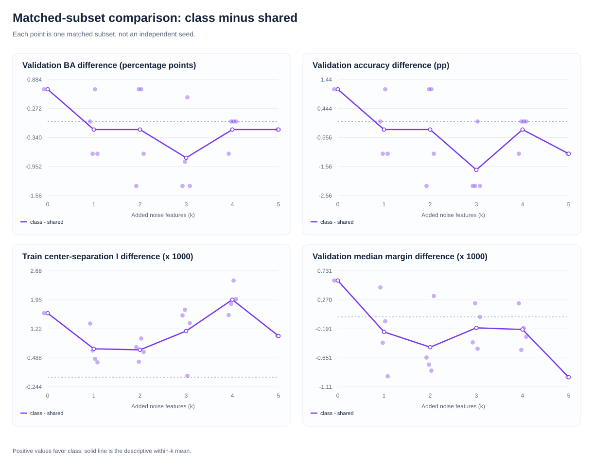
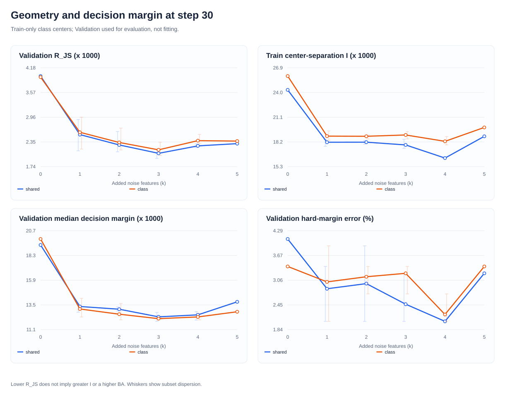

# E-CH4-14 — گزارش فنی یکپارچه حساسیت به ویژگی‌های نویزی

**بخش پایان‌نامه:** ۴.۱۴ | **وضعیت:** `COMPUTATIONAL_POSTFIT_AUDIT_PASS / FULL_0_60_REPORT_READY`  
**شواهد خام ثابت:** [مرحلهٔ ۰–۳۰](https://github.com/mahhammad/My-Thesis/commit/7bc66e4d2535fb15dfa5b569933b2d6c5a0962ac) | [ادامهٔ موفق ۳۰–۶۰](https://github.com/mahhammad/My-Thesis/actions/runs/43881004168) | [ممیزی و بازتولید نمودارهای ۰–۶۰](https://github.com/mahhammad/My-Thesis/actions/runs/43893347246)  
**محدوده تحلیل:** ۱۸ مجموعه ویژگی وابسته، دو خانوادهٔ سیاست `shared` و `class`، ۳۶ آموزش تا گام ۶۰ (۲۱۶۰ آپدیت تجمعی؛ ۱۰۸۰ در هر مرحله)، فقط Train و Validation؛ بدون Test. بخش‌های ۱–۱۸ نقطهٔ ۳۰ و بخش ۲۰ مسیر کامل تا گام ۶۰ را گزارش می‌کنند.

## ۱. پرسش پژوهشی و جمع‌بندی

با ثابت نگه‌داشتن سه ویژگی اطلاع‌رسان، داده مادر، ترتیب نمونه‌ها و برچسب‌ها، تقسیم Train/Validation و بودجه آموزش، افزودن صفر تا پنج ویژگی نویزی چگونه بر BA، Accuracy، هندسه مراکز، حاشیه تصمیم، تغییر پیش‌بینی و هزینه محاسباتی مدل گشت تصادفی روی گراف نمونه–ویژگی اثر می‌گذارد؟ همچنین آیا خانواده پرپارامترتر `class` در مقایسه جفت‌شده با `shared` برتری پایداری دارد؟

**نتیجه مرکزی و غیرمنتظره:** افت یکنواخت BA با افزودن نویز مشاهده نشد. میانگین BA اعتبارسنجی `shared` از **۹۵٫۹۲٪** در `k=0` به **۹۷٫۹۶٪** در `k=4` رسید و در `k=5` به **۹۶٫۷۷٪** برگشت؛ `class` به‌ترتیب **۹۶٫۶۰٪، ۹۷٫۷۹٪ و ۹۶٫۶۰٪** داشت. بااین‌حال شاخص جدایی مراکز `I` و میانه حاشیه در سطوح نویزی کوچک‌تر شدند. پس **پایداری BA، پایداری هندسه و حاشیه را تضمین نمی‌کند**. این مشاهده مختص یک داده مادر و مجموعه زیرمجموعه‌های مشخص است، نه ادعای سودمندبودن نویز در جامعه آماری.

## ۲. طراحی و منشأ داده‌ها

داده مادر از [`objective-start-diagnostics/inputs/phase2_train_validation/ds20261102_train_val.npz`](../objective-start-diagnostics/inputs/phase2_train_validation/ds20261102_train_val.npz) با بذر `20261102` و [manifest آن](../objective-start-diagnostics/inputs/phase2_train_validation/manifest.json) آمده است. داده Train شامل `300` نمونه، Validation شامل `90` نمونه، هر دو در `K=3` کلاس‌اند. فراوانی کلاس‌ها در Train برابر `[72,147,81]` و در Validation `[13,49,28]` است. سه ویژگی اطلاع‌رسان اصلی `[0,1,3]` همواره حاضرند؛ نویزهای قدیمی `[2,4]` عیناً از مادر خوانده شده‌اند؛ نویزهای جدید `[5,6,7]` هستند.

| مؤلفه داده | قرارداد اجراشده |
|---|---|
| نویز تازه | توزیع Gaussian مستقل، میانگین صفر، انحراف معیار سه‌گانه `(1.1,1.1,1.1)` |
| بذر نویز خام | `2026111601` |
| ضریب `gamma` نویز تازه | `(0.6,0.6,0.6)` |
| احتمال اسمی فقدان نویز | `(0.20,0.20,0.20)`، با قرارداد `True = observed` در ماسک |
| بذر ماسک مستقل | `2026111602` |
| شکل دو ماتریس نویز خام و ماسک | Train: `(300,3)`؛ Validation: `(90,3)`، `float64` / `bool` |
| SHA256 مادر | `e701cf9ef99b709fd5d6faee2d3ac631737d6b0195cf76eefc23d063bccb1b4a` |
| SHA256 طرح نویز | `82917272b0ac3850cecfd7bf4698dce55cbe955f8e3c308cf2c44d30e7f1ab8a` |

۱۸ زیرمجموعه از همین هشت اندیس اصلی مطابق [manifest مشتق‌ها](inputs/derived/manifest.json) انتخاب شده‌اند:

| k | نام زیرمجموعه و اندیس نویز |
|---:|---|
| 0 | `N0-01`: [] |
| 1 | `N1-01`: [2]؛ `N1-02`: [4]؛ `N1-03`: [5]؛ `N1-04`: [6] |
| 2 | `N2-01`: [2,4]؛ `N2-02`: [2,5]؛ `N2-03`: [4,6]؛ `N2-04`: [5,7] |
| 3 | `N3-01`: [2,4,5]؛ `N3-02`: [2,6,7]؛ `N3-03`: [4,5,7]؛ `N3-04`: [5,6,7] |
| 4 | `N4-01`: [2,4,5,6]؛ `N4-02`: [2,4,6,7]؛ `N4-03`: [2,5,6,7]؛ `N4-04`: [4,5,6,7] |
| 5 | `N5-01`: [2,4,5,6,7] |

داده‌های مشتق‌شده بدون مولد تصادفی جدید، با حفظ نمونه‌ها، برچسب‌ها، ماسک و NaNهای مادر ساخته شده‌اند. مورد مهم `N2-01` با ویژگی‌های `[0,1,2,3,4]` از نظر **SHA256 فایل NPZ کاملاً با مادر برابر** است. چهار زیرمجموعه هرکدام از سطوح `k=1..4` چهار seed مستقل نیستند؛ SD گروهی فقط پراکندگی انتخاب زیرمجموعه‌ها را توصیف می‌کند و نباید به فاصله اطمینان یا آزمون معناداری تبدیل شود. افزودن نویز همچنین بعد ورودی و ظرفیت سیاست را تغییر می‌دهد؛ مطالعه تفکیک علی این دو اثر را ادعا نمی‌کند.

## ۳. روش آموزش و سنجش

| تنظیم | مقدار ثابت |
|---|---|
| موتور | گراف نمونه–ویژگی با ماسک، استنتاج out-of-graph و گشت دقیق بدون بازگشت به نمونه مبدأ |
| پارامترهای گشت `β، λ، H` | `0.4`، `0.8`، `12` |
| هدف بهینه‌سازی | `softplus_JS_tau005` با `tau=0.005` |
| Adam | نرخ یادگیری `0.12`، logits اولیه صفر |
| دقت محاسبه | `float64`؛ `K=3` |
| خانواده | `shared` با شکل `(d+1)×d`؛ `class` با شکل `3×(d+1)×d`؛ `d=3+k` |
| بودجه | ۳۰ آپدیت Adam در هر fit، ۳۶ fit ترتیبی، ۱۰۸۰ آپدیت |
| ثبت مسیر | ۳۱ وضعیت از گام ۰ تا ۳۰، شامل loss، BA، Accuracy، گرادیان و اندازه آپدیت |
| ارزیابی | مراکز فقط از Train؛ Validation برون‌نمونه، بدون انتخاب پسینی بهترین گام |
| ممنوع | Test، بازآموزی برای تحلیل، seed اضافی یا انتخاب checkpoint بر اساس Validation |

`BA` میانگین recall سه کلاس است؛ `Accuracy` سهم درست‌طبقه‌بندی‌شده کل نمونه‌ها. ماتریس‌های confusion در گزارش‌های اولیه به‌صورت «سطر حقیقی، ستون پیش‌بینی» هستند. `R_JS`، `R_sqrt_JS` و `R_KL` فاصله/تراکم حول مرکز را از دید سنجه‌های مصوب نشان می‌دهند؛ `I` جدایی هندسی مراکز است. `T`، `BT`، `TNL` و `BTNL` نیز طبق قرارداد فصل سوم محاسبه شده‌اند. حاشیه برابر تفاوت امتیاز کلاس درست و بهترین رقیب است و با quantileها، نرخ خطای حاشیه سخت و surrogate ثبت می‌شود. سنجه‌های `R` و `I` جایگزین یکدیگر نیستند و BA به‌تنهایی کافی نیست.

## ۴. ممیزی مستقل داده و خروجی‌های واقعی

[گزارش ماشین‌خوان کنترل](tables/integrity_audit.json) و [اسکریپت بازخوانی read-only](reproduce_postfit.cjs) موارد زیر را بررسی می‌کنند:

| کنترل | نتیجه |
|---|---|
| فایل مشتق و manifest | ۱۸ NPZ، checksumهای ثبت‌شده؛ نمونه مادر `N2-01` یکسان |
| گزارش‌های تک‌اجرا | ۳۶ فایل `results/metrics/N*__*.json` |
| `metrics_full.json` | تمام ۳۶ گزارش و اطلاعات نمونه‌به‌نمونه؛ در CI با گزارش‌های جداگانه مقایسه می‌شود |
| گزارش تحلیل اولیه | ۳۶ رکورد فردی، ۱۲ گروه، ۱۸ جفت و ۶ گروه جفت‌شده |
| trace | ۳۶ فایل `trace.json` و ۳۶ `trace.csv`، هر یک ۳۱ گام |
| checkpoint | ۳۶ فایل `step_30.pt` و ۳۶ فایل SHA256 متناظر |
| ledger | `BUDGET_RESERVED=1`، `START=36`، `UPDATE=1080`، `SUCCESS=36`، `FAIL_STOP=0` |
| سنجه‌ها | ۷۲ confusion و BA/Accuracy دوباره محاسبه‌شده؛ برچسب‌های یکسان در زیرمجموعه‌ها |
| coverage | `measured=1548`؛ `not_applicable=72` (هندسه مرکز فقط برای Train) |
| Test | در manifestها و provenance برابر `test_accessed=false`؛ مسیر اجرایی Train/Validation-only |

فایل‌های checkpoint در اسکریپت read-only با **هش SHA256 واقعی بایت‌ها** تطبیق داده می‌شوند. داده‌ها و نتایج اولیه در `inputs/` و `results/` دست‌نخورده‌اند. اجرای اصلی آموزش [#43840079434](https://github.com/mahhammad/My-Thesis/actions/runs/43840079434) یک بار و با موفقیت از `09:28:38` تا `10:04:37 UTC`، یعنی **۳۵ دقیقه و ۵۹ ثانیه**، به پایان رسیده است.

## ۵. BA و Accuracy: عملکرد نهایی در گام ۳۰

در جدول `S=shared` و `C=class` هستند. در سطوح میانی، هر عدد میانگین **چهار زیرمجموعه وابسته** است:

| k | تعداد زیرمجموعه | BA Train: S / C (%) | BA Validation: S / C (%) | Accuracy Validation: S / C (%) |
|---:|---:|---:|---:|---:|
| 0 | 1 | 85.01 / 84.31 | 95.92 / 96.60 | 93.33 / 94.44 |
| 1 | 4 | 85.26 / 85.29 | 97.15 / 96.98 | 95.56 / 95.28 |
| 2 | 4 | 85.27 / 84.53 | 97.02 / 96.85 | 95.56 / 95.28 |
| 3 | 4 | 83.93 / 85.34 | 97.53 / 96.77 | 96.39 / 94.72 |
| 4 | 4 | 85.13 / 85.04 | 97.96 / 97.79 | 96.67 / 96.39 |
| 5 | 1 | 84.96 / 84.55 | 96.77 / 96.60 | 95.56 / 94.44 |


افزایش نویز کاهش یکنواخت BA نداشته و بیشترین مقدار میانگین Validation هر دو خانواده در `k=4` مشاهده شده است؛ در `k=5` کاهش رخ می‌دهد. در `k=4` حتی BA چهار زیرمجموعه `shared` عیناً `97.959%` است، اما این مشاهده روی یک Validation با ۹۰ نمونه به معنای پایداری برون‌داده‌ای نیست. Train BA عمدتاً حدود ۸۴–۸۵٪ و Validation حدود ۹۶–۹۸٪ است؛ متوسط اختلاف Validation منهای Train بین ۳۶ اجرا حدود **۱۲٫۲۳ واحد درصد** است که ممکن است ناشی از آسان‌تر بودن نمونه‌های این split باشد و نباید بدون Test مستقل تعمیم داد.

همه اعداد ۳۶ اجرا در [`per_dataset_metrics.csv`](tables/per_dataset_metrics.csv) و میانگین و SD توصیفی در [`summary_by_noise_level.csv`](tables/summary_by_noise_level.csv) آمده است. خطوط بازه کوچک شکل نشان‌دهنده کمینه و بیشینه همان زیرمجموعه‌های منتخب‌اند، **نه confidence interval**.

## ۶. مقایسه جفت‌شده shared و class

در هر جفت فقط خانواده سیاست فرق دارد. اختلاف‌ها `class − shared` هستند، BA و Accuracy با **واحد درصد** و `I` با ضریب ×1000:

| زیرمجموعه | k | ΔBA Validation (واحد درصد) | ΔAccuracy Validation (واحد درصد) | ΔI ×1000 |
|---|---:|---:|---:|---:|
| N0-01 | 0 | 0.680 | 1.111 | 1.617 |
| N1-01 | 1 | -0.680 | -1.111 | 0.674 |
| N1-02 | 1 | 0.680 | 1.111 | 0.462 |
| N1-03 | 1 | -0.680 | -1.111 | 0.375 |
| N1-04 | 1 | 0.000 | 0.000 | 1.354 |
| N2-01 | 2 | 0.680 | 1.111 | 0.390 |
| N2-02 | 2 | 0.680 | 1.111 | 0.978 |
| N2-03 | 2 | -0.680 | -1.111 | 0.636 |
| N2-04 | 2 | -1.361 | -2.222 | 0.759 |
| N3-01 | 3 | -0.850 | -2.222 | 1.703 |
| N3-02 | 3 | 0.510 | 0.000 | 0.035 |
| N3-03 | 3 | -1.361 | -2.222 | 1.366 |
| N3-04 | 3 | -1.361 | -2.222 | 1.560 |
| N4-01 | 4 | 0.000 | 0.000 | 1.850 |
| N4-02 | 4 | 0.000 | 0.000 | 2.440 |
| N4-03 | 4 | 0.000 | 0.000 | 1.970 |
| N4-04 | 4 | -0.680 | -1.111 | 1.570 |
| N5-01 | 5 | -0.170 | -1.111 | 1.041 |

در ۱۸ جفت، `class` در **۵** مورد BA بزرگ‌تر، `shared` در **۹** مورد بهتر و در **۴** مورد دقیقاً برابر بود. میانگین ۱۸ اختلاف BA برابر **−۰٫۲۵۵ واحد درصد** (به سود shared) است. بااین‌حال `I` در **تمام ۱۸ جفت برای class بزرگ‌تر** ثبت شده است. پس جدایی هندسی بالاتر، تضمین بهبود BA نیست و افزایش ظرفیت سه‌برابری `class` مزیت تصمیمی پایدار ایجاد نکرده است.



[جدول جفت‌ها](tables/paired_class_minus_shared.csv) و [گروه‌های جفت‌شده اولیه](results/metrics/metrics_paired_by_k.csv) برای بازبینی تمام اعداد در دسترس‌اند. این جفت‌ها تکرارهای آماری مستقل نیستند.

## ۷. هندسه مراکز، تراکم و حاشیه تصمیم

این جدول `R_JS`، `I` و میانه حاشیه را برای خوانایی ×۱۰۰۰ می‌کند؛ نرخ خطای حاشیه سخت درصد است:

| k | Validation R_JS ×1000: S / C | Train I ×1000: S / C | Median Validation margin ×1000: S / C | خطای حاشیه سخت Validation (%) S / C |
|---:|---:|---:|---:|---:|
| 0 | 3.978 / 3.952 | 24.312 / 25.929 | 19.280 / 19.857 | 4.08 / 3.40 |
| 1 | 2.534 / 2.591 | 18.183 / 18.899 | 13.338 / 13.099 | 2.85 / 3.02 |
| 2 | 2.279 / 2.340 | 18.190 / 18.880 | 13.075 / 12.594 | 2.98 / 3.15 |
| 3 | 2.072 / 2.158 | 17.868 / 19.034 | 12.339 / 12.165 | 2.47 / 3.23 |
| 4 | 2.256 / 2.385 | 16.331 / 18.288 | 12.532 / 12.331 | 2.04 / 2.21 |
| 5 | 2.311 / 2.374 | 18.875 / 19.916 | 13.790 / 12.831 | 3.23 / 3.40 |

از `k=0` تا `k=4` در `shared`، `I` از `0.02431` به `0.01633` (حدود ۳۳٪ افت)، `R_JS` اعتبارسنجی از `0.003978` به `0.002256` (حدود ۴۳٪ افت) و میانه حاشیه از `0.01928` به `0.01253` (حدود ۳۵٪ افت) رسید؛ الگوی کاهش مشابهی برای `class` نیز وجود دارد. درحالی‌که BA اعتبارسنجی افزایش یافت، **جدایی و میانه حاشیه کمتر شدند**. کوچک‌شدن `R_JS` به‌تنهایی قابل تفسیر به افزایش کیفیت جدایی نیست، زیرا `I` نیز جابه‌جا شده است.



معیارهای تکمیلی `T`، `BT`، `TNL`، `BTNL`، `R_sqrt_JS`، `R_KL` و فاصله جفت‌مراکز برای هر کدام از ۳۶ اجرا در [گزارش‌های canonical](results/metrics/) و [CSV گروهی](tables/summary_by_noise_level.csv) محفوظ‌اند. برای مثال `T` در `shared` از `0.4291` در `k=0` به `0.4113` در `k=4` و `TNL` از `0.8718` به `0.9159` رسید. بنابراین ابعاد هندسی هم‌جهت با BA حرکت نمی‌کنند.

## ۸. تغییر پیش‌بینی‌ها و خطاهای کلاس‌ها

برای هر زیرمجموعه، پیش‌بینی‌ها سطر‌به‌سطر با مدل همان خانواده در `N0-01` مقایسه شده‌اند، نه با یک جفت نمونه‌گیری تازه. در `k=5` از ۹۰ نمونه Validation فقط **۵ پیش‌بینی shared** و **۳ پیش‌بینی class** نسبت به `N0` عوض شدند؛ در `k=4` میانگین تغییرها به‌ترتیب ۴ و ۳٫۲۵ بود. تغییر پیش‌بینی الزاماً به معنی تغییر از درست به نادرست نیست.


جدول recall واقعی هر کلاس در Validation (اعداد میانگین زیرمجموعه‌ها):

| k | Recall کلاس ۰: S/C (%) | Recall کلاس ۱: S/C (%) | Recall کلاس ۲: S/C (%) |
|---:|---:|---:|---:|
| 0 | 100.00/100.00 | 87.76/89.80 | 100.00/100.00 |
| 1 | 100.00/100.00 | 92.35/91.84 | 99.11/99.11 |
| 2 | 100.00/100.00 | 92.86/92.35 | 98.21/98.21 |
| 3 | 100.00/100.00 | 94.39/90.31 | 98.21/100.00 |
| 4 | 100.00/100.00 | 93.88/93.37 | 100.00/100.00 |
| 5 | 100.00/100.00 | 93.88/89.80 | 96.43/100.00 |

در تمام ۳۶ اجرا، recall کلاس صفر روی این Validation کوچک **۱۰۰٪** است؛ کلاس یک با ۴۹ نمونه منشأ عمده خطاهاست. این موضوع و فراوانی نامتوازن کلاس‌ها توضیح می‌دهد چرا BA و Accuracy یکسان نیستند. ثبات نسبی تعداد خطاها با کوچک‌شدن حاشیه تناقض ندارد؛ درستی تصمیم و فاصله آن تا مرز تصمیم دو متغیر متفاوت‌اند. [نمودار recall سه کلاس](figures/07_validation_class_recall.svg) و [CSV آن](tables/validation_class_recall.csv) نیز ثبت شده‌اند.

## ۹. پویایی یادگیری و پرسش کفایت ۳۰ آپدیت

هر trace از **گام صفر تا گام ۳۰** ثبت شده است. در هر ۳۶ اجرا loss آموزش در پایان کمتر از ابتدا بود؛ متوسط کاهش نسبی حدود **۱۵٫۸۳٪** است، هرچند در ۳۵ اجرا دست‌کم یک افزایش موضعی loss در طول مسیر Adam وجود داشت. در گام ۳۰، نرم گرادیان در همه اجراها هنوز در بازه `2.36×10⁻⁵` تا `2.09×10⁻⁴` و نرم آخرین آپدیت در بازه `0.108` تا `0.609` غیرصفر است.

در **۲۱ اجرا** بهترین BA مشاهده‌شده در گامی پیش از ۳۰ از BA نهایی بالاتر بود؛ در ۱۵ اجرا BA نهایی با بهترین BA مشاهده‌شده برابر بود. اختلاف متوسط بیشینه مشاهده‌شده و مقدار نهایی حدود **۰٫۵۸۶ واحد درصد** است. این بیشینه‌های پسینی صرفاً برای تشخیص رفتار مسیر گزارش می‌شوند؛ **هیچ checkpoint به سبب این ارقام انتخاب نشده** و نتایج اصلی متعلق به گام ۳۰ باقی مانده‌اند.


**داوری کفایت:** ۳۰ گام برای پاسخ به پرسش از پیش تعریف‌شده **در بودجه ثابت ۳۰ آپدیت** کافی بوده و تمام جفت‌ها قابل‌مقایسه‌اند. اما کاهش loss، گرادیان و آپدیت غیرصفر و افت پس از بیشینه Validation در بعضی اجراها نشان می‌دهد **ادعای همگرایی کامل قابل دفاع نیست**. آموزش طولانی‌تر در دامنه این آزمایش نبوده است. [جدول ۳۷۲ ردیفی گام‌های گروهی](tables/learning_by_step.csv) و فایل‌های `results/traces/` برای تحلیل بیشتر موجودند؛ شکل برای جلوگیری از ازدحام فقط `k=0,2,5` را نشان می‌دهد.

## ۱۰. پارامترها، زمان اجرا و حافظه

با `d=3+k`، سیاست `shared` دقیقاً `d(d+1)` و سیاست `class` برابر `3d(d+1)` پارامتر قابل آموزش دارد.

| k | پارامتر S | پارامتر C | زمان S (ثانیه) | زمان C (ثانیه) | نسبت C/S |
|---:|---:|---:|---:|---:|---:|
| 0 | 12 | 36 | 15.08 | 41.82 | 2.77 |
| 1 | 20 | 60 | 18.32 | 53.57 | 2.92 |
| 2 | 30 | 90 | 25.09 | 73.96 | 2.95 |
| 3 | 42 | 126 | 32.01 | 93.98 | 2.94 |
| 4 | 56 | 168 | 39.80 | 124.71 | 3.13 |
| 5 | 72 | 216 | 47.22 | 159.25 | 3.37 |

اندازه سیاست در هر خانواده از `k=0` تا `k=5` **شش‌برابر** شد. زمان متوسط `shared` از `15.08s` به `47.22s` و زمان `class` از `41.82s` به `159.25s` رسید. در `k=5` خانواده `class` حدود **۳٫۳۷ برابر** `shared` زمان مصرف کرد. جمع زمان محاسبات درون ۳۶ گزارش تقریباً `2109.12` ثانیه است؛ زمان Workflow بزرگ‌تر است زیرا نصب، کنترل، ذخیره و آپلود را هم شامل می‌شود.


`resource_usage.process_rss_mib_at_report` حافظه RSS در یک نقطه ثبت‌شده است **نه بیشینه حافظه**. زمان‌ها مختص همین پیاده‌سازی گشت دقیق روی CPU و این محیط‌اند و قانون پیچیدگی عمومی نیستند.

## ۱۱. ساختار فایل‌ها، نقش آنها و بازتولید بدون آموزش

| مسیر | نقش دقیق |
|---|---|
| `inputs/noise_raw/new_noise_seed20261102.npz` و `manifest.json` | سه ستون نویز خام Train/Validation، بذر، توزیع، SHA فایل و آرایه |
| `inputs/noise_masks/new_noise_masks.npz` و `manifest.json` | ماسک مستقل `bool`، بذر و احتمال فقدان، SHA |
| `inputs/derived/N0-01.npz ... N5-01.npz` و `manifest.json` | ۱۸ داده مشتق، نگاشت ویژگی، شناسه سطر، checksum |
| `results/metrics/N*__*.json` | ۳۶ گزارش فردی canonical، هندسه، حاشیه، confusion، per-class، resource |
| `results/metrics/metrics_full.json` | تجمیع همان ۳۶ گزارش با جزئیات نمونه‌به‌نمونه |
| `results/metrics/metrics_analysis.json` و چهار فایل `metrics_*.csv` | تحلیل اولیه فردی، گروهی، جفتی و گروه جفتی |
| `results/metrics/coverage.json` و `provenance.json` | پوشش معیارها، بذر و SHA منشأ، ممنوعیت Test |
| `results/metrics/e14_spent_budget.jsonl` | دفتر رزرو، ۱۰۸۰ UPDATE و ۳۶ SUCCESS |
| `results/traces/<run_id>/trace.json` و `trace.csv` | ۳۱ نقطه یادگیری هر اجرا، شامل loss، BA، gradient و update |
| `results/checkpoints/<run_id>/step_30.pt` و `.sha256` | logits و Adam state در گام ۳۰ به‌همراه SHA مستقل |
| `tables/analysis_summary.json`، `integrity_audit.json` و پنج CSV | محاسبات ثانویه قابل ممیزی، جفت‌ها، کلاس‌ها، هندسه، منحنی و هزینه |
| `figures/01...07*.svg` | ۷ نمودار برداری، بدون بازآموزی |
| `reproduce_postfit.cjs` و `render_figures.cjs` | بازحساب جدول‌ها و بازتولید دقیق SVG با Node، بدون کتابخانه آموزش |
| `data.py`، `stage_execute.py`، `runner.py`، `e14_metrics.py`، `analysis.py` | کد اولیه داده/اجرا/سنجه‌ها؛ در تحلیل ثانویه تغییر نکرده‌اند |

**بازبینی read-only** با Node روی همین شاخه (دسترسی به کل فایل‌های اصلی و checkpointها لازم است):

```bash
git switch experiment/ch4-14-noise-sensitivity-01
node code/experiments/synthetic-noise-feature-sensitivity/reproduce_postfit.cjs --check
```

در این روش `metrics_full.json` با هر ۳۶ گزارش فردی، confusion و برچسب‌ها، `ledger` با آپدیت‌ها، SHA256 هر ۳۶ checkpoint و پنج CSV مشتق با محاسبه مستقیم مقایسه می‌شوند. برای بازتولید **صرفاً خروجی‌های تحلیلی** (بدون تغییر `inputs/` و `results/`):

```bash
node code/experiments/synthetic-noise-feature-sensitivity/reproduce_postfit.cjs --write
node code/experiments/synthetic-noise-feature-sensitivity/render_figures.cjs
git diff -- code/experiments/synthetic-noise-feature-sensitivity/tables code/experiments/synthetic-noise-feature-sensitivity/figures
```

برای فایل‌های سالم diff باید تهی باشد. CI شاخه job مستقلی به نام `postfit-audit` دارد که تطبیق فایل‌های اصلی، CSV و بازسازی دقیق SVGها را بدون آموزش انجام می‌دهد. برای درج در LaTeX، SVG برداری را می‌توان به PDF تبدیل کرد؛ داده هر نمودار در CSV و JSON متناظر وجود دارد.

## ۱۲. محدودیت‌ها و نتیجه‌گیری قابل دفاع

- **یک داده مادر و یک تحقق نویز:** چهار زیرمجموعه هر سطح، چهار اجرای مستقل نیستند. از آنها CI، مقدار p و ادعای تعمیم آماری معتبر استخراج نمی‌شود.
- **تغییر هم‌زمان بعد، نویز و پارامتر:** اثر تعداد ویژگی نویزی از افزایش بُعد و ظرفیت سیاست کاملاً تفکیک نشده است.
- **Validation آسان‌تر از Train:** این تفاوت بزرگِ دو split باید در گزارش نتیجه حفظ شود. Test استفاده نشده، بنابراین تعمیم نهایی به داده مستقل بررسی نشده است.
- **همگرایی اثبات نشده:** بودجه ثابت ۳۰ آپدیت اجرا شده، اما گرادیان و تغییر پارامتر در انتها غیرصفرند؛ بهترین Validation الزاماً در گام ۳۰ نیست.
- **اثر انتخاب زیرمجموعه:** حتی در `k` برابر، هویت ویژگی نویزی بر نتایج اثر دارد؛ SD فقط توصیف همین تنوع است.
- **محدودیت هندسه:** کاهش `R_JS` با کاهش `I` یا حاشیه ممکن است هم‌زمان رخ دهد؛ هیچ تک‌معیاری جای تمام سنجه‌ها نیست.

**جمع‌بندی نهایی:** مدل در این داده مادر نسبت به افزایش نویز از دید BA **افت یکنواخت نشان نداده** و بسیاری از پیش‌بینی‌ها نسبت به حالت بدون نویز ثابت مانده‌اند، ولی هندسه مراکز و حاشیه تصمیم تغییر کرده است. سیاست `class` علی‌رغم جدایی مراکز بزرگ‌تر در تمام ۱۸ جفت و هزینه محاسباتی بالاتر، برتری پایدار در BA نداشته است. برای پایان‌نامه، گزارش هم‌زمان **دقت، تراکم، جدایی، حاشیه، خطای هر کلاس و هزینه** از تمرکز صرف بر BA قابل دفاع‌تر است.

## ۱۳. زمینهٔ دشواری نمونه‌ها: مرجع Bayes MAP همان دادهٔ مادر

برای همین داده مادر با seed `20261102`، مرجع منجمدِ آگاه از توزیع مولد، **Bayes MAP**، دارای `Train BA≈84.32%` و `Validation BA≈97.449%` است؛ این اعداد از [گزارش `benchmark_v1`](../benchmark_v1/README_FA.md) و [گزارش `objective-start-diagnostics`](../objective-start-diagnostics/README_FA.md) گرفته شده‌اند، نه از بازآموزی یا Test جدید. مرجع برای تفسیر اختلاف دشواری بین Train و Validation اهمیت دارد و با BA بالای اعتبارسنجی IMC سازگار است. `N2-01` دقیقاً NPZ مادر و لنگر مقایسه است.

قاعده Bayes MAP برای **Accuracy موردانتظار تحت مدل مولد** بهینه است؛ نه کران بالای BA تجربی بر ۹۰ نمونه، نه الزاماً قاعده بهینه BA و نه منبع هندسه یکسان با IMC. مقادیر `R` روی پسین‌های مولد بیزی را نمی‌توان مستقیماً با `R` بازنمایی گشت برابر گرفت. در صورت استقلال شرطی واقعی نویزهای تازه و ماسک آنها از برچسب در مدل مولد، این ویژگی‌ها اطلاعات تازه‌ای برای Bayes فراهم نمی‌کنند؛ این یک گزاره **مشروط به مدل مولد و سازوکار missingness** است، نه بازآزمایی عددی Bayes روی تک‌تک مشتق‌ها.

## ۱۴. تکمیل مسیرهای یادگیری همه سطوح نویز، جداگانه برای هر خانواده

برای پاسخ به سؤال «آیا مقدار محدودی نویز مسیر را آرام‌تر می‌کند؟»، نمودارهای قدیمی `k=0,2,5` صرفاً نمایی منتخب بودند. اکنون **تمام شش سطح `k=0..5`، تمام ۳۱ گام و ۳۶ trace اولیه** در شکل‌های تازه حضور دارند. برای `k=1..4` خط اصلی میانگین چهار زیرمجموعه وابسته است و برای `k=0,5` تنها یک subset وجود دارد. محورهای هر دو خانواده در شکل‌های اصلی و مکمل **دامنه BA یکسان** دارند و میانگین‌گیری، تکرار مستقل آماری نیست.

**Validation BA شش سطح:**

- [شکل ۰۸ — فقط `shared`](figures/08_validation_BA_all_k_shared.svg)
- [شکل ۰۸ — فقط `class`](figures/08_validation_BA_all_k_class.svg)

**منحنی‌های منفرد برای جلوگیری از پنهان‌شدن نوسان زیر میانگین:** دو شکل با شش پنل `k=0..5`، برای سطوح میانی چهار منحنی کم‌رنگ و میانگین پررنگ، و برای دو انتهای دامنه فقط منحنی یگانه:

- [شکل ۰۹ — زیرمجموعه‌های `shared`](figures/09_validation_BA_individual_shared.svg)
- [شکل ۰۹ — زیرمجموعه‌های `class`](figures/09_validation_BA_individual_class.svg)

**Loss، BA، Gradient و Update با محور زمانی یکسان اما محور عمودی مستقل:**

- [شکل ۱۰ — تشخیص کامل مسیر `shared`](figures/10_full_learning_shared.svg)
- [شکل ۱۰ — تشخیص کامل مسیر `class`](figures/10_full_learning_class.svg)

این شکل‌های چهارپنلی به ترتیب `validation_BA`، `train_softplus_loss`، `gradient_l2` و `adam_update_l2` را برای همه شش سطح نشان می‌دهند. محور `gradient_l2` در شکل ۱۰ **لگاریتمی** است؛ سایر محورها خطی‌اند و واحد مستقل دارند. مقدار `adam_update_l2` در گام صفر تعریف‌نشده و در شکل ثبت نشده است.

برای بررسی مستقیم موج‌های گرادیان در **اجراهای فردی** و با محور عمودی خطی مشترک، [شکل ۱۱ `shared`](figures/11_gradient_individual_shared.svg) و [شکل ۱۱ `class`](figures/11_gradient_individual_class.svg) تهیه شده‌اند. شکل منتخب قدیمی [۰۳](figures/03_learning_diagnostics.svg) برای مقایسهٔ `k=0,2,5` محفوظ است، اما **مبنای داوری شش سطح، شکل‌های ۰۸ تا ۱۱ و traceهای ۳۶ اجرا** هستند.

## ۱۵. تحلیل عددی نوسان و میرایی: ابتدا هر اجرا، سپس گروه

برای دنباله ۳۱تایی `B_t=100×BA_validation(t)`، دو کمیت پایه این‌گونه‌اند:

```math
\mathrm{MDD}_{BA}=\max_{0\le t\le30}\bigl(\max_{0\le u\le t}B_u-B_t\bigr), \qquad
\mathrm{TV}_{BA}=\sum_{t=1}^{30}|B_t-B_{t-1}|.
```

شمار افت BA برابر تعداد `B_t<B_{t-1}` با تلرانس عددی `10^{-12}` در مقیاس BA خام، و شمار افزایش Loss به همین ترتیب از `L_t>L_{t-1}` به دست آمده است. برای گرادیان `g_t=||∇L_t||₂`، **قله/درهٔ محلیِ سخت** در گام داخلی `t=1..29` به‌ترتیب با `g_t>g_{t-1},g_{t+1}` و `g_t<g_{t-1},g_{t+1}` تعریف شده؛ حالت تساوی قله/دره نیست. میانگین قدرمطلق اختلاف اکسترمم‌های متوالی و نسبت نوسان ۱۵ تغییر انتهایی (گام ۱۵ تا ۳۰) به ۱۵ تغییر ابتدایی (۰ تا ۱۵) نیز ذخیره شده است؛ اگر مخرج صفر باشد نسبت تعریف‌نشده است. این سنجه‌ها **شاخص‌های توصیفی مسیرند، نه آزمون همگرایی**.

در جدول، MDD و TV هر دو **واحد درصد (pp)** دارند؛ اعداد داخل براکتِ MDD کمینه و بیشینه چهار زیرمجموعه انتخابی‌اند، نه فاصله اطمینان:

| k | بیشینه افت BA: shared (pp) | class (pp) | مجموع نوسان BA: shared (pp) | class (pp) | نسبت TV گرادیان دیر/زود: S/C |
|---:|---:|---:|---:|---:|---:|
| 0 | 6.48 | 4.42 | 18.90 | 13.10 | 0.206 / 0.320 |
| 1 | 2.47 [1.36, 3.41] | 1.66 [0.68, 2.72] | 9.74 | 7.53 | 0.314 / 0.262 |
| 2 | 1.79 [1.36, 2.55] | 1.32 [0.68, 1.87] | 7.06 | 6.21 | 0.404 / 0.296 |
| 3 | 2.38 [1.87, 2.55] | 1.79 [0.68, 2.55] | 8.76 | 9.18 | 0.242 / 0.172 |
| 4 | 2.08 [1.36, 3.23] | 1.66 [1.36, 2.55] | 11.01 | 11.18 | 0.418 / 0.277 |
| 5 | 1.36 | 1.36 | 9.69 | 11.22 | 0.412 / 0.344 |

**نتایج قابل مشاهده:**

- برای `shared`، MDD از `6.48 pp` در `k=0` به میانگین‌های `2.47، 1.79، 2.38، 2.08 pp` در `k=1..4` رسید؛ برای `class` از `4.42 pp` به `1.66، 1.32، 1.79، 1.66 pp`. **تمام زیرمجموعه‌های منفرد سطوح ۱ تا ۴** نیز MDD کمتر از اجرای بدون نویز همان خانواده دارند؛ این نتیجه صرفاً حاصل هموارشدن میانگین نیست. بااین‌حال `k=5` نیز MDD کوچک دارد و فرض «فقط نویز محدود مفید است» به‌صورت دقیق تأیید نمی‌شود.
- مجموع نوسان BA در **هر دو خانواده در `k=2` کمینه است**: `7.06 pp` برای `shared` و `6.21 pp` برای `class`؛ مقدار بی‌نویز به‌ترتیب `18.90` و `13.10 pp` بوده است. در `k=3,4,5` TV می‌تواند دوباره رشد کند؛ بنابراین روند غیر یکنواخت است.
- **میرایی عمومی نوسان گرادیان با افزودن نویز تأیید نمی‌شود.** برای نمونه نسبت TV دیر/زود در `shared` بدون نویز `0.206` و در `k=2` حدود `0.404` است؛ یعنی گرچه نوسان BA کمتر شده، فروکش نسبیِ تغییرات گرادیان در این مقایسه قوی‌تر نیست. در خانواده `class` وضعیت متفاوت است. صرف مشاهده قله‌های کوتاه‌تر نمی‌تواند اثبات کند نویز گرادیان را منظم‌سازی کرده است.
- برای نمونه مشخص `N0-01__shared`، از گام ۱ به ۲، BA اعتبارسنجی از `96.769%` به `95.408%` افت کرد، **درحالی‌که Loss آموزشی از `0.002687871` به `0.002424127` کاهش یافت**. پس کاهش surrogate در یک گام الزاماً به بهبود تصمیم سخت در همان گام نمی‌انجامد. traceها صرفاً BA عددی دارند و برچسب پیش‌بینی‌شده در **گام‌های میانی** را ذخیره نکرده‌اند؛ نمی‌توان نام نمونه‌های تغییرکرده را اختراع کرد.
- شمار قله‌ها و دره‌ها، جهش‌ها، گام‌های کاهش BA، افزایش موضعی Loss و رخدادهای هم‌زمانِ `Loss↓, BA↓` به تفکیک تمام ۳۶ اجرا در CSV ثبت شده‌اند. کاهش دامنهٔ تغییرات، **اثبات همگرایی کامل یا ثبات مرزهای تصمیم نیست**.

[جدول ۳۶ اجرای فردی](tables/stability_by_run.csv)، [جدول گروه‌های ۱۲گانه و پراکندگی subset](tables/stability_by_noise_level.csv)، [JSON کامل بازتولیدپذیر](tables/noise_dynamics_summary.json).

## ۱۶. شاخص سیاست‌محور NFI₃: سه **انتخاب ویژگی** بدون ماسک

هدف اندازه‌گیری احتمال انتخاب **دست‌کم یک ویژگی نویزی طی سه انتخاب متوالی ویژگی** تحت سیاست Softmax آموخته‌شده است، نه احتمال برخورد واقعی گشت نمونه–ویژگی. سه انتخاب شامل **انتخاب اولیه و دو انتقال ویژگی→ویژگی** است؛ با سه گام کامل گشت نمونه→نمونه یا افق `H=12` اشتباه نشود. در این شاخص `β` و `λ` مستقیماً وارد نمی‌شوند.

فرض کنیم `d=3+k`، بردار انتخاب اولیه `p_0=softmax(z[d,:])` و ماتریس انتقال ویژگی `P=softmax(z[0:d,:])` سطربه‌سطر هستند. مجموعه `J` سه اندیس **محلی** اطلاع‌رسان متناظر اندیس‌های اصلی `[0,1,3]` و `N` بقیه اندیس‌های محلی مطابق [manifest](inputs/derived/manifest.json) هستند. برای `class` هر کاندید کلاس `c∈{0,1,2}` دارای سیاست جداگانه است. روابط محاسبه:

```math
q_t=p_0P^{t-1}{\bf1}_{N}\quad (t=1,2,3),\qquad
F_3=1-p_0[J]\,P[J,J]^2{\bf1}_{3},\qquad
E_3=q_1+q_2+q_3.
```

`F₃` احتمال **حداقل یک** برخورد با نویز است (بین صفر و یک) و `E₃` **تعداد مورد انتظار انتخاب نویز** است (بین صفر و سه)، نه یک احتمال. در گام صفر logits صفر و سیاست Uniform بود:

```math
F_{3,U}(k)=1-\left(\frac{3}{3+k}\right)^3,\qquad
E_{3,U}(k)=\frac{3k}{3+k},\qquad
\mathrm{NFI}_3=\frac{F_3}{F_{3,U}(k)}\quad (k>0).
```

برای `k=0`، `F₃=E₃=0` و **NFI₃ تعریف‌نشده** است؛ در CSV مقدار آن خالی/`null` نگهداری شده، نه صفر. `NFI₃<1` نشان‌دهنده اجتناب نسبی از نویز نسبت به Uniform و `>1` نشان‌دهنده ترجیح نسبی است. به‌ویژه `F_{3,U}(5)≈0.947` نزدیک اشباع است؛ نسبت را باید همراه احتمال مطلق خواند.

**مقایسه صریح گام صفر با checkpoint واقعی گام ۳۰:** `S=shared`، `C=class` با **میانگین کلان برابر‌وزن سه کلاس**؛ در `k=1..4` میانگین چهار subset وابسته‌اند.

| نویز k | F₃ صفر/Uniform | F₃ پایان: S/C | NFI₃ پایان: S/C | E₃ پایان: S/C | E₃ صفر/Uniform |
|---:|---:|---:|---:|---:|---:|
| 0 | 0.000 | 0.000 / 0.000 | — / — | 0.000 / 0.000 | 0.000 |
| 1 | 0.578 | 0.601 / 0.569 | 1.040 / 0.983 | 0.653 / 0.795 | 0.750 |
| 2 | 0.784 | 0.671 / 0.583 | 0.856 / 0.743 | 1.088 / 0.887 | 1.200 |
| 3 | 0.875 | 0.615 / 0.586 | 0.703 / 0.669 | 1.099 / 1.005 | 1.500 |
| 4 | 0.921 | 0.667 / 0.575 | 0.724 / 0.624 | 1.191 / 1.043 | 1.714 |
| 5 | 0.947 | 0.639 / 0.583 | 0.675 / 0.616 | 1.146 / 1.068 | 1.875 |

[شکل ۱۲ — F₃، E₃ و NFI₃ در کنار مرجع Uniform](figures/12_nfi3_f3_e3.svg)

از `k=2` به بعد مقدار گروهی NFI₃ هر دو خانواده **کمتر از یک** است؛ در `k=5` مقدار shared برابر `0.675` و class-macro برابر `0.616` است. برای همین سطح، `F₃` آموخته‌شده `0.639/0.583` است در برابر `0.947` برای Uniform؛ یعنی سیاست احتمال برخورد سه‌انتخابی با نویز را نسبت به مرجع بدون ماسک پایین آورده است، هرچند این احتمال **صفر نیست**. در `k=1`، مقدار shared حدود `1.040` است؛ بنابراین ادعای اجتناب همیشگی از نویز غلط است.

**تفاوت کلاس‌ها را میانگین ماکرو پنهان نکند:** در زیرمجموعه `N2-01`، NFI₃ سه سیاست کلاس‌مشروط به‌ترتیب حدود `1.069، 0.497، 0.576` و میانگین ماکرو `0.714` است؛ سیاست کاندید کلاس صفر حتی نویز را نسبت به Uniform بیشتر ترجیح می‌دهد. فایل [`nfi3_by_policy.csv`](tables/nfi3_by_policy.csv) برای **۹۰ ردیف** (۱۸ shared، ۵۴ کلاس‌مشروط و ۱۸ macro) مقادیر `q₁,q₂,q₃,F₃,E₃,NFI₃,ΔF₃` و مقادیر صریح **گام صفر/۳۰** را ثبت کرده است. [خلاصه ۱۲گانه](tables/nfi3_by_noise_level.csv) و [JSON](tables/noise_dynamics_summary.json) مرجع بازتولید هستند.

**حد اعتبار حیاتی:** این یک **زنجیره سه‌انتخابی خلاف‌واقعیِ صرفاً سیاست‌محور، بدون ماسک** است. گشت واقعی به ماسک، حضور یال، هسته انتقال نمونه‌ای، ممنوعیت برگشت به نمونه مبدأ و توقف گشت وابسته است. پس این F₃ را نباید «احتمال دقیق بازدید نویز در گشت کامل» یا نتیجه آماری روی مسیرهای واقعی نامید.

## ۱۷. فرضیه بافر احتمالاتی Softmax و آنچه شواهد اجازه می‌دهند

فرضیه مطرح‌شده این است که افزودن تعداد محدود ویژگی غیرمطلع‌کننده می‌تواند بخشی از **جرم Softmax و تغییرات سیاست** را میان گزینه‌های اضافی توزیع کند و شدت اثر تغییر logits اطلاع‌رسان بر تصمیم را کاهش دهد. برای بررسی مقدماتی، در هر checkpoint ۳۰، جرم انتخاب اولیه `p₀(N)` و میانگین قدرمطلق اختلاف احتمال Softmax نسبت به سیاست Uniformِ logits صفر در ستون‌های `J` و `N` محاسبه شد. میانگین احتمال بر **تمام سطرهای سیاست (d+1 سطر، شامل انتخاب اولیه و انتقال ویژگی)** و ستون‌های همان نوع، **بدون وزن‌دهی با نمونه‌ها** گرفته شده است؛ این کمیت با گرادیان یا probability mass واقعی گشت مساوی نیست.

| k | جرم آغازین انتخاب نویز پس از آموزش: S/C | جرم Uniform | میانگین |Δ احتمال| برای ستون اطلاع‌رسان: S/C | برای ستون نویز: S/C |
|---:|---:|---:|---:|---:|
| 1 | 0.235/0.229 | 0.250 | 0.233/0.234 | 0.141/0.198 |
| 2 | 0.259/0.254 | 0.400 | 0.201/0.223 | 0.198/0.186 |
| 3 | 0.311/0.297 | 0.500 | 0.170/0.174 | 0.165/0.155 |
| 4 | 0.326/0.293 | 0.571 | 0.144/0.156 | 0.133/0.132 |
| 5 | 0.320/0.290 | 0.625 | 0.152/0.150 | 0.120/0.119 |

برای `k=5`، جرم `p₀(N)` آموخته‌شده در `shared/class` حدود `0.320/0.290` است، کمتر از `0.625` برای Uniform. بااین‌حال میانگین تغییر قدرمطلق احتمالِ ستون‌های اطلاع‌رسان همچنان در همین سطح حدود `0.152/0.150` است و حتی اندکی **بزرگ‌تر از تغییر ستون‌های نویز `0.120/0.119`**. بنابراین تبیین سادهٔ «نویز تمام تغییرات سیاست یا گرادیان را به خود جذب می‌کند» با این شواهد **تأیید نشده است**.

[شکل ۱۳ — پراکندگی توصیفی NFI₃ و بیشینه افت BA](figures/13_nfi3_vs_BA_drawdown.svg) رابطه‌ای را به‌صورت **۱۸ زیرمجموعه وابسته × دو خانواده** نمایش می‌دهد، نه آزمون همبستگی مستقل. در `k=2` مجموع نوسانات BA نسبتاً کم است و NFI₃ زیر Uniform قرار دارد، اما `k=5` حتی NFI₃ کمتری دارد و لزوماً پایین‌ترین TV(BA) را ندارد. پس از «NFI پایین» نمی‌توان به‌صورت یکنواخت «پایداری بیشتر» نتیجه گرفت. در این قرارداد **مسیر logits گام‌های ۱ تا ۲۹ ذخیره نشده**؛ تغییرات گام‌به‌گام احتمال‌های سیاست یا سهم جذب‌شده گرادیان از traceهای اسکالر قابل استخراج نیست و بازسازی ساختگی آنها ممنوع است.

شواهد فعلی از دو مشاهده توصیفی مستقل پشتیبانی می‌کنند: **(۱)** BA در پیکربندی‌های نویزی اغلب مسیر کم‌نوسان‌تری از حالت بدون نویز داشته، **(۲)** سیاست نهایی نسبت به Uniform در سطوح `k≥2` اغلب نویز را کمتر انتخاب می‌کند. اما پیوند علّی این دو، ادعای regularization، و تشخیص اثر خالص نویز از افزایش بعد، تعداد پارامتر و ترکیب ویژگی‌ها **هنوز اثبات نشده** است. در ضمن `k=1..4` چهار subset مشترک‌مادر و نه چهار seed مستقل‌اند؛ هیچ p-value یا فاصله اطمینان از آنها به دست نیامده است.

## ۱۸. فایل‌ها، بازتولید و وضعیت نهایی پژوهش

خروجی‌های افزوده در همان پوشه E-CH4-14 قرار گرفته‌اند و به داده‌ها/نتایج منجمد دست نزده‌اند:

| مسیر | نقش |
|---|---|
| `advanced_analysis.py` | تحلیل read-only ۳۶ trace، loader امن SHA-pinned ۳۶ checkpoint با `torch.load(weights_only=True)`، محاسبه F₃/E₃/NFI₃ و جدول‌های نوسان؛ حالت `--mode write` فقط خروجی‌های مشتق `tables/` و `figures/` را می‌نویسد |
| `test_advanced_analysis.py` | ۹ آزمون مستقل بدون آموزش: Uniform گام صفر، enumeration صریح `d³` مسیر تا `d=8`، سه کلاس برابر، mapping اندیس محلی، محدوده‌ها، SHA تامپر و drawdown/اکسترمم |
| `tables/stability_by_run.csv`، `stability_by_noise_level.csv` | ۳۶ رکورد فردی و ۱۲ خلاصه گروهیِ نوسان، بدون آمار استنباطی |
| `tables/nfi3_by_policy.csv`، `nfi3_by_noise_level.csv` | سیاست‌های ۳۶ checkpoint: ۹۰ ردیف شامل سه کلاس و macro؛ ۱۲ ردیف گروهی |
| `tables/noise_dynamics_summary.json` | ورودی عددی ثبت‌شده جهت بررسی مستقل تمام سنجه‌های جدید |
| `figures/08_*` تا `figures/13_*` | ۱۰ شکل SVG برداری جدید: دو BA اصلی، دو BA منفرد، دو چهارسنجشی، دو گرادیان منفرد، یک NFI₃ و یک مقایسه توصیفی با drawdown |

اجرای ممیزی عددی، **بدون fit یا Test**:

```bash
python -m unittest discover -s code/experiments/synthetic-noise-feature-sensitivity -p 'test_advanced_analysis.py' -v
python code/experiments/synthetic-noise-feature-sensitivity/advanced_analysis.py --mode check
```

برای بازسازی **فقط فایل‌های تحلیلی** (مجاز، بدون تغییر checkpoint، trace یا داده مادر):

```bash
python code/experiments/synthetic-noise-feature-sensitivity/advanced_analysis.py --mode write
git diff -- code/experiments/synthetic-noise-feature-sensitivity/tables code/experiments/synthetic-noise-feature-sensitivity/figures
```

مقادیر نسخه‌بندی‌شده با `numpy==2.4.6`، `matplotlib==3.10.7` و `torch==2.9.1` (CPU) ساخته شده‌اند. job مستقل CI جدید تمام محاسبات و **۱۰ شکل SVG را byte-for-byte** بازتولید می‌کند. در تمام این مراحل مسیر آموزشی `runner.py` فراخوانی نشده، داده Train/Validation دوباره تولید نشده و Test دست‌نخورده است.

**نتیجه نهایی برای §۴.۱۴:** افزودن ویژگی غیرمطلع‌کننده روی این داده مادر با **کاهش نوسان BA، به‌ویژه در k=2، همراه بوده**؛ اما میرایی گرادیان چنین روند یکدستی ندارد. از سوی دیگر سیاست‌های آموخته‌شده در زنجیرهٔ فرضی سه انتخاب ویژگی، عموماً نویز را کمتر از Uniform می‌گزینند. این هم‌زمانی، **شاهد امکان وجود مکانیسم بافر Softmax است، نه اثبات آن**. پایداری تصمیم، هندسه مرکز، حاشیه، NFI₃ و کمیت‌های گرادیان لزوماً هم‌جهت نیستند.

**تکمیل پژوهش:** ادامهٔ واقعی همین ۳۶ checkpoint تا گام ۶۰ انجام شده است؛ یافته‌های بازهٔ ۰–۳۰ در بخش‌های ۱ تا ۱۸ به‌عنوان نتایج مستقل همان پنجره حفظ شده‌اند و تحلیل یکپارچه و بازهٔ ۳۰–۶۰ در §۲۰ ارائه می‌شود. رسیدن به گام ۶۰ اثبات همگرایی نیست.

**وضعیت بخش‌های ۱ تا ۱۸:** `ORIGINAL_0_30_EVIDENCE_PRESERVED`؛ نتیجهٔ تحلیل ادامه و ممیزی کامل در §۲۰ است. `NO_TEST / NO_MAIN_MERGE`.


## ۱۹. قرارداد فنی و بازتولید ادامهٔ ۳۰→۶۰

**وضعیت این بخش: `RESUME_COMPLETED / STEP_60_AUDITED`.** بخش‌های ۱ تا ۱۸ تحلیل واقعی و مستقل ۰–۳۰ را نگه می‌دارند. ادامهٔ ۳۰–۶۰ با مصوبهٔ مستقیم مالک و همان Secret پیشین FIT، اما بودجهٔ جداگانهٔ یک‌بارمصرف، انجام شده است. این بخش پروتکل را ثبت می‌کند؛ نتایج علمی و نمودارهای کامل در §۲۰ گزارش شده‌اند.

### هدف و مبنا

همان ۳۶ سیاست آموزش‌دیده در `results/checkpoints/<run_id>/step_30.pt` (با sidecar SHA256 و metadata) به‌صورت ترتیبی و با **همان logits و وضعیت کامل Adam** از گام ۳۰ به گام ۶۰ خواهند رسید. مطابق پروتکل تنها ۳۰ آپدیت افزوده به هر job و در کل ۱۰۸۰ آپدیت جدید مجاز است؛ ۱۰۸۰ آپدیت قبلی در ledger قدیمی محفوظ می‌ماند. سیاست `class` سه تانسور کلاس‌مشروط دارد و تمام سنجه‌ها برای هر کلاس و macro برابر-وزن ثبت می‌شوند. بهینه‌ساز یا تابع هدف دوباره تنظیم یا از صفر شروع نمی‌شود.

پیش از صرف بودجه، [`resume_30_60.py`](resume_30_60.py) باید فایل‌های اصلی Train/Validation، نگاشت ویژگی، همهٔ ۳۶ checkpoint و SHA باینری و Git blob متناظر در کامیت منجمد `7bc66e4d...`، ممان‌های Adam، SHA trace و سنجه‌های بازتولیدشده در گام ۳۰ را کنترل کند. مقایسه BA و Loss و گرادیان و `logits_l2` با trace اصلی انجام می‌شود؛ `q₁..q₃/F₃/E₃/NFI₃` با [جدول سیاست‌های گام ۳۰](tables/nfi3_by_policy.csv) تطبیق داده می‌شوند. تلرانس بازسازی (در floating-point CPU) در کد `compare_step30` تعریف شده است؛ خطا به توقف **پیش از آپدیت ۳۱** می‌انجامد.

### فرمت ثبت پیوسته هر گام

برای **تک‌تک گام‌های تجمعی ۳۰..۶۰**، مسیر جدید `results/continuation_30_60/<run_id>/` پس از اجرای مجاز شامل شواهد زیر خواهد بود:

| فایل جدید پس از اجرای مجاز | نقش و سازوکار ماندگاری |
|---|---|
| `trace_30_60.jsonl` | یک رکورد برای هر گام شامل BA/Accuracy هر دو split، train Softplus-JS loss، گرادیان L2/L∞، norm آپدیت Adam، norm logits، شاخص گام و timestamp UTC؛ همچنین برای هر سیاست `F3/E3/NFI3/q1/q2/q3/p0_noise/p0_informative` |
| `logits_30_60.jsonl` | **خود ماتریس/tensor کامل logits در تمام ۳۱ گام** به صورت آرایه اعداد float64 و SHA256 بایت‌های float64 کم‌ارزش‌اول؛ نوشته‌شده همراه هر گام با `fsync` |
| `logits_steps30_60.npz` | export نهایی امن با `allow_pickle=False` و آرایه `steps=[30,...,60]` و تانسور `logits` به شکل `(31,d+1,d)` یا `(31,3,d+1,d)`؛ SHA256 فایل در manifest |
| `step_60.pt` و `step_60.pt.sha256` | checkpoint جدید شامل logits float64، ممان‌های Adam و شمارنده optimizer=60 و زنجیره provenance/مجوز مستقل؛ checkpoint گام ۳۰ هرگز overwrite نمی‌شود |
| `manifest.json` | SHA و شکل همه خروجی‌های هر job، SHA checkpoint اصلی و نهایی، لینک مصوبه مالک/QA و شناسه budget tag |
| `resume_budget.jsonl` | دفتر مستقلی شامل `BUDGET_RESERVED`، `START`، ۱۰۸۰ رویداد `UPDATE`، ۳۶ رویداد `SUCCESS` یا `FAIL_STOP`، با flush و fsync |

برای `class` مقدار `nfi3` به تفکیک سه candidate و مقدار `macro` (متوسط برابر‌وزن) است. احتمال `P(N→N | first=N)` با وزن توزیع `p₀` بر ویژگی‌های نویزی اولیه در صورت `k>0` محاسبه می‌شود و برای `k=0` تعریف‌نشده می‌ماند. تغییر جرم احتمال `p₀(N)` و `p₀(J)` نسبت به Uniform، جرم تقسیم‌شده بر تعداد ستون‌های هر نوع، و تغییر قدرمطلق logits/Softmax نیز قابل بازیابی‌اند. **NFI₃ یک زنجیرهٔ سه انتخاب ویژگی بدون ماسک است، نه احتمال واقعی بازدید نویز در گشت نمونه‌ای کامل.**

بعد از ادامه فقط از داده‌های واقعاً ثبت‌شده شکل‌های `F3/E3/NFI3` و `q1/q2/q3`، logits و BA/Loss/Gradient/Update ساخته می‌شوند؛ مقادیر گام‌های ۱..۲۹ برای F3 قابل بازیابی نیست و **نباید interpolate یا جعل شوند**. نمودار پیوسته از ۰ تا ۶۰ تنها برای معیارهایی مجاز است که trace واقعی برای هر دو بازه دارند؛ نقطهٔ ۳۰ باید با منبع قدیم دقیقاً منطبق باشد.

### گیت مستقل و روش ممیزی پیش از مصرف بودجه

- [`resume_gate.py`](resume_gate.py) فقط درخواست تک‌فایلی جدید `requests/resume_30_60.json` با commit مشخص `run(e-ch4-14): request resume_30_60` را مجاز می‌داند. هر تغییر اضافه، force push، چند commit یا انحراف SHA → توقف؛ commit درخواست باید **فرزند مستقیم SHA کدِ دارای CI موفق** باشد.
- **تصمیم مستقیم مالک:** [مجوز علمی](https://github.com/mahhammad/My-Thesis/issues/90#issuecomment-6918107404) و [استفاده از Secret قدیمی FIT](https://github.com/mahhammad/My-Thesis/issues/90#issuecomment-6918312481) جایگزین رأی‌های تکراری مرحلهٔ اجرا شده‌اند. در این استثنا Secret موجود `E14_FIT_TOKEN` فقط داخل job اجرا بررسی می‌شود؛ مقدار اصلی هرگز ثبت نمی‌شود و اعتبار آن با هش تاریخی `SHA256("fit:" + token)` کنترل می‌شود. [ممیزی preflight](https://github.com/mahhammad/My-Thesis/issues/90#issuecomment-6917482109) شواهد پیش‌اجراست و **به‌عنوان رأی QA مستقلِ تازه معرفی نمی‌شود**. SHA نهایی، اصل checkpoint و tag جداگانه همچنان قفل‌اند.
- شناسه budget فقط `refs/tags/e-ch4-14-resume-30-60-budget-spent` است؛ وجود این tag از قبل یعنی **NO RETRY**، حتی اگر اجرای قبلی شکست خورده باشد. [Workflow مخصوص ادامه](../../../.github/workflows/e-ch4-14-authorized-resume-30-60.yml) به‌صورت push-trigger روی فایل درخواست و فقط روی همان شاخه تعریف شده است، نه روی main.
- [`resume_watchdog.py`](resume_watchdog.py) بعد از رزرو سقف مجموع ۳۰۰ دقیقه، هر job حداکثر ۲۰ دقیقه و مجموع RSS فرایندهای کودک حداکثر ۶۱۴۴ MiB دارد؛ شکست به `FAIL_STOP` و حفظ داده‌های جزئی می‌انجامد. یک artifact مستقل GitHub Actions با نگهداری **۹۰ روزه** پیش از تلاش push تولید می‌شود و موفقیت فقط پس از مشاهده خروجی در شاخه و artifact اعلام می‌گردد. پایان سخت runner/kill یا قطعی زیرساخت ممکن است اجرای step artifact را ناممکن سازد؛ در چنین رخدادی ادعای بازیابی کامل مجاز نیست.
- توکن مرحله FIT فقط به درخواست صریح مالک **به‌عنوان credential** بازاستفاده می‌شود، نه مجوز یا بودجهٔ پیشین. budget tag مستقل ادامه همچنان فقط یک‌بار ایجاد می‌شود؛ شکست/قطع اجرا حق retry خودکار نمی‌دهد.

### بازتولید بی‌خطر پس از اجرای ثبت‌شده

```bash
python -m unittest discover -s code/experiments/synthetic-noise-feature-sensitivity -p 'test_resume_30_60.py' -v
python code/experiments/synthetic-noise-feature-sensitivity/resume_gate.py --mode fingerprint
python code/experiments/synthetic-noise-feature-sensitivity/continuation_analysis.py --mode check
```

دستورهای بالا فقط شواهد ثابت و ۳۶ خروجی واقعی را می‌خوانند؛ هیچ `optimizer.step()` اجرا نمی‌شود. پس از مصرف بودجه، حالت `resume_30_60.py --mode preflight` عمداً در صورت وجود خروجی ادامه، برای پیشگیری از retry متوقف می‌شود؛ بنابراین دستور مناسب بازتولید پس از اجرا، `continuation_analysis.py --mode check` است.

**وضعیت پس از اجرا:** گیت واقعاً عبور کرده و tag بودجهٔ جداگانه رزرو و مصرف شده است؛ هر تکرار خودکارِ مصرف بودجه ممنوع است. صحت ۳۶ خروجی و تحلیل ۳۰–۶۰ به‌صورت read-only در §۲۰ ممیزی شده و کد بازتولید آن موجود است.


## ۲۰. تحلیل نهایی واقعی گام‌های ۳۰ تا ۶۰؛ ۳۶ اجرای کنترل‌شده

### ۲۰.۱. منشأ داده، تداوم آموزش و ممیزی تمام خروجی‌ها

همهٔ **۳۶ آموزش** (۱۸ زیرمجموعه × دو خانوادهٔ `shared` و `class`) با **همان checkpoint گام ۳۰، logits و ممان‌های Adam** و بدون بازشروع تا گام ۶۰ ادامه یافته‌اند. درخواست اجرا `7393aafd244fb82d01e4aab7fa922e48a64a9813` و [GitHub Actions #43881004168](https://github.com/mahhammad/My-Thesis/actions/runs/43881004168) با وضعیت `SUCCESS` ثبت شده‌اند؛ خروجی اصلی در `results/continuation_30_60/` قرار دارد. بودجهٔ جدید از بودجهٔ گام‌های ۰–۳۰ مستقل و فقط یک‌بار مصرف‌شده است.

اسکریپت [`continuation_analysis.py`](continuation_analysis.py) ممیزی سراسری **بدون حتی یک آپدیت Adam جدید** را اجرا کرده است: `BUDGET_RESERVED=1`، `START=36`، `UPDATE=1080` و `SUCCESS=36`، بدون `FAIL_STOP`؛ ترتیب دقیق `31..60` برای هر یک از ۳۶ اجرا؛ تطبیق سنجه‌های مشترک گام ۳۰ با trace منجمد؛ ۳۱ رکورد پیوستهٔ `30..60` در trace و logits؛ مطابقت بایت‌های `float64` و SHA256 تک‌تک ماتریس‌ها با NPZ و **محاسبهٔ مستقل F₃/E₃/NFI₃، q₁..q₃ و احتمال شرطی انتخاب مجدد نویز از تمام logits ذخیره‌شده**؛ صحت SHA256 فایل‌های trace، ژورنال، NPZ و checkpoint گام ۶۰ نسبت به manifest؛ یکسانی logits نهایی checkpoint با آخرین ژورنال؛ و وجود دو ممان `float64` و شمارندهٔ Adam برابر ۶۰. کنترل `test_accessed=false` و نبود فایل Test در مجموعهٔ ورودی نیز انجام شده است. شواهد قدیمی آموزش ۰–۳۰ تغییر نکرده‌اند.

نسخهٔ تحلیل فقط داده‌های Train و Validation را می‌خواند، نه Test را؛ علاوه بر کنترل SHA، **هیچ تابع fit یا `optimizer.step()` را اجرا نمی‌کند**. [CI بازتولید و ممیزی ۳۶ اجرا](https://github.com/mahhammad/My-Thesis/actions/runs/43893347246) تمام کنترل‌ها، تولید نمودارها و بررسی تطابق byte-for-byte خروجی‌های مشتق را با موفقیت گذرانده است. کنترل یکسانی با منشأ قطعی و آزمایش اتصال مرز گام ۳۰ جایگزین ادعای تأیید علیت یا همگرایی نیست.

### ۲۰.۲. نتایج گروهی BA و نوسان در دو پنجره

برای هر اجرا `TV(BA)=100 Σ|BA_t−BA_(t−1)|` به واحد **واحد درصد** (percentage points) جداگانه روی ۰–۳۰ و ۳۰–۶۰ محاسبه شد. چهار زیرمجموعهٔ `k=1..4` با همان دادهٔ مادر ساخته شده‌اند و **تکرار seed مستقل نیستند**؛ `k=0` و `k=5` تنها یک زیرمجموعه دارند. اعداد زیر میانگین توصیفی در همان سطح نویز و خانواده‌اند.

| خانواده | k | زیرمجموعه | Val BA گام ۳۰ | Val BA گام ۶۰ | TV(BA) ۰–۳۰ | TV(BA) ۳۰–۶۰ |
|---|---:|---:|---:|---:|---:|---:|
| shared | ۰ | ۱ | ۹۵٫۹۲٪ | ۹۶٫۶۰٪ | ۱۸٫۹۰۴ | ۰٫۶۸۰ |
| shared | ۱ | ۴ | ۹۷٫۱۵٪ | ۹۷٫۱۵٪ | ۹٫۷۴۳ | ۱٫۶۱۶ |
| shared | ۲ | ۴ | ۹۷٫۰۲٪ | ۹۷٫۱۹٪ | ۷٫۰۵۸ | ۱٫۱۹۰ |
| shared | ۳ | ۴ | ۹۷٫۵۳٪ | ۹۷٫۳۶٪ | ۸٫۷۵۹ | **۱٫۱۰۵** |
| shared | ۴ | ۴ | ۹۷٫۹۶٪ | ۹۷٫۰۷٪ | ۱۱٫۰۱۲ | ۱٫۴۸۸ |
| shared | ۵ | ۱ | ۹۶٫۷۷٪ | ۹۶٫۷۷٪ | ۹٫۶۹۴ | ۵٫۱۰۲ |
| class | ۰ | ۱ | ۹۶٫۶۰٪ | ۹۶٫۶۰٪ | ۱۳٫۰۹۵ | ۲٫۷۲۱ |
| class | ۱ | ۴ | ۹۶٫۹۸٪ | ۹۷٫۱۵٪ | ۷٫۵۲۶ | ۲٫۰۴۱ |
| class | ۲ | ۴ | ۹۶٫۸۵٪ | ۹۷٫۲۸٪ | **۶٫۲۰۷** | ۱٫۳۶۱ |
| class | ۳ | ۴ | ۹۶٫۷۷٪ | ۹۶٫۹۴٪ | ۹٫۱۸۴ | **۰٫۵۱۰** |
| class | ۴ | ۴ | ۹۷٫۷۹٪ | ۹۷٫۴۵٪ | ۱۱٫۱۸۲ | ۲٫۰۴۱ |
| class | ۵ | ۱ | ۹۶٫۶۰٪ | ۹۶٫۶۰٪ | ۱۱٫۲۲۴ | ۱٫۳۶۱ |

**پاسخ دقیق پرسش `k=2`:** در بازهٔ ۰–۳۰، میانگین کمترین TV مربوط به `k=2` بود (در `shared` مقدار ۷٫۰۵۸ و در `class` مقدار ۶٫۲۰۷). اما در پنجرهٔ جدید ۳۰–۶۰، کمترین TV **در هر دو خانواده به `k=3` منتقل شده است** (۱٫۱۰۵ و ۰٫۵۱۰). پس پایداری توصیفی `k=2` در همهٔ مراحل آموزش تداوم نیافته است. در مجموع ۳۶ اجرا، از گام ۳۰ تا ۶۰، BA در **۷ اجرا افزایش، در ۷ اجرا کاهش و در ۲۲ اجرا بدون تغییر خالص** بوده است؛ ثبات نقطهٔ آغاز و پایان الزاماً به معنای عدم نوسان بین این دو نیست.

نمودارهای ادامهٔ یادگیری تا گام ۶۰: [BA، خانوادهٔ shared](figures/14_validation_BA_0_60_shared.svg)، [BA، خانوادهٔ class](figures/14_validation_BA_0_60_class.svg)، [نوسان پنجره‌ای shared](figures/19_BA_TV_window_shared.svg) و [نوسان پنجره‌ای class](figures/19_BA_TV_window_class.svg). در تمام نمودارهای گروهی، خط پررنگ میانگین زیرمجموعه‌ها و خط‌های کم‌رنگ مسیرهای منفردند؛ نقطهٔ ۳۰ مرز واقعی دو trace است و دادهٔ ۰–۳۰ جایگزین نشده است.

### ۲۰.۳. Loss، گرادیان و استمرار بهینه‌سازی

از گام ۳۰ تا ۶۰ **Loss و نرم گرادیان انتهایی در هر ۳۶ اجرا کاهش یافته‌اند**؛ اما دقت Validation لزوماً افزایش نیافته است. برای مثال، در `shared,k=2`، Loss میانگین از حدود `0.001967` به `0.001962` و نرم گرادیان از `5.09×10⁻⁵` به `1.00×10⁻⁵` رسید، در حالی که BA میانگین فقط ۰٫۱۷ واحد درصد افزایش یافت. در `class,k=3` نیز Loss میانگین از `0.001884` به `0.001868` و نرم گرادیان از `4.94×10⁻⁵` به `1.16×10⁻⁵` کاهش یافت.

این کاهش‌ها با ادامهٔ روند بهینه‌سازی سازگارند، اما **معادل اثبات همگرایی Adam، کمینهٔ سراسری یا بهبود تعمیم نیستند**. شکل‌های مستقل [Loss/Gradient، shared](figures/15_loss_gradient_0_60_shared.svg) و [Loss/Gradient، class](figures/15_loss_gradient_0_60_class.svg) مسیرهای کامل ۰–۶۰ و تغییرات منفرد را نشان می‌دهند.

### ۲۰.۴. رفتار انتخاب نویز: F₃، E₃، NFI₃ و سه انتخاب

جدول زیر میانگین سیاست نهایی (یا macro سه سیاست کلاس‌مشروط) را در دو انتهای بازه نشان می‌دهد. `F₃` احتمال دست‌کم یک انتخاب نویزی در زنجیرهٔ **سه انتخاب بدون ماسک**، `E₃` شمار مورد انتظار انتخاب نویز و `NFI₃=F₃/[1−(3/(3+k))³]` نسبت به Uniform است. برای `k=0` دو معیار نخست صفر و `NFI₃` **تعریف‌نشده** است.

| خانواده | k | F₃: ۳۰→۶۰ | E₃: ۳۰→۶۰ | NFI₃: ۳۰→۶۰ |
|---|---:|---:|---:|---:|
| shared | ۰ | ۰ → ۰ | ۰ → ۰ | — |
| shared | ۱ | ۰٫۶۰۱ → ۰٫۶۴۱ | ۰٫۶۵۳ → ۰٫۶۹۰ | ۱٫۰۴۰ → ۱٫۱۰۹ |
| shared | ۲ | ۰٫۶۷۱ → ۰٫۵۴۲ | ۱٫۰۸۸ → ۰٫۹۹۰ | ۰٫۸۵۶ → ۰٫۶۹۲ |
| shared | ۳ | ۰٫۶۱۵ → ۰٫۳۹۹ | ۱٫۰۹۹ → ۰٫۸۴۹ | ۰٫۷۰۳ → ۰٫۴۵۶ |
| shared | ۴ | ۰٫۶۶۷ → ۰٫۶۰۵ | ۱٫۱۹۲ → ۱٫۰۳۳ | ۰٫۷۲۴ → ۰٫۶۵۷ |
| shared | ۵ | ۰٫۶۳۹ → ۰٫۶۳۰ | ۱٫۱۴۶ → ۱٫۱۵۳ | ۰٫۶۷۵ → ۰٫۶۶۵ |
| class | ۰ | ۰ → ۰ | ۰ → ۰ | — |
| class | ۱ | ۰٫۵۶۹ → ۰٫۵۳۷ | ۰٫۷۹۵ → ۰٫۷۵۵ | ۰٫۹۸۳ → ۰٫۹۲۸ |
| class | ۲ | ۰٫۵۸۳ → ۰٫۵۵۱ | ۰٫۸۸۷ → ۰٫۸۶۲ | ۰٫۷۴۳ → ۰٫۷۰۲ |
| class | ۳ | ۰٫۵۸۶ → ۰٫۴۷۴ | ۱٫۰۰۵ → ۰٫۸۸۳ | ۰٫۶۶۹ → ۰٫۵۴۲ |
| class | ۴ | ۰٫۵۷۵ → ۰٫۴۹۰ | ۱٫۰۴۳ → ۰٫۹۵۰ | ۰٫۶۲۴ → ۰٫۵۳۲ |
| class | ۵ | ۰٫۵۸۳ → ۰٫۵۱۹ | ۱٫۰۶۸ → ۱٫۰۳۶ | ۰٫۶۱۵ → ۰٫۵۴۸ |

در بین **۳۴ اجرای دارای نویز**، `F₃` در ۲۸ اجرا کاهش و در ۶ اجرا افزایش یافته است؛ برای `E₃` هم همین شمارش برقرار است، ولی **لزومی ندارد جهت تغییر آنها در هر اجرای منفرد یکسان باشد**. نمونهٔ روشن، `shared,k=5` است که `F₃` کمی کم و `E₃` اندکی زیاد شده است. در `shared,k=1` میانگین هر سه `F₃/E₃/NFI₃` افزایش یافته؛ بنابراین ادعای «همهٔ سیاست‌ها با آموزش بیشتر همیشه از نویز اجتناب می‌کنند» نادرست است.

شکل‌های [F₃/E₃/NFI₃ برای shared](figures/16_F3_E3_NFI3_30_60_shared.svg) و [برای class](figures/16_F3_E3_NFI3_30_60_class.svg) مسیر پیوستهٔ **فقط گام‌های ۳۰–۶۰** را نشان می‌دهند. [احتمال نویز در انتخاب‌های اول تا سوم shared](figures/17_q1_q2_q3_30_60_shared.svg) و [class](figures/17_q1_q2_q3_30_60_class.svg) از فرض سادهٔ یک احتمال ثابت برای هر انتخاب پرهیز می‌کنند. احتمال تکرار نویز پس از اولین انتخاب نویزی نیز در [shared](figures/18_noise_repeat_30_60_shared.svg) و [class](figures/18_noise_repeat_30_60_class.svg) آمده است.

برای نمونهٔ `N3-02__class`، میانگین `q₁` از ۰٫۲۷۴ به ۰٫۲۷۱، `q₂` از ۰٫۳۳۴ به ۰٫۱۹۵ و `q₃` از ۰٫۳۸۴ به ۰٫۲۳۲ رسید؛ درحالی‌که احتمال شرطی `P(N→N | first=N)` از ۰٫۵۹۷ به ۰٫۴۹۷ افت کرد. پس افت `F₃` صرفاً کاهش احتمال ورود اولیه به نویز نیست و تغییر گذارهای بعدی نیز می‌تواند مهم باشد.

سیاست `class` سه مسیر مجزا دارد: [F₃ به تفکیک سه کلاس](figures/20_class_conditional_F3.svg) و [NFI₃ به تفکیک سه کلاس](figures/21_class_conditional_NFI3.svg) هرکدام منحنی منفرد زیرمجموعه و میانگین آن را نمایش می‌دهند. **macro سه کلاس به معنای رفتار یکسان سه سیاست نیست**. در ۱۷ اجرای دارای نویز از این خانواده، یعنی ۵۱ مسیر سیاست کلاس‌مشروط، F₃ در **۳۶ مسیر کاهش و در ۱۵ مسیر افزایش** یافت. میانگین F₃ سیاست کاندید کلاس ۰ از **۰٫۶۵۵ به ۰٫۶۹۰ افزایش** یافت، ولی در کاندید کلاس ۱ از **۰٫۵۸۶ به ۰٫۴۶۵** و در کاندید کلاس ۲ از **۰٫۴۹۳ به ۰٫۳۸۴** کاهش پیدا کرد. در **۱۳ اجرا از ۱۷ اجرا**، جهت تغییر F₃ میان سه کاندید یکسان نبود؛ پس نتیجهٔ macro نباید به‌عنوان روند هر کلاس تعبیر شود.

### ۲۰.۵. رابطهٔ پویایی سیاست و دقت؛ حدود استنتاج

در مشاهدهٔ موردی `N3-02__class`، از گام ۳۰ تا ۶۰، `F₃` از ۰٫۵۷۵ به ۰٫۴۰۵، `E₃` از ۰٫۹۹۲ به ۰٫۶۹۸ و `NFI₃` از ۰٫۶۵۷ به ۰٫۴۶۳ کاهش یافت، اما Validation BA از ۹۷٫۲۸٪ به ۹۷٫۹۶٪ رسید. این **هم‌زمانیِ توصیفی** است؛ به‌تنهایی نشان نمی‌دهد که افت مراجعه به نویز علت بهبود BA است. با توجه به اینکه ۲۲ اجرا BA آغاز و پایان برابر دارند ولی logits و احتمال‌های نویز آنها تغییر کرده‌اند، سیاست می‌تواند تغییر کند بی‌آنکه خروجی تصمیم الزاماً جابه‌جا شود.

از دید تغییرات نقطهٔ پایان در ۱۷ اجرای نویزدار هر خانواده، همبستگی توصیفی پیرسون بین ΔF₃ و ΔValidation BA برای `shared` حدود **−۰٫۰۴** و برای `class` حدود **+۰٫۱۰** است؛ این همبستگی‌های کوچک پشتیبان ادعای قوی دربارهٔ هم‌حرکتی خطی نیستند. همچنین `P(N→N | first=N)` در **۹ از ۱۷ اجرای shared** و **۱۳ از ۱۷ اجرای class** افزایش یافت؛ بنابراین کاهش احتمال کلی برخورد با نویز لزوماً به معنی کاهش احتمال انتخاب مجدد نویز پس از اولین برخورد نیست. این نسبت‌ها نیز توصیفی و وابسته به همان زیرمجموعه‌ها هستند.

نویز در Softmax می‌تواند سهم احتمالات را بازتوزیع کند؛ اما این داده‌ها مکانیسم «بافر احتمال» را به‌طور علّی جدا نمی‌کنند، زیرا با افزودن نویز، بُعد و تعداد پارامترهای سیاست و مجموعهٔ زیرمجموعه‌ها نیز عوض می‌شود. همچنین `F₃/E₃/NFI₃` شاخص‌های زنجیرهٔ **بدون ماسک** هستند و **معادل احتمال بازدید واقعی نویز در گشت نمونه–ویژگیِ ماسک‌دار نیستند**. نتایج این بخش فقط برای Train/Validation و این دادهٔ مادر و بودجهٔ ثابت ۶۰ گام قابل دفاع‌اند.

### ۲۰.۶. خروجی‌های مستند و دستور بازتولید

| فایل | ورودی و خروجی |
|---|---|
| [`continuation_analysis.py`](continuation_analysis.py) | ورودی: ۳۶ trace اصلی، ۳۶ trace ادامه، ۳۶ manifest، JSONL logits، NPZها، checkpointهای گام ۳۰ و ۶۰ و ledger؛ خروجی: جداول مشتق و **۱۴ شکل SVG**؛ هیچ آموزش انجام نمی‌دهد |
| [`tables/continuation_30_60_by_run.csv`](tables/continuation_30_60_by_run.csv) | ۳۶ ردیف: مقدار آغاز، پایان، تغییر و TV مربوط به هر اجرای منفرد |
| [`tables/continuation_30_60_by_noise_level.csv`](tables/continuation_30_60_by_noise_level.csv) | ۱۲ ردیف گروهی برای `k=0..5 × {shared,class}`، میانگین و حدود زیرمجموعه‌های همان گروه |
| [`tables/continuation_30_60_summary.json`](tables/continuation_30_60_summary.json) | نسخهٔ ماشین‌خوان کامل، آمار گروهی/فردی، قرارداد محدودیت‌ها و ledger |
| `figures/14_*.svg` تا `figures/21_*.svg` | منحنی‌های BA، Loss، Gradient، F₃/E₃/NFI₃، q₁/q₂/q₃، تکرار شرطی نویز، TV پنجره‌ای و سه کلاس |
| `results/continuation_30_60/<run_id>/` | دادهٔ خام و بدون تغییر: trace و logits هر ۳۱ گام، SHA، NPZ، checkpoint60 و manifest |

**بازتولید بدون مصرف بودجه:**

```bash
python -m pip install numpy==2.4.6 matplotlib==3.10.7
python -m pip install torch==2.9.1 --index-url https://download.pytorch.org/whl/cpu
python code/experiments/synthetic-noise-feature-sensitivity/continuation_analysis.py --mode check
```

برای تولید دوبارهٔ **فقط فایل‌های تحلیلی**، `--mode write` اجرا و سپس `--mode check` فراخوانی شود. حالت `check` همان جدول‌ها و شکل‌ها را دوباره از مبدأ محاسبه می‌کند و محتوای آنها را با فایل‌های نسخه‌بندی‌شده بایت‌به‌بایت مقایسه می‌کند. حفظ نسخهٔ `numpy/matplotlib/torch` و اجرای CPU با تنظیمات CI توصیه می‌شود. هیچ‌یک از این دستورها training، بازیابی خودکار هزینه یا Test را فعال نمی‌کند.

**جمع‌بندی برای فصل چهارم:** افزودن دو ویژگی نویزی در پنجرهٔ آغازین با کمترین نوسان BA همراه بود؛ اما در پنجرهٔ ادامهٔ ۳۰–۶۰ سه ویژگی نویزی کم‌نوسان‌ترین شدند. هم‌زمان، Loss و نرم گرادیان در هر ۳۶ ادامه کاهش یافتند، ولی BA تضمیناً بهتر نشد. سیاست‌های دارای نویز اغلب، نه همیشه، مراجعهٔ فرضی به نویز را کمتر کردند؛ رفتار سه انتخاب و سه کلاس نیز قابل تمایز بود. مجموعهٔ این مشاهدات به فهم پویایی گشت و Softmax کمک می‌کند، اما **اثبات علّی خاصیت regularization یا همگرایی نیست**. نتایج هنوز بدون ویرایش متن LaTeX و بدون ادغام در `main` در شاخهٔ پژوهش باقی مانده‌اند.

