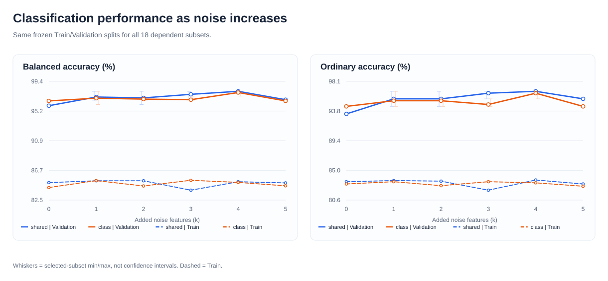
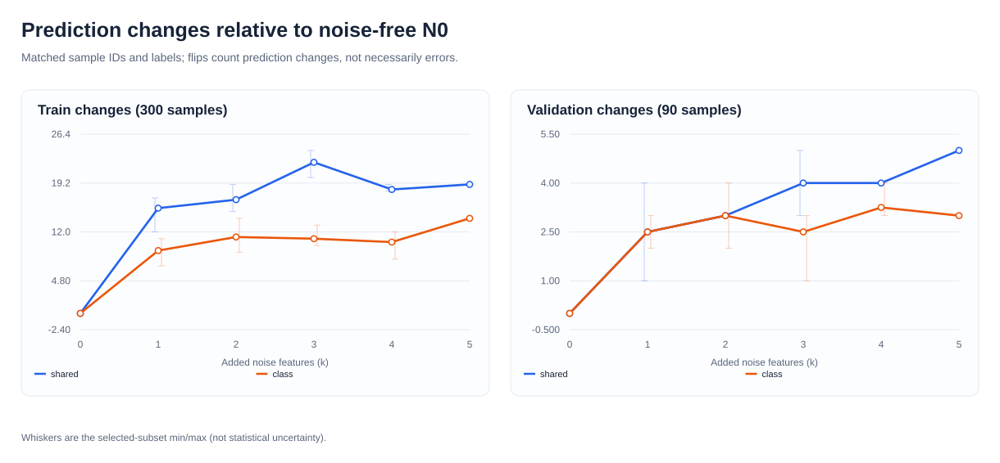
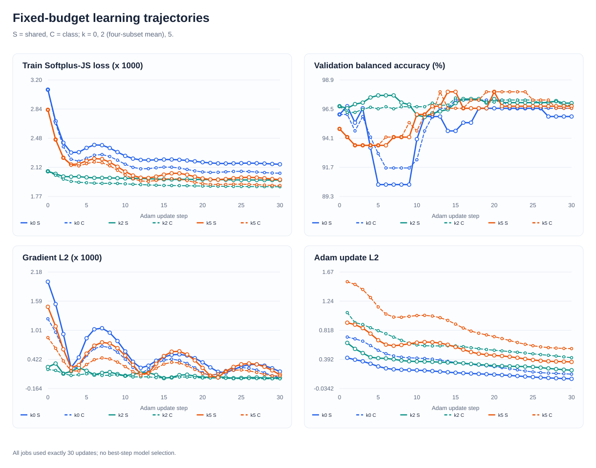
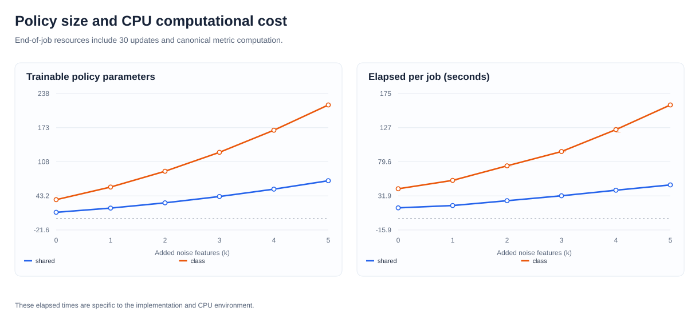

# E-CH4-14 — گزارش فنی یکپارچه حساسیت به ویژگی‌های نویزی

**بخش پایان‌نامه:** ۴.۱۴ | **وضعیت:** `POSTFIT_REPORT_READY_FOR_INDEPENDENT_SCIENTIFIC_AUDIT`  
**شواهد خام ثابت:** [کامیت نتایج `7bc66e4d2535`](https://github.com/mahhammad/My-Thesis/commit/7bc66e4d2535fb15dfa5b569933b2d6c5a0962ac) | [اجرای موفق ۳۶ آموزش](https://github.com/mahhammad/My-Thesis/actions/runs/43840079434)  
**محدوده تحلیل:** ۱۸ مجموعه ویژگی وابسته، دو خانواده سیاست `shared` و `class`، ۳۶ آموزش، ۱۰۸۰ آپدیت، فقط Train و Validation؛ بدون دسترسی به Test.

## ۱. پرسش پژوهشی و جمع‌بندی

با ثابت نگه‌داشتن سه ویژگی اطلاع‌رسان، داده مادر، ترتیب نمونه‌ها و برچسب‌ها، تقسیم Train/Validation و بودجه آموزش، افزودن صفر تا پنج ویژگی نویزی چگونه بر BA، Accuracy، هندسه مراکز، حاشیه تصمیم، تغییر پیش‌بینی و هزینه محاسباتی مدل گشت تصادفی روی گراف نمونه–ویژگی اثر می‌گذارد؟ همچنین آیا خانواده پرپارامترتر `class` در مقایسه جفت‌شده با `shared` برتری پایداری دارد؟

**نتیجه مرکزی و غیرمنتظره:** افت یکنواخت BA با افزودن نویز مشاهده نشد. میانگین BA اعتبارسنجی `shared` از **۹۵٫۹۲٪** در `k=0` به **۹۷٫۹۶٪** در `k=4` رسید و در `k=5` به **۹۶٫۷۷٪** برگشت؛ `class` به‌ترتیب **۹۶٫۶۰٪، ۹۷٫۷۹٪ و ۹۶٫۶۰٪** داشت. بااین‌حال شاخص جدایی مراکز `I` و میانه حاشیه در سطوح نویزی کوچک‌تر شدند. پس **پایداری BA، پایداری هندسه و حاشیه را تضمین نمی‌کند**. این مشاهده مختص یک داده مادر و مجموعه زیرمجموعه‌های مشخص است، نه ادعای سودمندبودن نویز در جامعه آماری.

## ۲. طراحی و منشأ داده‌ها

داده مادر از [`objective-start-diagnostics/inputs/phase2_train_validation/ds20261102_train_val.npz`](../objective-start-diagnostics/inputs/phase2_train_validation/ds20261102_train_val.npz) با بذر `20261102` و [manifest آن](../objective-start-diagnostics/inputs/phase2_train_validation/manifest.json) آمده است. داده Train شامل `300` نمونه، Validation شامل `90` نمونه، هر دو در `K=3` کلاس‌اند. فراوانی کلاس‌ها در Train برابر `[72,147,81]` و در Validation `[13,49,28]` است. سه ویژگی اطلاع‌رسان اصلی `[0,1,3]` همواره حاضرند؛ نویزهای قدیمی `[2,4]` عیناً از مادر خوانده شده‌اند؛ نویزهای جدید `[5,6,7]` هستند.

| مؤلفه داده | قرارداد اجراشده |
|---|---|
| نویز تازه | توزیع Gaussian مستقل، میانگین صفر، انحراف معیار سه‌گانه `(1.1,1.1,1.1)` |
| بذر نویز خام | `2026111601` |
| ضریب `gamma` نویز تازه | `(0.6,0.6,0.6)` |
| احتمال اسمی فقدان نویز | `(0.20,0.20,0.20)`، با قرارداد `True = observed` در ماسک |
| بذر ماسک مستقل | `2026111602` |
| شکل دو ماتریس نویز خام و ماسک | Train: `(300,3)`؛ Validation: `(90,3)`، `float64` / `bool` |
| SHA256 مادر | `e701cf9ef99b709fd5d6faee2d3ac631737d6b0195cf76eefc23d063bccb1b4a` |
| SHA256 طرح نویز | `82917272b0ac3850cecfd7bf4698dce55cbe955f8e3c308cf2c44d30e7f1ab8a` |

۱۸ زیرمجموعه از همین هشت اندیس اصلی مطابق [manifest مشتق‌ها](inputs/derived/manifest.json) انتخاب شده‌اند:

| k | نام زیرمجموعه و اندیس نویز |
|---:|---|
| 0 | `N0-01`: [] |
| 1 | `N1-01`: [2]؛ `N1-02`: [4]؛ `N1-03`: [5]؛ `N1-04`: [6] |
| 2 | `N2-01`: [2,4]؛ `N2-02`: [2,5]؛ `N2-03`: [4,6]؛ `N2-04`: [5,7] |
| 3 | `N3-01`: [2,4,5]؛ `N3-02`: [2,6,7]؛ `N3-03`: [4,5,7]؛ `N3-04`: [5,6,7] |
| 4 | `N4-01`: [2,4,5,6]؛ `N4-02`: [2,4,6,7]؛ `N4-03`: [2,5,6,7]؛ `N4-04`: [4,5,6,7] |
| 5 | `N5-01`: [2,4,5,6,7] |

داده‌های مشتق‌شده بدون مولد تصادفی جدید، با حفظ نمونه‌ها، برچسب‌ها، ماسک و NaNهای مادر ساخته شده‌اند. مورد مهم `N2-01` با ویژگی‌های `[0,1,2,3,4]` از نظر **SHA256 فایل NPZ کاملاً با مادر برابر** است. چهار زیرمجموعه هرکدام از سطوح `k=1..4` چهار seed مستقل نیستند؛ SD گروهی فقط پراکندگی انتخاب زیرمجموعه‌ها را توصیف می‌کند و نباید به فاصله اطمینان یا آزمون معناداری تبدیل شود. افزودن نویز همچنین بعد ورودی و ظرفیت سیاست را تغییر می‌دهد؛ مطالعه تفکیک علی این دو اثر را ادعا نمی‌کند.

## ۳. روش آموزش و سنجش

| تنظیم | مقدار ثابت |
|---|---|
| موتور | گراف نمونه–ویژگی با ماسک، استنتاج out-of-graph و گشت دقیق بدون بازگشت به نمونه مبدأ |
| پارامترهای گشت `β، λ، H` | `0.4`، `0.8`، `12` |
| هدف بهینه‌سازی | `softplus_JS_tau005` با `tau=0.005` |
| Adam | نرخ یادگیری `0.12`، logits اولیه صفر |
| دقت محاسبه | `float64`؛ `K=3` |
| خانواده | `shared` با شکل `(d+1)×d`؛ `class` با شکل `3×(d+1)×d`؛ `d=3+k` |
| بودجه | ۳۰ آپدیت Adam در هر fit، ۳۶ fit ترتیبی، ۱۰۸۰ آپدیت |
| ثبت مسیر | ۳۱ وضعیت از گام ۰ تا ۳۰، شامل loss، BA، Accuracy، گرادیان و اندازه آپدیت |
| ارزیابی | مراکز فقط از Train؛ Validation برون‌نمونه، بدون انتخاب پسینی بهترین گام |
| ممنوع | Test، بازآموزی برای تحلیل، seed اضافی یا انتخاب checkpoint بر اساس Validation |

`BA` میانگین recall سه کلاس است؛ `Accuracy` سهم درست‌طبقه‌بندی‌شده کل نمونه‌ها. ماتریس‌های confusion در گزارش‌های اولیه به‌صورت «سطر حقیقی، ستون پیش‌بینی» هستند. `R_JS`، `R_sqrt_JS` و `R_KL` فاصله/تراکم حول مرکز را از دید سنجه‌های مصوب نشان می‌دهند؛ `I` جدایی هندسی مراکز است. `T`، `BT`، `TNL` و `BTNL` نیز طبق قرارداد فصل سوم محاسبه شده‌اند. حاشیه برابر تفاوت امتیاز کلاس درست و بهترین رقیب است و با quantileها، نرخ خطای حاشیه سخت و surrogate ثبت می‌شود. سنجه‌های `R` و `I` جایگزین یکدیگر نیستند و BA به‌تنهایی کافی نیست.

## ۴. ممیزی مستقل داده و خروجی‌های واقعی

[گزارش ماشین‌خوان کنترل](tables/integrity_audit.json) و [اسکریپت بازخوانی read-only](reproduce_postfit.cjs) موارد زیر را بررسی می‌کنند:

| کنترل | نتیجه |
|---|---|
| فایل مشتق و manifest | ۱۸ NPZ، checksumهای ثبت‌شده؛ نمونه مادر `N2-01` یکسان |
| گزارش‌های تک‌اجرا | ۳۶ فایل `results/metrics/N*__*.json` |
| `metrics_full.json` | تمام ۳۶ گزارش و اطلاعات نمونه‌به‌نمونه؛ در CI با گزارش‌های جداگانه مقایسه می‌شود |
| گزارش تحلیل اولیه | ۳۶ رکورد فردی، ۱۲ گروه، ۱۸ جفت و ۶ گروه جفت‌شده |
| trace | ۳۶ فایل `trace.json` و ۳۶ `trace.csv`، هر یک ۳۱ گام |
| checkpoint | ۳۶ فایل `step_30.pt` و ۳۶ فایل SHA256 متناظر |
| ledger | `BUDGET_RESERVED=1`، `START=36`، `UPDATE=1080`، `SUCCESS=36`، `FAIL_STOP=0` |
| سنجه‌ها | ۷۲ confusion و BA/Accuracy دوباره محاسبه‌شده؛ برچسب‌های یکسان در زیرمجموعه‌ها |
| coverage | `measured=1548`؛ `not_applicable=72` (هندسه مرکز فقط برای Train) |
| Test | در manifestها و provenance برابر `test_accessed=false`؛ مسیر اجرایی Train/Validation-only |

فایل‌های checkpoint در اسکریپت read-only با **هش SHA256 واقعی بایت‌ها** تطبیق داده می‌شوند. داده‌ها و نتایج اولیه در `inputs/` و `results/` دست‌نخورده‌اند. اجرای اصلی آموزش [#43840079434](https://github.com/mahhammad/My-Thesis/actions/runs/43840079434) یک بار و با موفقیت از `09:28:38` تا `10:04:37 UTC`، یعنی **۳۵ دقیقه و ۵۹ ثانیه**، به پایان رسیده است.

## ۵. BA و Accuracy: عملکرد نهایی در گام ۳۰

در جدول `S=shared` و `C=class` هستند. در سطوح میانی، هر عدد میانگین **چهار زیرمجموعه وابسته** است:

| k | تعداد زیرمجموعه | BA Train: S / C (%) | BA Validation: S / C (%) | Accuracy Validation: S / C (%) |
|---:|---:|---:|---:|---:|
| 0 | 1 | 85.01 / 84.31 | 95.92 / 96.60 | 93.33 / 94.44 |
| 1 | 4 | 85.26 / 85.29 | 97.15 / 96.98 | 95.56 / 95.28 |
| 2 | 4 | 85.27 / 84.53 | 97.02 / 96.85 | 95.56 / 95.28 |
| 3 | 4 | 83.93 / 85.34 | 97.53 / 96.77 | 96.39 / 94.72 |
| 4 | 4 | 85.13 / 85.04 | 97.96 / 97.79 | 96.67 / 96.39 |
| 5 | 1 | 84.96 / 84.55 | 96.77 / 96.60 | 95.56 / 94.44 |



افزایش نویز کاهش یکنواخت BA نداشته و بیشترین مقدار میانگین Validation هر دو خانواده در `k=4` مشاهده شده است؛ در `k=5` کاهش رخ می‌دهد. در `k=4` حتی BA چهار زیرمجموعه `shared` عیناً `97.959%` است، اما این مشاهده روی یک Validation با ۹۰ نمونه به معنای پایداری برون‌داده‌ای نیست. Train BA عمدتاً حدود ۸۴–۸۵٪ و Validation حدود ۹۶–۹۸٪ است؛ متوسط اختلاف Validation منهای Train بین ۳۶ اجرا حدود **۱۲٫۲۳ واحد درصد** است که ممکن است ناشی از آسان‌تر بودن نمونه‌های این split باشد و نباید بدون Test مستقل تعمیم داد.

همه اعداد ۳۶ اجرا در [`per_dataset_metrics.csv`](tables/per_dataset_metrics.csv) و میانگین و SD توصیفی در [`summary_by_noise_level.csv`](tables/summary_by_noise_level.csv) آمده است. خطوط بازه کوچک شکل نشان‌دهنده کمینه و بیشینه همان زیرمجموعه‌های منتخب‌اند، **نه confidence interval**.

## ۶. مقایسه جفت‌شده shared و class

در هر جفت فقط خانواده سیاست فرق دارد. اختلاف‌ها `class − shared` هستند، BA و Accuracy با **واحد درصد** و `I` با ضریب ×1000:

| زیرمجموعه | k | ΔBA Validation (واحد درصد) | ΔAccuracy Validation (واحد درصد) | ΔI ×1000 |
|---|---:|---:|---:|---:|
| N0-01 | 0 | 0.680 | 1.111 | 1.617 |
| N1-01 | 1 | -0.680 | -1.111 | 0.674 |
| N1-02 | 1 | 0.680 | 1.111 | 0.462 |
| N1-03 | 1 | -0.680 | -1.111 | 0.375 |
| N1-04 | 1 | 0.000 | 0.000 | 1.354 |
| N2-01 | 2 | 0.680 | 1.111 | 0.390 |
| N2-02 | 2 | 0.680 | 1.111 | 0.978 |
| N2-03 | 2 | -0.680 | -1.111 | 0.636 |
| N2-04 | 2 | -1.361 | -2.222 | 0.759 |
| N3-01 | 3 | -0.850 | -2.222 | 1.703 |
| N3-02 | 3 | 0.510 | 0.000 | 0.035 |
| N3-03 | 3 | -1.361 | -2.222 | 1.366 |
| N3-04 | 3 | -1.361 | -2.222 | 1.560 |
| N4-01 | 4 | 0.000 | 0.000 | 1.850 |
| N4-02 | 4 | 0.000 | 0.000 | 2.440 |
| N4-03 | 4 | 0.000 | 0.000 | 1.970 |
| N4-04 | 4 | -0.680 | -1.111 | 1.570 |
| N5-01 | 5 | -0.170 | -1.111 | 1.041 |

در ۱۸ جفت، `class` در **۵** مورد BA بزرگ‌تر، `shared` در **۹** مورد بهتر و در **۴** مورد دقیقاً برابر بود. میانگین ۱۸ اختلاف BA برابر **−۰٫۲۵۵ واحد درصد** (به سود shared) است. بااین‌حال `I` در **تمام ۱۸ جفت برای class بزرگ‌تر** ثبت شده است. پس جدایی هندسی بالاتر، تضمین بهبود BA نیست و افزایش ظرفیت سه‌برابری `class` مزیت تصمیمی پایدار ایجاد نکرده است.


[جدول جفت‌ها](tables/paired_class_minus_shared.csv) و [گروه‌های جفت‌شده اولیه](results/metrics/metrics_paired_by_k.csv) برای بازبینی تمام اعداد در دسترس‌اند. این جفت‌ها تکرارهای آماری مستقل نیستند.

## ۷. هندسه مراکز، تراکم و حاشیه تصمیم

این جدول `R_JS`، `I` و میانه حاشیه را برای خوانایی ×۱۰۰۰ می‌کند؛ نرخ خطای حاشیه سخت درصد است:

| k | Validation R_JS ×1000: S / C | Train I ×1000: S / C | Median Validation margin ×1000: S / C | خطای حاشیه سخت Validation (%) S / C |
|---:|---:|---:|---:|---:|
| 0 | 3.978 / 3.952 | 24.312 / 25.929 | 19.280 / 19.857 | 4.08 / 3.40 |
| 1 | 2.534 / 2.591 | 18.183 / 18.899 | 13.338 / 13.099 | 2.85 / 3.02 |
| 2 | 2.279 / 2.340 | 18.190 / 18.880 | 13.075 / 12.594 | 2.98 / 3.15 |
| 3 | 2.072 / 2.158 | 17.868 / 19.034 | 12.339 / 12.165 | 2.47 / 3.23 |
| 4 | 2.256 / 2.385 | 16.331 / 18.288 | 12.532 / 12.331 | 2.04 / 2.21 |
| 5 | 2.311 / 2.374 | 18.875 / 19.916 | 13.790 / 12.831 | 3.23 / 3.40 |

از `k=0` تا `k=4` در `shared`، `I` از `0.02431` به `0.01633` (حدود ۳۳٪ افت)، `R_JS` اعتبارسنجی از `0.003978` به `0.002256` (حدود ۴۳٪ افت) و میانه حاشیه از `0.01928` به `0.01253` (حدود ۳۵٪ افت) رسید؛ الگوی کاهش مشابهی برای `class` نیز وجود دارد. درحالی‌که BA اعتبارسنجی افزایش یافت، **جدایی و میانه حاشیه کمتر شدند**. کوچک‌شدن `R_JS` به‌تنهایی قابل تفسیر به افزایش کیفیت جدایی نیست، زیرا `I` نیز جابه‌جا شده است.


معیارهای تکمیلی `T`، `BT`، `TNL`، `BTNL`، `R_sqrt_JS`، `R_KL` و فاصله جفت‌مراکز برای هر کدام از ۳۶ اجرا در [گزارش‌های canonical](results/metrics/) و [CSV گروهی](tables/summary_by_noise_level.csv) محفوظ‌اند. برای مثال `T` در `shared` از `0.4291` در `k=0` به `0.4113` در `k=4` و `TNL` از `0.8718` به `0.9159` رسید. بنابراین ابعاد هندسی هم‌جهت با BA حرکت نمی‌کنند.

## ۸. تغییر پیش‌بینی‌ها و خطاهای کلاس‌ها

برای هر زیرمجموعه، پیش‌بینی‌ها سطر‌به‌سطر با مدل همان خانواده در `N0-01` مقایسه شده‌اند، نه با یک جفت نمونه‌گیری تازه. در `k=5` از ۹۰ نمونه Validation فقط **۵ پیش‌بینی shared** و **۳ پیش‌بینی class** نسبت به `N0` عوض شدند؛ در `k=4` میانگین تغییرها به‌ترتیب ۴ و ۳٫۲۵ بود. تغییر پیش‌بینی الزاماً به معنی تغییر از درست به نادرست نیست.



جدول recall واقعی هر کلاس در Validation (اعداد میانگین زیرمجموعه‌ها):

| k | Recall کلاس ۰: S/C (%) | Recall کلاس ۱: S/C (%) | Recall کلاس ۲: S/C (%) |
|---:|---:|---:|---:|
| 0 | 100.00/100.00 | 87.76/89.80 | 100.00/100.00 |
| 1 | 100.00/100.00 | 92.35/91.84 | 99.11/99.11 |
| 2 | 100.00/100.00 | 92.86/92.35 | 98.21/98.21 |
| 3 | 100.00/100.00 | 94.39/90.31 | 98.21/100.00 |
| 4 | 100.00/100.00 | 93.88/93.37 | 100.00/100.00 |
| 5 | 100.00/100.00 | 93.88/89.80 | 96.43/100.00 |

در تمام ۳۶ اجرا، recall کلاس صفر روی این Validation کوچک **۱۰۰٪** است؛ کلاس یک با ۴۹ نمونه منشأ عمده خطاهاست. این موضوع و فراوانی نامتوازن کلاس‌ها توضیح می‌دهد چرا BA و Accuracy یکسان نیستند. ثبات نسبی تعداد خطاها با کوچک‌شدن حاشیه تناقض ندارد؛ درستی تصمیم و فاصله آن تا مرز تصمیم دو متغیر متفاوت‌اند. [نمودار recall سه کلاس](figures/07_validation_class_recall.svg) و [CSV آن](tables/validation_class_recall.csv) نیز ثبت شده‌اند.

## ۹. پویایی یادگیری و پرسش کفایت ۳۰ آپدیت

هر trace از **گام صفر تا گام ۳۰** ثبت شده است. در هر ۳۶ اجرا loss آموزش در پایان کمتر از ابتدا بود؛ متوسط کاهش نسبی حدود **۱۵٫۸۳٪** است، هرچند در ۳۵ اجرا دست‌کم یک افزایش موضعی loss در طول مسیر Adam وجود داشت. در گام ۳۰، نرم گرادیان در همه اجراها هنوز در بازه `2.36×10⁻⁵` تا `2.09×10⁻⁴` و نرم آخرین آپدیت در بازه `0.108` تا `0.609` غیرصفر است.

در **۲۱ اجرا** بهترین BA مشاهده‌شده در گامی پیش از ۳۰ از BA نهایی بالاتر بود؛ در ۱۵ اجرا BA نهایی با بهترین BA مشاهده‌شده برابر بود. اختلاف متوسط بیشینه مشاهده‌شده و مقدار نهایی حدود **۰٫۵۸۶ واحد درصد** است. این بیشینه‌های پسینی صرفاً برای تشخیص رفتار مسیر گزارش می‌شوند؛ **هیچ checkpoint به سبب این ارقام انتخاب نشده** و نتایج اصلی متعلق به گام ۳۰ باقی مانده‌اند.



**داوری کفایت:** ۳۰ گام برای پاسخ به پرسش از پیش تعریف‌شده **در بودجه ثابت ۳۰ آپدیت** کافی بوده و تمام جفت‌ها قابل‌مقایسه‌اند. اما کاهش loss، گرادیان و آپدیت غیرصفر و افت پس از بیشینه Validation در بعضی اجراها نشان می‌دهد **ادعای همگرایی کامل قابل دفاع نیست**. آموزش طولانی‌تر در دامنه این آزمایش نبوده است. [جدول ۳۷۲ ردیفی گام‌های گروهی](tables/learning_by_step.csv) و فایل‌های `results/traces/` برای تحلیل بیشتر موجودند؛ شکل برای جلوگیری از ازدحام فقط `k=0,2,5` را نشان می‌دهد.

## ۱۰. پارامترها، زمان اجرا و حافظه

با `d=3+k`، سیاست `shared` دقیقاً `d(d+1)` و سیاست `class` برابر `3d(d+1)` پارامتر قابل آموزش دارد.

| k | پارامتر S | پارامتر C | زمان S (ثانیه) | زمان C (ثانیه) | نسبت C/S |
|---:|---:|---:|---:|---:|---:|
| 0 | 12 | 36 | 15.08 | 41.82 | 2.77 |
| 1 | 20 | 60 | 18.32 | 53.57 | 2.92 |
| 2 | 30 | 90 | 25.09 | 73.96 | 2.95 |
| 3 | 42 | 126 | 32.01 | 93.98 | 2.94 |
| 4 | 56 | 168 | 39.80 | 124.71 | 3.13 |
| 5 | 72 | 216 | 47.22 | 159.25 | 3.37 |

اندازه سیاست در هر خانواده از `k=0` تا `k=5` **شش‌برابر** شد. زمان متوسط `shared` از `15.08s` به `47.22s` و زمان `class` از `41.82s` به `159.25s` رسید. در `k=5` خانواده `class` حدود **۳٫۳۷ برابر** `shared` زمان مصرف کرد. جمع زمان محاسبات درون ۳۶ گزارش تقریباً `2109.12` ثانیه است؛ زمان Workflow بزرگ‌تر است زیرا نصب، کنترل، ذخیره و آپلود را هم شامل می‌شود.



`resource_usage.process_rss_mib_at_report` حافظه RSS در یک نقطه ثبت‌شده است **نه بیشینه حافظه**. زمان‌ها مختص همین پیاده‌سازی گشت دقیق روی CPU و این محیط‌اند و قانون پیچیدگی عمومی نیستند.

## ۱۱. ساختار فایل‌ها، نقش آنها و بازتولید بدون آموزش

| مسیر | نقش دقیق |
|---|---|
| `inputs/noise_raw/new_noise_seed20261102.npz` و `manifest.json` | سه ستون نویز خام Train/Validation، بذر، توزیع، SHA فایل و آرایه |
| `inputs/noise_masks/new_noise_masks.npz` و `manifest.json` | ماسک مستقل `bool`، بذر و احتمال فقدان، SHA |
| `inputs/derived/N0-01.npz ... N5-01.npz` و `manifest.json` | ۱۸ داده مشتق، نگاشت ویژگی، شناسه سطر، checksum |
| `results/metrics/N*__*.json` | ۳۶ گزارش فردی canonical، هندسه، حاشیه، confusion، per-class، resource |
| `results/metrics/metrics_full.json` | تجمیع همان ۳۶ گزارش با جزئیات نمونه‌به‌نمونه |
| `results/metrics/metrics_analysis.json` و چهار فایل `metrics_*.csv` | تحلیل اولیه فردی، گروهی، جفتی و گروه جفتی |
| `results/metrics/coverage.json` و `provenance.json` | پوشش معیارها، بذر و SHA منشأ، ممنوعیت Test |
| `results/metrics/e14_spent_budget.jsonl` | دفتر رزرو، ۱۰۸۰ UPDATE و ۳۶ SUCCESS |
| `results/traces/<run_id>/trace.json` و `trace.csv` | ۳۱ نقطه یادگیری هر اجرا، شامل loss، BA، gradient و update |
| `results/checkpoints/<run_id>/step_30.pt` و `.sha256` | logits و Adam state در گام ۳۰ به‌همراه SHA مستقل |
| `tables/analysis_summary.json`، `integrity_audit.json` و پنج CSV | محاسبات ثانویه قابل ممیزی، جفت‌ها، کلاس‌ها، هندسه، منحنی و هزینه |
| `figures/01...07*.svg` | ۷ نمودار برداری، بدون بازآموزی |
| `reproduce_postfit.cjs` و `render_figures.cjs` | بازحساب جدول‌ها و بازتولید دقیق SVG با Node، بدون کتابخانه آموزش |
| `data.py`، `stage_execute.py`، `runner.py`، `e14_metrics.py`، `analysis.py` | کد اولیه داده/اجرا/سنجه‌ها؛ در تحلیل ثانویه تغییر نکرده‌اند |

**بازبینی read-only** با Node روی همین شاخه (دسترسی به کل فایل‌های اصلی و checkpointها لازم است):

```bash
git switch experiment/ch4-14-noise-sensitivity-01
node code/experiments/synthetic-noise-feature-sensitivity/reproduce_postfit.cjs --check
```

در این روش `metrics_full.json` با هر ۳۶ گزارش فردی، confusion و برچسب‌ها، `ledger` با آپدیت‌ها، SHA256 هر ۳۶ checkpoint و پنج CSV مشتق با محاسبه مستقیم مقایسه می‌شوند. برای بازتولید **صرفاً خروجی‌های تحلیلی** (بدون تغییر `inputs/` و `results/`):

```bash
node code/experiments/synthetic-noise-feature-sensitivity/reproduce_postfit.cjs --write
node code/experiments/synthetic-noise-feature-sensitivity/render_figures.cjs
git diff -- code/experiments/synthetic-noise-feature-sensitivity/tables code/experiments/synthetic-noise-feature-sensitivity/figures
```

برای فایل‌های سالم diff باید تهی باشد. CI شاخه job مستقلی به نام `postfit-audit` دارد که تطبیق فایل‌های اصلی، CSV و بازسازی دقیق SVGها را بدون آموزش انجام می‌دهد. برای درج در LaTeX، SVG برداری را می‌توان به PDF تبدیل کرد؛ داده هر نمودار در CSV و JSON متناظر وجود دارد.

## ۱۲. محدودیت‌ها و نتیجه‌گیری قابل دفاع

- **یک داده مادر و یک تحقق نویز:** چهار زیرمجموعه هر سطح، چهار اجرای مستقل نیستند. از آنها CI، مقدار p و ادعای تعمیم آماری معتبر استخراج نمی‌شود.
- **تغییر هم‌زمان بعد، نویز و پارامتر:** اثر تعداد ویژگی نویزی از افزایش بُعد و ظرفیت سیاست کاملاً تفکیک نشده است.
- **Validation آسان‌تر از Train:** این تفاوت بزرگِ دو split باید در گزارش نتیجه حفظ شود. Test استفاده نشده، بنابراین تعمیم نهایی به داده مستقل بررسی نشده است.
- **همگرایی اثبات نشده:** بودجه ثابت ۳۰ آپدیت اجرا شده، اما گرادیان و تغییر پارامتر در انتها غیرصفرند؛ بهترین Validation الزاماً در گام ۳۰ نیست.
- **اثر انتخاب زیرمجموعه:** حتی در `k` برابر، هویت ویژگی نویزی بر نتایج اثر دارد؛ SD فقط توصیف همین تنوع است.
- **محدودیت هندسه:** کاهش `R_JS` با کاهش `I` یا حاشیه ممکن است هم‌زمان رخ دهد؛ هیچ تک‌معیاری جای تمام سنجه‌ها نیست.

**جمع‌بندی نهایی:** مدل در این داده مادر نسبت به افزایش نویز از دید BA **افت یکنواخت نشان نداده** و بسیاری از پیش‌بینی‌ها نسبت به حالت بدون نویز ثابت مانده‌اند، ولی هندسه مراکز و حاشیه تصمیم تغییر کرده است. سیاست `class` علی‌رغم جدایی مراکز بزرگ‌تر در تمام ۱۸ جفت و هزینه محاسباتی بالاتر، برتری پایدار در BA نداشته است. برای پایان‌نامه، گزارش هم‌زمان **دقت، تراکم، جدایی، حاشیه، خطای هر کلاس و هزینه** از تمرکز صرف بر BA قابل دفاع‌تر است.

**گام بعد:** ممیزی مستقل علمی باید از فایل‌های اولیه و trace/checkpoint/ledger آغاز شود؛ پذیرش متن این README به‌تنهایی جایگزین ممیزی نیست.
