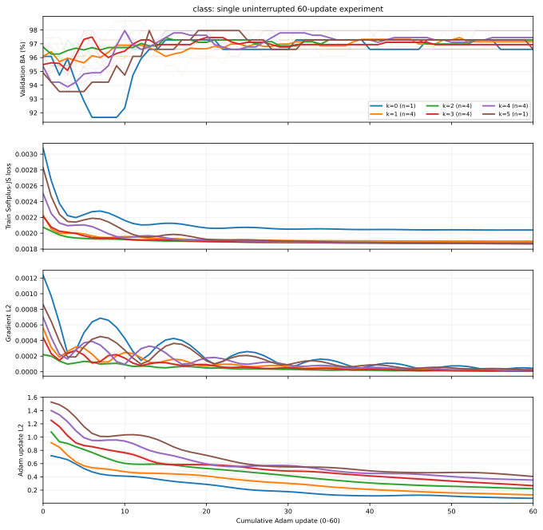
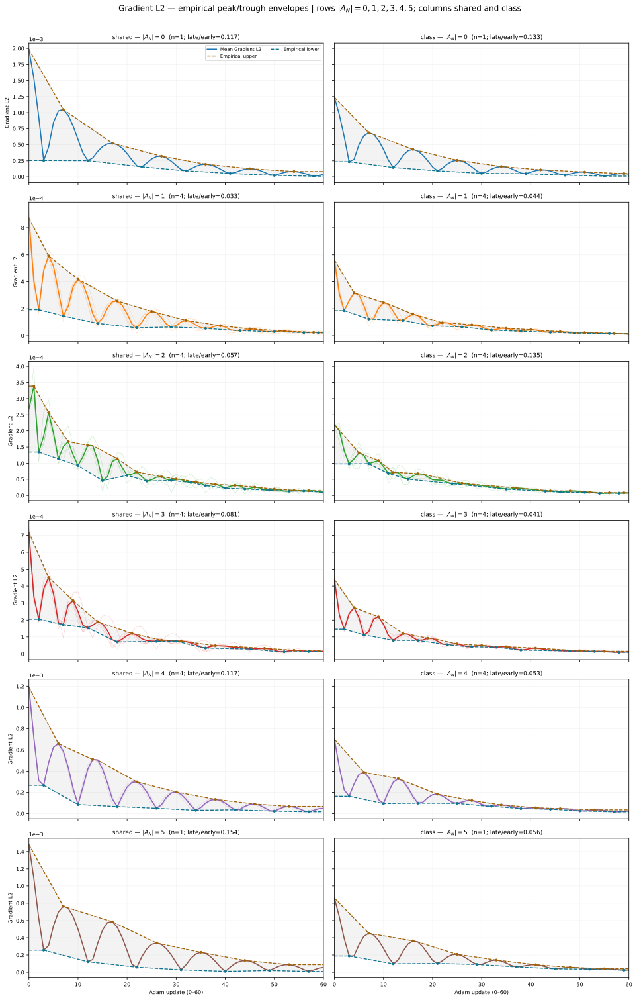
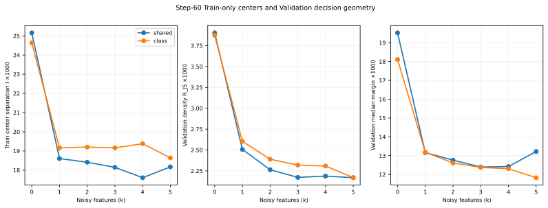
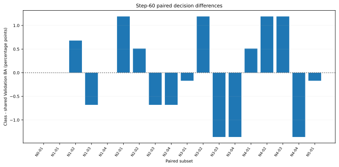
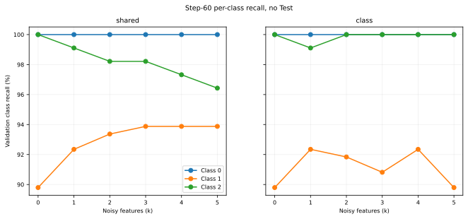
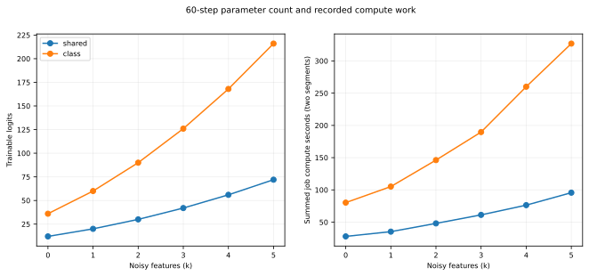

# E-CH4-14 — گزارش فنی یکپارچهٔ حساسیت به ویژگی‌های نویزی، آموزش ۶۰گامی

**بخش پایان‌نامه:** ۴.۱۴ · **پروتکل:** ۳۶ آموزش، هرکدام ۶۰ آپدیت Adam · **وضعیت:** `FULL_60_COMPUTATIONAL_AUDIT_PASS / NO_TEST`

**شواهد:** [آموزش اولیه و دادهٔ منجمد](https://github.com/mahhammad/My-Thesis/commit/7bc66e4d2535fb15dfa5b569933b2d6c5a0962ac) · [ثبت واقعی تکمیل گام ۶۰](https://github.com/mahhammad/My-Thesis/actions/runs/43881004168) · [محاسبهٔ دوبارهٔ سنجه‌های گام ۶۰ از checkpoint و بازتولید نمودارها](https://github.com/mahhammad/My-Thesis/actions/runs/43900799816).

این **یک آزمایش واحد با ۶۰ آپدیت برای هر سیاست** است. اجرای فنی در گام ۳۰ با حفظ کامل state بهینه‌ساز checkpoint شده و از همان نقطه ادامه یافته است؛ این مرزِ ذخیره‌سازی، دو آزمایش علمی ایجاد نمی‌کند. تمامی سنجه‌هایی که در ۰ تا ۶۰ واقعاً ثبت شده‌اند، روی **۶۱ وضعیت متوالی** گزارش می‌شوند. تنها سنجه‌های سیاست‌محور با تاریخچهٔ ناکامل، در پیوست انتهایی و صریحاً فقط برای **۳۰ تا ۶۰** آمده‌اند. ارقام هندسه، حاشیه، confusion و نتایج نهایی همگی از **گام ۶۰** بازحساب شده‌اند، نه گام ۳۰.

## ۱. پرسش علمی و یافته‌های اصلی

با ثابت‌گرفتن سه ویژگی اطلاع‌رسان، نمونه‌های Train/Validation، تابع هدف و بودجهٔ آموزش، آیا افزودن صفر تا پنج ویژگی نویزی روی کیفیت دسته‌بندی، نوسان مسیر یادگیری، هندسهٔ مراکز و حاشیهٔ تصمیم اثر یکنواخت دارد؟ رفتار دو خانوادهٔ `shared` و `class` چه تفاوتی دارد و آیا پایداری خروجی سخت را می‌توان از تغییرات سیاست Softmax توضیح داد؟

**پاسخ تجربی این ۳۶ آموزش ۶۰گامی:** کاهش یکنواخت BA با افزودن نویز مشاهده نشد. کمترین **مجموع نوسان BA اعتبارسنجی در تمام گام‌های ۰ تا ۶۰** برای $|A_N|=2$ است: `shared=8.248` و `class=7.568` واحد درصد؛ در مقابل بدون نویز به‌ترتیب `19.584` و `15.816` است. این نتیجه توصیفی، به معنای اثر علّی یا منظم‌سازی قطعی نویز نیست. کاهش نوسان تصمیم با افزایش جدایی مراکز یا حاشیه، رابطهٔ ضروری ندارد.

`class` ظرفیت سه‌برابری `shared` دارد، اما در گام ۶۰ در ۱۸ مقایسهٔ جفت‌شده، 7 بار بهتر، 8 بار بدتر و 3 بار برابر است؛ با وجود این، جدایی مراکز `I` آن در 17 جفت بالاتر است. **جدایی بیشتر الزاماً به دقت بالاتر منجر نشده است.**

در سنجه‌های تخصصی فصل سوم، میانگین نهایی $\bar n_N^{(3)}\approx0.941$ انتخاب نویزی از سه نوبت در ۲۶ اجرای دارای $|A_N|=2,\ldots,5$ دیده شد؛ اما این شمار به‌تنهایی معیار مقاومت نیست. نسبت سهم متوسط به Uniform، یعنی $\mathrm{NSR}_N^{(h)}$، در این سطوح برای افق‌های $h=1,2,3,4$ و هر دو خانواده کمتر از یک است. این مشاهده توصیفی است و تاریخچهٔ سیاست فقط برای گام‌های ۳۰ تا ۶۰ موجود است (بخش ۱۳).

## ۲. دادهٔ مادر، ویژگی‌ها و زیرمجموعه‌ها

- **منبع داده:** [دادهٔ ثابت Train/Validation](../objective-start-diagnostics/inputs/phase2_train_validation/ds20261102_train_val.npz)، با seed `20261102`، و [manifest کنترل منشأ](../objective-start-diagnostics/inputs/phase2_train_validation/manifest.json).
- **نمونه‌ها:** Train شامل ۳۰۰ و Validation شامل ۹۰ نمونه، در سه کلاس با فراوانی‌های `[72,147,81]` و `[13,49,28]`؛ Test در این آزمایش استفاده نشده است.
- **سه ویژگی اطلاع‌رسان همیشگی:** اندیس‌های اصلی `[0,1,3]`. دو نویز موجود در مادر `[2,4]`؛ سه نویز جدید `[5,6,7]` با توزیع Gaussian مستقل، میانگین صفر و انحراف معیار `1.1` برای هر ستون.
- **نماد علمی:** $|A_N|$ تعداد ویژگی‌های نویزی و $|A_P|=3$ است. فیلد `k` در نام فایل و manifest فقط نام فنی همین شمار است؛ متن علمی با نماد فصل سوم نوشته شده است.
- **ماسک و وزن‌ها:** بذر نویز جدید `2026111601`، بذر ماسک `2026111602`، فقدان اسمی هر نویز جدید `0.20`، `gamma=(0.6,0.6,0.6)` برای سه نویز جدید، `True=observed` در ماسک و مقادیر گم‌شده مطابق NPZ و manifest.
- **قرارداد SHA:** هش مادر `e701cf9ef99b709fd5d6faee2d3ac631737d6b0195cf76eefc23d063bccb1b4a` و هش طرح نویز `82917272b0ac3850cecfd7bf4698dce55cbe955f8e3c308cf2c44d30e7f1ab8a`. [فهرست، نگاشت‌ها و checksum تمام ۱۸ زیرمجموعه](inputs/derived/manifest.json).

| تعداد نویز $\lvert A_N\rvert$ | زیرمجموعه‌های مورد استفاده (اندیس اصلی نویز) | تعداد |
|---:|---|---:|
| ۰ | `N0-01: []` | ۱ |
| ۱ | `N1-01:[2]`، `N1-02:[4]`، `N1-03:[5]`، `N1-04:[6]` | ۴ |
| ۲ | `N2-01:[2,4]`، `N2-02:[2,5]`، `N2-03:[4,6]`، `N2-04:[5,7]` | ۴ |
| ۳ | `N3-01:[2,4,5]`، `N3-02:[2,6,7]`، `N3-03:[4,5,7]`، `N3-04:[5,6,7]` | ۴ |
| ۴ | `N4-01:[2,4,5,6]`، `N4-02:[2,4,6,7]`، `N4-03:[2,5,6,7]`، `N4-04:[4,5,6,7]` | ۴ |
| ۵ | `N5-01:[2,4,5,6,7]` | ۱ |

هر یک از ۱۸ مجموعه، برای هر دو خانواده بررسی شده است؛ `18×2=36` آموزش. تمام زیرمجموعه‌ها از یک دادهٔ مادر آمده‌اند: چهار زیرمجموعهٔ میانی **چهار seed مستقل نیستند** و بازهٔ کمینه/بیشینهٔ آن‌ها، فاصلهٔ اطمینان آماری نیست. `N2-01` از نظر فایل NPZ با نمونهٔ مادر متناظر یکسان است. افزودن نویز هم‌زمان بُعد ورودی و تعداد پارامترهای سیاست را نیز عوض می‌کند.

## ۳. مدل و پروتکل محاسباتی ۶۰ گام

| مؤلفه | قرارداد ثابت و اجراشده |
|---|---|
| مدل | گراف نمونه–ویژگی، گشت دقیق ماسک‌دار، بدون برگشت به نمونهٔ مبدأ؛ استنتاج Validation خارج از گراف آموزش |
| پارامترهای گشت | `beta=0.4`، `lambda=0.8`، `H=12` |
| تعداد کلاس | `K=3` |
| تابع هدف | `softplus_JS_tau005` با `tau=0.005` |
| بهینه‌ساز | Adam با `lr=0.12` و `float64`؛ logits اولیه صفر |
| خانوادهٔ shared | یک ماتریس `(d+1)×d`، $d=3+|A_N|$ |
| خانوادهٔ class | سه ماتریس کلاس‌مشروط `3×(d+1)×d` |
| بودجهٔ **هر اجرای واحد** | دقیقاً **۶۰** آپدیت؛ ۳۶ اجرا و **۲۱۶۰** آپدیت کل |
| ثبت سنجه‌های عمومی | **۶۱** حالت حقیقی `t=0..60` برای BA، Accuracy، Loss، gradient norm، logits norm و update norm (در `t=0` آپدیت Adam تعریف نشده است) |
| تداوم optimizer | حالت logits و ممان‌های Adam گام ۳۰ بارگذاری شد؛ شمارنده `31..60` بدون reset ادامه یافت |
| مرکز و ارزیابی | مراکز فقط از Train محاسبه می‌شوند؛ Validation صرفاً برای ارزیابی، بدون انتخاب پسینی checkpoint |
| ممنوع | Test، آموزش دوباره برای تحلیل، انتخاب بهترین گام اعتبارسنجی یا تغییر ورودی‌ها |

`BA` میانگین recall سه کلاس و `Accuracy` سهم صحیح کل نمونه‌هاست. `R_JS` میانگین تراکم/فاصلهٔ JS نسبت به مرکز کلاس، `I` جدایی مراکز و حاشیهٔ تصمیم اختلاف امتیاز کلاس درست از نزدیک‌ترین رقیب است. از `R` به‌تنهایی نتیجهٔ جدایی خوب، و از `I` به‌تنهایی نتیجهٔ دقت بالا به دست نمی‌آید. در تمام گزارش‌های نهایی، مرکز کلاس‌ها بر اساس بازنمایی Train در همان **checkpoint گام ۶۰** مجدداً ساخته شده است.

## ۴. ممیزی محاسباتی و سازگاری شواهد

[اسکریپت ممیزی مسیر](continuation_analysis.py) و [اسکریپت بازحساب گام ۶۰](unified_60_analysis.py) بدون `optimizer.step()` کار می‌کنند. بررسی‌ها شامل: ۳۶ مبدأ گام ۳۰ با SHA معتبر؛ تطبیق نقطهٔ مشترک گام ۳۰ با trace قدیمی؛ ۶۱ نقطهٔ پیوسته بدون duplication؛ ۳۶ checkpoint نهایی با ممان‌های `float64` و counter=60؛ ۳۱ وضعیت کامل logits گام‌های ۳۰–۶۰ با SHA256 بایت‌به‌بایت؛ مطابقت بازحساب `F3/E3/NFI3` از logits؛ و برابری BA/Accuracy گزارش `standard_metrics` با trace انتهایی است.

| دفتر بودجه | مقدار تأییدشده |
|---|---:|
| آموزش نخست | ۱۰۸۰ آپدیت، ۳۶ موفق |
| ادامهٔ همان آموزش‌ها | ۱۰۸۰ آپدیت، ۳۶ موفق |
| **مجموع نهایی** | **۲۱۶۰ آپدیت برای ۳۶ اجرای ۶۰گامی** |
| شکست ثبت‌شده در ledger ادامه | **۰** |

[اجرای معتبر آموزش ادامه](https://github.com/mahhammad/My-Thesis/actions/runs/43881004168) و [بازحساب موفق سنجه‌ها و شکل‌های گام ۶۰](https://github.com/mahhammad/My-Thesis/actions/runs/43900799816) اسناد محاسباتی هستند، نه مدرک اثبات علیت. تمام manifestها `test_accessed=false` دارند و روش بازحساب فقط `inputs/derived` شامل Train/Validation را می‌خواند. پاک‌سازی بخش نتیجه‌گیری زودهنگام ۴.۱۵ در `main` به‌طور مستقل انجام شده و متن بخش ۴.۱۴ روی شاخهٔ آزمایش در حال بازنویسی است؛ محاسبات این گزارش به دادهٔ خام و Test دست نمی‌زنند.

## ۵. کیفیت دسته‌بندی نهایی در **گام ۶۰**

در جدول زیر `S=shared` و `C=class` است. مقدار هر سلول میانگین توصیفی زیرمجموعه‌های همان سطح نویز است؛ **همهٔ مقادیر به checkpoint گام ۶۰ مربوط‌اند**.

| $\lvert A_N\rvert$ | زیرمجموعه | Train BA: S/C (%) | Validation BA: S/C (%) | Validation Accuracy: S/C (%) |
| :---: | :---: | :---: | :---: | :---: |
| 0 | 1 | 85.42 / 84.27 | 96.60 / 96.60 | 94.44 / 94.44 |
| 1 | 4 | 85.37 / 85.19 | 97.15 / 97.15 | 95.56 / 95.56 |
| 2 | 4 | 85.37 / 84.97 | 97.19 / 97.28 | 95.83 / 95.56 |
| 3 | 4 | 85.18 / 84.99 | 97.36 / 96.94 | 96.11 / 95.00 |
| 4 | 4 | 85.46 / 84.95 | 97.07 / 97.45 | 95.83 / 95.83 |
| 5 | 1 | 85.19 / 84.79 | 96.77 / 96.60 | 95.56 / 94.44 |


**مرجع Bayes MAP طبق §۴.۱۳:** برای همین بذر و دادهٔ مادر، Train BA برابر **۸۴٫۳۱۷٪** و Validation BA برابر **۹۷٫۴۴۹٪** است. خطوط مرجع در نمودارهای دقت ثبت شده‌اند؛ [مقادیر ماشین‌خوان](tables/final_60_bayes_reference.json).

نویز موجب افت یکنواخت اعتبارسنجی نشده است. بیشترین BA میانگین در میان سطوح نویز برای `shared` در $|A_N|=3$ برابر **97.36٪** و برای `class` در $|A_N|=4$ برابر **97.45٪** است. بالاترین نقطه به معنی برتری آماری قطعی نیست؛ حجم Validation فقط ۹۰ نمونه و زیرمجموعه‌ها وابسته‌اند. شکاف BA اعتبارسنجی و آموزش در این داده نیز وجود دارد و به‌تنهایی نشانهٔ کیفیت تعمیم روی Test نیست.

شواهد عددی فردی در [`final_60_by_run.csv`](tables/final_60_by_run.csv)، خلاصهٔ ۱۲ گروه در [`final_60_by_noise_level.csv`](tables/final_60_by_noise_level.csv) و مقادیر کامل معیارهای کاننیکال در [`final_60_canonical_reports.json`](tables/final_60_canonical_reports.json) ثبت شده‌اند.

## ۶. **یک مسیر پیوستهٔ ۰ تا ۶۰**: پویایی، نوسان و گرادیان

مجموع نوسان BA اعتبارسنجی برای **کل آزمایش** تعریف می‌شود:

```math
TV_{0:60}(BA) = 100\sum_{t=1}^{60}\left|BA_t-BA_{t-1}\right|,\qquad
MDD_{0:60}(BA)=100\max_{0\le t\le60}\left(\max_{0\le u\le t}BA_u-BA_t\right).
```

مبنای مقایسه **یک دنبالهٔ ۶۱نقطه‌ای** است، نه دو مقدار TV برای ۳۰ گام اول/دوم. TV و بیشینهٔ افت (MDD) با **واحد درصد (pp)** در کل مسیر اندازه‌گیری می‌شوند.

| $\lvert A_N\rvert$ | TV(BA) کل ۰–۶۰: S/C (pp) | بیشینهٔ افت کل ۰–۶۰: S/C (pp) |
| :---: | :---: | :---: |
| 0 | 19.584 / 15.816 | 6.476 / 4.422 |
| 1 | 11.359 / 9.566 | 2.469 / 1.786 |
| 2 | 8.248 / 7.568 | 1.786 / 1.318 |
| 3 | 9.864 / 9.694 | 2.381 / 1.786 |
| 4 | 12.500 / 13.223 | 2.083 / 1.658 |
| 5 | 14.796 / 12.585 | 1.361 / 1.361 |

**نتیجهٔ اصلی:** $|A_N|=2$ در هر دو خانواده کمترین `TV_{0:60}(BA)` را دارد؛ این پدیده در **تحلیل کل ۶۰ گام** پابرجاست. برای $|A_N|=1,\ldots,4$ منحنی‌های تک‌زیرمجموعه و میانگین آنها جدا ثبت شده‌اند؛ کم‌نوسان‌تر بودن میانگین به‌تنهایی نمی‌تواند رفتار تمام زیرمجموعه‌ها را ثابت کند. گرادیان و Loss آموزش روی تمام مسیرها ثبت شده‌اند و Loss انتهایی در **36/۳۶** و نرم گرادیان انتهایی در **36/۳۶** اجرا نسبت به گام صفر کمتر است؛ اما این وضعیت اثبات همگرایی بهینه‌ساز یا بهبود BA نیست.

**نمودارهای اصلی مسیر ۶۰گامی:**




[نمودار Train/Validation BA خانوادهٔ shared](figures/23_train_validation_BA_60_shared.svg) · [همان برای class](figures/23_train_validation_BA_60_class.svg) · [تمام زیرمجموعه‌های منفرد shared](figures/24_all_subsets_60_shared.svg) · [تمام زیرمجموعه‌های منفرد class](figures/24_all_subsets_60_class.svg).

### ۶.۱. پوش‌های نماییِ قله و درهٔ منحنی یادگیری

برای روشن‌کردن رفتار نوسانی **Validation BA**، پوش بالایی و پایینیِ نمایی بر میانگین هر سطح نویز در **تمام ۶۱ نقطهٔ واقعی ۰ تا ۶۰** برازش می‌شوند؛ هر خانواده و هر مقدار $|A_N|$ پوش مخصوص خود را دارد. این تحلیل روی BA میانگین زیرمجموعه‌هاست، نه پوش همهٔ اجراهای منفرد؛ نمودارهای منفرد در شکل ۲۴ محفوظ‌اند.

```math
L(t)=c-a_-\exp(-\rho t)\le \overline{BA}(t)\le
U(t)=c+a_+\exp(-\rho t),\qquad a_+,a_-,\rho\ge 0.
```

`c` از بازهٔ مشاهده‌شدهٔ ۱۰ گام انتهایی انتخاب می‌شود؛ برای هر `c` و نرخ `rho`، دامنه‌های بالا و پایین **کوچک‌ترین دامنه‌های پوشش‌دهندهٔ تک‌تک نقاط** هستند. سپس مساحت گسستهٔ `sum(U-L)` روی شبکهٔ ثابت پارامترها کمینه می‌شود. قله‌ها و دره‌های تماسی با خود نقاط مشخص می‌شوند، نه با رسم دلخواه خط یا حذف نقاط مزاحم. از آنجا که `rho=0` نیز مجاز است، روش **کاهش نوسان را از پیش فرض نمی‌گیرد**؛ مقدار نرخ و فاصلهٔ آغاز/پایان برای هر گروه در [پارامترهای ماشین‌خوان پوش](tables/final_60_BA_exponential_envelopes.json) ثبت می‌شود.

[پوش‌های نمایی کامل shared](figures/32_full_60_BA_exponential_envelopes_shared.svg) · [پوش‌های نمایی کامل class](figures/32_full_60_BA_exponential_envelopes_class.svg).

**حاصل برازش روی هر ۱۲ گروه:** در تمام گروه‌ها پوش‌ها **۶۱/۶۱ نقطهٔ مشاهده‌شده** را پوشش می‌دهند، نرخ نماییِ بهینهٔ شبکه‌ای **مثبت** و بین `0.0270` و `0.0855` به‌ازای هر آپدیت است. نسبت فاصلهٔ دو پوش در گام ۶۰ به گام صفر بین **۰٫۶٪ و ۱۹٫۸٪** محاسبه شده است؛ یعنی پوشِ برازش‌شده در پایان باریک‌تر است. برای نمونه در `shared,k=2`، فاصلهٔ پوش از `2.916` به `0.169` واحد درصد و در `class,k=2` از `1.371` به `0.255` واحد درصد رسیده است. علامت‌های مثلثی در نمودار، نقاط تماس واقعی بالا و پایین را مشخص می‌کنند. این نتایج **خصوصیات پوشِ پسینی‌اند** و روند دقیق دامنهٔ نوسان خام را به‌طور یکنواخت اثبات نمی‌کنند.

کوچک‌شدن فاصلهٔ این دو پوش، صرفاً **فشرده‌شدن پوشِ برازش‌شده در بازهٔ مشاهده‌شده** را توصیف می‌کند؛ به معنی برهان همگرایی، کران نظری مدل یا تضمین ادامهٔ کاهش بعد از گام ۶۰ نیست. همچنین کم‌شدن نوسانِ BA به‌خودی‌خود ثابت نمی‌کند Loss یا نُرم گرادیان با همان نرخ کاهش یافته‌اند.

### ۶.۲. تحلیل تجربی قله‌ها، دره‌ها و نرخ میرایی Gradient L2

برای تحلیل نوسان گرادیان در **کل مسیر ۰ تا ۶۰**، در هر گروه تعداد نویز و خانوادهٔ سیاست، میانگین مسیرهای واقعی محاسبه شد. قله‌ها و دره‌های موضعیِ این میانگین شناسایی و **پوش‌های تجربی بالا و پایین** با اتصال خطی نقاط تماس و افزودن نقاط لازم برای پوشش همهٔ مشاهدات ساخته شدند؛ هیچ تابع نمایی یا الزام کاهش عرض به پوش تحمیل نشده است. مسیرهای هر زیرمجموعه جدا و کم‌رنگ دیده می‌شوند، اما پوش مشخصاً متعلق به **میانگین گروه** است.



هر ردیف به‌ترتیب برای $|A_N|=0,\ldots,5$ و ستون‌ها برای shared و class است. محور افقی ۶۰ گام Adam را نشان می‌دهد. علاوه بر خود منحنی، نقاط قله/دره، پوش بالا/پایین و ناحیهٔ میان آن‌ها دیده می‌شوند. نمودارهای قبلی برای مقایسه حفظ شده‌اند.

برای سنجش میراییِ خود پوش، عرض $W(t)=U(t)-L(t)$ و نسبت **میانگین عرض گام‌های ۴۵ تا ۵۵** به **میانگین عرض گام‌های ۵ تا ۱۵** محاسبه شد. این انتخاب، بازه‌های داخلیِ پوش را با هم مقایسه می‌کند و نیازمند فرض نمایی‌بودن یا کاهش یکنواخت در هر گام نیست.

| $\lvert A_N\rvert$ | shared: نسبت دامنهٔ انتهایی به ابتدایی | class: نسبت دامنهٔ انتهایی به ابتدایی |
|:---:|---:|---:|
| 0 | 0.117 | 0.133 |
| 1 | 0.033 | 0.044 |
| 2 | 0.057 | 0.135 |
| 3 | 0.081 | 0.041 |
| 4 | 0.117 | 0.053 |
| 5 | 0.154 | 0.056 |

نسبت در **تمام ۱۲ گروه کمتر از یک** و بین **۰٫۰۳۳ و ۰٫۱۵۴** است. در نتیجه، عرض پوش در بخش انتهایی کمتر از ابتدای مسیر است؛ ولی کاهش یکنواختِ گام‌به‌گام ادعا نمی‌شود.

برای سنجش **نرخ میرایی نوسان**، در هر یک از **۳۶ مسیر منفرد** دامنهٔ قله نسبت به میانگین دو درهٔ مجاور اندازه‌گیری شد. بر لگاریتم دامنه‌های مشاهده‌شده دو مدل اکتشافی برازش شدند: نمایی $A(t)\propto e^{-\rho t}$ و توانی $A(t)\propto(1+t)^{-\alpha}$. در هر ۳۶ مسیر نرخ نمایی تخمینی مثبت و در بازهٔ تقریبی **۰٫۰۳۹۶ تا ۰٫۰۸۷۳ به‌ازای هر گام** بود (نیمه‌عمر متناظر حدود **۸ تا ۱۸ گام**). برحسب خطای مربعی لگاریتم دامنه، مدل نمایی در **۲۹ مسیر** و مدل توانی در **۷ مسیر** بهتر توصیف کرده است. این نتایج **توصیفی** هستند، نه اثبات قانون میرایی نمایی یا همگرایی ریاضی Adam.

[نمودار عرض پوش‌های تجربی](figures/35_gradient_L2_envelope_width.svg) · [نرخ و برازش تک‌تک ۳۶ مسیر](tables/gradient_peak_decay_by_run_60.csv) · [قله‌ها و دامنه‌ها](tables/gradient_peak_amplitudes_60.csv) · [۱۲ پوش و نقاط تماس](tables/gradient_empirical_envelopes_60.json).


کاهش Loss و گرادیان تضمین نمی‌کند هر گام BA افزایش یابد؛ تصمیم سخت می‌تواند با تغییرات پیوستهٔ احتمال بدون تغییر بماند، یا در نزدیکی مرز به‌طور ناپیوسته تغییر کند. هیچ checkpoint با انتخاب پسینیِ بهترین BA انتخاب نشده است.

## ۷. هندسهٔ مراکز، تراکم و حاشیهٔ **گام ۶۰**

همهٔ سنجه‌های این بخش مستقیماً از logits **گام ۶۰**، بازنمایی نمونه‌ها و مراکز Train دوباره محاسبه شده‌اند؛ نه از جدول پیشین گام ۳۰. برای خوانایی سه کمیت `I`، `R_JS` و میانهٔ حاشیهٔ Validation ضرب‌در ۱۰۰۰ شده‌اند.

| $\lvert A_N\rvert$ | Train I×1000: S/C | Validation R_JS×1000: S/C | میانهٔ حاشیه Validation×1000: S/C |
| :---: | :---: | :---: | :---: |
| 0 | 25.157 / 24.637 | 3.903 / 3.874 | 19.522 / 18.111 |
| 1 | 18.604 / 19.162 | 2.507 / 2.605 | 13.164 / 13.187 |
| 2 | 18.414 / 19.204 | 2.264 / 2.390 | 12.762 / 12.609 |
| 3 | 18.147 / 19.163 | 2.172 / 2.320 | 12.397 / 12.375 |
| 4 | 17.607 / 19.381 | 2.188 / 2.308 | 12.422 / 12.307 |
| 5 | 18.172 / 18.640 | 2.168 / 2.170 | 13.221 / 11.830 |



این اعداد نشان می‌دهند ثبات BA به معنای ثبات هندسه نیست. `I` جدایی مراکز است؛ `R_JS` میانگین فاصلهٔ JS نسبت به مرکز درست؛ و حاشیه فاصلهٔ امتیاز کلاس درست از نزدیک‌ترین رقیب. شاخص‌های `T، BT، TNL، BTNL`، فاصلهٔ جفت‌مراکز، `R_sqrt_JS`، `R_KL` و سنجه‌های surrogate در [گزارش‌های کاننیکال گام ۶۰](tables/final_60_canonical_reports.json) قابل بازبینی‌اند. کوچک‌شدن `R_JS` نباید با بهبود هم‌زمان جدایی یا تعمیم یکسان تلقی شود.

## ۸. مقایسهٔ جفت‌شدهٔ سیاست‌های shared و class در گام ۶۰

در هر یک از ۱۸ جفت، subset، Train، Validation و سایر تنظیمات ثابت است و تنها خانوادهٔ سیاست عوض می‌شود. اختلاف‌ها `class − shared` هستند. در گام ۶۰، از ۱۸ جفت، **7 جفت به سود class، 8 جفت به سود shared و 3 جفت برابر** است؛ میانگین اختلاف BA جفت‌ها حدود **-0.0000 واحد درصد** است. `I` برای class در **17/۱۸** جفت بزرگ‌تر است، اما برتری BA متناسب و همیشگی مشاهده نمی‌شود.



مقادیر کامل ۱۸ جفت و همهٔ اختلاف‌های BA، Accuracy، `I` و `R_JS` در [جدول جفتی گام ۶۰](tables/final_60_paired.csv) محفوظ‌اند. این جفت‌ها از داده‌های مشترک استخراج شده‌اند و **نمونهٔ مستقل برای آزمون معناداری** نیستند.

## ۹. تغییر پیش‌بینی‌ها و رفتار سه کلاس در گام ۶۰

برای هر subset، پیش‌بینی هر نمونهٔ Validation با خروجی سیاست همان خانواده روی `N0-01` در **گام ۶۰** مقایسه شد. جدول زیر تعداد میانگین پیش‌بینی‌های تغییرکرده در برابر حالت بدون نویز و Recall سه کلاس را نشان می‌دهد.

| $\lvert A_N\rvert$ | پیش‌بینی تغییرکرده از ۹۰ نمونه: S/C | Recall کلاس ۰: S/C (%) | Recall کلاس ۱: S/C (%) | Recall کلاس ۲: S/C (%) |
| :---: | :---: | :---: | :---: | :---: |
| 0 | 0.00 / 0.00 | 100.00 / 100.00 | 89.80 / 89.80 | 100.00 / 100.00 |
| 1 | 1.50 / 2.75 | 100.00 / 100.00 | 92.35 / 92.35 | 99.11 / 99.11 |
| 2 | 2.25 / 2.00 | 100.00 / 100.00 | 93.37 / 91.84 | 98.21 / 100.00 |
| 3 | 2.50 / 2.50 | 100.00 / 100.00 | 93.88 / 90.82 | 98.21 / 100.00 |
| 4 | 3.50 / 3.00 | 100.00 / 100.00 | 93.88 / 92.35 | 97.32 / 100.00 |
| 5 | 4.00 / 3.00 | 100.00 / 100.00 | 93.88 / 89.80 | 96.43 / 100.00 |




در این Validation، Recall کلاس صفر برای همهٔ ترکیب‌های حاضر ۱۰۰٪ است؛ عمدهٔ خطاها در کلاس یک با ۴۹ نمونه قرار دارند. تغییر پیش‌بینی نسبت به حالت بدون نویز الزاماً به معنای تغییر درستی/نادرستی پیش‌بینی نیست. ماتریس‌های confusion و رکوردهای `per_sample` در [گزارش کاننیکال](tables/final_60_canonical_reports.json) آمده‌اند؛ نه نمونهٔ Test و نه میان‌یابی پیش‌بینی‌های ذخیره‌نشده استفاده نشده است.

## ۱۰. هزینهٔ محاسباتی و مقیاس مدل

با $d=3+|A_N|$، تعداد پارامترهای قابل‌آموزش `shared=d(d+1)` و `class=3d(d+1)` است. زمان‌های زیر **جمع زمان محاسبات ثبت‌شدهٔ هر اجرا در دو قطعهٔ ذخیره‌سازی، برای یک مسیر ۶۰گامی** هستند؛ شامل همهٔ overhead کل Workflow نیستند و مدل هزینهٔ عمومی سخت‌افزار هم نیستند.

| $\lvert A_N\rvert$ | پارامتر S/C | زمان محاسبهٔ یک مسیر ۶۰گامی: S/C (ثانیه) |
| :---: | :---: | :---: |
| 0 | 12 / 36 | 27.90 / 80.26 |
| 1 | 20 / 60 | 35.27 / 105.16 |
| 2 | 30 / 90 | 48.07 / 146.19 |
| 3 | 42 / 126 | 61.26 / 189.65 |
| 4 | 56 / 168 | 76.34 / 259.95 |
| 5 | 72 / 216 | 95.68 / 326.82 |



مجموع زمان محاسبات ثبت‌شده در ۳۶ اجرا حدود **4218.2 ثانیه** است؛ زمان واقعی GitHub Actions علاوه بر آن نصب بسته‌ها، ممیزی و ثبت خروجی را دربرمی‌گیرد. RSS قبلی فقط اندازه‌گیری مقطعی بوده و معادل بیشینهٔ حافظه نیست. خانوادهٔ `class` با پارامترهای بیشتر، افزایش هزینهٔ محاسباتی آشکاری دارد.

## ۱۱. ساختار فایل‌ها، ورودی و خروجی و بازتولید

| فایل/پوشه | قرارداد و کاربرد |
|---|---|
| `inputs/noise_raw/`، `inputs/noise_masks/` | نویز جدید و ماسک‌ها، seed و SHA مرتبط |
| `inputs/derived/N*.npz` و `manifest.json` | ۱۸ دادهٔ Train/Validation، mapping، checksum، gamma؛ بدون Test |
| `results/traces/<run_id>/trace.json` | ۳۱ وضعیت اولیهٔ گام‌های ۰ تا ۳۰؛ **شواهد اصلی بدون دستکاری** |
| `results/checkpoints/<run_id>/step_30.pt` | checkpoint میانیِ همان مسیر ۶۰گامی، همراه وضعیت کامل Adam |
| `results/continuation_30_60/<run_id>/trace_30_60.jsonl` | ۳۱ وضعیت گام‌های ۳۰ تا ۶۰؛ رکورد مشترک گام ۳۰ تطبیق داده شده است |
| `results/continuation_30_60/<run_id>/logits_30_60.jsonl` و `logits_steps30_60.npz` | logits `float64` در هر گام ۳۰ تا ۶۰، با SHA مستقل و export امن |
| `results/continuation_30_60/<run_id>/step_60.pt`، `manifest.json` | **checkpoint نهایی**، Adam step=60، provenance، checksum |
| `results/continuation_30_60/resume_budget.jsonl` | دفتر یک‌بارمصرف ۱۰۸۰ آپدیت تکمیلی و ۳۶ SUCCESS |
| [`continuation_analysis.py`](continuation_analysis.py) | کنترل بی‌طرف از آموزش: شمارش رویدادها، اصالت ۳۶ checkpoint، تطبیق مرز و logits، بازحساب شاخص‌های سیاست |
| [`unified_60_analysis.py`](unified_60_analysis.py) | **کد اصلی گزارش**؛ اتصال واقعی دو فایل trace، محاسبهٔ مراکز و سنجه‌های کاننیکال گام ۶۰، تولید جدول‌های فردی، گروهی، جفتی و نمودارهای اصلی یکپارچه |
| `tables/final_60_by_run.csv`، `final_60_by_noise_level.csv`، `final_60_paired.csv` | ۳۶ اجرای فردی، ۱۲ گروه، ۱۸ اختلاف جفتی در **گام ۶۰ و کل مسیر ۰–۶۰** |
| `tables/final_60_summary.json`، `final_60_canonical_reports.json` | خلاصهٔ ماشین‌خوان مسیر کامل و گزارش‌های مفصل معیارهای نهایی |
| شکل‌های ۲۲ تا ۳۲ | نمودارهای اصلی ۶۰گامی BA/Loss/Gradient/Adam و هندسه، اکنون با Bayes MAP در نمودارهای دقت |
| شکل‌های ۳۴ تا ۳۶ | پوش تجربی Gradient L2، نمودار عرض پوش، و چیدمان تازهٔ ۶ سطر × ۲ ستون با $\lvert A_N\rvert=0,\ldots,5$ |
| gradient_peak_decay_by_run_60.csv و gradient_peak_amplitudes_60.csv | دامنهٔ قله‌های ۳۶ مسیر و مقایسهٔ نرخ‌های نمایی و توانی |
| gradient_empirical_envelopes_60.json و final_60_bayes_reference.json | خلاصهٔ ۱۲ پوش و مرجع بیزی همان بذر مطابق §۴.۱۳ |
| `figures/16_*.svg` تا `18_*.svg`، `20_*.svg` و `21_*.svg` | نمودارهای **پیوست تاریخی سیاست**؛ فقط گام‌های ۳۰ تا ۶۰ |
| [`noise_horizon_analysis.py`](noise_horizon_analysis.py) | بازحساب مستقل شاخص‌های رسمی §۳.۸ برای $h=1,2,3,4$ از ۳۶ ماتریس سیاست در هر ۳۱ وضعیت |
| `tables/noise_horizon_*.csv` و `noise_horizon_summary.json` | داده‌های تک‌گام، تک‌اجرا، گروهی، تک‌ستون و کلاس‌مشروط با کنترل نامعین‌بودن نسبت‌ها |
| `figures/37_*.svg` و `figures/38_*.svg` | سهم نرمال‌شده و NSR در چهار افق، و مسیر گام‌های ۳۰–۶۰ |
| [`chapter4_publication.py`](chapter4_publication.py) و `latex/` | پنج جدول فارسی و چهار شکل برداری فارسیِ استفاده‌شده در LaTeX §۴.۱۴ |

**دستور بازتولید صرفاً خواندنی، بدون آموزش و بدون Test:**

```bash
python -m pip install numpy==2.4.6 matplotlib==3.10.7
python -m pip install torch==2.9.1 --index-url https://download.pytorch.org/whl/cpu
python code/experiments/synthetic-noise-feature-sensitivity/bayes_reference_e14.py
python code/experiments/synthetic-noise-feature-sensitivity/gradient_empirical.py
python code/experiments/synthetic-noise-feature-sensitivity/continuation_analysis.py --mode check
python code/experiments/synthetic-noise-feature-sensitivity/unified_60_analysis.py --mode check
python code/experiments/synthetic-noise-feature-sensitivity/noise_horizon_analysis.py --mode check
```

حالت `--mode write` برای اسکریپت‌ها **فقط** جدول و SVG تحلیلی را می‌نویسد و checkpoint، logits، داده‌های مشتق و بودجه را تغییر نمی‌دهد. حالت `check` همهٔ خروجی‌های مشتق را دوباره محاسبه و **بایت‌به‌بایت** مقایسه می‌کند. وابستگی‌های نسخه‌بندی‌شده و اجرای CPU در Workflow، شرایط بازتولید را ثابت می‌کنند. کد اولیهٔ مدل و تولید داده در `runner.py`، `data.py`، `e14_metrics.py`، `analysis.py` و اسکریپت‌های مربوط موجود است. نمودارهای ۳۰گامی پیشین برای ممیزی تاریخی در Git باقی مانده‌اند، **اما نمودارهای اصلی و نتیجه‌گیری این گزارش بر اساس آزمایش کامل ۶۰گامی است**.

## ۱۲. محدودیت‌ها و نتیجه‌گیری علمی

این تحلیل یک تحقق دادهٔ مادر با seed معین، ۱۸ زیرمجموعهٔ وابسته و دو خانوادهٔ سیاست را بررسی می‌کند. نتایج به‌صورت توصیفی قابل دفاع‌اند؛ `n=4` در سطوح میانی، تعداد seed مستقل نیست و هیچ `p-value` یا فاصلهٔ اطمینان استنباطی از آن به دست نمی‌آید. افزایش تعداد ویژگی نویزی با افزایش بُعد و ظرفیت پارامتری هم‌زمان است؛ اثر خالص نویز از اثر ظرفیت به‌طور علّی تفکیک نشده. بهبود یا ثبات BA روی این Validation، تضمین عملکرد روی Test یا دادهٔ جدید نیست. بودجهٔ ۶۰ گام، **آزمون تجربی مسیر است، نه برهان همگرایی**.

**نتیجهٔ واحد برای §۴.۱۴:** مدل در این آزمایش ۶۰گامی از دید BA در برابر ویژگی نویزی دچار افت یکنواخت نشده و در هر دو خانواده، $|A_N|=2$ کمترین نوسان کل مسیر را داشته است. هندسهٔ مراکز، حاشیه‌ها، شمار پیش‌بینی‌های جابه‌جاشده و هزینهٔ محاسباتی به‌گونه‌ای متفاوت تغییر می‌کنند. `class` با وجود جدایی بیشتر مراکز در اغلب جفت‌ها، برتری یکنواخت دسته‌بندی نشان نمی‌دهد. سازوکارِ فرضی «بافر احتمال Softmax» **نه از این نتایج اثبات می‌شود و نه به‌طور علّی از افزایش بعد جدا شده است**.

---

## ۱۳. سنجه‌های تخصصی مواجهه با نویز مطابق §۳.۸

این پیوست جزئی از **همان آزمایش واحد ۶۰گامی** است. قرارداد نمادگذاری این بخش از [§۳.۸: تحلیل ویژگی‌های نویزی و مواجهه سیاست با آن‌ها](../../../tex/chapter3.tex) و به‌ویژه رابطه‌های `eq:ch3-noise-feature-sets`، `eq:ch3-noise-policy-probabilities`، `eq:ch3-noise-general-horizon` و `eq:ch3-noise-normalized-uniform-ratio` گرفته شده است؛ نمادهای فنی فایل‌های تاریخی تنها نام کلید داده هستند. سیاست‌ها و logits مربوط به **۳۱ وضعیت واقعی گام‌های ۳۰ تا ۶۰** ذخیره شده‌اند؛ بنابراین هیچ شاخص نویزی برای گام‌های ۰ تا ۲۹ بازسازی، تخمین یا درونیابی نشده است. همهٔ سنجه‌ها مربوط به *انتخاب‌های متوالی بدون ماسک با امکان تکرار ویژگی* هستند، نه احتمال بازدید واقعی در گشت نمونه–ویژگی.

### ۱۳.۱. تعریف‌ها و سازگاری با نام‌های تاریخی

مطابق [§۳.۸ فصل سوم](../../../tex/chapter3.tex)، مجموعهٔ $A_N$ همان ویژگی‌های نویزی معلوم از طراحی مولد و $A_P$ سه ویژگی غیرنویزی است؛ در نتیجه $d=|A_P|+|A_N|=3+|A_N|$. توزیع آغاز $p_0$ و ماتریس انتقال $P$ از Softmax سطرهای logits بدون ماسک به‌دست می‌آیند. رابطه‌های دارای برچسب‌های LaTeX با نام‌های زیر در فصل سوم تعریف شده‌اند:

- `eq:ch3-noise-feature-sets` — تعریف $A_D=A_P\mathbin{\dot\cup}A_N$ و $d=|A_P|+|A_N|$.\n- `eq:ch3-noise-policy-probabilities` — تعریف $p_0,P$.
- `eq:ch3-noise-qt` و `eq:ch3-noise-general-horizon` — تعریف $q_t$، احتمال برخورد و شمار انتخاب برای هر افق.
- `eq:ch3-noise-normalized-expectation`، `eq:ch3-noise-uniform-reference` و `eq:ch3-noise-normalized-uniform-ratio` — سهم نرمال‌شده و مرجع یکنواخت هم‌بُعد.
- `eq:ch3-noise-per-feature-selection` — تعریف استفاده از تک‌ستون.

$$
q_t=p_0P^{t-1}\mathbf1_{A_N},\quad
p_{\mathrm{hit},N}^{(h)}=1-p_0[A_P]P_{A_P,A_P}^{h-1}\mathbf1_{A_P},\quad
\bar n_N^{(h)}=\sum_{t=1}^h q_t.
$$

در این روابط، $p_{\mathrm{hit},N}^{(h)}$ احتمال **دست‌کم یک** انتخاب نویزی است، اما $\bar n_N^{(h)}$ **تعداد مورد انتظار** انتخاب‌های نویزی را با احتساب تکرار می‌شمارد. برای مقایسهٔ منصفانهٔ افق و بعد:

$$
s_N^{(h)}=\frac{\bar n_N^{(h)}}h,\qquad
s_N^{(h),U}=\frac{|A_N|}{3+|A_N|},\qquad
\mathrm{NSR}_N^{(h)}
=\frac{s_N^{(h)}}{|A_N|/(3+|A_N|)},\quad |A_N|>0.
$$

برای $|A_N|=0$، احتمال برخورد، شمار و سهم انتخاب نویز صفرند ولی NSR و NFI **تعریف‌نشده‌اند، نه صفر**. خانوادهٔ class دارای سه سیاست کلاس‌مشروط است که شاخص‌ها ابتدا برای هرکدام محاسبه و سپس میانگین برابر‌وزن آن‌ها فقط به‌صورت خلاصهٔ توصیفی گزارش می‌شود.

کلیدهای فنی تاریخی در فایل‌های خام و نام نمودارها برای بازتولید حفظ می‌شوند؛ در متن علمی، **فقط نماد فصل سوم** به‌کار می‌رود: `F3` $\leftrightarrow p_{\mathrm{hit},N}^{(3)}$، `E3` $\leftrightarrow\bar n_N^{(3)}$، و `NFI3` $\leftrightarrow\mathrm{NFI}_N^{(3)}=p_{\mathrm{hit},N}^{(3)}/[1-(|A_P|/d)^3]$. این نام‌گذاری فایل‌ها مجوز کاربرد نمادهای تاریخی به‌جای تعریف علمی نیست. NSR بر **سهم متوسط انتخاب نویز** و NFI بر **احتمال دست‌کم یک برخورد** بنا شده‌اند و نباید با هم اشتباه شوند.

### ۱۳.۲. افق‌های یک، دو، سه و چهار انتخاب

افق $h=1$ رفتار نخستین انتخاب ($q_1$) را توصیف می‌کند؛ $h=2,3$ مقایسه‌های اصلی نزدیک عمق مفید، مطابق `eq:ch3-noise-local-depth-comparison`، و $h=4$ آزمایش حساسیت به یک انتخاب اضافی است. این افق با سقف $H=12$ گشت واقعی یکسان نیست.

جدول زیر میانگین توصیفی گروه‌ها را در **گام ۶۰** نشان می‌دهد. برای $|A_N|=1,\ldots,4$ چهار زیرمجموعهٔ وابسته و برای صفر و پنج یک زیرمجموعه وجود دارد؛ این‌ها بذرهای مستقل نیستند.

| خانواده | $\lvert A_N\rvert$ | $s_N^{(1)}$ | $s_N^{(2)}$ | $s_N^{(3)}$ | $s_N^{(4)}$ | $\mathrm{NSR}_N^{(3)}$ | $\mathrm{NSR}_N^{(4)}$ |
|:---:|:---:|---:|---:|---:|---:|---:|---:|
| shared | 0 | 0.000 | 0.000 | 0.000 | 0.000 | — | — |
| shared | 1 | 0.235 | 0.177 | 0.230 | 0.215 | 0.920 | 0.860 |
| shared | 2 | 0.271 | 0.269 | 0.330 | 0.365 | 0.825 | 0.912 |
| shared | 3 | 0.297 | 0.275 | 0.283 | 0.288 | 0.566 | 0.575 |
| shared | 4 | 0.310 | 0.301 | 0.344 | 0.371 | 0.603 | 0.650 |
| shared | 5 | 0.340 | 0.354 | 0.384 | 0.390 | 0.615 | 0.624 |
| class | 0 | 0.000 | 0.000 | 0.000 | 0.000 | — | — |
| class | 1 | 0.236 | 0.238 | 0.252 | 0.254 | 1.007 | 1.017 |
| class | 2 | 0.254 | 0.252 | 0.287 | 0.309 | 0.718 | 0.773 |
| class | 3 | 0.285 | 0.279 | 0.294 | 0.310 | 0.589 | 0.620 |
| class | 4 | 0.292 | 0.299 | 0.316 | 0.331 | 0.554 | 0.579 |
| class | 5 | 0.322 | 0.339 | 0.345 | 0.352 | 0.552 | 0.564 |

[نمودار سهم نرمال‌شده و نسبت Uniform در چهار افق](figures/37_noise_horizon_normalized_reference.svg) · [نمودار مسیر واقعی گام‌های ۳۰–۶۰ در ۱۲ پنل](figures/38_noise_horizon_paths_30_60.svg)

در هر دو خانواده و در تمام چهار افق، برای $|A_N|=2,\ldots,5$ نسبت $\mathrm{NSR}_N^{(h)}<1$ است. با این حال، برای class و $|A_N|=1$ در افق‌های سه و چهار، نسبت‌ها به‌ترتیب **۱٫۰۰۷** و **۱٫۰۱۷** هستند. بنابراین نتیجه به تعریف شاخص، افق و سطح نویز وابسته است.

### ۱۳.۳. تفاوت احتمال برخورد و میانگین دفعات انتخاب

برای shared و $|A_N|=1$ در گام ۶۰، $\mathrm{NFI}_N^{(3)}=1.109$ ولی $\mathrm{NSR}_N^{(3)}=0.920$ است: احتمال حداقل یک برخورد با نویز *نسبت به Uniform بیشتر*، اما میانگین دفعات انتخاب نویز *کمتر* است. همین مثال نشان می‌دهد که احتمال و شمار مورد انتظار دو معیار مستقل‌اند.

از گام ۳۰ تا ۶۰، در ۲۸ مورد از ۳۴ اجرای دارای نویز، $p_{\mathrm{hit},N}^{(3)}$ کاهش و در ۶ مورد افزایش داشته است؛ بنابراین کاهش آن همیشگی نیست. [نمودارهای تاریخی سه‌نوبتی shared](figures/16_F3_E3_NFI3_30_60_shared.svg) و [class](figures/16_F3_E3_NFI3_30_60_class.svg)، [احتمال‌های $q_1,q_2,q_3$ برای shared](figures/17_q1_q2_q3_30_60_shared.svg) و [class](figures/17_q1_q2_q3_30_60_class.svg)، و [نمودار کلاس‌مشروط احتمال برخورد](figures/20_class_conditional_F3.svg) همچنان برای بازبینی تاریخی حفظ شده‌اند. هیچ رابطهٔ علّی با تغییر BA از این شواهد اثبات نشده است.

### ۱۳.۴. انتخاب تک‌ستون و تفسیر میانگین نزدیک یک

طبق `eq:ch3-noise-per-feature-selection`، مقدار $\bar n_a^{(h)}$ برای هر ستون $a$ جداگانه محاسبه می‌شود و جمع آن بر ستون‌های نویزی برابر $\bar n_N^{(h)}$ است. [شاخص تک‌ستون در همهٔ چهار افق](tables/noise_horizon_by_feature_60.csv) و [مقادیر هر سیاست کلاس‌مشروط](tables/noise_horizon_by_class_60.csv) ثبت شده‌اند؛ **کم‌استفاده‌بودن یک ستون، شناسایی نویز نیست**.

در ۲۶ اجرای دارای $|A_N|=2,\ldots,5$، میانگین $\bar n_N^{(3)}$ در گام ۶۰ حدود **۰٫۹۴۱** انتخاب نویزی از سه نوبت است. ولی اجراهای منفرد از **۰٫۳۷۰** تا **۱٫۵۴۱** تغییر می‌کنند و مرجع یکنواخت $\bar n_N^{(3),U}=3|A_N|/(3+|A_N|)$ از **۱٫۲۰۰** تا **۱٫۸۷۵** رشد می‌کند. این داده، سهمیهٔ ثابت یک انتخاب نویزی یا علت تثبیت دقت را ثابت نمی‌کند.

**شواهد جدید:** [۴۴۶۴ ردیف گام×افق](tables/noise_horizon_by_step_30_60.csv)، [مقایسهٔ هر اجرای منفرد در گام‌های ۳۰ و ۶۰](tables/noise_horizon_by_run_30_60.csv)، [۴۸ گروه افق×خانواده×تعداد نویز](tables/noise_horizon_by_group_30_60.csv)، [خلاصهٔ ماشین‌خوان](tables/noise_horizon_summary.json) و [اسکریپت محاسبهٔ مستقل از logits](noise_horizon_analysis.py). دادهٔ خام، logits، Test و بودجهٔ آموزش هیچ‌کدام تغییر نکرده‌اند.


---

## ۱۴. تحلیل اکتشافی پساآموزش: پایداری هندسهٔ مراکز و ترجیح ویژگی‌ها

**وضعیت:** تحلیل مشتق‌شده از شواهد منجمد ۳۶ اجرای گام ۶۰؛ **بدون آموزش مجدد، بدون دسترسی به Test و بدون تغییر دادهٔ خام.** این بخش به‌طور مستقل از داده‌های گام ۶۰ محاسبه می‌شود و بازنمایی‌های کامل نمونه‌به‌نمونه را، که در گزارش کاننیکال ذخیره نشده‌اند، جعل یا استنباط نمی‌کند.

### ۱۴.۱. منشأ محاسبات و قرارداد مقایسه

معیارهای عمومی از خروجی رسمی `standard_metrics()` در [گزارشگر عمومی Benchmark](../benchmark_v1/report_snapshot.py) گرفته شده‌اند. در آزمایش حاضر اتصال آن از طریق [`e14_metrics.py`](e14_metrics.py) و بازحساب گام ۶۰ در [`unified_60_analysis.py`](unified_60_analysis.py) انجام شده است. مبنا ۳۶ گزارش بازحساب‌شده در گام ۶۰ در `tables/final_60_canonical_reports.json` با مراکز `Train-only`، معیارهای `Train/Validation` و خروجی `per_sample` است. فایل‌های `results/metrics/<run_id>.json` متعلق به گام ۳۰ هستند و برای این مقایسهٔ نهایی استفاده نمی‌شوند.

برای هر خانوادهٔ `shared` و `class` مرجع مستقل و هم‌خانواده `N0-01` در گام ۶۰ استفاده می‌شود. برچسب‌ها و ترتیب ۳۰۰ نمونهٔ Train و ۹۰ نمونهٔ Validation برای مقایسهٔ فردبه‌فرد کنترل می‌شوند. در سطوح ۱ تا ۴، چهار زیرمجموعه **وابسته** داریم؛ کمینه/بیشینهٔ آن‌ها فاصلهٔ اطمینان نیست. بذر مستقل تازه‌ای تولید نشده است.

- **جابه‌جایی هر مرکز:** `sqrt(JSD(V_c(k), V_c(0)))` و میانگین/بیشینهٔ آن روی سه کلاس.
- **تغییر هندسهٔ بین‌کلاسی:** اختلاف هر سه فاصلهٔ زوجی `sqrt(JSD)`، تغییر کوچک‌ترین فاصله، میانگین قدرمطلق تغییر سه فاصله و اختلاف `T,BT,TNL,BTNL,I` مطابق قرارداد عمومی.
- **تراکم:** اختلاف هر سه `R_KL,R_JS,R_sqrt_JS` در Train و Validation، و توزیع تغییرات نمونه‌به‌نمونهٔ فاصله تا مرکز. برای Validation مرکزها همچنان از Train هستند.
- **تصمیم:** اختلاف BA، جابه‌جایی پیش‌بینی‌ها و گذارهای درست/نادرست، تغییر حاشیه و تغییر امتیازهای سه فرض کلاس در همان نمونه‌ها.

**مرز استنباط:** `per_sample` شامل `labels,predicted,scores_all_candidates,margins,R_*` است، اما خود بردار کامل بازنمایی هر نمونه برای هر فرض کلاس را ذخیره نکرده است. پس تغییر امتیاز و تغییر فاصلهٔ نمونه تا مرکز، **اندازهٔ جابه‌جایی خود بازنمایی نمونه** نیست. برای محاسبهٔ دقیق `sqrt(JSD)` میان بازنمایی‌های متناظر باید گشت دقیق را با checkpointهای ذخیره‌شده *فقط ارزیابی مجدد* کرد؛ آموزش جدید لازم نیست.

### ۱۴.۲. نتایج بازحساب‌شدهٔ گام ۶۰ و کنترل منبع زمانی

**اصلاح ممیزی:** تلاش اولیهٔ توسعه، گزارش‌های گام ۳۰ در `results/metrics/` را با گام ۶۰ اشتباه گرفته بود. آن اعداد کنار گذاشته شدند. تمام نتایج هندسی حاضر از `tables/final_60_canonical_reports.json` و بازپخش مستقل checkpoint گام ۶۰ محاسبه شده‌اند. [اجرای موفق هندسه](https://github.com/mahhammad/My-Thesis/actions/runs/44207225771) و [بازپخش موفق بازنمایی](https://github.com/mahhammad/My-Thesis/actions/runs/44207098689) شواهد اجرایی هستند.

جدول زیر فقط مقایسهٔ `|A_N|=0` و `|A_N|=5` و گام ۶۰ است؛ هر ستون، یک خانوادهٔ سیاست با مرجع هم‌خانواده است.

| معیار | shared | class |
|---|---:|---:|
| میانگین جابه‌جایی مراکز با `sqrt(JSD)` | 0.012256 | 0.010974 |
| میانگین قدرمطلق تغییر سه فاصلهٔ زوجی مراکز | 0.020171 | 0.017237 |
| اختلاف جدایی اطلاعاتی `I` | −0.006984 | −0.005997 |
| اختلاف تراکم `R_JS` اعتبارسنجی | −0.001735 | −0.001705 |
| تغییر BA اعتبارسنجی (واحد درصد) | +0.170 | 0.000 |
| کسر نمونه‌های Validation با تغییر پیش‌بینی | 0.04444 | 0.03333 |
| میانگین جابه‌جایی بازنمایی واقعی نمونه‌های Validation، `sqrt(JSD)` | 0.022857 | 0.021310 |

این مقایسه نشان می‌دهد حفظ عملکرد طبقه‌بندی، لزوماً به معنای حفظ هندسهٔ مراکز یا بازنمایی تک‌نمونه‌ها نیست. کاهش تراکم `R_JS` نیز به‌تنهایی جبران‌کنندهٔ کاهش جدایی `I` نیست. برای سطوح میانی، میانگین، کمینه و بیشینهٔ چهار زیرمجموعهٔ **وابسته** در فایل‌های مشتق‌شده حفظ شده است؛ روند تغییر هندسه با `|A_N|` یکنواخت نیست.

در شاخص‌های انتخاب ویژگی، سهم سه ویژگی اصلی در افق ۳ برای `|A_N|=5` به‌ترتیب `0.615580` و `0.654762` است و فاصلهٔ TV سهم شرطی از حالت بدون نویز `0.189658` و `0.134107` است. رتبهٔ زوجی سه ویژگی اصلی در این دو اجرای پنج‌نویزی حفظ شده است، اما در سطوح دیگر الزاماً نه؛ مثلاً میانگین وارونگی زوجی در `shared, h=3, |A_N|=3` برابر `2` از `3` است.

### ۱۴.۳. تغییر سهم و ترتیب ویژگی‌های اصلی

از [محاسبهٔ قبلی §۳.۸](noise_horizon_analysis.py)، جدول `noise_horizon_by_feature_60.csv` حاوی سهم تک‌تک ویژگی‌ها در افق‌های ۱ تا ۴ است. [`feature_stability_analysis.py`](feature_stability_analysis.py) با تکیه بر همان داده، برای **افق‌های ۱، ۲ و ۳** و ویژگی‌های اصلی با شناسه‌های مادر `0,1,3` موارد زیر را محاسبه می‌کند:

- سهم مطلق هر ویژگی و تغییر آن نسبت به حالت بدون نویز.
- سهم شرطی هر ویژگی درون مجموعه `A_P` و تغییر آن نسبت به حالت بدون نویز.
- فاصلهٔ TV بین دو توزیع سهم شرطی سه ویژگی اصلی.
- سه مقایسهٔ ترتیب `(0,1),(0,3),(1,3)`، تعداد وارونگی و تعداد تساوی‌های نزدیک.

شاخص‌ها **ترجیح انتخاب سیاست** را اندازه می‌گیرند، نه «اهمیت علّی ویژگی» یا تفکیک‌پذیری ذاتی داده. سیاست `class` فعلاً در جدول تک‌ویژگی با میانگین برابر‌وزن سیاست‌های کلاس‌مشروط خلاصه می‌شود؛ حفظ ترتیب در این میانگین، به معنای حفظ ترتیب در هر سه سیاست مجزا نیست. آزمون جداگانهٔ سه سیاست می‌تواند در توسعه بعدی افزوده شود.

### ۱۴.۴. فایل‌های جدید و بازتولید

| فایل | نقش |
|---|---|
| [`geometry_stability_analysis.py`](geometry_stability_analysis.py) | تحلیل بازآزمونی از ۳۶ فایل کاننیکال بدون محاسبهٔ دوبارهٔ گشت |
| [`feature_stability_analysis.py`](feature_stability_analysis.py) | پایداری سهم و رتبهٔ سه ویژگی اصلی در سه افق از جدول منجمد |
| [`stability_figures.py`](stability_figures.py) | ترسیم نمودارهای مقایسه‌ای از جدول‌های مشتق‌شده |
| [`geometry_stability_by_run_60.json`](tables/geometry_stability_by_run_60.json) | معیارهای هندسه، تراکم و تصمیم با جزئیات هر اجرا و هر نمونه |
| [`geometry_stability_by_run_60.csv`](tables/geometry_stability_by_run_60.csv) | خلاصهٔ فشردهٔ ۳۶ اجرای منفرد |
| [`geometry_stability_by_noise_level_60.csv`](tables/geometry_stability_by_noise_level_60.csv) | ۱۲ گروه خانواده × سطح نویز، با میانگین و کمینه/بیشینه |
| [`feature_preference_by_run_60.csv`](tables/feature_preference_by_run_60.csv) | ۱۰۸ ردیف اجرا × افق |
| [`feature_preference_by_noise_level_60.csv`](tables/feature_preference_by_noise_level_60.csv) | ۳۶ گروه خانواده × سطح نویز × افق |
| [Workflow محاسبهٔ بدون آموزش](../../../.github/workflows/e-ch4-14-geometry-stability.yml) | تولید و کنترل مشتقات بدون تغییر checkpointها و داده‌های خام |

نمودارهای مشتق‌شدهٔ ۳۹ تا ۴۳، به‌ترتیب تغییر مراکز، تغییر جدایی/تراکم، سهم نسبی ویژگی‌های اصلی، مقایسهٔ فاصلهٔ TV با وارونگی رتبه، و **جابه‌جایی دقیق بازنمایی نمونه‌ها در Train/Validation** هستند. این‌ها نمودارهای اکتشافیِ گزارش فنی‌اند و ورود هیچ‌کدام به LaTeX بدون انتخاب علمی و ممیزی مستقل انجام نمی‌شود.

**روش بازتولید:** `python geometry_stability_analysis.py --mode check` و `python feature_stability_analysis.py --mode check`، سپس `python stability_figures.py --mode check`. حالت `write` فقط فایل‌های مشتق‌شده را می‌سازد. هیچ‌یک آموزش، Test یا بازنویسی دادهٔ منجمد انجام نمی‌دهند.

**بازپخش مکمل بازنمایی‌ها:** [کد `representation_drift_analysis.py`](representation_drift_analysis.py) و [Workflow مستقل بازپخش](../../../.github/workflows/e-ch4-14-representation-drift.yml) برای محاسبهٔ دقیق فاصلهٔ `sqrt(JSD)` **بردارهای بازنمایی متناظر** در Train/Validation طراحی شده‌اند. این مسیر با بررسی SHA هر checkpoint، از `represent_train` و `represent_query` برای ۳۶ سیاست گام ۶۰ استفاده می‌کند و هیچ گام آموزشی ندارد. خروجی‌ها به‌شکل `tables/representation_drift_by_run_60.csv`، `representation_drift_by_sample_60.csv` و `representation_drift_by_noise_level_60.csv` تعریف شده‌اند. این مسیر مستلزم **بازارزیابی دقیق گشت با سیاست ذخیره‌شده** است، نه بازآموزی؛ بازپخش مستقل انجام و جدول‌های واقعی ثبت و ممیزی شده‌اند؛ هیچ بهینه‌سازی یا به‌روزرسانی مدل صورت نگرفته است.

---

## ۱۵. آزمون اکتشافی فرضیهٔ «بافر احتمال نویز در Softmax»

### ۱۵.۱. صورت فرضیه و تمایزهای ضروری

**فرضیهٔ آزمایشی، نه نتیجهٔ علّی:** حضور ویژگی‌های نویزی ممکن است با جذب بخشی از جرم احتمال Softmax، تغییرات انتخاب ویژگی‌های اصلی و دامنهٔ نوسانات گرادیان/BA را تعدیل کند. داده‌ها نشان نمی‌دهند سیاست الزاماً نویز را بیشتر از Uniform «دوست دارد»: سهم نویز می‌تواند قابل‌توجه، اما از مرجع Uniform کمتر باشد.

در هر سطر سیاست $p_a=e^{z_a}/\sum_j e^{z_j}$ و $\partial p_a/\partial z_b=p_a(\delta_{ab}-p_b)$ است. بااین‌حال برای دو ویژگی اصلی، $p_a/p_b=e^{z_a-z_b}$ مستقل از logits نویز است. در نتیجه اضافه‌کردن جرم نویز با **ثابت‌ماندن logits اصلی** نمی‌تواند ترتیب یا نسبت احتمال دو ویژگی اصلی را تغییر دهد. تغییر ترجیحات نسبی ناشی از تغییر خود logits آموخته‌شده است، نه صرفاً مخرج Softmax.

مشتق موضعی $J_{PP}$ مشتق احتمال سه خروجیِ اصلی نسبت به logits همان سه ویژگی است. برای مقایسهٔ عادلانهٔ ابعاد، فقط چهار سطر هم‌معنا در هر سیاست (سطر آغاز و سطرهای سه ویژگی اصلی) با وزن برابر بررسی شدند و در خانوادهٔ class میانگین سه سیاست کلاس‌مشروط گزارش شد. نسبت $J_{PP}/J_{\mathrm{conditional}}$ از مقایسهٔ نرم فروبنیوس این مشتق با مشتق Softmax سه‌ویژگیِ مجدداً نرمال‌شده *در همان سیاست و همان سطر* ساخته شده است؛ این نسبت **تغییر نسبت به مدل بدون نویز** نیست.

### ۱۵.۲. تمام سطوح نویز، نتایج گام ۶۰

سهم سه ویژگی اصلی از فرایند کمکی بدون ماسک §۳.۸ با افق $h=3$، مقدار $\|J_{PP}\|_F$ از گام ۶۰، Gradient RMS میانگین ۳۱ وضعیت واقعی گام‌های ۳۰–۶۰ برابر $\|\nabla_z L\|_2/\sqrt{\#z}$، و TV(BA) مجموع تغییرات مطلق BA اعتبارسنجی در مسیر **۰ تا ۶۰** برحسب واحد درصد است. متوسط‌های $k=1,\ldots,4$ از چهار زیرمجموعهٔ وابسته ساخته شده‌اند، نه چهار بذر مستقل.

| خانواده | $|A_N|$ | سهم سه ویژگی اصلی، $h=3$ | $\|J_{PP}\|_F$ | نسبت به مشتق شرطی | Gradient RMS ×$10^6$ | TV(BA)، pp |
|---|---:|---:|---:|---:|---:|---:|
| shared | ۰ | ۱٫۰۰۰ | ۰٫۱۵۵۳ | ۱٫۰۰۰ | ۲۷٫۲۰ | ۱۹٫۵۸۴ |
| shared | ۱ | ۰٫۷۷۰ | ۰٫۱۷۷۱ | ۰٫۸۵۵ | ۱۱٫۰۵ | ۱۱٫۳۵۹ |
| shared | ۲ | ۰٫۶۷۰ | ۰٫۱۵۱۷ | ۰٫۸۶۶ | ۴٫۶۱ | ۸٫۲۴۸ |
| shared | ۳ | ۰٫۷۱۷ | ۰٫۱۷۳۸ | ۰٫۹۳۴ | ۵٫۴۲ | ۹٫۸۶۴ |
| shared | ۴ | ۰٫۶۵۶ | ۰٫۲۸۱۶ | ۰٫۸۳۶ | ۹٫۷۸ | ۱۲٫۵۰۰ |
| shared | ۵ | ۰٫۶۱۶ | ۰٫۲۰۸۸ | ۰٫۷۲۹ | ۱۰٫۷۷ | ۱۴٫۷۹۶ |
| class | ۰ | ۱٫۰۰۰ | ۰٫۲۴۲۱ | ۱٫۰۰۰ | ۱۲٫۲۱ | ۱۵٫۸۱۶ |
| class | ۱ | ۰٫۷۴۸ | ۰٫۱۹۴۶ | ۰٫۹۲۲ | ۴٫۰۲ | ۹٫۵۶۶ |
| class | ۲ | ۰٫۷۱۳ | ۰٫۱۵۴۸ | ۰٫۸۵۹ | ۱٫۶۰ | ۷٫۵۶۸ |
| class | ۳ | ۰٫۷۰۶ | ۰٫۱۹۵۲ | ۰٫۸۵۲ | ۲٫۱۸ | ۹٫۶۹۴ |
| class | ۴ | ۰٫۶۸۴ | ۰٫۲۱۶۷ | ۰٫۸۳۷ | ۳٫۴۹ | ۱۳٫۲۲۳ |
| class | ۵ | ۰٫۶۵۵ | ۰٫۲۰۴۷ | ۰٫۷۸۵ | ۴٫۴۵ | ۱۲٫۵۸۵ |

**تفسیر محدود:** در هر دو خانواده، $k=2$ کمترین گرادیان RMS در گام‌های ۳۰–۶۰ و کمترین TV(BA) در مسیر ۰–۶۰ را دارد. اما برای shared، نرم ژاکوبین در $k=2$ تنها اندکی نسبت به $k=0$ پایین‌تر است (۰٫۱۵۱۷ در برابر ۰٫۱۵۵۳)؛ در class کاهش بزرگ‌تر است (۰٫۱۵۴۸ در برابر ۰٫۲۴۲۱). در shared و سطوح ۱ و ۴ نیز نرم ژاکوبین از حالت بدون نویز **بزرگ‌تر** است. بنابراین «نویز همیشه حساسیت Softmax را پایین می‌آورد» با داده‌ها سازگار نیست، و بافر احتمال به‌تنهایی تبیین کافی برای کاهش نوسان نیست.

افزایش $k$ همراه با تغییر بُعد، شمار پارامترها و مسیر Adam است. نرمال‌کردن گرادیان به $\sqrt{\#z}$ اختلاف شمار پارامترها را کاملاً کنترل نمی‌کند. رابطهٔ ژاکوبین موضعی با نوسانات کل گشت دقیق ماسک‌دار و پیش‌بینی سخت نیز غیرمستقیم است. نتیجهٔ این بخش **شاهد توصیفی سازگار با بخشی از فرضیه** است، نه شناسایی سازوکار علّی.

### ۱۵.۳. داده، نمودار و بازتولید بدون آموزش

اسکریپت [softmax_buffer_analysis.py](softmax_buffer_analysis.py) از ۳۶ فایل logits گام‌های ۳۰ تا ۶۰، در مجموع **۱۱۱۶ رکورد** و trace متناظر استفاده می‌کند؛ هیچ گشت واقعی، Test یا آموزش تازه‌ای اجرا نمی‌کند. [آزمون‌های ریاضی](test_softmax_buffer_analysis.py) مشتق Softmax را با تفاضل محدود و نرمال‌سازی احتمال را مستقل بررسی می‌کنند. اسکریپت، سهم ویژگی‌های اصلی در افق‌های ۱ تا ۳ را با محاسبات مستقل §۳.۸ نیز تطبیق می‌دهد.

داده‌های مشتق‌شده: [تمام ۳۱ گام هر اجرا](tables/softmax_buffer_by_step_30_60.csv)، [۳۶ اجرای نهایی](tables/softmax_buffer_by_run_60.csv) و [۱۲ گروه خانواده × تعداد نویز](tables/softmax_buffer_by_noise_level_60.csv). نمودارها: [۴۴ ـ سهم احتمال و ژاکوبین](figures/44_noise_allocation_and_softmax_jacobian_60.svg)، [۴۵ ـ مسیر حساسیت Softmax و Gradient RMS](figures/45_softmax_gradient_paths_30_60.svg)، [۴۶ ـ نسبت ژاکوبین به حالت سه‌ویژگی شرطی](figures/46_softmax_dilution_ratio_60.svg). [Workflow مستقل بدون آموزش](../../../.github/workflows/e-ch4-14-softmax-buffer.yml) محاسبات و آزمون‌ها را بازتولید می‌کند.

برای آزمون **علّی** این فرضیه در آینده، باید کنترل‌های دیگری مانند perturbation مشخص logits با ثابت‌بودن بخش اطلاع‌رسان، یا طراحی سیاست‌های هم‌ظرفیت انجام شود. این کنترل‌ها بخشی از آزمایش انجام‌شده نیستند.
