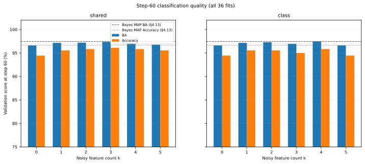
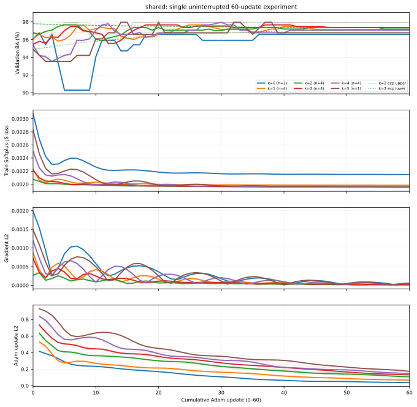
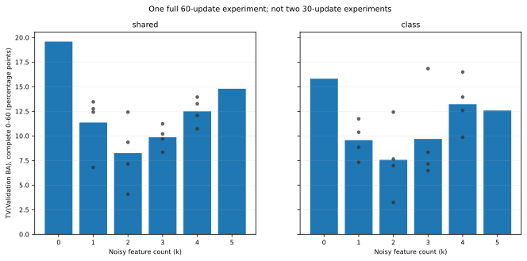
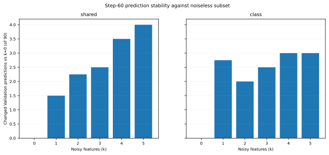

# E-CH4-14 — گزارش فنی یکپارچهٔ حساسیت به ویژگی‌های نویزی، آموزش ۶۰گامی

**بخش پایان‌نامه:** ۴.۱۴ · **پروتکل:** ۳۶ آموزش، هرکدام ۶۰ آپدیت Adam · **وضعیت:** `FULL_60_COMPUTATIONAL_AUDIT_PASS / NO_TEST`

**شواهد:** [آموزش اولیه و دادهٔ منجمد](https://github.com/mahhammad/My-Thesis/commit/7bc66e4d2535fb15dfa5b569933b2d6c5a0962ac) · [ثبت واقعی تکمیل گام ۶۰](https://github.com/mahhammad/My-Thesis/actions/runs/43881004168) · [محاسبهٔ دوبارهٔ سنجه‌های گام ۶۰ از checkpoint و بازتولید نمودارها](https://github.com/mahhammad/My-Thesis/actions/runs/43900799816).

این **یک آزمایش واحد با ۶۰ آپدیت برای هر سیاست** است. اجرای فنی در گام ۳۰ با حفظ کامل state بهینه‌ساز checkpoint شده و از همان نقطه ادامه یافته است؛ این مرزِ ذخیره‌سازی، دو آزمایش علمی ایجاد نمی‌کند. تمامی سنجه‌هایی که در ۰ تا ۶۰ واقعاً ثبت شده‌اند، روی **۶۱ وضعیت متوالی** گزارش می‌شوند. تنها سنجه‌های سیاست‌محور با تاریخچهٔ ناکامل، در پیوست انتهایی و صریحاً فقط برای **۳۰ تا ۶۰** آمده‌اند. ارقام هندسه، حاشیه، confusion و نتایج نهایی همگی از **گام ۶۰** بازحساب شده‌اند، نه گام ۳۰.

## ۱. پرسش علمی و یافته‌های اصلی

با ثابت‌گرفتن سه ویژگی اطلاع‌رسان، نمونه‌های Train/Validation، تابع هدف و بودجهٔ آموزش، آیا افزودن صفر تا پنج ویژگی نویزی روی کیفیت دسته‌بندی، نوسان مسیر یادگیری، هندسهٔ مراکز و حاشیهٔ تصمیم اثر یکنواخت دارد؟ رفتار دو خانوادهٔ `shared` و `class` چه تفاوتی دارد و آیا پایداری خروجی سخت را می‌توان از تغییرات سیاست Softmax توضیح داد؟

**پاسخ تجربی این ۳۶ آموزش ۶۰گامی:** کاهش یکنواخت BA با افزودن نویز مشاهده نشد. کمترین **مجموع نوسان BA اعتبارسنجی در تمام گام‌های ۰ تا ۶۰** برای `k=2` است: `shared=8.248` و `class=7.568` واحد درصد؛ در مقابل بدون نویز به‌ترتیب `19.584` و `15.816` است. این نتیجه توصیفی، به معنای اثر علّی یا منظم‌سازی قطعی نویز نیست. کاهش نوسان تصمیم با افزایش جدایی مراکز یا حاشیه، رابطهٔ ضروری ندارد.

`class` ظرفیت سه‌برابری `shared` دارد، اما در گام ۶۰ در ۱۸ مقایسهٔ جفت‌شده، 7 بار بهتر، 8 بار بدتر و 3 بار برابر است؛ با وجود این، جدایی مراکز `I` آن در 17 جفت بالاتر است. **جدایی بیشتر الزاماً به دقت بالاتر منجر نشده است.**

در شاخص سیاست‌محور تکمیلی، میانگین نهایی **`E₃≈0.941` انتخاب نویزی از سه انتخاب** در ۲۶ اجرای دارای `k=2..5` مشاهده شد؛ با وجود تغییر تعداد ویژگی‌های نویزی، این میانگین نزدیک یک باقی مانده است. بااین‌حال، مقادیر منفرد از `0.370` تا `1.541` پراکنده‌اند و ثابت‌ماندن یک سهمیهٔ نویز نتیجه نمی‌شود. تاریخچهٔ واقعی این سنجه فقط برای گام‌های ۳۰–۶۰ موجود است (بخش ۱۳.۴).

## ۲. دادهٔ مادر، ویژگی‌ها و زیرمجموعه‌ها

- **منبع داده:** [دادهٔ ثابت Train/Validation](../objective-start-diagnostics/inputs/phase2_train_validation/ds20261102_train_val.npz)، با seed `20261102`، و [manifest کنترل منشأ](../objective-start-diagnostics/inputs/phase2_train_validation/manifest.json).
- **نمونه‌ها:** Train شامل ۳۰۰ و Validation شامل ۹۰ نمونه، در سه کلاس با فراوانی‌های `[72,147,81]` و `[13,49,28]`؛ Test در این آزمایش استفاده نشده است.
- **سه ویژگی اطلاع‌رسان همیشگی:** اندیس‌های اصلی `[0,1,3]`. دو نویز موجود در مادر `[2,4]`؛ سه نویز جدید `[5,6,7]` با توزیع Gaussian مستقل، میانگین صفر و انحراف معیار `1.1` برای هر ستون.
- **ماسک و وزن‌ها:** بذر نویز جدید `2026111601`، بذر ماسک `2026111602`، فقدان اسمی هر نویز جدید `0.20`، `gamma=(0.6,0.6,0.6)` برای سه نویز جدید، `True=observed` در ماسک و مقادیر گم‌شده مطابق NPZ و manifest.
- **قرارداد SHA:** هش مادر `e701cf9ef99b709fd5d6faee2d3ac631737d6b0195cf76eefc23d063bccb1b4a` و هش طرح نویز `82917272b0ac3850cecfd7bf4698dce55cbe955f8e3c308cf2c44d30e7f1ab8a`. [فهرست، نگاشت‌ها و checksum تمام ۱۸ زیرمجموعه](inputs/derived/manifest.json).

| تعداد نویز k | زیرمجموعه‌های مورد استفاده (اندیس اصلی نویز) | تعداد |
|---:|---|---:|
| ۰ | `N0-01: []` | ۱ |
| ۱ | `N1-01:[2]`، `N1-02:[4]`، `N1-03:[5]`، `N1-04:[6]` | ۴ |
| ۲ | `N2-01:[2,4]`، `N2-02:[2,5]`، `N2-03:[4,6]`، `N2-04:[5,7]` | ۴ |
| ۳ | `N3-01:[2,4,5]`، `N3-02:[2,6,7]`، `N3-03:[4,5,7]`، `N3-04:[5,6,7]` | ۴ |
| ۴ | `N4-01:[2,4,5,6]`، `N4-02:[2,4,6,7]`، `N4-03:[2,5,6,7]`، `N4-04:[4,5,6,7]` | ۴ |
| ۵ | `N5-01:[2,4,5,6,7]` | ۱ |

هر یک از ۱۸ مجموعه، برای هر دو خانواده بررسی شده است؛ `18×2=36` آموزش. تمام زیرمجموعه‌ها از یک دادهٔ مادر آمده‌اند: چهار زیرمجموعهٔ میانی **چهار seed مستقل نیستند** و بازهٔ کمینه/بیشینهٔ آن‌ها، فاصلهٔ اطمینان آماری نیست. `N2-01` از نظر فایل NPZ با نمونهٔ مادر متناظر یکسان است. افزودن نویز هم‌زمان بُعد ورودی و تعداد پارامترهای سیاست را نیز عوض می‌کند.

## ۳. مدل و پروتکل محاسباتی ۶۰ گام

| مؤلفه | قرارداد ثابت و اجراشده |
|---|---|
| مدل | گراف نمونه–ویژگی، گشت دقیق ماسک‌دار، بدون برگشت به نمونهٔ مبدأ؛ استنتاج Validation خارج از گراف آموزش |
| پارامترهای گشت | `beta=0.4`، `lambda=0.8`، `H=12` |
| تعداد کلاس | `K=3` |
| تابع هدف | `softplus_JS_tau005` با `tau=0.005` |
| بهینه‌ساز | Adam با `lr=0.12` و `float64`؛ logits اولیه صفر |
| خانوادهٔ shared | یک ماتریس `(d+1)×d`، `d=3+k` |
| خانوادهٔ class | سه ماتریس کلاس‌مشروط `3×(d+1)×d` |
| بودجهٔ **هر اجرای واحد** | دقیقاً **۶۰** آپدیت؛ ۳۶ اجرا و **۲۱۶۰** آپدیت کل |
| ثبت سنجه‌های عمومی | **۶۱** حالت حقیقی `t=0..60` برای BA، Accuracy، Loss، gradient norm، logits norm و update norm (در `t=0` آپدیت Adam تعریف نشده است) |
| تداوم optimizer | حالت logits و ممان‌های Adam گام ۳۰ بارگذاری شد؛ شمارنده `31..60` بدون reset ادامه یافت |
| مرکز و ارزیابی | مراکز فقط از Train محاسبه می‌شوند؛ Validation صرفاً برای ارزیابی، بدون انتخاب پسینی checkpoint |
| ممنوع | Test، آموزش دوباره برای تحلیل، انتخاب بهترین گام اعتبارسنجی یا تغییر ورودی‌ها |

`BA` میانگین recall سه کلاس و `Accuracy` سهم صحیح کل نمونه‌هاست. `R_JS` میانگین تراکم/فاصلهٔ JS نسبت به مرکز کلاس، `I` جدایی مراکز و حاشیهٔ تصمیم اختلاف امتیاز کلاس درست از نزدیک‌ترین رقیب است. از `R` به‌تنهایی نتیجهٔ جدایی خوب، و از `I` به‌تنهایی نتیجهٔ دقت بالا به دست نمی‌آید. در تمام گزارش‌های نهایی، مرکز کلاس‌ها بر اساس بازنمایی Train در همان **checkpoint گام ۶۰** مجدداً ساخته شده است.

## ۴. ممیزی محاسباتی و سازگاری شواهد

[اسکریپت ممیزی مسیر](continuation_analysis.py) و [اسکریپت بازحساب گام ۶۰](unified_60_analysis.py) بدون `optimizer.step()` کار می‌کنند. بررسی‌ها شامل: ۳۶ مبدأ گام ۳۰ با SHA معتبر؛ تطبیق نقطهٔ مشترک گام ۳۰ با trace قدیمی؛ ۶۱ نقطهٔ پیوسته بدون duplication؛ ۳۶ checkpoint نهایی با ممان‌های `float64` و counter=60؛ ۳۱ وضعیت کامل logits گام‌های ۳۰–۶۰ با SHA256 بایت‌به‌بایت؛ مطابقت بازحساب `F3/E3/NFI3` از logits؛ و برابری BA/Accuracy گزارش `standard_metrics` با trace انتهایی است.

| دفتر بودجه | مقدار تأییدشده |
|---|---:|
| آموزش نخست | ۱۰۸۰ آپدیت، ۳۶ موفق |
| ادامهٔ همان آموزش‌ها | ۱۰۸۰ آپدیت، ۳۶ موفق |
| **مجموع نهایی** | **۲۱۶۰ آپدیت برای ۳۶ اجرای ۶۰گامی** |
| شکست ثبت‌شده در ledger ادامه | **۰** |

[اجرای معتبر آموزش ادامه](https://github.com/mahhammad/My-Thesis/actions/runs/43881004168) و [بازحساب موفق سنجه‌ها و شکل‌های گام ۶۰](https://github.com/mahhammad/My-Thesis/actions/runs/43900799816) اسناد محاسباتی هستند، نه مدرک اثبات علیت. تمام manifestها `test_accessed=false` دارند و روش بازحساب فقط `inputs/derived` شامل Train/Validation را می‌خواند. هیچ کد LaTeX و هیچ فایلی در `main` تغییر داده نشده است.

## ۵. کیفیت دسته‌بندی نهایی در **گام ۶۰**

در جدول زیر `S=shared` و `C=class` است. مقدار هر سلول میانگین توصیفی زیرمجموعه‌های همان سطح نویز است؛ **همهٔ مقادیر به checkpoint گام ۶۰ مربوط‌اند**.

| k | زیرمجموعه | Train BA: S/C (%) | Validation BA: S/C (%) | Validation Accuracy: S/C (%) |
| :---: | :---: | :---: | :---: | :---: |
| 0 | 1 | 85.42 / 84.27 | 96.60 / 96.60 | 94.44 / 94.44 |
| 1 | 4 | 85.37 / 85.19 | 97.15 / 97.15 | 95.56 / 95.56 |
| 2 | 4 | 85.37 / 84.97 | 97.19 / 97.28 | 95.83 / 95.56 |
| 3 | 4 | 85.18 / 84.99 | 97.36 / 96.94 | 96.11 / 95.00 |
| 4 | 4 | 85.46 / 84.95 | 97.07 / 97.45 | 95.83 / 95.83 |
| 5 | 1 | 85.19 / 84.79 | 96.77 / 96.60 | 95.56 / 94.44 |



**مرجع Bayes MAP طبق §۴.۱۳:** برای همین بذر و دادهٔ مادر، Train BA برابر **۸۴٫۳۱۷٪** و Validation BA برابر **۹۷٫۴۴۹٪** است. خطوط مرجع در نمودارهای دقت ثبت شده‌اند؛ [مقادیر ماشین‌خوان](tables/final_60_bayes_reference.json).

نویز موجب افت یکنواخت اعتبارسنجی نشده است. بیشترین BA میانگین در میان سطوح نویز برای `shared` در `k=3` برابر **97.36٪** و برای `class` در `k=4` برابر **97.45٪** است. بالاترین نقطه به معنی برتری آماری قطعی نیست؛ حجم Validation فقط ۹۰ نمونه و زیرمجموعه‌ها وابسته‌اند. شکاف BA اعتبارسنجی و آموزش در این داده نیز وجود دارد و به‌تنهایی نشانهٔ کیفیت تعمیم روی Test نیست.

شواهد عددی فردی در [`final_60_by_run.csv`](tables/final_60_by_run.csv)، خلاصهٔ ۱۲ گروه در [`final_60_by_noise_level.csv`](tables/final_60_by_noise_level.csv) و مقادیر کامل معیارهای کاننیکال در [`final_60_canonical_reports.json`](tables/final_60_canonical_reports.json) ثبت شده‌اند.

## ۶. **یک مسیر پیوستهٔ ۰ تا ۶۰**: پویایی، نوسان و گرادیان

مجموع نوسان BA اعتبارسنجی برای **کل آزمایش** تعریف می‌شود:

```math
TV_{0:60}(BA) = 100\sum_{t=1}^{60}\left|BA_t-BA_{t-1}\right|,\qquad
MDD_{0:60}(BA)=100\max_{0\le t\le60}\left(\max_{0\le u\le t}BA_u-BA_t\right).
```

مبنای مقایسه **یک دنبالهٔ ۶۱نقطه‌ای** است، نه دو مقدار TV برای ۳۰ گام اول/دوم. TV و بیشینهٔ افت (MDD) با **واحد درصد (pp)** در کل مسیر اندازه‌گیری می‌شوند.

| k | TV(BA) کل ۰–۶۰: S/C (pp) | بیشینهٔ افت کل ۰–۶۰: S/C (pp) |
| :---: | :---: | :---: |
| 0 | 19.584 / 15.816 | 6.476 / 4.422 |
| 1 | 11.359 / 9.566 | 2.469 / 1.786 |
| 2 | 8.248 / 7.568 | 1.786 / 1.318 |
| 3 | 9.864 / 9.694 | 2.381 / 1.786 |
| 4 | 12.500 / 13.223 | 2.083 / 1.658 |
| 5 | 14.796 / 12.585 | 1.361 / 1.361 |

**نتیجهٔ اصلی:** `k=2` در هر دو خانواده کمترین `TV_{0:60}(BA)` را دارد؛ این پدیده در **تحلیل کل ۶۰ گام** پابرجاست. برای (k=1..4) منحنی‌های تک‌زیرمجموعه و میانگین آنها جدا ثبت شده‌اند؛ کم‌نوسان‌تر بودن میانگین به‌تنهایی نمی‌تواند رفتار تمام زیرمجموعه‌ها را ثابت کند. گرادیان و Loss آموزش روی تمام مسیرها ثبت شده‌اند و Loss انتهایی در **36/۳۶** و نرم گرادیان انتهایی در **36/۳۶** اجرا نسبت به گام صفر کمتر است؛ اما این وضعیت اثبات همگرایی بهینه‌ساز یا بهبود BA نیست.

**نمودارهای اصلی مسیر ۶۰گامی:**




[نمودار Train/Validation BA خانوادهٔ shared](figures/23_train_validation_BA_60_shared.svg) · [همان برای class](figures/23_train_validation_BA_60_class.svg) · [تمام زیرمجموعه‌های منفرد shared](figures/24_all_subsets_60_shared.svg) · [تمام زیرمجموعه‌های منفرد class](figures/24_all_subsets_60_class.svg).

### ۶.۱. پوش‌های نماییِ قله و درهٔ منحنی یادگیری

برای روشن‌کردن رفتار نوسانی **Validation BA**، پوش بالایی و پایینیِ نمایی بر میانگین هر سطح نویز در **تمام ۶۱ نقطهٔ واقعی ۰ تا ۶۰** برازش می‌شوند؛ هر خانواده و هر `k` پوش مخصوص خود را دارد. این تحلیل روی BA میانگین زیرمجموعه‌هاست، نه پوش همهٔ اجراهای منفرد؛ نمودارهای منفرد در شکل ۲۴ محفوظ‌اند.

```math
L(t)=c-a_-\exp(-\rho t)\le \overline{BA}(t)\le
U(t)=c+a_+\exp(-\rho t),\qquad a_+,a_-,\rho\ge 0.
```

`c` از بازهٔ مشاهده‌شدهٔ ۱۰ گام انتهایی انتخاب می‌شود؛ برای هر `c` و نرخ `rho`، دامنه‌های بالا و پایین **کوچک‌ترین دامنه‌های پوشش‌دهندهٔ تک‌تک نقاط** هستند. سپس مساحت گسستهٔ `sum(U-L)` روی شبکهٔ ثابت پارامترها کمینه می‌شود. قله‌ها و دره‌های تماسی با خود نقاط مشخص می‌شوند، نه با رسم دلخواه خط یا حذف نقاط مزاحم. از آنجا که `rho=0` نیز مجاز است، روش **کاهش نوسان را از پیش فرض نمی‌گیرد**؛ مقدار نرخ و فاصلهٔ آغاز/پایان برای هر گروه در [پارامترهای ماشین‌خوان پوش](tables/final_60_BA_exponential_envelopes.json) ثبت می‌شود.

[پوش‌های نمایی کامل shared](figures/32_full_60_BA_exponential_envelopes_shared.svg) · [پوش‌های نمایی کامل class](figures/32_full_60_BA_exponential_envelopes_class.svg).

**حاصل برازش روی هر ۱۲ گروه:** در تمام گروه‌ها پوش‌ها **۶۱/۶۱ نقطهٔ مشاهده‌شده** را پوشش می‌دهند، نرخ نماییِ بهینهٔ شبکه‌ای **مثبت** و بین `0.0270` و `0.0855` به‌ازای هر آپدیت است. نسبت فاصلهٔ دو پوش در گام ۶۰ به گام صفر بین **۰٫۶٪ و ۱۹٫۸٪** محاسبه شده است؛ یعنی پوشِ برازش‌شده در پایان باریک‌تر است. برای نمونه در `shared,k=2`، فاصلهٔ پوش از `2.916` به `0.169` واحد درصد و در `class,k=2` از `1.371` به `0.255` واحد درصد رسیده است. علامت‌های مثلثی در نمودار، نقاط تماس واقعی بالا و پایین را مشخص می‌کنند. این نتایج **خصوصیات پوشِ پسینی‌اند** و روند دقیق دامنهٔ نوسان خام را به‌طور یکنواخت اثبات نمی‌کنند.

کوچک‌شدن فاصلهٔ این دو پوش، صرفاً **فشرده‌شدن پوشِ برازش‌شده در بازهٔ مشاهده‌شده** را توصیف می‌کند؛ به معنی برهان همگرایی، کران نظری مدل یا تضمین ادامهٔ کاهش بعد از گام ۶۰ نیست. همچنین کم‌شدن نوسانِ BA به‌خودی‌خود ثابت نمی‌کند Loss یا نُرم گرادیان با همان نرخ کاهش یافته‌اند.

### ۶.۲. تحلیل تجربی قله‌ها، دره‌ها و نرخ میرایی Gradient L2

برای تحلیل نوسان گرادیان در **کل مسیر ۰ تا ۶۰**، در هر گروه تعداد نویز و خانوادهٔ سیاست، میانگین مسیرهای واقعی محاسبه شد. قله‌ها و دره‌های موضعیِ این میانگین شناسایی و **پوش‌های تجربی بالا و پایین** با اتصال خطی نقاط تماس و افزودن نقاط لازم برای پوشش همهٔ مشاهدات ساخته شدند؛ هیچ تابع نمایی یا الزام کاهش عرض به پوش تحمیل نشده است. مسیرهای هر زیرمجموعه جدا و کم‌رنگ دیده می‌شوند، اما پوش مشخصاً متعلق به **میانگین گروه** است.


هر ردیف به‌ترتیب برای $|A_N|=0,\ldots,5$ و ستون‌ها برای shared و class است. محور افقی ۶۰ گام Adam را نشان می‌دهد. علاوه بر خود منحنی، نقاط قله/دره، پوش بالا/پایین و ناحیهٔ میان آن‌ها دیده می‌شوند. نمودارهای قبلی برای مقایسه حفظ شده‌اند.

برای سنجش میراییِ خود پوش، عرض $W(t)=U(t)-L(t)$ و نسبت **میانگین عرض گام‌های ۴۵ تا ۵۵** به **میانگین عرض گام‌های ۵ تا ۱۵** محاسبه شد. این انتخاب، بازه‌های داخلیِ پوش را با هم مقایسه می‌کند و نیازمند فرض نمایی‌بودن یا کاهش یکنواخت در هر گام نیست.

| $\lvert A_N\rvert$ | shared: نسبت دامنهٔ انتهایی به ابتدایی | class: نسبت دامنهٔ انتهایی به ابتدایی |
|:---:|---:|---:|
| 0 | 0.117 | 0.133 |
| 1 | 0.033 | 0.044 |
| 2 | 0.057 | 0.135 |
| 3 | 0.081 | 0.041 |
| 4 | 0.117 | 0.053 |
| 5 | 0.154 | 0.056 |

نسبت در **تمام ۱۲ گروه کمتر از یک** و بین **۰٫۰۳۳ و ۰٫۱۵۴** است. در نتیجه، عرض پوش در بخش انتهایی کمتر از ابتدای مسیر است؛ ولی کاهش یکنواختِ گام‌به‌گام ادعا نمی‌شود.

برای سنجش **نرخ میرایی نوسان**، در هر یک از **۳۶ مسیر منفرد** دامنهٔ قله نسبت به میانگین دو درهٔ مجاور اندازه‌گیری شد. بر لگاریتم دامنه‌های مشاهده‌شده دو مدل اکتشافی برازش شدند: نمایی $A(t)\propto e^{-\rho t}$ و توانی $A(t)\propto(1+t)^{-\alpha}$. در هر ۳۶ مسیر نرخ نمایی تخمینی مثبت و در بازهٔ تقریبی **۰٫۰۳۹۶ تا ۰٫۰۸۷۳ به‌ازای هر گام** بود (نیمه‌عمر متناظر حدود **۸ تا ۱۸ گام**). برحسب خطای مربعی لگاریتم دامنه، مدل نمایی در **۲۹ مسیر** و مدل توانی در **۷ مسیر** بهتر توصیف کرده است. این نتایج **توصیفی** هستند، نه اثبات قانون میرایی نمایی یا همگرایی ریاضی Adam.

[نمودار عرض پوش‌های تجربی](figures/35_gradient_L2_envelope_width.svg) · [نرخ و برازش تک‌تک ۳۶ مسیر](tables/gradient_peak_decay_by_run_60.csv) · [قله‌ها و دامنه‌ها](tables/gradient_peak_amplitudes_60.csv) · [۱۲ پوش و نقاط تماس](tables/gradient_empirical_envelopes_60.json).



کاهش Loss و گرادیان تضمین نمی‌کند هر گام BA افزایش یابد؛ تصمیم سخت می‌تواند با تغییرات پیوستهٔ احتمال بدون تغییر بماند، یا در نزدیکی مرز به‌طور ناپیوسته تغییر کند. هیچ checkpoint با انتخاب پسینیِ بهترین BA انتخاب نشده است.

## ۷. هندسهٔ مراکز، تراکم و حاشیهٔ **گام ۶۰**

همهٔ سنجه‌های این بخش مستقیماً از logits **گام ۶۰**، بازنمایی نمونه‌ها و مراکز Train دوباره محاسبه شده‌اند؛ نه از جدول پیشین گام ۳۰. برای خوانایی سه کمیت `I`، `R_JS` و میانهٔ حاشیهٔ Validation ضرب‌در ۱۰۰۰ شده‌اند.

| k | Train I×1000: S/C | Validation R_JS×1000: S/C | میانهٔ حاشیه Validation×1000: S/C |
| :---: | :---: | :---: | :---: |
| 0 | 25.157 / 24.637 | 3.903 / 3.874 | 19.522 / 18.111 |
| 1 | 18.604 / 19.162 | 2.507 / 2.605 | 13.164 / 13.187 |
| 2 | 18.414 / 19.204 | 2.264 / 2.390 | 12.762 / 12.609 |
| 3 | 18.147 / 19.163 | 2.172 / 2.320 | 12.397 / 12.375 |
| 4 | 17.607 / 19.381 | 2.188 / 2.308 | 12.422 / 12.307 |
| 5 | 18.172 / 18.640 | 2.168 / 2.170 | 13.221 / 11.830 |


این اعداد نشان می‌دهند ثبات BA به معنای ثبات هندسه نیست. `I` جدایی مراکز است؛ `R_JS` میانگین فاصلهٔ JS نسبت به مرکز درست؛ و حاشیه فاصلهٔ امتیاز کلاس درست از نزدیک‌ترین رقیب. شاخص‌های `T، BT، TNL، BTNL`، فاصلهٔ جفت‌مراکز، `R_sqrt_JS`، `R_KL` و سنجه‌های surrogate در [گزارش‌های کاننیکال گام ۶۰](tables/final_60_canonical_reports.json) قابل بازبینی‌اند. کوچک‌شدن `R_JS` نباید با بهبود هم‌زمان جدایی یا تعمیم یکسان تلقی شود.

## ۸. مقایسهٔ جفت‌شدهٔ سیاست‌های shared و class در گام ۶۰

در هر یک از ۱۸ جفت، subset، Train، Validation و سایر تنظیمات ثابت است و تنها خانوادهٔ سیاست عوض می‌شود. اختلاف‌ها `class − shared` هستند. در گام ۶۰، از ۱۸ جفت، **7 جفت به سود class، 8 جفت به سود shared و 3 جفت برابر** است؛ میانگین اختلاف BA جفت‌ها حدود **-0.0000 واحد درصد** است. `I` برای class در **17/۱۸** جفت بزرگ‌تر است، اما برتری BA متناسب و همیشگی مشاهده نمی‌شود.


مقادیر کامل ۱۸ جفت و همهٔ اختلاف‌های BA، Accuracy، `I` و `R_JS` در [جدول جفتی گام ۶۰](tables/final_60_paired.csv) محفوظ‌اند. این جفت‌ها از داده‌های مشترک استخراج شده‌اند و **نمونهٔ مستقل برای آزمون معناداری** نیستند.

## ۹. تغییر پیش‌بینی‌ها و رفتار سه کلاس در گام ۶۰

برای هر subset، پیش‌بینی هر نمونهٔ Validation با خروجی سیاست همان خانواده روی `N0-01` در **گام ۶۰** مقایسه شد. جدول زیر تعداد میانگین پیش‌بینی‌های تغییرکرده در برابر حالت بدون نویز و Recall سه کلاس را نشان می‌دهد.

| k | پیش‌بینی تغییرکرده از ۹۰ نمونه: S/C | Recall کلاس ۰: S/C (%) | Recall کلاس ۱: S/C (%) | Recall کلاس ۲: S/C (%) |
| :---: | :---: | :---: | :---: | :---: |
| 0 | 0.00 / 0.00 | 100.00 / 100.00 | 89.80 / 89.80 | 100.00 / 100.00 |
| 1 | 1.50 / 2.75 | 100.00 / 100.00 | 92.35 / 92.35 | 99.11 / 99.11 |
| 2 | 2.25 / 2.00 | 100.00 / 100.00 | 93.37 / 91.84 | 98.21 / 100.00 |
| 3 | 2.50 / 2.50 | 100.00 / 100.00 | 93.88 / 90.82 | 98.21 / 100.00 |
| 4 | 3.50 / 3.00 | 100.00 / 100.00 | 93.88 / 92.35 | 97.32 / 100.00 |
| 5 | 4.00 / 3.00 | 100.00 / 100.00 | 93.88 / 89.80 | 96.43 / 100.00 |




در این Validation، Recall کلاس صفر برای همهٔ ترکیب‌های حاضر ۱۰۰٪ است؛ عمدهٔ خطاها در کلاس یک با ۴۹ نمونه قرار دارند. تغییر پیش‌بینی نسبت به حالت بدون نویز الزاماً به معنای تغییر درستی/نادرستی پیش‌بینی نیست. ماتریس‌های confusion و رکوردهای `per_sample` در [گزارش کاننیکال](tables/final_60_canonical_reports.json) آمده‌اند؛ نه نمونهٔ Test و نه میان‌یابی پیش‌بینی‌های ذخیره‌نشده استفاده نشده است.

## ۱۰. هزینهٔ محاسباتی و مقیاس مدل

با `d=3+k`، تعداد پارامترهای قابل‌آموزش `shared=d(d+1)` و `class=3d(d+1)` است. زمان‌های زیر **جمع زمان محاسبات ثبت‌شدهٔ هر اجرا در دو قطعهٔ ذخیره‌سازی، برای یک مسیر ۶۰گامی** هستند؛ شامل همهٔ overhead کل Workflow نیستند و مدل هزینهٔ عمومی سخت‌افزار هم نیستند.

| k | پارامتر S/C | زمان محاسبهٔ یک مسیر ۶۰گامی: S/C (ثانیه) |
| :---: | :---: | :---: |
| 0 | 12 / 36 | 27.90 / 80.26 |
| 1 | 20 / 60 | 35.27 / 105.16 |
| 2 | 30 / 90 | 48.07 / 146.19 |
| 3 | 42 / 126 | 61.26 / 189.65 |
| 4 | 56 / 168 | 76.34 / 259.95 |
| 5 | 72 / 216 | 95.68 / 326.82 |


مجموع زمان محاسبات ثبت‌شده در ۳۶ اجرا حدود **4218.2 ثانیه** است؛ زمان واقعی GitHub Actions علاوه بر آن نصب بسته‌ها، ممیزی و ثبت خروجی را دربرمی‌گیرد. RSS قبلی فقط اندازه‌گیری مقطعی بوده و معادل بیشینهٔ حافظه نیست. خانوادهٔ `class` با پارامترهای بیشتر، افزایش هزینهٔ محاسباتی آشکاری دارد.

## ۱۱. ساختار فایل‌ها، ورودی و خروجی و بازتولید

| فایل/پوشه | قرارداد و کاربرد |
|---|---|
| `inputs/noise_raw/`، `inputs/noise_masks/` | نویز جدید و ماسک‌ها، seed و SHA مرتبط |
| `inputs/derived/N*.npz` و `manifest.json` | ۱۸ دادهٔ Train/Validation، mapping، checksum، gamma؛ بدون Test |
| `results/traces/<run_id>/trace.json` | ۳۱ وضعیت اولیهٔ گام‌های ۰ تا ۳۰؛ **شواهد اصلی بدون دستکاری** |
| `results/checkpoints/<run_id>/step_30.pt` | checkpoint میانیِ همان مسیر ۶۰گامی، همراه وضعیت کامل Adam |
| `results/continuation_30_60/<run_id>/trace_30_60.jsonl` | ۳۱ وضعیت گام‌های ۳۰ تا ۶۰؛ رکورد مشترک گام ۳۰ تطبیق داده شده است |
| `results/continuation_30_60/<run_id>/logits_30_60.jsonl` و `logits_steps30_60.npz` | logits `float64` در هر گام ۳۰ تا ۶۰، با SHA مستقل و export امن |
| `results/continuation_30_60/<run_id>/step_60.pt`، `manifest.json` | **checkpoint نهایی**، Adam step=60، provenance، checksum |
| `results/continuation_30_60/resume_budget.jsonl` | دفتر یک‌بارمصرف ۱۰۸۰ آپدیت تکمیلی و ۳۶ SUCCESS |
| [`continuation_analysis.py`](continuation_analysis.py) | کنترل بی‌طرف از آموزش: شمارش رویدادها، اصالت ۳۶ checkpoint، تطبیق مرز و logits، بازحساب شاخص‌های سیاست |
| [`unified_60_analysis.py`](unified_60_analysis.py) | **کد اصلی گزارش**؛ اتصال واقعی دو فایل trace، محاسبهٔ مراکز و سنجه‌های کاننیکال گام ۶۰، تولید جدول‌های فردی، گروهی، جفتی و نمودارهای اصلی یکپارچه |
| `tables/final_60_by_run.csv`، `final_60_by_noise_level.csv`، `final_60_paired.csv` | ۳۶ اجرای فردی، ۱۲ گروه، ۱۸ اختلاف جفتی در **گام ۶۰ و کل مسیر ۰–۶۰** |
| `tables/final_60_summary.json`، `final_60_canonical_reports.json` | خلاصهٔ ماشین‌خوان مسیر کامل و گزارش‌های مفصل معیارهای نهایی |
| شکل‌های ۲۲ تا ۳۲ | نمودارهای اصلی ۶۰گامی BA/Loss/Gradient/Adam و هندسه، اکنون با Bayes MAP در نمودارهای دقت |
| شکل‌های ۳۴ تا ۳۶ | پوش تجربی Gradient L2، نمودار عرض پوش، و چیدمان تازهٔ ۶ سطر × ۲ ستون با $\lvert A_N\rvert=0,\ldots,5$ |
| gradient_peak_decay_by_run_60.csv و gradient_peak_amplitudes_60.csv | دامنهٔ قله‌های ۳۶ مسیر و مقایسهٔ نرخ‌های نمایی و توانی |
| gradient_empirical_envelopes_60.json و final_60_bayes_reference.json | خلاصهٔ ۱۲ پوش و مرجع بیزی همان بذر مطابق §۴.۱۳ |
| `figures/16_*.svg` تا `18_*.svg`، `20_*.svg` و `21_*.svg` | نمودارهای **پیوست سیاست** که فقط از گام ۳۰ تا ۶۰ دادهٔ واقعی دارند |

**دستور بازتولید صرفاً خواندنی، بدون آموزش و بدون Test:**

```bash
python -m pip install numpy==2.4.6 matplotlib==3.10.7
python -m pip install torch==2.9.1 --index-url https://download.pytorch.org/whl/cpu
python code/experiments/synthetic-noise-feature-sensitivity/bayes_reference_e14.py
python code/experiments/synthetic-noise-feature-sensitivity/gradient_empirical.py
python code/experiments/synthetic-noise-feature-sensitivity/continuation_analysis.py --mode check
python code/experiments/synthetic-noise-feature-sensitivity/unified_60_analysis.py --mode check
```

حالت `--mode write` برای اسکریپت‌ها **فقط** جدول و SVG تحلیلی را می‌نویسد و checkpoint، logits، داده‌های مشتق و بودجه را تغییر نمی‌دهد. حالت `check` همهٔ خروجی‌های مشتق را دوباره محاسبه و **بایت‌به‌بایت** مقایسه می‌کند. وابستگی‌های نسخه‌بندی‌شده و اجرای CPU در Workflow، شرایط بازتولید را ثابت می‌کنند. کد اولیهٔ مدل و تولید داده در `runner.py`، `data.py`، `e14_metrics.py`، `analysis.py` و اسکریپت‌های مربوط موجود است. نمودارهای ۳۰گامی پیشین برای ممیزی تاریخی در Git باقی مانده‌اند، **اما نمودارهای اصلی و نتیجه‌گیری این گزارش بر اساس آزمایش کامل ۶۰گامی است**.

## ۱۲. محدودیت‌ها و نتیجه‌گیری علمی

این تحلیل یک تحقق دادهٔ مادر با seed معین، ۱۸ زیرمجموعهٔ وابسته و دو خانوادهٔ سیاست را بررسی می‌کند. نتایج به‌صورت توصیفی قابل دفاع‌اند؛ `n=4` در سطوح میانی، تعداد seed مستقل نیست و هیچ `p-value` یا فاصلهٔ اطمینان استنباطی از آن به دست نمی‌آید. افزایش تعداد ویژگی نویزی با افزایش بُعد و ظرفیت پارامتری هم‌زمان است؛ اثر خالص نویز از اثر ظرفیت به‌طور علّی تفکیک نشده. بهبود یا ثبات BA روی این Validation، تضمین عملکرد روی Test یا دادهٔ جدید نیست. بودجهٔ ۶۰ گام، **آزمون تجربی مسیر است، نه برهان همگرایی**.

**نتیجهٔ واحد برای §۴.۱۴:** مدل در این آزمایش ۶۰گامی از دید BA در برابر ویژگی نویزی دچار افت یکنواخت نشده و در هر دو خانواده، `k=2` کمترین نوسان کل مسیر را داشته است. هندسهٔ مراکز، حاشیه‌ها، شمار پیش‌بینی‌های جابه‌جاشده و هزینهٔ محاسباتی به‌گونه‌ای متفاوت تغییر می‌کنند. `class` با وجود جدایی بیشتر مراکز در اغلب جفت‌ها، برتری یکنواخت دسته‌بندی نشان نمی‌دهد. سازوکارِ فرضی «بافر احتمال Softmax» **نه از این نتایج اثبات می‌شود و نه به‌طور علّی از افزایش بعد جدا شده است**.

---

## ۱۳. پیوست تکمیلی: شاخص‌های سیاست که فقط از **گام ۳۰ تا ۶۰** ثبت شده‌اند

**این پیوست یک آزمایش مستقل نیست.** شاخص‌های `F₃`، `E₃`، `NFI₃`، احتمال‌های `q₁/q₂/q₃`، بازانتخاب نویز و ماتریس کامل logits فقط برای ۳۱ وضعیت **گام‌های ۳۰ تا ۶۰** ثبت شده‌اند. نباید برای گام‌های ۱ تا ۲۹ از روی traceهای قدیمی آنها را جعل، تخمین یا میان‌یابی کرد. مقدار Uniform نظری در logits صفر معلوم است، ولی به معنی داشتن مسیر واقعی گام‌های ۱ تا ۲۹ نیست.

### ۱۳.۱. تعریف سه انتخاب ویژگی و تفاوت با گشت واقعی

با `d=3+k`، `p₀` توزیع انتخاب اولیه و `P` ماتریس انتقال Softmax **بدون ماسک** و `J` اندیس‌های سه ویژگی اطلاع‌رسان است:

```math
F_3=1-p_0[J]P[J,J]^2\mathbf{1},\qquad
q_t=p_0 P^{t-1}\mathbf{1}_{N}\ (t=1,2,3),\qquad
E_3=q_1+q_2+q_3,\qquad
NFI_3=\frac{F_3}{1-(3/(3+k))^3}.
```

`F₃` احتمال **حداقل یک** انتخاب نویزی، `E₃` شمار مورد انتظار انتخاب نویز از سه انتخاب و `NFI₃` نسبت به سیاست Uniform است. برای `k=0`، `F₃=E₃=0` و `NFI₃` **تعریف‌نشده** است؛ این نسبت با صفر جایگزین نمی‌شود. `F₃` و `E₃` دو معیار متفاوت‌اند؛ کاهش نسبی NFI در kهای متفاوت نیز لزوماً به معنی کاهش احتمال خام برخورد نویز نیست. هیچ‌یک از این‌ها **احتمال بازدید واقعی نویز در گشت کامل ماسک‌دار** نیستند.

### ۱۳.۲. نتیجهٔ مشاهده‌شدهٔ افزودهٔ سیاست در ۳۰–۶۰

در جدول زیر هر مقدار یک زوج آغاز/پایان سنجهٔ تکمیلی است، نه دو آزمایش. برای `class` میانگین کلان برابر‌وزنِ سه سیاست کلاس‌مشروط گزارش می‌شود.

| خانواده | k | F₃: گام ۳۰→۶۰ | E₃: گام ۳۰→۶۰ | NFI₃: گام ۳۰→۶۰ |
| :---: | :---: | :---: | :---: | :---: |
| shared | 0 | 0.000 → 0.000 | 0.000 → 0.000 | تعریف‌نشده |
| shared | 1 | 0.601 → 0.641 | 0.653 → 0.690 | 1.040 → 1.109 |
| shared | 2 | 0.671 → 0.542 | 1.088 → 0.990 | 0.856 → 0.692 |
| shared | 3 | 0.615 → 0.399 | 1.099 → 0.849 | 0.703 → 0.456 |
| shared | 4 | 0.667 → 0.605 | 1.191 → 1.033 | 0.724 → 0.657 |
| shared | 5 | 0.639 → 0.630 | 1.146 → 1.153 | 0.675 → 0.665 |
| class | 0 | 0.000 → 0.000 | 0.000 → 0.000 | تعریف‌نشده |
| class | 1 | 0.569 → 0.537 | 0.795 → 0.755 | 0.983 → 0.928 |
| class | 2 | 0.583 → 0.551 | 0.887 → 0.862 | 0.743 → 0.702 |
| class | 3 | 0.586 → 0.474 | 1.005 → 0.883 | 0.669 → 0.542 |
| class | 4 | 0.575 → 0.490 | 1.043 → 0.949 | 0.624 → 0.532 |
| class | 5 | 0.583 → 0.519 | 1.068 → 1.036 | 0.616 → 0.548 |

در 28 مورد از ۳۴ اجرای دارای نویز، `F₃` کاهش و در 6 مورد افزایش داشته است. به‌ویژه در `shared,k=1`، میانگین F₃ افزایش داشته؛ پس فرض «همهٔ سیاست‌ها در طول آموزش همیشه از نویز دور می‌شوند» با داده سازگار نیست. `F₃` و `E₃` می‌توانند جهت مخالف داشته باشند، چون احتمال حداقل یک برخورد و تعداد مورد انتظار برخورد، یک کمیت واحد نیستند.

**نمودارهای این پیوست فقط بازهٔ واقعی ۳۰–۶۰ را نشان می‌دهند:**

[روند F₃/E₃/NFI₃ خانوادهٔ shared](figures/16_F3_E3_NFI3_30_60_shared.svg) · [همان برای class](figures/16_F3_E3_NFI3_30_60_class.svg)

[احتمال نویز در انتخاب‌های اول، دوم و سوم برای shared](figures/17_q1_q2_q3_30_60_shared.svg) · [برای class](figures/17_q1_q2_q3_30_60_class.svg)

[تکرار انتخاب نویز پس از انتخاب نویزی اول برای shared](figures/18_noise_repeat_30_60_shared.svg) · [برای class](figures/18_noise_repeat_30_60_class.svg)

[سه سیاست کلاس‌مشروط: F₃](figures/20_class_conditional_F3.svg) · [سه سیاست کلاس‌مشروط: NFI₃](figures/21_class_conditional_NFI3.svg)

### ۱۳.۳. سه سیاست کلاس‌مشروط و فرضیهٔ Softmax

`class` سه سیاست جدا دارد. میانگین `macro` **رفتار همگن سه کلاس را ثابت نمی‌کند**؛ تغییر احتمال انتخاب نویز پس از انتخاب اول نیز می‌تواند با تغییر `q₂/q₃` متفاوت باشد. در کنار احتمال ورود اولیه `p₀(N)`، `P(N→N | first=N)` نیز از logits ذخیره‌شده محاسبه شده است. برای نمونه `N3-02__class`، `F₃` از `0.575` به `0.405` و `NFI₃` از `0.657` به `0.463` رسید؛ این تغییرات با تغییر Validation BA همراه بوده‌اند، ولی **اثر علّی آنها اثبات نشده است**.

مقایسهٔ logits کامل، احتمال اولیه و گذارهای ویژگی نشان می‌دهد جرم Softmax می‌تواند میان ویژگی‌های اطلاع‌رسان و نویزی بازتوزیع شود؛ اما در غیاب آزمایش کنترل‌شدهٔ ظرفیت یکسان، نمی‌توان «جذب نوسان توسط نویز» یا regularization را به‌عنوان مکانیسم قطعی معرفی کرد. از طرفی F₃/NFI₃ نسبت به Uniform برای `k≥2` غالباً زیر یک است، ولی این نسبت لزوماً با نوسان BA در تمام kها رابطهٔ یکنواخت ندارد.

### ۱۳.۴. تمرکز میانگین E₃ در نزدیکی یک انتخاب نویزی

مشاهدهٔ جالب در خروجی نهایی این است که **میانگین E₃ برای گروه‌های دارای ۲ تا ۵ ویژگی نویزی، نزدیک یک انتخاب نویزی از مجموع سه انتخاب** قرار گرفته است. میانگین وزن‌دار بر حسب تعداد زیرمجموعه‌ها در ۲۶ اجرای `shared` و `class` با `k≥2` برابر **۰٫۹۴۱** در گام ۶۰ است. منظور از مقدار `class`، میانگین برابر‌وزن سه سیاست کلاس‌مشروط در هر اجرای آن است.

این تمرکز یک **روند توصیفی تجمیعی** است، نه قانون ثابت برای هر سیاست: مقادیر منفرد همین ۲۶ اجرا بین **۰٫۳۷۰ تا ۱٫۵۴۱** قرار دارند. همچنین `k=0` بنا بر تعریف `E₃=0` دارد و `k=1` رفتار دیگری نشان می‌دهد. در مقابل، مرجع Uniform برابر `E₃^{U}=3k/(3+k)` است که با افزایش `k` از ۲ تا ۵ به‌ترتیب از **۱٫۲۰۰ به ۱٫۸۷۵** رشد می‌کند؛ در نتیجه نزدیکی میانگین آموخته‌شده به یک، صرفاً پیامد نسبت ویژگی‌های نویزی در سیاست Uniform نیست. با این داده نمی‌توان ادعا کرد سیاست عمداً یک «سهمیهٔ یک‌تایی» برای نویز برقرار می‌کند یا این رفتار علت بهبود BA است.

**منبع دقیق این پیوست:** [۳۶ ژورنال logits و trace](results/continuation_30_60/)، [مجموعهٔ کامل شاخص‌های ۳۰–۶۰](tables/continuation_30_60_summary.json) و [ممیزی محاسبهٔ مستقل از بایت‌های logits](continuation_analysis.py). هیچ شاخصی برای زمان‌های ثبت‌نشده جایگذاری نشده است.
